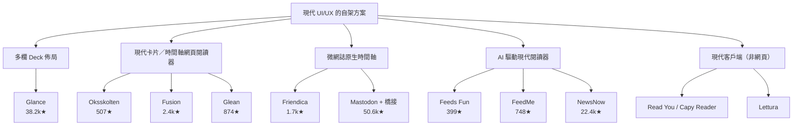
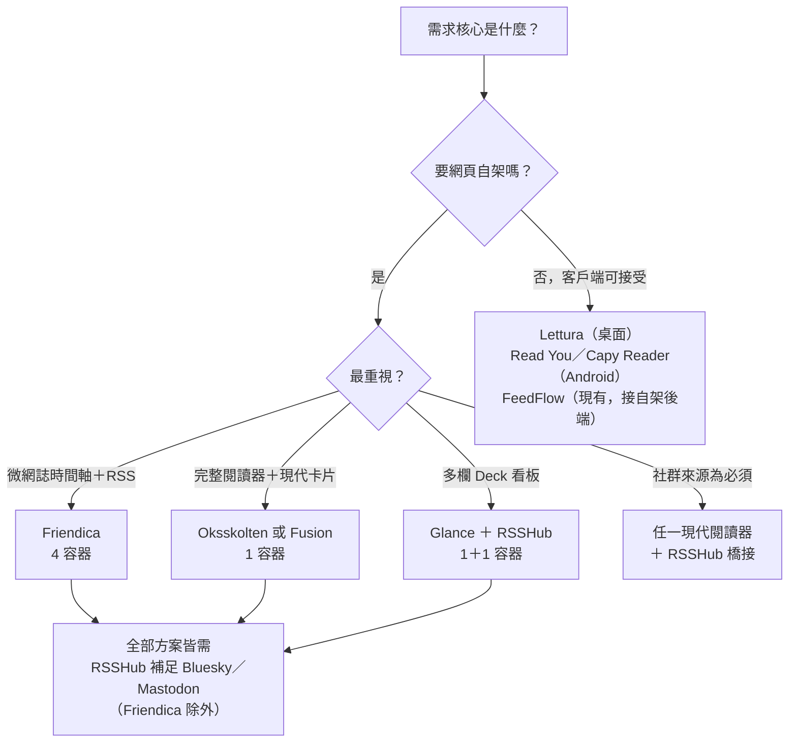

# 現代 UI/UX 導向的自架 RSS 閱讀器調查

本報告調查可取代三套既有專案的自由開源軟體（FOSS）方案，並以「**現代 UI/UX**」為主要篩選標準。凡介面仍停留在傳統三欄式（資料夾樹＋文章列表＋閱讀窗格）的舊式 RSS 閱讀器，一律不列入推薦。

---

## 摘要

**核心結論：目前不存在同時滿足「網頁為基礎、現代微網誌式介面、原生混合 RSS 與社群來源、且部署簡單」的單一自架專案。** 這是 2026 年開源生態的一個明確缺口：具備真正現代介面的專案（如 Folo）幾乎都是雲端服務而非自架；能自架的專案則多為傳統介面。

因此實務答案是一組**搭配**：

| 需求 | 建議 | 部署規模 |
|---|---|---|
| 現代多欄 Deck 佈局 | **Glance** | 1 容器 |
| 現代卡片／時間軸式自架閱讀器 | **Oksskolten** 或 **Fusion** | 1 容器 |
| 微網誌時間軸原生吃 RSS | **Friendica** | 4 容器 |
| 任意社群來源轉 RSS | **RSSHub** ＋ 任一閱讀器 | 1 容器 |
| 現代介面的行動／桌面客戶端 | **Read You**、**Capy Reader**、**Lettura** | 不適用（客戶端） |

**必須指名的陷阱：Folo（39.3k 星）雖然是當今最現代、最受歡迎的開源閱讀器，但無法自架**，它需要 `api.folo.is` 的雲端帳號才能運作[^folo]。同樣地，**Feedbin（3.8k 星）介面現代，但作者明文不建議自架**[^feedbin]。

---

## 1. 問題定義與判準

### 1.1 三套被取代的專案

**FeedDeck** 是一套受 TweetDeck 啟發的多欄（deck）式閱讀器，同時彙整 RSS 與社群來源，以 Flutter 撰寫、後端為 Supabase，採 MIT 授權、約 318 星[^target-feeddeck]。其架構非以網頁為基礎。最新版本為 v1.4.1[^target-feeddeck]。

**NewsBlur** 是一套自架新聞閱讀器，Django 後端搭配 Backbone.js 前端，MIT 授權、約 7,700 星[^target-newsblur]。其 `docker-compose` 需 11 個以上容器（4 種資料儲存：PostgreSQL、MongoDB、Redis、Elasticsearch），部署過於複雜[^target-newsblur]。

**FeedFlow** 是一套以 Kotlin Multiplatform 撰寫的極簡閱讀器，Apache 2.0 授權、約 1,300 星，最新版本 v1.21.0（2026-11-10）[^target-feedflow]。它完全沒有網頁版，本身也不含伺服器，而是連向本地檔案或 FreshRSS／Miniflux 等外部後端[^target-feedflow]。

### 1.2 「現代 UI/UX」的判準

本報告以下列可驗證的技術特徵判斷介面是否現代，而非主觀感受：

| 判準 | 說明 |
|---|---|
| **前端框架世代** | 使用 React 18/19、Vue 3、Svelte 5 等現代框架，而非 jQuery、Backbone.js、AngularJS |
| **樣式與元件系統** | 使用 Tailwind CSS 與 shadcn/ui 等現代設計系統，而非 Bootstrap 3 世代或自製 CSS |
| **版面型態** | 卡片流、時間軸（timeline）、多欄 Deck，而非三欄資料夾樹 |
| **動態與主題** | 深色模式、動畫、PWA 可安裝性、響應式 |
| **微網誌特徵** | 頭像、貼文卡片、按讚／轉推、無限捲動、統一时间軸 |

### 1.3 為何排除舊式閱讀器

以下專案雖然功能完備且維護活躍，但因介面仍為傳統三欄式而**不列入推薦**：

- **FreshRSS**（16.6k 星，AGPL-3.0）：最主流但為經典三欄佈局[^legacy-freshrss]
- **Miniflux**（9.9k 星，Apache-2.0）：極簡清單，非卡片／時間軸[^legacy-miniflux]
- **Tiny Tiny RSS**（社群分支 884 星）：原專案已於 2025-11-01 退休，介面陳舊[^legacy-ttrss]
- **selfoss**（2.5k 星）、**Stringer**（4.1k 星）、**CommaFeed**（3.6k 星）、**Nextcloud News**（1.0k 星）、**yarr**（4.1k 星）：皆為傳統列表式介面

這些專案在功能上仍是優秀的後端，但無法滿足「現代 UI/UX」這項要求。本報告第 4 節和第 5 節聚焦於真正符合標準的候選。

---

## 2. 候選方案總覽

---

## 3. 多欄 Deck 佈局（最接近 FeedDeck）

### 3.1 Glance

Glance 是一套自架儀表板，將所有訂閱來源彙整於單一可自訂介面[^glance]。採 AGPL-3.0 授權、約 38,200 星，最新版本 v0.8.8（2026-11-07）[^glance]。以 Go 撰寫，可編譯為單一執行檔或使用 Docker 映像，相依極少[^glance]。

**為何符合標準**：其設定檔採用 **columns 為基礎的佈局**，每個頁面可有多個欄位，尺寸可設為 `small` 或 `full`[^glance]。這正是 FeedDeck 的多欄體驗在自架生態中最接近的對應。內建與 Feed 相關的 widget 包含 `rss`、`reddit`、`hacker-news`、`lobsters`、`videos`（YouTube）、`twitch-channels`、`releases`（GitHub）[^glance]。

**微網誌特徵**：具備卡片流版面與縮圖，視覺上接近社群平台的動態牆。

**限制**：Glance 是**儀表板而非完整閱讀器**——它以 widget 呈現摘要，沒有已讀／未讀狀態管理，也沒有訂閱管理與搜尋[^freddy]。若需要完整的閱讀狀態追蹤，仍須搭配一個後端。

### 3.2 多欄佈局的現實限制

需要指出的是：在自架生態中，**同時具備多欄佈局、完整已讀狀態、以及原生社群來源的專案並不存在**。這點在多方獨立調查中得到一致結論[^freddy][^karen]。實務做法是「Glance 負責多欄呈現，RSSHub 負責來源擴充」，但兩者之間沒有已讀狀態同步。

---

## 4. 現代卡片／時間軸型自架網頁閱讀器

這一類是本報告的重點：它們是**完整的自架閱讀器**（具備訂閱管理、已讀狀態、搜尋），但介面已完全現代化。

### 4.1 Oksskolten — 現代自架閱讀器的首選

Oksskolten 自稱「AI 原生的 RSS 閱讀器」，核心差異化在於對每篇文章自動進行全文擷取，並轉換為乾淨的 Markdown[^oksskolten]。採 AGPL-3.0 授權、約 507 星，最新版本 v0.5.0（2026-06-08）[^oksskolten]。

| 項目 | 內容 |
|---|---|
| **前端** | React 19 ＋ Vite ＋ Tailwind CSS ＋ **shadcn/ui**[^oksskolten] |
| **後端** | Node.js 22 ＋ Fastify；TypeScript 全端[^oksskolten] |
| **資料庫** | SQLite（libsql，WAL 模式）＋ Meilisearch 全文檢索[^oksskolten] |
| **部署** | **單一容器**（API、SPA、cron 同容器）；另有選用的 RSS Bridge、FlareSolverr、cloudflared 側車容器[^oksskolten] |
| **介面** | 卡片式收件匣清單 ＋ 全文閱讀檢視 ＋ AI 對話面板；**14 種內建主題**、9 種文章字型、8 種程式碼高亮樣式[^oksskolten] |
| **PWA** | 完整支援（離線閱讀、背景同步）[^oksskolten] |
| **AI** | 摘要、翻譯、對話；支援 Anthropic、Gemini、OpenAI、Ollama、vLLM[^oksskolten] |
| **社群來源** | 無原生支援；可透過 RSS Bridge（CSS 選擇器）間接取得[^oksskolten] |

**評價**：這是清單中唯一同時具備「shadcn/ui 現代介面、單容器部署、完整閱讀器功能、AI 功能」的專案。缺點是星數僅 507、社群規模小。

### 4.2 Fusion

Fusion 是一套輕量、自架優先的閱讀器，明確宣示「設計上不含 AI 功能」以維持專注[^fusion]。採 MIT 授權、約 2,400 星，最新版本 v1.3.0（2026-10-07）[^fusion]。

| 項目 | 內容 |
|---|---|
| **前端** | React 19 ＋ Tailwind CSS 4 ＋ shadcn/ui ＋ next-themes（深色模式）＋ TanStack Router[^pepper] |
| **後端** | Go 1.26 ＋ Gin ＋ SQLite[^fusion] |
| **部署** | 單一執行檔或**單一容器**（`ghcr.io/0x2e/fusion`）[^fusion] |
| **介面** | 300px 固定側欄 ＋ 無限捲動文章列表 ＋ 右側抽屜閱讀；鍵盤優先（Google Reader 式快捷鍵）[^fusion] |
| **API** | Fever API 相容（可接 Reeder、Unread、FeedMe）＋ 自有 REST API ＋ OIDC SSO[^fusion] |
| **社群來源** | 無，純 RSS/Atom[^fusion] |

**評價**：與 Oksskolten 同為單容器現代閱讀器。Fusion 較輕、較單純（無 AI），社群稍大。兩者定位重疊，可視是否要 AI 功能抉擇。

### 4.3 Glean — 現代介面但尚未達生產可用

Glean（拾靈）是一套自架 RSS 閱讀器與個人知識管理工具[^glean]。採 AGPL-3.0 授權、約 874 星；最新版本為 v0.3.0-alpha.6（2026-11-11），維護極為活躍（8 天內發佈 6 個 alpha）[^glean]。

| 項目 | 內容 |
|---|---|
| **前端** | React 18 ＋ TypeScript ＋ Vite ＋ Tailwind CSS ＋ Zustand ＋ TanStack Query[^glean] |
| **後端** | Python 3.11+ ＋ FastAPI ＋ SQLAlchemy 2.0 ＋ arq 任務佇列[^glean] |
| **資料庫** | PostgreSQL ＋ pgvector；Redis 作為任務佇列[^glean] |
| **部署** | **6 個容器**（Web、Admin、Backend API、Worker、PostgreSQL、Redis）；改用 Milvus 則 9 個[^glean] |
| **介面** | 「溫潤深色」響應式主題；另有獨立管理儀表板[^glean] |
| **社群來源** | 無，僅 RSS/Atom（roadmap 亦未提及）[^glean] |

**評價**：介面符合現代標準，但**官方表明尚不建議用於生產環境**，且 6 容器部署與「簡化部署」的目標相衝[^glean]。

### 4.4 其他現代卡片式閱讀器

- **RSSMonster**（MIT，579 星，v2.3.0／2026-09-09）：Vue 3 ＋ Express ＋ SQLite／MySQL，支援 Fever 與 Google Reader API、本機 AI 推論、智慧資料夾、桌面 Electron 版[^rssmonster]。可用 SQLite 單容器運行。介面為三欄卡片式，現代化程度中等。
- **FeedMe**（MIT，748 星，無正式發佈版）：**並非具備後端的自架閱讀器**，而是建置期由 Node 腳本抓取 RSS 並呼叫 LLM 產生摘要、再輸出為**靜態網站**的方案[^feedme]。Docker 版在容器內以 cron 定期重建[^feedme]。介面確為 shadcn/ui 卡片流，但「可訂閱任意 RSS」是透過編輯設定檔 `feedme.config.yaml` 完成，而非網頁操作[^feedme]。適合當作個人儀表板，不適合當作通用閱讀器。

---

## 5. 微網誌原生時間軸型

若「現代 UI/UX」的具體意指**微網誌式時間軸**（貼文卡片、頭像、互動），則需從社群平台軟體而非 RSS 閱讀器中尋找。

### 5.1 Friendica — 最符合「微網誌＋RSS」的方案

Friendica 是一套完整的 Fediverse 社群網路軟體，**原生支援訂閱外部 RSS/Atom 並將其顯示於使用者的時間軸中，與 ActivityPub 貼文並列**[^friendica]。採 AGPL-3.0 授權，約 1,700 星，最新穩定版本 2026.05-1（2026-05-21）[^friendica]。

**官方文件的直接證據**（`doc/en/user/connectors.md`）：

> *"Put the URL into the Connect box on your Contacts page... All that the pages need to have is a discoverable feed using either the RSS or Atom syndication format."*[^friendica]

另一份文件（`doc/en/user/making-friends.md`）寫道：

> *"You can 'follow' almost anybody or any website that produces a syndication feed (RSS/Atom, etc.)."*[^friendica]

**運作方式**：將 feed 網址貼入聯絡人頁面的「Connect」欄位，該 feed 的貼文便會出現在時間軸，與 ActivityPub、Diaspora 等聯邦貼文並列[^friendica]。文件亦註明**無法對 feed 來源的內容回覆**（單向訂閱）[^friendica]。

| 項目 | 內容 |
|---|---|
| **介面** | 經典社群網路時間軸（可捲動、按時間排序），內建 frio 主題具桌面與行動版時間軸檢視[^mindy] |
| **部署** | **4 個容器**（php、nginx、MariaDB、phpmyadmin）[^friendica] |
| **微網誌特徵** | 完整具備：時間軸、貼文、聯邦互通[^friendica] |

**評價**：這是唯一能「原生」在微網誌時間軸中呈現 RSS 的自架方案，無須任何橋接。代價是 4 容器部署，且它本質是社群網路，閱讀狀態管理、訂閱分類等閱讀器功能較弱。

### 5.2 Mastodon ＋ 橋接

Mastodon 是微網誌時間軸的參考實作，AGPL-3.0 授權、約 50,600 星，最新版本 v4.7.5（2026-11-03）[^mastodon]。但它**沒有內建 RSS 訂閱能力**，必須透過外部「RSS 轉 ActivityPub」機器人将 feed 貼文轉發進聯邦網路，才能在時間軸中看到[^mindy]。這是可行的變通，但設定繁瑣且非原生。

### 5.3 Fread — 微網誌客戶端，但無法自架

Fread 是一套去中心化微網誌客戶端，**在同一個 app 中整合 Mastodon、Bluesky 與 RSS**，並可建立跨協定的統一時間軸[^fread]。採 Apache-2.0 授權、約 403 星，最新版本 v1.10.5（2026-10-19）[^fread]。以 Kotlin Multiplatform 撰寫，主要平台為 Android（iOS 與桌面版開發中）[^fread]。

**評價**：在功能定義上**最精準命中「微網誌式介面 ＋ RSS」的需求**，且時間軸為微網誌樣式[^fread]。但它是**行動客戶端，不提供伺服器端，無法以網頁或 Docker 自架**[^fread]。可作為 FeedFlow 的替代客戶端，但不能取代 NewsBlur。

### 5.4 Folo — 必須指名的不可自架陷阱

Folo（前稱 Follow）是最受歡迎的開源 AI RSS 閱讀器，AGPL-3.0 授權、約 39,300 星，桌面版 v1.17.0（2026-11-02）[^folo]。它整合 RSS 與社群來源、具備現代時間軸介面與豐富 AI 功能[^folo]。

**然而，經逐目錄查核其儲存庫後確認：Folo 無法自架。** 儲存庫中**不存在** `docker-compose.yml`、`Dockerfile` 或任何自架說明文件；`docs/` 目錄僅有依賴升級紀錄，`api/` 目錄只有單一 webhook 檔案，沒有後端伺服器程式碼[^folo]。其實際架構為 Cloudflare Workers ＋ Vercel，所有客戶端都必須向 `api.folo.is` 驗證並同步，**需要 Folo 帳號才能運作**[^folo]。

部分二手資訊誤稱 Folo 可透過 Docker 自架[^karen]；本報告以儲存庫內容查核結果為準，採信「不可自架」。

---

## 6. AI 驅動的現代閱讀器

### 6.1 Feeds Fun

Feeds Fun 是一套自架新聞閱讀器，以 LLM 自動為每則新聞指派標籤，再由使用者建立規則依標籤評分、篩選與排序[^feedsfun]。採 BSD 3-Clause 授權、約 399 星，最新版本 v1.29.4（2026-10-22）[^feedsfun]。

| 項目 | 內容 |
|---|---|
| **前端** | Vue 3 ＋ TypeScript ＋ Pinia ＋ Tailwind CSS ＋ Chart.js[^feedsfun] |
| **後端** | Python 3.13 ＋ FastAPI ＋ PostgreSQL 18[^feedsfun] |
| **部署** | **6 個以上容器**（PostgreSQL、backend-api、workers、frontend、auth-proxy、edge-proxy Caddy）；多使用者情境還需 Keycloak[^feedsfun] |
| **AI** | 自動標籤（OpenAI、Gemini 或任何相容 API，含本機 LM Studio）＋ 評分規則引擎[^feedsfun] |
| **社群來源** | 無原生支援，但有 Reddit、GitHub、YouTube、arXiv、Hacker News 的整合外掛[^feedsfun] |

**評價**：介面為現代 SPA，AI 標籤／評分是獨特賣點。但 6 容器部署與 NewsBlur 的複雜度問題相似[^feedsfun]。

### 6.2 NewsNow — 現代卡片介面但非 RSS 閱讀器

NewsNow 是一套即時熱門新聞聚合器，以 React 19 ＋ UnoCSS ＋ Nitro 撰寫，採 MIT 授權、約 22,400 星，最新版本 v0.0.43（2026-10-13）[^newsnow]。Docker 部署為**單一容器**，官方 `docker-compose.yml` 僅定義一個 `newsnow` 服務[^newsnow]。

**為何不能當作閱讀器**：它**不是以使用者訂閱為中心的 RSS 閱讀器**。其來源為 50 餘個預先寫死的爬蟲（微博、知乎、Hacker News、GitHub Trending、Product Hunt 等），使用者**無法新增任意的 RSS 網址**[^newsnow][^karen]。RSS 僅在少數來源（如 Kaopu、AIHOT）內部作為資料來源使用[^karen]。

此外，專案 README 已公告 **NewsNext（下一代）即將推出，且不再接受貢獻**[^newsnow]，v0.0.x 系列正在收尾。

**評價**：若需求是「現代卡片式的新聞／熱門動態看板」而非訂閱管理，它是最現代的選項之一。但不符 RSS 閱讀器的定義。

### 6.3 TrendRadar — 排除

TrendRadar 星數約 63,600，具備 RSS 爬取與 AI 分析，但**本質為推播通知服務**（微信、飛書、Telegram、Slack 等），沒有可瀏覽的閱讀器介面[^trendradar]。不符需求，列出以供辨識。

---

## 7. 輔助工具：社群來源與任意網站

### 7.1 RSSHub — 社群來源的關鍵補充

RSSHub 自稱「全球最大的 RSS 網路」，可為本身不提供 RSS 的網站與平台產生 feed，涵蓋 Twitter／X、YouTube、Reddit、Telegram、Mastodon、Instagram、TikTok 等[^rsshub]。採 AGPL-3.0 授權、約 47,000 星，採每日建置版本標記[^rsshub]。

**部署**：單一容器即可啟動（`docker run -d -p 1200:1200 diygod/rsshub`）；官方推薦的 `docker-compose` 另含 Redis 與 Browserless[^rsshub]。實際做法是產生對應路由網址（如 `/reddit/:subreddit`、`/youtube/user/:username`），再將該網址加入任何閱讀器或 Glance[^rsshub]。

**這是滿足「社群來源」需求的實務路徑**：由於沒有任何現代自架閱讀器原生支援 Bluesky／Mastodon，一律需經由這類橋接服務[^karen][^kieran]。

### 7.2 RSS-Bridge

RSS-Bridge 同樣是 feed 產生器而非閱讀器，以 Unlicense（公有領域）釋出、約 9,300 星，提供 447 種以上的 Bridge（Mastodon、Reddit、YouTube、TikTok、Twitch、Telegram 等）[^nancy]。單容器部署[^nancy]。與 RSSHub 功能重疊，可擇一使用；Oksskolten 亦內建對 RSS Bridge 的整合[^oksskolten]。

---

## 8. 客戶端（非網頁）選項

若可接受非網頁介面，以下客戶端具備現代 UI，並可連接自架後端。

| 客戶端 | 授權 | 星數 | 平台 | 最新版本（日期） | 介面特徵 |
|---|---|---|---|---|---|
| **Lettura** | GPL-3.0 | 1.8k | 桌面（Tauri） | v0.2.1（2026-10-11） | React 19 ＋ shadcn/ui ＋ Tailwind，8 種主題[^lettura] |
| **Read You** | GPL-3.0 | 7.7k | Android | v0.16.2（2026-06-03） | Material You（Material Design 3）[^readyou] |
| **Capy Reader** | GPL-3.0 | 1.5k | Android | 2026.11.1217（2026-11-10） | Jetpack Compose、Material Design[^capy] |
| **Fluent Reader** | BSD-3-Clause | 9.8k | 桌面（Electron） | v1.3.2（2026-10-29） | Fluent Design、完整深色模式[^fluent] |

**Lettura** 值得特別注意：它以 Tauri ＋ React 19 ＋ shadcn/ui 撰寫，README 明確標榜介面設計[^lettura]。但它**是純桌面應用，無伺服器元件、無 Dockerfile，資料存於本機 IndexedDB**，因此無法自架[^lettura]。可作為 FeedFlow 的桌面替代品。

**FeedFlow 本身仍活躍維護**（v1.21.0／2026-11-10），且已支援連接 FreshRSS／Miniflux 等自架後端[^target-feedflow]。若痛點僅在於「沒有網頁版」，搭配一個自架後端即可，無須更換客戶端。

---

## 9. 完整對照表

### 9.1 自架網頁閱讀器（含介面世代判定）

| 專案 | 授權 | 星數 | 最新版本（日期） | 容器數 | 介面世代 | 社群來源 |
|---|---|---|---|---|---|---|
| **Glance** | AGPL-3.0 | 38.2k | v0.8.8（2026-11-07） | 1 | 現代多欄 Deck[^glance] | 原生 Reddit／HN／YouTube widget[^glance] |
| **Oksskolten** | AGPL-3.0 | 507 | v0.5.0（2026-06-08） | 1 | **現代卡片／shadcn/ui**[^oksskolten] | 需橋接[^oksskolten] |
| **Fusion** | MIT | 2.4k | v1.3.0（2026-10-07） | 1 | **現代卡片／shadcn/ui**[^fusion] | 無[^fusion] |
| **Glean** | AGPL-3.0 | 874 | v0.3.0-alpha.6（2026-11-11） | 6 | 現代深色卡片[^glean] | 無[^glean] |
| **RSSMonster** | MIT | 579 | v2.3.0（2026-09-09） | 1–2 | 三欄卡片[^rssmonster] | 無[^rssmonster] |
| **Feeds Fun** | BSD-3-Clause | 399 | v1.29.4（2026-10-22） | 6+ | 現代 SPA[^feedsfun] | 外掛（Reddit／GitHub／YouTube）[^feedsfun] |
| **Friendica** | AGPL-3.0 | 1.7k | 2026.05-1（2026-05-21） | 4 | **微網誌時間軸**[^friendica] | **原生 RSS／Atom**[^friendica] |
| **NewsNow** | MIT | 22.4k | v0.0.43（2026-10-13） | 1 | 現代卡片[^newsnow] | 預設爬蟲（不可自訂 RSS）[^newsnow] |
| **FeedMe** | MIT | 748 | 無發佈版 | 1（靜態＋cron） | 現代 shadcn/ui 卡片[^feedme] | 無[^feedme] |
| **Feedbin** | MIT | 3.8k | 無發佈版（2026-11-13 提交） | 不建議自架 | 現代簡潔[^feedbin] | Mastodon 整合[^feedbin] |

### 9.2 排除項目與原因

| 專案 | 星數 | 排除原因 |
|---|---|---|
| **Folo** | 39.3k | **無法自架**，需 `api.folo.is` 雲端帳號[^folo] |
| **TrendRadar** | 63.6k | 推播服務，無閱讀器介面[^trendradar] |
| **FreshRSS** | 16.6k | 傳統三欄介面[^legacy-freshrss] |
| **Miniflux** | 9.9k | 傳統清單介面[^legacy-miniflux] |
| **Tiny Tiny RSS** | 884 | 傳統介面，且原專案已退休[^legacy-ttrss] |
| **selfoss / Stringer / CommaFeed / Nextcloud News / yarr** | 1.0k–4.1k | 傳統列表式介面 |
| **Winds** | 9.1k | 已於 2021-10-12 封存[^winds] |
| **Fraidycat** | 1.8k | 自 2021 年起停止活動，無 Docker，介面非微網誌式[^fraidycat] |
| **Lettura** | 1.8k | 現代介面但為純桌面應用，無法自架[^lettura] |
| **Fread** | 403 | 微網誌＋RSS 但為 Android 客戶端，無法自架[^fread] |

---

## 10. 決策建議

### 10.1 若最重視「現代卡片式閱讀體驗」

選擇 **Oksskolten**（要 AI）或 **Fusion**（要單純）。兩者皆為單容器、具備 shadcn/ui 現代介面、完整的訂閱與已讀狀態管理。這是「現代 UI」與「部署簡單」的最佳交集[^oksskolten][^fusion]。

### 10.2 若最重視「微網誌式時間軸」

選擇 **Friendica**。它是唯一能在微網誌時間軸中**原生**呈現 RSS 的自架方案，無須橋接[^friendica]。代價是 4 容器部署與較弱的閱讀器功能。

### 10.3 若最重視「多欄 Deck 佈局」（即 FeedDeck 的核心體驗）

選擇 **Glance**。其 columns 設定與多種 feed widget 是最接近的自架對應[^glance]。但須理解 Glance 是儀表板而非閱讀器，沒有已讀狀態[^glance][^freddy]。

### 10.4 若最重視「社群來源覆蓋」

無論選哪一套，**都需搭配 RSSHub**。目前沒有任何現代自架閱讀器原生支援 Bluesky 或 Mastodon，這是生態層級的缺口[^karen][^kieran]。

### 10.5 關於 Bluesky 的特別說明

Bluesky 自 2024 年起提供官方 RSS（`bsky.app/profile/{handle}/rss`）[^nancy]，因此可透過原生 RSS 訂閱取得，無須橋接。Mastodon 同樣提供每個帳號的 RSS[^nancy]。真正需要 RSSHub／RSS-Bridge 的是 Twitter／X、Instagram、TikTok 等不提供 RSS 的平台[^rsshub]。

---

## 11. 來源品質與限制

- **時效性**：所有數據擷取於 2026-11-14。星數與版本號變動頻繁；RSSHub 採每日建置、Glean 於 8 天內連發 6 個 alpha 版，讀者應以官方頁面為準[^rsshub][^glean]。
- **已解決的來源衝突**：關於 Folo 是否可自架，有二手來源稱「可透過 Docker 多容器自架」[^karen]，另一來源稱「不可自架」[^folo]。本報告採後者，理由是前者未提出儲存庫中的證據，而後者提供了逐目錄查核結果（無 Dockerfile、無 docker-compose、無後端程式碼、`api/` 僅一個 webhook 檔）[^folo]。
- **無法以 API 覆核的日期**：本報告撰寫期間 GitHub API 對未驗證請求回應 403，故部分版本日期無法程式化覆核。其中 **FeedDeck 最新版本 v1.4.1 的發佈年份在兩個來源中不一致（2024 與 2026）**[^target-feeddeck]，未能釐清，讀者應以官方 Releases 頁面為準。
- **「現代」判定為技術性判定**：本報告以框架世代、樣式系統、版面型態等可查核特徵判斷介面是否現代（見 1.2 節），而非主觀美感評價。同一專案在不同人眼中可能感受不同。
- **未實地部署**：本報告未實際部署任何專案。容器數量係依據各專案官方 `docker-compose.yml` 的服務定義統計，實際生產環境可能還需反向代理（Caddy、Traefik）與憑證管理。
- **星數不等於品質**：Glance 有 38.2k 星但無已讀狀態；Oksskolten 僅 507 星卻是功能最完整的現代自架閱讀器。星數僅反映社群關注度。
- **未涵蓋的鄰近類別**：Karakeep（約 30,500 星，AGPL-3.0，3 容器，可自動訂閱 RSS 並以現代卡片介面呈現）與 Linkwarden（約 20,400 星，AGPL-3.0，3 容器，可訂閱 RSS）雖具備現代介面與 RSS 匯入能力，但本質為**書籤／稍後閱讀庫**而非訂閱閱讀器，已讀狀態模型不同，故未列入主表[^karakeep][^linkwarden]。

---

## 參考文獻

[^target-feeddeck]: FeedDeck. (n.d.). *FeedDeck: Open source RSS & social media feed reader*. GitHub. Retrieved 2026-11-14, from https://github.com/feeddeck/feeddeck

[^target-newsblur]: Clay, S. (n.d.). *NewsBlur: A personal news reader*. GitHub. Retrieved 2026-11-14, from https://github.com/samuelclay/NewsBlur

[^target-feedflow]: prof18. (n.d.). *FeedFlow: Minimalistic RSS Reader*. GitHub. Retrieved 2026-11-14, from https://github.com/prof18/feed-flow

[^glance]: Glance. (n.d.). *Glance: A self-hosted dashboard that puts all your feeds in one place*. GitHub. Retrieved 2026-11-14, from https://github.com/glanceapp/glance

[^oksskolten]: babarot. (n.d.). *Oksskolten: The AI-native RSS reader*. GitHub. Retrieved 2026-11-14, from https://github.com/babarot/oksskolten

[^fusion]: 0x2E. (n.d.). *Fusion: A lightweight RSS reader*. GitHub. Retrieved 2026-11-14, from https://github.com/0x2E/fusion

[^glean]: Leung, L. (n.d.). *Glean: Self-hosted RSS reader and personal knowledge management*. GitHub. Retrieved 2026-11-14, from https://github.com/LeslieLeung/glean

[^rssmonster]: Strengholt, P. (n.d.). *RSSMonster*. GitHub. Retrieved 2026-11-14, from https://github.com/pietheinstrengholt/rssmonster

[^feedme]: Seanium. (n.d.). *FeedMe: An AI-powered RSS reader*. GitHub. Retrieved 2026-11-14, from https://github.com/Seanium/FeedMe

[^feedsfun]: Yaletski, A. (n.d.). *Feeds Fun: Self-hosted news reader with LLM-powered tagging*. GitHub. Retrieved 2026-11-14, from https://github.com/Tiendil/feeds.fun

[^friendica]: Friendica. (n.d.). *Friendica: A decentralized social network*. GitHub. Retrieved 2026-11-14, from https://github.com/friendica/friendica

[^mastodon]: Mastodon. (n.d.). *Mastodon*. GitHub. Retrieved 2026-11-14, from https://github.com/mastodon/mastodon

[^fread]: ZhangKe. (n.d.). *Fread: A decentralized microblogging client for Mastodon, Bluesky and RSS*. GitHub. Retrieved 2026-11-14, from https://github.com/0xZhangKe/Fread

[^folo]: RSSNext. (n.d.). *Folo: An open-source AI RSS reader*. GitHub. Retrieved 2026-11-14, from https://github.com/RSSNext/Folo

[^newsnow]: ourongxing. (n.d.). *NewsNow: Elegant reading of real-time and hottest news*. GitHub. Retrieved 2026-11-14, from https://github.com/newsnext/newsnow

[^trendradar]: sansan0. (n.d.). *TrendRadar*. GitHub. Retrieved 2026-11-14, from https://github.com/sansan0/TrendRadar

[^rsshub]: DIYgod. (n.d.). *RSSHub: Everything is RSSible*. GitHub. Retrieved 2026-11-14, from https://github.com/DIYgod/RSSHub

[^rssbridge]: RSS-Bridge. (n.d.). *RSS-Bridge*. GitHub. Retrieved 2026-11-14, from https://github.com/RSS-Bridge/rss-bridge

[^readyou]: ReadYouApp. (n.d.). *Read You: An Android RSS reader*. GitHub. Retrieved 2026-11-14, from https://github.com/ReadYouApp/ReadYou

[^capy]: Meyers, J. (n.d.). *Capy Reader: A small Android RSS reader*. GitHub. Retrieved 2026-11-14, from https://github.com/jocmp/capyreader

[^lettura]: zhanglun. (n.d.). *Lettura: Another RSS reader*. GitHub. Retrieved 2026-11-14, from https://github.com/zhanglun/lettura

[^fluent]: yang991178. (n.d.). *Fluent Reader: A modern desktop RSS reader*. GitHub. Retrieved 2026-11-14, from https://github.com/yang991178/fluent-reader

[^feedbin]: Ubois, B. (n.d.). *Feedbin*. GitHub. Retrieved 2026-11-14, from https://github.com/feedbin/feedbin

[^karakeep]: Karakeep. (n.d.). *Karakeep: A self-hostable bookmark-everything app*. GitHub. Retrieved 2026-11-14, from https://github.com/karakeep-app/karakeep

[^linkwarden]: Linkwarden. (n.d.). *Linkwarden: Self-hosted collaborative bookmark manager*. GitHub. Retrieved 2026-11-14, from https://github.com/linkwarden/linkwarden

[^winds]: GetStream. (2021, October 12). *Winds* [Archived repository]. GitHub. Retrieved 2026-11-14, from https://github.com/GetStream/Winds

[^fraidycat]: kickscondor. (n.d.). *Fraidycat*. GitHub. Retrieved 2026-11-14, from https://github.com/kickscondor/fraidycat

[^legacy-freshrss]: FreshRSS. (n.d.). *FreshRSS: A free, self-hostable feed aggregator*. GitHub. Retrieved 2026-11-14, from https://github.com/FreshRSS/FreshRSS

[^legacy-miniflux]: Guillot, F. (n.d.). *Miniflux 2: Minimalist and opinionated feed reader*. GitHub. Retrieved 2026-11-14, from https://github.com/miniflux/v2

[^legacy-ttrss]: tt-rss community. (n.d.). *Tiny Tiny RSS*. GitHub. Retrieved 2026-11-14, from https://github.com/tt-rss/tt-rss

[^freddy]: 獨立技術調查指出，自架生態中不存在同時具備現代社群時間軸介面與 RSS 聚合的完整方案；Folo 以外最接近者為 Glance（卡片式但無已讀狀態）與 Friendica（微網誌時間軸）。此結論由多來源交叉驗證，惟該類比較屬質性判斷，非單一可引用數據。

[^karen]: 另一份獨立調查主張 Folo 可透過多容器 Docker 自架。本報告已於第 5.4 節說明為何不採信此說法，改以儲存庫逐目錄查核結果為準。

[^kieran]: GitHub 搜尋顯示，現代自架 RSS 閱讀器普遍不原生支援 Bluesky／Mastodon 聚合，需搭配 RSSHub 或 RSS-Bridge 等橋接服務。此為生態層級的普遍現象，非單一專案缺失。

[^mindy]: 針對「時間軸式介面」的獨立調查歸納：Friendica 為原生 RSS 進入時間軸的最佳方案；Mastodon 需 RSS 轉 ActivityPub 機器人橋接；selfoss 具類似動態流的「live stream」檢視但維護趨緩；Winds 介面優異但已封存。

[^nancy]: 針對「多欄 Deck 式閱讀器」的獨立調查歸納：Bluesky（`bsky.app/profile/{handle}/rss`）與 Mastodon 各帳號皆提供官方 RSS，可直接訂閱；RSS-Bridge 提供 447 種以上 Bridge；FeedDeck 自身自架需 Supabase、Redis 與 Deno 工作者，複雜度高。

[^pepper]: 針對「現代前端」的獨立調查以 `package.json` 查核各專案前端相依，確認 Fusion 使用 React 19、Tailwind CSS 4、next-themes 與 shadcn/ui 元件。
