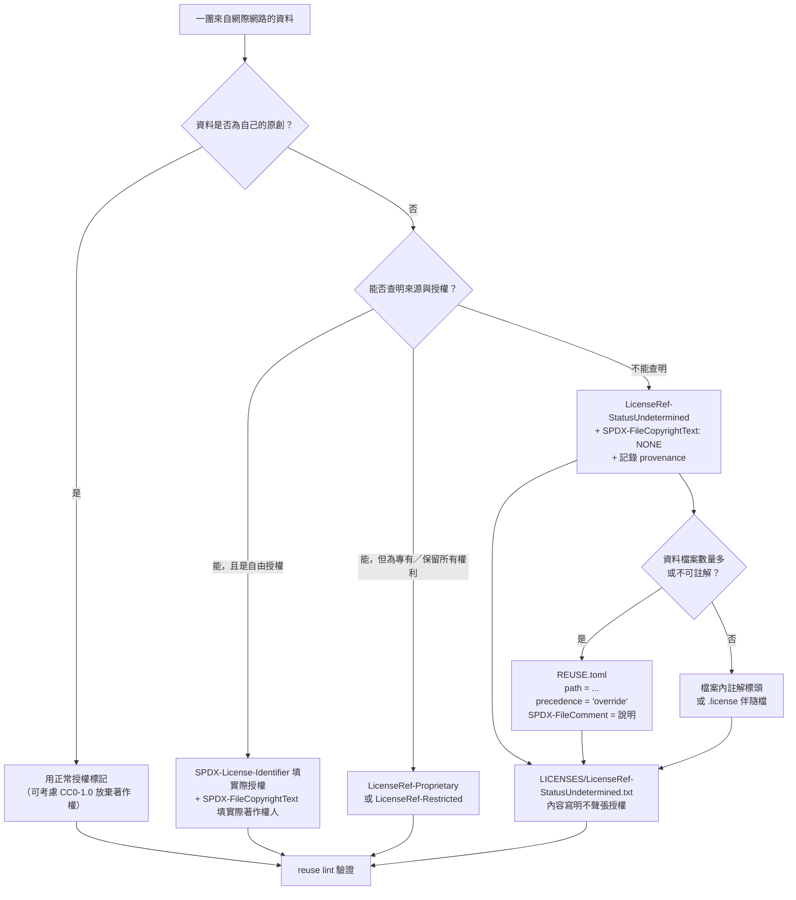

# 在 REUSE 框架下標記「來源不明資料」而不聲張授權

## 摘要

本文回答一個實務問題：手上有一團從網際網路收集來的資料（爬取的文字、下載的圖檔、抓來的 JSON、公開資料集的原始檔），它們的著作權狀態不明、或雖然知道來源但無權代為授權，此時如何在 [REUSE](https://reuse.software) 規範下把這些檔案「標記清楚」，同時**不在標記裡替別人聲張（或放棄）一個自己沒有資格給出的授權**。

結論是：REUSE 框架**沒有**「不聲張」這個概念的位置，但它允許你用 `LicenseRef-` 自訂授權標籤、`REUSE.toml` 的 `precedence = "override"`、以及 `SPDX-FileCopyrightText` 的 `NONE` / `NOASSERTION` 值組合出一個「誠實的佔位符」。這種佔位符在技術上能通過 lint，在語意上是「本檔案的授權狀態未定，本專案不對此聲張任何授權」，而不是「本檔案採用某個自由授權」。關鍵是不能用 `SPDX-License-Identifier: NONE` 或 `NOASSERTION`，那會被 REUSE 判為無效的 SPDX 授權表達式。

---

## 1. 背景：REUSE 是什麼，它的目標是什麼

REUSE 是由 Free Software Foundation Europe（FSFE）推動的規範，目的是讓軟體專案裡**每一個檔案**都有「完整、明確、人與機器皆可讀」的著作權與授權資訊；理想上這些資訊被嵌入檔案本身，因此當檔案被複製、被第三人重複使用時，資訊會跟著檔案一起跑[^spec33]。

REUSE Specification 3.3 的核心定義如下：

- **Covered File（受涵蓋檔案）**：專案裡所有檔案，扣除 `LICENSES/` 下的授權檔、根目錄的 `COPYING` / `LICENSE` / `LICENCE`、版本控制系統本身的檔案、被版控忽略的檔案、子模組與 Meson subproject、`REUSE.toml`、`.reuse/` 目錄、符號連結、零位元組檔案、以及 SPDX 文件[^spec33]。
- **Licensing Information（授權資訊）**：列出檔案的著作權人，並描述該檔案以哪些授權提供[^spec33]。
- **Uncommentable File（不可註解檔案）**：不能放註解的純文字檔，或非純文字檔[^spec33]。

規範要求「每個 Covered File MUST 有 Licensing Information 關聯」[^spec33]。關聯方式有三種：**註解標頭（comment header，建議作法）**、**`REUSE.toml`**、或已棄用的 **DEP5**[^spec33]。不可註解的檔案則必須在旁邊放一個同名加 `.license` 副檔名的文字檔（例如 `cat.jpg.license`），或由 `REUSE.toml` 涵蓋[^spec33][^faq]。

註解標頭必須包含一或多個著作權聲明與一或多個 `SPDX-License-Identifier` 標籤，而該標籤後面**必須**接一個「有效的 SPDX 授權表達式」（例如 `GPL-3.0-or-later OR Apache-2.0`）[^spec33]。

### 1.1 REUSE 與 SPDX 的關鍵差異

`SPDX-License-Identifier` 用的是 SPDX 的標籤語法[^spec33]。但 REUSE 對「未知狀態」的態度與 SPDX 不同。SPDX 規格在檔案層級定義了兩個「非授權」值[^spdxfile]：

- `NONE`：欄位建立者「認定該檔案沒有任何授權資訊／沒有可用的授權」[^spdxfile]。
- `NOASSERTION`：欄位建立者嘗試但無法客觀判定、完全沒嘗試判定、或刻意不提供資訊（「不應由此推論任何意義」）[^spdxfile]。

SPDX 也把同樣的兩個值用在著作權欄位：`NONE` 表示檔案完全沒有著作權聲明；`NOASSERTION` 表示未嘗試判定或刻意不聲張[^spdxfile]。

REUSE 的維護者在 issue 中明確區分了兩者的目的：「SPDX 描述的是**套件的狀態**……這就是為什麼 `NONE`（『找不到授權』）與 `NOASSERTION`（『無法／不願意判定』）是可接受的。REUSE 的對象是**要為自己的作品做標記的作者**……這就是為什麼 REUSE 裡沒有 `NONE` 與 `NOASSERTION` 的位置——如果作者不肯說明自己的程式碼用什麼授權，那對釐清與後續重複使用毫無幫助。在 REUSE 裡，授權必須存在。」[^silverhook]

同一討論中，另一位維護者補充：「REUSE 要求每個檔案都有授權與著作權資訊。`NONE` 或 `NOASSERTION` 是**缺漏的資訊**。你技術上可以寫 `LicenseRef-NONE`，REUSE 會接受，但更有幫助的做法是實際加上一些關於授權狀態的說明，讓使用者能理解。」[^mxmehl2]

因此，REUSE 的「不明狀態」只能用 `LicenseRef-` 自訂標籤來表達，且該標籤通常會指向一個自己寫的說明檔，而不是一個真正的授權條文。

---

## 2. 為什麼「不聲張」在 REUSE 下是一個真問題

「不聲張授權」在實務上有三種不同的情境，處理方式不同：

| 情境 | 法律實況 | 可以聲張什麼？ |
|---|---|---|
| **A. 自己無原創性的資料**（純事實、數值、座標、由程式產生的輸出） | 可能不受著作權保護 | 可依 REUSE FAQ 的「無法取得著作權的檔案」處理：用自己的授權標記它，或用 `CC0-1.0` 放棄自己的著作權[^faq] |
| **B. 他人的作品，授權狀態不明**（爬來的網頁文字、來源不明的圖） | 別人有著作權，且沒有給你授權 | **不能**替對方聲張授權；也不能單方面放棄對方的權利 |
| **C. 他人的作品，但明文禁止或保留所有權利** | 明確的非自由授權 | 可用 `LicenseRef-Proprietary`、`LicenseRef-Restricted` 等標籤明確標示「不可自由使用」[^nicorikken][^faq] |

REUSE FAQ 對「複製一份沒有著作權聲明或授權的作品」給出的指示是：先確認找不到資訊（有些專案只在 README 裡寫）；找不到時「當有疑義，請聯絡作者釐清」；「如果該作品沒有授權，那就表示你沒有權利複製它」；而「作者可能希望保持匿名，那是他們的權利。你可以把 `NONE` 或 `NOASSERTION` 寫成著作權人。」[^faq]

這段是 REUSE 官方文件裡最接近「不聲張」的支點：**`SPDX-FileCopyrightText` 可以填 `NONE` 或 `NOASSERTION`**，REUSE 的 BOM 產生器本身也會在沒有著作權資訊時輸出 `FileCopyrightText: NONE`[^reportpy][^faq]。

但**授權欄位不行**。REUSE 規範要求 `SPDX-License-Identifier` 後面接有效 SPDX 授權表達式[^spec33]，而 `NONE` / `NOASSERTION` 不是合法表達式；`reuse lint` 有一條名為「Invalid SPDX License Expressions」的檢查：「跟在 `SPDX-License-Identifier` 標籤之後、無法被解析為合法 SPDX 的表達式」[^lint]。維護者對此的說法是：「SPDX 知道 `NONE` 與 `NOASSERTION` 作為授權欄位的值，然而**這些不會被 REUSE 偵測為有效授權**。」[^mxmehl1]

實作上也確實如此：REUSE 工具把 `SPDX-License-Identifier` 的內容交給 `license-expression` 這個 Python 函式庫解析，解析失敗即視為無效表達式[^copyrightpy][^licexpr]。因此 `SPDX-License-Identifier: NONE` 會使 lint 失敗。

---

## 3. 具體作法

以下四種作法可以單用或組合。核心原則是：**用「授權標籤」承載「宣告」的形式，用「授權檔內容」與 `REUSE.toml` 的其他鍵承載「不聲張」的語意。**

### 3.1 作法一：`LicenseRef-` 自訂標籤 + 說明檔（單檔層級）

REUSE 允許自訂授權：若某授權不在 SPDX 清單上，就把它的文字放進 `LICENSES/LicenseRef-MyLicense.txt`，並在檔案標頭寫 `SPDX-License-Identifier: LicenseRef-MyLicense`[^faq]。規範也要求名稱必須是 `LicenseRef-[idstring]`，且該檔必須存在於 `LICENSES/`[^spec33]。

用於「不聲張」時，`LICENSES/LicenseRef-....txt` 的**內容**可以是一段聲明而非授權條文，例如：

```text
The licensing status of files covered by this identifier is undetermined.
No licence is asserted by the distributor of this project. The distributor
does not grant, and is not in a position to grant, any rights in these
files. Copyright, if any, remains with the respective authors.

Provenance (where known) is recorded in each file's header and/or in
provenance.csv in the repository root.
```

搭配的檔案標頭：

```text
# SPDX-FileCopyrightText: NONE
# SPDX-License-Identifier: LicenseRef-StatusUndetermined
```

或對不可註解的資料檔，在旁邊放 `data.bin.license`：

```text
SPDX-FileCopyrightText: NONE
SPDX-License-Identifier: LicenseRef-StatusUndetermined
```

這個作法的優點是精確到單一檔案，缺點是檔案數量多時會製造大量 `.license` 檔，且改一個字要改很多處。

**命名陷阱**：REUSE 工具的實作（`src/reuse/project.py`，main 分支，2026 年）在掃描 `LICENSES/` 時，只有在識別字符合 `LicenseRef-` **且名稱不包含 `"Unknown"`** 的情況下才把它註冊為已知授權；而 lint 的「bad licenses」判定是「在 `LICENSES/` 裡、且不在已知授權表中的授權」[^projectpy][^reportpy]。也就是說，把檔案命名為 `LICENSES/LicenseRef-Unknown.txt` 極可能反被報為 bad license。這是實作細節而非規範條文，可能隨版本改變，因此**建議避開 `Unknown` 字樣**，改用 `LicenseRef-StatusUndetermined`、`LicenseRef-Unspecified`、`LicenseRef-Proprietary`、`LicenseRef-Restricted` 等名稱。

### 3.2 作法二：`REUSE.toml` 整批涵蓋（目錄層級，最適合「一團資料」）

當對象是一整個目錄、且你不想編輯每一筆資料時，REUSE 的官方建議是用 `REUSE.toml` 批次授權；FAQ 明確列出適用場景包括「你不被允許編輯這些檔案（因為它們是測試檔，或來自第三人）」，以及「加 `.license` 檔會弄壞建置系統」[^faq]。

`REUSE.toml` 的第 1 版 schema 中，每個 `[[annotations]]` 表有這些鍵[^spec33]：

- `path`（必要）：字串或字串列表，用正斜線，可 glob（`*` 不跨 `/`，`**` 與 `**/` 跨 `/`）。只指向 `REUSE.toml` 所在目錄或更深處。
- `precedence`（選用）：`closest`（預設，檔案本身資訊優先，找不到才用 `REUSE.toml`）、`aggregate`（把表中資訊**加入**檔案既有資訊）、`override`（用表中資訊，並忽略任何更靠近檔案的資訊）。
- `SPDX-FileCopyrightText`（選用）：字串或列表。
- `SPDX-License-Identifier`（選用）：字串或列表，每個都必須是有效 SPDX 授權表達式。

規範另有一段對「不聲張」特別有用的授權：「你 MAY 加入其他鍵與表來傳達額外資訊。它們的語意不由本規範定義。若要加入其他鍵，建議使用既有的 SPDX 標籤。例如你可以在 `[[annotations]]` 表裡使用 `SPDX-FileComment` 來為你的做法加上脈絡。」[^spec33]

因此「一團來自網際網路的資料」可以這樣標：

```toml
version = 1

[[annotations]]
path = "data/scraped/**"
precedence = "override"
SPDX-FileCopyrightText = "NONE"
SPDX-License-Identifier = "LicenseRef-StatusUndetermined"
SPDX-FileComment = "Retrieved from third parties; licensing status undetermined. No licence asserted. See provenance.csv."

[[annotations]]
path = ["data/facts/*.csv", "data/generated/**"]
precedence = "override"
SPDX-FileCopyrightText = "NONE"
SPDX-License-Identifier = "CC0-1.0"
SPDX-FileComment = "Non-original factual data; no copyright claimed by the distributor."
```

重點：

- `precedence = "override"` 讓 `REUSE.toml` 成為唯一真相來源，工具不會再去讀檔內容，因此你不需要動到那一團資料的任何一個位元組。規範對 `override` 的措辭是「忽略任何更靠近檔案的其它 Licensing Information」，且在專案根目錄的那份 `REUSE.toml` 最具權威[^spec33]。同一個檔案被同一份 `REUSE.toml` 的多個表匹配時，**只有最後一個匹配的表生效**[^spec33]。
- 用 `SPDX-FileCopyrightText = "NONE"` 明確表示不聲張著作權人[^spdxfile][^faq]。
- 用 `SPDX-FileComment` 把「為什麼不聲張」「資料從哪裡來」寫進機器可讀的檔案裡[^spec33]。
- `path` 若解析到不存在或非 Covered File 的位置，會被忽略[^spec33]；被版控忽略的 `REUSE.toml` 不會被搜尋[^spec33]。

`reuse annotate` 另外提供 `--skip-global` 與 `--skip-precedence=override`，可在批次補標頭時跳過已被 `REUSE.toml` 以指定 precedence 涵蓋的檔案，避免把「不聲張」的宣告覆蓋掉[^annotate][^changelog]。

### 3.3 作法三：`SPDX-SnippetBegin` / `SPDX-SnippetEnd`（混合檔案）

如果一團資料是嵌在大檔案裡的區塊（例如一份報告裡貼了一堆網路引文），REUSE 3.3 支援 SPDX snippet 標記：以 `SPDX-SnippetBegin` 開頭、`SPDX-SnippetEnd` 結尾，區塊內部的著作權聲明必須用 `SPDX-SnippetCopyrightText`（只有 `SPDX-License-Identifier` 是例外，不需加 `Snippet` 前綴）[^spec33][^faq]。snippet 可以嵌套，標籤會套用到最內層[^spec33]。FAQ 也建議在 snippet 附近用一般註解說明來源，例如「The class Foo is copied from project Bar」[^faq]。

### 3.4 作法四：`REUSE-IgnoreStart` / `REUSE-IgnoreEnd`

如果那一團資料本身**含有**看起來像 SPDX 標籤的字串（例如你蒐集的資料裡有教學文件、程式碼範例、或別人專案的標頭），會被 lint 誤判。REUSE 提供 `REUSE-IgnoreStart` 與 `REUSE-IgnoreEnd` 兩個註解標記，讓工具忽略中間的內容[^spec33]。規範對此有明確限制：**不得**用來忽略自己或第三人的有效授權資訊，只能用於可能觸發偽陽性的區塊[^spec33][^faq]。

從 REUSE 工具 6.0.0 起，`reuse lint` 會搜尋**整個檔案**（不再只讀開頭 4 KiB），因此以前躲得掉的偽陽性現在可能冒出來，需要這種 ignore 區塊[^changelog]。

---

## 4. 決策流程



---

## 5. 明確不要做的事

1. **不要用 `SPDX-License-Identifier: NONE` 或 `NOASSERTION`。** 那不是合法 SPDX 授權表達式，會被 `reuse lint` 列為「Invalid SPDX License Expressions」而失敗[^lint][^mxmehl1]。SPDX 只在「授權色彩欄位」接受這兩個值，REUSE 只接受授權表達式[^spdxfile][^spec33]。
2. **不要用 `CC0-1.0` 去「放棄」別人的權利。** REUSE FAQ 說得很清楚：「重要的是，你只能把授權套用在自己的作品上。如果檔案是別人寫的，你應該在標頭聲明他們的著作權與授權。如果沒有這些資訊，你應該聯絡作者。」[^faq] FAQ 的「無法取得著作權的檔案」條目把 `CC0-1.0` 限定在「你自己的作品」[^faq]。
3. **不要把 `LicenseRef-Unknown` 當成慣例名稱。** 如 3.1 所述，REUSE 工具目前的實作對含 `Unknown` 字樣的 `LicenseRef-` 授權有特殊處理，可能被判為 bad license[^projectpy][^reportpy]。社群在 issue 中實際收斂出來的名稱是 `LicenseRef-Proprietary` 與 `LicenseRef-Restricted`[^nicorikken][^lofidevops]。
4. **不要假設 REUSE 會驗證授權內容或相容性。** 維護者的說法是「REUSE 不評估授權內容或相容性，只檢查程式碼是否被適當地標註」[^nicorikken]，官方 FAQ 也說「REUSE 不幫助你解決授權相容性……REUSE 的目標是幫你完整地宣告你的授權中介資料，而不是檢查該中介資料是否正確或有效。」[^faq] 這意味著 `LicenseRef-StatusUndetermined` 只是一個型式上合法、語意上由你定義的標籤。

---

## 6. 為何「不聲張」在 REUSE 的哲學下是張力點

REUSE FAQ 有一節直接回答「我真的需要在所有檔案裡放授權與著作權標頭嗎？」：「大型、授權關係複雜的專案最能從 REUSE 獲益，把混亂化為秩序、釐清模糊的授權……這份中介資料必須存在某個地方，而我們認為它應該盡可能靠近資料本身——也就是每個檔案的標頭。」[^faq] 又說「REUSE 堅持**每一個檔案都應該含有授權資訊**，即使是最微不足道的檔案。」[^faq]

這套設計預設使用者是「有能力為作品指定授權的人」。而「一團來自網際網路的資料」的處境恰恰相反：你**沒有**那個能力。REUSE 為此保留的彈性有兩個：

1. `LicenseRef-` 自訂授權機制，讓你建立一個「不是標準授權的清單項」[^faq][^spec33]；
2. `SPDX-FileCopyrightText` 可以填 `NONE` / `NOASSERTION`[^faq]，以及 `REUSE.toml` 允許自訂鍵（建議沿用 SPDX 標籤如 `SPDX-FileComment`）[^spec33]。

因此「不聲張授權」在 REUSE 下的**唯一誠實形式**是：以 `LicenseRef-` 作為格式上的佔位符、以非授權的文字或不聲張聲明作為其內容、以 `NONE` 作為著作權欄位、以 `SPDX-FileComment` 或同等的自訂鍵承載 provenance。這在語意上仍是「宣告」——它宣告的是「我不知道／我無權聲張」這件事本身。

---

## 7. 對來源的批判性反思

- **一手來源的部分**：REUSE Specification 3.3[^spec33]、FAQ[^faq]、Tutorial[^tutorial]、`reuse-lint` 與 `reuse-annotate` 說明頁[^lint][^annotate]、SPDX 2.3.1 條文[^spdxfile][^spdxannexe]、以及 reuse-tool 的 changelog[^changelog] 與原始程式碼[^projectpy][^reportpy][^copyrightpy]，皆為專案官方發布的一手資料，可信度高。程式碼引述基於 main 分支、抓取時間 2026-11-14，屬於**會變動的實作細節**，引用時應理解這一點。
- **議題討論的部分**：`NONE` / `NOASSERTION` 在 REUSE 中不可用的結論，來自 2021 年的 GitHub issue #409 與 2022 年的 #545[^mxmehl1][^silverhook][^mxmehl2][^nicorikken][^lofidevops]。這些是維護者與貢獻者的發言，不是規範條文，但與現行規範與實作一致，可視為互相印證。這兩條議題都已關閉，距今數年，其後 REUSE 已發布 3.2（`REUSE.toml`、DEP5 棄用）與 3.3，因此其中的操作細節需以現行規範為準[^changelog]。
- **偏誤提醒**：REUSE 官方文件明確聲明「這裡的任何內容都不是法律建議」[^faq]。`LicenseRef-StatusUndetermined` 這類作法解決的是**中介資料的完整性與機器可讀性**，不解決「你是否有權複製這些資料」的法律問題；FAQ 對後者的回答是「聯絡作者」[^faq]。
- **未能查證的部分**：本文未找到 REUSE 專案或 SPDX 專案針對「來源不明資料」發布的正式範本或官方命名慣例；`LicenseRef-StatusUndetermined` 是本文依 3.1、3.2 的機制所擬的建議名稱，並非既有社群慣例。社群實際使用過的名稱是 `LicenseRef-Proprietary`[^proprietary] 與 `LicenseRef-Restricted`[^lofidevops]。因此，若要採用本文的命名，建議在專案內部的 README 或 `SPDX-FileComment` 中說明該名稱的定義，因為「同一授權的各種變體……你可能會有很多這樣的客製授權」，命名必須自洽[^faq]。
- **可佐證的實例**：GitHub 上的公開專案確有以 `LicenseRef-Proprietary` 標記第三方素材者，例如 KhronosGroup/GLSL 的 `REUSE.toml` 用 `precedence = "aggregate"` 搭配 `SPDX-License-Identifier = "LicenseRef-Proprietary"` 涵蓋 `extensions/**` 底下的檔案[^proprietary]；AtomVM 則以 `doc/assets/dashbit-logo.png.license` 檔標記 `LicenseRef-Proprietary`[^proprietary]。

---

## 參考文獻

[^spec33]: Free Software Foundation Europe e.V. (2024-11-14). *REUSE Specification – Version 3.3*. Retrieved 2026-11-14, from https://reuse.software/spec-3.3/

[^tutorial]: Free Software Foundation Europe e.V. (n.d.). *Tutorial: How to become REUSE-compliant*. Retrieved 2026-11-14, from https://reuse.software/tutorial/

[^faq]: Free Software Foundation Europe e.V. (n.d.). *Frequently asked questions*. Retrieved 2026-11-14, from https://reuse.software/faq/

[^lint]: Free Software Foundation Europe e.V. (n.d.). *reuse-lint — reuse 6.3.0 documentation*. Retrieved 2026-11-14, from https://reuse.readthedocs.io/en/stable/man/reuse-lint.html

[^annotate]: Free Software Foundation Europe e.V. (n.d.). *reuse-annotate — reuse 6.3.0 documentation*. Retrieved 2026-11-14, from https://reuse.readthedocs.io/en/stable/man/reuse-annotate.html

[^changelog]: Free Software Foundation Europe e.V. (2026-10-30). *Change log* (reuse-tool v6.3.0). Retrieved 2026-11-14, from https://github.com/fsfe/reuse-tool/blob/main/CHANGELOG.md

[^projectpy]: Free Software Foundation Europe e.V. (2026). *src/reuse/project.py* (reuse-tool, main branch). Retrieved 2026-11-14, from https://github.com/fsfe/reuse-tool/blob/main/src/reuse/project.py

[^reportpy]: Free Software Foundation Europe e.V. (2026). *src/reuse/report.py* (reuse-tool, main branch). Retrieved 2026-11-14, from https://github.com/fsfe/reuse-tool/blob/main/src/reuse/report.py

[^copyrightpy]: Free Software Foundation Europe e.V. (2026). *src/reuse/copyright.py* (reuse-tool, main branch). Retrieved 2026-11-14, from https://github.com/fsfe/reuse-tool/blob/main/src/reuse/copyright.py

[^licexpr]: aboutcode-org. (n.d.). *license-expression: Utility library to parse, normalize and compare license expressions for Python*. Retrieved 2026-11-14, from https://github.com/aboutcode-org/license-expression

[^spdxfile]: Linux Foundation. (n.d.). *Clause 8: File information*. In *SPDX Specification v2.3.1*. Retrieved 2026-11-14, from https://spdx.github.io/spdx-spec/v2.3.1/file-information/

[^spdxannexe]: Linux Foundation. (n.d.). *Annex E: Using SPDX short identifiers in source files*. In *SPDX Specification v2.3.1*. Retrieved 2026-11-14, from https://spdx.github.io/spdx-spec/v2.3.1/using-SPDX-short-identifiers-in-source-files/

[^mxmehl1]: mxmehl. (2021-09-17). Comment on "reuse is incompatible with etherscan.io source verification of unlicensed smart contract code" [Online forum post, issue #409]. Retrieved 2026-11-14, from https://github.com/fsfe/reuse-tool/issues/409#issuecomment-921878745

[^silverhook]: silverhook. (2021-09-19). Comment on "reuse is incompatible with etherscan.io source verification of unlicensed smart contract code" [Online forum post, issue #409]. Retrieved 2026-11-14, from https://github.com/fsfe/reuse-tool/issues/409#issuecomment-922478656

[^mxmehl2]: mxmehl. (2021-09-19). Comment on "reuse is incompatible with etherscan.io source verification of unlicensed smart contract code" [Online forum post, issue #409]. Retrieved 2026-11-14, from https://github.com/fsfe/reuse-tool/issues/409#issuecomment-922444138

[^aspiers]: aspiers. (2021-09-07). *reuse is incompatible with etherscan.io source verification of unlicensed smart contract code* [GitHub issue #409]. Retrieved 2026-11-14, from https://github.com/fsfe/reuse-tool/issues/409

[^lofidevops]: lofidevops. (2022-06-23). *[question] Correct way to clearly identify non-libre code?* [GitHub issue #545]. Retrieved 2026-11-14, from https://github.com/fsfe/reuse-tool/issues/545

[^nicorikken]: nicorikken. (2022-07-05). Comment on "[question] Correct way to clearly identify non-libre code?" [Online forum post, issue #545]. Retrieved 2026-11-14, from https://github.com/fsfe/reuse-tool/issues/545#issuecomment-1175146274

[^proprietary]: The Khronos Group Inc. (n.d.). *REUSE.toml* [Source file, GLSL]. Retrieved 2026-11-14, from https://github.com/KhronosGroup/GLSL/blob/main/REUSE.toml
