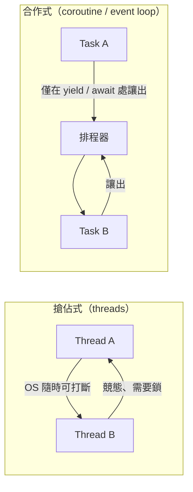
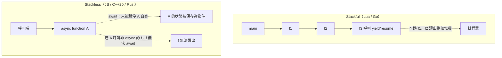
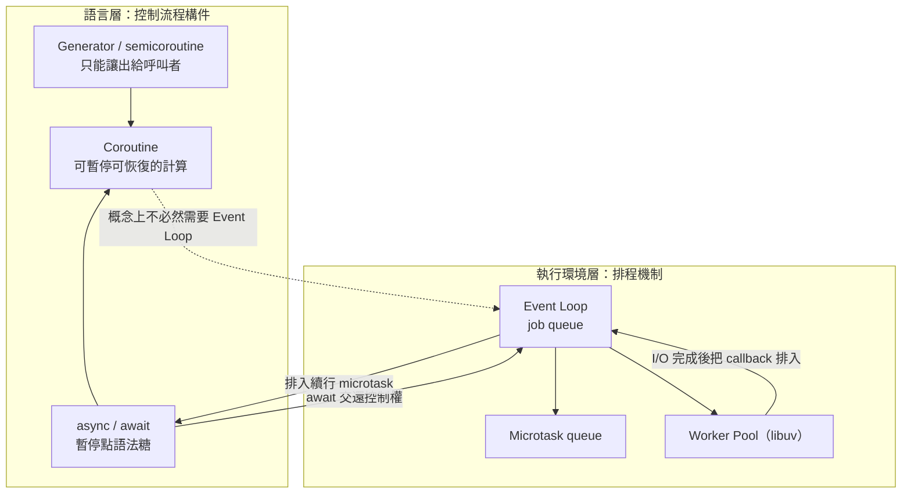

# JavaScript 的 Event Loop／Async 與其他語言的 Coroutine 之異同

## 摘要

JavaScript 的 Event Loop 與其他程式語言的 Coroutine，常被視為「同一件事的不同說法」，因為兩者都能讓開發者用接近同步（synchronous）的寫法處理非同步（asynchronous）工作，而且都採用「合作式」（cooperative）而非「搶佔式」（preemptive）的排程[^coop]。然而，若從控制流程（control flow）的實作層次檢視，兩者其實屬於不同的抽象層：Coroutine 是一種**語言層級的控制流程概念**（可暫停、可恢復的計算單元），而 Event Loop 是一種**執行環境層級的排程機制**（負責挑選下一個要執行的任務）[^mdn-exec][^wiki-coro]。

兩者最關鍵的差異在於「堆疊」（stack）與「控制轉移」（control transfer）的方式：Lua、Go 等語言的 Coroutine 多為 *stackful*，可從任意巢狀函式讓出（yield）；JavaScript 的 `async`／`await` 與 generator 則屬 *stackless*，只能在被標記的函式內暫停，且暫停後一律把控制權交還給 Event Loop，而不是交還給指定的另一個 Coroutine[^wiki-coro][^mdn-exec]。

本報告將先分別說明兩套模型，再逐項比較相同與相異之處，並以 Mermaid 圖示與對照表輔助理解。所有事實均附註腳與改良式 APA 引用。

---

## 1. 背景：JavaScript 的 Event Loop 與 Async 模型

### 1.1 Agent、Heap、Queue、Stack

ECMAScript 規範將每一個獨立的 JavaScript 執行者稱為 **agent**（代理）。Agent 類比於一條執行緒（但底層實作不一定是作業系統執行緒），並持有三種資料結構[^mdn-exec]：

- **Heap（物件堆）**：存放程式中建立的物件記憶體。
- **Queue（作業佇列）**：在 HTML 規範與一般說法中稱為 **Event Loop**，負責讓單執行緒的 JavaScript 也能進行非同步程式設計。
- **Stack（執行環境堆疊）**：即 **Call Stack**，以「後進先出」方式管理函式的進入與離開。

MDN 對 Event Loop 的定位說得很清楚：「Queue (of jobs)：這在 HTML（以及一般說法）中稱為 event loop，它讓 JavaScript 在單執行緒的情況下仍能進行非同步程式設計。之所以稱為 queue，是因為它大致上是先進先出：較早的 job 會先於較晚的 job 執行。」[^mdn-exec]

Agent 本身即是一條執行緒：「一個 agent 類似於一條執行緒……每個 agent 可以擁有多個 realm（與 global object 一對一對應），這些 realm 之間可以同步互相存取，因此必須在單一執行緒中執行。」[^mdn-exec]

### 1.2 Job Queue 與 Run-to-Completion

當一段程式需要進行非同步動作時，處理該動作完成後續工作的程式碼會以 **callback** 形式定義，形成一個 **job**，在動作完成後被放入 job queue。Agent 每次從佇列取出一個 job 執行；job 執行過程中可能再產生新的 job，被加到佇列尾端[^mdn-exec]。

規範明確保證 **run-to-completion**：

> 「每個 job 在被處理時會完整執行完畢，才會處理其他 job。這在推理程式行為時提供了一些好處，包括：每當一個函式開始執行，它就無法被搶佔，並且會在其他程式碼執行之前完整跑完（也能修改它操作的資料）。這與 C 不同，例如在 C 中若某函式在某條執行緒中執行，runtime 系統可以在任何時間點將它停下，改去執行另一條執行緒中的其他程式碼。」[^mdn-exec]

同時，Event Loop 也提供了「never blocking」的保證：I/O 通常透過事件與 callback 處理，因此程式在等待 IndexedDB 查詢或 `fetch()` 回應時，仍能處理使用者輸入等其他事情[^mdn-exec]。

### 1.3 Task 與 Microtask

HTML 規範將 job 分為兩類：**task**（巨集任務）與 **microtask**（微任務）。Microtask 具有較高優先權，且 microtask 佇列會在 task 佇列被取出前先被清空[^mdn-exec]。

MDN 對 task 的定義是：「task 是指由標準機制排入執行的任何東西，例如程式一開始的啟動、事件被非同步派送，或 interval 或 timeout 被觸發。這些都會被排入 task queue。」例如使用者點擊元素、`setTimeout()` 或 `setInterval()` 到期，都會產生 task[^mdn-micro]。

至於 microtask：「microtask 是一個簡短的函式，它在建立它的函式或程式結束後執行，且僅在 JavaScript 執行堆疊為空時執行，但在控制權交還給驅動腳本執行環境的 Event Loop 之前執行。」[^mdn-micro]

Microtask 與 task 的兩項關鍵差異為[^mdn-micro]：

1. 每當一個 task 結束，Event Loop 會檢查該 task 是否把控制權交還給其他 JavaScript 程式碼；若否，則執行 microtask 佇列中所有 microtask。因此 microtask 佇列在每次 Event Loop 迭代中會被處理多次。
2. 若某個 microtask 透過 `queueMicrotask()` 再加入新的 microtask，這些新 microtask 會在下一個 task 執行前先執行完畢，因為 Event Loop 會持續呼叫 microtask 直到佇列為空。

「JavaScript promise 與 Mutation Observer API 都使用 microtask 佇列來執行其 callback。」[^mdn-micro]

Jake Archibald 的經典文章以一段程式碼說明執行順序，結論為 `script start`、`script end`、`promise1`、`promise2`、`setTimeout`：目前正在執行的 script 必須先結束，microtask 才會被處理；promise 的 callback 以 microtask 形式排在 `setTimeout` 這個新 task 之前[^archibald]。他也指出：「在 ECMAScript 領域中，microtask 被稱為 job。在 `PerformPromiseThen` 的步驟 8.a 中，會呼叫 `EnqueueJob` 來排入一個 microtask。」[^archibald]

### 1.4 執行階段（runtime）層：Node.js 的 Event Loop

在瀏覽器之外，Node.js 的 Event Loop 由 C 函式庫 **libuv** 實作。Node.js 官方文件指出：「Event Loop 讓 Node.js 能夠執行非阻塞 I/O 操作——儘管預設只使用單一 JavaScript 執行緒——其作法是盡可能把操作卸載給系統核心。」[^node-loop]

Node.js 的 Event Loop 分為多個 **phase**（階段），每個階段有先進先出的 callback 佇列，依序為：`timers`、`pending callbacks`、`idle, prepare`、`poll`、`check`、`close callbacks`[^node-loop]。此外 `process.nextTick()` 不屬於 Event Loop 本身：「`nextTickQueue` 會在當前操作完成後處理，不論 Event Loop 目前在哪個階段。」[^node-loop]

Node.js 並非只有一條執行緒。官方文件將之分為兩類執行緒：「Node.js 中有兩種類型的執行緒：一條 Event Loop（又稱 main loop、main thread、event thread 等），以及一個由 k 條 Worker 組成的 Worker Pool（又稱 threadpool）。」[^node-block]「Event Loop 執行註冊於事件的 JavaScript callback，同時負責完成網路 I/O 等非阻塞的非同步請求；Worker Pool 則由 libuv 實作，用來處理『昂貴』的工作，包括作業系統未提供非阻塞版本的 I/O，以及特別耗費 CPU 的任務。」[^node-block] 例如檔案系統 API、`dns.lookup()`、`crypto.pbkdf2()`、zlib 等，都使用 libuv 的 threadpool[^node-block]。

Node.js 官方亦強調 JavaScript 的並行語意：「Node.js 中的 JavaScript 執行是單執行緒的，因此 concurrency 指的是 Event Loop 在完成其他工作後執行 JavaScript callback 的能力。任何預期要以並行方式執行的程式碼，都必須讓 Event Loop 在非 JavaScript 操作（如 I/O）進行時能繼續運行。」[^node-bnb] 並指出「Event Loop 不同於許多其他語言中可能建立額外執行緒來處理並行工作的模型。」[^node-bnb]

### 1.5 Async／Await 如何與 Event Loop 互動

`async function` 每次被呼叫時，會回傳一個新的 Promise，其結果為函式回傳值或被拋出的例外[^mdn-async]。`await` 僅能用在 `async function` 內或模組頂層[^mdn-await]。

MDN 對 `await` 的控制流效果描述如下：

> 「當在程式碼中遇到 `await`（無論是在 async function 或模組中），被等待的運算式會先被求值，而所有依賴該運算式結果的程式碼會被暫停。控制權會離開該函式並回到呼叫者。當被等待的運算式值被解析後，另一個延續暫停程式碼的 microtask 會被排入執行。即使被等待的值是已解析的 promise 或不是 promise，這件事也會發生：在所有其他已排入的 microtask 被處理完之前，執行不會回到當前函式。」[^mdn-await]

這正是「continuation 以 microtask 形式排入」的具體描述。MDN 也指出 async function 的函式主體可想像為被 `await` 切成數段：「在第一個 `await` 運算式之前的頂層程式碼會同步執行……每個 `await` 運算式之後的程式碼，可以想成存在於一個 `.then` callback 中。如此一來，每次重入函式時，promise 鏈就逐段建立起來。」[^mdn-async]

MDN 另外說明 async／await 的歷史淵源：「`async`／`await` 的目的在於簡化取用 promise 式 API 所需的語法。async／await 的行為類似於把 generator 與 promise 結合起來。」[^mdn-async]

### 1.6 規範層的機制：Execution Context 的暫停與恢復

ECMAScript 規範把「暫停／恢復」定義為 **execution context**（執行環境）的推入與移出。規範第 9.4 節「Execution Contexts」包含兩個直接支援此機制的抽象操作[^ecma]：

- **9.4.7 RunSuspendedContext ( context, completionRecord )**：以指定的 completion record 繼續執行某個先前被暫停的 execution context。
- **9.4.8 RunCallerContext ( value )**：把控制權交還給呼叫端的 execution context。

而 §9.5「Jobs and Host Operations to Enqueue Jobs」則定義了排入工作的 host 掛鉤，其中 **9.5.5 HostEnqueuePromiseJob ( job, realm )** 專用於排入 Promise 相關的 job；規範對其語意說明為「排定 job 於未來某時間點執行」，且使用此演算法的 Abstract Closure「意圖與 Promise 的處理相關，或至少以等同於 Promise 處理操作的優先權排程」[^ecma]。這正是 MDN 所述「promise callback 屬 microtask」[^mdn-micro] 在規範層的對應機制。

因此，規範層呈現的圖像是：async function 的執行環境被**複製並保存**，`await` 時該環境被移出 execution context stack（暫停），日後由被排入的 job 重新推入並以 `RunSuspendedContext` 續行[^ecma]。這是 stackless 設計在規範文字上的直接體現：被保存的是一個**執行環境**，而不是整條原生呼叫堆疊。

### 1.7 Generator 的暫停與重入

Generator 函式被呼叫時不會立即執行其程式碼，而是回傳一個特殊型別的 iterator，稱為 Generator[^mdn-gen-guide]。MDN 的執行模型文件以 generator 說明「執行環境」如何被保存與重新推入堆疊：

> 「呼叫 `gen()` 時會先建立一個被暫停的執行環境——此時 `gen` 內部的程式碼都還沒執行。Generator `g` 會在其內部保存這個執行環境。當前正在執行的執行環境仍然是進入點。當呼叫 `g.next()` 時，`gen` 的執行環境會被推入堆疊，`gen` 內的程式碼執行至 `yield` 運算式。接著 generator 的執行環境被暫停並從堆疊移除，控制權回到進入點。當再次呼叫 `g.next()` 時，generator 的執行環境會再次被推入堆疊，程式碼從上次中斷處繼續。」[^mdn-exec]

MDN 也指出 generator 提供雙向控制流：「Generator 允許雙向控制流：控制權可以在 generator 函式（被呼叫者）與其呼叫者之間任意次數地轉移。控制權可透過呼叫 generator 的方法 `next()`、`throw()`、`return()` 由呼叫者傳向被呼叫者；也可透過正常 `return`、`throw` 或執行完所有敘述，或使用 `yield`、`yield*` 運算式，由被呼叫者傳回呼叫者。」[^mdn-fngen]

---

## 2. 背景：Coroutine 是什麼

### 2.1 定義

Coroutine 是「可以被暫停與恢復的程式元件——把 subroutine（副程式）一般化——用於合作式多工」[^wiki-coro]。Wikipedia 引述 Christopher D. Marlin（1980）整理的兩項公認基本特徵[^wiki-coro]：

1. Coroutine 內部區域資料的值會在連續呼叫之間保留下來；
2. Coroutine 的執行在控制權離開它時被暫停，之後控制權再次進入時，從上次離開處繼續。

須注意「coroutine 沒有單一精確的定義」[^wiki-coro]。Marlin 的整理有助理解，但不同語言實作的差異相當大。

### 2.2 對稱與非對稱、Stackful 與 Stackless

Wikipedia 指出 coroutine 實作有三項特徵[^wiki-coro]：

1. **控制轉移機制**：非對稱（asymmetric）coroutine 通常提供 `yield`、`resume` 等關鍵字，程式設計者不能自由選擇要讓出給哪個 frame，runtime 只會讓出給當前 coroutine 最近的呼叫者。對稱（symmetric）coroutine 則必須由程式設計者指定讓出的目的地。
2. **是否為第一級物件（first-class object）**：coroutine 可以是可自由操作的物件，或是受限制的構件。
3. **是否能在巢狀函式呼叫中暫停**：能做到的稱為 **stackful** coroutine；做不到的稱為 **stackless** coroutine，「除非被標記為 coroutine，否則一般的函式不能使用 `yield` 關鍵字」[^wiki-coro]。

2009 年發表的 "Revisiting Coroutines" 一文提出 **full coroutine** 一詞，指同時支援 first-class coroutine 且為 stackful 者；full coroutine 具有與 one-shot continuation 及 delimited continuation 相同的表達力[^wiki-coro]。

### 2.3 與 Subroutine、Thread、Generator 的關係

**Subroutine**：「副程式是 coroutine 的特例。」副程式被呼叫時從頭開始執行，一旦離開就結束，一個副程式實例只回傳一次，且在呼叫之間不保留狀態；相對地，coroutine 可以透過呼叫其他 coroutine 而離開，之後可能再回到被呼叫處[^wiki-coro]。「任何副程式都可以被轉譯為不使用 `yield` 的 coroutine。」[^wiki-coro]

**Thread**：「Coroutine 與 thread 非常相似。然而，coroutine 是合作式多工，而 thread 通常是搶佔式多工。Coroutine 提供 concurrency……但不提供 parallelism，因為它們不會同時執行多個任務。」[^wiki-coro] Coroutine 相對於 thread 的優點是：可在硬即時（hard real-time）情境使用（切換不涉及系統呼叫或阻塞呼叫）、不需要 mutex／semaphore 等同步原語來保護 critical section，也不需要作業系統支援[^wiki-coro]。Wikipedia 總結其一項重要差異：「thread 通常是搶佔式排程，coroutine 則不是。因為 thread 可以在任何瞬間被重新排程並行執行，使用 thread 的程式必須小心加鎖；相對地，因為 coroutine 只能在程式中的特定點被重新排程且不會並行執行，使用 coroutine 的程式往往可以完全避免加鎖。」[^wiki-coro]

**Generator**：「Generator 又稱 semicoroutine，是 coroutine 的子集。具體而言，雖然兩者都能多次讓出、暫停執行並在多个進入點重入，但它們的差異在於 coroutine 能控制讓出後立即從何處繼續，而 generator 不能，只能把控制權交還給 generator 的呼叫者。」[^wiki-coro] Generator 的 `yield` 不指定要跳往哪個 coroutine，而是把值傳回母常式[^wiki-coro]。Wikipedia 的 Generator 條目亦指出：「Generator 可以用更具表達力的控制流程構件實作，例如 coroutine 或 first-class continuation。Generator（又稱 semicoroutine）是 coroutine 的特例（且較弱），因為它們總是讓出控制權給呼叫者。」[^wiki-gen]

### 2.4 語言支援概況

Wikipedia 列出原生支援 coroutine 的語言，包括：C++（C++20 起）、C#（2.0 起）、Erlang、F#、Haskell、JavaScript（1.7 起，標準化於 ECMAScript 6）、Kotlin（1.1 起）、Lua、PHP（5.5 起）、Python（2.5 起，3.3 起改良，3.5 起有明確語法）、Ruby、Racket、Scheme、Simula 67、Smalltalk、Tcl（8.6 起）等[^wiki-coro]。Java 沒有原生或函式庫支援，但可呼叫 Kotlin 的 kotlinx.coroutines（需以 Java wrapper 包裝，並不理想）[^wiki-coro]。

另須注意各語言實作的「coroutine」性質差異很大。Wikipedia 對 C++20 的描述：「C++20 引入了標準化的 coroutine，作為可以在執行中途暫停、之後恢復的 **stackless** 函式。 coroutine 的暫停狀態儲存在 heap 上。」[^wiki-coro]

### 2.5 歷史：Conway 1958／1963

「Melvin Conway 在 1958 年創造了 coroutine 一詞，當時他將此概念應用於一個組合語言的建構。Coroutine 的第一份公開發表解釋則出現在稍後，於 1963 年。」[^wiki-coro] 此後 coroutine 被廣泛應用於實作合作式任務、例外、Event Loop、iterator、無限序列與 pipe 等[^wiki-coro]。

---

## 3. 相同之處

### 3.1 都是合作式多工，不是搶佔式

兩者都不會在任意時間點打斷執行中的程式碼。JavaScript 的 run-to-completion 保證「每當一個函式開始執行，它就無法被搶佔」[^mdn-exec]；coroutine「只在程式中的特定點被重新排程」[^wiki-coro]。因此使用 coroutine 或 Event Loop 的程式，往往可避免執行緒加鎖問題[^wiki-coro]。

### 3.2 都是「可暫停、可恢復的計算」抽象

Coroutine 的核心定義即是「執行被暫停、之後從原處繼續」[^wiki-coro]。JavaScript 的 generator 執行環境被保存在 generator 物件內、之後被重新推入堆疊[^mdn-exec]；`await` 則暫停 async function，之後以 microtask 續行[^mdn-await]。兩者都在談同一種現象：把「暫停點」與「恢復點」形式的控制流顯式化。

### 3.3 都提供 concurrency，而非平行的 parallelism

Coroutine「提供 concurrency……但不提供 parallelism，因為它們不會同時執行多個任務」[^wiki-coro]。JavaScript 亦同：「Node.js 中的 JavaScript 執行是單執行緒的，因此 concurrency 指的是 Event Loop 在完成其他工作後執行 JavaScript callback 的能力。」[^node-bnb]

### 3.4 目標一致：用同步風格寫非同步程式

Python 的 PEP 342 動機寫道：「Coroutine 是表達許多演算法（如模擬、遊戲、非同步 I/O，以及其他事件驅動程式設計或合作式多工形式）的自然方式。Python 的 generator 函式幾乎就是 coroutine——但還不完全——因為它們允許暫停執行以產生值，但不提供在恢復執行時傳入值或例外的方式。」[^pep342] PEP 342 的目的正是讓開發者不必「把整個應用程式寫成一系列 callback」，也不必為需要數百甚至數千個合作式多工 pseudo-thread 的程式使用資源密集的 thread[^pep342]。

JavaScript 的 async／await 出於相同的可讀性動機：「async／await 能幫助你寫出更直覺、更像同步程式碼的程式碼。」[^mdn-promises] PEP 492 也指出其終極目標是「幫助建立一個共通、易於接近的 Python 非同步程式設計心智模型，並使其盡可能接近同步程式設計。」[^pep492]

### 3.5 都能表達 producer／consumer 與狀態機

Wikipedia 以 producer／consumer 佇列作為 coroutine 的入門範例：一個 coroutine 產生項目、另一個取用項目，透過 `yield` 輪流運行[^wiki-coro]。同樣的模式在 JavaScript 可用 generator 或 async iterator 實作；Node.js 的 stream 與 async iteration 亦屬此類。Wikipedia 亦將「單一副程式中的狀態機」「actor 模型」列為 coroutine 的常見用途[^wiki-coro]。

### 3.6 「semicoroutine」的定位

JavaScript 的 generator 在分類上就是 coroutine 的一個子集：`yield` 只能把控制權交還給呼叫者，這正符合「generator 又稱 semicoroutine，是 coroutine 的子集」之定義[^wiki-coro][^wiki-gen]。就控制流理論而言，JavaScript 自 ES6 起確實已經「擁有」一種 coroutine。David Herman 的論述亦指出：「Generator 很像 coroutine，但有一個重要差異：它們只能暫停自己的函式 activation。」[^herman]

---

## 4. 相異之處

### 4.1 抽象層不同：語言概念 vs. 執行環境機制

Coroutine 是**語言／控制流的概念**，由編譯器或 VM 提供 `yield`／`resume` 等構件[^wiki-coro]。Event Loop 則是**執行環境的排程機制**，在 JavaScript 中由 host environment（瀏覽器、Node.js）提供，規範層面體現為 job queue 與 host hook[^mdn-exec]。也就是說，coroutine 回答「這段計算能否暫停」；Event Loop 回答「下一個要執行哪個 job」。

### 4.2 Stackful 與 Stackless：能否從巢狀函式讓出

這是實務上最顯著的差異。

Lua 的 coroutine 是 stackful，且可從巢狀函式讓出。Lua 5.4 手冊寫道：

> 「Coroutine 藉由呼叫 `coroutine.yield` 讓出。當 coroutine 讓出時，對應的 `coroutine.resume` 會立即回傳，即使讓出發生在巢狀函式呼叫中（也就是不發生在主函式中，而是發生在主函式直接或間接呼叫的函式中）。」[^lua]

Go 的 goroutine 亦為 stackful，並可跨阻塞點搬移。Go FAQ 說明：「Goroutine 是讓 concurrency 易於使用的一部分。其想法（已存在一段時間）是把獨立執行的函式——coroutine——多工到一組 thread 上。當某個 coroutine 阻塞時，例如呼叫了阻塞的系統呼叫，runtime 會自動把同一作業系統 thread 上的其他 coroutine 移到另一條可執行的 thread，使其不被阻塞。」[^gofaq]

相對地，JavaScript 的 `await` 只能在 `async function`（或模組頂層）使用，`yield` 只能在 generator 函式內使用[^mdn-await][^mdn-fngen]。David Herman 對此的解釋是：ECMAScript 選擇的是「淺層（shallow）coroutine」——「在 ES6 中，`yield` 不是任何人可用的函式，而是只有 generator 函式能使用的內建運算子。使用 generator 時，呼叫一個 JS 函式就像以往一樣無害。你永遠不必擔心某個函式呼叫可能讓出，使你無法完成原本要做的事。」[^herman]

Rauschmayer 對同一個限制的措辭更直接：「Generator 是**淺層（shallow）**co-routine：它們的執行狀態只在 generator 函式**內部**被保存——不會再往後延伸到函式之外，而且被遞迴呼叫的函式不能 `yield`。」[^rauschmayer] 他也指出「coroutine 是單執行緒版的多工：每個 coroutine 是一條 thread，但所有 coroutine 都在單一 thread 中執行，並透過 `yield` 明確放棄控制權。由於是明確讓出，這種多工也稱為合作式（相對於一般的搶佔式多工）。」[^rauschmayer]

換言之：Lua 的 `resume()` 可以穿越多層尚未 return 的函式框架；JavaScript 的 `await` 所暫停的僅是「async function 自己的執行環境」，其下方的原生呼叫堆疊會被解除[^mdn-exec]。規範層面亦印證此點：ECMAScript 定義了 **Await** 抽象操作（§27.10.5.3）以及 **AsyncFunctionStart**（§27.10.5.1）與 **GeneratorResume**（§27.8.3.3），這些演算法保存與恢復的對象都是單一 execution context，而非整條呼叫堆疊；恢復時透過 **RunSuspendedContext** 把該 context 重新推入堆疊[^ecma]。

這也是為何 C++20 的 coroutine 被描述為「stackless，暫停狀態儲存在 heap 上」[^wiki-coro]，以及 Rust 的 async 被描述為「把一段程式碼轉換成實作 `Future` trait 的狀態機」[^rust]。

### 4.3 控制轉移的對象：一律交還 Event Loop，而非指定 coroutine

對稱 coroutine 允許「由程式設計者指定讓出的目的地」[^wiki-coro]；即使是 Lua 這種由 `resume` 驅動的實作，也可由外部程式碼決定下一次要 resume 哪個 coroutine[^lua]。相對地，JavaScript 的 `await` 只把控制權交還給呼叫者／Event Loop，等待中的續行由 Promise 的 reaction 以 microtask 形式排入[^mdn-await][^mdn-micro]。開發者無法在 `await` 處指定「直接切換到另一個特定工作」。

### 4.4 排程器：不可自訂 vs. 可插拔

JavaScript 的 Event Loop 由 host environment 驅動，開發者無法替換排程策略（多個 task source 的取用順序由瀏覽器決定：「瀏覽器可以在 Event Loop 每一輪自行選擇從哪個 source 取 task」[^archibald]）。相對地，Kotlin 的 coroutine 提供可插拔的 **CoroutineDispatcher**：「coroutine context 包含 coroutine dispatcher（見 `CoroutineDispatcher`），決定對應 coroutine 使用哪一條或哪些執行緒來執行。dispatcher 可以把 coroutine 限制在特定執行緒、派送到 thread pool，或讓它不受限制地執行。」[^kotlin-ctx]

Kotlin 的 `Dispatchers.Default`「由 JVM 與 Native 上的共享 thread pool 支撐。預設情況下，此 dispatcher 使用的最大執行緒數等於 CPU 核心數，但至少為二」[^kotlin-disp-default]。`Dispatchers.IO`「專門用於把阻塞的 I/O 任務卸載到共享 thread pool；並行處理 IO 工作的執行緒數預設為 64 條或核心數（取較大者）」[^kotlin-disp-io]。`Dispatchers.Main`「是限制在操作 UI 物件之主執行緒上的 coroutine dispatcher，通常是單執行緒」[^kotlin-disp-main]。

### 4.5 單執行緒 vs. 可多執行緒平行

JavaScript 預設在單一執行緒上執行 JavaScript 程式碼。要進行真正的平行運算，須建立新的 agent（Web Worker 或 Node.js `worker_threads`），而 agent 之間以 `postMessage()` 溝通，記憶體共享須透過 `SharedArrayBuffer` 搭配 `Atomics`[^mdn-exec]。

Kotlin 的模型不同。Kotlin 官方文件指出：「在 JVM 與 Kotlin/Native 上，所有並行程式碼（例如 coroutine）都跑在由作業系統管理的 thread 上。Coroutine 可以暫停執行，而不阻塞一條 thread。這使得某個 coroutine 可以在等待資料到達時暫停，讓同一條 thread 上的另一個 coroutine 執行。」[^kotlin-basics] 且「coroutine 不綁定特定 thread。它可以在某條 thread 上暫停、在另一條 thread 上恢復，因此許多 coroutine 可以共用同一個 thread pool。當 coroutine 暫停時，thread 不會被阻塞，仍可自由執行其他任務。」[^kotlin-basics] Kotlin 官方亦將 coroutine 定位為「thread 的輕量替代品」，可暫停而不佔用系統資源，因而更適合細粒度的並行[^kotlin-overview]。

Go 更進一步：goroutine「可能有非常低的開銷，除了堆疊記憶體外幾乎沒有額外負擔，而堆疊只需幾 KB」，「為了讓堆疊很小，Go 的 runtime 使用可調整大小、有界的堆疊」[^gofaq]。

### 4.6 取消（cancellation）與結構化並行（structured concurrency）

Kotlin 提供 **結構化並行**：「coroutine 形成具有連結生命週期的父子任務樹狀階層……父 coroutine 會等待其子 coroutine 完成後才結束。若父 coroutine 失敗或被取消，其所有子 coroutine 也會被遞迴取消。」[^kotlin-basics]

Python asyncio 亦有 `TaskGroup`：「Task group 結合了任務建立 API 與方便可靠的等待方式，會等待群組中所有任務完成。」[^py-tasks] Python 官方文件也說明取消機制：「任務可以輕鬆且安全地被取消。當任務被取消時，`asyncio.CancelledError` 會在該任務的下一個機會被引發。」[^py-tasks]

JavaScript 本身長期沒有內建的結構化並行或取消機制；實務上須以 `AbortController`／`AbortSignal` 傳遞取消訊號，或由框架自行管理。這是 Event Loop 模型與 Kotlin／Python asyncio 相較之下的一項明顯落差。

### 4.7 「函式染色」（function coloring）問題

由於 `await` 只能在 async function 內使用[^mdn-await]，任何呼叫 async function 的函式本身也必須是 async 才能等待結果，形成函式的傳染性標記。相對地，stackful coroutine（Lua、Go）沒有此限制：任何函式都可呼叫會讓出的函式，因為讓出的是整個堆疊，而非某一層函式的狀態。Wikipedia 對 stackless coroutine 的定義正說明了這點：「除非被標記為 coroutine，否則一般的函式不能使用 `yield` 關鍵字。」[^wiki-coro]

### 4.8 「在任何函式呼叫點可能被讓出」的語意風險

David Herman 指出 coroutine（相對於 generator）會破壞 JavaScript 的 run-to-completion 保證：

> 「Coroutine 幾乎和 thread 一樣具搶佔性……一旦加入 coroutine，你永遠不知道別人何時可能呼叫 `yield`。你呼叫的任何函式都有權隨時暫停並恢復你，甚至在 Event Loop 轉了好幾圈之後。於是每當你修改狀態時，就會開始擔心呼叫某個函式可能打斷你原本打算視為一筆交易（transactional）的程式碼。」[^herman]

他並舉例：若 `munge()` 內部發生 `yield`，物件可能在 `obj.foo` 與 `obj.bar` 尚未更新完成的中間狀態下被其他事件觀察到[^herman]。這也是 ECMAScript 選擇 stackless、淺層 coroutine 的理由之一：讓「呼叫一個 JS 函式」永遠不會暗中讓出控制權[^herman]。

### 4.9 例外處理與除錯

`async`／`await` 讓非同步程式碼可使用一般的 `try`／`catch`：「使用 async 與 await 讓一般的 `try`／`catch` 區塊可圍繞非同步程式碼。」[^mdn-async] 這點與 Python 的 `async with`／PEP 492 目標相近[^pep492]。

但 stackless 實作在除錯上另有代價。Rust 官方 async book 直接指出：async 是把程式碼「轉換成實作 `Future` trait 的狀態機」[^rust]；C# 的 async／await「並非語言 runtime 的核心部分，而是在編譯期以 lambda 或 continuation 實作」[^wiki-await]。這意味著堆疊追蹤（stack trace）與變數檢視往往與原始碼結構不一致。相對地，Lua 的 coroutine 在發生錯誤時「不會 unwind 它的堆疊，因此之後可以用 debug API 檢視它」[^lua]，保留了完整的 coroutine 堆疊。

Kotlin 則以工具補足此問題：「Kotlin 外掛的 Coroutine Debugger 簡化了 IntelliJ IDEA 中的 coroutine 除錯……stack 包含所有 frame 及其變數值，甚至是標準除錯中會遺失的那些。」[^kotlin-ctx]

### 4.10 等待 I/O 時「阻塞什麼」的差異

JavaScript：`await` 一個非同步 I/O 時，Event Loop 仍可執行其他 job；但若某個 job 執行耗費 CPU 的同步工作，會阻塞整個 Event Loop（以及所有等待中的 callback）[^node-block]。

Kotlin：`delay()` 會「暫停 1 秒並釋放該 thread」[^kotlin-basics]；但一般阻塞式呼叫仍會佔住 thread，因此需 `Dispatchers.IO` 或 `runBlocking` 處理[^kotlin-disp-io]。

Python asyncio：`await asyncio.sleep()`「總是暫停當前任務，允許其他任務執行」；`delay` 設為 0 可提供一條最佳化路徑讓其他任務執行[^py-tasks]。但 Python 官方警告：「阻塞式（CPU-bound）程式碼不應直接呼叫。例如，若某函式執行 1 秒的 CPU 密集計算，所有並行的 asyncio Task 與 IO 操作都會被延遲 1 秒。」[^py-dev]

三者對「阻塞」的處理哲學一致：都要求開發者避免讓執行單元長時間占用排程器。

### 4.11 排程單位與「誰決定何時恢復」

| 面向 | JavaScript | Lua | Python asyncio | Kotlin | Go |
| --- | --- | --- | --- | --- | --- |
| 讓出後的控制權去處 | 交還 Event Loop（排程器）[^mdn-await] | 交還最近的 `resume` 呼叫者[^lua] | 交還 asyncio Event Loop[^py-loop] | 交還 Dispatcher[^kotlin-ctx] | 交還 Go runtime 排程器[^gofaq] |
| Stackful／Stackless | Stackless[^herman] | Stackful[^lua] | Stackless（generator 為基礎）[^pep492] | Stackless[^kotlin-basics] | Stackful[^gofaq] |
| 可否從巢狀函式讓出 | 否[^mdn-await][^mdn-fngen] | 可以[^lua] | 否（須向上傳遞 `await`）[^pep342] | 否（須標記 `suspend`）[^kotlin-basics] | 是[^gofaq] |
| 多執行緒平行 | 否（需另開 agent）[^mdn-exec] | 否（Lua thread 非 OS thread）[^lua] | 否（單執行緒 Event Loop）[^py-dev] | 是（Dispatcher）[^kotlin-disp-default] | 是（goroutine 多工至 thread）[^gofaq] |
| 取消機制 | 需 `AbortController` | `coroutine.close`[^lua] | `Task.cancel()`／`TaskGroup`[^py-tasks] | Job 階層＋結構化並行[^kotlin-basics] | `context.Context` |
| 函式染色問題 | 有[^mdn-await] | 無[^lua] | 有[^pep492] | 有（`suspend` 標記）[^kotlin-basics] | 無[^gofaq] |

### 4.12 Python 的演進：從 generator 到原生 coroutine

Python 的歷史特別能說明「generator 與 coroutine 的關係」這一議題。PEP 342（2005）將 generator 增強為簡單的 coroutine：把 `yield` 由敘述改為運算式，並新增 `send()`、`throw()`、`close()` 方法[^pep342]。PEP 3156（2012）提出 asyncio，採用「可插拔的 Event Loop」與「基於 `yield from` 的較高階排程器」[^pep3156]。

到了 PEP 492（2015），Python 決定把 coroutine 變成語言的獨立概念：

> 「目前的 Python 支援以 generator 實作 coroutine（PEP 342），並由 PEP 380 引入的 `yield from` 語法進一步強化。這種做法有一些缺點：容易把 coroutine 與一般 generator 混淆，因為它們共用相同語法……本提案讓 coroutine 成為 Python 的原生語言特性，並明確將其與 generator 分開。」[^pep492]

PEP 492 也明示其與 Event Loop 的關係：「本 PEP 假設非同步任務是由類似 stdlib 模組 `asyncio.events.AbstractEventLoop` 的 Event Loop 排程與協調。雖然本 PEP 不綁定任何特定 Event Loop 實作，它只適用於那種以 `yield` 作為對排程器發出訊號、表示 coroutine 將等待某事件（如 IO）完成的 coroutine。」[^pep492] 這段話正好說明：Python 的 coroutine 是語言構件，而 Event Loop 是排程器，兩者互相搭配但概念不同——與 JavaScript 的關係如出一轍。

Python asyncio 官方文件亦點出 coroutine 與排程單位的區隔：「只是呼叫一個 coroutine 不會排定它執行」[^py-tasks]；須以 `asyncio.run()`、`await` 或 `asyncio.create_task()` 才會執行。「Task 用來排定 coroutine 並行執行。當某個 coroutine 被包進 Task（例如 `asyncio.create_task()`）時，該 coroutine 會被自動排定很快執行。」[^py-tasks]

### 4.13 Python asyncio 的單執行緒保證

Python 官方文件對 asyncio 的並行模型有明確說明：「一條 Event Loop 跑在一條執行緒（通常是主執行緒）中，並在該執行緒中執行所有 callback 與 Task。當某個 Task 在 Event Loop 中執行時，同一條執行緒中沒有其他 Task 能執行。當某個 Task 執行 `await` 運算式時，執行中的 Task 會被暫停，Event Loop 改執行下一個 Task。」[^py-dev] 這與 JavaScript 的 run-to-completion 幾乎是同一句話。

若要跨執行緒排程，須使用 `loop.call_soon_threadsafe()`：「要從另一條 OS 執行緒排程 callback，應使用 `loop.call_soon_threadsafe()`。」[^py-dev] 這對應到 JavaScript 需要 Web Worker 才能取得第二條執行緒的情形[^mdn-exec]。

---

## 5. 整體對照

**一句話總結相同點**：兩者都是「合作式」的並行抽象，都以顯式的暫停／恢復點（`yield`／`await`）取代搶佔，都無法提供真平行，且都以「用同步風格寫非同步程式」為主要價值[^wiki-coro][^mdn-exec][^pep342]。

**一句話總結相異點**：Coroutine 是**語言層的控制流程構件**（在 Lua／Go 為 stackful、可跨巢狀函式讓出，並可指定轉移對象），Event Loop 是**執行環境層的排程循環**；JavaScript 的 async／await 與 generator 是**stackless 的淺層 coroutine**，它只借用 coroutine 的「暫停」概念，實際控制權一律交還 Event Loop，並由 host 決定後續排程[^mdn-exec][^herman][^wiki-coro]。

---

## 6. 常見誤解澄清

| 誤解 | 事實 |
| --- | --- |
| 「JavaScript 有 coroutine。」 | JavaScript 有 generator 與 async／await，分類上屬於 **stackless、非對稱、semicoroutine**，而非 full coroutine（first-class + stackful）[^wiki-coro]。 |
| 「`await` 會阻塞整個程式。」 | `await` 只暫停其所在的 async function；「`await` 運算式永遠不會阻塞主執行緒，只會延後真正依賴該結果的程式碼執行」[^mdn-await]。 |
| 「Event Loop 就是 coroutine。」 | Event Loop 是排程機制；coroutine 是可暫停的計算單元。前者決定「下一個執行誰」，後者決定「這段計算能否暫停」[^mdn-exec][^wiki-coro]。 |
| 「Promise 就是 coroutine。」 | Promise 是表示「非同步操作最終結果」的物件[^mdn-promises]；它本身不會暫停執行流程，是 `await` 讓流程暫停[^mdn-await]。 |
| 「只要有 Event Loop 就是單執行緒。」 | Node.js 除 Event Loop 外尚有 libuv 的 Worker Pool，且概念上可有多個 agent／worker_threads[^node-block][^mdn-exec]。 |
| 「Coroutine 一定比較輕量。」 | 需區分實作：Go 的 goroutine 堆疊僅數 KB 且可調整[^gofaq]；Kotlin coroutine 比 JVM thread 輕量得多（官方示例中 5 萬個 coroutine 約 500 MB，對比 5 萬條 thread 可能達 100 GB）[^kotlin-basics]；但 C++20 的 stackless coroutine 狀態存在 heap 上，成本取決於配置策略[^wiki-coro]。 |

---

## 7. 批判性反思：來源的偏誤與限制

- **規範 vs. 實作**：MDN 明言其執行模型「大體上是理論性與抽象的，不含任何平台或實作細節。現代 JavaScript 引擎對所述語意做了大量最佳化」[^mdn-exec]。因此文中關於 job queue 的描述是語意模型，不代表 V8 等引擎的實際實作。
- **Node.js 與瀏覽器不同**：Node.js 的 Event Loop phase 劃分（timers／poll／check 等）是 libuv 特有實作[^node-loop]，瀏覽器規範只有較抽象的 task source 概念[^archibald]。將兩者視為同一件事會失準。
- **Wikipedia 的可驗證性**：Wikipedia 的 Coroutine 條目在定義與分類上引用了學術來源（Marlin 1980、de Moura & Ierusalimschy 2009）[^wiki-coro]，可信度較高；但 Generator 條目本身掛有「需要更多引用」的維護標籤，其關於 generator 與 coroutine 關係的敘述宜與其他來源交叉比對。
- **Kotlin 官方文件的立場**：Kotlin 文件由 JetBrains 維護，對自家 coroutine 的效能比較（如「5 萬條 thread 可能達 100 GB」）屬官方示例，數字取決於 JVM 設定與作業系統，屬「典型值」而非普遍保證[^kotlin-basics]。文中未提供該效能比較的原始 benchmark 條件，應以量級差異理解，不宜當作精確數字。
- **時效性**：ECMAScript 規範與 HTML 規範皆為 Living Standard，本報告引用的是擷取當日版本[^ecma][^html]。Kotlin coroutine 與 Python asyncio 仍持續演進（例如 Python 3.11 新增 `TaskGroup`[^py-tasks]、3.15 新增 `TaskGroup.cancel()`[^py-tasks]）。
- **「Coroutine」一詞的歧義**：Wikipedia 明白指出「coroutine 沒有單一精確的定義」[^wiki-coro]。比較不同語言時，必須同時指明「對稱／非對稱」「stackful／stackless」「是否 first-class」三個維度，否則容易雞同鴨講。
- **未找到的來源**：本報告未能取得 Conway 1963 年論文原文（ACM Digital Library 回傳 403、圖書館鏡像回傳 404），因此關於 1958／1963 年的敘述僅能引用 Wikipedia 的二手整理[^wiki-coro]，未能直接核對一手文獻。
- **規範原文的引用方式**：ECMAScript 規範為 Living Standard，且各節內容以單一長頁呈現。本報告中關於 §9.4（RunSuspendedContext、RunCallerContext）、§9.5.5（HostEnqueuePromiseJob）、§27.10.5.1（AsyncFunctionStart）、§27.10.5.3（Await）、§27.8.3.3（GeneratorResume）的敘述，係依據規範的目錄結構與章節存在性核對後改寫為中文摘要，並非逐字引文；如需逐字引用，請直接參閱規範對應錨點[^ecma]。

---

## 參考文獻

[^archibald]: Archibald, J. (2015, August 17). Tasks, microtasks, queues and schedules. JakeArchibald.com. Retrieved 2026-11-14, from https://jakearchibald.com/2015/tasks-microtasks-queues-and-schedules/

[^coop]: 合作式／搶佔式多工之分野，見 Wikipedia 對 coroutine 與 thread 的比較：Coroutine. (2026). In Wikipedia. Retrieved 2026-11-14, from https://en.wikipedia.org/wiki/Coroutine

[^ecma]: Ecma International. (2026). ECMAScript® 2027 language specification. Retrieved 2026-11-14, from https://tc39.es/ecma262/

[^gofaq]: The Go Authors. (n.d.). Frequently asked questions (FAQ). Retrieved 2026-11-14, from https://go.dev/doc/faq

[^herman]: Herman, D. (2011, December 14). Why coroutines won't work on the web. The Little Calculist. Retrieved 2026-11-14, from http://calculist.org/blog/2011/12/14/why-coroutines-wont-work-on-the-web/

[^html]: WHATWG. (2026, November 14). HTML living standard. Retrieved 2026-11-14, from https://html.spec.whatwg.org/multipage/webappapis.html

[^kotlin-basics]: JetBrains. (2026, September 7). Coroutines basics. Kotlin Documentation. Retrieved 2026-11-14, from https://kotlinlang.org/docs/coroutines-basics.html

[^kotlin-ctx]: JetBrains. (2025, February 27). Coroutine context and dispatchers. Kotlin Documentation. Retrieved 2026-11-14, from https://kotlinlang.org/docs/coroutine-context-and-dispatchers.html

[^kotlin-disp-default]: JetBrains. (n.d.). Dispatchers.Default. kotlinx.coroutines API reference. Retrieved 2026-11-14, from https://kotlinlang.org/api/kotlinx.coroutines/kotlinx-coroutines-core/kotlinx.coroutines/-dispatchers/-default.html

[^kotlin-disp-io]: JetBrains. (n.d.). Dispatchers.IO. kotlinx.coroutines API reference. Retrieved 2026-11-14, from https://kotlinlang.org/api/kotlinx.coroutines/kotlinx-coroutines-core/kotlinx.coroutines/-dispatchers/-i-o.html

[^kotlin-disp-main]: JetBrains. (n.d.). Dispatchers.Main. kotlinx.coroutines API reference. Retrieved 2026-11-14, from https://kotlinlang.org/api/kotlinx.coroutines/kotlinx-coroutines-core/kotlinx.coroutines/-dispatchers/-main.html

[^kotlin-overview]: JetBrains. (2026, September 1). Coroutines. Kotlin Documentation. Retrieved 2026-11-14, from https://kotlinlang.org/docs/coroutines-overview.html

[^lua]: Ierusalimschy, R., de Figueiredo, L. H., & Celes, W. (2020–2026). Lua 5.4 reference manual (Section 2.6 Coroutines). Lua.org, PUC-Rio. Retrieved 2026-11-14, from https://www.lua.org/manual/5.4/manual.html

[^mdn-async]: MDN Web Docs contributors. (2026). async function. MDN Web Docs. Retrieved 2026-11-14, from https://developer.mozilla.org/en-US/docs/Web/JavaScript/Reference/Statements/async_function

[^mdn-await]: MDN Web Docs contributors. (2026). await. MDN Web Docs. Retrieved 2026-11-14, from https://developer.mozilla.org/en-US/docs/Web/JavaScript/Reference/Operators/await

[^mdn-exec]: MDN Web Docs contributors. (2026). JavaScript execution model. MDN Web Docs. Retrieved 2026-11-14, from https://developer.mozilla.org/en-US/docs/Web/JavaScript/Reference/Execution_model

[^mdn-fngen]: MDN Web Docs contributors. (2026, October 10). function*. MDN Web Docs. Retrieved 2026-11-14, from https://developer.mozilla.org/en-US/docs/Web/JavaScript/Reference/Statements/function*

[^mdn-gen-guide]: MDN Web Docs contributors. (2026, August 21). Iterators and generators. MDN Web Docs. Retrieved 2026-11-14, from https://developer.mozilla.org/en-US/docs/Web/JavaScript/Guide/Iterators_and_generators

[^mdn-micro]: MDN Web Docs contributors. (2026). Using microtasks in JavaScript with queueMicrotask(). MDN Web Docs. Retrieved 2026-11-14, from https://developer.mozilla.org/en-US/docs/Web/API/HTML_DOM_API/Microtask_guide

[^mdn-promises]: MDN Web Docs contributors. (2026). Using promises. MDN Web Docs. Retrieved 2026-11-14, from https://developer.mozilla.org/en-US/docs/Web/JavaScript/Guide/Using_promises

[^node-bnb]: OpenJS Foundation. (n.d.). Overview of blocking vs non-blocking. Node.js Learn. Retrieved 2026-11-14, from https://nodejs.org/en/learn/asynchronous-work/overview-of-blocking-vs-non-blocking

[^node-block]: OpenJS Foundation. (n.d.). Don't block the event loop (or the worker pool). Node.js Learn. Retrieved 2026-11-14, from https://nodejs.org/en/learn/asynchronous-work/dont-block-the-event-loop

[^node-loop]: OpenJS Foundation. (n.d.). The Node.js event loop. Node.js Learn. Retrieved 2026-11-14, from https://nodejs.org/en/learn/asynchronous-work/event-loop-timers-and-nexttick

[^pep342]: van Rossum, G., & Eby, P. J. (2005, May 10). PEP 342 – Coroutines via enhanced generators. Python Software Foundation. Retrieved 2026-11-14, from https://peps.python.org/pep-0342/

[^pep492]: Selivanov, Y. (2015, April 9). PEP 492 – Coroutines with async and await syntax. Python Software Foundation. Retrieved 2026-11-14, from https://peps.python.org/pep-0492/

[^pep3156]: van Rossum, G. (2012, December 12). PEP 3156 – Asynchronous IO support rebooted: the "asyncio" module. Python Software Foundation. Retrieved 2026-11-14, from https://peps.python.org/pep-3156/

[^py-dev]: Python Software Foundation. (2026). Developing with asyncio. Python 3.15.2 documentation. Retrieved 2026-11-14, from https://docs.python.org/3/library/asyncio-dev.html

[^py-loop]: Python Software Foundation. (2026). Event loop. Python 3.15.2 documentation. Retrieved 2026-11-14, from https://docs.python.org/3/library/asyncio-eventloop.html

[^py-tasks]: Python Software Foundation. (2026). Coroutines and tasks. Python 3.15.2 documentation. Retrieved 2026-11-14, from https://docs.python.org/3/library/asyncio-task.html

[^rauschmayer]: Rauschmayer, A. (2015, March 4). No promises: Asynchronous JavaScript with only generators. 2ality. Retrieved 2026-11-14, from https://web.archive.org/web/20221206133315/https://2ality.com/2015/03/no-promises.html

[^rust]: The Rust Project Developers. (n.d.). async/.await primer. Asynchronous Programming in Rust. Retrieved 2026-11-14, from https://rust-lang.github.io/async-book/01_getting_started/04_async_await_primer.html

[^wiki-await]: Async/await. (2026). In Wikipedia. Retrieved 2026-11-14, from https://en.wikipedia.org/wiki/Async/await

[^wiki-coro]: Coroutine. (2026). In Wikipedia. Retrieved 2026-11-14, from https://en.wikipedia.org/wiki/Coroutine

[^wiki-gen]: Generator (computer programming). (2026). In Wikipedia. Retrieved 2026-11-14, from https://en.wikipedia.org/wiki/Generator_(computer_programming)
