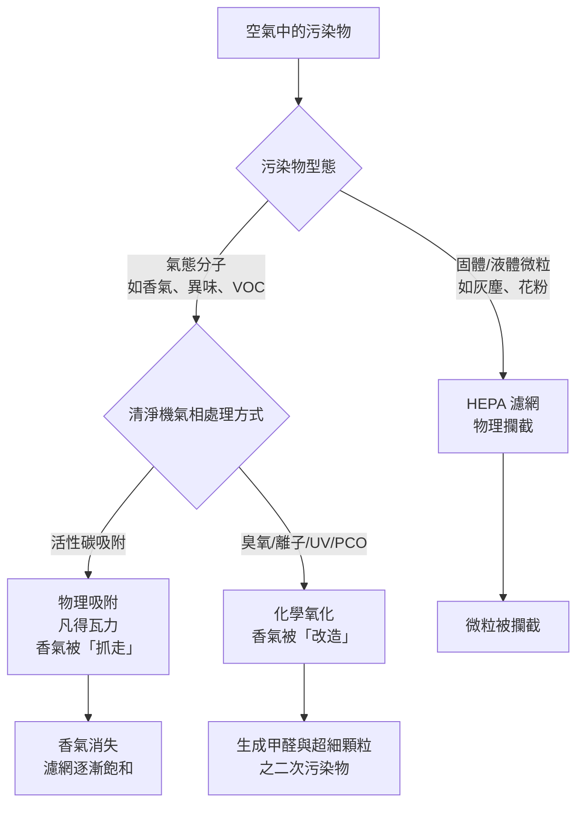

# 室內芳香劑與活性碳空氣清淨機同時使用，會不會互相抵銷功能？

## 摘要

答案取決於「清淨機的種類」，而兩種情況的結果差異極大：

1. **若是活性碳（含 HEPA）濾網式清淨機**：會。活性碳的設計目的就是吸附揮發性有機物（VOC），而芳香劑散發的香氣本身就是 VOC，因此清淨機會持續把香氣分子吸附掉，造成「香氣變淡、擴香效果被抵銷」的感官結果[^beast][^apqhq]。同時，這些香氛 VOC 會佔用活性碳有限的吸附位點，使濾網更快飽和、更換週期縮短[^purlife][^alen]。
2. **若是臭氧／離子／氧化型清淨機**：更糟。臭氧會與芳香劑中的萜烯類（如檸檬烯）發生化學反應，生成甲醛（IARC 一級致癌物）與超細懸浮微粒（二次有機氣膠），使室內空氣品質反而變差[^weschler06][^carb_haz]。這不是「互相抵銷」，而是「製造新的污染物」。

換句話說：**活性碳清淨機與芳香劑是「互相抵消」（清淨機贏，香氣消失）；臭氧清淨機與芳香劑是「互相加乘」（產生毒性副產物）**。以下逐項說明機制、證據、健康意義與實務建議。

---

## 1. 先釐清：清淨機的兩種除污機制

家用清淨機處理空氣污染物的方式大致分為兩類，兩者對香氣的意義完全不同：

- **HEPA 濾網**只能攔截「微粒」，無法捕捉氣態分子；氣味與 VOC 必須靠活性碳處理[^cleanstation][^smartair]。
- **活性碳**是物理吸附（physisorption）：氣體分子靠凡得瓦力（van der Waals forces）附著在活性碳極大量的微孔隙表面（典型比表面積約 700–1,500 m²/g，甚至可達 2,000 m²/g），分子本身不被化學改變[^taobao][^cleanstation][^acarbons][^huarui]。EPA 也明確指出，若要過濾氣體與 VOC，應選用含活性碳的機型，且「碳的用量越多越有效（越厚越好）」[^epa_guide]。
- **臭氧／離子／光催化（PCO/UV）** 類裝置則是靠氧化反應，會改變分子結構，因此可能產生新的副產物[^cen2025][^epa_ozone]；EPA 亦指出電漿、光催化與 UV 在居家可攜式清淨機中「尚未被證明能有效移除氣體」[^epa_guide]。

因為芳香劑散發的是**氣態 VOC 分子**，所以它落在「活性碳」與「氧化型裝置」的處理範圍內，這也是兩者會互相影響的根本原因。

---

## 2. 活性碳 + 芳香劑：真正的「抵銷」

### 2.1 香氣會被活性碳吸走

精油與芳香劑的主成分（萜烯、酯類、醇類等）屬於 VOC，而活性碳正是為了移除 VOC 而設計[^beast][^theairpurifierhq]。因此當擴香器與活性碳清淨機同處一室時，清淨機一邊由擴香器釋出香氣，一邊又把香氣分子吸回濾網，形成「自己把自己的香氣過濾掉」的矛盾[^beast]。

不過，抵銷並非百分之百。活性碳能**降低**空氣中香氣分子的濃度，但無法保證完全去除，仍有部分分子會逸散到空間中，因此實際感受通常是「香味明顯變淡、擴散範圍縮小」，而非完全聞不到[^plentiful]。

### 2.2 芳香劑會加速濾網飽和

活性碳的吸附位點數量有限。每吸附一個香氛分子，就少一個位點可用來捕捉其他異味或污染物[^purlife][^alen]。這種「競爭吸附」（competitive adsorption）在學術文獻中已充分證實：不同 VOC 分子與水氣分子會爭奪同一批吸附位點[^laskar2018][^springer2023]。

更進一步，吸附親和力較強的成分可能**置換**已被吸附、親和力較弱的成分，造成「置換／爬升效應」（roll-up effect）：原本已被捕捉的污染物可能在特定期間以高於入口的濃度被重新釋出[^est2014][^honeycomb]。這也意味著，被香氣「佔滿」的活性碳濾網，其後續對其他污染物的防護力會下降。

### 2.3 潮濕與脫附：吸附是有限度的

- **潮濕**會顯著降低活性碳對 VOC 的吸附容量。研究顯示，當相對濕度由 0% 上升到 60% 時，受測的四種 VOC（丙酮、甲苯、正己烷、正癸烷）的飽和吸附量全部下降[^sep2026]；水氣分子與 VOC 分子競爭同一批吸附位點，是潮濕環境下容量下降的主因[^laskar2018][^springer2023]；也有商業來源指出濕度高於約 70% 時吸附容量可能再下降 30–60%[^descent]。
- **脫附**：活性碳飽和後不但無法繼續吸附，在溫度升高或濕度變化時還可能把已吸附的分子釋回空氣，造成二次污染[^whalesens][^purifierhub]。這也是濾網飽和的典型警訊（出風口出現異味）[^cleanstation]。

### 2.4 對濾網壽命的實際影響

| 使用情境 | 建議更換週期 | 來源 |
|---|---|---|
| 一般住宅、低 VOC | 約 6–12 個月（優質大碳床可更長） | AirPurifierLabs[^purlife]、Smart Air[^smartair_life] |
| 併用芳香劑／高 VOC／高濕 | 可能縮短至 3–6 個月或更短 | Alen[^alen]、HomeHygia[^homehygia]、Whalesens[^whalesens] |

要注意的是，活性碳濾網不像 HEPA 有標準化的 CADR 性能標示，其氣相去除能力高度取決於**碳的實際質量（越多越好）**與使用環境[^epa_guide]，因此上述數字只能視為粗略範圍，而非規格保證。

---

## 3. 臭氧／離子／氧化型清淨機 + 芳香劑：不是抵銷，是加乘毒性

這是本題中最容易被誤解、也最危險的部分。若清淨機屬於會產生臭氧的機型（臭氧產生器、離子產生器、部分靜電集塵與紫外光／光催化裝置），則它與芳香劑的交互作用**不會**讓香氣消失，而是產生新污染物。

### 3.1 臭氧與萜烯的化學反應

芳香劑的主成分經美國環保署（EPA）分析，主要為檸檬烯（limonene）、α-蒎烯、β-蒎烯與莰烯等**萜烯類**[^epa_freshener]。萜烯的碳-碳雙鍵能與臭氧快速反應，生成：

- **甲醛**（IARC 列為 Group 1 一級致癌物）與其他醛類[^weschler06][^carb_fact]；
- **二次有機氣膠（SOA）與超細懸浮微粒（PM0.1）**[^weschler06][^wainman2000]；
- 羥自由基（OH），再進一步與其他有機物反應生成更多潛在毒性物質[^nazaroff2004]。

Weschler（2006）估計，在戶外臭氧濃度中等的區域，自行做日常清潔的人平均每天因「臭氧與清潔劑／芳香劑成分反應」而吸入約 20 µg 甲醛與 35 µg 二次有機氣膠（其中很大一部分是超細顆粒）[^weschler06]。

### 3.2 實測數據

- 加州大學 Irvine 團隊研究指出，以離子清淨機使臭氧上升 5–15 ppb（背景約 5 ppb）後，一旦注入檸檬烯，PM2.5 與 PM0.1 濃度會暴增**一到兩個數量級**（約 10³ 至 10⁵ 顆/cm³）；主導研究者 Nizkorodov 直言：「在檸檬烯存在下，這些清淨機實際上就是空氣污染製造機。」[^ehp2007]
- 德州大學的封閉艙研究顯示，於芳香劑存在下開啟離子清淨機，**甲醛上升約 8%**、**超細顆粒增加超過 800%**；部分機型（如 Sharper Image Ionic Breeze）甲醛增幅超過 50%[^smartair2024]。
- 2025 年發表於 *ACS ES&T Air* 的研究（Kroll、Ye 等，MIT/NCAR）發現，氧化型清淨機（UV 光電化學氧化）在處理芳香噴霧（Febreze）時，**雖移除部分 VOC，卻同時生成甲醛等副產物**[^cen2025]。

### 3.3 官方立場

- **EPA**：明確表示「臭氧濃度在不超過公共衛生標準的前提下，幾乎無法移除室內空氣污染物」，而且「沒有任何聯邦機構核准這類裝置用於有人員活動的空間」；臭氧與室內化學物質反應會產生具刺激性與腐蝕性的副產物[^epa_ozone][^epa_ionizer]。
- **加州空氣資源局（CARB）**：指出「臭氧會與空氣中既有化學物質反應，產生額外的有毒污染物，最主要是甲醛與超細顆粒」，並規定室內空氣清淨機的臭氧排放須低於 0.050 ppm（50 ppb），且建議臭氧產生器除經核可的工業用途（無人在場）外不應使用[^carb_fact][^carb_haz]。

---

## 4. 綜合對照：誰會抵銷誰？

| 清淨機類型 | 與芳香劑的作用 | 香氣結果 | 空氣品質結果 |
|---|---|---|---|
| HEPA 濾網式（無活性碳） | 幾乎不作用於氣態香氣分子 | 不受影響 | 無變化 |
| **活性碳（＋HEPA）濾網式** | **物理吸附香氛 VOC** | **香氣變淡、被抵銷** | 香氣與其他異味被移除；濾網加速飽和 |
| 離子清淨機／臭氧產生器 | **臭氧氧化萜烯** | 香氣改變（但不是被移除） | **變差**：生成甲醛、超細顆粒、SOA |
| 光催化／UV 氧化型（PCO） | 氧化分解 VOC | 香氣被分解 | 可能同時生成甲醛等副產物 |

---

## 5. 芳香劑本身的健康風險（不論是否併用清淨機）

即使不看清淨機，室內芳香劑本身就值得警惕：

- 美國 *Environmental Health Perspectives* 的研究調查 25 種香氛消費產品（含空氣清新劑），共測得**超過 133 種 VOC**，平均每種產品排放 17 種；**44% 的產品至少產生一種被列為致癌物的物質**（如乙醛、甲醛、二氯甲烷等），且標榜「綠色」「天然」「有機」的產品排放量並未較低[^ehp2011]。
- EPA 指出，室內 VOC 濃度通常是室外的 2–10 倍，而**空氣清新劑是已知的 VOC 來源之一**；VOC 的健康影響包括眼睛、鼻子、喉嚨刺激，頭痛、噁心、協調能力喪失，以及肝、腎與中樞神經系統損傷，部分物質具致癌性[^epa_voc]。
- 檸檬烯等萜烯本身會與室內臭氧（來自室外滲入或其他電器）反應生成甲醛與超細顆粒，這在沒有清淨機的情況下也可能發生[^weschler06]。
- 擴香棒（reed diffuser）與精油（包含長期存放者）皆已被證實是室內 VOC 的持續釋放源[^reed2024][^wiley_ina]。

---

## 6. 實務建議

1. **先問清淨機類型**：若機型會產生臭氧（臭氧產生器、離子產生器、部分靜電集塵），**切勿與芳香劑併用**，並建議直接停用該類裝置[^epa_ozone][^carb_haz]。
2. **活性碳機型無法「同時保香又除味」**：活性碳對 VOC 是無差別吸附，香氣與異味一視同仁。若堅持擴香，就要接受香氣被削弱、濾網加速飽和兩個結果。
3. **分時段使用**：若要在活性碳清淨機的空間中擴香，可考慮「清淨機與擴香分開時段運轉」，以減少吸附與競爭的浪費。
4. **縮短更換週期並觀察警訊**：併用芳香劑時，應把碳濾網更換週期從 6–12 個月縮短，並以「除味效果變差、出風口出現異味」作為更換訊號[^cleanstation]。
5. **不要試圖「曬太陽再生」碳濾網**：活性碳濾網無法靠日曬恢復吸附能力，須整片更換[^cleanstation]。
6. **回歸源頭控制**：EPA 建議以「源頭控制、通風、經證實的除污方法」為優先，芳香劑本身屬於應減少的污染源，而非清淨機要對抗的對象[^epa_guide][^epa_ozone]。

---

## 7. 資料品質與批判性反思

- **來源性質差異很大**：本報告中關於「香氣被吸附」「濾網飽和加速」的多數具體數字來自 **清淨機廠商與商業部落格**（如 PurifierBeast、PlentifulAir、AirPurifierLabs、HomeHygia、Alen），這些來源有販售濾網與機器的商業動機，數字（例如「高 VOC 環境下壽命縮短 50% 以上」[^descent]）**缺乏同儕審查佐證，應保守看待**。
- **可信度較高的一群來源**是官方機構與同儕審查文獻：EPA、CARB、Weschler 與 Nazaroff 系列研究，以及 *Environmental Science & Technology*、*Indoor Air*、*Environmental Health Perspectives* 等期刊。本報告對「臭氧＋萜烯→甲醛／超細顆粒」與「競爭吸附」的結論，主要建立在這些來源上，證據強度較高[^weschler06][^nazaroff2004][^est2014][^carb_fact]。
- **對立或未解的疑點**：
  - 活性碳對香氣的實際去除率，因缺乏家用氣相濾網的標準性能標示，難以量化；不同機型的有效碳質量差異可達數十倍[^epa_guide]。
  - 「置換／爬升效應」多在實驗室固定床吸附器中證實[^est2014]，在家中低濃度、多成分的實際環境中是否會造成可察覺的污染物再釋出，尚缺直接的家用實測。
  - 「活性碳＋芳香劑＝完全互相抵銷」是簡化說法：活性碳只能降低香氣濃度而非百分之百移除[^plentiful]，且香氣感知也受通風、空間大小與個人嗅覺影響。
- **未採信的來源**：部分內容農場與電商導購頁面（例如淘寶購物指南、部分中文健康網站）提供與官方一致的科普敘述，但其原始研究來源不明，本報告僅在與其他來源一致時作為旁證，未以其作為單一依據。

---

## 8. 參考文獻

Alen. (2026). *Activated carbon air filters: Everything you need to know*. Retrieved 2026-11-14, from https://alen.com/blogs/health-benefits/activated-carbon-air-filter

ACarbons. (2025, May 15). *Activated carbon surface area (BET) and pore size*. Retrieved 2026-11-14, from https://www.acarbons.com/activated-carbon-surface-area/

AirPurifierLabs. (2026). *Activated carbon filter life expectancy*. Retrieved 2026-11-14, from https://airpurifierlabs.com/activated-carbon-filter-life-expectancy/

Burton, A. (2007, July). Indoor air quality: Lemon-fresh ozone. *Environmental Health Perspectives, 115*(7), A350. Retrieved 2026-11-14, from https://pmc.ncbi.nlm.nih.gov/articles/PMC1913568/

California Air Resources Board. (2010, January 1). *California's regulation to limit ozone emissions from indoor air cleaning devices* [Fact sheet]. Retrieved 2026-11-14, from https://ww2.arb.ca.gov/resources/fact-sheets/californias-regulation-limit-ozone-emissions-indoor-air-cleaning-devices

California Air Resources Board. (n.d.). *Hazardous ozone-generating air purifiers*. Retrieved 2026-11-14, from https://ww2.arb.ca.gov/our-work/programs/air-cleaners-ozone-products/hazardous-ozone-generating-air-purifiers

Descent Analysis. (2026, May). *Activated carbon filter lifespan: VOC and odor removal degradation*. Retrieved 2026-11-14, from https://descentanalysis.org/articles/activated-carbon-filter-lifespan-voc-odor

Destaillats, H., Lunden, M. M., Singer, B. C., Coleman, B. K., Hodgson, A. T., Weschler, C. J., & Nazaroff, W. W. (2006). Indoor secondary pollutants from household product emissions in the presence of ozone: A bench-scale chamber study. *Environmental Science & Technology, 40*(14), 4421-4428. Retrieved 2026-11-14, from https://doi.org/10.1021/es052198z

HANYAN Activated Carbon. (2026, September 23). *How VOC mixtures affect honeycomb activated carbon performance*. Retrieved 2026-11-14, from https://honeycombcarbon.com/how-voc-mixtures-affect-honeycomb-activated-carbon-performance/

HomeHygia. (2026). *How to maximize carbon filter lifespan*. Retrieved 2026-11-14, from https://homehygia.com/carbon-filter-lifespan-air-purifier/

Huarui Activated Carbon. (2024, August). *椰殼活性碳碘值與比表面積*. Retrieved 2026-11-14, from https://www.huaruicarbon.com/

Krebs, K. A., De Jesus, V. R., Mason, M. A., & Liu, X. (2003, July). *Source characterization of air fresheners*. Presented at the Indoor Air Quality Problems and Engineering Solutions Symposium. Retrieved 2026-11-14, from https://cfpub.epa.gov/si/si_public_record_report.cfm?dirEntryId=64050

Laskar, I. I., Hashisho, Z., Phillips, J. H., Anderson, J. E., & Nichols, M. (2018). Competitive adsorption equilibrium modeling of volatile organic compound (VOC) and water vapor onto activated carbon. *Separation and Purification Technology*. Retrieved 2026-11-14, from https://www.sciencedirect.com/science/article/pii/S1383586618334609

Lim, X. (2025, December 4). Certain air cleaners may remove some VOCs but create others. *Chemical & Engineering News*. Retrieved 2026-11-14, from https://cen.acs.org/environment/persistent-pollutants/air-purifiers-make-VOCs-formaldehyde-febreze/103/web/2025/12

Nazaroff, W. W., & Weschler, C. J. (2004). Cleaning products and air fresheners: Exposure to primary and secondary air pollutants. *Atmospheric Environment, 38*(18), 2841-2865. Retrieved 2026-11-14, from https://doi.org/10.1016/j.atmosenv.2004.02.040

PlentifulAir. (n.d.). *Do air purifiers remove essential oils — Filters and fragrance*. Retrieved 2026-11-14, from https://plentifulair.com/do-air-purifiers-remove-essential-oils-filters-and-fragrance/

Purifier Beast. (2026). *Essential oils and air purifiers: What works and what to avoid*. Retrieved 2026-11-14, from https://purifierbeast.com/learn/essential-oils-air-purifier/

PurifierHub. (2025). *Do air fresheners affect air purifiers? What you need to know*. Retrieved 2026-11-14, from https://purifierhub.com/do-air-fresheners-affect-air-purifiers/

PurifierHub. (2025, October 4). *Do air fresheners affect air purifiers? What you need to know*. Retrieved 2026-11-14, from https://purifierhub.com/do-air-fresheners-affect-air-purifiers/

Separation and Purification Technology. (2026). Effect of relative humidity on VOC adsorption capacity of activated carbon. Retrieved 2026-11-14, from https://www.sciencedirect.com/journal/separation-and-purification-technology

Environmental Science and Pollution Research. (2023). Competitive adsorption characteristics of volatile organic compounds and water vapor on Fe/N-doped activated carbon. Retrieved 2026-11-14, from https://link.springer.com/journal/11356

Environmental Science & Technology. (2014). Competitive adsorption of volatile organic compound mixtures on activated carbon in a fixed-bed adsorber. Retrieved 2026-11-14, from https://pubs.acs.org/journal/esthag

Smart Air. (2024, February 29). *Study finds ionizers increase air pollution*. Retrieved 2026-11-14, from https://smartairfilters.com/en/blog/ionizers-can-increase-pollution-particles-formaldehyde/

Smart Air. (2025, March 10). *Do activated carbon filters remove odors?* Retrieved 2026-11-14, from https://smartairfilters.com/en/blog/do-activated-carbon-filters-remove-odors/

Steinemann, A. C., et al. (2011, January). Indoor air quality: Scented products emit a bouquet of VOCs. *Environmental Health Perspectives*. Retrieved 2026-11-14, from https://pmc.ncbi.nlm.nih.gov/articles/PMC3018511/

The Air Purifier HQ. (2026). *Air purifiers with essential oil diffusers: What to know*. Retrieved 2026-11-14, from https://theairpurifierhq.com/blog/air-purifiers-with-essential-oil-diffusers-what-to-know

United States Environmental Protection Agency. (2018, August). *Residential air cleaners: A technical summary* (3rd ed.). Retrieved 2026-11-14, from https://www.epa.gov/indoor-air-quality-iaq/air-cleaners-and-air-filters-home

United States Environmental Protection Agency. (2026, February 18). *What are ionizers and other ozone generating air cleaners?* Retrieved 2026-11-14, from https://www.epa.gov/indoor-air-quality-iaq/what-are-ionizers-and-other-ozone-generating-air-cleaners

United States Environmental Protection Agency. (2026, February 19). *Ozone generators that are sold as air cleaners*. Retrieved 2026-11-14, from https://www.epa.gov/indoor-air-quality-iaq/ozone-generators-are-sold-air-cleaners

United States Environmental Protection Agency. (2026, June 23). *Volatile organic compounds' impact on indoor air quality*. Retrieved 2026-11-14, from https://www.epa.gov/indoor-air-quality-iaq/volatile-organic-compounds-impact-indoor-air-quality

United States Environmental Protection Agency. (2026, October 1). *Guide to air cleaners in the home*. Retrieved 2026-11-14, from https://www.epa.gov/indoor-air-quality-iaq/guide-air-cleaners-home

Wainman, T., Zhang, J., Weschler, C. J., & Lioy, P. J. (2000). Ozone and limonene in indoor air: A source of submicron particle exposure. *Environmental Health Perspectives, 108*(12), 1139-1145. Retrieved 2026-11-14, from https://pmc.ncbi.nlm.nih.gov/articles/PMC1240194/

Weschler, C. J. (2000). Ozone in indoor environments: Concentration and chemistry. *Indoor Air, 10*(4), 269-288. Retrieved 2026-11-14, from https://doi.org/10.1034/j.1600-0668.2000.010004269.x

Weschler, C. J. (2006, October). Ozone's impact on public health: Contributions from indoor exposures to ozone and products of ozone-initiated chemistry. *Environmental Health Perspectives, 114*(10), 1489-1496. Retrieved 2026-11-14, from https://pmc.ncbi.nlm.nih.gov/articles/PMC1626413/

Weschler, C. J., & Shields, H. C. (1999). Indoor ozone/terpene reactions as a source of indoor particles. *Atmospheric Environment, 33*(15), 2301-2312. Retrieved 2026-11-14, from https://www.sciencedirect.com/science/article/pii/S1352231099000837

Whalesens. (2026, May 18). *活性炭过滤器优缺点详解：吸附原理、适用范围与选型更换全攻略*. Retrieved 2026-11-14, from https://www.whalesens.cn/insights/product-knowledge/activated-carbon-filter-pros-cons-guide.html

綠界清淨站. (2026, November 11). *活性碳濾網可以除臭嗎？吸附原理、使用限制與挑選重點*. Retrieved 2026-11-14, from https://ec.cleanstation.com.tw/blogs/knowledge/activated-carbon-filter-odor

[^beast]: Purifier Beast (2026). 「精油含有 VOC 化合物——正是附活性碳段的空氣清淨機被設計來移除的同一類污染物。」
[^apqhq]: The Air Purifier HQ (2026). 每一滴加入的精油，有一部分正是碳層被設計來去除的物質，因此香氣會被碳層移除，且碳層因此更快飽和。
[^theairpurifierhq]: 同前註。
[^purlife]: AirPurifierLabs (2026). 一般住宅活性碳濾網壽命約 6–12 個月；VOC 濃度升高會加速飽和、縮短壽命。
[^plentiful]: PlentifulAir (n.d.). 具活性碳濾網的清淨機可移除或降低空氣中的精油，但只能「降低」香氣，無法百分之百去除。
[^alen]: Alen (2026). 活性碳濾網常見壽命 3–6 個月；污染物或氣味較多的環境會使碳更快飽和。
[^laskar2018]: Laskar et al. (2018). 以 Manes 理論模擬 VOC 與水氣在活性碳上的多成分競爭吸附。
[^springer2023]: Environmental Science and Pollution Research (2023). Fe/N 摻雜活性碳上 VOC 與水氣的競爭吸附特性研究。
[^est2014]: Environmental Science & Technology (2014). 固定床吸附器中 VOC 混合物競爭吸附模型，證實吸附強者置換弱者造成「roll-up」現象。
[^honeycomb]: HANYAN Activated Carbon (2026, September 23). 多種蒸氣同時進入碳床時會競爭吸附位點，改變突破（breakthrough）的順序與時間。
[^sep2026]: Separation and Purification Technology (2026). 相對濕度由 0% 升至 60% 時，四種 VOC 的飽和吸附量全部下降。
[^descent]: Descent Analysis (2026, May). 高 VOC 濃度環境下濾網壽命可縮短 50% 以上；濕度 >70% 時吸附容量再降 30–60%。（商業來源，未經同儕審查）
[^whalesens]: Whalesens (2026, May 18). 活性碳飽和後不僅無法繼續吸附，溫度升高或濕度變化時可能脫附，造成二次污染。
[^purifierhub]: PurifierHub (2025). 芳香劑的 VOC 會使活性碳更快飽和，且部分香精成分可能造成 off-gassing，把已捕捉的污染物釋回空氣。
[^cleanstation]: 綠界清淨站 (2026, November 11). 氣味分子靠活性碳吸附；HEPA 攔截微粒；除味效果變差或出風口出現異味為更換訊號；不可靠曬太陽再生。
[^smartair]: Smart Air (2025, March 10). 活性碳捕捉氣體（吸附）、HEPA 捕捉微粒。
[^taobao]: 淘寶購物指南 (2026, September 15). 活性碳靠物理吸附（凡得瓦力）捕捉氣體分子，非化學分解；建議 3–6 個月更換。
[^acarbons]: ACarbons (2025, May 15). 活性碳比表面積由 BET 法測得，典型商用活性碳約 700–1,500 m²/g，高品質者（如椰殼碳）可達 1,200–2,000 m²/g。
[^huarui]: Huarui Activated Carbon (2024). 活性碳以物理吸附作用捕捉氣體分子，吸附力主要來自凡得瓦力與孔隙結構。
[^epa_freshener]: Krebs et al. (2003). EPA 分析五種空氣清新劑，主要成分為檸檬烯、α-蒎烯、β-蒎烯與莰烯等萜烯。
[^weschler06]: Weschler (2006). 臭氧與萜烯／檸檬烯反應生成甲醛（IARC 一級致癌物）與二次有機氣膠；清潔作業者平均每日吸入約 20 µg 甲醛與 35 µg SOA。
[^nazaroff2004]: Nazaroff & Weschler (2004). 清潔劑與空氣清新劑中的萜烯可與室內臭氧快速反應，生成包括甲醛在內的二次污染物與羥自由基。
[^carb_fact]: California Air Resources Board (2010). 「臭氧也會與其他化學物質（例如賦予部分家用產品松木或柑橘氣味的萜烯）反應，產生甲醛等有毒副產品。」臭氧排放上限 0.050 ppm。
[^carb_haz]: California Air Resources Board (n.d.). 「臭氧被發現會與空氣中既有化學物質反應，產生額外的有毒污染物，最主要是甲醛與超細顆粒。」
[^epa_ozone]: United States Environmental Protection Agency (2026, February 19). 臭氧濃度不超過公共衛生標準時幾乎無法移除室內污染物；沒有任何聯邦機構核准這類裝置用於有人空間。
[^epa_ionizer]: United States Environmental Protection Agency (2026, February 18). 離子產生器與部分電子式清淨機間接產生臭氧，臭氧產生器則直接產生；臭氧為肺部刺激物。
[^ehp2007]: Burton (2007). 引述 UC Irvine 研究：離子清淨機使臭氧上升 5–15 ppb 後，注入檸檬烯造成 PM2.5／PM0.1 暴增一至兩個數量級；研究者稱此時清淨機實為空氣污染製造機。
[^smartair2024]: Smart Air (2024, February 29). 引述德州大學研究：芳香劑存在下開啟離子清淨機，甲醛上升 8%、超細顆粒增加逾 800%。
[^cen2025]: Lim (2025, December 4). 引述 2025 年 *ACS ES&T Air* 研究：氧化型清淨機在處理芳香噴霧時移除部分 VOC，卻同時生成甲醛等副產物。
[^ehp2011]: Steinemann et al. (2011). 25 種香氛產品共測得 133 種以上 VOC，平均每種 17 種，44% 至少產生一種致癌物；標榜天然者排放未較低。
[^epa_voc]: United States Environmental Protection Agency (2026, June 23). 室內 VOC 濃度常為室外 2–10 倍；空氣清新劑為 VOC 來源之一；健康影響含刺激、頭痛、器官與中樞神經損傷及致癌性。
[^reed2024]: *Device* (2024). 擴香棒（reed diffuser）的全尺寸艙體研究證實其為室內 VOC 重要來源。
[^wiley_ina]: *Indoor Air* (2024-2025). 長期存放的精油（茶樹油、玫瑰油）仍持續釋放 VOC 並具暴露風險。
[^wainman2000]: Wainman et al. (2000). 證實臭氧-檸檬烯反應可在室內產生顯著次微米顆粒濃度。
[^epa_guide]: United States Environmental Protection Agency (2018, August; 2026, October 1). 建議以源頭控制與通風優先；活性碳氣相去除能力高度取決於碳的質量；濾網需定期更換。
[^smartair_life]: Smart Air (n.d.). 活性碳濾網壽命「取決於使用時所過濾的氣體與 VOC 濃度」，難以給出單一數字。
[^homehygia]: HomeHygia (2026). 碳濾網常見壽命 3–6 個月；減少煙霧、化學噴霧與油煙可延長壽命。
