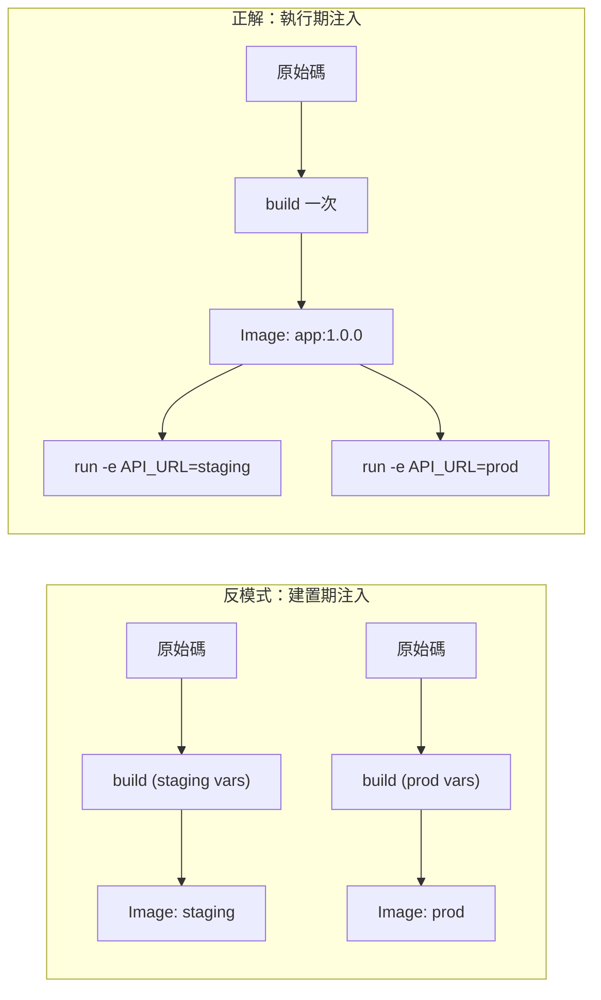
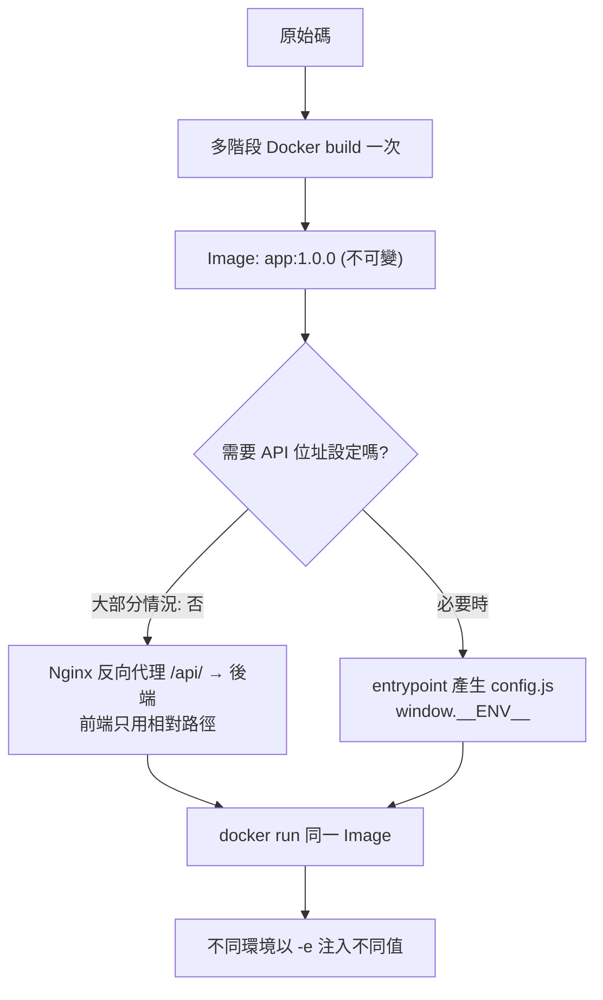

# 前後端分離架構下，前端 Docker Image 的執行期設定最佳實踐

## 摘要

在「前後端分離」架構中，前端通常是一包被 SPA(Single Page Application)框架編譯出來的靜態檔案（HTML、JavaScript、CSS），再被打包進一個 Docker Image 內，交由 Nginx 等靜態伺服器提供給客戶端瀏覽器。這種架構會遇到一個核心矛盾：

- **把 API 位址等資訊編譯進 Image 內並不實際**：一旦 Image 建置完成，設定值就固定了，無法在佈署後（部署到測試、正式環境時）修改。
- **前端實際執行在客戶端的瀏覽器**：瀏覽器沒有伺服器端的環境變數（`process.env`）、沒有檔案系統、也沒有「執行環境」可言，因此無法像後端程式那樣直接用 `docker run -e` 注入環境變數。

本文說明這個問題的成因，並整理實務上被廣泛採用的解決方案、對應的開源工具，以及推薦的最佳實踐。

---

## 1. 問題的根源：建置期靜態字串替換

許多人誤以為前端也可以像後端一樣讀取環境變數。實際上，像 `REACT_APP_*`、`VITE_*` 這類變數，是在**建置階段（build time）**由打包工具做**靜態字串替換**後，直接寫死進 JavaScript 產物中的。

Create React App 官方文件明確指出，環境變數是在建置時被內嵌的，且因為 CRA 產出的是靜態 HTML/CSS/JS，它在執行期「不可能」讀取環境變數[^cra]：

> The environment variables are embedded during the build time. Since Create React App produces a static HTML/CSS/JS bundle, it can't possibly read them at runtime.

Vite 的做法也相同，`import.meta.env.VITE_*` 會在建置時被靜態替換，以利 tree-shaking[^vite-env]：

> These constants are defined as global variables during dev and statically replaced at build time to make tree-shaking effective.

### 為什麼這在容器情境下是問題

| 面向 | 不良後果 |
|---|---|
| Image 數量 | 每個環境（dev / staging / prod）都得各自建置一個 Image |
| CI/CD 成本 | 每次改設定都要重跑完整的 `npm ci && npm run build` |
| 設定洩漏 | 所有值被永久寫死進壓縮後的 JS，任何人用瀏覽器 DevTools 即可檢視 |
| 無法「同一 Image 逐環境晉升」 | 無法用同一個 SHA 的 Image 做漸進式佈署 |

Vite 官方討論區就有一個具體的失敗情境：在 CI 管線建置 Image 時，staging 的變數被烤進了壓縮檔；當同一個 Image 被晉升到 production 時，客戶端請求仍然打到 staging 的端點[^vite-discussion]。

這違反了《十二因素應用程式》(The Twelve-Factor App) 的第三項原則——**設定 (Config)**[^12factor]：

> The twelve-factor app stores config in environment variables (often shortened to env vars or env). Env vars are easy to change between deploys without changing any code; unlike config files, there is little chance of them being checked into the code repo accidentally.

其核心精神是「**一次建置，多處佈署 (build once, deploy anywhere)**」：建置產物在所有環境都應該完全相同，只有執行環境（設定）不同。第五項原則「Build, release, run」也強調，建置（build）與設定（config）必須嚴格分離，兩者結合成為一次「發佈 (release)」[^12factor-build]。



---

## 2. 實務上的解決方案

### 2.1 執行期注入：以 entrypoint 產生 `config.js`（最推薦）

這是「一次建置，多處佈署」最標準、最可靠的做法。原理是：在 `index.html` 中、bundler 產物**之前**，先載入一支由容器啟動時動態產生的設定檔，並把設定值掛到全域變數（例如 `window.__ENV__`）上。

**步驟一：準備一支佔位設定檔 `public/env-config.js`**（本機開發時使用）

```js
window.__ENV__ = {
  API_URL: "http://localhost:8000",
  APP_ENV: "development"
};
```

**步驟二：在 `index.html` 最前面載入**

```html
<head>
  <script src="/env-config.js"></script>
  <!-- bundler 產物在其後載入 -->
</head>
```

**步驟三：撰寫有型別與開發期 fallback 的存取層 `src/config.ts`**

```ts
interface RuntimeConfig {
  API_URL: string;
  APP_ENV: string;
}

declare global {
  interface Window { __ENV__?: RuntimeConfig; }
}

export const config: RuntimeConfig = {
  API_URL: window.__ENV__?.API_URL || import.meta.env.VITE_API_URL || "http://localhost:8000",
  APP_ENV: window.__ENV__?.APP_ENV || import.meta.env.MODE || "development",
};
```

**步驟四：容器啟動時產生設定檔 `docker-entrypoint.sh`**

```sh
#!/bin/sh
set -e

cat <<EOF > /usr/share/nginx/html/env-config.js
window.__ENV__ = {
  API_URL: "${API_URL:-http://localhost:8000}",
  APP_ENV: "${APP_ENV:-production}"
};
EOF

exec "$@"
```

**步驟五：多階段 Dockerfile（只建置一次）**

```dockerfile
FROM node:20-alpine AS builder
WORKDIR /app
COPY package*.json ./
RUN npm ci
COPY . .
RUN npm run build

FROM nginx:alpine
COPY --from=builder /app/dist /usr/share/nginx/html
COPY docker-entrypoint.sh /docker-entrypoint.sh
RUN chmod +x /docker-entrypoint.sh
EXPOSE 80
ENTRYPOINT ["/docker-entrypoint.sh"]
CMD ["nginx", "-g", "daemon off;"]
```

**使用方式：同一個 Image，不同設定**

```bash
docker run -e API_URL=https://api.staging.example.com myapp:1.0.0
docker run -e API_URL=https://api.example.com         myapp:1.0.0
```

這個模式在 Vite 官方討論串中被多方採用，多個留言者都收斂到同一套做法[^vite-discussion][^devto-bo]。

### 2.2 Nginx `docker-entrypoint.d/` 掛鉤 + `envsubst`

官方 Nginx Docker Image 會在容器啟動時，自動執行 `/docker-entrypoint.d/` 目錄下所有可執行腳本。這是**侵入性最低**的做法，因為不需要覆寫 `ENTRYPOINT` 或 `CMD`。

**樣板檔 `runtime-env.template.js`**

```js
window.RUNTIME_ENV = {
  API_URL: "${API_URL}",
  FEATURE_FLAG_ANALYTICS: "${FEATURE_FLAG_ANALYTICS}",
  SENTRY_DSN: "${SENTRY_DSN}",
};
```

**啟動腳本 `entrypoint.sh`（放到 `/docker-entrypoint.d/40-runtime-env.sh`）**

```sh
#!/bin/sh
set -eu

envsubst '${API_URL} ${FEATURE_FLAG_ANALYTICS} ${SENTRY_DSN}' \
  < /usr/share/nginx/html/runtime-env.template.js \
  > /usr/share/nginx/html/runtime-env.js

rm -f /usr/share/nginx/html/runtime-env.template.js
```

**Dockerfile**

```dockerfile
FROM nginx:alpine
RUN apk add --no-cache gettext   # 提供 envsubst
COPY --from=builder /app/build /usr/share/nginx/html
COPY public/runtime-env.template.js /usr/share/nginx/html/runtime-env.template.js
COPY entrypoint.sh /docker-entrypoint.d/40-runtime-env.sh
RUN chmod +x /docker-entrypoint.d/40-runtime-env.sh
```

> **重要陷阱**：`envsubst` 一定要**明確列出白名單變數**。若執行不帶參數的 `envsubst`，它會替換檔案中所有的 `$` 符號，導致 JavaScript 的樣板字串（template literal）等語法被破壞[^devto-imzihad]。

### 2.3 Nginx `sub_filter` 即時字串替換

`ngx_http_sub_module` 可以在回應（response）送出時即時替換字串：

```nginx
location / {
    sub_filter '__API_URL__'  'https://api.production.com';
    sub_filter '__APP_ENV__'  'production';
    sub_filter_once off;
    sub_filter_types application/javascript;
}
```

但這通常**不是** SPA 的正確選擇[^nginx-subfilter]：

- 官方 `nginx:alpine` Image **預設未編譯**此模組（需 `--with-http_sub_module`）。
- `sub_filter` 對**每一個請求**都執行字串掃描，帶來 CPU 額外負擔。
- 與 gzip 搭配時情況複雜（需確保回應未被預先壓縮）。
- 樣板語法可能與 SPA 自身的 `{{ }}` 或 `__...__` 撞名。

### 2.4 執行期抓取靜態 `/config.json`

另一種做法是不注入全域變數，而是讓 SPA 在啟動（mount）之前用 `fetch('/config.json')` 抓取設定。

```nginx
location = /config.json {
    alias /etc/nginx/runtime-config/production.json;
    add_header Cache-Control "no-cache, no-store, must-revalidate";
    add_header Content-Type application/json;
}
```

```js
const response = await fetch('/config.json');
const config = await response.json();
// config.apiBase 等，之後才 mount 應用
```

| 比較項 | `/config.json` | `window.__ENV__` |
|---|---|---|
| 啟動延遲 | 多一次網路往返 | 立即（同步） |
| 伺服器複雜度 | 無（純靜態） | 需要字串替換 |
| 快取安全風險 | 設定檔必須不快取，否則會拿到舊設定 | 無（每次請求注入） |
| XSS 風險 | 低（僅 `JSON.parse`） | 較高（注入未轉義內容） |

### 2.5 同源反向代理：徹底消除 API 位址設定

最貼近十二因素精神的做法，其實是**讓前端根本不需要設定 API 位址**。做法是由 Nginx 把 `/api/` 的請求反向代理到後端服務，前端只使用相對路徑（`fetch('/api/users')`）。

```nginx
server {
    listen 80;
    root /var/www/myapp/dist;

    location / {
        try_files $uri $uri/ /index.html;
    }

    location /api/ {
        proxy_pass http://backend-api:8080/;
        proxy_set_header Host $host;
        proxy_set_header X-Real-IP $remote_addr;
        proxy_set_header X-Forwarded-For $proxy_add_x_forwarded_for;
        proxy_set_header X-Forwarded-Proto $scheme;
    }
}
```

根據 Nginx `proxy_pass` 文件，當 `proxy_pass` 帶有 URI（結尾的斜線，如 `http://backend-api:8080/`）時，符合 location 前綴的部分會被替換為該 URI，因此 `/api/users` 會被轉為 `http://backend-api:8080/users`[^nginx-proxy].

**優點**：
- 前端**完全不需要** API 位址設定，能真正做到「環境無關」。
- **沒有 CORS 問題**：API 與 SPA 同源（同 scheme + host + port），瀏覽器不需 CORS 標頭，可省下整類設定與除錯工作。
- **Cookie 順暢**：`SameSite=Strict`、`HttpOnly` 等 Cookie 與驗證流程在同源下運作自然。

**缺點**：
- Nginx 成為必要元件（但實務上幾乎每個正式環境 SPA 本來就有反向代理層）。
- 路徑可能衝突：若前端自己也用 `/api/` 作為前端路由，需選用不同的前綴。
- WebSocket 代理需額外設定 `proxy_set_header Upgrade` 與 `proxy_http_version 1.1`。

### 2.6 伺服器端渲染（SSR）取得伺服器環境變數

SSR 框架（Next.js、Nuxt）因為有 Node.js 伺服器，可以透過伺服器端函式讀取環境變數並傳給前端元件。

Next.js 提供 `getServerSideProps`，官方文件明確建議用它來讀取執行期環境變數，以實現「單一 Docker Image 跨多環境晉升」[^nextjs]：

```js
export async function getServerSideProps() {
  return {
    props: {
      API_BASE_URL: process.env.API_BASE_URL,
      ANALYTICS_ID: process.env.ANALYTICS_ID,
    },
  };
}
```

Nuxt 則提供 `runtimeConfig` API，區分僅伺服器可見的私有鍵與可暴露給客戶端的 `public` 鍵，並可用環境變數（如 `NUXT_PUBLIC_API_BASE`）在執行期覆寫[^nuxt]。

**代價**：需要 Node.js 執行環境（記憶體、CPU、行程管理、冷啟動），且快取失效更難處理（render cache、CDN cache、API cache）。若只是為了解決環境變數問題就導入 SSR，屬於「殺雞用牛刀」；但若團隊本來就有 SEO 或動態 OG Image 等需求，這是很自然的選擇。

---

## 3. 開源工具比較

| 工具 / 做法 | GitHub Stars | 維護狀態 | 支援打包器 | 機制 |
|---|---|---|---|---|
| [import-meta-env](https://github.com/runtime-env/import-meta-env) | 276 | 活躍（2025-09 發佈） | Vite、Webpack、Rollup、ESbuild、Babel、SWC | 建置期注入佔位符，執行期以 CLI 替換 |
| [@beam-australia/react-env](https://github.com/andrewmclagan/react-env) | 310 | 低度活動 | CRA、Next.js | 啟動前 CLI 產生 `__ENV.js`（`window.__ENV`） |
| [cra-runtime-environment-variables](https://github.com/kunokdev/cra-runtime-environment-variables) | 222 | 穩定（模式本身無須維護） | 框架無關 | shell 腳本產生 `env-config.js` |
| [runtime-env-cra](https://github.com/kHRISl33t/runtime-env-cra) | 49 | 已停止維護（2021-08） | 僅 CRA | CLI 產生 `runtime-env.js`（`window.__RUNTIME_CONFIG__`） |
| [vite-plugin-runtime-env](https://github.com/micha149/vite-plugin-runtime-env) | 35 | 活躍（2025-06） | Vite | 外掛轉換 `import.meta.env` → `window.env`，搭配 `envsubst` |
| [vite-plugin-env-runtime](https://github.com/werheng/vite-plugin-env-runtime) | 1 | 低度活動 | Vite | 轉換環境變數引用 → 全域變數，產生 `config.js` |
| [react-inject-env](https://www.npmjs.com/package/react-inject-env) | 無公開 Repo | 已停止維護（2022-05） | 通用 SPA | 產生靜態 `env.js` |

**說明**：`import-meta-env` 是目前維護最積極、支援打包器最廣的方案；`@beam-australia/react-env` 星數雖較高，但活動度偏低。若只需要一個輕量、零依賴的做法，`envsubst` + Nginx entrypoint 的模式最單純。星數低於約 100 的專案（如 `runtime-env-cra`、`vite-plugin-env-runtime`）讀者應意識到其維護風險。

---

## 4. 推薦的最佳實踐

綜合以上，建議的組合策略如下：



1. **優先考慮同源反向代理**（2.5 節）。若能讓 Nginx 代理 `/api/`，前端就完全不需要 API 位址設定，這是落差最小、最符合十二因素的解。
2. **若確實需要執行期設定**（如多個外部服務端點、feature flag、Sentry DSN），使用 **entrypoint 產生 `config.js`** 掛到 `window.__ENV__`（2.1 節），或使用 **Nginx `docker-entrypoint.d/` + `envsubst` 白名單**（2.2 節）。
3. **多階段 Dockerfile**：建置階段用 Node，執行階段只放 `nginx:alpine` 與靜態產物，維持 Image 精簡與安全。
4. **同一 Image 跨環境晉升**：以 `docker run -e API_URL=... app:1.0.0` 或 Kubernetes ConfigMap 注入。
5. **避免 `sub_filter`**：除非已確認模組存在且能接受額外負擔。
6. **絕不放入機密**：任何在瀏覽器可存取的設定（`window.__ENV__`、`config.js`、`config.json`）都是公開的，僅能放「公開的客戶端設定」，不得放資料庫連線字串、私鑰或私有 API 金鑰[^devto-imzihad][^cra]。

### entrypoint 腳本安全檢查清單

1. 結尾使用 `exec "$@"`，讓訊號（如 SIGTERM）能傳遞給 Nginx。
2. `envsubst` 務必明確列出變數白名單，切勿使用無參數版本。
3. 提供 shell 預設值 fallback：`${VAR:-default}`。
4. 視情況用 `set -e` 在缺少必要變數時提早失敗 (fail fast)。
5. 在 Nginx 中對設定檔加上 `Cache-Control: no-cache`，避免瀏覽器或 CDN 快取舊設定。

---

## 5. 結論

「前端執行在瀏覽器、又被打包進 Docker Image」之所以難以設定，根源在於 bundler 於**建置期**把環境變數靜態替換進 JavaScript，這違反了十二因素的「設定與程式碼分離」原則。實務上的最佳實踐並非「想辦法讓瀏覽器讀環境變數」，而是**把設定的責任移轉到基礎設施層**：

- 能用**同源反向代理**消除設定最好；
- 需要執行期設定時，以 **entrypoint 產生 `config.js`** 或 **`envsubst` 樣板**注入，維持「一次建置、多處佈署」；
- **SSR** 雖能優雅解決，但成本高，應由其他需求驅動而非單純為環境變數而導入。

如此便能以單一不可變 Image，安全且一致地佈署到所有環境。

---

## 參考文獻

[^cra]: Create React App. (n.d.). *Adding custom environment variables*. Retrieved 2026-11-14, from https://create-react-app.dev/docs/adding-custom-environment-variables/

[^vite-env]: Vite. (n.d.). *Env variables and modes*. Retrieved 2026-11-14, from https://vitejs.dev/guide/env-and-mode.html

[^vite-discussion]: Vite. (n.d.). *Injecting runtime env vars in a Vite SPA (Docker build once, deploy anywhere)* [Discussion #23326]. Retrieved 2026-11-14, from https://github.com/vitejs/vite/discussions/23326

[^12factor]: Wiggins, A. (n.d.). *The Twelve-Factor App: III. Config*. Retrieved 2026-11-14, from https://12factor.net/config

[^12factor-build]: Wiggins, A. (n.d.). *The Twelve-Factor App: V. Build, release, run*. Retrieved 2026-11-14, from https://12factor.net/build-release-run

[^devto-bo]: Bo. (n.d.). *Runtime environment variables in frontend applications*. DEV Community. Retrieved 2026-11-14, from https://dev.to/bo/runtime-environment-variables-in-frontend-applications-4gf9

[^devto-imzihad]: Imzihad, M. (n.d.). *Runtime environment variables for React apps with Nginx and Docker*. DEV Community. Retrieved 2026-11-14, from https://dev.to/imzihad21/runtime-environment-variables-for-react-apps-with-nginx-and-docker-3p62

[^nginx-subfilter]: Nginx. (n.d.). *Module ngx_http_sub_module*. Retrieved 2026-11-14, from https://nginx.org/en/docs/http/ngx_http_sub_module.html

[^nginx-proxy]: Nginx. (n.d.). *Module ngx_http_proxy_module: proxy_pass*. Retrieved 2026-11-14, from https://nginx.org/en/docs/http/ngx_http_proxy_module.html

[^nextjs]: Next.js. (n.d.). *Environment variables*. Retrieved 2026-11-14, from https://nextjs.org/docs/pages/building-your-application/configuring/environment-variables

[^nuxt]: Nuxt. (n.d.). *Configuration: runtime config and environment variables*. Retrieved 2026-11-14, from https://nuxt.com/docs/getting-started/configuration

[^import-meta-env]: runtime-env. (n.d.). *import-meta-env: Build once, deploy anywhere*. Retrieved 2026-11-14, from https://github.com/runtime-env/import-meta-env

[^react-env]: McLagan, A. (n.d.). *react-env: Runtime configuration for React and Next.js*. Retrieved 2026-11-14, from https://github.com/andrewmclagan/react-env

[^kunokdev]: kunokdev. (n.d.). *cra-runtime-environment-variables*. Retrieved 2026-11-14, from https://github.com/kunokdev/cra-runtime-environment-variables

[^vite-plugin-runtime-env]: Micha. (2025). *vite-plugin-runtime-env*. Retrieved 2026-11-14, from https://github.com/micha149/vite-plugin-runtime-env

[^runtime-env-cra]: kHRISl33t. (2021). *runtime-env-cra*. Retrieved 2026-11-14, from https://github.com/kHRISl33t/runtime-env-cra

[^vite-plugin-env-runtime]: werheng. (2024). *vite-plugin-env-runtime*. Retrieved 2026-11-14, from https://github.com/werheng/vite-plugin-env-runtime

[^react-inject-env]: react-inject-env. (2022). *react-inject-env* [npm package]. Retrieved 2026-11-14, from https://www.npmjs.com/package/react-inject-env
