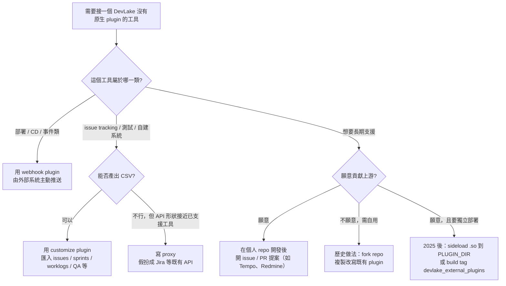

# DevLake 社群中關於「官方不支援但想要的 connector」與第三方 connector 的討論

## 摘要

Apache DevLake（以下簡稱 DevLake）是一套開源的開發資料平台，透過一連串「plugin」把各種 DevOps 工具（Jira、GitHub、GitLab、Jenkins 等）的資料抓進統一的正規化資料層，並以 Grafana 呈現 DORA 等工程指標[^devlake-repo]。本報告回答一個具體問題：**在 DevLake 社群中，是否存在關於「官方不支援、但使用者想要」的 connector，以及關於第三方 connector 的討論？**

結論概要如下：

1. **存在大量「想要但官方沒做」的請求。** DevLake 以 GitHub Issue 標籤 `add-a-plugin` 管理這類需求；截至 2026-11-14，該標籤下有 45 個 issue，其中僅 2 個仍處於開啟狀態[^aplugin-search][^aplugin-open]。長期最熱門的是 ArgoCD（42 個表情反應、89 則留言、自 2023-05 開啟至今）與 ServiceNow（自 2023-01 開啟至今）[^argocd-5207][^servicenow-4234]。
2. **社群自製的「官方之外」connector 確實存在，但幾乎都藏在個人 GitHub repo，星數極低（多為 0 星），且歷史上官方並未提供正式的第三方 plugin 機制。** 2023 年 DevLake 主要維護者直接回覆「standalone plugin 不可行，建議 fork repo 改一個既有 plugin」[^standalone-5251]。
3. **情況在 2025–2026 年出現轉折。** 官方文件新增了 Go plugin 的 `sideloading`（`PLUGIN_DIR` 下放 `.so` 即可載入）與 `devlake_external_plugins` build tag，並在 2026-10 的單一執行檔重構提案中，把 sideloading 明確定調為「支援第三方 plugin 的一級路徑」[^devsetup][^single-binary-9276]。
4. **社群開發的 connector 也能被官方接受並上游化。** 例如 Tempo（Jira Tempo Timesheets）由使用者在個人 repo 開發後開 issue 提案[^tempo-8883]；Redmine、GLPI、Zephyr 三個 Python plugin 由貢獻者開發並於 2026-10 至 2026-11 合併進主線[^pydevlake-9092][^redmine-pr-9265]。
5. **官方對「未支援工具」提供的正規替代路徑是 `customize` plugin（CSV 匯入）與 `webhook` plugin**，其設計動機文件本身就明白寫著「許多組織使用 DevLake 沒有原生 plugin 的多樣或自建 issue tracking 系統」[^customize-csv-8446][^customize-doc]。

## 1. 背景：DevLake 與其資料源

DevLake 由 Apache 軟體基金會孵化，repo 為 `apache/devlake`，主要語言為 Go，星數約 3,201、fork 約 839，授權 Apache-2.0[^devlake-repo]。它的架構由三個概念組成：

- **Raw layer**：plugin 從資料源抓下來的原始資料。
- **Tool layer**：對應各工具語意的中介資料表。
- **Domain layer**：跨工具統一的正規化模型（issues、pull_requests、cicd_pipelines、accounts 等），是分析與儀表板的基礎[^pluginimpl]。

官方文件列出的資料源包含 GitHub、GitLab、Jira、YouTrack、Jenkins、BitBucket、TAPD、Teambition、Zentao、Gitee、PagerDuty、Opsgenie、incident.io、Grafana IRM、Feishu、AE、SonarQube、Bamboo、Azure DevOps、CircleCI 等[^supported-sources]。官方 plugin 清單頁另列出 azuredevops、bamboo、bitbucket、bitbucket_server、circleci、customize、feishu、gitee、gitextractor、github、gitlab、grafana_irm、jenkins、jira、linker、monorepo、opsgenie、pagerduty、refdiff、sonarqube、tapd、teambition、trello、webhook、youtrack、zentao 等[^plugins-doc]。2026 年的建置重構說明書則指出，可建置的官方 plugin 目錄共 **47 個**[^single-binary-9276]。

## 2. DevLake 有「官方第三方 connector 機制」嗎？

### 2.1 2023–2024：清楚表態「不支援獨立的第三方 plugin」

2023-05-19，使用者 dantleech 在 GitHub Discussions 開了一則 Q&A，標題為「Standalone Plugin」（#5251）。他的情境是想接 ClickUp，但官方尚未支援，於是問：能不能寫一個輕量、獨立於 repo 之外的 plugin 來整合？他看到 `env.example` 裡有 `PLUGIN_DIR` 這個變數，想確認是否可行[^standalone-5251]。

主要維護者 klesh 於 2023-05-22 給出被標記為解答的回覆（原文）：

> "No, not really, data collection is not a one-time deal, the standalone plugin would not work well for our scenario, for example, we don't want to collect all data every time, and collected data must be crunched with others at some point. It would be much more practical to just fork the repo, copy and modify an existing plugin like `jira`, it is pretty mature at this point."[^standalone-5251]

也就是說，當時官方立場是：**第三方做法就是 fork 整個 repo，複製並改寫既有 plugin**，而不是維護獨立的外部 plugin。提問者隨後回覆「已 fork 並有進展」[^standalone-5251]。

同一時期的其他線索也一致：

- **2024-02-06，Discussion #6930「How to add external Pydevlake plugin?」**：使用者 gffuentes 問能否把 PyDevLake plugin 放在私有的獨立 repo、再讓 DevLake 指向它。klesh 於 2024-04-28 回覆：「It should be doable by mounting the plugin dir as a sub dir of `incubator-devlake/backend/python/plugins`」[^external-pydevlake-6930]。也就是說，外部 Python plugin 的唯一方法是**把它掛載／複製進官方 plugins 目錄**，而非每個 repo 各自獨立安裝。該討論並未被標記為已解答，2024-05 仍有使用者追問同一個問題[^external-pydevlake-6930]。
- **2024-06-04，Discussion #7570「Dependency management for new plugins」**：使用者 bobharwood 依官方文件寫了一個 Rally plugin，卻卡在 Go module 路徑（`module declares its path as: github.com/apache/incubator-devlake but was required as: github.com/bobharwood/...`）。官方回覆只給了 plugin 開發文件連結與建議找主要開發者，問題本身沒有被解答[^depmgmt-7570]。
- **2024-12-30，Discussion #8253「Backstage backend plugin」**：使用者 grahambrooks 想寫一個後端 plugin 把組織（使用者／團隊）資料餵進 DevLake，並提到「我試著把 core module 匯入到一個獨立專案，但在 1.0.1 版本裡似乎拿不到」。這則討論只有自動化機器人 dosubot 回覆一般性的 plugin 介面說明，沒有人回答「core module 能否在外部專案使用」這個核心問題[^backstage-8253]。

### 2.2 2025–2026：sideloading 成為「一級路徑」

官方《Developer Setup》文件（Next 版）新增了 **Sideloading plugins** 一節，內容明確表示：

> "A released `lake` binary already contains every official plugin, and it still accepts extras. Any `.so` found under `PLUGIN_DIR` (default `bin/plugins`) is opened at startup and registered on top of the compiled-in set, so you can add a custom plugin — or replace an official one — without rebuilding DevLake."[^devsetup]

同時文件列出兩個必須知道的限制：`.so` 必須以**完全相同的 DevLake 版本、Go 工具鏈、build flags 與依賴版本**編譯（否則 Go 會拒絕載入）；載入失敗的 plugin 會被記錄並略過，伺服器仍可啟動[^devsetup]。此外可使用 `DEVLAKE_PLUGINS=none make build` 或 `go build -tags devlake_external_plugins` 產生「不含任何 plugin、完全靠 `PLUGIN_DIR` 載入」的核心執行檔[^devsetup]。

2026-10-29，klesh 提出大型重構提案 **#9276「Build the core and all plugins into a single binary by default」**，其中第 6 節標題直接寫著「**Sideloading is a first-class path**」，並定義出兩種模式[^single-binary-9276]：

| 模式 | 建置方式 | 執行期行為 |
|---|---|---|
| 預設 | 一個 `bin/lake` | 所有官方 plugin 內建，外加 `PLUGIN_DIR` 內任何 `.so` |
| core-only | `-tags devlake_external_plugins` | 只有框架與 API，所有 plugin 都來自 `PLUGIN_DIR` |

同一提案也強化了 `LoadGoPlugins` 對第三方程式碼的容忍度：缺少 `PLUGIN_DIR` 不再視為啟動失敗；開不起來的 `.so`、沒有 `PluginEntry` 或未實作 `PluginMeta` 的檔案會被記錄並略過；與內建 plugin 同名的 `.so` 會覆蓋內建版本並發出警告[^single-binary-9276]。

值得注意的是，該提案同時指出 sideload 仍有明顯門檻：需要「發布建置配方（build recipe）」、需要版本握手（`APIVersion` / `PluginAPIVersion`），並主張把 `core/plugin`、`core/context`、`core/dal` 與 domain model 的公開型別「視為 public ABI」[^single-binary-9276]。換言之，**第三方 plugin 在此時才被官方明確當成要支援的對象，但相關文件與 API 穩定化在報告撰寫時仍屬待辦項目**（提案的 task list 中「Docs: how to build and sideload a plugin against a released image」尚未勾選）[^single-binary-9276]。

### 2.3 Python（PyDevLake）遠端 plugin

DevLake 另有 Python plugin 框架 PyDevLake。官方文件說明 Python plugin 不走 Go 的 registry，而是在執行期於 `REMOTE_PLUGIN_DIR` 下被發現[^pluginimpl]。不過在實務問題上，社群得到的指引仍是「掛載到官方 plugins 目錄」[^external-pydevlake-6930]。Python 框架本身在 2026 年曾一度被提議廢除，詳見第 6 節。

## 3. 官方不支援、社群想要的 connector：討論與請求

### 3.1 官方用來收斂需求的標籤：`add-a-plugin`

DevLake 以 GitHub Issue 標籤管理新增 plugin 的請求，標籤 `add-a-plugin` 的官方描述為「This issue is to add a plugin」[^aplugin-label]。以 GitHub 搜尋 API 查詢該標籤下的 issue，總數為 **45 件**；若把 PR 一併計入則為 63 件[^aplugin-search][^aplugin-search2]。其中處於開啟狀態、且帶有此標籤的 issue 只有 **2 件**[^aplugin-open]：

| Issue | 標題 | 建立日期 | 狀態 | 反應數 | 留言數 |
|---|---|---|---|---|---|
| [#5207](https://github.com/apache/devlake/issues/5207) | `[Feature] ArgoCD Integration` | 2023-05-16 | open | 42 | 89 |
| [#4234](https://github.com/apache/devlake/issues/4234) | `[Feature][Plugin] Support ServiceNow as an incident management system` | 2023-01-18 | open（已指派） | 2 | 16 |

### 3.2 官方投票：「下一個新 plugin 是什麼？」

2023-12-12，協作者 d4x1 在 GitHub Discussions 發起投票 **#6619「The next new plugin」**，開場說明：

> "Althrough DevLake supports many plugins … there are still many tools to be supported. Here is a vote that can help DevLake team to decide which is the next one to be supported. Feel free to comment your opinions."[^next-plugin-poll]

投票結果（49 票）為：ArgoCD 24%、SonarCloud 18%、Tekton 16%、FluxCD 14%、ServiceNow 12%、Trello 2%、Gitee 2%、Others 10%[^next-plugin-poll]。d4x1 指出投票選項上限為 8 個，「可惜還有太多 plugin 想加」[^next-plugin-poll]。留言中另外出現兩次 **Linear.app** 的請求（2024-04 與 2024-11）與兩次 **Kanbanize**（對應 issue #7616）[^next-plugin-poll]。

### 3.3 兩個「開了三年還沒做完」的代表案例

**ArgoCD（#5207）** 是最典型的「想要但官方不支援」案例。提案者 1ddo 的原文動機是：

> "Most of our CD are done with Kubernetes ArgoCD and we wanted to add this data connection to DevLake so we could leverage DORA for our deployment frequency."[^argocd-5207]

這則 issue 的互動量遠高於其他請求（89 則留言）[^argocd-5207]。其討論串本身就是一份「社群想辦法自己接」的紀錄：

- 使用者 klemen-df（2023-09）問「這件事的狀態是什麼？」，klesh 回覆：「Under discussion, no plan or volunteer at this point AFAIK 😂」[^argocd-5207]。
- 使用者 gespi1（2023-09）提出 ArgoCD multi-source application 的資料模型需求：DevLake 當時每個 app 只吃一個 `repo_url`，但多來源 app 的 `repoURL` 是清單[^argocd-5207]。
- 使用者 pratiyush05（2023-11）描述多 repo 對單一 deployment repo 的企業情境，klesh 建議先用 `webhook` plugin 建立 deployment，並指向後續支援多 repo 的 issue #6262[^argocd-5207]。
- 使用者 thiDucTran（2024-04）實際做出可運作的 ArgoCD Notifications → DevLake webhook 設定（以 YAML 提供），並獲得其他使用者 6 個 👍 反應；有留言建議應把此做法補進 webhook 文件，klesh 回應「PRs are welcome」[^argocd-5207]。

**ServiceNow（#4234）** 由協作者 Startrekzky 於 2023-01-18 提出，主張 ServiceNow 是最普及的 issue management 工具之一，對 DORA 的 incident 資料特別有價值：

> "A ServiceNow plugin is most useful for DevLake's support for DORA metrics. ServiceNow is one of the most popular issue management tools in the industry. DevLake would help more teams implement the DORA framework if it has a plugin that can pull incident data from ServiceNow."[^servicenow-4234]

該 issue 到 2026-10-05 仍有更新，並已指派給貢獻者 Thundercloud12[^servicenow-4234]。此外 2025-07-14 有使用者另開 Discussion #8502「Add Plugin for ServiceNow」詢問如何實作，klesh 只反問「Can you code? do you know golang?」，對方（2025-11）回答「會寫程式但 Go 只懂基礎」[^servicenow-8502]。

### 3.4 提出後被關閉或停滯的其他請求

除了上述兩件開啟中的 issue，`add-a-plugin` 標籤下的多數請求最終被關閉（部分標記為 `Stale`、部分 `not_planned`）。以下為可查證的代表案例：

| Issue | 想要但未支援的 connector | 建立日期 | 關閉狀態 |
|---|---|---|---|
| [#8869](https://github.com/apache/devlake/issues/8869) | CheckmarxOne（資安掃描） | 2026-05-07 | closed（not_planned） |
| [#8846](https://github.com/apache/devlake/issues/8846) | GitHub Copilot CLI 指標維度 | 2026-04-23 | closed（not_planned） |
| [#8801](https://github.com/apache/devlake/issues/8801) | PostgreSQL 作為 DevLake 後端資料庫 | 2026-03-22 | closed（not_planned） |
| [#8713](https://github.com/apache/devlake/issues/8713) | AI Adoption 指標 | 2026-02-12 | closed（not_planned） |
| [#8883](https://github.com/apache/devlake/issues/8883) | Tempo（Jira Tempo Timesheets） | 2026-05-24 | closed（已完成，上游合併） |
| [#8569](https://github.com/apache/devlake/issues/8569) | OpenProject | 2025-09-11 | closed（Stale） |
| [#8468](https://github.com/apache/devlake/issues/8468) | YouTrack | 2025-06-16 | closed（後續已成為官方支援） |
| [#7626](https://github.com/apache/devlake/issues/7626) | Sentry | 2024-06-14 | closed（Stale） |
| [#7616](https://github.com/apache/devlake/issues/7616) | Kanbanize | 2024-06-13 | closed（Stale） |
| [#6158](https://github.com/apache/devlake/issues/6158) | Octopus Deploy | 2023-09-27 | closed（Stale） |
| [#5871](https://github.com/apache/devlake/issues/5871) | Gerrit | 2023-08-14 | closed（Stale） |
| [#5505](https://github.com/apache/devlake/issues/5505) | Azure DevOps Issue tracking data model | 2023-06-15 | closed |
| [#4838](https://github.com/apache/devlake/issues/4838) | SonarCloud 支援 | 2023-03-31 | closed |
| [#4767](https://github.com/apache/devlake/issues/4767) | Coverity | 2023-03-24 | closed |
| [#3458](https://github.com/apache/devlake/issues/3458) | ClickUp | 2022-10-18 | closed |

[^aplugin-search][^aplugin-search2][^devlake-repo]

## 4. 第三方／社群自製 connector 的實際情況

### 4.1 社群自建、獨立於官方 repo 的 plugin

以 GitHub 搜尋「名稱或描述含 devlake plugin」的公開 repo，可找到多個由個人開發、**星數皆為 0** 的實作。這些正是「官方不支援、於是自己做」的具體證據：

| Repo | 說明 | 語言 | 星數 | 建立日期 |
|---|---|---|---|---|
| `acarmisc/apache-devlake-jira-tempo-plugin` | 讓 DevLake 吃 Jira Tempo 工時的 plugin；後續上游化為 #8883 | Go | 0 | 2026-04-10 |
| `irfanuddinahmad/taiga-devlake-plugin` | Taiga 整合 | Go | 0 | 2026-02-07 |
| `irfanuddinahmad/dev-telemetry-devlake-plugin` | 開發者 telemetry／生產力指標 | Go | 0 | 2026-02-12 |
| `tprinty/devlake_gerrit_plugin` | 抓取 Gerrit 資料（對應未實作的 Gerrit 請求 #5871） | Python | 0 | 2025-09-10 |
| `hjertmann/youtrack-proxy` | 以「Jira REST API proxy」包裝 YouTrack，讓 DevLake 用官方 Jira plugin 間接吃 YouTrack 資料 | Go | 0（1 fork） | 2026-08-29 |
| `Kunal-Khedkar25/gitea-devlake-plugin` | Gitea 整合（空 repo） | — | 0 | 2025-05-22 |
| `d4x1/devlake-plugin-analysis` | DevLake 協作者自己做的 plugin 分析 repo | — | 0 | 2023-08-29 |

[^plugin-repos-search]

這份清單有兩個值得注意的訊號：

1. **`hjertmann/youtrack-proxy` 的做法很有代表性**：官方 Jira plugin 吃的是 Jira REST API，因此第三方作者乾脆做一個「翻譯層」把 YouTrack 轉成 Jira API 形狀，繞過「沒有官方 YouTrack plugin」的問題。這正好反映出社群在缺乏第三方 plugin 機制時的變通方式[^plugin-repos-search]。附帶一提，YouTrack 之後已被官方納入支援清單[^supported-sources]。
2. **星數極低（全為 0）代表「社群自建 connector」在 DevLake 生態中尚未形成規模**，這些實作多是單一組織為自己需求而做，缺乏集中索引或市集。相對地，主 repo `apache/devlake` 約有 3,201 星[^devlake-repo]。依研究準則，星數低於約 100 的專案需評估是否值得報告；由於本主題即為「非官方 connector 討論」，低星數本身即是重要事實，故仍一併列出並標明其能見度有限。

### 4.2 社群做的 connector 被官方接納的案例

與「只能 fork」相對的另一條路，是社群開發後回饋上游：

- **Tempo（#8883）**：提案者 acarmisc 在個人 repo `acarmisc/apache-devlake-jira-tempo-plugin` 完成 plugin 後，於 2026-05-24 開 issue 提案，內容包含 worklog 收集、team 管理、對應到 `issue_worklogs` domain layer、以及 config-ui 整合；issue 於 2026-06-06 關閉[^tempo-8883]。
- **Redmine（PR #9265）**：2026-10-27 由貢獻者 rabelenda 提出，加入 Redmine 的 project、issue、journal、time entry 收集與 Grafana 儀表板，並附帶 PyDevLake 對 ticket domain 的改進；2026-10-28 即被合併[^redmine-pr-9265]。
- **GLPI、Zephyr**：同一貢獻者在 2026-11-09 的留言中確認「3 個 plugin 都已被合併」[^pydevlake-9092]。

這條路徑的關鍵在於：**官方接受貢獻，但不接受「官方 repo 之外的獨立安裝方式」**。Discussion #8282 中 klesh 對此講得最直白：

> "No one is working on it AFAIK. We are open to accepting new plugins for sure."[^aws-8282]

## 5. 官方給「未支援工具」的正規替代做法

既然「寫一個獨立第三方 connector」長期不暢通，DevLake 提供了三條官方路徑來接未支援的工具。這三條路徑在社群討論中反覆被提起，可視為官方對「不支援但想要」的實質回應。

### 5.1 `customize` plugin：CSV 匯入（最接近「萬用 connector」）

`customize` plugin 允許使用者：

- 在 domain layer 資料表新增／刪除欄位；
- 依規則從 raw layer 抽取值寫入特定欄位；
- 以 CSV 匯入 `issues`、`issue_commits`、`issue_repo_commits`、`sprints`、`issue_worklogs`、`issue_changelogs`、`qa_apis`、`qa_test_cases`、`qa_test_case_executions` 等資料表[^customize-doc]。

這條路徑被明確定位為「接未支援工具」的手段。issue #8446 的動機段落寫道：

> "Many organizations use diverse or custom-built issue tracking systems that are not natively supported by dedicated DevLake plugins. The 'Customize' plugin currently allows importing issues and issue_repo_commits via CSV, which is a valuable first step."[^customize-csv-8446]

同一需求串的延伸還有 #8400（匯入 issues.csv 時自動建立 accounts）、#8393（建立 QA domain 並支援 CSV 匯入）、#8444（non-incremental 匯入時串聯清空 qa_apis 與 qa_test_case_executions），這些都由協作者 narrowizard 提出並實作[^plugin-repos-search][^customize-doc]。換句話說，**當某個 issue tracking 工具沒有 plugin 時，官方路線是「自己想辦法輸出 CSV，再用 customize 餵進 domain layer」**。

### 5.2 `webhook` plugin：由外部系統主動推資料

對 CD／部署類工具（如 ArgoCD、Argo CD 之外的部署系統），官方建議改用 `webhook` plugin 讓外部系統「推」資料進 DevLake。klesh 在 ArgoCD 討論串中就建議用 webhook 建立 deployment[^argocd-5207]；社群使用者 thiDucTran 則實際給出可用的 ArgoCD Notifications 設定範例（透過 `argocd-notifications-cm` 的 template／trigger 與 Application annotation 觸發），並獲得其他使用者正面回報「可以運作（僅小幅修改）」[^argocd-5207]。

### 5.3 API proxy：假扮成已支援的工具

如第 4.1 節所述，`hjertmann/youtrack-proxy` 以 MIT 授權提供一個「Jira REST API proxy for YouTrack」，讓 DevLake 的 Jira plugin 能間接抓取 YouTrack 資料，描述原文即為「enables Apache DevLake to ingest YouTrack data via its Jira plugin」[^plugin-repos-search]。這是第三種變通：不新增 connector，而是讓既有 connector 誤以為自己接的是別的系統。

上述流程中的每一個節點都有對應的社群討論依據：webhook[^argocd-5207]、customize[^customize-csv-8446]、proxy[^plugin-repos-search]、上游貢獻[^tempo-8883][^redmine-pr-9265]、fork[^standalone-5251]、sideload[^devsetup][^single-binary-9276]。

## 6. 周邊爭議：PyDevLake 存廢與「社群想接的工具」

2026-09-02，klesh 提出 **#9092「[Proposal] Deprecate Python plugin framework and consolidate on Go」**，主張在 3 個月棄用期後移除 PyDevLake，理由是該框架幾乎沒有採用（僅 `azuredevops` 一個 plugin，且 `dbt` 已於 2026-08-31 移除），並可簡化 Docker 映像與 CI。提案列出四階段計畫（警告、凍結、遷移協助、移除）[^pydevlake-9092]。

這則提案引出了本報告最直接的「官方不支援但社群想接」對話。貢獻者 rabelenda 於 2026-09-02 回覆，說明其公司已開發 **Redmine、GLPI、Zephyr** 等 Python plugin，並加值了 Azure DevOps Python plugin（可抽 issues 與 QA entities），原文強調：

> "I really think that having python framwork lowers the barrier for implementing plugins … in general plugins take significantly less code and ceremony (I tried re implementing some in go and the resulting code is quite verbose and a little harder to read). If we contribute these changes would you consider keeping this support?"[^pydevlake-9092]

klesh 最初回應「主要挑戰是維護者不足……如果接下來 3 個月有更多人願意一起維護，我們樂意保留」，並建議用 AI 轉寫成 Go[^pydevlake-9092]。經過數輪往返後，klesh 於 2026-10-27 表示：

> "Thank you for the detailed explanation. I appreciate your passion, and if that is your plan, I think we could take another shot at Python. I will remove the deprecation, and you can start contributing."[^pydevlake-9092]

後續發展：[#9259](https://github.com/apache/devlake/pull/9259) 撤回棄用；PR #9265（Redmine）於 2026-10-28 合併；貢獻者於 2026-11-09 確認三個 plugin（Redmine、GLPI、Zephyr）皆已合併，並由另一位貢獻者 DoDiODev 接手把 `pydevlake`、`azuredevops`、`glpi`、`redmine`、`zephyr` 與 e2e 的 `fakeplugin` 升級到 Pydantic 2（PR #9352）[^pydevlake-9092]。此案例的意義是：**當社群用行動證明「想接的工具」與「願意維護」，官方立場是可以被改變的**。

## 7. 批判性反思：來源限制與判讀注意

1. **「DevLake 沒有第三方 connector 機制」是時點相關的敘述，不能一概而論。** 2023–2024 的官方回覆（#5251、#6930、#8253）明確表示沒有；但 2025 年後的文件已納入 sideloading，2026-10 的 #9276 更把它寫成「first-class path」[^standalone-5251][^external-pydevlake-6930][^backstage-8253][^devsetup][^single-binary-9276]。引用任何一方時都必須附上時間。
2. **文件版本差異。** `sideloading` 一節出現在官網的「Next」版文件；舊版本（v0.17–v0.21）的文件結構不同，未見同等的第三方支援敘述[^devsetup]。因此「官方是否支援第三方 plugin」的答案取決於參考哪一版文件。
3. **`add-a-plugin` 的數量易被誤讀。** GitHub 搜尋 API 對同一標籤，限定 `type:issue` 時為 45 件，未限定時為 63 件（含 PR）[^aplugin-search][^aplugin-search2]。若直接引用 63 會高估「使用者請求」的數量。
4. **大量請求以 `Stale` 關閉，未必代表「不需要」。** 多則 issue（如 Sentry、Kanbanize、Octopus Deploy、Gerrit）是被自動化流程標記 stale 後關閉，而非因需求消失[^plugin-repos-search][^aplugin-search]。反之，`not_planned` 的關閉（如 CheckmarxOne、PostgreSQL 後端）更像是官方明確不受理[^aplugin-search]。
5. **GitHub Discussions 的樣本偏小且多未獲解答。** 本報告引用的第三方 plugin 相關 Q&A（#5251、#6930、#7570、#8253、#8282、#8502、#8324）多數標記為 Unanswered，部分僅有機器人回覆[^external-pydevlake-6930][^depmgmt-7570][^backstage-8253][^aws-8282][^servicenow-8502]。這代表「社群討論」其實相當分散且未被官方系統性整理；主要互動仍以 GitHub Issues 與 Slack 為主。
6. **社群自建 repo 星數皆為 0，能見度極低。** 這既可能是「這類需求規模有限」，也可能是「沒有管道讓這些實作被發現」。兩種解讀都與現有資料相容，單憑星數無法判定。
7. **本報告的事實主要來自 GitHub 官方 API 與 Apache DevLake 官網文件，未涵蓋 Slack 內部討論。** DevLake 的即時溝通主要在 `devlake-io.slack.com`，其歷史訊息不可公開檢索；若存在只在 Slack 討論的第三方 connector 需求，本報告無法覆蓋。

## 8. 結論

針對「DevLake 社群是否有關於官方不支援但想要的 connector、以及第三方 connector 的討論」這個問題，答案是**明確的「有」**，而且可以分成三條線：

- **需求面**：以 `add-a-plugin` 標籤與投票 #6619 為中心，長期存在大量未實作的請求；ArgoCD 與 ServiceNow 是持續數年、呼聲最高的兩個，另有 Linear.app、Kanbanize、Sentry、Gerrit、ClickUp、Coverity、OpenProject、AWS CodeBuild/CodeDeploy 等[^aplugin-search][^next-plugin-poll][^aws-8282]。
- **機制面**：2023–2024 年官方明確表示不支援獨立第三方 plugin，建議 fork repo[^standalone-5251]；2025 年後文件納入 Go plugin sideloading 與 `devlake_external_plugins`，2026-10 更將其定調為支援第三方的一級路徑，但 API 穩定化與建置文件仍在待辦[^devsetup][^single-binary-9276]。Python 端的外部 plugin 仍須掛載進官方目錄[^external-pydevlake-6930]。
- **實作面**：社群確實做出多個官方之外的 connector（Tempo、Taiga、Gerrit、Gitea、YouTrack proxy 等），星數普遍為 0[^plugin-repos-search]；其中 Tempo、Redmine、GLPI、Zephyr 走的是「先在個人 repo 開發、再回饋上游」並被合併的路線[^tempo-8883][^redmine-pr-9265][^pydevlake-9092]。對不想貢獻上游者，官方提供 `customize`（CSV）、`webhook`（推播）與 API proxy 三種替代做法[^customize-csv-8446][^argocd-5207][^plugin-repos-search]。

## 參考資料

[^devlake-repo]: Apache Software Foundation. (n.d.). *apache/devlake* [Source code repository]. GitHub. Retrieved 2026-11-14, from https://github.com/apache/devlake

[^devsetup]: Apache DevLake. (n.d.). *Developer setup*. Retrieved 2026-11-14, from https://devlake.apache.org/docs/DeveloperManuals/DeveloperSetup

[^pluginimpl]: Apache DevLake. (n.d.). *Plugin implementation*. Retrieved 2026-11-14, from https://devlake.apache.org/docs/DeveloperManuals/PluginImplementation

[^supported-sources]: Apache DevLake. (n.d.). *Supported data sources*. Retrieved 2026-11-14, from https://devlake.apache.org/docs/Overview/SupportedDataSources

[^plugins-doc]: Apache DevLake. (n.d.). *Plugins*. Retrieved 2026-11-14, from https://devlake.apache.org/docs/Plugins

[^customize-doc]: Apache DevLake. (n.d.). *Customize*. Retrieved 2026-11-14, from https://devlake.apache.org/docs/Plugins/customize

[^aplugin-label]: Apache DevLake. (n.d.). *Label: add-a-plugin*. GitHub. Retrieved 2026-11-14, from https://api.github.com/repos/apache/devlake/labels/add-a-plugin

[^aplugin-search]: Apache DevLake. (n.d.). *Issues labeled add-a-plugin* [Search results]. GitHub REST API. Retrieved 2026-11-14, from https://api.github.com/search/issues?q=repo:apache/devlake+label:add-a-plugin+type:issue

[^aplugin-search2]: Apache DevLake. (n.d.). *Issues and pull requests labeled add-a-plugin* [Search results]. GitHub REST API. Retrieved 2026-11-14, from https://api.github.com/search/issues?q=repo:apache/devlake+label:add-a-plugin&per_page=50&page=2

[^aplugin-open]: Apache DevLake. (n.d.). *Open issues labeled add-a-plugin* [Search results]. GitHub REST API. Retrieved 2026-11-14, from https://api.github.com/search/issues?q=repo:apache/devlake+label:add-a-plugin+state:open

[^argocd-5207]: 1ddo. (2023, May 16). *[Feature] ArgoCD integration* [Issue #5207]. GitHub. Retrieved 2026-11-14, from https://github.com/apache/devlake/issues/5207

[^servicenow-4234]: Startrekzky. (2023, January 18). *[Feature][Plugin] Support ServiceNow as an incident management system* [Issue #4234]. GitHub. Retrieved 2026-11-14, from https://github.com/apache/devlake/issues/4234

[^servicenow-8502]: AnkushVishwakarma01. (2025, July 14). *Add plugin for ServiceNow* [Discussion #8502]. GitHub. Retrieved 2026-11-14, from https://github.com/apache/devlake/discussions/8502

[^next-plugin-poll]: d4x1. (2023, December 12). *The next new plugin* [Discussion #6619]. GitHub. Retrieved 2026-11-14, from https://github.com/apache/devlake/discussions/6619

[^standalone-5251]: dantleech. (2023, May 19). *Standalone plugin* [Discussion #5251]. GitHub. Retrieved 2026-11-14, from https://github.com/apache/devlake/discussions/5251

[^external-pydevlake-6930]: gffuentes. (2024, February 6). *How to add external Pydevlake plugin?* [Discussion #6930]. GitHub. Retrieved 2026-11-14, from https://github.com/apache/devlake/discussions/6930

[^depmgmt-7570]: bobharwood. (2024, June 4). *Dependency management for new plugins* [Discussion #7570]. GitHub. Retrieved 2026-11-14, from https://github.com/apache/devlake/discussions/7570

[^backstage-8253]: grahambrooks. (2024, December 30). *Backstage backend plugin* [Discussion #8253]. GitHub. Retrieved 2026-11-14, from https://github.com/apache/devlake/discussions/8253

[^aws-8282]: rob3000. (2025, January 31). *Support for AWS CodeBuild + Deploy* [Discussion #8282]. GitHub. Retrieved 2026-11-14, from https://github.com/apache/devlake/discussions/8282

[^single-binary-9276]: klesh. (2026, October 29). *[Refactor][Build] Build the core and all plugins into a single binary by default* [Issue #9276]. GitHub. Retrieved 2026-11-14, from https://github.com/apache/devlake/issues/9276

[^customize-csv-8446]: narrowizard. (2025, May 21). *[Feature][Customize] Enhance Customize plugin: Support CSV import for issue_changelogs, issue_worklogs, sprints, and add sprints field to issues.csv* [Issue #8446]. GitHub. Retrieved 2026-11-14, from https://github.com/apache/devlake/issues/8446

[^tempo-8883]: acarmisc. (2026, May 24). *[Feature][Plugin] Add Tempo (Jira Tempo Timesheets) plugin* [Issue #8883]. GitHub. Retrieved 2026-11-14, from https://github.com/apache/devlake/issues/8883

[^redmine-pr-9265]: rabelenda. (2026, October 27). *feat(redmine): add Redmine plugin and dashboard* [Pull request #9265]. GitHub. Retrieved 2026-11-14, from https://github.com/apache/devlake/pull/9265

[^pydevlake-9092]: klesh. (2026, September 2). *[Proposal] Deprecate Python plugin framework and consolidate on Go* [Issue #9092]. GitHub. Retrieved 2026-11-14, from https://github.com/apache/devlake/issues/9092

[^plugin-repos-search]: GitHub. (n.d.). *Repository search: devlake plugin* [Search results]. GitHub REST API. Retrieved 2026-11-14, from https://api.github.com/search/repositories?q=devlake+plugin+in:name,description,topics&sort=stars&order=desc
