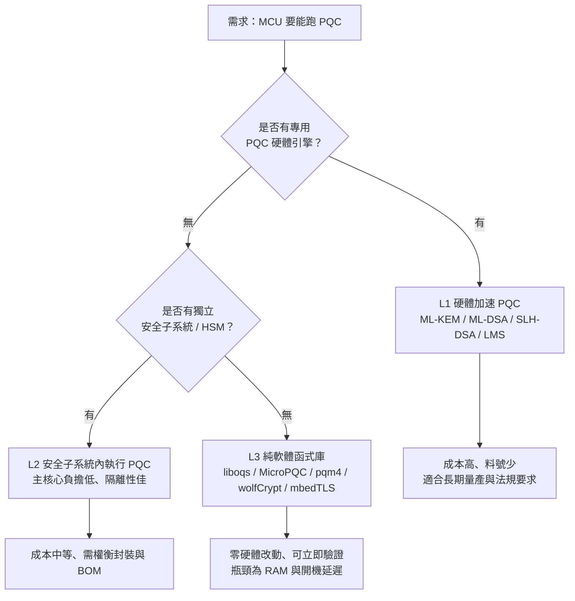
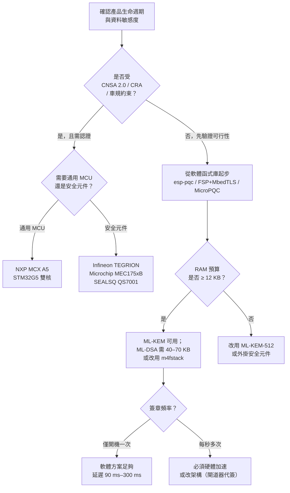

# 支援後量子密碼學（PQC）演算法的 MCU 選型調查

## 摘要

後量子密碼學（Post-Quantum Cryptography, PQC）在 2024 年完成第一批 NIST 標準化之後，微控制器（MCU）廠商開始把「抗量子」從雲端與伺服器議題延伸到嵌入式裝置。截至 2026 年 11 月，市場上的「支援 PQC 的 MCU」其實分成三個截然不同的層級：

1. **硬體密碼核心直接加速 PQC**：ML-KEM、ML-DSA、SLH-DSA、LMS 由專用硬體運算，主核心幾乎不耗時。
2. **硬體安全模組（HSM）或安全子系統內建 PQC**：PQC 在隔離的加密引擎中執行，主核心只負責呼叫。
3. **純軟體函式庫實作**：靠最佳化過的 C 或組合語言在 Cortex-M 上跑，RAM 與週期成本高，但可移植性最好、可立即部署於既有料號。

本報告整理已公開可查證的具體料號、演算法支援範圍、認證狀態與效能數據，並提供選型決策流程。核心結論是：**真正「硬體加速 PQC」的量產 MCU 仍然稀少（Microchip MEC175xB、Infineon TEGRION 安全控制器、NXP MCX A5 為代表），而大多數既有 MCU 的 PQC 能力來自軟體函式庫**，其瓶頸是 RAM 而非算力[^taxonomy][^mec175][^mcxa5]。

---

## 1. 背景：為什麼 MCU 需要 PQC

NIST 於 2024 年 8 月 13 日一次公布三項聯邦資訊處理標準（FIPS）[^nistpqc]：

| 標準 | 演算法 | 前身名稱 | 用途 |
|---|---|---|---|
| FIPS 203 | ML-KEM | CRYSTALS-Kyber | 金鑰封裝（密鑰交換） |
| FIPS 204 | ML-DSA | CRYSTALS-Dilithium | 數位簽章 |
| FIPS 205 | SLH-DSA | SPHINCS+ | 無狀態雜湊式簽章 |

美國國家安全局（NSA）的 **CNSA 2.0** 進一步要求資料中心與運算設備在兩年內具備抗量子能力，並把 ML-KEM、ML-DSA 與 LMS（Leighton-Micali Signature，具狀態雜湊式簽章）列為採購要求[^mec175][^cnx].

對 MCU 而言，威脅有兩個具體場景[^esppqc]：

- **Harvest Now, Decrypt Later（先竊取、後解密）**：攻擊者今天錄下 TLS 流量，等量子電腦成熟再解密。智慧電表、工業閘道器、車用模組的生命週期常達 10–15 年，正好落在風險窗口內。
- **遠端接管（Secure Boot 偽造）**：量子電腦離線破解廠商簽章私鑰後，可對已部署裝置推送看似合法的惡意韌體。

因此 MCU 的 PQC 需求通常不是「全面換掉 RSA/ECC」，而是**混合式（hybrid）部署**：古典演算法與 PQC 並存，攻擊者必須同時破解兩者[^esppqc][^mec175]。

---

## 2. 支援層級分類

判別一個料號屬於哪一層，不能只看廠商行銷用語「支援 PQC」，而要確認三件事：**（a）演算法是硬體運算還是軟體呼叫；（b）PQC 金鑰是否存放於受保護的金鑰庫；（c）是否有第三方認證（CC、FIPS 140-3、PSA/SESIP）涵蓋該 PQC 實作**[^taxonomy][^crqc-infineon]。

---

## 3. 硬體加速 PQC 的 MCU 與安全控制器

### 3.1 Microchip MEC175xB（嵌入式控制器，硬體 PQC）

2025 年 5 月 15 日發表，是市場上少見**把 PQC 演算法做進不可變硬體（immutable hardware）**的嵌入式控制器[^mec175]：

- 核心：Arm Cortex-M4F，96 MHz，含 MPU；480 KB SRAM。
- PQC：CNSA 2.0 合規的 **ML-DSA**、**ML-KEM**，以及 **LMS 驗證**。
- 應用定位：筆記型電腦、桌機、儲存機箱等平台的安全控制器，透過 eSPI／I3C 與主 SoC 協作。
- 安全開機與韌體更新可設定為 CNSA 1.0、CNSA 2.0 或混合式簽章驗證；attestation 使用 ML-DSA 簽章與金鑰產生。
- 開發：MPLAB X IDE、MEC1753-240 MECC（EV48H83A）開發板；發表時僅供 early adopter program 申請[^mec175]。

**注意**：MEC175xB 是「平台安全控制器」而非通用應用 MCU，它不執行使用者的應用邏輯。若需求是通用 MCU 本體加速 PQC，應往 3.5、3.6 或第 4 節尋找。

### 3.2 Microchip TS1800 與 TS50x（平台根信任控制器，硬體 PQC）

2026 年 4 月 28 日，Microchip 擴充其 Post-Quantum-Ready 根信任控制器家族[^ts1800]：

| 型號 | 核心 | PQC 能力 | 定位 |
|---|---|---|---|
| **TS1800／TS1800-TFLX** | Cortex-M4F，最高 192 MHz | **ML-DSA、ML-KEM、LMS 驗證**（硬體加速） | OCP 平台根信任（Platform Root of Trust） |
| **TS50x** | 精簡架構 | PQC + ECC P-384 混合式**驗證**（secure boot） | 不需完整 OCP RoT 的系統 |

TS1800 符合 NIST SP 800-193、OCP、CNSA 2.0 與歐盟 CRA 要求，介面含 USB 2.0 HS/FS、I2C、SPI；TS50x 的機制是在簽章驗證通過前持續把晶片組壓在 reset 狀態，屬於「守門員」型元件而非運算主體[^ts1800]。兩者發表時均為 early adopter program。

### 3.3 Infineon TEGRION 安全控制器（CC EAL6+ 的 PQC 認證）

Infineon 於 2025 年 1 月 23 日宣布，其 TEGRION 系列安全控制器（28 nm、Integrity Guard 32 架構）取得 **Common Criteria EAL6** 的 PQC 實作認證，是業界第一個在安全控制器上以 EAL6 等級認證 PQC 演算法的案例[^ifx-eal6]。對應的 BSI 憑證為 `BSI-DSZ-CC-1249-2024`（2024-12-17 核發），涵蓋搭載 `PQ Crypto Suite v5.00.012`（ML-KEM）的 Armv8-M 安全控制器[^ifx-eal6]。

後續產品線[^ifx-slc27][^crqc-infineon]：

| 型號 | PQC 演算法 | 認證 | 時間 |
|---|---|---|---|
| TEGRION SLC21 PQ Edition | ML-KEM | CC EAL6+ | 2025-01 宣布 |
| TEGRION SLC26（SLC26GDA360 等） | 同平台 PQC 能力 | CC EAL6+ | 2024 起 |
| TEGRION SLC27 | ML-KEM + ML-DSA | CC 認證加密庫 | 2025-10-14 |

**定位**：eSIM、5G SIM、支付卡、身分證、eHealth 卡等安全元件市場。它不是通用 MCU，而是「可程式化的安全晶片」，透過 ISO 7816／SPI／I2C 介面提供 PQC 服務。

### 3.4 Infineon OPTIGA TPM SLB 9672（XMSS 韌體更新保護）

TPM 屬於安全晶片而非 MCU，但常與 MCU 搭配。SLB 9672（FW15.xx／FW16.xx）是市場上第一個以 **XMSS（eXtended Merkle Signature Scheme，具狀態雜湊式簽章）** 保護韌體更新流程的 TPM，提供 256 位元金鑰長度與額外 PQC 檢查[^optiga]。

重點是它**只用 PQC 保護韌體更新路徑**，不是提供通用的 ML-KEM／ML-DSA 介面。若設計只需要「抗量子的韌體更新鏈」，這是成本最低的加法；若需要裝置端 PQC 金鑰交換，則不適用。

### 3.5 NXP MCX A5（MCXA577）— 硬體 PQC 加速的通用 MCU

NXP 於 2026 年 8 月發表 MCX A5 家族，把 PQC 加速放進通用 Cortex-M33 MCU[^mcxa5]：

- 核心：Arm Cortex-M33，最高 240 MHz，FPU／DSP／MPU／TrustZone，988.8 CoreMark。
- 記憶體：最高 2 MB 雙庫 Flash（ECC、read-while-write）、最高 640 KB SRAM。
- 安全：**EdgeLock 加速器**含 TRNG、PKC（ECC／RSA）與 **SGI 引擎（AES-256、SHA-2、PQC、KeyStore）**；安全開機支援 **PQC 混合式（hybrid）簽章驗證**。
- 認證目標：PSA Level 3、SESIP Level 3。
- 連網：10/100 Mbps Ethernet MAC + 內建 **10BASE-T1S 單對乙太網路數位 PHY**（工業／PLC／遠端 I/O 場景少見的整合）。
- 狀態：2026 年 8 月開始送樣，**一般供貨預計 2026 年 Q4**；開發板 FRDM-MCXA577[^mcxa5]。

**評註**：這是目前公開資料中，唯一同時具備「通用 MCU 應用核心」+「硬體 PQC 引擎」+「工業連網」的料號，但截至本報告撰寫時仍未全面量產，且 NXP 並未在公開頁面逐項列出 SGI 引擎支援哪些 PQC 參數集（僅寫 PQC），實際可用的 FIPS 203／204 變體需向原廠確認[^mcxa5][^crqc-nxp]。獨立的第三方觀測站對 NXP 的評語仍是「已發表 PQC 策略，但未能確證具體一般供貨 SKU」[^crqc-nxp]。

### 3.6 STMicroelectronics STM32G5（雙核版本才有 PQC 硬體）

2026 年 11 月 3 日的 ST 官方部落格明確說明：**單核** STM32G5（Cortex-M33，280 MHz）以軟體執行所有 PQC 演算法；**雙核版本**才是 ST 第一款內建「可加速所有 NIST 核准 PQC 演算法」硬體密碼核心的 mixed-signal MCU，涵蓋 **LMS、ML-KEM（FIPS 203）、ML-DSA（FIPS 204）、SLH-DSA（FIPS 205）**[^stg5]。

其他重點[^stg5]：

- Cortex-M33 + TrustZone，隔離信任／非信任域。
- 不可變根信任（iRoT，出廠設定）與可更新根信任（uRoT）。
- 硬體金鑰包裝（key wrapping）機制，金鑰使用中不外露。
- 目標 SESIP Level 3 與 PSA Level 3 認證，主打免加安全元件的 BOM 精簡。
- 應用對準 M-CRPS（模組化冗餘電源）與 SPDM 標準，亦即 AI 資料中心電源與機器人即時控制。

**時程風險**：報導指出單核已量產、雙核要到 2027 年[^stg5-press]。若專案需要在 2026 年內取得硬體 PQC，STM32G5 只能用單核的軟體路徑。

### 3.7 Renesas RH850/U2C（車用硬體 PQC）

Renesas 的 RH850/U2C 車用 MCU（28 nm、最高 320 MHz G4KH 雙核鎖步、最高 8 MB Flash／1.5 MB RAM）規格明確列出「支援 PQC 演算法」，並同時支援中國 SM3／SM4，符合 ISO 21434 與 ISO 26262 ASIL-D[^rh850]。這是目前公開資料中少數**車規等級且硬體支援 PQC** 的 MCU，但演算法細節（ML-KEM／ML-DSA 參數集）未在公開頁面展開。

---

## 4. 以硬體安全子系統或軟體提供 PQC 的 MCU

### 4.1 Renesas RA8P1（軟體 PQC，經 FSP + Mbed TLS）

RA8P1 是 Renesas 首款 AI 加速 MCU（1 GHz Cortex-M85 + 250 MHz Cortex-M33 + Ethos-U55 NPU，2025 年 7 月 1 日發表）[^ra8p1]。PQC 並非硬體加速，而是透過 **FSP（Flexible Software Package）6.6.0 與 PSA Crypto／Mbed TLS** 提供[^ra8pqc]：

- 演算法：**ML-KEM-512／768／1024**、**ML-DSA-44／65／87**。
- 啟用方式：定義 `MBEDTLS_MLKEM_C`、`MBEDTLS_ML_DSA_C` 巨集（預設關閉）。
- 官方範例專案（EK-RA8P1 / R7KA8P1KFLCAC）示範五種情境：ML-KEM 雙方金鑰交換、ML-KEM 金鑰備份還原、ML-DSA 雙方簽章驗證、ML-DSA 金鑰備份還原、ML-KEM 解封裝 + ML-DSA 簽章組合[^ra8pqc]。
- 另有應用筆記「Secure Bootloader Using MCUboot with Post-Quantum Cryptography」，說明以 PQC 簽章韌體映像與執行期驗證[^ra8pqc]。

**優勢**：Cortex-M85 的高時脈與 Helium 向量指令讓軟體 PQC 相對可行；生態完整（FSP、範例、MCUboot）。**限制**：ML-DSA 簽章需要數十 KB 堆疊，需確認 SRAM 預算[^pqm4]。

### 4.2 Nuvoton NuMicro M2354（Cortex-M23 上的極限軟體優化）

2026 年 6 月 11 日，Nuvoton 宣布 M2354（Cortex-M23、96 MHz、1 MB 雙庫 Flash、256 KB SRAM）以開源 **MicroPQC** 框架實作 PQC[^nuvoton]：

- NIST 演算法：**ML-KEM-512／768**、**ML-DSA-44**、**SLH-DSA-SHAKE128F**、**FN-DSA-512**（FALCON）。
- 韓國 K-PQC 候選：AIMer128f、SMAUG-T1、HAETAE2，另有 NTRU+768。
- 關鍵優化：NTT 內聯 Montgomery 乘法、展開 butterfly、預先計算 twiddle factor，比一般參考實作減少約 **30%** 週期；靜態配置與就地 NTT 讓 **ML-KEM-768 RAM 用量壓到 12 KB 以下**[^nuvoton]。
- 認證：PSA Certified Level 3、SESIP Level 3；M2354xJFBE／M2354CJFAE 另支援 TCG DICE[^nuvoton]。

**意義**：這是目前公開資料中「在最低階核心（Cortex-M23，無 DSP、無 FPU、無快取）上跑 PQC」的代表案例，證明 PQC 不必等新硬體。代價是簽章效能很差：ML-DSA-44 簽章約 334 ms、SLH-DSA-SHAKE128F 簽章約 72.7 秒[^nuvoton-bench]。適合「開機驗章一次」而非「高頻簽章」。

### 4.3 Espressif esp-pqc（全系列 ESP32 軟體方案）

2026 年 10 月 14 日，Espressif 發布 `esp-pqc` 元件（基於 liboqs 的自家 fork），要求 **ESP-IDF v6.0 以上**，支援所有 Espressif SoC[^esppqc]：

- 演算法：**ML-KEM-768**、**ML-DSA-65**（TLS 使用 `X25519MLKEM768` 混合金鑰交換）。
- 能力一：**混合式 TLS 1.3**，含 ML-DSA-65 憑證鏈。
- 能力二：**PQC Secure Boot** — ROM 先做古典 Secure Boot V2 驗證，第二階段 bootloader 再驗 ML-DSA-65 簽章；簽章額外佔 8 KB Flash（合計 12 KB）。
- 效能（ESP32-C5 @ 80 MHz，古典搭檔 RSA-3072）：SHA-256 約 30 ms、**ML-DSA-65 軟體驗證約 44 ms（3.53 M cycles）**、RSA-PSS-3072 硬體約 13 ms，混合開機驗證合計約 **91 ms**。
- 限制：ML-DSA-65 公鑰 1,952 bytes、簽章 3,309 bytes、憑證鏈約 7.5 KB，需放大 mbedTLS I/O 緩衝區[^esppqc]。
- 官方明確表示：**未來**的 Espressif SoC 才會整合專用 PQC 硬體加速[^esppqc]。

**定位**：最適合「已在用 ESP32、想立刻驗證 PQC 開機與 TLS」的團隊；成本為零（純軟體），但 RAM／Flash 與開機延遲需實測。

### 4.4 Microchip PIC32CK SG／MEC172x／dsPIC33（軟體 PQC 函式庫）

Microchip 的軟體路線分三支[^mchp-sw]：

| 平台 | 函式庫 | 時間 |
|---|---|---|
| PIC32CK SG/GC（Cortex-M33 120 MHz、2 MB Flash、512 KB SRAM、HSM、TrustZone） | MPLAB Harmony 3 Crypto v4／wolfCrypt | 2025-08 |
| MEC172x 嵌入式控制器 | Harmony 3 Crypto v4 | 2025-08 |
| dsPIC33C／dsPIC33A（16 位元 DSC） | dsPIC33 PQC and Classical Crypto Library（wolfCrypt 5.9.2） | 2024-11 |

其中 PIC32CK SG 內建 HSM 子系統（專用 CPU、記憶體、secure DMA、密碼加速器），PQC 由軟體執行但金鑰受 HSM 保護；dsPIC33 版本則是業界少見把 PQC 帶到 16 位元 DSC 的案例[^mchp-sw]。

### 4.5 SEALSQ Quantum Shield QS7001（RISC-V 安全 MCU）

QS7001 是 SEALSQ 推出的「後量子時代晶片」，定位為硬體安全 MCU／安全元件[^qs7001]：

- 核心：80 MHz 32 位元加固 RISC-V。
- PQC：**Kyber（512／768／1024）** 與 **Dilithium 2**，另支援 RSA、ECC（572 位元）、AES、SP 800-90B RNG。
- 記憶體：512 KB Flash、80 KB RAM、128 KB ROM；介面 1 Mbps I2C／33 MHz SPI、4 個 GPIO。
- 封裝：QFN32，**TPM 相容腳位**；工作電壓 1.62–3.6 V、-40～105 °C。
- 認證：Common Criteria EAL5+ 評估進行中；QVault TPM 軟體堆疊以 FIPS 140-2／140-3 為目標[^qs7001]。

**評註**：Kyber／Dilithium 是 NIST 標準化前的名稱，對應 ML-KEM／ML-DSA 的早期版本；若要聲稱 FIPS 203／204 合規，需確認韌體是否已更新到最終標準參數與編碼。適合當「外掛式 PQC 安全元件」加在既有 MCU 旁。

---

## 5. 純軟體函式庫：讓任何 Cortex-M 都能跑 PQC

若目標不是特定料號，而是「我手上的 MCU 能不能跑 PQC」，可直接評估以下函式庫。

### 5.1 pqm4（Cortex-M4 的權威基準）

pqm4 是學術界與 Arm 官方教學路徑共同引用的 Cortex-M4 PQC 測試與基準框架（GitHub `mupq/pqm4`，約 464 星）[^pqm4]。**重要現況**：專案已公告停止積極維護，將於 2027 年 1 月後轉為唯讀封存，官方建議改用 `mlkem-native` 與 `mldsa-native`[^pqm4]。

支援板卡：NUCLEO-L4R5ZI（STM32L4R5ZI，預設）、STM32F4 Discovery、NUCLEO-L476RG、CW308T-STM32F3（ChipWhisperer 側通道攻擊目標）、MPS2-AN386（QEMU）[^pqm4]。

**實測數據（Cortex-M4 @ 24 MHz，`m4fspeed` 最佳化實作）**[^pqm4-bench]：

| 演算法 | KeyGen（cycles） | 封裝／簽章（cycles） | 解封裝／驗章（cycles） | RAM（位元組） |
|---|---|---|---|---|
| ML-KEM-512 | 392,423 | 390,881 | 428,167 | 4,372–5,436 |
| ML-KEM-768 | 642,096 | 658,754 | 707,827 | 5,396–6,468 |
| ML-KEM-1024 | 1,018,976 | 1,031,565 | 1,094,008 | 6,436–7,500 |
| ML-DSA-44 | 1,426,025 | 3,943,121 | 1,421,623 | 8,912–44,816 |
| ML-DSA-65 | 2,516,006 | 6,193,171 | 2,415,944 | 9,888–68,872 |
| ML-DSA-87 | 4,275,859 | 7,947,380 | 4,193,104 | 12,060–107,892 |
| SPHINCS+-SHA2-128f（參考實作） | 15,742,990 | 368,575,228 | 21,923,628 | 2,468–2,856 |

換算成時間（24 MHz）[^pqm4-bench]：ML-KEM-768 封裝約 **27 ms**；ML-DSA-65 簽章約 **258 ms**、驗章約 **101 ms**；SPHINCS+ 簽章約 **15 秒**。可用 `m4fstack` 變體把 ML-DSA-44 堆疊壓到 4.4 KB，代價是簽章週期增加約 3 倍。

另外，pqm4 沒有官方 Cortex-M7 target；M7 需自行以相同工具鏈移植，官方未公布 M7 基準[^pqm4]。

### 5.2 mlkem-native 與 mldsa-native（pqm4 的後繼）

pqm4 維護者建議的替代方案是 PQ Code Package 下的 `mlkem-native`（可攜 C90 實作，FIPS 203）與 `mldsa-native`[^pqm4][^mlkemnative]。特點是：可攜性優先、可選組合語言加速、有正式的形式化驗證與持續整合，適合產品化而非僅 bench。

### 5.3 其他常見組合

- **wolfSSL／wolfCrypt**：嵌入式商用授權，涵蓋 ML-KEM、ML-DSA、Falcon 等；Microchip dsPIC33 與 PIC32CK 的官方 PQC 函式庫即基於此[^mchp-sw]。第三方觀測站對 wolfSSL 的評語是「提供嵌入式 PQC 演算法，但裝置是否真的就緒取決於各 OEM 的韌體版本」[^crqc-infineon]。
- **Mbed TLS／PSA Crypto**：Renesas FSP 6.6.0 即以 `MBEDTLS_MLKEM_C`／`MBEDTLS_ML_DSA_C` 啟用 PQC，是 Arm 生態最標準的路徑[^ra8pqc]。
- **liboqs**：Espressif `esp-pqc` 的底層，也是 Open Quantum Safe 專案的實驗性實作集合；定位為原型與評估，非量產保證[^esppqc]。

---

## 6. 綜合比較表

| 廠商／型號 | 類型 | PQC 演算法 | 執行方式 | 認證 | 狀態與時間 |
|---|---|---|---|---|---|
| Microchip MEC175xB | 嵌入式安全控制器 | ML-DSA、ML-KEM、LMS 驗證 | **硬體（不可變）** | CNSA 2.0 合規 | 2025-05 發表，early adopter[^mec175] |
| Microchip TS1800 | 平台根信任控制器（Cortex-M4F 192 MHz） | ML-DSA、ML-KEM、LMS 驗證 | **硬體加速** | SP 800-193／CNSA 2.0／CRA | 2026-04-28 發表，EAP[^ts1800] |
| Microchip TS50x | Secure Boot 控制器 | PQC + ECC P-384 混合驗證 | 硬體 | CRA／CNSA 2.0 | 2026-04-28 發表[^ts1800] |
| Infineon TEGRION SLC21／SLC26／SLC27 | 安全控制器 | ML-KEM；SLC27 加 ML-DSA | 硬體 | CC EAL6+（BSI 憑證） | 2025-01 起陸續發表[^ifx-eal6] |
| NXP MCX A5（MCXA577） | 通用 MCU（Cortex-M33） | PQC 混合式安全開機（SGI 引擎） | **硬體引擎** | 目標 PSA L3／SESIP L3 | 2026-08 送樣，Q4 2026 供貨[^mcxa5] |
| ST STM32G5 雙核 | 通用 MCU（Cortex-M33） | LMS、ML-KEM、ML-DSA、SLH-DSA | **硬體密碼核心** | 目標 SESIP L3／PSA L3 | 雙核預計 2027[^stg5] |
| ST STM32G5 單核 | 通用 MCU | 同上 | 軟體 | 目標 SESIP L3／PSA L3 | 2026-11 量產[^stg5] |
| Renesas RH850/U2C | 車用 MCU | PQC（規格未展開） | 硬體 | ISO 21434／ASIL-D | 量產中[^rh850] |
| Renesas RA8P1 | 通用 MCU（Cortex-M85） | ML-KEM-512/768/1024、ML-DSA-44/65/87 | 軟體（FSP + Mbed TLS） | — | 2025-07 量產[^ra8p1][^ra8pqc] |
| Nuvoton M2354 | 安全 MCU（Cortex-M23） | ML-KEM-512/768、ML-DSA-44、SLH-DSA、FN-DSA + K-PQC | 軟體（MicroPQC） | PSA L3／SESIP L3 | 2026-06 宣布[^nuvoton] |
| Espressif ESP32 全系列 | 無線 SoC | ML-KEM-768、ML-DSA-65 | 軟體（esp-pqc／liboqs） | 依既有 Secure Boot V2 | 2026-10 發布[^esppqc] |
| Microchip PIC32CK SG／MEC172x | 通用 MCU／EC | wolfCrypt PQC | 軟體 + HSM 金鑰保護 | 目標 PSA L3 | 2025-08[^mchp-sw] |
| Microchip dsPIC33C/A | 16 位元 DSC | wolfCrypt PQC | 軟體 | — | 2024-11[^mchp-sw] |
| SEALSQ QS7001 | 安全元件／安全 MCU | Kyber 512/768/1024、Dilithium 2 | 硬體加速 | CC EAL5+ 評估中 | 已供貨[^qs7001] |

---

## 7. 選型決策流程

### 決策要點

1. **先算 RAM，再算週期**。ML-KEM-768 軟體實作約需 5–6 KB 堆疊，ML-DSA-65 最佳化實作需 60–69 KB、低堆疊變體仍需 6.6 KB；Cortex-M23 這類 32 KB SRAM 等級的元件若不特別優化（如 Nuvoton 的 12 KB ML-KEM），根本放不下[^pqm4-bench][^nuvoton]。
2. **簽章頻率決定是否值得硬體**。開機驗章一次（約 44–100 ms）用軟體完全合理；若每個感測器封包都要簽章，軟體 ML-DSA 的 258 ms 會直接吃掉即時性預算[^pqm4-bench][^esppqc]。
3. **傳輸與儲存開銷常被低估**。ML-DSA-65 公鑰 1,952 bytes、簽章 3,309 bytes、憑證鏈約 7.5 KB，TLS 緩衝區與 OTA 映像都要放大；PQC 開機簽章單獨就佔 8–12 KB Flash[^esppqc]。
4. **混合式是預設答案，不是過渡方案**。Microchip、ST、Espressif、NXP 全都採 hybrid（古典 + PQC 並存），可維持既有合規性並避免新演算法實作缺陷造成的單點失效[^mec175][^stg5][^esppqc][^mcxa5]。
5. **注意「標準化前名稱」陷阱**。SEALSQ QS7001 規格寫的是 Kyber／Dilithium，屬標準化前命名；採購時應確認韌體是否已對齊 FIPS 203／204 的最終參數與 ASN.1 編碼[^qs7001]。

---

## 8. 來源批判與資料缺口

- **廠商新聞稿的時間與量產時間常不一致**。STM32G5 單核「已量產」但真正具備硬體 PQC 的雙核要等 2027；NXP MCX A5 2026 年 8 月「送樣」、Q4 才一般供貨。表格中的「狀態」欄因此嚴格區分發表、送樣、量產[^stg5][^mcxa5]。
- **「支援 PQC」的定義不統一**。部分型號只支援 PQC 保護的**韌體更新**（Infineon SLB 9672 的 XMSS），不提供裝置端 ML-KEM 金鑰交換能力，容易被誤讀[^optiga]。
- **NXP 的公開資訊最不透明**。獨立觀測站 CRQC 對 NXP 的評級是「Announced」，並明確警告「不應推論既有 NXP 裝置可升級、或某個 SKU 已量產 PQC」；MCX A5 的 SGI 引擎僅寫「PQC」，未列參數集[^crqc-nxp][^mcxa5]。
- **車用與工業（Renesas RH850/U2C）的演算法清單未公開**，僅在新聞與產品頁出現「支援 PQC」字樣，無法從公開資料判斷是否為 ML-KEM／ML-DSA 或僅 LMS[^rh850]。
- **pqm4 已停止維護**，其基準雖仍是學術引用標準，但新專案應改用 `mlkem-native`／`mldsa-native`，並注意兩者效能數據不可直接與 pqm4 表對照[^pqm4]。
- **本報告未涵蓋的領域**：FPGA 上的 PQC 加速（非 MCU）、RISC-V 自訂指令擴充（如 PQShield、PQPlatform）、以及已停產或僅限軍用管制的料號。

---

## 9. 結論

- **要「現在就能量產、有第三方 PQC 認證」**：Infineon TEGRION 系列（CC EAL6+ 的 ML-KEM，SLC27 加 ML-DSA）與 Microchip MEC175xB／TS1800（CNSA 2.0 硬體 ML-DSA／ML-KEM）是實證最強的選擇，但都是安全控制器／根信任控制器，不是通用應用 MCU。
- **要「通用 MCU + 硬體 PQC」**：NXP MCX A5（2026 Q4 供貨）是目前唯一公開的候選；STM32G5 需等雙核版本（2027）。
- **要「既有 BOM 不動、先驗證」**：Espressif `esp-pqc`（ML-KEM-768／ML-DSA-65，開機驗章 91 ms）與 Renesas RA8P1（FSP 6.6.0，ML-KEM／ML-DSA 全參數集）提供最完整的官方範例；Cortex-M23 等極低階平台則可參考 Nuvoton M2354 的 12 KB ML-KEM 優化。
- **要「極低價、簽章不頻繁」**：純軟體 pqm4／`mlkem-native` 搭配 Cortex-M4 即可，ML-KEM-768 約 27 ms、ML-DSA-65 驗章約 101 ms（24 MHz），但務必先量測堆疊峰值。

---

## 參考文獻

[^ts1800]: Microchip Technology. (2026, April 28). *Microchip expands its family of post-quantum-ready root of trust controllers* [Press release]. Retrieved 2026-11-14, from https://www.microchip.com/en-us/about/news-releases/products/microchip-expands-its-family-of-post-quantum-ready-root-of-trust-controllers

[^nistpqc]: National Institute of Standards and Technology. (2024, August 13). *NIST releases first 3 finalized post-quantum encryption standards*. Retrieved 2026-11-14, from https://www.nist.gov/news-events/news/2024/08/nist-releases-first-3-finalized-post-quantum-encryption-standards

[^taxonomy]: CRQC. (2026, October 28). *PQC vendor readiness & product roadmaps*. Retrieved 2026-11-14, from https://crqc.dev/vendors

[^mec175]: Microchip Technology. (2025, May 15). *Microchip brings hardware quantum resistance to embedded controllers* [Press release]. Retrieved 2026-11-14, from https://ir.microchip.com/news-events/press-releases/detail/1312/microchip-brings-hardware-quantum-resistance-to-embedded-controllers

[^cnx]: CNX Software. (2026, August 19). *NXP MCX A5 Cortex-M33 MCU family supports 10BASE-T1S single pair Ethernet and post-quantum cryptography*. Retrieved 2026-11-14, from https://www.cnx-software.com/2026/08/19/nxp-mcx-a5-cortex-m33-mcu-family-supports-10base-t1s-single-pair-ethernet-and-post-quantum-cryptography/

[^esppqc]: Espressif Systems. (2026, October 14). *Post-quantum cryptography on ESP32*. Retrieved 2026-11-14, from https://developer.espressif.com/blog/2026/10/esp32-post-quantum-cryptography/

[^crqc-infineon]: CRQC. (2026, October 28). *Infineon: Post-quantum roadmap & products*. Retrieved 2026-11-14, from https://crqc.dev/vendors/infineon

[^crqc-nxp]: CRQC. (2026, October 28). *NXP: Post-quantum roadmap & products*. Retrieved 2026-11-14, from https://crqc.dev/vendors/nxp

[^ifx-eal6]: Infineon Technologies. (2025, January 23). *Infineon and the BSI pave the way for a quantum-safe future with the world's first Common Criteria EAL6 certification for post-quantum cryptography*. Retrieved 2026-11-14, from https://www.infineon.com/press-release/2025/infcss202501-043

[^ifx-slc27]: Infineon Technologies. (2025, October 14). *Infineon's PQC-certified contactless and dual-interface security controllers*. Retrieved 2026-11-14, from https://www.infineon.com/technology-news/2025/INFCSS202510-004

[^optiga]: Infineon Technologies. (n.d.). *OPTIGA TPM SLB 9672 FW16*. Retrieved 2026-11-14, from https://www.infineon.com/part/OPTIGA-TPM-SLB-9672-FW16

[^mcxa5]: CNX Software. (2026, August 19). *NXP MCX A5 Cortex-M33 MCU family supports 10BASE-T1S single pair Ethernet and post-quantum cryptography* [Hardware specification summary of NXP MCX A5 / MCXA577]. Retrieved 2026-11-14, from https://www.cnx-software.com/2026/08/19/nxp-mcx-a5-cortex-m33-mcu-family-supports-10base-t1s-single-pair-ethernet-and-post-quantum-cryptography/

[^stg5]: STMicroelectronics. (2026, November 3). *STM32G5: The most secure mixed-signal STM32 MCU supports PQC to future-proof designs against regulations*. Retrieved 2026-11-14, from https://blog.st.com/stm32g5-security/

[^stg5-press]: STMicroelectronics. (2026, November 4). *STMicroelectronics reveals advanced microcontrollers for real-time power control in AI datacenters and robotics* [Press release]. Retrieved 2026-11-14, from https://markets.businessinsider.com/news/stocks/stmicroelectronics-reveals-advanced-microcontrollers-for-real-time-power-control-in-ai-datacenters-and-robotics-1036713110

[^rh850]: Renesas Electronics. (n.d.). *RH850/U2C group: Automotive microcontrollers*. Retrieved 2026-11-14, from https://www.renesas.com/en/products/rh850-u2c

[^ra8p1]: Renesas Electronics. (2025, July 1). *Renesas sets new MCU performance bar with 1-GHz RA8P1 devices with AI acceleration* [Press release]. Retrieved 2026-11-14, from https://www.renesas.com/en/about/newsroom/renesas-sets-new-mcu-performance-bar-1-ghz-ra8p1-devices-ai-acceleration

[^ra8pqc]: Renesas Electronics. (2026). *Post-quantum cryptography example project for EK-RA8P1*. Retrieved 2026-11-14, from https://github.com/renesas/ra-fsp-examples/blob/master/example_projects/ek_ra8p1/post_quantum_cryptography/post_quantum_cryptography_ek_ra8p1_ep/README.md

[^nuvoton]: Nuvoton Technology. (2026, June 11). *Quantum-safe milestone: Nuvoton's NuMicro M2354 successfully implements post-quantum cryptography* [Press release]. Retrieved 2026-11-14, from https://www.nuvoton.com/news/news/all/TSNuvotonNews-000621/

[^nuvoton-bench]: Hengsen Technology. (2026, June). *Nuvoton M2354 post-quantum cryptography PQC: technical analysis and benchmarks*. Retrieved 2026-11-14, from https://www.hengsen.com/news/nuvoton-m2354-post-quantum-cryptography-pqc

[^mchp-sw]: Microchip Technology. (n.d.). *Post-quantum cryptography solutions*. Retrieved 2026-11-14, from https://www.microchip.com/en-us/solutions/technologies/embedded-security/post-quantum-cryptography

[^qs7001]: SEALSQ. (n.d.). *Quantum Shield QS7001: Post-quantum security chip*. Retrieved 2026-11-14, from https://www.sealsq.com/semiconductors/platforms/quantum-shield/qs7001

[^pqm4]: Kannwischer, M. J., Rijneveld, J., Schwabe, P., & Stoffelen, K. (2019). *pqm4: Testing and benchmarking NIST PQC on ARM Cortex-M4* (Cryptology ePrint Archive Report 2019/844). Retrieved 2026-11-14, from https://github.com/mupq/pqm4

[^pqm4-bench]: mupq. (2026). *pqm4 benchmark results* [benchmarks.md]. Retrieved 2026-11-14, from https://github.com/mupq/pqm4/blob/master/benchmarks.md

[^mlkemnative]: PQ Code Package. (2026). *mlkem-native: Secure, fast, and portable C90 implementation of ML-KEM / FIPS 203*. Retrieved 2026-11-14, from https://github.com/pq-code-package/mlkem-native