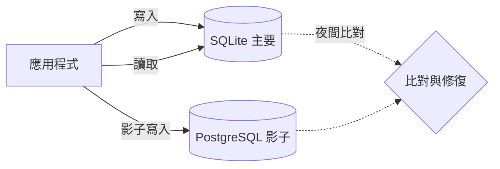
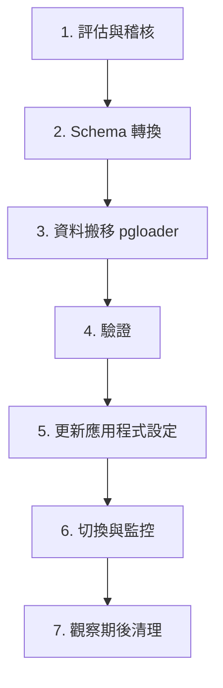

# 已部署且正在運行的專案如何從 SQLite 遷移至 PostgreSQL

## 摘要

SQLite 是嵌入式（embedded）資料庫，資料以單一檔案形式存在於應用程式行程內；PostgreSQL 則是客戶端／伺服器（client/server）架構的資料庫，透過網路連線、具備角色權限與真正並行寫入能力。把一個**已經上線、正在服務使用者**的專案從 SQLite 換到 PostgreSQL，本質上不只是「搬資料」，而是一次**架構層級的變更**[^arch]。本文說明可行的遷移策略、資料型別與行為差異、工具選擇、完整流程、切換與回滾做法，並附上檢查清單。本文為獨立文件，閱讀者不需具備任何前置背景。

---

## 1. 為什麼「已上線」讓遷移變複雜

若專案尚未上線，遷移只是「複製檔案、改連線字串」；一旦上線，資料庫隨時有寫入，遷移期間必須避免資料遺失、服務中斷與資料不一致。以下幾點是上線狀態下特有的挑戰：

- **寫入持續發生**：遷移過程若有新資料寫入 SQLite，必須確保這些資料不會遺漏。
- **停機成本**：使用者會直接感受到服務中斷，需要決定可接受的停機窗口。
- **一致性風險**：若同時寫入兩個資料庫，兩邊可能出現資料分歧（drift）。
- **回滾需求**：切換後若出問題，必須能快速退回 SQLite 而不遺失資料。

一個常見的誤解是「用 `pgloader` 一行指令就搬完了」。資料搬移確實是容易的部分，真正的工作在於處理 SQLite 的寬鬆型別讓應用程式「長期將就」而累積的問題[^arch]。

---

## 2. 遷移策略選項

依可接受的停機時間與資料量，主要分為三種策略。

### 2.1 維護窗口遷移（Maintenance Window）

最簡單也最適合約九成專案的做法[^render]：

1. 安排一段停機時間（依資料量約 1 至 4 小時）。
2. 停止應用程式，阻止新寫入。
3. 執行 `pgloader` 搬移所有資料。
4. 驗證關鍵流程。
5. 切換 `DATABASE_URL` 指向 PostgreSQL。
6. 啟動應用程式並持續監控。

對 10 GB 以下的資料庫，維護窗口遷移通常能在 1 小時內完成；多數應用程式可安排在離峰時段承受短暫停機[^render]。

**適用條件**：資料庫小於約 50 GB、可安排 1 至 4 小時停機、想走最單純的路徑。

### 2.2 雙寫／影子寫入（Dual-Write / Shadow-Write）

當停機不可接受時，採雙寫策略：寫入同時送到 SQLite 與 PostgreSQL，讀取仍以 SQLite 為準（authoritative），直到驗證完成才切換讀取。此做法需要謹慎處理，因為它**會加重 SQLite 的鎖競爭**（也就是原本想解決的問題），遷移期間寫入可能變慢 20% 至 40%[^render]。



一個真實案例是把 30 個 SQLite 資料庫遷移到單一 PostgreSQL，作者採用四段模式切換：`sqlite` → `shadow` → `postgres` → `postgres_only`[^summer]。其關鍵實作細節值得借鏡：

- **影子寫入失敗絕不讓請求失敗**：錯誤被捕捉、記錄，由夜間比對修復。
- **主鍵是複製而非重新產生**：主資料庫插入後，把同一組 id 帶入影子寫入，避免並行寫入造成分歧。
- **時間戳由應用程式產生**，不使用 SQL 預設值，讓兩邊持有完全相同的值。
- **刪除也是一種寫入**，必須同樣影子化。
- **切換條件**：連續 7 次夜間比對乾淨、72 小時內無影子寫入失敗、每個週期性工作都在兩邊跑過、工作耗時不超過現況 25%。

### 2.3 Expand/Contract（擴張／收縮）

這是零停機「結構變更」的通用模式，適用於遷移時需要同時調整 schema 的情況[^drozd]：

- **擴張階段**：新增欄位或資料表，舊程式仍可運作，新程式開始使用新結構。
- **回填階段**：分批（每批 1,000 至 10,000 列）把資料填進新結構，並可重複執行（idempotent）。
- **切換讀取**：程式改為只讀新結構。
- **收縮階段**：確認穩定（通常一個完整發布週期、7 天以上）後，才刪除舊欄位／資料表。


### 2.4 藍綠部署

藍綠部署（Blue-Green）需要可靠的複寫管道（如 Debezium CDC、AWS DMS、Kafka），把 Green 環境與 Blue 保持同步後再切換流量，失敗可在數秒內切回[^codelit]。但 SQLite **沒有內建複寫機制**，因此對 SQLite→PostgreSQL 而言，藍綠通常難以直接套用，多數實務改採應用層雙寫[^render]。

---

## 3. 資料型別對應與行為差異

這一節是遷移成敗的核心。SQLite 採「型別親和性」（type affinity），宣告的型別只是建議、非強制；PostgreSQL 採嚴格型別，不合法的值會直接拒絕[^sqlitetype]。

### 3.1 主鍵與 AUTOINCREMENT

| 面向 | SQLite | PostgreSQL |
|---|---|---|
| 機制 | `INTEGER PRIMARY KEY` 別名指向內部 `rowid`，自動遞增 | `SERIAL`（舊式）或 `GENERATED ... AS IDENTITY`（現代） |
| 重複使用 id | 未加 `AUTOINCREMENT` 時，刪除後可能重用 id | IDENTITY 不會重用 |
| 手動插入 | 可任意插入主鍵值 | `GENERATED ALWAYS` 會拒絕，需 `OVERRIDING SYSTEM VALUE` |

SQLite 的 `AUTOINCREMENT` 是較嚴格的模式，透過 `sqlite_sequence` 記錄高水位，保證 id 絕不重用[^sqlitetype]。PostgreSQL 的 `GENERATED ALWAYS AS IDENTITY` 是標準且較安全的對應；`serial` 則只是建立序列並設為預設值的便利寫法[^pgnumeric]。

**常見陷阱**：用 `sqlite3 .dump` 直接倒入 PostgreSQL 時，`INTEGER PRIMARY KEY` 會變成沒有自動遞增的整數欄位，下一次省略 id 的 `INSERT` 會失敗。搬移資料後**務必重設序列**：

```sql
SELECT setval(pg_get_serial_sequence('users', 'id'), (SELECT MAX(id) FROM users));
```

`pgloader` 的 `reset sequences` 選項會自動處理這件事[^pgloader]。

### 3.2 BOOLEAN

SQLite **沒有**獨立的布林儲存類別，`BOOLEAN` 型別名會得到 NUMERIC 親和性，值以整數 0（false）與 1（true）儲存[^sqlitetype]。PostgreSQL 有原生 `boolean` 型別（1 位元組），輸出永遠是 `t`／`f`，且只接受 `true`、`'t'`、`'yes'`、`'on'`、`'1'` 等合法輸入[^pgbool]。

**陷阱**：SQLite 欄位裡若混有 `'yes'`、`2` 等值，PostgreSQL 會拒絕。`pgloader` 的 SQLite 預設**不會**自動把整數轉布林（不像 MySQL 的 tinyint(1) 規則），需自行宣告轉換規則[^pgloader]。

### 3.3 日期與時間

SQLite 沒有日期／時間儲存類別，常見以 ISO-8601 文字、Unix epoch 秒、epoch 毫秒或 Julian day 數值儲存，甚至同一欄位混用[^sqlitetype]。PostgreSQL 有專屬型別，`timestamptz` 內部一律以 UTC 儲存、輸出時再依時區轉換[^pgdatetime]。

**陷阱**：日期時間是「考古工作」。若把 epoch 毫秒誤當 epoch 秒載入，資料會跑到約 5 萬年後。載入前應檢查每一欄的實際格式：

```sql
SELECT created_at, typeof(created_at) FROM users LIMIT 5;
```

ISO 字串可直接載入 `timestamp`；epoch 整數需以 `to_timestamp()` 轉換。`pgloader` 預設的 `sqlite-timestamp-to-timestamp` 可處理 ISO 字串，但 epoch 毫秒需自訂轉換[^pgloader]。

### 3.4 動態型別 vs 靜態型別

SQLite 的型別跟著「值」而非「欄位」，同一欄位可存放任意型別；`VARCHAR(5)` 的長度限制也**完全被忽略**[^sqlitetype]。PostgreSQL 嚴格檢查，長度超限會被截斷或拒絕。

**陷阱**：年代久遠的 SQLite 資料庫常藏有「字串存進整數欄」等被默默接受的壞資料，PostgreSQL 載入時會拒絕。遷移前應逐欄稽核：

```sql
SELECT typeof(user_id), COUNT(*) FROM orders GROUP BY typeof(user_id);
```

### 3.5 TEXT / VARCHAR

`TEXT` 對應 `text`（建議）；`VARCHAR(n)` 只有在確定所有值都符合長度時才對應 `varchar(n)`，否則用 `text`。另外 SQLite 文字可含 NUL 位元組（`\0`），PostgreSQL 不允許，會截斷；PostgreSQL 也要求合法 UTF-8[^foxschema]。

### 3.6 BLOB / BYTEA

SQLite 的 `BLOB` 對應 PostgreSQL 的 `bytea`，位元組原樣搬移[^pgloader]。需注意 SQLite 3.45.0+ 的 JSONB 是**另一種二進位格式**，與 PostgreSQL 的 JSONB 不相容，不可直接複製[^sqlitejson]。

### 3.7 JSON

SQLite 沒有原生 JSON 型別，JSON 以一般 `TEXT` 儲存（建議加 `CHECK (json_valid(col))`）；PostgreSQL 有 `json` 與 `jsonb`（建議用 `jsonb`，可建立 GIN 索引）。兩者的 `->`、`->>` 運算子語法相近，但路徑語法略有差異[^sqldocs-json]。

### 3.8 大小寫與排序規則

SQLite 的 `LIKE` 對 ASCII 字母**預設不分大小寫**；PostgreSQL 的 `LIKE` **區分大小寫**，需改用 `ILIKE` 或安裝 `citext` 擴充[^sqlfmt]。這是遷移後最常見的「查詢突然查不到資料」來源之一。

### 3.9 NULL 與外鍵

NULL 語意兩者大致一致，皆遵循 SQL 標準[^foxschema]。外鍵則差異明顯：SQLite 的**外鍵強制預設關閉**，必須在**每個連線**執行 `PRAGMA foreign_keys = ON`，且預設值自 3.6.19 起即為 OFF[^sqlitepragma]。PostgreSQL **一律強制**外鍵。

**陷阱**：若原應用程式從未開啟外鍵強制，SQLite 內可能藏有多年的父子關聯違規，PostgreSQL 會立刻拒絕。遷移前可用 `PRAGMA foreign_key_check;` 檢查[^sqlitefk]。

### 3.10 SQL 方言差異

| 主題 | SQLite | PostgreSQL |
|---|---|---|
| `LIMIT n, m` | 支援（MySQL 相容，n=offset） | **不支援**，須用 `LIMIT m OFFSET n`[^sqlfmt] |
| UPSERT | 刻意抄襲 PostgreSQL 語法，`ON CONFLICT ... DO UPDATE` 幾乎相同[^sqliteupsert] | 相同語法 |
| `RETURNING` | 支援 | 支援，語法幾乎一致[^sqliteupsert] |
| `GROUP BY` | 寬鬆：SELECT 可含未在 GROUP BY 的欄位 | **嚴格**：非聚合欄位必須在 GROUP BY 中，否則報錯[^sqlfmt] |
| UPSERT 欄位限定 | 可用裸欄位名 `SET col = col + 1` | 需限定 `SET col = t.col + 1` 或 `excluded.col`[^sqliteupsert] |
| 日期函式 | `strftime()`、`julianday()` | `to_char()`、`EXTRACT()`、`date_trunc()`[^foxschema] |

**陷阱**：SQLite 寬鬆的 `GROUP BY`（SELECT 帶裸欄位）是常見的破壞點，必須改寫；`LIMIT 10, 5` 這種 MySQL 相容寫法在 PostgreSQL 會失效。

---

## 4. 工具選擇

### 4.1 pgloader（主要推薦）

pgloader 是開源資料載入工具，能從 SQLite 等多種來源搬移資料到 PostgreSQL，會自動探索 schema、轉換型別、建立索引、重設序列，並以 PostgreSQL 的 COPY 協定平行載入[^pgloaderdoc]。最簡用法：

```bash
pgloader sqlite:///path/to/file.db pgsql://user@host/dbname
```

正式環境建議用 `.load` 檔以保留可重現性：

```sql
LOAD DATABASE
     FROM sqlite:///path/to/app.db
     INTO postgresql://user@host/appdb

WITH include drop, create tables, create indexes, reset sequences

CAST column users.is_active to boolean using tinyint-to-boolean,
     column events.created_at to timestamptz using unix-timestamp-to-timestamptz

SET work_mem to '256MB', maintenance_work_mem to '512MB';
```

預設型別轉換包含 `integer → bigint`、`real → real`、`double → double precision`、`text` 類 → `text`、`blob → bytea`、`datetime/timestamp → timestamptz`[^pgloaderdoc]。

**已知限制**：`include drop` 會 CASCADE 刪除所有參考到目標資料表的物件，使用需謹慎[^pgloaderdoc]；SQLite 允許單表多個主鍵，PostgreSQL 會拒絕（錯誤 42P16）；浮點值進入整數欄可能導致載入錯誤或（舊版）執行緒卡住[^pgloaderissues]。

### 4.2 其他工具

- **`sqlite3 .dump | psql`**：古典做法，但無自動型別轉換，會在 `AUTOINCREMENT`、反引號識別字、PRAGMA 等處出錯，僅適合極小資料庫[^tools]。
- **SQLGlot**（約 9.8k stars）：Python 的 SQL 方言轉換器，能把 SQLite 方言轉成 PostgreSQL 方言，但只處理語法、不搬資料[^tools]。
- **dbmate**（約 7.6k stars）：框架無關的 schema 版本管理工具，非資料搬移工具[^tools]。
- **ESF Database Migration Toolkit**：商業 GUI 工具，提供精靈式遷移[^tools]。

---

## 5. 完整遷移流程



### 步驟 1：評估與稽核

- 確認遷移動機：多台應用伺服器、並行寫入需求、資料量成長、出現 `database is locked` 等[^arch]。
- 對每個重要欄位執行 `typeof()` 稽核，找出隱藏的混合型別資料。
- 檢查日期格式（ISO 字串、epoch 秒、epoch 毫秒、Julian day）。
- 先在 SQLite 內清理壞資料，例如 `UPDATE t SET col = CAST(col AS INTEGER) WHERE typeof(col) = 'text'`[^arch]。

### 步驟 2：Schema 轉換

用 `pgloader` 自動轉換，或以 ORM 遷移框架建立 schema 後再用 `pgloader --with "DATA ONLY"` 只搬資料[^arch]。務必檢查型別對應（見第 3 節）。

### 步驟 3：資料搬移

```bash
createdb appdb
pgloader ./app.sqlite postgresql:///appdb
```

### 步驟 4：驗證

**只比對列數不足**。應比對聚合校驗值：

```sql
SELECT COUNT(*), SUM(amount_cents), MIN(created_at), MAX(created_at) FROM orders;
```

並檢查孤兒外鍵（應無結果）：

```sql
SELECT o.id FROM orders o
LEFT JOIN users u ON o.user_id = u.id
WHERE u.id IS NULL;
```

同時對兩邊跑應用程式最常用的查詢並比對結果[^arch]。一個 Oracle→PostgreSQL 的真實事故中，列數幾乎完全一致，卻有約 60 萬列的值是錯的——**列數一致不代表值一致**[^dualwrite]。

### 步驟 5：更新應用程式設定

- 更改 `DATABASE_URL` 環境變數。
- 加入連線池（Django 的 `CONN_MAX_AGE`、Rails 的 `pool`、SQLAlchemy 的 pool 設定）。
- 修正查詢語法：`LIKE` → `ILIKE`、`strftime()` → `to_char()`、寬鬆 `GROUP BY` 改寫等[^render]。

### 步驟 6：切換與監控

依第 2 節策略切換。若採雙寫，切換條件與回滾見下節。

### 步驟 7：觀察期後清理

**至少保留舊資料庫 7 天**作為熱回滾選項，確認穩定後才移除舊程式碼路徑並歸檔檔案[^summer]。

---

## 6. 切換、回滾與安全模式

### 6.1 分階段切換（雙寫情境）

以真實案例的順序為例[^summer]：

1. **預演**：從正式快照複製、跑一次、修正腳本，直到乾淨為止。
2. **影子寫入上線**：先在舊模式部署程式，再於一個晚上切到 `shadow` 模式。
3. **浸泡（Soak）**：直到退出條件成立（連續 7 次乾淨比對、72 小時無失敗等）。
4. **切換讀取**：PostgreSQL 成為主要，SQLite 轉為影子，維持 3 個工作天以上。
5. **停止寫入 SQLite**：檔案保留作為備援。
6. **退役**：再觀察一週後歸檔並移除遷移程式碼。

### 6.2 回滾

- 影子階段回滾：只要把設定切回，SQLite 仍是真相來源，回滾時間以秒計、無資料遺失[^summer]。
- 修復腳本即回滾工具：從主要來源重新複製，讓回滾路徑在每次修復分歧時都被演練，而非在壞天氣時才第一次使用[^summer]。
- 通用原則：**舊 schema 就是回滾路徑**，在觀察期（通常 7 天）結束前不得刪除[^codelit]。

### 6.3 零停機的 PostgreSQL 安全模式

若同時需要調整 schema，應遵循[^drozd]：

- `ALTER TABLE ... ADD COLUMN` 不加 `DEFAULT` 是安全的（不鎖定既有列）。
- 加 `NOT NULL` 需三步：先允許 NULL → 回填 → `SET NOT NULL`。
- 加 `UNIQUE` 需：`CREATE UNIQUE INDEX CONCURRENTLY` → 用 `USING INDEX` 加上約束。
- 生產環境一律使用 `CREATE INDEX CONCURRENTLY`。
- 每支遷移都設定 `lock_timeout = '5s'` 與 `statement_timeout`。
- 回填要分批、可重啟（idempotent）、依複寫延遲節流。

### 6.4 停止條件（立即回滾）

遷移期間應定義監控停止條件，例如錯誤率超過 1%、複寫延遲超過 10 秒、p99 延遲超過基準 2 倍[^drozd]。

---

## 7. 檢查清單

**遷移前**
- [ ] 對所有重要欄位執行 `typeof()` 稽核
- [ ] 檢查日期時間格式（避免 epoch 毫秒誤判）
- [ ] 用 `PRAGMA foreign_key_check;` 找出外鍵違規
- [ ] 準備回滾腳本並在預演環境測試
- [ ] 建立 PostgreSQL 的備份、連線池、監控與複寫規劃

**遷移中**
- [ ] 使用 `.load` 檔而非一行指令（可重現）
- [ ] 搬移後重設序列（`reset sequences` 或 `setval`）
- [ ] 以聚合校驗值比對，而非只比列數
- [ ] 檢查孤兒外鍵
- [ ] 對兩邊跑常用查詢並比對

**切換後**
- [ ] 保留舊資料庫至少 7 天
- [ ] 監控錯誤率、延遲、複寫延遲
- [ ] 修正 `LIKE`→`ILIKE`、寬鬆 `GROUP BY`、`LIMIT n, m` 等方言差異
- [ ] 觀察期結束才刪除舊 schema 與遷移程式碼

---

## 8. 來源批判性反思

- **render.com、mako.ai、sesamedisk、gaxonline、foxschema、intosql、sqlfmt.app、codelit.io 等**多為廠商或內容行銷性質的網站，內容具參考價值但可能有推廣自身服務的動機，且部分未標明確切日期。本文在引用其「策略建議」時，會與官方文件（PostgreSQL、SQLite、pgloader）交叉印證。
- **官方文件**（postgresql.org、sqlite.org、pgloader.readthedocs.io）為最高權威來源，型別與行為差異均以官方敘述為準。
- **Dylan Summerville 的案例**與 **LevelUp Careers 的事故報告**屬第一手實務經驗，前者描述成功流程、後者描述失敗教訓（約 60 萬列分歧），兩者互補，可信度較高，但仍屬個別專案情境，不一定可直接套用。
- **Chetan Yadav／LevelUp Careers 的事故**發生在 Oracle→PostgreSQL、且以同步雙寫實作，其教訓（兩次提交非單一交易、無對帳機制）可推廣到 SQLite→PostgreSQL 情境，但數字（約 2,400 TPS、0.3% 分歧）為該情境專屬。
- 本文標示的「約九成專案適合維護窗口遷移」等量化說法來自 render.com，屬經驗估計，非嚴謹統計，讀者應視自身情況調整。

---

## 參考文獻

[^arch]: Mako. (n.d.). *Migrating from SQLite to PostgreSQL: When, how, and what breaks*. Retrieved 2026-11-19, from https://mako.ai/guides/migrate-sqlite-to-postgresql

[^render]: Render. (2025). *How to migrate from SQLite to PostgreSQL*. Retrieved 2026-11-19, from https://render.com/articles/how-to-migrate-from-sqlite-to-postgresql

[^summer]: Summerville, D. (n.d.). *Moving 30 SQLite databases to Postgres without losing a record*. Retrieved 2026-11-19, from https://dylansummerville.com/blog/sqlite-to-postgres-migration

[^drozd]: Drozd, M. (2025, July 29). *Zero-downtime PostgreSQL migrations: Expand/contract, backfill and rollback strategies*. Retrieved 2026-11-19, from https://www.michal-drozd.com/en/blog/zero-downtime-postgresql-migrations/

[^dualwrite]: Yadav, C. (2026, August). *Near zero-downtime migration: The dual-write pattern explained*. Retrieved 2026-11-19, from https://levelupcareers.hashnode.dev/near-zero-downtime-migration-the-dual-write-pattern-explained

[^codelit]: Codelit.io. (2026, March 28). *Zero downtime migration: Database & service strategies*. Retrieved 2026-11-19, from https://codelit.io/blog/migration-strategies-zero-downtime

[^pgloaderdoc]: pgloader. (n.d.). *SQLite to Postgres*. Retrieved 2026-11-19, from https://pgloader.readthedocs.io/en/latest/ref/sqlite.html

[^pgloaderissues]: pgloader. (n.d.). *Issue tracker: #1580, #1622, #1687*. GitHub. Retrieved 2026-11-19, from https://github.com/dimitri/pgloader/issues

[^tools]: pgloader. (n.d.). *pgloader official site*. Retrieved 2026-11-19, from https://pgloader.io

[^pgnumeric]: PostgreSQL Global Development Group. (2026). *Numeric types* (Section 8.1.4, Serial types). Retrieved 2026-11-19, from https://www.postgresql.org/docs/current/datatype-numeric.html

[^pgbool]: PostgreSQL Global Development Group. (2026). *Boolean type* (Section 8.6). Retrieved 2026-11-19, from https://www.postgresql.org/docs/current/datatype-boolean.html

[^pgdatetime]: PostgreSQL Global Development Group. (2026). *Date/time types* (Section 8.5). Retrieved 2026-11-19, from https://www.postgresql.org/docs/current/datatype-datetime.html

[^sqlitetype]: SQLite. (n.d.). *Datatypes in SQLite*. Retrieved 2026-11-19, from https://www.sqlite.org/datatype3.html

[^sqlitepragma]: SQLite. (n.d.). *PRAGMA statements* (PRAGMA foreign_keys). Retrieved 2026-11-19, from https://www.sqlite.org/pragma.html

[^sqlitefk]: SQLite. (2026, October 25). *Foreign keys*. Retrieved 2026-11-19, from https://sqlite.org/foreignkeys.html

[^sqliteupsert]: SQLite. (2024, April 11). *UPSERT*. Retrieved 2026-11-19, from https://sqlite.org/lang_upsert.html

[^sqlitejson]: SQLite. (n.d.). *JSON functions and operators*. Retrieved 2026-11-19, from https://www.sqlite.org/json1.html

[^foxschema]: Fox Schema. (2026). *SQLite to PostgreSQL migration schema guide*. Retrieved 2026-11-19, from https://foxschema.com/sqlite-to-postgresql-migration-schema-guide/

[^sqlfmt]: SQL Format. (2026). *SQLite vs PostgreSQL syntax differences*. Retrieved 2026-11-19, from https://www.sqlfmt.app/blog/sqlite-vs-postgresql-syntax-differences

[^sqldocs-json]: SQLDocs. (2026, October 7). *SQLite JSON data*. Retrieved 2026-11-19, from https://sqldocs.org/sqlite-json-data/
