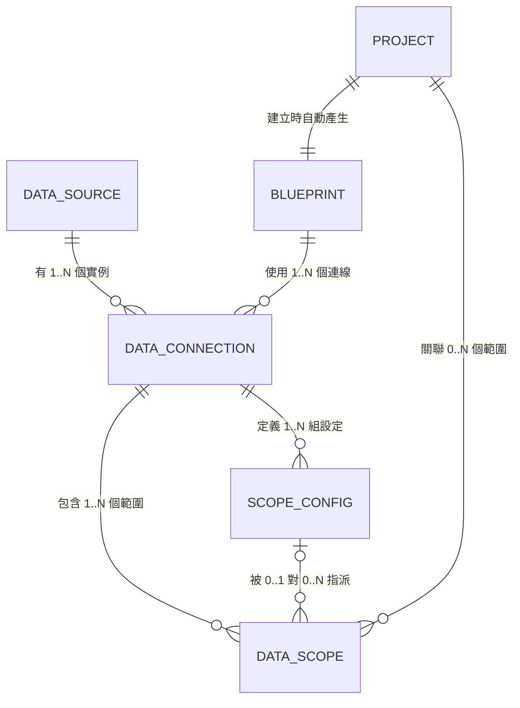

# Apache DevLake 的 ScopeConfig（範圍設定）是什麼？

## 摘要

Apache DevLake（以下簡稱 DevLake）是一套開源的開發資料平台，用來擷取（ingest）、分析並視覺化來自各種 DevOps 工具（GitHub、GitLab、Jira、Jenkins 等）的破碎化資料，以萃取工程卓越、開發者體驗與社群成長相關的洞察[^repo]。本文聚焦於 DevLake 資料設定流程中的一個關鍵概念：**ScopeConfig（範圍設定）**。

簡言之，ScopeConfig 是「某一個資料範圍（data scope）的設定」，它定義了兩件事：**要蒐集哪些資料實體（data entities）**，以及**要對這些資料套用哪些轉換規則（transformations）**[^concepts]。每個資料範圍最多只能綁定一組 ScopeConfig，但同一組 ScopeConfig 可以在同一個資料連線下被多個資料範圍共用[^concepts]。本文將說明其定義、組成、在 DevLake 資料模型中的位置、實際外掛的欄位範例、程式實作、REST API 端點、生命週期規則，並追溯其概念演進，最後對來源進行批判性反思。

---

## 1. 背景：DevLake 的資料階層

要理解 ScopeConfig，必須先理解 DevLake 的設定階層。DevLake 的設定介面（Config UI）中，依使用者操作順序會依序遇到以下名詞[^concepts]：

| 名詞 | 定義 | 對應範例 |
| --- | --- | --- |
| Data Source（資料來源） | 一個特定的 DevOps 工具 | GitHub、GitLab、Jira、Jenkins |
| Data Connection（資料連線） | 某個資料來源的一個具體實例，儲存 endpoint 與驗證權杖等存取資訊 | 某個 GitHub 組織的連線 |
| Data Scope（資料範圍） | 資料來源中的「最上層容器」 | Jira board、TAPD workspace、GitHub/GitLab/BitBucket repo、Jenkins job |
| Scope Config（範圍設定） | 某個資料範圍的設定，定義要蒐集的資料實體與要套用的轉換 | 某個 repo 的標籤轉換規則 |
| Project（專案） | 真實世界的專案或產品線，用來彙整不同領域的資料 | Apache DevLake 專案 |
| Blueprint（藍圖） | 將資料從來源同步進 DevLake 的計畫 | 每日同步排程 |

DevLake 以各種資料範圍（repos、boards、cicd_scopes、cq_projects）作為「容器」，把不同領域的資料關聯到特定專案[^concepts]。DORA 等指標是在**專案層級**計算的，因此正確地把資料範圍組織到專案中，是取得有意義指標的前提[^organize]。

---

## 2. ScopeConfig 的定義

官方文件對 ScopeConfig 的定義是：

> 「A scope config refers to the configuration of a data scope. It defines the specific data entities to be collected and the transformations to be applied to that data.」（範圍設定指的是某個資料範圍的設定，它定義了要蒐集的特定資料實體，以及要套用於該資料的轉換。）[^concepts]

並附帶兩條重要的基數（cardinality）規則[^concepts]：

- **每個資料範圍最多只能有一組 ScopeConfig**（at most one）。
- **一組 ScopeConfig 可以在同一個資料連線下被多個資料範圍共用**（shared among multiple data scopes under the same data connection）。

換句話說，ScopeConfig 是介於「資料連線」與「資料範圍」之間的一層可重用設定樣板。當多個 repo 或 board 需要相同的轉換規則時，可以建立一組 ScopeConfig 後指派給它們。

---

## 3. ScopeConfig 的組成

ScopeConfig 由兩個部分組成[^concepts]：

### 3.1 Data Entities（資料實體）

資料實體指要從各資料領域蒐集的具體資料欄位，並被歸類為 DevLake 的**六大資料領域**[^concepts]：

1. Issue Tracking（議題追蹤）
2. Source Code Management（原始碼管理）
3. Code Review（程式碼審查）
4. CI/CD
5. Code Quality（程式碼品質）
6. Cross-Domain（跨領域）

使用者可透過勾選／取消勾選領域來決定要蒐集哪些實體。例如在設定 GitHub 資料連線時，若只想蒐集 repos、commits 與 pull requests，而不要 issues 與 workflow runs，就勾選 Source Code Management 與 Code Review，並取消 Issue Tracking 與 CI/CD[^concepts]。官方文件指出，一般情況下不需要修改這部分，但若想加速蒐集，可以取消某些實體[^github]。

### 3.2 Transformations（轉換規則）

轉換規則是讓使用者自訂 DevLake 如何把原始 API 回應轉換成領域層（domain layer）資料的設定[^concepts]。設定轉換規則並非強制，但某些預建儀表板（例如 DORA、Weekly Bug Retro）需要這些規則才能正確顯示指標；若留空或設定錯誤，只有少數資料來源儀表板會如預期顯示[^concepts]。

轉換規則會實際影響領域層欄位。例如領域層 schema 文件說明：

- `issues.type` 的三種標準型別（REQUIREMENT / BUG / INCIDENT）「The transformation rule is set in the Scope Config on the Connections page of Jira, GitHub and etc.」[^schema]
- `cicd_pipelines.type`（與 `cicd_tasks.type`）在符合 ScopeConfig 中設定的正規表達式時會被設為 `DEPLOYMENT`[^schema]。
- `cicd_pipelines.environment`（與 `cicd_tasks.environment`）在符合 ScopeConfig 中設定的正規表達式時會被設為 `PRODUCTION`[^schema]。

---

## 4. 與其他概念之間的關係

下圖以 Mermaid 呈現 Data Connection、Data Scope、ScopeConfig 與 Project / Blueprint 之間的關係：

重點說明：

- 一個 Blueprint 可以有多個資料連線；每個資料連線可以有多個資料範圍[^concepts]。
- 「Each set of data scope can only have one set of scope config.」（每一組資料範圍只能有一組 ScopeConfig。）[^concepts]
- 一個資料範圍可以選擇性地關聯一組 ScopeConfig；一組 ScopeConfig 可被同連線下的多個範圍共用[^concepts]。
- 在程式碼層面，資料範圍（scope）與 ScopeConfig 的關聯是透過範圍結構中的 `ScopeConfigId` 欄位實作[^base]；API 回傳範圍時會把對應的 `scopeConfig` 一併附上[^genericscope]。

---

## 5. 實際外掛的 ScopeConfig 範例

不同外掛的 ScopeConfig 有不同的轉換欄位。以下以 GitHub、Jira、GitLab 及 Python 外掛框架為例。

### 5.1 GitHub

GitHub 的 ScopeConfig 在 Config UI 的「Step 1.3 - Add Scope Config」步驟設定，包含資料實體與轉換兩部分，且**每個 GitHub repo 最多只能有一組轉換規則**[^github]。常見轉換欄位包括[^github]：

- **Issue Tracking**
  - Severity：以正規表達式從 issue 標籤解析嚴重度。例如標籤形如 `severity/p0`、`severity/p1` 時輸入 `severity/(.*)$`；形如 `p0`、`p1` 時輸入 `(p0|p1|p2)$`。
  - Component：同 Severity。
  - Priority：同 Severity。
  - Type/Requirement、Type/Bug、Type/Incident：把符合正規表達式的 issue 標籤對應到 REQUIREMENT / BUG / INCIDENT 三種標準型別。
- **CI/CD**
  - 用以計算 DORA 指標的關鍵規則：以正規表達式辨識何謂「部署」與何謂「生產環境部署」。第一個欄位輸入比對 workflow run 或 job 名稱的 regex（例如 `.*push-image.*`），第二個欄位輸入辨識生產環境的 regex（例如 `push-image-to-prod` 或 `release.*`）；若留空，則所有被辨識為部署者皆視為生產部署。
- **Code Review**
  - Type：以正規表達式從 PR 標籤解析 PR 型別，例如 `type/(.*)$`。
  - Component：同 Type，解析 PR 的 component。
- **Additional Settings**
  - Tags Limit：比較最後 N 組 tag 以計算 commit diff 與 issue diff，N 預設為 10。
  - Tags Pattern：只有符合正規表達式的 tag 才會被計入。
  - Tags Order：目前僅支援「reverse semver」排序。

在程式碼中，GitHub 的 ScopeConfig 對應結構 `GithubScopeConfig` 內嵌了通用的 `common.ScopeConfig`，並額外帶有 `PrType`、`PrComponent`、`PrBodyClosePattern`、`IssueSeverity`、`IssuePriority`、`IssueComponent`、`IssueTypeBug`、`IssueTypeIncident`、`IssueTypeRequirement`、`DeploymentPattern`、`ProductionPattern`、`EnvNamePattern`、`Refdiff`、`PrSizeExcludedFileExtensions` 等欄位，對應的資料表名稱為 `_tool_github_scope_configs`[^githubmodel]。其中亦包含一組 `IssueField*` 欄位，用於把 GitHub issue 的組織層結構化欄位（organization-level structured metadata）對應到 DevLake 的 issue 欄位，且優先於前述的標籤正規表達式[^githubmodel]。

### 5.2 Jira

Jira 的 ScopeConfig 同樣包含資料實體與轉換兩部分，且**每個 Jira board 最多只能有一組轉換規則**[^jira]：

- **Issue Tracking**
  - Requirement / Bug / Incident：選擇要分別轉換成 REQUIREMENT / BUG / INCIDENT 的 issue types。
  - Epic Key：選擇代表 Epic key 的自訂欄位（通常為「Epic Link」）。
  - Story Point：選擇代表 story point 的自訂欄位（通常為「Story Points」）。
- **Additional Settings**
  - Remotelink Commit SHA：以正規表達式從 issue 的 remote links 解析 commit SHA，建立 issue 與 commit 的關聯，可直接使用 `/commit/([0-9a-f]{40})$`。

這些 Jira 轉換是量測 Requirement Lead Time、Bug Age 或 DORA 的 Median Time to Restore Service（MTTR）等指標的必要條件[^jira]。

對應的 `JiraScopeConfig` 結構欄位包括 `EpicKeyField`、`StoryPointField`、`RemotelinkCommitShaPattern`、`RemotelinkRepoPattern`（一組 `{pattern, regex}`）、`TypeMappings`（把原始 issue type 對應到標準型別與狀態）、`ApplicationType`、`DueDateField`、`ExtraJQL`，資料表名稱為 `_tool_jira_scope_configs`[^jiramodel]。此結構另實作 `Validate()`，會嘗試編譯 `RemotelinkCommitShaPattern` 與各 `RemotelinkRepoPattern` 的 regex，並以 Go template 解析 `ExtraJQL`，格式錯誤時回傳錯誤[^jiramodel]。

### 5.3 GitLab

`GitlabScopeConfig` 的欄位與 GitHub 高度相似，包括 `PrType`、`PrComponent`、`PrBodyClosePattern`、`IssueSeverity`、`IssuePriority`、`IssueComponent`、`IssueTypeBug`、`IssueTypeIncident`、`IssueTypeRequirement`、`DeploymentPattern`、`ProductionPattern`、`EnvNamePattern`、`Refdiff`、`PrSizeExcludedFileExtensions`，資料表名稱為 `_tool_gitlab_scope_configs`[^gitlabmodel]。這說明 ScopeConfig 的欄位設計在不同外掛間具有共通模式，但由各外掛自行宣告。

### 5.4 Python 外掛（Pydevlake）

除了 Go 外掛，DevLake 亦提供以 Python 撰寫外掛的框架 Pydevlake。在此框架中，外掛需宣告 `scope_config_type`，並定義一個繼承自 `dl.ScopeConfig` 的類別；該類別「包含某個範圍要蒐集的領域實體，以及外掛用來轉換資料的參數，例如以正規表達式從名稱比對 issue 型別」[^pydevlake]。若外掛不需要任何轉換參數，可省略該類別與 `scope_config_type` 屬性[^pydevlake]。

---

## 6. 資料模型與程式實作

在 Go 程式碼層面，通用 ScopeConfig 的基礎結構定義於 `common` 套件[^base]：

- `ScopeConfig` 結構內嵌 `Model`（含 `ID`、`CreatedAt`、`UpdatedAt`），並有：
  - `Entities []string`（以 JSON 序列化儲存），
  - `ConnectionId uint64`（必填、建立索引），
  - `Name string`（必填、唯一索引，型別 varchar(255)）。
- `Scope` 結構包含 `ConnectionId uint64`（主鍵、必填）與 `ScopeConfigId uint64`，後者即為指向 ScopeConfig 的關聯欄位。

外掛若想實作 ScopeConfig，需宣告 `ScopeConfig() dal.Tabler` 方法，例如 GitHub 外掛回傳 `&models.GithubScopeConfig{}`[^githubimpl]。此外，Python 外掛的 ScopeConfig、Connection、Scope 等型別也會被存入 DevLake 資料庫，變更時需撰寫資料庫遷移腳本[^pydevlake]。

在 API 邏輯層，ScopeConfig 的 CRUD 由 `ScopeConfigHelper` 負責[^scopeconfighelper]：

- `Create`：解析路徑中的 `connectionId`（必須為非零整數），將請求 body 解碼為 ScopeConfig，設定 `connectionId`，執行結構驗證與複合驗證，寫入資料庫；若名稱重複會回傳「已有同名 ScopeConfig」的錯誤。
- `Update`：以 `id` 取出既有設定，解碼請求 body 後驗證並更新；名稱重複同樣報錯。
- `Get` / `List`：依 `id` 或 `connectionId` 取得單筆或清單（支援 pageSize / page 分頁）。
- `Delete`：依 `id` 與 `connectionId` 刪除，並透過 `nullOutScopeReferences` 把所有引用該 ScopeConfig 的 scope 之 `scope_config_id` 設為 NULL。

另一方面，`DsScopeConfigApiHelper` 提供資料來源外掛共用的端點實作，包括依連線取得所有 ScopeConfig、依 ScopeConfig 反查使用它的專案，以及 Post / Patch / Delete[^dsscopeconfig]。

---

## 7. REST API 端點

以 GitHub 外掛為例，其 API 路由註冊如下[^githubimpl]（DevLake 的 REST API 一般掛載於 `/plugins/{plugin}/...` 之下）：

| 方法 | 路徑 | 用途 |
| --- | --- | --- |
| GET | `/plugins/github/connections/:connectionId/scope-configs` | 列出某連線下的所有 ScopeConfig |
| POST | `/plugins/github/connections/:connectionId/scope-configs` | 新增 ScopeConfig |
| GET | `/plugins/github/connections/:connectionId/scope-configs/:scopeConfigId` | 取得單一 ScopeConfig |
| PATCH | `/plugins/github/connections/:connectionId/scope-configs/:scopeConfigId` | 更新 ScopeConfig |
| DELETE | `/plugins/github/connections/:connectionId/scope-configs/:scopeConfigId` | 刪除 ScopeConfig |
| GET | `/plugins/github/scope-config/:scopeConfigId/projects` | 查詢使用該 ScopeConfig 的專案 |

DevLake 的 Swagger 文件隨 `devlake` 容器一同提供，可於 `http://<DEVLAKE_CONTAINER_HOST>:<PORT>/swagger/index.html`，或經由 config-ui 容器於 `http://<CONFIG_UI_CONTAINER_HOST>:<PORT>/api/swagger/index.html` 存取[^apiref]。

此外，在 Config UI 的「Advanced Mode」中，使用者可以直接以 JSON 撰寫 pipeline，並在 `options` 中指定 `connectionId`、`scopeId`（Jenkins 為 job 名稱）等參數[^advanced]。資料範圍與 ScopeConfig 的關聯也可在 API 回傳中觀察到：`ScopeRes` / `ScopeDetail` 結構同時包含 `scope`、`scopeConfig` 與 `blueprints` 三個欄位[^genericscope][^srvscope]。

---

## 8. 生命週期與完整性規則

現行的服務層 helper（`ScopeConfigSrvHelper`）定義了多項完整性規則[^srvconfig]：

- **刪除保護**：`DeleteScopeConfig` 會先查詢是否有任何 scope 的 `scope_config_id` 指向該設定；若有，回傳 Conflict 錯誤「Please delete all data scope(s) before you delete this ScopeConfig.」，亦即必須先刪除所有使用中的資料範圍，才能刪除 ScopeConfig。此操作會包在「無執行中 pipeline」的檢查內。
  - 值得注意的是，較早期的 `pluginhelper.ScopeConfigHelper.Delete` 採取不同策略：它會直接把引用者的 `scope_config_id` 設為 NULL（`nullOutScopeReferences`）[^scopeconfighelper]。這反映此功能的實作經歷了演進。
- **反查專案**：`GetProjectsByScopeConfig` 會以 `_devlake_blueprint_scopes` 關聯表（含 `plugin_name`、`connection_id`、`scope_id`、`scope_config_id` 等欄位）串接 `_devlake_blueprints` 與 scope 資料表，找出哪些專案與藍圖正在使用該設定，並回傳專案名稱、藍圖 ID 與其下的 scope 清單[^srvconfig]。
- **scopeConfigId 驗證**：`ScopeSrvHelper.Validate` 會檢查 `connectionId` 與 `scopeConfigId` 是否存在於資料庫，不存在時分別回傳「connectionId is invalid」與「scopeConfigId is invalid」[^srvscope]。
- **預設 entities**：當讀取 scope 明細時，若 ScopeConfig 的 `Entities` 為空，系統會自動填入 `plugin.DOMAIN_TYPES` 作為預設值[^srvscope]。

---

## 9. 版本演進與設計脈絡

「範圍設定」的概念並非一開始就以此名稱存在，而是隨版本逐步整合。比較 v0.15 與現行文件可以看出演進脈絡：

- **v0.15（約 2022 年）**：文件將「建立 Blueprint」拆為四個步驟，其中第 3 步是「Adding Transformation Rules (optional)」；文件並將 Data Scope 與 Transformation Rules 分列為不同名詞，敘述為「Each set of data scope is strictly accompanied with one set of transformation rules」（每一組資料範圍嚴格伴隨一組轉換規則），且允許把轉換規則複製到不同的資料範圍[^v015]。當時的資料實體被歸為**五個**領域（尚未含 Code Quality）[^v015]。
- **現行文件（Next / v1.0）**：統一以 **Scope Config** 一詞涵蓋「資料實體」與「轉換」兩部分，資料實體擴充為**六個**領域（新增 Code Quality），並明確表述為「每個資料範圍最多一組 ScopeConfig、一組 ScopeConfig 可被多個範圍共用」[^concepts]。

因此可理解為：早期的「轉換規則」概念在後續版本被收斂進「ScopeConfig」，並與資料實體一併成為可被多個範圍共用的第一級（first-class）實體，同時在程式碼中取得獨立的資料表、CRUD API 與完整性規則。

---

## 10. 批判性來源反思

- **權威性**：本文核心定義來自 DevLake 官方文件網站（`devlake.apache.org`）與 Apache 基金會官方 GitHub 儲存庫（`github.com/apache/devlake`），屬第一手且具權威性的來源。官方文件與原始碼互相印證（例如「每個範圍最多一組設定」在文件與 `Scope`/`ScopeConfig` 結構中一致；Jira 的遠端連結轉換在文件與 `JiraScopeConfig` 欄位中一致）。
- **時效性**：官方文件網站標示版本為「Next」並提供 v0.15 至 v1.0 等歷史版本；原始碼取自 `main` 分支。DevLake 自 v1.0 起進行概念重構，不同版本文件對「scope」與「scope config」的敘述略有差異（見第 9 節）。本文內容以 `main` 分支與 Next 文件為準，引用日期為 2026-11-19。
- **完整性限制**：官方文件以概念與操作為主，欄位層級的細節（例如 `GithubScopeConfig`、`JiraScopeConfig` 的完整欄位清單）需回歸原始碼確認，本文已同時引用原始碼。部分欄位（如 GitHub 的 `IssueField*` 對應）在文件中尚無完整說明，屬較新的實作。
- **行為不一致的取捨**：刪除 ScopeConfig 的完整性規則在程式碼中存在兩套實作（舊 helper 將引用設為 NULL、新服務層 helper 直接拒絕刪除），本文同時列出並指出其演進，避免以偏概全。
- **可重現性**：本文所述之 GitHub 星數（約 3,200）、fork 數與授權等資訊取自 GitHub API 的即時回應，會隨時間變動，僅代表擷取當下狀態[^repo]。
- **未查證事項**：本文未逐一驗證每個資料來源外掛（Jenkins、SonarQube、TAPD、Bitbucket、Azure DevOps 等）各自的 ScopeConfig 欄位，僅以 GitHub、Jira、GitLab 與 Python 框架作為代表範例；不同外掛的可用轉換欄位並不相同，讀者應查閱對應外掛的官方設定文件。

---

## 11. 重點回顧

- **ScopeConfig = 資料範圍的設定**，定義「蒐集哪些資料實體」與「套用哪些轉換規則」[^concepts]。
- **基數關係**：每個資料範圍最多一組 ScopeConfig；一組 ScopeConfig 可被同連線下多個範圍共用[^concepts]。
- **兩大組成**：Data Entities（六大資料領域）與 Transformations（自訂領域層轉換）[^concepts]。
- **實作**：通用基礎為 `common.ScopeConfig`（含 `Entities`、`ConnectionId`、`Name`）[^base]，外掛再擴充各自欄位（如 `GithubScopeConfig`、`JiraScopeConfig`、`GitlabScopeConfig`）[^githubmodel][^jiramodel][^gitlabmodel]；Python 外掛以 `scope_config_type` 宣告[^pydevlake]。
- **API**：以 `/plugins/{plugin}/connections/:connectionId/scope-configs` 為核心進行 CRUD，並可反查使用該設定的專案[^githubimpl]。
- **完整性規則**：刪除前必須先移除所有引用該設定的資料範圍，否則回傳 Conflict[^srvconfig]。

---

## 參考文獻

[^repo]: Apache Software Foundation. (2026). *apache/devlake* [Computer software]. GitHub. Retrieved 2026-11-19, from https://github.com/apache/devlake

[^concepts]: Apache DevLake. (n.d.). *Key concepts*. Retrieved 2026-11-19, from https://devlake.apache.org/docs/Overview/KeyConcepts

[^github]: Apache DevLake. (n.d.). *GitHub*. Retrieved 2026-11-19, from https://devlake.apache.org/docs/Configuration/GitHub

[^jira]: Apache DevLake. (n.d.). *Jira*. Retrieved 2026-11-19, from https://devlake.apache.org/docs/Configuration/Jira

[^schema]: Apache DevLake. (n.d.). *Domain layer schema*. Retrieved 2026-11-19, from https://devlake.apache.org/docs/DataModels/DevLakeDomainLayerSchema

[^organize]: Apache DevLake. (n.d.). *How to organize DevLake projects*. Retrieved 2026-11-19, from https://devlake.apache.org/docs/Configuration/HowToOrganizeDevlakeProjects

[^advanced]: Apache DevLake. (n.d.). *Blueprint advanced mode*. Retrieved 2026-11-19, from https://devlake.apache.org/docs/Configuration/AdvancedMode

[^apiref]: Apache DevLake. (n.d.). *API references*. Retrieved 2026-11-19, from https://devlake.apache.org/docs/Overview/References

[^v015]: Apache DevLake. (n.d.). *Key concepts* (Version v0.15). Retrieved 2026-11-19, from https://devlake.apache.org/docs/v0.15/Overview/KeyConcepts

[^base]: Apache Software Foundation. (2026). *Common base models* [Source code]. GitHub. Retrieved 2026-11-19, from https://github.com/apache/devlake/blob/main/backend/core/models/common/base.go

[^githubmodel]: Apache Software Foundation. (2026). *GitHub scope config model* [Source code]. GitHub. Retrieved 2026-11-19, from https://github.com/apache/devlake/blob/main/backend/plugins/github/models/scope_config.go

[^jiramodel]: Apache Software Foundation. (2026). *Jira scope config model* [Source code]. GitHub. Retrieved 2026-11-19, from https://github.com/apache/devlake/blob/main/backend/plugins/jira/models/scope_config.go

[^gitlabmodel]: Apache Software Foundation. (2026). *GitLab scope config model* [Source code]. GitHub. Retrieved 2026-11-19, from https://github.com/apache/devlake/blob/main/backend/plugins/gitlab/models/scope_config.go

[^githubimpl]: Apache Software Foundation. (2026). *GitHub plugin implementation* [Source code]. GitHub. Retrieved 2026-11-19, from https://github.com/apache/devlake/blob/main/backend/plugins/github/impl/impl.go

[^scopeconfighelper]: Apache Software Foundation. (2026). *Scope config helper* [Source code]. GitHub. Retrieved 2026-11-19, from https://github.com/apache/devlake/blob/main/backend/helpers/pluginhelper/api/scope_config_helper.go

[^dsscopeconfig]: Apache Software Foundation. (2026). *Data source scope config API helper* [Source code]. GitHub. Retrieved 2026-11-19, from https://github.com/apache/devlake/blob/main/backend/helpers/pluginhelper/api/ds_scope_config_api_helper.go

[^genericscope]: Apache Software Foundation. (2026). *Generic scope helper* [Source code]. GitHub. Retrieved 2026-11-19, from https://github.com/apache/devlake/blob/main/backend/helpers/pluginhelper/api/scope_generic_helper.go

[^srvconfig]: Apache Software Foundation. (2026). *Scope config service helper* [Source code]. GitHub. Retrieved 2026-11-19, from https://github.com/apache/devlake/blob/main/backend/helpers/srvhelper/scope_config_service_helper.go

[^srvscope]: Apache Software Foundation. (2026). *Scope service helper* [Source code]. GitHub. Retrieved 2026-11-19, from https://github.com/apache/devlake/blob/main/backend/helpers/srvhelper/scope_service_helper.go

[^pydevlake]: Apache Software Foundation. (2026). *Pydevlake README* [Source code]. GitHub. Retrieved 2026-11-19, from https://github.com/apache/devlake/blob/main/backend/python/README.md
