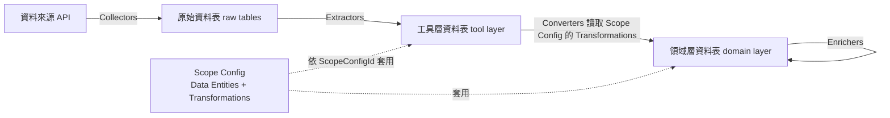

# DevLake 的 ScopeConfig 轉換（Transformations）運作原理與使用方式

## 摘要

Apache DevLake 是一套開源的開發資料平台（Dev Data Platform），用來蒐集、分析並視覺化來自各種 DevOps 工具的資料[^md]。使用者在設定資料來源時，除了選擇要收集的「資料範圍」（Data Scope）之外，還能為每個範圍設定一組「範圍設定」（Scope Config），其中包含兩大部分：要收集的「資料實體」（Data Entities）與要套用的「轉換」（Transformations）[^key]。

本報告說明 Scope Config 的轉換機制如何運作：它的資料結構、在資料管線中的位置、在設定介面（Config UI）中的操作流程、各外掛常見的轉換欄位、對應的 API 端點，以及重新轉換（Re-transform）的用法。閱讀本報告不需要任何 DevLake 背景知識，所有專有名詞都會在文中定義。

---

## 1. 背景：DevLake 與相關名詞

Apache DevLake 以 Go 語言撰寫，授權為 Apache-2.0，截至 2026-11-19 於 GitHub 上約有 3,204 顆星、842 個 fork[^md]。它的核心設計是把「資料來源」與「專案」分開：資料先被收集進平台，再依專案分組以計算指標。

### 1.1 依序出現的關鍵名詞

以下名詞按使用者在設定介面中的操作順序排列[^key]：

| 名詞（原文） | 定義 |
| --- | --- |
| 資料來源（Data Source） | 一個具體的 DevOps 工具，例如 GitHub、GitLab、Jira、Jenkins。 |
| 資料連線（Data Connection） | 某個資料來源的具體實例，儲存端點網址與認證資訊，例如「公司 GitHub 的某個帳號」。 |
| 資料範圍（Data Scope） | 資料來源中的最高層級「容器」。對 Jira 而言是一個 board，對 GitHub／GitLab／BitBucket 而言是一個 repo，對 Jenkins 而言是一個 job。 |
| 範圍設定（Scope Config） | 某個資料範圍的設定，定義要收集哪些資料實體，以及要套用哪些轉換。 |
| 專案（Project） | 真實世界中的專案或產品線，用來把不同領域的資料分組，DORA 指標在專案層級計算。 |
| 藍圖（Blueprint） | 把資料從資料來源同步進平台的計畫。 |

### 1.2 範圍設定的兩大部分

範圍設定由兩個部分組成[^key]：

1. **資料實體（Data Entities）**：要從各資料領域收集哪些欄位。DevLake 把實體分為六個資料領域（Data Domain）：問題追蹤（Issue Tracking）、原始碼管理（Source Code Management）、程式碼審查（Code Review）、CI/CD、程式碼品質（Code Quality）、跨領域（Cross-Domain）[^key]。使用者可以勾選或取消勾選這些領域，藉此加快收集速度[^gh][^jira]。
2. **轉換（Transformations）**：使用者自訂「DevLake 如何把原始 API 回應轉換成領域層（domain layer）資料」的設定[^key]。

### 1.3 範圍設定與資料範圍的關係

**每個資料範圍最多只能關聯一份範圍設定；而同一條資料連線下，一份範圍設定可以分享給多個資料範圍使用**[^key]。在程式碼層面，這個關係由資料範圍（Scope）上的一個欄位 `ScopeConfigId` 來維護：資料範圍會記錄它指向哪一份範圍設定[^base]。若某個範圍沒有指定 `ScopeConfigId`，執行時會改用一組預設（空白）設定[^impl]。

---

## 2. 轉換的資料結構

範圍設定在底層是以每個外掛各自的資料表儲存，命名規則為 `_tool_<外掛名>_scope_configs`，例如 GitHub 為 `_tool_github_scope_configs`[^ghsc]、Jira 為 `_tool_jira_scope_configs`[^jisc]。

所有外掛的範圍設定都內嵌了一個共用的基礎結構 `common.ScopeConfig`，其欄位如下[^base]：

```go
type ScopeConfig struct {
    Model                        // 含 ID、CreatedAt、UpdatedAt
    Entities     []string        // 要收集的資料實體
    ConnectionId uint64          // 所屬資料連線
    Name         string          // 設定名稱（同一連線內唯一）
}
```

換句話說，**「Entities（要收集什麼）」與「外掛自訂的轉換欄位（要怎麼轉換）」共同構成一筆範圍設定**。以下以外掛自訂欄位為例說明。

### 2.1 GitHub 的轉換欄位

GitHub 外掛的範圍設定定義了下列轉換欄位[^ghsc]（節錄）：

- `prType`、`prComponent`：從 PR 標籤解析 PR 的類型與元件。
- `issueSeverity`、`issuePriority`、`issueComponent`：從 issue 標籤解析嚴重度、優先度、元件。
- `issueTypeBug`、`issueTypeIncident`、`issueTypeRequirement`：把符合正規表達式的 issue 標籤歸類為 BUG / INCIDENT / REQUIREMENT。
- `deploymentPattern`、`productionPattern`、`envNamePattern`：用來辨識部署與正式環境。
- `refdiff`：refdiff 外掛的設定。
- `prSizeExcludedFileExtensions`：計算 PR 大小時要排除的副檔名。

### 2.2 Jira 的轉換欄位

Jira 外掛的範圍設定則包含較結構化的轉換欄位[^jisc]，例如：

- `typeMappings`：把 Jira 的 issue 類型映射到 DevLake 的標準類型，結構如下[^jisc]：

```go
type TypeMapping struct {
    StandardType   string         // 標準類型
    StatusMappings StatusMappings // 狀態映射
}
type StatusMapping struct {
    StandardStatus string // 標準狀態
}
```

- `epicKeyField`、`storyPointField`：指定代表 Epic 鍵與 story point 的自訂欄位。
- `remotelinkCommitShaPattern`、`remotelinkRepoPattern`：從 issue 的 remote link 解析 commit SHA，以建立 issue 與 commit 的關聯。
- `extraJql`：在使用者查詢之外附加的 JQL 條件。

不同外掛的轉換欄位彼此不同，但都遵循相同的資料表與共用基礎結構設計。

---

## 3. 轉換在資料管線中的位置

DevLake 的資料管線（Pipeline）由「階段（Stages）→ 任務（Tasks）→ 子任務（Subtasks）」三層組成[^key]。子任務有四种角色[^key]：

- **收集器（Collectors）**：透過 API 從資料來源取得原始資料，存入原始資料表（raw data table）。
- **擷取器（Extractors）**：把資料從原始資料表萃取到工具層資料表（tool layer tables）。
- **轉換器（Converters）**：把工具層資料轉換成領域層資料表（domain layer tables）。
- **豐富器（Enrichers）**：把某一領域的資料與其他領域關聯、補齊。

**轉換規則（Transformations）在「轉換器」階段生效**：當 Converters 把工具層資料寫入領域層時，會讀取該資料範圍對應的範圍設定，據此決定型別、嚴重度、部署分類等領域層欄位。因此「轉換」是「如何把原始資料映射成 DevLake 標準模型」的設定，而非改變原始資料的收集方式。

下圖描繪整體流程：



### 3.1 轉換是可選的，但影響儀表板

設定轉換規則並非強制[^key]。若沒有設定，仍可看到「GitHub Metrics」等資料來源層級的儀表板；但若想看到「Weekly Bug Retro」「Weekly Community Retro」或其他預建儀表板，特別是「Type/Bug」，就必須加上轉換規則[^gh]。Jira 亦同：未設定轉換規則時，無法看到「Jira」或「Engineering Throughput and Cycle Time」儀表板的全部圖表[^jira]。

此外，**每個 GitHub repo 最多只能有一組轉換設定**[^gh]，每個 Jira board 亦是如此[^jira]。

---

## 4. 在設定介面（Config UI）中使用轉換

設定介面預設位於 `http://localhost:4000`[^tut]。與轉換相關的流程如下[^tut][^gh]：

1. **步驟 1.1 新增資料連線**：設定端點與認證。
2. **步驟 1.2 新增資料範圍**：例如選擇要收集的 GitHub repo 或 Jira board。
3. **步驟 1.3 新增範圍設定（選用）**：設定要收集的資料實體，以及要套用的轉換規則。
4. **步驟 2 在專案中收集資料**：建立專案、關聯連線、設定同步策略（時間範圍、頻率、跳過失敗任務）。

進入範圍設定的第二步（Transformations）時，介面會提示：**若只修改範圍設定而未修改前一步的資料實體，只需在專案頁面執行「重新轉換資料」（Re-transform Data），即可看到儀表板更新**[^form]。

### 4.1 資料收集模式與「重新轉換」

DevLake 支援三種資料收集模式[^tut]：

| 模式 | 行為 |
| --- | --- |
| Collect Data（預設） | 在指定時間範圍內取得資料；支援增量的工具採增量，否則全量。 |
| Collect Data in Full Refresh Mode | 刪除時間範圍內的既有資料並重新收集，用於移除已不存在的舊資料。 |
| **Re-transform Data** | **不收集新資料**，而是把最新的範圍設定轉換規則套用到既有資料。 |

「Re-transform Data」是調整轉換規則後最省時的更新方式：不必重新向來源 API 拉資料，只要重跑轉換器即可[^tut]。

### 4.2 GitHub 的轉換設定範例

GitHub 連線的範圍設定中，常見的轉換規則與寫法如下[^gh]：

- **Severity / Component / Priority**：從 issue 標籤解析。
  - 若標籤形如 `severity/p0`、`severity/p1`、`severity/p2`，輸入 `severity/(.*)$`。
  - 若標籤形如 `p0`、`p1`、`p2`，輸入 `(p0|p1|p2)$`。
- **Type/Bug、Type/Requirement、Type/Incident**：把符合正規表達式的 issue 標籤歸類為 BUG / REQUIREMENT / INCIDENT。與 PR 的 `type` 不同，這裡不做子匹配（submatch），因為 DevLake 想把各種命名標準化。
- **CI/CD 部署辨識**：這是計算 DORA 指標的關鍵規則。DevLake 以正規表達式從 GitHub environments 中找出正式環境；若部署是透過 workflow run 而非 GitHub deployments，則可勾選選項把某個 workflow run 轉成 DevLake 的部署，並設定兩個正規表達式：
  - 第一個：辨識哪些 workflow run 或其 job 算部署（例如 `.*push-image.*`；可在前面加 `(?i)` 使其不分大小寫）。
  - 第二個：辨識哪些部署屬於 PRODUCTION（例如 `.*prod` 或 `release.*`；留空則全部視為正式部署）。
- **Code Review 的 Type / Component**：從 PR 標籤解析，例如標籤形如 `type/feature-development` 時輸入 `type/(.*)$`。
- **Additional Settings**：Tags Limit（比較最近 N 組標籤，預設 10）、Tags Pattern（只有符合正規表達式的標籤才計入）、Tags Order（目前僅支援 reverse semver）。

### 4.3 Jira 的轉換設定範例

Jira 連線的範圍設定中，轉換規則如下[^jira]：

- **Requirement / Bug / Incident**：選擇要分別映射到這三種標準類型的 Jira issue 類型。
- **Epic Key**：選擇代表 Epic 鍵的自訂欄位，通常是「Epic Link」。
- **Story Point**：選擇代表 story point 的自訂欄位，通常是「Story Points」。
- **Remotelink Commit SHA**：以正規表達式從 issue 的 remote link 解析 commit，例如可直接使用 `/commit/([0-9a-f]{40})$`，以建立 issue 與 commit 的關聯。

這些轉換是計算「Requirement Lead Time」「Bug Age」「DORA - Median Time to Restore Service」等指標的必要條件[^jira]。

---

## 5. 透過 API 使用範圍設定

除了圖形介面，範圍設定也可透過 API 操作。以 GitHub 外掛為例，其路由註冊如下[^impl]：

| 方法 | 路徑 | 用途 |
| --- | --- | --- |
| POST | `/plugins/github/connections/{connectionId}/scope-configs` | 建立範圍設定 |
| GET | `/plugins/github/connections/{connectionId}/scope-configs` | 列出範圍設定 |
| GET | `/plugins/github/connections/{connectionId}/scope-configs/{scopeConfigId}` | 取得單一範圍設定 |
| PATCH | `/plugins/github/connections/{connectionId}/scope-configs/{scopeConfigId}` | 更新範圍設定 |
| DELETE | `/plugins/github/connections/{connectionId}/scope-configs/{scopeConfigId}` | 刪除範圍設定 |
| GET | `/plugins/github/scope-config/{scopeConfigId}/projects` | 查詢與某範圍設定相關的專案 |

設定介面的前端程式在 `config-ui` 中的對應呼叫如下，可作為路徑格式的佐證[^api]：

```ts
export const list = (plugin, connectionId) =>
  request(`/plugins/${plugin}/connections/${connectionId}/scope-configs`);
export const create = (plugin, connectionId, data) =>
  request(`/plugins/${plugin}/connections/${connectionId}/scope-configs`, { method: 'post', data });
export const update = (plugin, connectionId, id, data) =>
  request(`/plugins/${plugin}/connections/${connectionId}/scope-configs/${id}`, { method: 'patch', data });
export const check = (plugin, id) =>
  request(`/plugins/${plugin}/scope-config/${id}/projects`);
```

在進階模式（Advanced Mode）中也能直接以 JSON 描述管線，適合需要同時收集多個 repo／board、對收集內容做細緻控制，或串接多階段外掛的情境[^adv]。此外，觸發藍圖時可在請求主體設定 `skipCollectors: true` 來略過收集器，只重跑後續的轉換步驟[^adv]。

### 5.1 轉換在執行時如何被解析

以 GitHub 為例，執行任務時會先嘗試用 `connection_id` 搭配 repo 名稱或 GitHub ID 找出 repo，接著依下列優先順序決定使用的範圍設定[^impl][^taskdata]：

1. 若選項中已直接帶入 `scopeConfig` 物件，優先使用它。
2. 否則若 `scopeConfigId` 不為 0，就依該 ID 從資料庫讀取範圍設定。
3. 若都沒有，則使用一組新的空白範圍設定（等同不套用任何自訂轉換）。

---

## 6. 使用時的注意事項

- **轉換設定不改變原始資料的收集方式**，只影響工具層→領域層的映射；要套用最新規則可用「Re-transform Data」模式[^tut]。
- **每個範圍最多一組轉換設定**[^gh][^jira]；但同一連線下的一份範圍設定可分享給多個範圍[^key]。
- **指標相依性**：DORA、Weekly Bug Retro、Requirement Lead Time、Bug Age、MTTR 等儀表板需要正確的轉換規則才能完整呈現[^key][^gh][^jira]。
- **專案組織不等於團隊組織**：DevLake 只在專案層級計算 DORA；官方不建議以「團隊」為單位測量，並建議每個專案保持「原子性」（atomic）以利比較與組合[^org]。
- **共用資源要納入所有相關專案**：若某個 repo 或 board 在現實中被多個專案共用，建議在所有相關專案中都納入，因為 DevLake 無法判斷個別 commit 或 issue 屬於哪個專案[^org]。
- **Webhook 例外**：若使用 webhook 收集事件，必須為每個專案各自設定一條連線，否則同一 webhook 的資料會被複製到所有使用它的專案[^org]。

---

## 7. 結論

DevLake 的 Scope Config 轉換機制，本質上是一組「以資料範圍為單位、用來客製化原始資料如何映射到領域層模型」的規則集合。它由共用欄位（`Entities`、`ConnectionId`、`Name`）與各外掛自訂的轉換欄位共同組成，儲存於 `_tool_<外掛>_scope_configs` 資料表；每個範圍最多關聯一份設定，但一份設定可分享給多個範圍。轉換在管線的「轉換器」階段生效；設定完成後，若只調整轉換規則而不變更資料實體，可用「Re-transform Data」模式快速套用到既有資料，無須重新呼叫來源 API。要在圖形介面或 API（`/plugins/<外掛>/connections/<connectionId>/scope-configs`）中設定皆可，且轉換正確與否直接決定 DORA、Bug Retro 等預建儀表板能否完整呈現。

---

## 參考文獻

[^md]: GitHub. (2026-11-19). *apache/devlake repository metadata* [Application programming interface]. Retrieved 2026-11-19, from https://api.github.com/repos/apache/devlake

[^key]: Apache DevLake. (2023-11-09). *Key Concepts*. Retrieved 2026-11-19, from https://devlake.apache.org/docs/v1.0/Overview/KeyConcepts

[^tut]: Apache DevLake. (n.d.). *Tutorial*. Retrieved 2026-11-19, from https://devlake.apache.org/docs/Configuration/Tutorial

[^gh]: Apache DevLake. (n.d.). *GitHub*. Retrieved 2026-11-19, from https://devlake.apache.org/docs/Configuration/GitHub

[^jira]: Apache DevLake. (n.d.). *Jira*. Retrieved 2026-11-19, from https://devlake.apache.org/docs/Configuration/Jira

[^adv]: Apache DevLake. (n.d.). *Blueprint Advanced Mode*. Retrieved 2026-11-19, from https://devlake.apache.org/docs/Configuration/AdvancedMode

[^org]: Apache DevLake. (n.d.). *How to Organize DevLake Projects*. Retrieved 2026-11-19, from https://devlake.apache.org/docs/Configuration/HowToOrganizeDevlakeProjects

[^base]: Apache DevLake. (n.d.). *backend/core/models/common/base.go* [Source code]. Retrieved 2026-11-19, from https://raw.githubusercontent.com/apache/devlake/main/backend/core/models/common/base.go

[^ghsc]: Apache DevLake. (n.d.). *backend/plugins/github/models/scope_config.go* [Source code]. Retrieved 2026-11-19, from https://raw.githubusercontent.com/apache/devlake/main/backend/plugins/github/models/scope_config.go

[^jisc]: Apache DevLake. (n.d.). *backend/plugins/jira/models/scope_config.go* [Source code]. Retrieved 2026-11-19, from https://raw.githubusercontent.com/apache/devlake/main/backend/plugins/jira/models/scope_config.go

[^impl]: Apache DevLake. (n.d.). *backend/plugins/github/impl/impl.go* [Source code]. Retrieved 2026-11-19, from https://raw.githubusercontent.com/apache/devlake/main/backend/plugins/github/impl/impl.go

[^taskdata]: Apache DevLake. (n.d.). *backend/plugins/github/tasks/task_data.go* [Source code]. Retrieved 2026-11-19, from https://raw.githubusercontent.com/apache/devlake/main/backend/plugins/github/tasks/task_data.go

[^api]: Apache DevLake. (n.d.). *config-ui/src/api/scope-config/index.ts* [Source code]. Retrieved 2026-11-19, from https://raw.githubusercontent.com/apache/devlake/main/config-ui/src/api/scope-config/index.ts

[^form]: Apache DevLake. (n.d.). *config-ui/src/plugins/components/scope-config-form/index.tsx* [Source code]. Retrieved 2026-11-19, from https://raw.githubusercontent.com/apache/devlake/main/config-ui/src/plugins/components/scope-config-form/index.tsx
