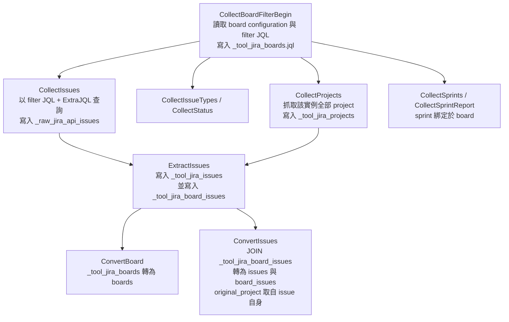
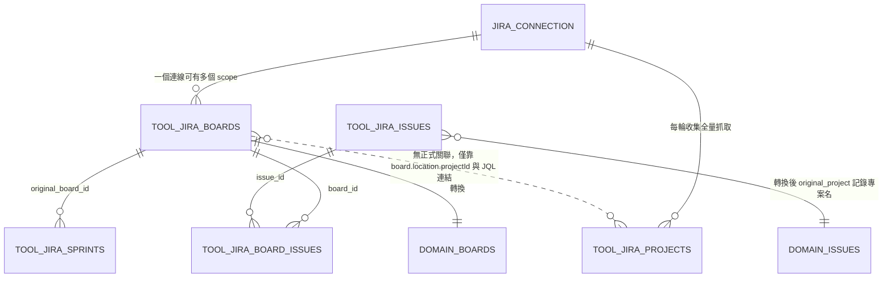

# DevLake 中 Jira Project 與 Jira Board 的關係

## 摘要

在 Apache DevLake 的 Jira 外掛中，**Jira Board 才是資料收集的「範圍（scope）」單位，而 Jira Project 只是一個被順帶抓取、停留在工具層（tool layer）的參考清單**。兩者之間沒有正式的父子或外鍵關聯，實務上呈現一種「弱關聯、且可能多對多」的關係：一個 board 的過濾條件可以橫跨多個 project，而一個 project 的議題也可能出現在多個 board 上。

更精確地說，DevLake 在設定 Jira 資料來源時，要求使用者選擇的是 **Board**，不是 Project[^configjira]；實際決定「哪些議題會被收進來」的關鍵，也不是 project 邊界，而是 **board 背後那條已儲存的 Jira 篩選器（saved filter）JQL**[^boardfilter]。本文依據 DevLake 官方文件、現行主線原始碼（`apache/devlake`，檢索於 2026-11-20）與官方討論串，完整拆解這層關係。

> **研究對象的基本資訊**：`apache/devlake` 為 Apache 軟體基金會專案，授權 Apache-2.0，主要語言 Go，截至 2026-11-20 有 3,204 顆星、842 個 fork[^githubrepo]。本文所引用的原始碼，均為主線分支 `main` 的版本。

---

## 一、背景：DevLake 的資料模型層級

要理解 Board 與 Project 的關係，必須先掌握 DevLake 的概念層級。官方文件將資料組織方式定義如下[^keyconcepts]：

| 層級 | 定義 | Jira 的對應實體 |
|---|---|---|
| Data Source（資料來源） | 某個 DevOps 工具，例如 Jira、GitHub | Jira |
| Data Connection（資料連線） | 某個資料來源的具體實例，儲存端點與認證資訊 | 一個 Jira 站台（instance） |
| **Data Scope（資料範圍）** | 資料來源中的最上層「容器」 | **Jira Board** |
| Scope Config（範圍設定） | 某個 scope 要收集哪些實體、套用哪些轉換 | 每個 board 至多一組 |
| Project（DevLake 專案） | 把不同來源的 scope 聚合起來計算指標 | 可關聯多個 Jira board |

官方文件對 Data Scope 的定義明白寫道：「**a data scope for Jira is a Jira board**」（Jira 的資料範圍就是一個 Jira board）[^keyconcepts]。也就是說，在 DevLake 的詞彙裡，**board 與 project 不是同一層級的概念**——board 是 scope，project 只是 board 底下的屬性與參考資料。

---

## 二、Jira Board 在 DevLake 中的定位

Jira 外掛本身「透過 Jira REST API 收集 Jira 資料，再據此計算並視覺化各種工程指標」[^pluginsjira]。在它的實作中，唯一被當作 scope 的實體就是 Jira board。

### 2.1 Board 是外掛的 Scope 實體

在程式碼層級，Jira 外掛實作 `plugin.ToolLayerScope` 介面所回傳的型別是 `JiraBoard`[^implgo]：

```go
func (p Jira) Scope() plugin.ToolLayerScope {
	return &models.JiraBoard{}
}
```

`JiraBoard` 對應資料表 `_tool_jira_boards`[^boardgo]，欄位如下：

```go
type JiraBoard struct {
	common.Scope `mapstructure:",squash"`
	BoardId      uint64 `json:"boardId" mapstructure:"boardId" validate:"required" gorm:"primaryKey"`
	ProjectId    uint   `json:"projectId" mapstructure:"projectId"`
	Name         string `json:"name" mapstructure:"name" gorm:"type:varchar(255)"`
	Self         string `json:"self" mapstructure:"self" gorm:"type:varchar(255)"`
	Type         string `json:"type" mapstructure:"type" gorm:"type:varchar(100)"`
	Jql          string `json:"jql" mapstructure:"jql"`
	SubQuery     string `json:"subQuery" mapstructure:"subQuery"`
}
```

其中 `common.Scope` 提供 `ConnectionId`（主鍵之一）與 `ScopeConfigId`[^scopecommon]。有兩個設計細節值得注意：

1. **`ProjectId` 不是主鍵、也沒有外鍵約束。** 它只是 board 的一個普通屬性。
2. **`Jql` 欄位是 DevLake 自己額外掛上的**，用來記錄這個 board 背後的篩選條件，後述會說明它的用途。

Board 在設定介面上，是使用者於「Add Data Scopes」步驟中勾選的項目（「Choose the Jira boards to collect」）[^configjira]。在後端，設定介面所呼叫的 scope API（`PUT /plugins/jira/connections/{connectionId}/scopes` 新增、`GET` 列出、`PATCH` 更新、`DELETE` 刪除）其請求與回應主體型別全部都是 `models.JiraBoard`[^scopeapi]，進一步印證 board 是這個外掛唯一的 scope 單位。

### 2.2 `ProjectId` 的來源與限制

`_tool_jira_boards.project_id` 的值，來自 Jira Agile API 的 board `location.projectId`[^apiv2board]：

```go
func (b Board) ConvertApiScope() plugin.ToolLayerScope {
	result := &models.JiraBoard{
		BoardId: b.ID,
		Name:    b.Name,
		Self:    b.Self,
		Type:    b.Type,
	}
	if b.Location != nil {
		result.ProjectId = b.Location.ProjectId
	}
	return result
}
```

這帶出一個關鍵限制。根據 Atlassian 的 Board REST API 文件，board 的 `location.type` 只有 `project` 與 `user` 兩種取值[^atlassianboard]：

- `location.type = "project"`：board 掛在某個 Jira project 之下，此時才會帶有 `projectId`、`projectKey` 等欄位。
- `location.type = "user"`：由使用者持有的 board（例如以跨專案篩選器建立的 board），**不會有 `projectId`**。

因此在 DevLake 中，**凡是「以篩選器建立、跨越多個 project」的 board，其 `project_id` 會是 0 或空值**。這從側面證明了 board 與 project 之間並不保證一對一關係。

---

## 三、Jira Project 在 DevLake 中的定位

### 3.1 Project 只是被動抓取的參考清單

`JiraProject` 對應資料表 `_tool_jira_projects`[^projectgo]：

```go
type JiraProject struct {
	common.NoPKModel

	// collected fields
	ConnectionId uint64 `gorm:"primarykey"`
	Id           string `gorm:"primaryKey;type:varchar(255)"`
	ProjectKey   string `gorm:"type:varchar(255)"`
	Name         string `gorm:"type:varchar(255)"`
}
```

注意它的主鍵是 `(ConnectionId, Id)`，**與 board 完全無關**。`projects` 既不引用 `boards`，`boards` 也不引用 `projects`。

### 3.2 收集 project 的方式：與 board 無關的全量抓取

`CollectProjects` 子任務會呼叫 Jira 的 `api/2/project` 端點，一次抓取該 Jira 實例上的**所有** project[^projectcollector]：

```go
		ApiClient:   data.ApiClient,
		UrlTemplate: "api/2/project",
```

注意其 `Query` 只設定了 `jql=ORDER BY created ASC`，**沒有**依 `BoardId` 做任何過濾。雖然這個子任務的參數（`JiraApiParams`）仍帶著 `BoardId`，但那是 DevLake 用於標記 raw data 來源的通用機制，並非查詢條件。抽取階段則由 `ExtractProjects` 把每筆原始 JSON 反序列化為 `apiv2models.Project`，再經由 `ToToolLayer` 轉成 `JiraProject` 寫入工具層[^projectextractor]，其中 `Id`、`ProjectKey`、`Name` 直接對應 Jira API 的 `id`、`key`、`name`[^apiv2project]。

這一點可由 DevLake 官方 e2e 測試的 snapshot 佐證：在 `connection_id = 2`、`board_id = 8` 的收集情境下，`_tool_jira_projects` 裡存了 12 筆 project（Enterprise Edition、Customer Center、Next、Roadmap、DevLake⋯⋯），且每一筆的 `_raw_data_params` 都標記為 `{"ConnectionId":2,"BoardId":8}`[^projectsnapshot]。換言之，**每跑一次某個 board 的收集流程，就會把所有 project 重新抓一遍**，而不是只抓該 board 所屬的那一個 project。

### 3.3 Project 沒有進入領域層（domain layer）

在 Jira 外掛的子任務清單中，projects 只有 `CollectProjects` 與 `ExtractProjects` 兩個子任務，**沒有**對應的 convertor[^implgo]。也就是說，`_tool_jira_projects` 是一條「只進不出」的分支：它停留在工具層，不會被轉換成領域層的獨立實體。

那領域層的議題要如何得知所屬專案？答案是由 **issue 自己攜帶**。在議題抽取階段，`JiraIssue` 會直接記錄 `ProjectId` 與 `ProjectName`[^issuego]，轉換時寫入領域層 `issues.original_project`[^issueconvertor]：

```go
			OriginalProject:         jiraIssue.ProjectName,
```

官方領域層文件也明確指出：`issues.original_project` 是「The name of the original project this issue belongs to. Transformed from a Jira project's name」[^domainschema]。因此，**在 DevLake 的資料倉儲中，議題與專案的關聯是透過 issue 欄位表達的，而不是透過 board 或 `_tool_jira_projects` 的關聯表**。

---

## 四、Board 與 Project 的實際關聯：以 JQL 而非專案邊界劃分

### 4.1 真正的收集界線是 board 的 saved filter JQL

DevLake 在每個 board 收集流程的一開始，會執行 `CollectBoardFilterBegin` 子任務[^boardfilter]。它做三件事：

1. 呼叫 `agile/1.0/board/{boardId}/configuration`，取得該 board 的 `filter.id`；
2. 再呼叫 `api/2/filter/{filterId}`，取得該篩選器的 JQL；
3. 把 JQL 寫回 `_tool_jira_boards.jql`，並偵測 JQL 是否變更（變更時可自動觸發 full sync，或直接報錯要求使用者改用 full sync）。

程式碼中對「kanban 子篩選器」特別提出警告[^boardfilter]：

```go
	if boardConfig.SubQuery.Query != "" {
		logger.Warn(nil, "board %d has kanban sub-filter: %s — using saved filter JQL for collection to avoid silent issue exclusion", data.Options.BoardId, boardConfig.SubQuery.Query)
	}
```

接著 `CollectIssues` 以這條 JQL 組成最終查詢[^issuecollector]：

```go
	filterJql := buildFilterJQL(data.FilterId, extraJql, incrementalJql)
```

`buildFilterJQL` 的組合法則是把 `filter = {filterId}`、使用者自訂的 `ExtraJQL`（以 `AND` 串接）以及增量時間條件組合起來[^issuecollector]。程式碼註解也解釋了為何不使用 board 的 Agile API 而改用 search API：

> The board Agile API applies kanban sub-filters server-side, which silently excludes resolved issues (e.g. those with a released fixVersion). The search API with the saved filter JQL returns all matching issues.[^issuecollector]

這項設計的意義是：**DevLake 對 board 的依賴，實質上是「借用」board 所封裝的那條 JQL**，而不是依賴 board 與 project 的結構關係。近期版本甚至新增了 `ExtraJQL` 範圍設定，讓使用者能在 board 的 JQL 之上再附加條件（例如把一個大 board 縮限到某個 project）[^issuecollector]。

### 4.2 Board ↔ Issue 的關聯表

議題與 board 的歸屬關係記錄在 `_tool_jira_board_issues`（三欄複合主鍵 `ConnectionId + BoardId + IssueId`）[^boardissue]。當某個 board 的收集流程抽取出議題時，便會同時寫入這筆對應[^issueextractor]：

```go
	results = append(results, &models.JiraBoardIssue{
		ConnectionId: data.Options.ConnectionId,
		BoardId:      data.Options.BoardId,
		IssueId:      issue.IssueId,
	})
```

轉換階段再以此表過濾並產出領域層的 `boards` 與 `board_issues`[^issueconvertor]。`ConvertBoard` 子任務則負責把 `_tool_jira_boards` 中當前這一個 board 轉成領域層 `boards` 的一列，其 id 由 `didgen` 依 `(connectionId, boardId)` 生成，`url` 取自 `board.Self`[^boardconvertor]。領域層文件中，`boards` 被定義為「an issue list or a collection of issues. It's the abstraction of a Jira board, a Jira or TAPD project」（議題的清單或集合；是 Jira board、Jira 或 TAPD project 的抽象）[^domainschema]。這段敘述常被誤讀為「board 等於 project」，但同份文件對 Jira 的實作描述是：Jira Board 的 id 形如 `jira:1:JiraBoards:1:12`[^domainschema]，可見在 DevLake 中 board 與 project 是各自獨立的抽象，只是被歸入同一張 `boards` 表。

### 4.3 Sprint 綁在 Board 上

Sprint（衝刺）與 board 有明確的從屬關係。領域層文件說明，Jira 的 sprint 與 board 有兩種關係[^domainschema]：

- **一對多**：sprint 是基於某個特定 board 建立的，`sprints.original_board_id` 記錄此關聯（此欄位僅在由 Jira sprint 轉換而來時才非空）。
- **多對多**：sprint 可被映射到多個 board，反之亦然，此關係記錄於 `board_sprints` 表。

這也是官方選擇以 board 為 scope 的核心理由之一（見下節）。

### 4.4 收集流程的實際順序

綜合原始碼 `SubTaskMetas()`[^implgo]，一個 Jira board 的收集流程可濃縮如下：



圖中可見：**projects 的收集（B）與 issues 的收集（D）是平行的兩條線，彼此不互相依賴**；而 board 與 issue 的關聯則是在抽取階段（E）才被寫入 `_tool_jira_board_issues`。

---

## 五、為何 DevLake 選擇 Board 而非 Project？

這個設計選擇在官方討論串中有明確說明。討論串標題即為〈Why are boards instead of jira projects selectable in a jira data scope?〉[^discussion6832]，提問者指出：

> Boards are defined by filters on issues, hence they are only views on a subset of all jira issues. If a jira issue is not selected by any board, DevLake won't be able to ingest it. To me it would make more sense to define the data scope for jira based on jira projects.

維護者 klesh 回覆了兩點理由[^discussion6832]：

1. **sprint 綁定於 board**，這對某些指標而言不可或缺；
2. **board 帶有篩選器**，讓使用者能控制哪些資料要被同步。

後續討論中，有使用者反映實務痛點：若想收集組織內所有 project 的議題，必須為每個 project 額外建立一個 board，因為 board 的「欄位管理（column management）」會隱藏未被映射到欄位的狀態[^discussion6832]。維護者則建議「那就建立一個包含所有議題的 board」作為變通方案[^discussion6832]。

這裡的「欄位管理」正是 Board 與 Project 差異的核心。依 Atlassian 的 Board REST API 文件[^atlassianboard]：

- **board 的篩選器 JQL** 決定候選議題池（the initial gate）；
- **欄位與狀態的映射（columnConfig）** 決定議題是否真正顯示於 board——文件在多個端點重複寫道：「An issue belongs to the board if its status is mapped to the board's column.」（議題的狀態必須被映射到 board 的欄位，該議題才屬於這個 board。）

也就是說，**board 是一層篩選過的「視圖」，而非 project 那樣的議題全集**。DevLake 以 board 為 scope，等於把「使用者已整理過的議題子集」當成收集單位；好處是使用者可控、且能取得 sprint 資訊，代價則是「未出現在任何 board 篩選器與欄位映射中的議題，將不會被收進 DevLake」。

值得注意的是，DevLake 後續版本已透過兩項改良緩解此問題：改用 search API 搭配 saved filter JQL（避免 kanban 子篩選器造成的靜默排除）[^issuecollector]，以及提供 `ExtraJQL` 範圍設定，讓使用者在 board JQL 之上再放寬或限縮條件[^issuecollector]。

---

## 六、關係總結



歸納成五點：

1. **層級不同**：Board 是資料範圍（scope），Project 只是被順帶抓取的參考資料，兩者不在同一層級[^keyconcepts]。
2. **無外鍵關聯**：`_tool_jira_boards` 與 `_tool_jira_projects` 之間沒有任何外鍵或關聯表，`JiraProject` 的主鍵僅為 `(ConnectionId, Id)`[^projectgo]。
3. **關聯是弱且可選的**：board 的 `project_id` 來自 Jira 的 `location.projectId`，只在 board 掛載於單一 project 時才有值；跨專案篩選器建立的 board 不會有值[^apiv2board][^atlassianboard]。
4. **實際界線是 JQL**：決定收集範圍的是 board 背後的 saved filter JQL，DevLake 將其保存在 `_tool_jira_boards.jql` 並用於查詢[^boardfilter][^issuecollector]。一個 board 可以橫跨多個 project，因此兩者實務上可能是多對多。
5. **專案資訊落點在 issue 上**：領域層要得知議題屬於哪個專案，讀的是 `issues.original_project`（源自 `_tool_jira_issues.project_name`），而非 `_tool_jira_projects` 的關聯[^domainschema][^issueconvertor]。

---

## 七、實務上的注意事項

- **不要預期 `_tool_jira_projects` 只含單一專案。** 它是整個 Jira 實例的 project 清單，每輪 board 收集都會重抓一次[^projectcollector][^projectsnapshot]。
- **若議題未被任何已選 board 的篩選器與欄位映射涵蓋，就不會被收集。** 這是 board 作為 scope 的結構性限制[^atlassianboard][^discussion6832]。
- **board 的 JQL 變更會影響後續同步。** DevLake 會偵測 `_tool_jira_boards.jql` 的變化，並依設定自動觸發 full sync，或要求使用者手動改用 full sync，以免增量同步產生資料不一致[^boardfilter]。
- **`boards` 這張領域層表同時容納 Jira board、Jira project 與 TAPD project 等抽象**[^domainschema]，因此在 SQL 查詢時不可直接把 `boards` 等同於 Jira project。
- **Sprint 指標依賴 board。** 若 `sprints.original_board_id` 與 `board_sprints` 的關聯缺失，仰賴 sprint 的指標（如 velocity、burndown 相關）將無法正確計算[^domainschema]。

---

## 參考文獻

[^keyconcepts]: Apache DevLake. (2023, November 9). *Key concepts*. Apache DevLake Documentation. Retrieved 2026-11-20, from https://devlake.apache.org/docs/Overview/KeyConcepts/

[^configjira]: Apache DevLake. (n.d.). *Jira* (Configuration). Apache DevLake Documentation. Retrieved 2026-11-20, from https://devlake.apache.org/docs/Configuration/Jira/

[^pluginsjira]: Apache DevLake. (n.d.). *Jira* (Plugins). Apache DevLake Documentation. Retrieved 2026-11-20, from https://devlake.apache.org/docs/Plugins/jira

[^domainschema]: Apache DevLake. (n.d.). *Domain layer schema*. Apache DevLake Documentation. Retrieved 2026-11-20, from https://devlake.apache.org/docs/DataModels/DevLakeDomainLayerSchema

[^discussion6832]: pogopaule, klesh, & gsaivenkateshzs. (2024–2025). *Why are boards instead of jira projects selectable in a jira data scope?* [Discussion #6832]. GitHub. Retrieved 2026-11-20, from https://github.com/apache/devlake/discussions/6832

[^githubrepo]: Apache Software Foundation. (n.d.). *apache/devlake*. GitHub. Retrieved 2026-11-20, from https://github.com/apache/devlake (3,204 stars, 842 forks as of 2026-11-20)

[^boardgo]: Apache DevLake. (n.d.). *backend/plugins/jira/models/board.go* [Source code, branch `main`]. GitHub. Retrieved 2026-11-20, from https://github.com/apache/devlake/blob/main/backend/plugins/jira/models/board.go

[^projectgo]: Apache DevLake. (n.d.). *backend/plugins/jira/models/project.go* [Source code, branch `main`]. GitHub. Retrieved 2026-11-20, from https://github.com/apache/devlake/blob/main/backend/plugins/jira/models/project.go

[^scopecommon]: Apache DevLake. (n.d.). *backend/core/models/common/base.go* [Source code, branch `main`]. GitHub. Retrieved 2026-11-20, from https://github.com/apache/devlake/blob/main/backend/core/models/common/base.go

[^implgo]: Apache DevLake. (n.d.). *backend/plugins/jira/impl/impl.go* [Source code, branch `main`]. GitHub. Retrieved 2026-11-20, from https://github.com/apache/devlake/blob/main/backend/plugins/jira/impl/impl.go

[^projectcollector]: Apache DevLake. (n.d.). *backend/plugins/jira/tasks/project_collector.go* [Source code, branch `main`]. GitHub. Retrieved 2026-11-20, from https://github.com/apache/devlake/blob/main/backend/plugins/jira/tasks/project_collector.go

[^projectextractor]: Apache DevLake. (n.d.). *backend/plugins/jira/tasks/project_extractor.go* [Source code, branch `main`]. GitHub. Retrieved 2026-11-20, from https://github.com/apache/devlake/blob/main/backend/plugins/jira/tasks/project_extractor.go

[^boardfilter]: Apache DevLake. (n.d.). *backend/plugins/jira/tasks/board_filter_begin_collector.go* [Source code, branch `main`]. GitHub. Retrieved 2026-11-20, from https://github.com/apache/devlake/blob/main/backend/plugins/jira/tasks/board_filter_begin_collector.go

[^issuecollector]: Apache DevLake. (n.d.). *backend/plugins/jira/tasks/issue_collector.go* [Source code, branch `main`]. GitHub. Retrieved 2026-11-20, from https://github.com/apache/devlake/blob/main/backend/plugins/jira/tasks/issue_collector.go

[^issueextractor]: Apache DevLake. (n.d.). *backend/plugins/jira/tasks/issue_extractor.go* [Source code, branch `main`]. GitHub. Retrieved 2026-11-20, from https://github.com/apache/devlake/blob/main/backend/plugins/jira/tasks/issue_extractor.go

[^issueconvertor]: Apache DevLake. (n.d.). *backend/plugins/jira/tasks/issue_convertor.go* [Source code, branch `main`]. GitHub. Retrieved 2026-11-20, from https://github.com/apache/devlake/blob/main/backend/plugins/jira/tasks/issue_convertor.go

[^boardconvertor]: Apache DevLake. (n.d.). *backend/plugins/jira/tasks/board_convertor.go* [Source code, branch `main`]. GitHub. Retrieved 2026-11-20, from https://github.com/apache/devlake/blob/main/backend/plugins/jira/tasks/board_convertor.go

[^boardissue]: Apache DevLake. (n.d.). *backend/plugins/jira/models/board_issue.go* [Source code, branch `main`]. GitHub. Retrieved 2026-11-20, from https://github.com/apache/devlake/blob/main/backend/plugins/jira/models/board_issue.go

[^issuego]: Apache DevLake. (n.d.). *backend/plugins/jira/models/issue.go* [Source code, branch `main`]. GitHub. Retrieved 2026-11-20, from https://github.com/apache/devlake/blob/main/backend/plugins/jira/models/issue.go

[^apiv2board]: Apache DevLake. (n.d.). *backend/plugins/jira/tasks/apiv2models/board.go* [Source code, branch `main`]. GitHub. Retrieved 2026-11-20, from https://github.com/apache/devlake/blob/main/backend/plugins/jira/tasks/apiv2models/board.go

[^apiv2project]: Apache DevLake. (n.d.). *backend/plugins/jira/tasks/apiv2models/project.go* [Source code, branch `main`]. GitHub. Retrieved 2026-11-20, from https://github.com/apache/devlake/blob/main/backend/plugins/jira/tasks/apiv2models/project.go

[^scopeapi]: Apache DevLake. (n.d.). *backend/plugins/jira/api/scope_api.go* [Source code, branch `main`]. GitHub. Retrieved 2026-11-20, from https://github.com/apache/devlake/blob/main/backend/plugins/jira/api/scope_api.go

[^projectsnapshot]: Apache DevLake. (n.d.). *backend/plugins/jira/e2e/snapshot_tables/_tool_jira_projects.csv* [Test snapshot data, branch `main`]. GitHub. Retrieved 2026-11-20, from https://github.com/apache/devlake/blob/main/backend/plugins/jira/e2e/snapshot_tables/_tool_jira_projects.csv

[^atlassianboard]: Atlassian. (n.d.). *Board* (Jira Software Cloud REST API, API group board). Atlassian Developer. Retrieved 2026-11-20, from https://developer.atlassian.com/cloud/jira/software/rest/api-group-board/
