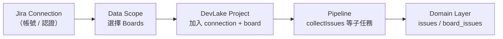
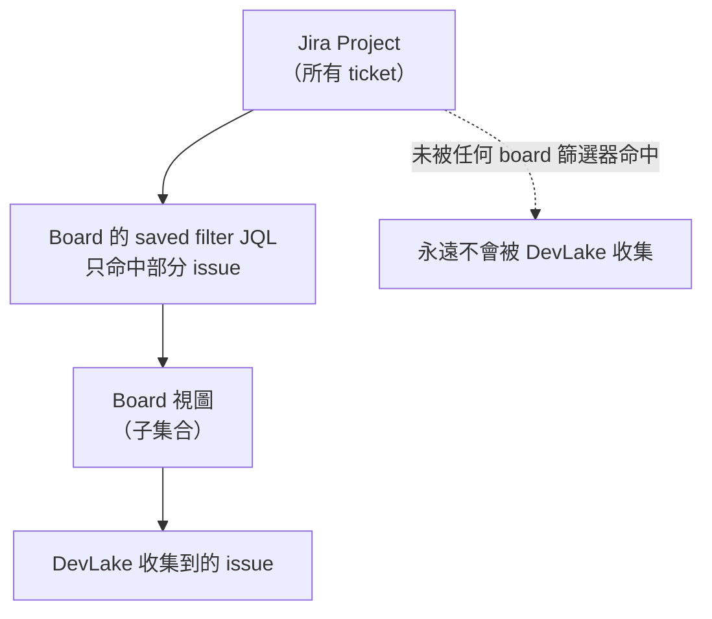
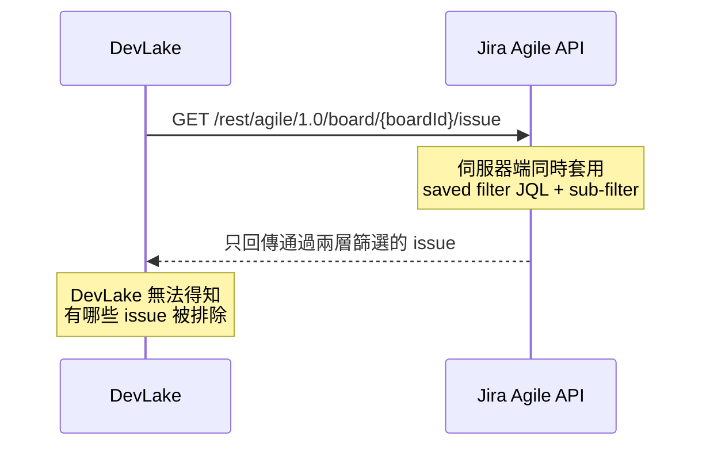
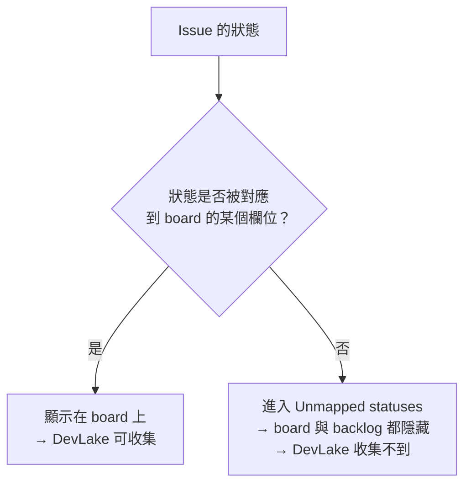
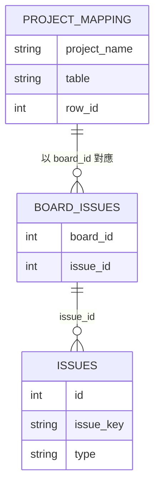
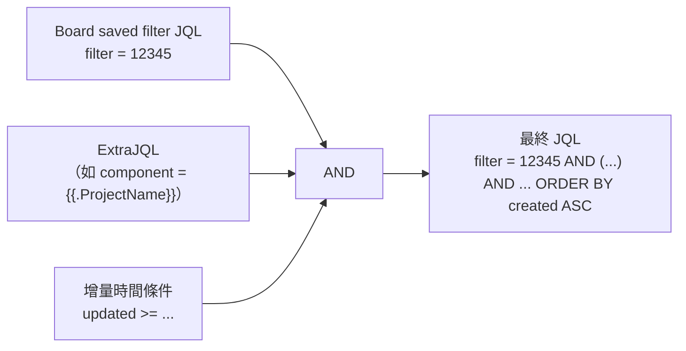

# 為何 DevLake 的 Jira Board 無法涵蓋 Jira Project 下的所有 Ticket

## 摘要

Apache DevLake 在連接 Jira 時，資料範圍（Data Scope）的選擇單位是「Board（看板）」而不是「Project（專案）」。這使得許多使用者發現：即使把某個 Jira Project 對應的 Board 加進 DevLake，專案底下仍然有大量 ticket 沒有被收集。本文說明這個現象的根本原因，並拆解成多個層次：Board 本質上只是「篩選後的視圖」、Kanban 子篩選器（sub-filter）、看板欄位與狀態對應（column/status mapping）、Epic 與 board 的歸屬規則，以及 DevLake 自身的收集與關聯機制。最後說明 DevLake 現行（v1.0.x）的因應做法與仍存在的限制。

本文的結論是：**Board 與 Project 是兩種不同的概念。Board 只會回傳「通過其篩選條件、且狀態被對應到欄位」的 issue 子集合，因此「Board 涵蓋範圍小於 Project」是設計上的必然結果，而不是單純的設定錯誤。**

---

## 一、背景：DevLake 為何以 Board 為資料範圍單位

在 DevLake 的 Jira 連接設定中，資料範圍（Data Scope）是「選擇要收集的 Jira boards」[^devlake-config-jira]。使用者必須先在 Connection 加入 boards，接著在 Project 中把 connection 與特定 board 加入，才會開始收集[^devlake-config-jira]。

這個設計並非偶然。DevLake 維護者 klesh 在官方討論串中說明，選擇 board 有兩個理由[^disc-6832]：

1. **Sprint（衝刺）是綁定在 board 上的**，某些指標（例如 velocity）必須依賴 board 才能計算；
2. **Board 帶有篩選器（filter）**，讓使用者能控制要同步哪些資料。

換句話說，DevLake 是刻意以 board 為「收集的邏輯單位」，並把 board 的篩選器視為使用者用來圈定範圍的工具。這個設計在「board 的篩選器等於我想要的全部 issue」時運作良好，但一旦 board 的定義與專案範圍不一致，缺口就出現了。

---

## 二、根本原因一：Board 只是「篩選後的視圖」，不是專案

Jira 的 board 是建立在一個 **saved filter（已儲存的篩選器）** 之上的視圖。Board 只會顯示「該篩選器 JQL 所命中的 issue」。DevLake 在收集前會先呼叫 board 的 configuration 端點，取得其 filter，再呼叫 filter 端點取得 JQL[^devlake-boardfilter-code]。這代表 DevLake 完全承襲了該 board 篩選器的範圍。

發起官方討論的使用者 pogopaule 就精準指出這個問題：「Boards 是由針對 issue 的篩選器定義的，因此它們只是所有 Jira issue 中的一個子集合的視圖。如果某個 Jira issue 沒有被任何 board 選中，DevLake 就無法取得它。」[^disc-6832]

因此，若某個 ticket 的狀態、元件或欄位不符合 board 篩選器，它就不在 board 上，也就不會被 DevLake 收集。這是「Board 不覆蓋整個 Project」最直接的原因。

---

## 三、根本原因二：Kanban 子篩選器（Sub-filter）會再砍掉一批 issue

Kanban board 除了主要的 saved filter 之外，還有一個獨立的 **sub-filter（子篩選器）**。Atlassian 官方文件說明：「如果你使用 Kanban board，你可以加入一個子篩選器，進一步精煉 board 篩選器所回傳的 issue。例如，你可能想在 issue 被標記為完成後、直到被釋出或衝刺結束前，仍將它們顯示在 board 上。」[^atl-subfilter] Atlassian 學習文件更直接指出：「子篩選器只能顯示比 board 篩選器更少的 work items。」[^atl-learning]

Jira Data Center 的預設子篩選器即為：`fixVersion in unreleasedVersions() OR fixVersion is EMPTY`[^atl-dc-filters]。這意味著**一旦某個 issue 被指派了已釋出（released）的 fixVersion，它就會從 Kanban board 上消失**。

這個機制正是 DevLake GitHub Issue #8917 的核心：使用者發現「已解決／已完成的 issue 會在指派已釋出的 `fixVersion` 後，從 DevLake 悄悄消失」，而且「不會產生任何錯誤或警告，同步會以成功狀態完成，但資料不完整」[^issue-8917]。

Issue #8917 指出，DevLake 早期是透過 `GET /rest/agile/1.0/board/{boardId}/issue` 收集 issue，而 Jira 會在伺服器端同時套用 saved filter 與 sub-filter，所以 DevLake 只收到被過濾後的子集合，且無從察覺[^issue-8917]。

---

## 四、根本原因三：狀態未對應到欄位的 issue 會從 board 消失

Board 的成員資格還取決於 **column/status mapping（欄位與狀態對應）**。Atlassian 官方文件明確寫道：「未對應的狀態會同時在 board 視圖與 backlog 視圖中隱藏 work items。」[^atl-columns]

Atlassian 的 Board REST API 文件也定義得非常清楚：「**一個 issue 屬於該 board，若它的狀態被對應到該 board 的欄位**（An issue belongs to the board if its status is mapped to the board's column）。」[^atl-board-api]

這在實務上很容易出問題。討論串中的使用者 gsaivenkateshzs 描述了他的困境：團隊在 Jira 中新增了新的狀態，但沒有把它對應到 board 的欄位，於是「那些狀態的 issue 就不會顯示在 board 上」；而且每當有新的狀態類型出現，就得手動重新對應[^disc-6832]。這使得「用 board 當作收集範圍」在狀態頻繁變動的團隊中特別脆弱。

---

## 五、根本原因四：Epic 不屬於 Scrum board

Board 的歸屬規則還有型別上的例外。Atlassian 的 Board API 文件指出：「一個 issue 屬於該 board，若它的狀態被對應到該 board 的欄位。**Epic issue 不屬於 scrum board**（Epic issues do not belong to scrum boards）。」[^atl-board-api]

因此，若專案中的 Epic 沒有被任何 board 納入，這些 Epic 也不會經由 board 收集路徑進入 DevLake。DevLake 另外有獨立的 epic 收集子任務來處理這類情況，但這也再次說明「board」與「project 全部 ticket」不是等價的範圍。

---

## 六、根本原因五：DevLake 以 board 為關聯鍵，強化範圍綁定

DevLake 的領域層（Domain Layer）用一張關聯表 `board_issues` 記錄「哪個 board 關聯到哪些 issue」。原始碼中 `JiraBoardIssue` 的欄位為 `BoardId` 與 `IssueId` 的主鍵組合[^devlake-boardissue-code]。收集到的 issue 會透過 `board_issues` 與 board 綁定，而 DevLake 專案又透過 `project_mapping` 對應到 domain 層的 board[^issue-9151]。

這個結構的意涵是：**issue 進入 DevLake 的路徑，本質上是「經由某個 board」**。Issue #9151 進一步揭露了當多個 DevLake 專案共用同一個 Jira board 時的資料污染問題，指出收集參數與 collector state 是以 `(connectionId, boardId)` 為識別，不含 project 層級的區分[^issue-9151]。這代表 board 不僅是收集範圍，也是資料歸屬的鍵，範圍綁定被寫進了資料模型裡。

---

## 七、歷史脈絡：使用者長年反映這個落差

這個落差並非新問題。多個官方議題都記錄了相同症狀：

- **Discussion #6832**（2024-01-17 開啟）標題即為「為什麼 Jira 資料範圍選的是 boards 而不是 jira projects？」，是最早系統性提出此問題的討論[^disc-6832]。
- **Issue #8196**（2024-11-18）使用者提問：「有沒有辦法讓 DevLake 連接 Jira Projects 而不是 Jira Boards？」並指出「在我們的場景中，有 board 並不合理」；維護者回覆指向 #6832 的說明[^issue-8196]。
- **Issue #7826**（2024-08-02，severity/p1）回報「issue 從資料集中消失」，使用者強調「它們仍在 Jira 的 board 篩選器之下」，卻從 DevLake 消失[^issue-7826]。
- **Issue #8955**（2026-06-24）描述大規模（約 1,000 個 deployable unit）場景：單一 Jira project 涵蓋 50 個以上的服務，共用 board 造成 DORA 指標被無關服務的 issue 污染[^issue-8955]。

值得注意的是，#8917 的報告者推測，Kanban 子篩選器「可能是 #7826 那些回報中至少一部分未被發現的根本原因」[^issue-8917]。這說明 board 範圍問題的表現形式很多，但底層機制相通。

---

## 八、現行因應與解法

### 8.1 ExtraJQL：在 board 範圍內再篩選

DevLake 先後加入了讓使用者對 board 查詢附加 JQL 的能力：

- **PR #8962**：允許用 DevLake 專案名稱過濾 Jira board[^pr-8962]。
- **PR #8972**：允許在查詢 Jira board 時套用額外的 JQL，用於「當一個 board 上有很多元件時」縮小範圍[^pr-8972]。

維護者 klesh 在 #8955 中定調了方向：「更好的做法是加入一個 `ExtraJQL` 欄位，支援 golang `text/template`，把 ProjectName 與其他變數傳進去產生動態 JQL，這樣對其他人也足夠有彈性。」[^issue-8955] 原始碼中的 `renderExtraJQL` 即以 Go template 實作，並支援 `{{.BoardName}}`、`{{.ProjectName}}`、`{{.BoardId}}` 等變數[^devlake-issuecollector-code]。

需注意的是，ExtraJQL 的方向是「**在既有 board 範圍內再縮小**」，而不是「擴大到整個 project」。因此它解決的是「board 太大、資料污染」的問題，而不是「board 漏收 issue」的問題。

### 8.2 改用 Search API 以繞過 Kanban 子篩選器

針對子篩選器造成的漏收，Issue #8917 提出兩個方案，其中 Option A 是「以 Jira search API 取代 board Agile API，直接使用 board 的 saved filter JQL」[^issue-8917]。對應的 **PR #8923** 標題即為「透過 saved filter JQL 收集 board issues」，說明其作法是「透過 Jira Search API、使用儲存在 `_tool_jira_boards.jql` 的 board saved filter JQL 來收集，繞過 board 層級的 subQuery」；Jira Server 使用 `api/2/search`，Jira Cloud 使用 `api/3/search/jql`[^pr-8923]。

此變更已反映在現行程式碼：`CollectIssues` 使用 search API 並附上註解「使用 `filter = {id}` JQL 取代 board Agile API。Board Agile API 會在伺服器端套用 kanban 子篩選器，會悄悄排除已解決的 issue」[^devlake-issuecollector-code]。`board_filter_begin_collector.go` 也會解析並記錄 `subQuery`，在偵測到子篩選器時發出警告[^devlake-boardfilter-code]。

### 8.3 仍存在的限制

即使繞過了子篩選器，仍有幾項本質限制：

1. **狀態未對應欄位** 的 issue 是否會被 search API 納入，取決於實作是否已完全改用 filter JQL 而非 board 成員判定；這是社群仍在觀察的邊界[^atl-columns][^issue-8917]。
2. **多專案共用同一 board** 時，收集與持久化仍以 `(connectionId, boardId)` 為鍵，issue 可能被跨專案使用（#9151 仍在開啟中）[^issue-9151]。
3. **以 Project 為資料範圍** 的原生支援仍未實作；維護者對「用 project 取代 board」持保留態度[^disc-6832][^issue-8955]。

---

## 九、結論

DevLake 的 Jira Board 之所以不會覆蓋 Jira Project 下的所有 ticket，是多重機制疊加的結果：

| 層次 | 機制 | 影響 |
| --- | --- | --- |
| Board 定義 | Board 是 saved filter JQL 的視圖 | 未命中篩選器的 issue 完全不會出現 |
| Kanban 子篩選器 | sub-filter 進一步精煉 filter | 如已釋出 fixVersion 的 issue 會消失 |
| 欄位對應 | 狀態未對應到欄位者被隱藏 | 新狀態未對應時 issue 從 board 消失 |
| 型別規則 | Epic 不屬於 scrum board | Epic 需另經 epic 收集路徑 |
| 資料模型 | `board_issues` 以 board 為關聯鍵 | issue 的歸屬被綁定在 board 上 |

簡言之，**Board 與 Project 是不同層級的概念**：Project 是 issue 的容器，Board 則是對這些 issue 的一種「篩選後視圖」。DevLake 選擇以 board 為收集單位，換來的是 sprint 指標與使用者自訂範圍的彈性，但代價就是 board 的涵蓋範圍天生小於 project。

DevLake 目前已透過 ExtraJQL（縮小範圍）與改用 search API（繞過 Kanban 子篩選器）緩解了最嚴重的漏收問題，但「以 Project 為原生資料範圍」與「多專案共用 board 的隔離」仍是尚未完全解決的方向。

---

## 參考文獻

Apache DevLake. (n.d.). *Jira — Configuration*. Retrieved 2026-11-20, from https://devlake.apache.org/docs/Configuration/Jira

Apache DevLake. (n.d.). *Jira plugin*. Retrieved 2026-11-20, from https://devlake.apache.org/docs/Plugins/jira

Apache DevLake. (n.d.). *backend/plugins/jira/tasks/board_filter_begin_collector.go*. Retrieved 2026-11-20, from https://github.com/apache/devlake/blob/main/backend/plugins/jira/tasks/board_filter_begin_collector.go

Apache DevLake. (n.d.). *backend/plugins/jira/tasks/issue_collector.go*. Retrieved 2026-11-20, from https://github.com/apache/devlake/blob/main/backend/plugins/jira/tasks/issue_collector.go

Apache DevLake. (n.d.). *backend/plugins/jira/models/board_issue.go*. Retrieved 2026-11-20, from https://github.com/apache/devlake/blob/main/backend/plugins/jira/models/board_issue.go

Apache DevLake. (n.d.). *Repository statistics*. Retrieved 2026-11-20, from https://api.github.com/repos/apache/devlake

Atlassian. (n.d.). *Add a sub-filter to a company-managed kanban board*. Retrieved 2026-11-20, from https://support.atlassian.com/jira-software-cloud/docs/add-a-sub-filter-to-a-company-managed-kanban-board/

Atlassian. (n.d.). *Configure columns*. Retrieved 2026-11-20, from https://support.atlassian.com/jira-software-cloud/docs/configure-columns/

Atlassian. (n.d.). *Configuring filters* (Jira Software Server 11.3). Retrieved 2026-11-20, from https://confluence.atlassian.com/jirasoftwareserver/configuring-filters-938845268.html

Atlassian. (n.d.). *Jira Software Cloud REST API — Board*. Retrieved 2026-11-20, from https://developer.atlassian.com/cloud/jira/software/rest/api-group-board/

Atlassian. (n.d.). *Board filters in Jira*. Retrieved 2026-11-20, from https://learning.atlassian.com/learning/course/configure-jira-board-filters-and-settings/lesson/filter-jira-board

pogopaule. (2024-01-17). *Why are boards instead of jira projects selectable in a jira data scope?* [Discussion #6832]. Retrieved 2026-11-20, from https://github.com/apache/devlake/discussions/6832

danielrosa-zh. (2024-11-18). *[Question][Jira Connector] Is there a way to allow Apache DevLake to connect on Jira Projects instead of a Jira Boards?* [Issue #8196]. Retrieved 2026-11-20, from https://github.com/apache/devlake/issues/8196

wouldd. (2024-08-02). *[Bug][Jira] issues disappearing from dataset, progressive load issue?* [Issue #7826]. Retrieved 2026-11-20, from https://github.com/apache/devlake/issues/7826

jbsmith7741. (2026-06-11). *[Bug][Jira] Kanban board sub-filter silently excludes issues from collection* [Issue #8917]. Retrieved 2026-11-20, from https://github.com/apache/devlake/issues/8917

vaujo6y. (2026-06-24). *[Question][JIRA] Feature Request / Guidance: Support for inline JQL filtering / Component-based Data Scoping* [Issue #8955]. Retrieved 2026-11-20, from https://github.com/apache/devlake/issues/8955

christoph-mueller-sda-se. (2026-09-18). *[Bug][Jira/DORA] Extra JQL does not isolate projects sharing the same Jira board* [Issue #9151]. Retrieved 2026-11-20, from https://github.com/apache/devlake/issues/9151

bujjibabukatta. (2026-06-13). *fix(jira): collect board issues via saved filter JQL* [Pull request #8923]. Retrieved 2026-11-20, from https://github.com/apache/devlake/pull/8923

VaughanJ. (2026-07-02). *feat(jira): Allow extra JQL when querying JIRA board* [Pull request #8972]. Retrieved 2026-11-20, from https://github.com/apache/devlake/pull/8972

VaughanJ. (2026-06-30). *feat(jira): Allow filter jira board using devlake project name* [Pull request #8962]. Retrieved 2026-11-20, from https://github.com/apache/devlake/pull/8962

---

[^devlake-config-jira]: Apache DevLake. (n.d.). *Jira — Configuration*. Retrieved 2026-11-20, from https://devlake.apache.org/docs/Configuration/Jira

[^disc-6832]: pogopaule. (2024-01-17). *Why are boards instead of jira projects selectable in a jira data scope?* [Discussion #6832]. Retrieved 2026-11-20, from https://github.com/apache/devlake/discussions/6832

[^atl-subfilter]: Atlassian. (n.d.). *Add a sub-filter to a company-managed kanban board*. Retrieved 2026-11-20, from https://support.atlassian.com/jira-software-cloud/docs/add-a-sub-filter-to-a-company-managed-kanban-board/

[^atl-learning]: Atlassian. (n.d.). *Board filters in Jira*. Retrieved 2026-11-20, from https://learning.atlassian.com/learning/course/configure-jira-board-filters-and-settings/lesson/filter-jira-board

[^atl-dc-filters]: Atlassian. (n.d.). *Configuring filters* (Jira Software Server 11.3). Retrieved 2026-11-20, from https://confluence.atlassian.com/jirasoftwareserver/configuring-filters-938845268.html

[^atl-columns]: Atlassian. (n.d.). *Configure columns*. Retrieved 2026-11-20, from https://support.atlassian.com/jira-software-cloud/docs/configure-columns/

[^atl-board-api]: Atlassian. (n.d.). *Jira Software Cloud REST API — Board*. Retrieved 2026-11-20, from https://developer.atlassian.com/cloud/jira/software/rest/api-group-board/

[^issue-8917]: jbsmith7741. (2026-06-11). *[Bug][Jira] Kanban board sub-filter silently excludes issues from collection* [Issue #8917]. Retrieved 2026-11-20, from https://github.com/apache/devlake/issues/8917

[^devlake-boardfilter-code]: Apache DevLake. (n.d.). *backend/plugins/jira/tasks/board_filter_begin_collector.go*. Retrieved 2026-11-20, from https://github.com/apache/devlake/blob/main/backend/plugins/jira/tasks/board_filter_begin_collector.go

[^devlake-boardissue-code]: Apache DevLake. (n.d.). *backend/plugins/jira/models/board_issue.go*. Retrieved 2026-11-20, from https://github.com/apache/devlake/blob/main/backend/plugins/jira/models/board_issue.go

[^issue-9151]: christoph-mueller-sda-se. (2026-09-18). *[Bug][Jira/DORA] Extra JQL does not isolate projects sharing the same Jira board* [Issue #9151]. Retrieved 2026-11-20, from https://github.com/apache/devlake/issues/9151

[^issue-8196]: danielrosa-zh. (2024-11-18). *[Question][Jira Connector] Is there a way to allow Apache DevLake to connect on Jira Projects instead of a Jira Boards?* [Issue #8196]. Retrieved 2026-11-20, from https://github.com/apache/devlake/issues/8196

[^issue-7826]: wouldd. (2024-08-02). *[Bug][Jira] issues disappearing from dataset, progressive load issue?* [Issue #7826]. Retrieved 2026-11-20, from https://github.com/apache/devlake/issues/7826

[^issue-8955]: vaujo6y. (2026-06-24). *[Question][JIRA] Feature Request / Guidance: Support for inline JQL filtering / Component-based Data Scoping* [Issue #8955]. Retrieved 2026-11-20, from https://github.com/apache/devlake/issues/8955

[^pr-8962]: VaughanJ. (2026-06-30). *feat(jira): Allow filter jira board using devlake project name* [Pull request #8962]. Retrieved 2026-11-20, from https://github.com/apache/devlake/pull/8962

[^pr-8972]: VaughanJ. (2026-07-02). *feat(jira): Allow extra JQL when querying JIRA board* [Pull request #8972]. Retrieved 2026-11-20, from https://github.com/apache/devlake/pull/8972

[^pr-8923]: bujjibabukatta. (2026-06-13). *fix(jira): collect board issues via saved filter JQL* [Pull request #8923]. Retrieved 2026-11-20, from https://github.com/apache/devlake/pull/8923

[^devlake-issuecollector-code]: Apache DevLake. (n.d.). *backend/plugins/jira/tasks/issue_collector.go*. Retrieved 2026-11-20, from https://github.com/apache/devlake/blob/main/backend/plugins/jira/tasks/issue_collector.go
