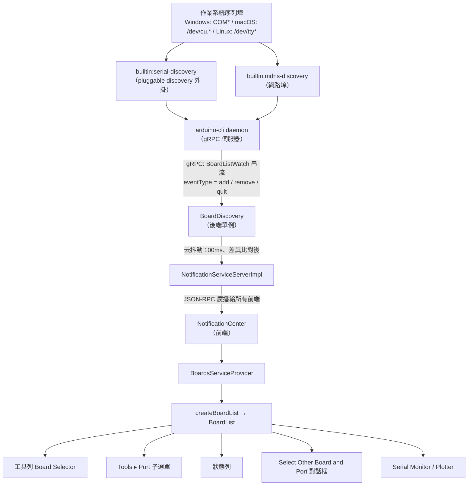

# Arduino IDE 2.x 如何偵測並在 GUI 顯示 USB / COM / UART 序列埠

## 摘要

Arduino IDE 2.x（以下簡稱 IDE 2）是一套以 Eclipse Theia 為框架、以 Electron 打包的桌面應用程式[^ide-readme][^blog-ide20]。它本身**不直接**讀取作業系統的序列埠。它改為啟動 `arduino-cli` 的 **daemon 模式**（`arduino-cli daemon`），透過 **gRPC** 呼叫 CLI 的 `BoardListWatch` 串流 API[^cli-daemon][^cli-rpc]，而真正掃描 USB / UART 裝置的是 CLI 內部掛載的 **pluggable discovery** 工具，例如 `builtin:serial-discovery` 與 `builtin:mdns-discovery`[^cli-discovery-spec][^serial-discovery]。

IDE 2 的後端 `BoardDiscovery` 服務把 gRPC 串流事件聚合成一份埠狀態快照，經過去抖動與差異比對後，再透過 Theia 的 JSON-RPC 通知服務廣播給所有已連線的前端視窗[^ide-board-discovery][^ide-notif-server]。前端 `BoardsServiceProvider` 把這份資料轉換成 `BoardList` UI 模型[^ide-boards-provider][^ide-board-list]，最後由工具列的 Board Selector 下拉選單、`Tools ▸ Port` 子選單、狀態列、以及「Select Other Board and Port」對話框呈現[^ide-toolbar][^ide-board-selection][^ide-selected-board][^ide-config-dialog]。Serial Monitor 與 Serial Plotter 也共用同一份偵測結果來決定要連線哪個埠[^ide-monitor-proxy][^ide-plotter]。

本文逐層拆解這條資料流，並附上每一層對應的原始碼檔案、gRPC 訊息定義與官方規格來源。**本文描述的版本以 `arduino/arduino-ide` 的 `main` 分支與其內嵌的 `arduino-cli` 1.6.0 為準**[^ide-package-json]。

---

## 1. 結論速覽

| 問題 | 答案 |
| --- | --- |
| 誰實際讀取 OS 序列埠？ | `arduino-cli` 內的 pluggable discovery 外掛，序列埠由 `builtin:serial-discovery` 負責[^cli-discovery-spec] |
| IDE 如何得知埠的增減？ | 以 gRPC 訂閱 `BoardListWatch` 串流，事件型別為 `add` / `remove` / `quit`[^ide-board-discovery][^cli-board-proto] |
| 後端在哪裡聚合狀態？ | `arduino-ide-extension/src/node/board-discovery.ts` 的 `BoardDiscovery`（後端單例）[^ide-board-discovery] |
| 如何傳到前端？ | `NotificationServiceServerImpl.notifyDetectedPortsDidChange()` 廣播給所有前端 client[^ide-notif-server] |
| 前端在哪裡變成畫面？ | `BoardsServiceProvider` → `createBoardList()` → 工具列 / `Tools ▸ Port` / 狀態列 / 對話框[^ide-boards-provider][^ide-board-list] |
| 顯示哪些埠？ | `serial` 與 `network` 一律顯示；其他協定必須偵測到已知開發板才顯示[^ide-boards-service] |

簡言之：**IDE 是 gRPC 客戶端，CLI 是發現埠的伺服器，discovery 外掛才是真正碰觸硬體的那一層。**

---

## 2. 整體資料流



---

## 3. 架構前提：IDE 2 是 Theia 應用，後端外包給 CLI

`arduino/arduino-ide` 的 README 明言：IDE 2 與 IDE 1.x 不共用任何程式碼，它「基於 Theia IDE 框架、以 Electron 建置」，而「編譯與上傳等後端操作被外包給一個以 daemon 模式執行的 arduino-cli 實例」[^ide-readme]。Arduino 官方的 2.0 正式版公告也重申同一點，並補充「前端以 TypeScript 撰寫，後端大部分以 Golang 撰寫」[^blog-ide20]。

Arduino CLI 官方文件定義 `daemon` 子命令為「以 gRPC daemon 方式執行 Arduino CLI」，預設監聽 TCP 埠 50051[^cli-daemon]。CLI 的 gRPC 介面本身是官方認可的整合途徑之一，官方文件甚至直接以 Arduino IDE 2.x 作為「乾淨分離關注點」的範例：**IDE 不知道如何編譯或與板子通訊，它把這些全部交給 CLI；CLI 也不知道連進來的是 IDE**[^cli-integration]。

這個架構決定了所有後續行為：IDE 只需要實作「gRPC client」與「把資料畫出來」兩件事。

---

## 4. 後端：序列埠是怎麼被「發現」的

### 4.1 啟動 arduino-cli daemon

後端由 `arduino-ide-extension/src/node/arduino-daemon-impl.ts` 的 `ArduinoDaemonImpl` 負責啟動 CLI 子行程。它使用 Node.js 的 `spawn()`，參數由 `getSpawnArgs()` 產生，內容為[^ide-daemon-impl]：

```
'daemon', '--port', '0', '--config-file', <cliConfigPath>, '-v'
```

- `--port 0` 要求 CLI 自行挑選一個空閒的 TCP 埠[^ide-daemon-impl]。
- 真正的埠號是從 daemon 的 **stdout** 解析出來的：IDE 逐行嘗試 `JSON.parse`，取出 `Port` 與 `IP` 兩個欄位，兩者都拿到才判定 gRPC 伺服器已就緒[^ide-daemon-impl]。
- 啟動成功後 `fireDaemonStarted(port)` 會觸發 `onDaemonStartedEmitter`，並呼叫 `notificationService.notifyDaemonDidStart(port)`[^ide-daemon-impl]。
- 若初次啟動失敗，會以 `retry(..., 1_000, 5)` 重試最多 5 次[^ide-daemon-impl]。

CLI 二進位檔的路徑由 `src/node/resources.ts` 的 `arduinoCliPath` 決定，它指向打包資源目錄下的 `arduino-cli`（Windows 加上 `.exe`）[^ide-resources]。被綁定的 CLI 版本記錄在 `arduino-ide-extension/package.json` 的 `arduino.arduino-cli.version`，目前為 **1.6.0**；同一份檔案也顯示 IDE 擴充套件本身版本為 2.3.12，並使用 Theia 1.57.0[^ide-package-json]。

### 4.2 gRPC 客戶端與 instance 初始化

`src/node/core-client-provider.ts` 的 `CoreClientProvider` 管理 gRPC client 的生命週期[^ide-core-client]：

- `client` getter：若 client 尚未建立，回傳一個 `Deferred` 的 promise，等到 `onClientReady` 事件觸發才解析；若已建立則直接回傳快取的 client。
- `create(port)`：先 `closeClient()`，再建立 client，呼叫 `CreateRequest` 取得 CLI 的 "instance"，最後執行 `initInstanceWithFallback(client)`。
- `initInstanceWithFallback()`：先嘗試 `initInstance()`；若失敗原因是 `MustUpdateIndexesBeforeInitError`（缺少索引或內建工具），會先執行索引更新，再重新初始化。
- 原始碼註解明確指出必須先更新索引的三種情境：缺少主要套件索引 `package_index.json`、缺少函式庫索引 `library_index.json`，以及**缺少內建工具 `builtin:serial-discovery` 或 `builtin:mdns-discovery`**[^ide-core-client]。
- `CoreClientAware` 這個抽象基底類別暴露 `coreClient` getter 與 `refresh()`，讓 `BoardDiscovery`、`BoardsServiceImpl`、`MonitorService` 等服務共用同一個 client[^ide-core-client]。

`refresh()` 會重新執行 `initInstance()`。由於 CLI 的 discovery 與 instance 綁定，重新初始化等同於**重啟 board discovery**[^ide-core-client]。

### 4.3 BoardDiscovery：核心的埠追蹤器

`src/node/board-discovery.ts` 的 `BoardDiscovery` 是整條管線的心臟。它的類別註解自述為「追蹤可用埠與開發板、並把變更廣播給所有已連線前端實例的單例服務」，並強調「與其他服務不同，它不是 connection-scoped」[^ide-board-discovery]。它同時以 `@injectable()` 註冊為 `BackendApplicationContribution`，因此由 Theia 的後端生命週期驅動。

**生命週期**：`onStart()` 呼叫 `start()`，`onStop()` 呼叫 `stop()`[^ide-board-discovery]。

**建立串流**：`start()` 取得 `coreClient` 後，建立 `BoardListWatchRequest`（帶上 instance）並交給 `createWrapper()`；`createWrapper()` 呼叫 `client.boardListWatch(req)`，回傳一個 gRPC readable stream，並掛上 `end` 與 `error` 處理器[^ide-board-discovery]：

- 收到 `end`：觸發 `onStreamDidEndEmitter`。原始碼註解說明這是「CLI 在 discovery 行程被殺掉時送出，例如索引更新與 core client 重新初始化之後」。
- 收到 `error`：若 `ServiceError.isCancel(error)` 為真，代表是 IDE 主動取消，觸發 `onStreamDidCancelEmitter`；否則記為非預期錯誤。

`stop(restart)` 會等待上述兩個事件之一，並設有 10 秒逾時（`createTimeout(10_000, reject)`），逾時則 reject[^ide-board-discovery]。串流的 `dispose()` 會呼叫 `stream.cancel()`，原始碼註解指出取消串流「會殺掉 `builtin:mdns-discovery` 行程」，而 client 會收到一筆 `{"eventType":"quit","error":""}` 回應[^ide-board-discovery]。

**解析事件**：`onBoardListWatchResponse()` 的行為是[^ide-board-discovery]：

1. 以 `EventType.parse(resp.getEventType())` 解析事件型別。
2. 若為 `Quit` → 呼叫 `this.stop()` 並結束。
3. 取出 `resp.getPort()`；若存在則呼叫 `fromRpc()` 轉成 IDE 的 `DetectedPort`，成功後呼叫 `fireSoon({ detectedPort, eventType })`。
4. 若沒有 port 但有 `resp.getError()`，記為錯誤日誌。

**RPC 轉換**：`fromRpc()` 把 gRPC 的 `DetectedPort` 轉成 API 型別——把 `matchingBoardsList` 映射成 `{ fqbn, name }` 陣列（`fqbn` 偏好 `undefined` 而非空字串，`name` 空值時使用 `Unknown`），port 則交給 `createApiPort()`[^ide-board-discovery]。`createApiPort()` 的欄位映射為[^ide-board-discovery]：

| gRPC `Port` getter | IDE `Port` 欄位 |
| --- | --- |
| `getAddress()` | `address` |
| `getLabel()` | `addressLabel` |
| `getProtocol()` | `protocol` |
| `getProtocolLabel()` | `protocolLabel` |
| `getPropertiesMap().toObject()` | `properties` |
| `getHardwareId()` | `hardwareId`（空字串轉 `undefined`） |

**去抖動與差異比對**：`fireSoon()` 是關鍵的最佳化[^ide-board-discovery]：

- 把事件推入 `bufferedEvents`，清除既有的 timer，再設定一個 **100 毫秒** 的 `setTimeout`。
- 計時器到期後，以 `deepClone` 取得目前狀態，呼叫 `calculateNewState()` 算出新狀態。
- 只有在 `!isDeepStrictEqual(current, newState)` 時才更新 `_detectedPorts` 並呼叫 `notificationService.notifyDetectedPortsDidChange({ detectedPorts })`。
- 最後清空緩衝區。

也就是說，**短時間內的大量事件會被合併成一次通知，且狀態未變化時完全不通知前端**。

**狀態計算**：`calculateNewState()` 以 `Port.keyOf(port)` 為鍵[^ide-board-discovery]：

- `add` → `newState[key] = { port, boards }`（覆寫語意）。
- `remove` → `delete newState[key]`。

原始碼註解解釋為何 `add` 必須是覆寫：序列 discovery 可能「分塊」回報同一個埠的細節，例如 Teensy 4.1 會先以 `[no_device] Triple Serial` 這個 address label 出現，之後才補上完整的 `/dev/cu.usbmodem127902301 Triple Serial`，此時 CLI 只會送出另一個 `add`，因此必須覆寫[^ide-board-discovery]。

**事件型別**：`EventType` 列舉只有 `Add`、`Remove`、`Quit` 三種，`parse()` 會先 `toLowerCase()` 再比對，遇到未知字串則拋出錯誤[^ide-board-discovery]。

### 4.4 後端服務與依賴注入綁定

`src/node/boards-service-impl.ts` 的 `BoardsServiceImpl.getDetectedPorts()` 直接把 `BoardDiscovery` 的快照回傳給前端[^ide-boards-service-impl]：

```ts
async getDetectedPorts(): Promise<DetectedPorts> {
  return this.boardDiscovery.detectedPorts;
}
```

此外，`install()` 與 `uninstall()`（安裝或卸載開發板平台）會在動作前呼叫 `await this.boardDiscovery.stop()`，並在串流結束事件中呼叫 `this.boardDiscovery.start()` 重新啟動。原始碼留下一則 TODO，說明這個耦合關係的來由可追溯到 PR #1107[^ide-boards-service-impl]。這證實了「discovery 與 CLI instance 綁定」的推論。

`src/node/arduino-ide-backend-module.ts` 定義了所有綁定[^ide-backend-module]：

- `ConfigServiceImpl`、`ArduinoDaemonImpl`、`CoreClientProvider`、`BoardDiscovery`、`NotificationServiceServerImpl`、`MonitorManager` 皆為 `inSingletonScope()`；其中 `ArduinoDaemonImpl`、`ConfigServiceImpl`、`BoardDiscovery` 另外綁定為 `BackendApplicationContribution`。
- `BoardsService`、`LibraryService`、`CoreService`、`ExamplesService`、`MonitorManagerProxy` 等則包在 `ConnectionContainerModule` 內，代表**每個前端連線各有一份實例**。
- `NotificationServiceServerImpl` 以 `JsonRpcConnectionHandler` 綁定，路徑常數為 `NotificationServicePath`；handler 內會把每個連線的 client 註冊進 server（`server.setClient(client)`），連線關閉時再 `disposeClient(client)`。

`src/node/notification-service-server.ts` 的 `NotificationServiceServerImpl` 內部僅維護一個 `clients` 陣列，所有通知方法都是「逐一呼叫每個 client」；`notifyDetectedPortsDidChange()` 即為一例[^ide-notif-server]。這就是「廣播給所有前端視窗」的實作方式。

### 4.5 gRPC 訊息定義（由 pinned CLI 產生）

CLI 的 gRPC 服務名為 `ArduinoCoreService`，套件為 `cc.arduino.cli.commands.v1`[^cli-commands-proto]。與埠偵測相關的兩個 RPC 為[^cli-commands-proto]：

- `BoardList(BoardListRequest) returns (BoardListResponse)`：一次性列出目前連線的開發板。
- `BoardListWatch(BoardListWatchRequest) returns (stream BoardListWatchResponse)`：**伺服器端串流**，回報開發板的連線與斷線事件。

`BoardListWatchResponse` 的欄位為[^cli-board-proto]：

| 欄位 | 型別 | 說明 |
| --- | --- | --- |
| `event_type` | `string` | 事件型別，官方註解說明其為「從 serial discovery 工具收到的事件型別」 |
| `port` | `DetectedPort` | 埠的詳細資訊 |
| `error` | `string` | 偵測連線開發板時的錯誤 |

`BoardListWatchRequest` 則只有 `instance` 與 `skip_cloud_api_for_board_detection` 兩個欄位[^cli-board-proto]。

`DetectedPort` 訊息為[^cli-board-proto]：

```protobuf
message DetectedPort {
  // The possible boards attached to the port.
  repeated BoardListItem matching_boards = 1;
  // The port details.
  Port port = 2;
}
```

`Port` 訊息（`port.proto`）則刻意對應 GUI 需求[^cli-port-proto]：

```protobuf
message Port {
  string address = 1;         // 例如 /dev/ttyACM0
  string label = 2;           // 顯示於 GUI 的標籤，例如 "ttyACM0"
  string protocol = 3;        // 例如 serial、network
  string protocol_label = 4;  // 人類可讀描述，例如 "Serial Port (USB)"
  map<string, string> properties = 5;
  string hardware_id = 6;     // 開發板實例的硬體 ID（序號）
}
```

注意 `label` 的註解直接寫明「The port label to show on the GUI」，這正是 IDE 端 `addressLabel` 的來源[^cli-port-proto][^ide-board-discovery]。

---

## 5. pluggable discovery 與 builtin 工具

### 5.1 什麼是 pluggable discovery

Arduino CLI 的官方規格將 discovery 定義為「一種特殊的工具，用來尋找支援的開發板」，由平台開發者依規格自行實作。這些工具是**可被當成子行程啟動的可執行檔**，透過 **stdin / stdout** 通訊：從 stdin 接受純文字命令，在 stdout 以 JSON 回應[^cli-discovery-spec]。

規格定義的命令有 `HELLO`、`START`、`STOP`、`QUIT`、`LIST`、`START_SYNC`[^cli-discovery-spec]：

- `HELLO <PROTOCOL_VERSION> "<USER_AGENT>"`：必須是第一個命令，用於協定版本協商。官方文件甚至以 `HELLO 1 "Arduino IDE 1.8.13"` 作為範例。
- `START`：初始化 discovery 的內部子程序，必須在 `LIST` 之前呼叫。
- `LIST`：一次性列舉當下所有埠。
- `START_SYNC`：進入「事件模式」，之後每當有新埠出現或移除，就非同步送出 `add` 與 `remove` 事件；呼叫後必須先送出一連串初始 `add` 事件，回報當下所有埠。
- `STOP`：暫停並釋放資源。
- `QUIT`：終止行程。

規格也定義了一個重要的語意：**若某個埠的資訊需要更新，discovery 可以直接對同一個 address 與 protocol 再送一次 `add`，而不必先送 `remove`；此時所有先前的資訊都必須被丟棄並以新的取代**[^cli-discovery-spec]。這正是 4.3 節所述、IDE 端 `add` 為何採覆寫語意、以及 `BoardDiscovery` 註解中 Teensy 案例的規格根據。

`LIST` 回應的埠結構包含 `address`、`label`、`protocol`、`protocolLabel`、`hardwareId` 與 `properties`[^cli-discovery-spec]，與 gRPC 的 `Port` 訊息欄位一一對應（見 4.5 節）。官方文件給的範例輸出為[^cli-discovery-spec]：

```json
{
  "eventType": "list",
  "ports": [
    {
      "address": "/dev/ttyACM0",
      "label": "ttyACM0",
      "protocol": "serial",
      "protocolLabel": "Serial Port (USB)",
      "hardwareId": "EBEABFD6514D32364E202020FF10181E",
      "properties": {
        "pid": "0x804e",
        "vid": "0x2341",
        "serialNumber": "EBEABFD6514D32364E202020FF10181E",
        "name": "ttyACM0"
      }
    }
  ]
}
```

### 5.2 builtin:serial-discovery

`arduino/serial-discovery` 是一支以 Go 撰寫、透過 stdio 互動的命令列程式，README 自述為「Arduino IDE 的序列埠 pluggable discovery」[^serial-discovery]。它同樣實作 `HELLO` / `START` / `STOP` / `QUIT` / `LIST` / `START_SYNC` 六個命令[^serial-discovery]。

README 對 USB 相關屬性的說明是關鍵：「若序列埠來自 USB 序列轉換器，USB 的 VID/PID 與 USB SERIAL NUMBER 屬性也會一併回報在 `properties` 內」[^serial-discovery]。其範例輸出為[^serial-discovery]：

```json
{
  "address": "/dev/ttyACM0",
  "label": "/dev/ttyACM0",
  "properties": {
    "pid": "0x804e",
    "vid": "0x2341",
    "serialNumber": "EBEABFD6514D32364E202020FF10181E"
  },
  "hardwareId": "EBEABFD6514D32364E202020FF10181E",
  "protocol": "serial",
  "protocolLabel": "Serial Port (USB)"
}
```

`remove` 事件則只回報 `address` 與 `protocol` 兩個欄位[^serial-discovery]。README 也附上一段完整的使用逐字稿，示範 `LIST`、`START_SYNC`、`add`、`remove`、再 `add`、最後 `QUIT` 的順序[^serial-discovery]。

該專案的 GitHub 統計為約 26 顆星、8 個 fork、以 Go 撰寫、授權 GPL-3.0[^api-serial-discovery]。星數偏低，但這是 Arduino 官方工具鏈的內部元件，並非獨立產品，因此低星數在此不代表品質或可信度低落；其權威性來自它被 Arduino CLI 與 IDE 直接引用。

### 5.3 builtin:mdns-discovery

`arduino/mdns-discovery` 自述為「mdns (bonjour) pluggable discovery」，同樣以 Go 撰寫、授權 GPL-3.0，星數約 26、fork 數約 10[^api-mdns-discovery]。它負責網路協定（mDNS / Bonjour）的開發板，會回報 `network` 協定的埠[^ide-board-discovery]。前述 `BoardDiscovery` 原始碼註解提到取消串流會殺掉 `builtin:mdns-discovery` 行程，即為此工具[^ide-board-discovery]。

### 5.4 平台如何宣告 discovery 依賴

Arduino CLI 的套件索引規格允許平台以 `discoveryDependencies` 宣告所需的 discovery 工具。官方文件說明平台定義可列出依賴項，而 Arduino AVR 平台即宣告了 `serial-discovery` 與 `mdns-discovery`[^cli-package-index]。這也是 `initInstanceWithFallback()` 必須先確保這兩個內建工具存在的原因[^ide-core-client]。

---

## 6. 共用型別：Port / DetectedPort / DetectedPorts

`src/common/protocol/boards-service.ts` 定義了前後端共用的型別[^ide-boards-service]。

**`Port`** 是整條資料流的原子單位：

```ts
export interface Port {
  readonly address: string;        // 例：COM41、/dev/cu.usbmodem14201
  readonly addressLabel: string;   // 顯示用位址標籤
  readonly protocol: string;       // 'serial' | 'network' | 其他
  readonly protocolLabel: string;  // 例：'Serial Port (USB)'
  readonly properties?: Record<string, string>; // vid / pid / serialNumber ...
  readonly hardwareId?: string;
}
```

**`DetectedPort`** 為「一個埠加上可能的開發板清單」[^ide-boards-service]：

```ts
export interface DetectedPort {
  readonly port: Port;
  readonly boards?: Pick<Board, 'name' | 'fqbn'>[];
}
```

**`DetectedPorts`** 則是以埠鍵為索引的唯讀字典；原始碼註解說明它就是「Arduino CLI 以 `board list --watch` 的 gRPC 等價物所偵測到的內容之最接近表示」，鍵由 `Port.keyOf` 產生[^ide-boards-service]。

**`Port.keyOf`** 是整個系統識別埠的唯一鍵，格式為 `` `arduino+${protocol}://${address}` ``；若傳入的是 `PortIdentifier` 則直接以 `{ protocol, address }` 組合，否則遞迴取 `.port`[^ide-boards-service]。這個「協定 + 位址」的組合鍵帶出一個重要後果：**同一個位址、不同協定會被視為兩個不同的埠**。

**其他實用函式**[^ide-boards-service]：

- `Port.toString({ addressLabel, protocolLabel })` 回傳 `` `${addressLabel} ${protocolLabel}` ``，這是對話框中每個埠項目的顯示文字。
- `Port.compare()` 先以協定優先序排序，再以 `naturalCompare` 比較位址。
- `Port.isVisiblePort(detectedPort)`：若 `protocol` 為 `'serial'` 或 `'network'` 一律回傳 `true`（原始碼註解提到 IDE2 仍需為未識別的 network 板子提供更好的標籤，連結到 issue #1331）；其他協定只有在 `detectedPort.boards?.length` 為真時才顯示。這正是「為何某些埠在預設情況下看不到」的規則來源。
- `Port.Protocols.KnownProtocolLiterals` 僅有 `'serial'` 與 `'network'`；`ProtocolLabels` 把 `serial` 本地化為 `Serial`、`network` 為 `Network`，並由 `protocolLabel()` 在非已知協定時直接回傳原字串。
- 埠協定優先序表 `portProtocolPriorities` 為 `{ serial: 0, network: 1 }`，其餘協定取得 `Number.MAX_SAFE_INTEGER`。註解明言「數字越小、優先序越高」。

`getBoardInfo()` 則實作了 `Tools ▸ Get Board Info` 的內容：它從 board list 中取出目前選取的埠，若協定不是 `serial` 回傳非序列埠訊息，若缺少 `vid`/`pid` 則回傳非原生序列埠訊息，否則讀取 `properties` 中的 `vid`、`pid`、`serialNumber` 與開發板名稱，組出 `BN`/`VID`/`PID`/`SN`[^ide-boards-service]。

---

## 7. 前端：資料如何變成 UI

### 7.1 NotificationCenter 接收廣播

`src/browser/notification-center.ts` 的 `NotificationCenter` 實作 `NotificationServiceClient` 與 `FrontendApplicationContribution`。它在 `@postConstruct` 中呼叫 `this.server.setClient(this)`，把自己註冊為後端通知服務的 client[^ide-notification-center]。

它為每種通知各維護一個 Emitter，其中與埠偵測相關的是：

- 欄位 `detectedPortsDidChangeEmitter`（型別為 `Emitter<{ detectedPorts: DetectedPorts }>`）。
- 對外事件 `onDetectedPortsDidChange`。
- `notifyDetectedPortsDidChange(event)` 方法，內容就是 `this.detectedPortsDidChangeEmitter.fire(event)`——**這個方法是由後端經 JSON-RPC 呼叫的**[^ide-notification-center]。

`NotificationServicePath` 常數與 client/server 介面定義在 `src/common/protocol/notification-service.ts`；`NotificationServiceServer` 被定義為 `Required<NotificationServiceClient> & JsonRpcServer<NotificationServiceClient>`，並額外有 `disposeClient()`[^ide-notification-service]。

### 7.2 BoardsServiceProvider 彙整並觸發 UI 更新

`src/browser/boards/boards-service-provider.ts` 的 `BoardsServiceProvider` 是前端的狀態中心[^ide-boards-provider]：

- 內部狀態包含 `_boardsConfig`、`_detectedPorts`、`_boardList`、`_boardListHistory` 與一個 `_ready` Deferred。
- 對外事件 `onBoardsConfigDidChange` 與 `onBoardListDidChange`；後者的註解說明它「在 board config（埠或板子）變更時、以及 discovery（`board list --watch`）偵測到任何變更時」都會觸發。
- `onStart()` 的行為分兩段：

1. **訂閱即時變更**：`this.notificationCenter.onDetectedPortsDidChange(({ detectedPorts }) => this.refreshBoardList({ detectedPorts }))`，同時訂閱 `onPlatformDidInstall` 以處理「使用者選了未安裝平台的板子、之後才安裝」的情境。
2. **首次載入**：等待應用程式狀態到達 `'ready'`，然後 `Promise.all` 同時向後端要求 `getDetectedPorts()` 並從本地儲存還原先前選擇（`restoreState()`）。若還原到已選的板子或埠，就把它併入 `options.boardsConfig`；原始碼註解提醒，不這樣做的話，在 `File > New Sketch` 開新視窗時可能會覆蓋掉從其他視窗繼承來的設定。最後呼叫 `refreshBoardList(options)` 並解析 `_ready`。

- `refreshBoardList(params)` 的流程是：依參數更新 `_detectedPorts`、`_boardsConfig`、`_boardListHistory`，然後呼叫 `createBoardList(...)` 產生新的 `BoardList`，包裝成 `BoardListUI` 後以 `boardListDidChangeEmitter.fire(...)` 通知所有訂閱者。
- `updateConfig()` 是選擇變更的入口：它比對新舊值、組出變更事件、更新歷史紀錄、觸發 `boardsConfigDidChangeEmitter`、呼叫 `refreshBoardList()`，最後 `saveState()` 把選擇寫入本地儲存。
- getter 有三個：`ready`、`boardsConfig`、`boardList`、`detectedPorts`。

`BoardListUI` 型別是 `BoardList` 加上 `select` 與 `edit` 兩個動作；`edit` 會執行 `arduino-open-boards-dialog` 命令並開啟對話框[^ide-boards-provider]。

### 7.3 createBoardList：把埠清單組成 UI 模型

`src/common/protocol/board-list.ts` 的 `createBoardList(detectedPorts, boardsConfig, boardListHistory)` 負責把後端的 `DetectedPorts` 轉成 UI 模型[^ide-board-list]：

1. 逐一對 `Object.values(detectedPorts)` 呼叫 `createBoardListItemUI()`，產生 `BoardListItemUI[]`。
2. 以 `boardListItemComparator` 排序。
3. 用 `findSelectedIndex()` 找出目前選取的項目索引。
4. 以 `collectBoards()` 與 `collectPorts()` 彙整出 `boards` 與 `allPorts`。
5. 以 `createBoardListLabels()` 產生整份清單的標籤資訊。
6. 回傳的物件同時提供 `ports(predicate)`、`portsGroupedByProtocol()`、`toString()`。

**排序規則**（`boardListItemComparator` 的 JSDoc 有完整說明）[^ide-board-list]：

1. 先比埠協定（`portProtocolComparator`：serial → network → 其他）。
2. 再比開發板（`boardIdentifierComparator`）：有板的排在前；`fqbn` 供應商為 `arduino` 的排在其他供應商之前；最後以 `naturalCompare` 比較名稱。若沒有板，則「有多個候選板」的項目排在「完全未知」之前，同為候選時再以名稱是否唯一決定次序。
3. 最後以埠位址 `naturalCompare` 作為 fallback。

**標籤產生**（`createBoardListItemLabels`）[^ide-board-list]：

- `portLabel = port.address`。
- 開發板名稱優先取 `item.board`；若是推斷出來的板子（`isInferredBoardListItem`），則以 `inferredBoard` 覆寫；若仍無板但屬於「多候選板」項目，則取唯一名稱或退回 `unconfirmedBoard`，否則為 `Unknown`。
- `boardLabelWithFqbn` 在有 `fqbn` 時附加 `` ` (${fqbn})` ``。
- `tooltip` 為 `` `${boardLabelWithFqbn}\n${portLabel}` ``。

**埠過濾與分組**[^ide-board-list]：

- `filterPorts(allPorts, selectedPort, predicate)`：先過濾，再用 `findMatchingPortIndex()` 算出 `matchingIndex`，最後以 `Object.assign` 把索引掛在陣列上。
- `portsGroupedByProtocol()`：以 `detectedPort.port.protocol` 分組，並**針對每個協定重新計算 `matchingIndex`**——原始碼註解說明這是必要的，因為快取的 match index 是「對全部埠」而言。
- `toString()` 以 `JSON.stringify` 輸出 `labels`、`detectedPorts`、`boardsConfig`、`items`、`selectedIndex`、`boardListHistory`，供除錯傾印使用。

`BoardListLabels`（整份清單層級）則包含 `boardLabel`（未選板時為 `selectBoard` 字串）、`portProtocol`、`tooltip` 與 `selected`。tooltip 的組法會在找不到對應埠時附加 `notConnected` 字串[^ide-board-list]。

### 7.4 顯示位置（一）：工具列 Board Selector

工具列項目由 `src/browser/arduino-frontend-contribution.tsx` 註冊，使用 `BoardsToolBarItem.TOOLBAR_ID` 作為 id，並透過 `isVisible` 判斷「只在左側工具列顯示」、`priority` 為 7[^ide-frontend-contribution]。

`src/browser/boards/boards-toolbar-item.tsx` 定義了 `BoardsToolBarItem` 與 `BoardListDropDown` 兩個 React 元件[^ide-toolbar]：

- `BoardsToolBarItem` 的 state 為 `{ boardList, coords }`；建構子向 `document` 註冊一個 click 監聽器，任何點擊都會把下拉選單設為 `'hidden'`。
- `componentDidMount()` 訂閱 `onBoardListDidChange`，把新的 `boardList` 寫入 state。
- 主按鈕的 render 邏輯：以 `boardList.labels` 取出 `boardLabel`、`selected`、`portProtocol`、`tooltip`；若 `portProtocol` 存在則以 `iconNameFromProtocol()` 產生圖示 class；標籤加上 `arduino-boards-toolbar-item--label-connected` class 以表示已連線；尾端固定渲染一個 `fa fa-caret-down caret`。
- 點擊主按鈕的 `show()` 會以 `getBoundingClientRect()` 計算下拉選單的座標（`top`、`left`、`width`、`paddingTop`），並以 `stopPropagation()` 避免被前述的 document click 監聽器立刻關閉。
- `BoardListDropDown` 使用 `ReactDOM.createPortal` 把清單渲染進 `document.getElementById('boards-dropdown-container')` 這個掛在 `document.body` 的容器。
- `renderBoardListItems()` 逐一呼叫 `renderBoardListItem()`，並在底部渲染一個 footer 項目，文字為 `Select other board and port…`，點擊時呼叫 `boardList.edit({ query: '' })` 開啟對話框。
- `renderBoardListItem()` 的每個項目結構為：協定圖示 + 標籤區（`--board-label` 顯示 `boardLabel`、`--port-label` 顯示 `portLabel`）+ 動作區；根元素帶 `title={tooltip}`，選取時加上 `--selected` class。
- 動作區由 `renderActions()` 產生：若項目有 `edit` 動作則渲染鉛筆 codicon（tooltip 為 `Edit Board and Port...`），若有 `revert` 動作則渲染 discard codicon（tooltip 為 `Use '{0}' discovered on '{1}'`）。兩者的點擊處理器都會 `preventDefault()`、`stopPropagation()`、先 `hide()` 再執行回呼。
- `onDefaultAction()` 依 `item.defaultAction.type` 分派到 `boardList.select(params)` 或 `boardList.edit(params)`，並以 `assertUnreachable()` 保證型別窮盡。

**圖示對應**由 `iconNameFromProtocol(protocol)` 決定[^ide-toolbar]：

| 協定 | 圖示 class |
| --- | --- |
| `serial` | `fa-arduino-technology-usb` |
| `network` | `fa-arduino-technology-connection` |
| 其他 | `fa-arduino-technology-3dimensionscube` |

原始碼註解提醒：為官方板子使用的協定指定專屬圖示是合理的，但除此之外「最好避免在 IDE 程式碼中為特定協定實作特殊處理」。

### 7.5 顯示位置（二）：`Tools ▸ Port` 子選單

`src/browser/contributions/board-selection.ts` 的 `BoardSelection` 是 `SketchContribution`，負責動態重建 `Tools ▸ Board` 與 `Tools ▸ Port` 選單[^ide-board-selection]：

- `onStart()` 訂閱 `notificationCenter.onPlatformDidInstall`、`onPlatformDidUninstall`（皆帶 `discardCache = true` 以清除已安裝板子的快取）與 `boardsServiceProvider.onBoardListDidChange(() => this.updateMenus())`。
- `onReady()` 首次呼叫 `updateMenus()`。
- `updateMenus()` 使用一個 `_installedBoards` Deferred 作為快取，避免每次變更都重新查詢已安裝平台。
- `rebuildMenus()` 會先 `this.toDisposeBeforeMenuRebuild.dispose()` 清掉上一輪註冊的選單項目與命令。

`Port` 子選單的路徑常數為 `ArduinoMenus.TOOLS__PORTS_SUBMENU`，定義在 `src/browser/menu/arduino-menus.ts`，其原始碼註解直接寫明「`Tool` > `Ports`（永遠可見，見 issue #655）」[^ide-menus]。子選單標籤為 `Port{0}`，其中 `{0}` 在有選取埠時為 `: "<address>"`[^ide-board-selection]。

**埠項目註冊**（`registerPorts(protocol, ports, protocolOrder)`）[^ide-board-selection]：

1. 若 `ports.length` 為 0 則直接返回。
2. 以 `new PlaceholderMenuNode(menuPath, nls.localize('arduino/board/typeOfPorts', '{0} ports', Port.Protocols.protocolLabel(protocol)))` 為每個協定註冊一個 placeholder，把協定名稱本地化後顯示成例如「Serial ports」。`PlaceholderMenuNode` 是一個不綁定任何命令、永遠停用的特殊節點[^ide-menus]。
3. 逐一為每個埠註冊命令，命令 id 為 `` `arduino-select-port--${portKey}` ``，其中 `portKey = Port.keyOf(port)`。
4. 標籤為 `` `${port.addressLabel}` ``；若該埠偵測到板子，則附加 `` ` (${boardsList})` ``，其中 boardsList 是以 `, ` 串接的板子名稱。這對應官方文件所描述的「開發板名稱通常顯示在埠之後，例如 `COM3 (Arduino Uno)`」[^arduino-hc-select]。
5. 命令的 `isToggled` 為 `i === ports.matchingIndex`，因此目前選取的埠會被標記為已勾選。
6. 執行時呼叫 `this.boardsServiceProvider.updateConfig({ protocol: port.protocol, address: port.address })`。

`rebuildMenus()` 最後以 `boardList.portsGroupedByProtocol()` 取得分組結果，從 `protocolOrder = 100` 起算、每組遞增 100 後呼叫 `registerPorts()`，最後呼叫 `this.mainMenuManager.update()`[^ide-board-selection]。

值得注意的是同一段程式碼也註冊了 `Reload Board Data`（連到 `BoardsDataStore.reloadBoardData()`）與 `Get Board Info`（連到 `getBoardInfo()`）兩個命令[^ide-board-selection]。

### 7.6 顯示位置（三）：狀態列

`src/browser/contributions/selected-board.ts` 的 `SelectedBoard` 負責狀態列[^ide-selected-board]：

- `onStart()` 訂閱 `boardsServiceProvider.onBoardListDidChange((boardList) => this.update(boardList))`。
- `onReady()` 等待 `boardsServiceProvider.ready` 後呼叫 `update()`。
- `update()` 設定兩個狀態列元素：
  - `arduino-selected-board`：有選板時顯示 `$(microchip) <board name>`，否則顯示 `$(close) No board selected`。
  - `arduino-selected-port`：只有在有選板時才設定。**在 iOS 之外的平台上，這個元素的文字預設是 `[not connected]`**；若有選埠則改為 `on <address>`；若選了埠但 `boardList.items[boardList.selectedIndex]` 找不到（表示該埠目前已不被 CLI 偵測到），則在文字尾端附加 ` [not connected]`。若沒有選板，則以 `removeElement('arduino-selected-port')` 直接移除該元素。

### 7.7 顯示位置（四）：Select Other Board and Port 對話框

對話框由 `src/browser/boards/boards-config-dialog.tsx` 與 `boards-config-component.tsx` 兩個檔案組成。

**`BoardsConfigDialog`**[^ide-config-dialog]：

- 建構子把 `this.node.id` 設為 `'select-board-dialog-container'`，並在 `contentNode` 加上 `select-board-dialog` class；按鈕為 `Cancel` 與 `OK`。
- `@postConstruct` 訂閱 `boardsServiceProvider.onBoardListDidChange`，重新 `deepClone` 目前的 boardsConfig 並 `update()`。
- `render()` 輸出兩段說明文字（「Select both a Board and a Port if you want to upload a sketch.」與「If you only select a Board you will be able to compile, but not to upload your sketch.」），以及 `id="select-board-dialog"` 與 `className="selectBoardContainer"` 的容器。
- 對話框自身的 `ports(predicate)` 直接轉呼叫 `boardsServiceProvider.boardList.ports(predicate)`。
- `open()` 支援 `EditBoardsConfigActionParams`：可帶入 `query`（觸發搜尋框）、`portToSelect`、`boardToSelect` 與 `searchSet`（限制搜尋結果集合，用於多候選板的情境）。
- `isValid()` 的規則是：若未選板但選了埠，回傳錯誤訊息 `Please pick a board connected to the port you have selected.`。

**`BoardsConfigComponent`**[^ide-config-component]：

- state 為 `{ searchResults, showAllPorts, query }`，其中 `showAllPorts` 預設 `false`。
- `render()` 以 `renderContainer()` 分別產生 `boards` 與 `ports` 兩個區塊，後者額外帶 footer。
- `renderPorts()` 是核心：`const predicate = this.state.showAllPorts ? undefined : Port.isVisiblePort;` 然後 `this.props.ports(predicate)`；再用 `findMatchingPortIndex()` 算出選取索引。若結果為空，渲染 `No ports discovered`；否則渲染一個 `.ports.list`，每個項目以 `<Item>` 呈現，`label` 為 `Port.toString(detectedPort.port)`（即 `${addressLabel} ${protocolLabel}`），`key` 為 `Port.keyOf(detectedPort.port)`。
- `renderPortsFooter()` 渲染 `Show all ports` 核取方塊，其 tooltip 為 `Shows all available ports when enabled`，切換時呼叫 `toggleFilterPorts()`。**勾選後 `predicate` 變成 `undefined`，等於繞過 `Port.isVisiblePort` 的過濾**，這正是「為何對話框看得到、下拉選單卻看不到某些埠」的機制。
- `renderBoards()` 則以 `Board.decorateBoards()` 產生板子清單，並在有 `details`（同名板子來自不同平台）時附加平台名稱；搜尋框 placeholder 為 `Search board`，無結果時顯示 `No boards found for "{0}"`。
- `componentDidMount()` 訂閱 `onPlatformDidInstall`、`onPlatformDidUninstall`、`onIndexUpdateDidComplete`、`onDaemonDidStart`（重新查詢板子）與 `onDaemonDidStop`（清空搜尋結果）。

`Item<T>` 這個共用元件會依 `selected` 與 `missing` 附加對應 class，並在選取時渲染一個 `fa fa-check` 圖示[^ide-config-component]。

### 7.8 顯示位置（五）：Serial Monitor 與 Serial Plotter

Arduino 官方的 2.0 公告指出，IDE 2 的 Serial Monitor 與 Plotter **可以同時使用**，「讓使用者對同一份資料輸出有兩個視窗檢視」——在此之前必須在文字與圖形之間二選一[^blog-ide20]。官方教材頁面分別為 `Using the Serial Monitor tool` 與 `Using the Serial Plotter Tool`[^arduino-docs-monitor][^arduino-docs-plotter]。這兩頁的內容由 JavaScript 動態渲染，靜態抓取無法取得內文，因此本文不引用其具體敘述，改以原始碼為準。

**前端：`src/browser/monitor-manager-proxy-client-impl.ts`**[^ide-monitor-proxy]

- `startMonitor(settings?)` 的第一步是 `const { boardList } = this.boardsServiceProvider;` 然後 `this.lastConnectedBoard = boardList.items[boardList.selectedIndex];`——**要連哪個埠完全由 board list 的選取索引決定**。
- 若尚未訂閱，它會訂閱 `onBoardListDidChange`，邏輯為：
  - 取 `newBoardList.items[newBoardList.selectedIndex]`；若不存在則直接返回。
  - 若 `lastConnectedBoard` 不存在，或與新項目 `boardListItemEquals()` 相等（代表同一個埠被重新插上），就重新呼叫 `this.startMonitor()` 以重建回呼。
  - 否則更新 `lastConnectedBoard` 並觸發 `onMonitorShouldResetEmitter`，由 Plotter 端處理重置[^ide-plotter]。
- 接著以 `getInferredBoardOrBoard(this.lastConnectedBoard)` 解析實際（或由歷史推斷）的板子；若取不到則直接返回、不進行連線。
- 最後呼叫 `this.server().startMonitor(board, this.lastConnectedBoard.port, settings)`，失敗時以 `messageService.error()` 顯示錯誤。
- WebSocket 連線部分：`connect(addressPort)` 建立 `new WebSocket(`ws://localhost:${addressPort}`)`，`onmessage` 會解析 JSON，若為陣列則觸發 `onMessagesReceivedEmitter`，若 `command` 等於 `Monitor.MiddlewareCommand.ON_SETTINGS_DID_CHANGE` 則觸發 `onMonitorSettingsDidChangeEmitter`。
- `send()` 以 `Monitor.ClientCommand.SEND_MESSAGE` 送出、`changeSettings()` 以 `Monitor.ClientCommand.CHANGE_SETTINGS` 送出。
- `getWebSocketPort()` 回傳 `this.wsPort`。

這些命令常數定義在 `src/common/protocol/monitor-service.ts`[^ide-monitor-service-common]：

```ts
export namespace Monitor {
  export enum ClientCommand {
    SEND_MESSAGE = 'SEND_MESSAGE',
    CHANGE_SETTINGS = 'CHANGE_SETTINGS',
  }
  export enum MiddlewareCommand {
    ON_SETTINGS_DID_CHANGE = 'ON_SETTINGS_DID_CHANGE',
  }
}
```

同一份檔案也定義了 `MonitorManagerProxyPath = '/services/monitor-manager-proxy'`，以及 `PluggableMonitorSetting`（含 `id`、`label`、`type`、`values`、`selectedValue`）、`MonitorState`（含 `autoscroll`、`timestamp`、`lineEnding`、`interpolate`、`darkTheme`、`wsPort`、`serialPort`、`connectionStatus`）與四種錯誤碼（`ConnectionFailed` 6001、`NotConnected` 6002、`AlreadyConnected` 6003、`MissingConfiguration` 6004）[^ide-monitor-service-common]。**因此前端與後端之間是 localhost WebSocket 上的 JSON 封包，而非另一條 gRPC 連線。**

**後端 proxy：`src/node/monitor-manager-proxy-impl.ts`**[^ide-monitor-proxy-impl]

`MonitorManagerProxyImpl.startMonitor()` 的做法是：若有 settings 先 `changeMonitorSettings()`；接著組出 `connectToClient`，其內容為「向 `MonitorManager.getWebsocketAddressPort(board, port)` 取得位址後呼叫 `this.client.connect(address)`」；最後把 `connectToClient` 交給 `MonitorManager.startMonitor()`。也就是說，**WebSocket 位址是由後端的 MonitorManager 決定後才回傳給前端連線**。

**後端管理器：`src/node/monitor-manager.ts`**[^ide-monitor-manager]

- `MonitorManager` 以 `monitorServices: Map<MonitorID, MonitorService>` 管理所有執行中的 pluggable monitor，並以 `monitorID(fqbn, port)` 作為鍵。
- `monitorID()` 的實作為：把 FQBN 以 `:` 切開、只取前 3 段（`` shortenedFqbn ``），再回傳 `` `${shortenedFqbn}-${port.address}-${port.protocol}` ``。**這再次確認「同一位址、不同協定」會被視為不同的 monitor。**
- 它另外維護 `monitorIDsByUploadState`，區分 `uploadInProgress`、`pausedForUpload`、`disposedForUpload` 三種狀態；`notifyUploadStarted()` 會把 monitor 暫停，`notifyUploadFinished()` 則依「埠是否在上傳過程中改變」決定重啟或停止。`startQueuedServices()` 還會重新向 `boardsService.getDetectedPorts()` 確認該板子是否仍在該埠上。
- 原始碼註解說明每個 `MonitorService` 只負責「一個、且僅一個」monitor 的生命週期。

**後端服務：`src/node/monitor-service.ts`**[^ide-monitor-service]

- `start()` 一開始就檢查 `if (!this.board?.fqbn || !this.port?.address || !this.port?.protocol)`，缺一即 reject `createMissingConfigurationError(this.port)`。**這證實序列埠的協定是必要條件，且不是在前端寫死的。**
- 之後 `portMonitorSettings(this.port.protocol, this.board.fqbn)` 向 CLI 查詢該協定的可設定項目。
- 建構 `MonitorPortOpenRequest` 時，若有 address 與 protocol，會建立 `new RpcPort()` 並 `rpcPort.setAddress(this.port.address)` 與 `rpcPort.setProtocol(this.port.protocol)`，再 `openPortRequest.setPort(rpcPort)`。
- `createDuplex()` 的內容是 `coreClient.client.monitor()`，即呼叫 gRPC 的雙向串流 `Monitor` RPC。
- `pollWriteToStream()` 以 `retry(..., 2_000, MAX_WRITE_TO_STREAM_TRIES)` 搭配 `timeoutReject(WRITE_TO_STREAM_TIMEOUT_MS, ...)`（`MAX_WRITE_TO_STREAM_TRIES = 10`、`WRITE_TO_STREAM_TIMEOUT_MS = 30000`）進行重試與逾時控制。
- `changeSettings()` 會用 `just-diff` 計算設定差異，只送出真正改變的欄位，原始碼註解指出這是為了繞過 issue #375。

**Serial Plotter 前端：`src/browser/serial/plotter/plotter-frontend-contribution.ts`**[^ide-plotter]

- `startPlotter(forceReload = false)` 的第一步是 `await this.monitorManagerProxy.startMonitor();`——**與 Serial Monitor 共用同一個連線入口**。
- 若已有 `_plotterUrl` 則直接呼叫 `window.electronArduino.showPlotterWindow({ url, forceReload })`；否則取 `this.monitorManagerProxy.getWebSocketPort()`，成功則 `open(wsPort)`，失敗則顯示 `Couldn't open serial plotter`。
- `open(wsPort)` 以 `queryString.stringifyUrl` 把 `darkTheme`、`wsPort`、`serialPort` 組成查詢字串，指向 `/plotter` 端點，再開啟 Electron 視窗。
- 後端由 `src/node/plotter/plotter-backend-contribution.ts` 以 `express.static(arduinoPlotterWebAppPath)` 提供靜態資源，並註冊 `GET /plotter` 回傳 `index.html`[^ide-plotter-backend]。
- `onStart()` 也訂閱 `monitorManagerProxy.onMonitorShouldReset(() => this.reset())`，對應 7.8 節前端 proxy 中「換了不同的板/埠」時觸發的事件。

**Serial Monitor 前端的資料模型**：`src/browser/monitor-model.ts` 的 `MonitorModel` 使用 `LocalStorageService` 持久化狀態（storage id 為 `arduino-monitor-model`），並對每個可變屬性（`autoscroll`、`timestamp`、`lineEnding`、`interpolate`、`darkTheme`、`wsPort`、`serialPort`、`connectionStatus`）在 setter 中同步呼叫 `monitorManagerProxy.changeSettings()` 與觸發 `onChangeEmitter`；它同時在 `onStart()` 訂閱 `onMonitorSettingsDidChange` 以接收後端推回的設定[^ide-monitor-model]。其中 `serialPort` 的初值為空字串、`connectionStatus` 初值為 `'not-connected'`[^ide-monitor-model]。

### 7.9 與埠清單相關的 CSS

樣式檔由 `src/browser/style/index.css` 匯入。該檔開頭的匯入清單第 2 行為 `@import "./boards-config-dialog.css";`、第 5 行為 `@import "./monitor.css";`[^ide-index-css]。

`boards-config-dialog.css` 中的關鍵選擇器[^ide-css-dialog]：

| 位置 | class / selector |
| --- | --- |
| 對話框外框 | `#select-board-dialog-container > .dialogBlock`（固定 640×500）、`div#select-board-dialog`、`div#select-board-dialog .selectBoardContainer` |
| 清單容器 | `.selectBoardContainer .list`（`max-height: 200px`、可垂直捲動） |
| 埠清單位移 | `.selectBoardContainer .ports.list`（`margin-top: 47px`，原始碼註解說明 47 = 37 的 Boards 輸入框高度 + 10 的 margin） |
| 清單項目 | `.list .item`、`.list .item .selected-icon`、`.list .item .details`、`.list .item.missing`、`.list .item:hover`、`.list .label` |
| 選取狀態 | `.list .item.selected`、`.list .item.selected i` |
| 搜尋框 | `.selectBoardContainer .search`、`.selectBoardContainer .search input` |
| 內容區 | `#select-board-dialog .selectBoardContainer .container .content .title`、`.footer`、`.loading` |
| 無結果狀態 | `#select-board-dialog .no-result`（對應 `No ports discovered`） |
| 工具列按鈕容器 | `.arduino-boards-toolbar-item-container`（寬 210px、高度用 `var(--arduino-button-height)`） |
| 工具列協定圖示 | `.arduino-boards-toolbar-item--protocol`、`.arduino-boards-dropdown-item--protocol` |
| 工具列標籤 | `.arduino-boards-toolbar-item--label`、`.arduino-boards-toolbar-item--label-connected`、`.arduino-boards-toolbar-item-container .caret` |
| 下拉清單 | `.arduino-boards-dropdown-list`、`.arduino-boards-dropdown-list--items-container`（`max-height: 404px`） |
| 下拉項目 | `.arduino-boards-dropdown-item`、`--board-header`、`--label`、`--board-label`、`--port-label`、`--selected` |
| 下拉 footer | `.arduino-board-dropdown-footer` |
| 窄高視窗 | `@media only screen and (max-height: 400px)` 會隱藏對話框說明文字與區塊標題 |

`monitor.css` 中的關鍵選擇器[^ide-css-monitor]：

| 位置 | class / selector |
| --- | --- |
| 分頁圖示 | `.monitor-tab-icon` |
| 整體容器 | `.serial-monitor`、`.serial-monitor .body` |
| 訊息區 | `.serial-monitor-messages`、`.serial-monitor-messages pre` |
| 頂部列 | `.serial-monitor .head`、`.serial-monitor .head .send`、`.serial-monitor .head .send > input` |
| 設定選擇器 | `.serial-monitor .head .config`、`.serial-monitor .head .config .select` |
| 工具列項目 | `.p-TabBar-toolbar .item.arduino-monitor`、`.p-TabBar-toolbar .item.arduino-monitor.toggled`、`.p-TabBar-toolbar .item .clear-all` |

---

## 8. 重點檔案索引

以下皆為 `arduino/arduino-ide` 的 `main` 分支路徑（相對 `arduino-ide-extension/`）。

| 檔案 | 角色 |
| --- | --- |
| `package.json` | 綁定的 CLI 版本 `arduino-cli 1.6.0`、Theia 1.57.0、擴充套件版本 2.3.12 |
| `src/node/resources.ts` | 匯出 `arduinoCliPath` 等二進位路徑 |
| `src/node/arduino-daemon-impl.ts` | `ArduinoDaemonImpl`：`spawn()` 啟動 CLI daemon、從 stdout 解析 TCP 埠、觸發 `notifyDaemonDidStart` |
| `src/node/core-client-provider.ts` | `CoreClientProvider` / `CoreClientAware`：gRPC client、instance 初始化、索引 fallback、`refresh()` |
| `src/node/board-discovery.ts` | **核心**：`BoardListWatch` 串流、`add`/`remove`/`quit` 解析、100ms 去抖動、差異比對、廣播；亦包含 `createApiPort()` |
| `src/node/boards-service-impl.ts` | `getDetectedPorts()`；安裝/卸載平台時 stop/start discovery |
| `src/node/notification-service-server.ts` | `NotificationServiceServerImpl`：逐一呼叫所有 client 的廣播中心 |
| `src/node/arduino-ide-backend-module.ts` | DI 綁定：單例 vs connection-scoped、`NotificationServicePath` 的 RPC handler |
| `src/common/protocol/boards-service.ts` | `Port` / `DetectedPort` / `DetectedPorts` 型別、`Port.keyOf`、`Port.isVisiblePort`、`getBoardInfo` |
| `src/common/protocol/board-list.ts` | `createBoardList()`、排序、標籤、`portsGroupedByProtocol()` |
| `src/common/protocol/notification-service.ts` | `NotificationServiceClient` / `Server` 介面與 `NotificationServicePath` |
| `src/common/protocol/monitor-service.ts` | `Monitor.ClientCommand` / `MiddlewareCommand`、`MonitorState`、錯誤碼 |
| `src/browser/notification-center.ts` | 前端接收後端通知並轉為 Emitter 事件 |
| `src/browser/boards/boards-service-provider.ts` | 前端狀態中心：`refreshBoardList()`、`onBoardListDidChange`、`updateConfig()` |
| `src/browser/boards/boards-toolbar-item.tsx` | 工具列 Board Selector 與 `BoardListDropDown`、`iconNameFromProtocol()` |
| `src/browser/boards/boards-config-dialog.tsx` | 「Select Other Board and Port」對話框外框與 `ports()` 轉呼叫 |
| `src/browser/boards/boards-config-component.tsx` | 對話框內容：`renderPorts()`、`Show all ports`、`No ports discovered` |
| `src/browser/contributions/board-selection.ts` | `Tools ▸ Port` 子選單動態重建、`{0} ports` placeholder |
| `src/browser/contributions/selected-board.ts` | 狀態列 `arduino-selected-board` / `arduino-selected-port` |
| `src/browser/menu/arduino-menus.ts` | `TOOLS__PORTS_SUBMENU` 常數、`PlaceholderMenuNode` |
| `src/browser/monitor-manager-proxy-client-impl.ts` | Serial Monitor 前端：選埠、WebSocket、`onMonitorShouldReset` |
| `src/browser/monitor-model.ts` | Serial Monitor 前端狀態與本地儲存 |
| `src/browser/serial/plotter/plotter-frontend-contribution.ts` | Serial Plotter 前端：共用 `startMonitor()`、`getWebSocketPort()` |
| `src/node/monitor-manager-proxy-impl.ts` | 後端 proxy：取得 WebSocket 位址並交給 client 連線 |
| `src/node/monitor-manager.ts` | monitor 生命週期與 `monitorID(fqbn, port)` 鍵 |
| `src/node/monitor-service.ts` | 後端 `MonitorService`：要求 `port.protocol`、`rpcPort.setProtocol()`、`client.monitor()` |
| `src/node/plotter/plotter-backend-contribution.ts` | 以 express 提供 `/plotter` 靜態頁面 |
| `src/browser/style/boards-config-dialog.css` | 對話框、工具列按鈕、下拉清單樣式 |
| `src/browser/style/monitor.css` | Serial Monitor 樣式 |
| `src/browser/style/index.css` | 匯入上述兩份 CSS（第 2 行與第 5 行） |

### gRPC 訊息定義（由 pinned CLI 產生）

| 檔案 | 內容 |
| --- | --- |
| `rpc/cc/arduino/cli/commands/v1/commands.proto` | `ArduinoCoreService`、`BoardList`、`BoardListWatch` 的 RPC 定義 |
| `rpc/cc/arduino/cli/commands/v1/board.proto` | `BoardListWatchRequest`、`BoardListWatchResponse`、`DetectedPort` |
| `rpc/cc/arduino/cli/commands/v1/port.proto` | `Port` 訊息（address / label / protocol / protocol_label / properties / hardware_id） |

---

## 9. 平台差異與其他備註

### 9.1 埠位址字串

埠的位址字串**由 CLI 的 discovery 決定，IDE 只負責透傳**。Arduino 官方說明文件在 `Tools ▸ Port` 一節給出的範例為[^arduino-hc-select]：

```
COM3 (Arduino Uno)
/dev/cu.usbmodem14101 (Arduino Uno)
/dev/ttyACM0 (Arduino Uno)
```

亦即 Windows 為 `COM*`、macOS 為 `/dev/cu.*`、Linux 為 `/dev/tty*`。`serial-discovery` 的 README 也以 `/dev/ttyACM0` 作為範例位址反覆出現[^serial-discovery]。IDE 端只讀取 `address` 與 `label`（後者對應為 `addressLabel`），不對字串做任何平台判斷[^ide-board-discovery][^ide-boards-service]。`arduino-cli board list` 的官方輸出範例同樣是 `/dev/ttyACM1 Serial Port (USB) Arduino/Genuino MKR1000 arduino:samd:mkr1000 arduino:samd`，其中 `Serial Port (USB)` 正是 `protocolLabel`[^cli-getting-started]。

### 9.2 `properties` 的來源

`vid`（Vendor ID）、`pid`（Product ID）與 `serialNumber` 都來自 USB 描述元，由 `serial-discovery` 填入 `properties`[^serial-discovery]。它們有兩個主要用途：

1. **`Tools ▸ Get Board Info`**：`getBoardInfo()` 讀出 `vid`/`pid`/`serialNumber` 組成 `VID`/`PID`/`SN`[^ide-boards-service]。
2. **開發板識別**：CLI 規格說明，`boards.txt` 中每個板子可宣告一組 `upload_port.*` 屬性；若某個板子的所有 `upload_port.*` 都能在埠的 `properties` 中找到匹配，該板子就是此埠的「候選板」[^cli-discovery-spec]。規格特別提醒：`serialNumber` 是**特定實例**的唯一值，不能用來識別板子**型號**；而 `vid`/`pid` 也不必然唯一，例如 FT232 或 CH340 這類 USB 轉序列晶片會讓多款板子共用相同的 vid/pid，此時**不應**用於識別[^cli-discovery-spec]。

### 9.3 非序列協定走同一條管線

`network` 協定（例如 mDNS）與序列埠完全共用同一條資料流：進入 `DetectedPorts`、經由 `createBoardList()` 排序（`serial` 優先、`network` 次之、其他最後）、顯示在同樣的 UI 元件中[^ide-boards-service][^ide-board-list]。唯一差別是工具列圖示與 `Port.isVisiblePort` 的判斷[^ide-toolbar][^ide-boards-service]。

`Port.isVisiblePort` 的「其他協定必須有已知板子才顯示」規則，與對話框的 `Show all ports` 核取方塊互補：勾選後 predicate 變成 `undefined`，所有偵測到的埠都會列出[^ide-boards-service][^ide-config-component]。

### 9.4 空埠狀態的歷史沿革

在 IDE 2 的早期版本中，若偵測不到任何埠，`Tools ▸ Port` 選單項目會**完全消失**。這被 Arduino 官方說明文件以註腳方式記錄：「In IDE 2, the _Tools > Port_ option will not display if Arduino IDE doesn't detect any ports」，並連到 GitHub issue #655[^arduino-hc-select]。

該 issue（由 per1234 於 2021-12-02 提出，標題為 `Show "Tools > Port" menu even when empty`）主張，缺少埠選單「給使用者一種 Arduino IDE 應用程式本身故障、而非缺少外部資源的印象」，並建議改為顯示空選單[^issue-655]。issue 被標記為 `type: enhancement` 與 `conclusion: resolved`，於 2022-12-21 關閉[^issue-655]。對照 `arduino-menus.ts` 中 `TOOLS__PORTS_SUBMENU` 的註解「always visible https://github.com/arduino/arduino-ide/issues/655」，可見該行為在現行版本已改為**永遠顯示**[^ide-menus]。

目前對話框在無埠時會顯示 `No ports discovered`，這是 `boards-config-component.tsx` 中的字串常值[^ide-config-component]。

---

## 10. 資料來源的批判性反思

撰寫本文時對來源做了以下評估。

**來源權威性**。全文事實分為三類，可信度依序遞減：

1. **原始碼與規格**（`arduino/arduino-ide`、`arduino/arduino-cli` 的 proto 檔與官方規格頁）。這類來源是系統行為的最終定義，本文的所有機制描述均以它們為準。限制是它們描述的是 `main` 分支的**開發中狀態**，可能領先或落後於使用者實際安裝的發行版本。
2. **官方文件**（`arduino.github.io/arduino-cli`、`support.arduino.cc`）。`arduino-cli` 的文件齊全且與規格一致，`board list --watch`、`daemon`、pluggable discovery 的敘述都與原始碼相符。
3. **GitHub API 的統計數字**（星數、fork 數）。這類數字隨時變動，且對判斷技術正確性沒有幫助。

**已發現的文件不一致處**，值得讀者留意：

- Arduino 官方說明文件（2024-01-29 最後編輯）仍以註腳形式描述「未偵測到埠時 `Tools ▸ Port` 不顯示」，並連到已於 2022-12-21 關閉的 issue #655；而現行程式碼的註解則標示該選單「永遠可見」。**文件落後於程式碼**，因此本文以程式碼為準[^arduino-hc-select][^issue-655][^ide-menus]。
- `docs.arduino.cc` 上的 Serial Monitor 與 Serial Plotter 教材頁面採 JavaScript 動態渲染，靜態抓取只取得空內容，因此本文未引用其內文敘述，改以 `arduino-ide` 原始碼佐證「兩者共用同一個 monitor 連線入口」的結論[^arduino-docs-monitor][^arduino-docs-plotter]。Arduino 官方 2.0 公告中「Serial Monitor 與 Plotter 可同時使用」的敘述則可成功取得並引用[^blog-ide20]。
- 本文全部內容以 `main` 分支的檔案為依據，但**未驗證這些位置在特定發行版本中的對應行號**。因此本文刻意不標註行號，只引用類別與方法名稱，以免行號隨版本漂移而失準。

**關於低星數專案**。`arduino/serial-discovery` 與 `arduino/mdns-discovery` 各約 26 顆星[^api-serial-discovery][^api-mdns-discovery]，遠低於 `arduino-cli`（約 5,097 顆星）或 `arduino-ide`（約 3,369 顆星）[^api-serial-discovery]。若以一般「星數代表社群關注度」的標準衡量，它們屬於低關注度專案；但它們是 Arduino 官方工具鏈的內部元件，由 Arduino 組織維護，並被 CLI 與 IDE 直接引用，其權威性來自「它就是實際執行的那份程式碼」，而非社群熱度。因此本文仍將其列為主要來源，但同時以官方規格頁交叉驗證其行為。

**未涵蓋的範圍**。以下主題與本次問題相關但未深入：

- `arduino-cli` 之外的其他 pluggable discovery 實作（例如第三方平台的 discovery）。
- `serial-discovery` 在 macOS 上如何區分 `/dev/tty.*` 與 `/dev/cu.*` 的實作細節。
- 藍牙、DFU、SSH 等其他協定在 IDE 中的顯示與連線行為。
- 多視窗（multi-window）情境下 `USE_INHERITED_CONFIG` 的完整繼承流程。

這些都需要另一次針對性的研究。

**一項值得注意的設計取捨**。`BoardDiscovery.fireSoon()` 的 100 毫秒去抖動與 `isDeepStrictEqual` 差異比對，在「事件數量多但狀態不變」時能有效抑制無謂的 UI 重繪[^ide-board-discovery]。但這也意味著**前端的更新頻率有 100 毫秒的下限**；對於需要即時反映埠變化的情境，這個延遲是設計上接受的成本，而非缺陷。

---

## 11. 參考文獻

Arduino. (n.d.). *Arduino pluggable discovery for serial ports* [Source code]. Retrieved 2026-11-21, from https://github.com/arduino/serial-discovery

Arduino. (n.d.). *ArduinoCoreService gRPC reference* (board.proto: BoardListWatchRequest, BoardListWatchResponse, DetectedPort). Retrieved 2026-11-21, from https://github.com/arduino/arduino-cli/blob/master/rpc/cc/arduino/cli/commands/v1/board.proto

Arduino. (n.d.). *ArduinoCoreService gRPC reference* (commands.proto: ArduinoCoreService, BoardList, BoardListWatch). Retrieved 2026-11-21, from https://github.com/arduino/arduino-cli/blob/master/rpc/cc/arduino/cli/commands/v1/commands.proto

Arduino. (n.d.). *ArduinoCoreService gRPC reference* (port.proto: Port). Retrieved 2026-11-21, from https://github.com/arduino/arduino-cli/blob/master/rpc/cc/arduino/cli/commands/v1/port.proto

Arduino. (n.d.). *arduino/arduino-cli repository statistics* [Data file]. Retrieved 2026-11-21, from https://api.github.com/repos/arduino/arduino-cli

Arduino. (n.d.). *arduino/arduino-ide repository statistics* [Data file]. Retrieved 2026-11-21, from https://api.github.com/repos/arduino/arduino-ide

Arduino. (n.d.). *arduino/mdns-discovery repository statistics* [Data file]. Retrieved 2026-11-21, from https://api.github.com/repos/arduino/mdns-discovery

Arduino. (n.d.). *arduino/serial-discovery repository statistics* [Data file]. Retrieved 2026-11-21, from https://api.github.com/repos/arduino/serial-discovery

Arduino. (n.d.). *Arduino IDE 2.x* [Source code]. Retrieved 2026-11-21, from https://github.com/arduino/arduino-ide

Arduino. (n.d.). *board list — Arduino CLI command reference*. Retrieved 2026-11-21, from https://arduino.github.io/arduino-cli/1.6/commands/arduino-cli_board_list/

Arduino. (n.d.). *daemon — Arduino CLI command reference*. Retrieved 2026-11-21, from https://arduino.github.io/arduino-cli/1.6/commands/arduino-cli_daemon/

Arduino. (n.d.). *Getting started — Arduino CLI*. Retrieved 2026-11-21, from https://arduino.github.io/arduino-cli/1.6/getting-started/

Arduino. (n.d.). *monitor — Arduino CLI command reference*. Retrieved 2026-11-21, from https://arduino.github.io/arduino-cli/1.6/commands/arduino-cli_monitor/

Arduino. (n.d.). *Package index specification — Arduino CLI*. Retrieved 2026-11-21, from https://arduino.github.io/arduino-cli/1.6/package_index_json-specification/

Arduino. (n.d.). *Pluggable discovery specification — Arduino CLI*. Retrieved 2026-11-21, from https://arduino.github.io/arduino-cli/1.6/pluggable-discovery-specification/

Arduino. (n.d.). *Protocol Documentation — Arduino CLI gRPC reference*. Retrieved 2026-11-21, from https://arduino.github.io/arduino-cli/1.6/rpc/commands/

Arduino. (n.d.). *The three pillars of the Arduino CLI*. Retrieved 2026-11-21, from https://arduino.github.io/arduino-cli/1.6/integration-options/

Arduino Help Center. (2024-01-29). *Select board and port in Arduino IDE*. Retrieved 2026-11-21, from https://support.arduino.cc/hc/en-us/articles/4406856349970-Select-board-and-port-in-Arduino-IDE

Arduino Team. (2022-09-14). *It's here: please welcome Arduino IDE 2.0*. Arduino Blog. Retrieved 2026-11-21, from https://blog.arduino.cc/2022/09/14/its-here-please-welcome-arduino-ide-2-0/

per1234. (2021-12-02). *Show "Tools > Port" menu even when empty* [Issue #655]. Retrieved 2026-11-21, from https://github.com/arduino/arduino-ide/issues/655

---

[^api-mdns-discovery]: Arduino. (n.d.). *arduino/mdns-discovery repository statistics* [Data file]. Retrieved 2026-11-21, from https://api.github.com/repos/arduino/mdns-discovery

[^api-serial-discovery]: Arduino. (n.d.). *arduino/serial-discovery repository statistics* [Data file]. Retrieved 2026-11-21, from https://api.github.com/repos/arduino/serial-discovery

[^arduino-docs-monitor]: Arduino. (n.d.). *Using the Serial Monitor tool*. Retrieved 2026-11-21, from https://docs.arduino.cc/software/ide-v2/tutorials/ide-v2-serial-monitor/

[^arduino-docs-plotter]: Arduino. (n.d.). *Using the Serial Plotter Tool*. Retrieved 2026-11-21, from https://docs.arduino.cc/software/ide-v2/tutorials/ide-v2-serial-plotter/

[^arduino-hc-select]: Arduino Help Center. (2024-01-29). *Select board and port in Arduino IDE*. Retrieved 2026-11-21, from https://support.arduino.cc/hc/en-us/articles/4406856349970-Select-board-and-port-in-Arduino-IDE

[^blog-ide20]: Arduino Team. (2022-09-14). *It's here: please welcome Arduino IDE 2.0*. Arduino Blog. Retrieved 2026-11-21, from https://blog.arduino.cc/2022/09/14/its-here-please-welcome-arduino-ide-2-0/

[^cli-board-proto]: Arduino. (n.d.). *board.proto* [Source code]. Retrieved 2026-11-21, from https://raw.githubusercontent.com/arduino/arduino-cli/master/rpc/cc/arduino/cli/commands/v1/board.proto

[^cli-commands-proto]: Arduino. (n.d.). *commands.proto* [Source code]. Retrieved 2026-11-21, from https://raw.githubusercontent.com/arduino/arduino-cli/master/rpc/cc/arduino/cli/commands/v1/commands.proto

[^cli-daemon]: Arduino. (n.d.). *daemon — Arduino CLI command reference*. Retrieved 2026-11-21, from https://arduino.github.io/arduino-cli/1.6/commands/arduino-cli_daemon/

[^cli-discovery-spec]: Arduino. (n.d.). *Pluggable discovery specification — Arduino CLI*. Retrieved 2026-11-21, from https://arduino.github.io/arduino-cli/1.6/pluggable-discovery-specification/

[^cli-getting-started]: Arduino. (n.d.). *Getting started — Arduino CLI*. Retrieved 2026-11-21, from https://arduino.github.io/arduino-cli/1.6/getting-started/

[^cli-integration]: Arduino. (n.d.). *The three pillars of the Arduino CLI*. Retrieved 2026-11-21, from https://arduino.github.io/arduino-cli/1.6/integration-options/

[^cli-manual]: Arduino. (n.d.). *board list — Arduino CLI command reference*. Retrieved 2026-11-21, from https://arduino.github.io/arduino-cli/1.6/commands/arduino-cli_board_list/

[^cli-package-index]: Arduino. (n.d.). *Package index specification — Arduino CLI*. Retrieved 2026-11-21, from https://arduino.github.io/arduino-cli/1.6/package_index_json-specification/

[^cli-port-proto]: Arduino. (n.d.). *port.proto* [Source code]. Retrieved 2026-11-21, from https://raw.githubusercontent.com/arduino/arduino-cli/master/rpc/cc/arduino/cli/commands/v1/port.proto

[^cli-rpc]: Arduino. (n.d.). *Protocol Documentation — Arduino CLI gRPC reference*. Retrieved 2026-11-21, from https://arduino.github.io/arduino-cli/1.6/rpc/commands/

[^ide-backend-module]: Arduino. (n.d.). *src/node/arduino-ide-backend-module.ts* [Source code]. Retrieved 2026-11-21, from https://raw.githubusercontent.com/arduino/arduino-ide/main/arduino-ide-extension/src/node/arduino-ide-backend-module.ts

[^ide-board-discovery]: Arduino. (n.d.). *src/node/board-discovery.ts* [Source code]. Retrieved 2026-11-21, from https://raw.githubusercontent.com/arduino/arduino-ide/main/arduino-ide-extension/src/node/board-discovery.ts

[^ide-board-list]: Arduino. (n.d.). *src/common/protocol/board-list.ts* [Source code]. Retrieved 2026-11-21, from https://raw.githubusercontent.com/arduino/arduino-ide/main/arduino-ide-extension/src/common/protocol/board-list.ts

[^ide-board-selection]: Arduino. (n.d.). *src/browser/contributions/board-selection.ts* [Source code]. Retrieved 2026-11-21, from https://raw.githubusercontent.com/arduino/arduino-ide/main/arduino-ide-extension/src/browser/contributions/board-selection.ts

[^ide-boards-provider]: Arduino. (n.d.). *src/browser/boards/boards-service-provider.ts* [Source code]. Retrieved 2026-11-21, from https://raw.githubusercontent.com/arduino/arduino-ide/main/arduino-ide-extension/src/browser/boards/boards-service-provider.ts

[^ide-boards-service]: Arduino. (n.d.). *src/common/protocol/boards-service.ts* [Source code]. Retrieved 2026-11-21, from https://raw.githubusercontent.com/arduino/arduino-ide/main/arduino-ide-extension/src/common/protocol/boards-service.ts

[^ide-boards-service-impl]: Arduino. (n.d.). *src/node/boards-service-impl.ts* [Source code]. Retrieved 2026-11-21, from https://raw.githubusercontent.com/arduino/arduino-ide/main/arduino-ide-extension/src/node/boards-service-impl.ts

[^ide-config-component]: Arduino. (n.d.). *src/browser/boards/boards-config-component.tsx* [Source code]. Retrieved 2026-11-21, from https://raw.githubusercontent.com/arduino/arduino-ide/main/arduino-ide-extension/src/browser/boards/boards-config-component.tsx

[^ide-config-dialog]: Arduino. (n.d.). *src/browser/boards/boards-config-dialog.tsx* [Source code]. Retrieved 2026-11-21, from https://raw.githubusercontent.com/arduino/arduino-ide/main/arduino-ide-extension/src/browser/boards/boards-config-dialog.tsx

[^ide-core-client]: Arduino. (n.d.). *src/node/core-client-provider.ts* [Source code]. Retrieved 2026-11-21, from https://raw.githubusercontent.com/arduino/arduino-ide/main/arduino-ide-extension/src/node/core-client-provider.ts

[^ide-css-dialog]: Arduino. (n.d.). *src/browser/style/boards-config-dialog.css* [Source code]. Retrieved 2026-11-21, from https://raw.githubusercontent.com/arduino/arduino-ide/main/arduino-ide-extension/src/browser/style/boards-config-dialog.css

[^ide-css-monitor]: Arduino. (n.d.). *src/browser/style/monitor.css* [Source code]. Retrieved 2026-11-21, from https://raw.githubusercontent.com/arduino/arduino-ide/main/arduino-ide-extension/src/browser/style/monitor.css

[^ide-daemon-impl]: Arduino. (n.d.). *src/node/arduino-daemon-impl.ts* [Source code]. Retrieved 2026-11-21, from https://raw.githubusercontent.com/arduino/arduino-ide/main/arduino-ide-extension/src/node/arduino-daemon-impl.ts

[^ide-frontend-contribution]: Arduino. (n.d.). *src/browser/arduino-frontend-contribution.tsx* [Source code]. Retrieved 2026-11-21, from https://raw.githubusercontent.com/arduino/arduino-ide/main/arduino-ide-extension/src/browser/arduino-frontend-contribution.tsx

[^ide-index-css]: Arduino. (n.d.). *src/browser/style/index.css* [Source code]. Retrieved 2026-11-21, from https://raw.githubusercontent.com/arduino/arduino-ide/main/arduino-ide-extension/src/browser/style/index.css

[^ide-menus]: Arduino. (n.d.). *src/browser/menu/arduino-menus.ts* [Source code]. Retrieved 2026-11-21, from https://raw.githubusercontent.com/arduino/arduino-ide/main/arduino-ide-extension/src/browser/menu/arduino-menus.ts

[^ide-monitor-manager]: Arduino. (n.d.). *src/node/monitor-manager.ts* [Source code]. Retrieved 2026-11-21, from https://raw.githubusercontent.com/arduino/arduino-ide/main/arduino-ide-extension/src/node/monitor-manager.ts

[^ide-monitor-model]: Arduino. (n.d.). *src/browser/monitor-model.ts* [Source code]. Retrieved 2026-11-21, from https://raw.githubusercontent.com/arduino/arduino-ide/main/arduino-ide-extension/src/browser/monitor-model.ts

[^ide-monitor-proxy]: Arduino. (n.d.). *src/browser/monitor-manager-proxy-client-impl.ts* [Source code]. Retrieved 2026-11-21, from https://raw.githubusercontent.com/arduino/arduino-ide/main/arduino-ide-extension/src/browser/monitor-manager-proxy-client-impl.ts

[^ide-monitor-proxy-impl]: Arduino. (n.d.). *src/node/monitor-manager-proxy-impl.ts* [Source code]. Retrieved 2026-11-21, from https://raw.githubusercontent.com/arduino/arduino-ide/main/arduino-ide-extension/src/node/monitor-manager-proxy-impl.ts

[^ide-monitor-service]: Arduino. (n.d.). *src/node/monitor-service.ts* [Source code]. Retrieved 2026-11-21, from https://raw.githubusercontent.com/arduino/arduino-ide/main/arduino-ide-extension/src/node/monitor-service.ts

[^ide-monitor-service-common]: Arduino. (n.d.). *src/common/protocol/monitor-service.ts* [Source code]. Retrieved 2026-11-21, from https://raw.githubusercontent.com/arduino/arduino-ide/main/arduino-ide-extension/src/common/protocol/monitor-service.ts

[^ide-notif-server]: Arduino. (n.d.). *src/node/notification-service-server.ts* [Source code]. Retrieved 2026-11-21, from https://raw.githubusercontent.com/arduino/arduino-ide/main/arduino-ide-extension/src/node/notification-service-server.ts

[^ide-notification-center]: Arduino. (n.d.). *src/browser/notification-center.ts* [Source code]. Retrieved 2026-11-21, from https://raw.githubusercontent.com/arduino/arduino-ide/main/arduino-ide-extension/src/browser/notification-center.ts

[^ide-notification-service]: Arduino. (n.d.). *src/common/protocol/notification-service.ts* [Source code]. Retrieved 2026-11-21, from https://raw.githubusercontent.com/arduino/arduino-ide/main/arduino-ide-extension/src/common/protocol/notification-service.ts

[^ide-package-json]: Arduino. (n.d.). *arduino-ide-extension/package.json* [Source code]. Retrieved 2026-11-21, from https://raw.githubusercontent.com/arduino/arduino-ide/main/arduino-ide-extension/package.json

[^ide-plotter]: Arduino. (n.d.). *src/browser/serial/plotter/plotter-frontend-contribution.ts* [Source code]. Retrieved 2026-11-21, from https://raw.githubusercontent.com/arduino/arduino-ide/main/arduino-ide-extension/src/browser/serial/plotter/plotter-frontend-contribution.ts

[^ide-plotter-backend]: Arduino. (n.d.). *src/node/plotter/plotter-backend-contribution.ts* [Source code]. Retrieved 2026-11-21, from https://raw.githubusercontent.com/arduino/arduino-ide/main/arduino-ide-extension/src/node/plotter/plotter-backend-contribution.ts

[^ide-readme]: Arduino. (n.d.). *arduino/arduino-ide README* [Source code]. Retrieved 2026-11-21, from https://raw.githubusercontent.com/arduino/arduino-ide/main/README.md

[^ide-resources]: Arduino. (n.d.). *src/node/resources.ts* [Source code]. Retrieved 2026-11-21, from https://raw.githubusercontent.com/arduino/arduino-ide/main/arduino-ide-extension/src/node/resources.ts

[^ide-selected-board]: Arduino. (n.d.). *src/browser/contributions/selected-board.ts* [Source code]. Retrieved 2026-11-21, from https://raw.githubusercontent.com/arduino/arduino-ide/main/arduino-ide-extension/src/browser/contributions/selected-board.ts

[^ide-toolbar]: Arduino. (n.d.). *src/browser/boards/boards-toolbar-item.tsx* [Source code]. Retrieved 2026-11-21, from https://raw.githubusercontent.com/arduino/arduino-ide/main/arduino-ide-extension/src/browser/boards/boards-toolbar-item.tsx

[^issue-655]: per1234. (2021-12-02). *Show "Tools > Port" menu even when empty* [Issue #655]. Retrieved 2026-11-21, from https://github.com/arduino/arduino-ide/issues/655

[^serial-discovery]: Arduino. (n.d.). *Arduino pluggable discovery for serial ports* [Source code]. Retrieved 2026-11-21, from https://raw.githubusercontent.com/arduino/serial-discovery/main/README.md