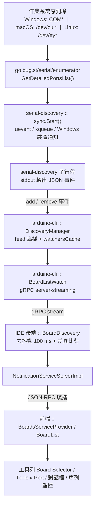
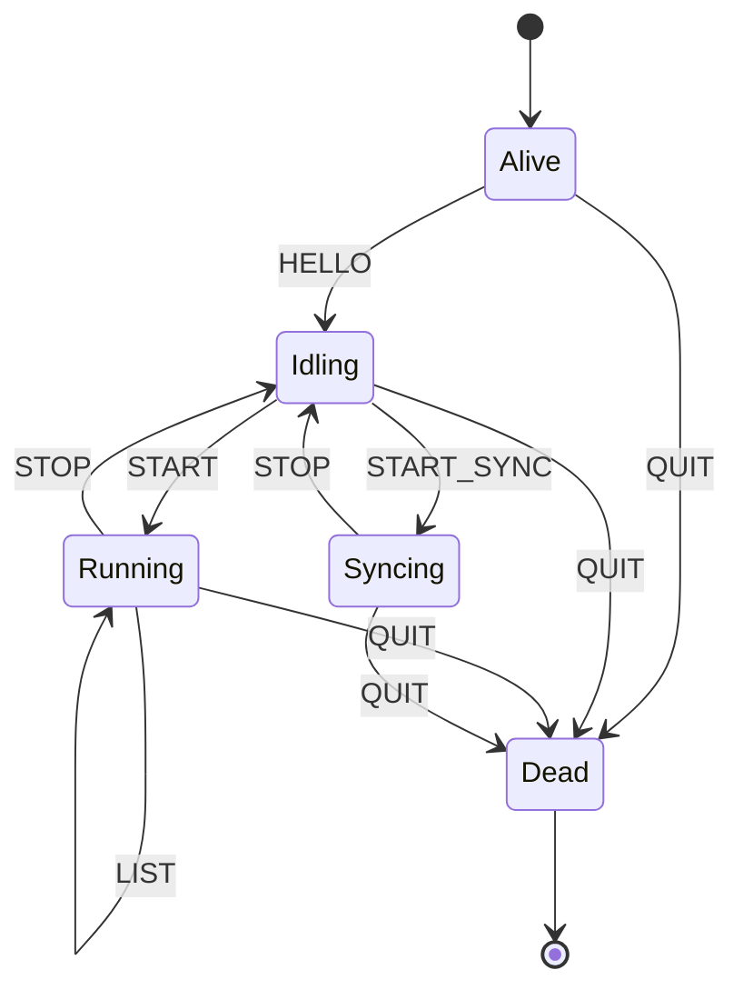
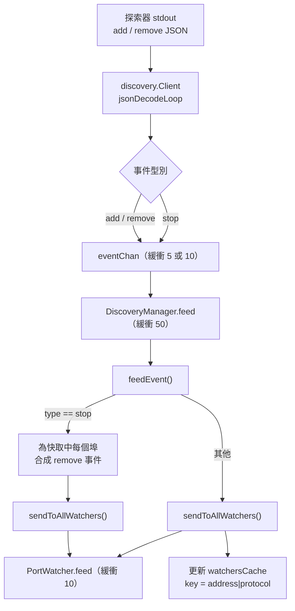
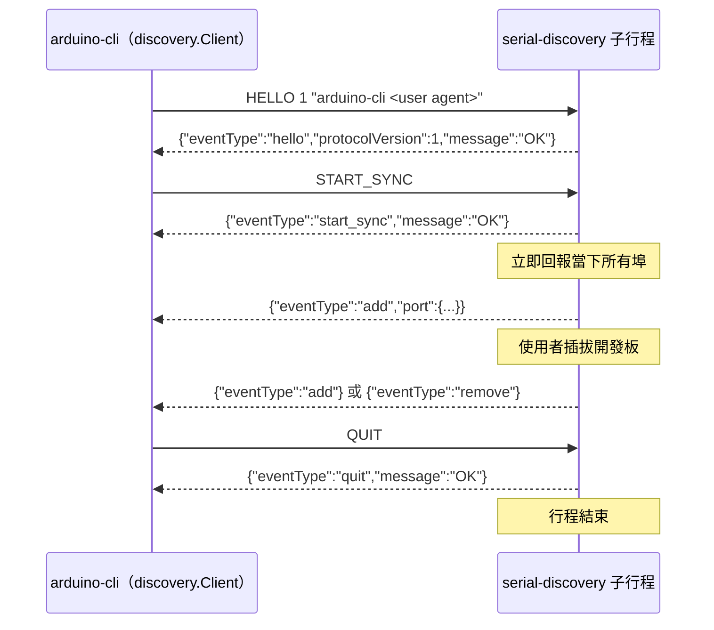
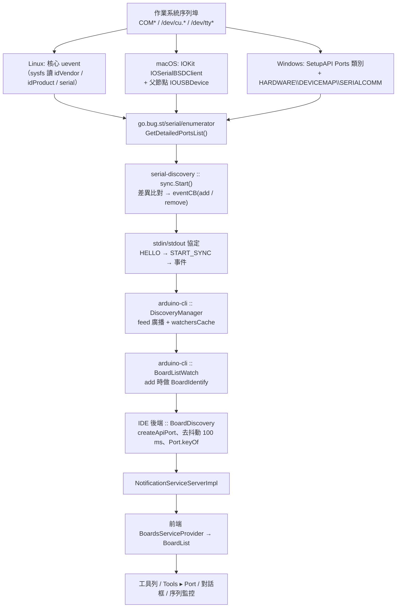

# 深入解析：`builtin:serial-discovery` 如何掃描作業系統序列埠（COM / UART）

## 摘要

Arduino IDE 2.x（下稱 IDE 2）本身**沒有**任何讀取作業系統序列埠的程式碼。它啟動 `arduino-cli` 的 daemon 模式，透過 gRPC 訂閱一個串流；真正呼叫作業系統 API 列舉序列埠的，是 CLI 以**子行程**方式啟動的一支小型 Go 程式 `serial-discovery`，其識別碼為 `builtin:serial-discovery`[^cli-discovery-spec][^cli-loader-go][^ide-package-json]。

`serial-discovery` 與 CLI 之間不是任何專有 API，而是一套公開的**標準輸入／標準輸出文字協定**：CLI 從子行程的 stdin 寫入純文字命令（以 LF 結尾），子行程則從 stdout 輸出 JSON 回應。CLI 送出的第一個命令必定是 `HELLO`，接著是 `START_SYNC`，之後子行程就會即時推送 `add` 與 `remove` 事件[^cli-discovery-spec][^pdh-client]。

「有哪些埠」這個問題，最終由 Go 函式庫 `go.bug.st/serial/enumerator`（原始碼位於 `github.com/bugst/go-serial`）回答：Linux 讀 sysfs、macOS 走 IOKit、Windows 用 SetupAPI 與登錄檔[^gs-usb-linux][^gs-usb-darwin][^gs-usb-windows]。CLI 收到事件後補上「這個埠可能是哪塊板子」的比對結果，轉成 gRPC 事件；IDE 後端再去抖動、快取，最後廣播給所有前端視窗[^cli-service-board-list][^ide-board-discovery][^ide-notif-server]。

本文逐步拆解這條鏈路，每一層都附上實際原始碼位置、gRPC 訊息定義與官方規格來源。**所有機制描述以 `arduino/arduino-ide` 的 `main` 分支、該分支內嵌的 `arduino-cli` 1.6.0、以及 `arduino/serial-discovery` 的 `main` 分支為準**；行號會隨版本漂移，因此本文以類別、方法與常數名稱為主要定位方式[^ide-package-json][^cli-release]。

---

## 1. 一句話總結

IDE 完全不下場掃描序列埠；它啟動 `arduino-cli` daemon，用 gRPC `BoardListWatch`（等同 `arduino-cli board list --watch`）訂閱一個**由 `builtin:serial-discovery` 子行程餵資料的串流**[^cli-board-list-cmd][^cli-service-board-list]。探索器用標準的 stdin/stdout JSON 協定（`HELLO` → `START_SYNC` → 持續 `add`/`remove`）把作業系統原生埠資訊（`address`、`label`、`protocol`、`protocolLabel`、`vid`、`pid`、`serialNumber`）送上來，其資料源自 `go.bug.st/serial/enumerator`：Linux 讀 sysfs 與核心 uevent、macOS 走 IOKit、Windows 用 SetupAPI 與登錄檔[^sd-sync][^gs-enumerator]。CLI 補上 matching boards 後轉成 gRPC 事件，IDE 再用 `Port.keyOf` 去抖動、快取、廣播給所有前端視窗[^ide-board-discovery][^ide-boards-service]。

---

## 2. 為什麼掃描發生在 CLI，而不是 IDE？

IDE 2 是以 Eclipse Theia 為框架、以 Electron 打包的桌面應用程式；其後端（Node.js 行程）與前端（瀏覽器環境）都以 TypeScript 撰寫[^ide-repo-api]。在本專案公開原始碼中找不到任何原生序列埠列舉程式碼：任何以 `serialport` 為名的相依套件（例如 `serialport`、`@serialport/*`）皆不存在於 `arduino-ide-extension/package.json` 的依賴清單中[^ide-package-json]。IDE 端唯一出現「serialPort」字樣的地方，是序列監控與繪圖器的 UI 狀態欄位，屬於協定名稱與介面狀態，而非硬體存取[^ide-package-json]。

因此「掃描作業系統序列埠」的程式碼**不在 IDE 內**，而在下列元件：

| 元件 | 角色 | 是否位於 IDE 原始碼內 |
| --- | --- | --- |
| `arduino-cli` | 以 daemon 模式提供 gRPC 服務，執行探索器、把事件串成 `BoardListWatch` | 否（IDE 僅內嵌其發行檔，版本鎖定 1.6.0）[^ide-package-json] |
| `builtin:serial-discovery` | 真正呼叫作業系統 API 列舉序列埠的子行程 | 否[^sd-main] |
| `go.bug.st/serial/enumerator` | 跨平台的序列埠與 USB 詳細資訊列舉 | 否[^gs-enumerator] |
| `arduino/pluggable-discovery-protocol-handler/v2` | 協定 client/server 共用程式庫，探索器與 CLI 兩端都用它 | 否[^pdh-discovery] |
| `BoardDiscovery` | IDE 後端接收 gRPC 事件、去抖動、廣播給前端 | 是[^ide-board-discovery] |

`arduino-cli` 以 daemon 模式啟動後會成為一個 gRPC 伺服器，預設監聽 TCP 50051（IDE 以 `--port 0` 要求作業系統自動配發，再從 stdout 讀回實際埠號）[^cli-daemon][^ide-daemon-impl]。



---

## 3. Pluggable discovery 是什麼

`arduino-cli` 不把序列埠邏輯硬編碼在自身，而是定義一套**探索器（discoverer）與 CLI 之間的標準 stdin/stdout 通訊協定**。任何程式只要照這個協定在 stdout 印 JSON、從 stdin 讀命令，就能當作探索器。

官方規格開頭即寫明（原文照引）[^cli-discovery-spec]：

> Discovery tools are a special kind of tool used to find supported boards, a platform developer can create their own following the specification below. These tools must be in the form of executables that can be launched as a subprocess using a `platform.txt` command line recipe. They communicate to the parent process via stdin/stdout, accepting commands as plain text strings from stdin and sending answers back in JSON format on stdout. Each tool will implement the commands to list and enumerate ports for a specific protocol as specified in this document.

重點整理：

- **探索器是獨立子行程**，用 stdin/stdout 對話，不是函式庫連結。
- **命令是純文字**（ASCII，以 LF 結尾），**回應是 JSON**。
- 有一個 **「events 模式」**（`START_SYNC`），探索器會即時推送埠的上線／離線。
- 外掛可被取代：第三方平台可自帶自己的 discovery，並以 `discoveryDependencies` 宣告[^cli-package-index]。

官方規格原始文件本身就是 `arduino-cli` 倉庫中的 `docs/pluggable-discovery-specification.md`，因此規格與 CLI 實作同倉共管[^cli-discovery-spec]。協定的 client 與 server 共用程式庫是 `arduino/pluggable-discovery-protocol-handler`（約 8 顆星、4 個 fork、授權 GPL-3.0）的 v2 模組[^pdh-repo]；`arduino-cli` 與 `serial-discovery` 的 `go.mod` 都鎖定 `v2.2.4`[^sd-gomod][^cli-repo-api]。此程式庫將協定狀態機與解析邏輯包好，實作者只要填 `Hello`、`StartSync`、`Stop`、`Quit` 四個方法即可[^pdh-discovery]。

在 IDE 端可看到對應的耦合證據，`board-discovery.ts` 的註解寫著（原文照引）[^ide-board-discovery]：

```ts
// Cancelling the stream will kill the discovery `builtin:mdns-discovery process`.
// The client (this class) will receive a `{"eventType":"quit","error":""}` response from the CLI.
```

也就是說：取消 gRPC 串流會終止探索器子行程。這一點在協定層有對應機制（`STOP` 命令），而在 CLI 層則由 `DiscoveryManager` 的 watcher 關閉流程實現[^pdh-client][^cli-discoverymanager]。

---

## 4. 探索器協議（Pluggable Discovery Protocol）

命令由 CLI 經 **stdin** 送出，回應由探索器經 **stdout** 送出；除錯訊息走 **stderr**。規格明文要求：**所有命令都必須實作，且必須立即回應、不得延遲**[^cli-discovery-spec]。

### 4.1 `HELLO`（必須是第一個命令）

```text
HELLO <PROTOCOL_VERSION> "<USER_AGENT>"
```

規格給的範例如下（CLI 會以自身版本作為 user agent）[^cli-discovery-spec]：

```text
HELLO 1 "Arduino IDE 1.8.13"
HELLO 1 "arduino-cli 1.2.3"
```

- `<PROTOCOL_VERSION>`：client/IDE 支援的最高協定版本（目前 `1`）。
- `<USER_AGENT>`：客戶端名稱與版本，不得含雙引號。

探索器回應[^cli-discovery-spec]：

```json
{
  "eventType": "hello",
  "protocolVersion": 1,
  "message": "OK"
}
```

規格對 `protocolVersion` 的定義是「後續通訊實際使用的版本」，並列出三種協商情境：客戶端版本較新時客戶端降級；探索器版本較新時探索器自行降級回報較低版本；若無法降級則照實回報，此時客戶端可選擇終止或發出警告[^cli-discovery-spec]。

### 4.2 其餘命令與回應事件型別

| 命令 | 用途 | 回應 `eventType` |
| --- | --- | --- |
| `START` | 初始化探索器內部機制（須在 `LIST` 前呼叫） | `start` |
| `STOP` | 停止探索、釋放資源 | `stop` |
| `QUIT` | 結束探索器（之後行程結束） | `quit` |
| `LIST` | 單次列出目前所有埠 | `list` |
| `START_SYNC` | 進入 events 模式，之後推送 `add` / `remove` | `start_sync` |

命令若有錯誤，回應會帶 `"error": true` 與 `"message"`；未知或不合法命令回 `eventType: "command_error"`，例如 `{"eventType":"command_error","error":true,"message":"Unknown command XXXX"}`[^cli-discovery-spec]。

規格也附有狀態機圖，其原始 Graphviz 定義在 CLI 倉庫中[^cli-state-machine]：



`Alive` 代表行程已啟動但尚未收到任何命令；`Dead` 代表行程已停止，不能再接受命令[^cli-discovery-spec]。

### 4.3 `LIST` 回應（單次列舉）

規格中的 `LIST` 區塊其實是一份**帶註解的骨架**（不是合法 JSON），另有一份取自 `serial-discovery` 的完整範例[^cli-discovery-spec]：

```json
{
  "eventType": "list",
  "ports": [
    {
      "address": "/dev/ttyACM0",
      "label": "ttyACM0",
      "protocol": "serial",
      "protocolLabel": "Serial Port (USB)",
      "hardwareId": "EBEABFD6514D32364E202020FF10181E",
      "properties": {
        "pid": "0x804e",
        "vid": "0x2341",
        "serialNumber": "EBEABFD6514D32364E202020FF10181E",
        "name": "ttyACM0"
      }
    }
  ]
}
```

各欄位（官方規格定義）[^cli-discovery-spec]：

- `address`：埠位址，如 `/dev/ttyACM0`（序列）或 `192.168.10.100`（網路）。
- `label`：給人看的 `address` 形式，規格舉例為 `ttyACM0` 或 `SSH on 192.168.10.100`。
- `protocol`：協定識別字，如 `serial`、`dfu`、`ssh`。
- `protocolLabel`：給人看的協定名，如 `Serial port`、`DFU USB`、`Network (ssh)`。
- `hardwareId`（選用）：唯一識別**板子實例**（同型號的其他板子也適用），例如乙太網路 MAC、USB 序號、CPU-ID；**不得**用於識別板子**型號**。
- `properties`：此埠的 key/value 資訊，用於板子型號識別。

### 4.4 `START_SYNC` 回應（events 模式）

```json
{ "eventType": "start_sync", "message": "OK" }
```

之後非同步推送。`add` 事件[^cli-discovery-spec]：

```json
{
  "eventType": "add",
  "port": {
    "address": "/dev/ttyACM0",
    "label": "ttyACM0",
    "hardwareId": "EBEABFD6514D32364E202020FF10181E",
    "properties": { "pid": "0x804e", "vid": "0x2341", "serialNumber": "..." },
    "protocol": "serial",
    "protocolLabel": "Serial Port (USB)"
  }
}
```

`remove` 事件只帶 address 與 protocol[^cli-discovery-spec]：

```json
{ "eventType": "remove", "port": { "address": "/dev/ttyACM0", "protocol": "serial" } }
```

規格中兩個關鍵規則[^cli-discovery-spec]：

1. **`START_SYNC` 後必須先送出一連串初始 `add` 事件**，回報當下所有埠。
2. **若要更新某埠的資訊，可直接再送一次 `add`**（不必先 `remove`），語意是「先前資訊全部丟棄、以新的取代」。

第 2 點正好對應 IDE 端的一則註解：同一個埠可能先以 `[no_device] Triple Serial` 為 label 出現，之後補上完整 label，因此 `add` 在 IDE 端是**覆寫**語意[^ide-board-discovery]。

### 4.5 板子識別（Board identification）

規格說明，`boards.txt` 中每塊板子可宣告一組 `upload_port.*` 屬性；若某塊板子的所有 `upload_port.*` 都能在埠的 `properties` 中找到匹配，該板子就是此埠的「候選板」。使用 `.N` 後綴可宣告多組，各組獨立、不得混用[^cli-discovery-spec]。

規格同時提出一項重要警告（原文照引）[^cli-discovery-spec]：

> Sometimes a board do not expose a unique vid/pid combination, this is the case for example if a USB-2-serial converter chip is used (like the omnipresent FT232 or CH340): those chips exposes their specific vid/pid that will be the same for all the other boards using the same chip. In such cases the board identification properties should NOT be used.

即：USB 轉序列晶片（FT232、CH340）的 vid/pid 不具唯一性，不應用於型號識別。

---

## 5. CLI 端（一）：`DiscoveryManager` 如何管理探索器

`arduino-cli` 以 `DiscoveryManager` 管理多個探索器，原始碼位於 `internal/arduino/discovery/discoverymanager/discoverymanager.go`[^cli-discoverymanager]。其型別定義蘊含整體設計：

```go
type DiscoveryManager struct {
	discoveries        map[string]*discovery.Client
	discoveriesRunning bool
	feed               chan *discovery.Event
	watchers           map[*PortWatcher]bool
	watchersCache      map[string]map[string]*discovery.Event
	userAgent          string
}
```

`feed` 的緩衝大小是 **50**，是所有事件匯流的中央通道[^cli-discoverymanager]。

### 5.1 `Add()`：註冊探索器

```go
func (dm *DiscoveryManager) Add(id string, args ...string) error {
	d := discovery.NewClient(id, args...)
	d.SetLogger(logrus.WithField("discovery", id))
	d.SetUserAgent(dm.userAgent)
	return dm.add(d)
}
```

`id` 形如 `builtin:serial-discovery`；`args...` 是啟動子行程的完整命令列。若探索器已在運行，`add()` 會立刻啟動它[^cli-discoverymanager]。

### 5.2 `Start()` 與 `startDiscovery()`：啟動與事件搬運

`Start()` 的設計是幂等的（已在跑就回 `nil`），它先開啟一個 goroutine 把所有 feed 事件送給 `feedEvent()`，再併發啟動每個探索器[^cli-discoverymanager]。

`startDiscovery()` 是握手與訂閱的地方[^cli-discoverymanager]：

```go
if err := d.Run(); err != nil { ... }        // 啟動子行程 + HELLO 握手
eventCh, err := d.StartSync(5)               // START_SYNC，5 秒逾時
...
go func(d *discovery.Client) {
    for ev := range eventCh { dm.feed <- ev }
}(d)
```

`StartSync(5)` 的 `5` 是**等待回應的逾時秒數**；`d.Run()` 內部的 `HELLO` 逾時則是 10 秒[^cli-discoverymanager][^pdh-client]。`StartSync` 會在送出命令**之前**先建立事件通道，原因是探索器可能在 `start_sync` 回應抵達前就搶先送出初始 `add` 事件，若通道尚未存在，這些事件會被丟棄[^pdh-client]。

### 5.3 `Watch()`：把現有埠補發給新 watcher

```go
func (dm *DiscoveryManager) Watch() (*PortWatcher, error) {
	dm.Start()
	watcher := &PortWatcher{ feed: make(chan *discovery.Event, 10) }
	...
	go func() {
		...
		// When a watcher is started, send all the current active ports first...
		for _, cache := range dm.watchersCache {
			for _, ev := range cache { watcher.feed <- ev }
		}
		// ...and after that add the watcher to the list of watchers receiving events
		dm.watchers[watcher] = true
	}()
	return watcher, nil
}
```

順序很關鍵：**先把快取中現有埠的事件補發**，**之後才**把 watcher 加入廣播清單，避免新 watcher 漏掉初始狀態[^cli-discoverymanager]。watcher 的 feed 通道緩衝為 **10**[^cli-discoverymanager]。

### 5.4 `feedEvent()`：廣播、快取與合成 remove

事件廣播時，若某 watcher 在 **500 毫秒**內無法接收事件，CLI 會把它從 watcher 清單移除並記下錯誤，避免慢速 watcher 拖垮整個串流[^cli-discoverymanager]。

快取的鍵是 `address + "|" + protocol`[^cli-discoverymanager]：

```go
eventID := ev.Port.Address + "|" + ev.Port.Protocol
switch ev.Type {
case "add":    cache[eventID] = ev
case "remove": delete(cache, eventID)
default:       logrus.Errorf("Unhandled event from discovery: %s", ev.Type)
}
```

當探索器送來 `stop` 事件時，CLI 會**為該探索器快取中的所有埠合成 `remove` 事件**，廣播出去後再清空該探索器的快取；`stop` 事件本身**不會**被轉發給 watcher[^cli-discoverymanager]。這確保前端不會殘留已消失的埠。



### 5.5 協定層的事件通道與 `stop`

協定程式庫 `client.go` 是事件產生的源頭：解碼迴圈只把 `add` 與 `remove` 兩型放進事件通道，其餘訊息走另一條通道；而 `stopSync()` 會將 `Event{Type: "stop"}` 推入事件通道後關閉它[^pdh-client]。所以事件通道中可能出現的型別只有 `add`、`remove`、`stop` 三種[^pdh-client]。

`Quit()` 則是送 `QUIT`、等待 5 秒、然後強制砍掉子行程（`killProcess`）[^pdh-client]。`DiscoveryManager.Clear()` 在 CLI instance 重置時會對所有探索器呼叫 `Quit()`[^cli-discoverymanager]。

協定互動的時序如下：



---

## 6. CLI 端（二）：`BoardListWatch` 把事件變成 gRPC server-streaming

`commands/service_board_list.go` 的 `BoardListWatch` 是 IDE 訂閱的起點[^cli-service-board-list]：

```go
func (s *arduinoCoreServerImpl) BoardListWatch(req *rpc.BoardListWatchRequest,
    stream rpc.ArduinoCoreService_BoardListWatchServer) error {
    ...
    watcher, err = dm.Watch()
    ...
    go func() {
        for event := range watcher.Feed() {
            port := &rpc.DetectedPort{ Port: rpc.DiscoveryPortToRPC(event.Port) }
            boardsError := ""
            if event.Type == "add" {
                // 只有 add 才會去比對已安裝平台，找出 matching boards
                resp, err := s.BoardIdentify(context.Background(), &rpc.BoardIdentifyRequest{...})
                if err != nil { boardsError = err.Error() } else { port.MatchingBoards = resp.GetBoards() }
            }
            stream.Send(&rpc.BoardListWatchResponse{
                EventType: event.Type,
                Port:      port,
                Error:     boardsError,
            })
        }
    }()
    <-stream.Context().Done()
    watcher.Close()
    return nil
}
```

重點：

- `remove` 事件**不做** board 比對（省成本），只帶 port。板子比對只發生在 `add`[^cli-service-board-list]。
- `eventType` 是**原樣轉發**探索器事件型別；此函式中唯一由 CLI 自行產生的型別是缺少 instance 時的 `"error"`[^cli-service-board-list]。
- 串流結束（客戶端取消）時，`<-stream.Context().Done()` 之後呼叫 `watcher.Close()`，也就切斷了與探索器事件的關聯[^cli-service-board-list]。

gRPC 訊息定義（節錄自 `board.proto`）[^cli-board-proto]：

```proto
rpc BoardListWatch(BoardListWatchRequest) returns (stream BoardListWatchResponse);

message BoardListWatchRequest {
  Instance instance = 1;
  bool skip_cloud_api_for_board_detection = 2;
}

message BoardListWatchResponse {
  // Event type as received from the serial discovery tool.
  string event_type = 1;
  DetectedPort port = 2;
  string error = 3;
}

message DetectedPort {
  repeated BoardListItem matching_boards = 1;
  Port port = 2;
}
```

`Port` 訊息定義如下（節錄）[^cli-port-proto]：

```proto
message Port {
  string address = 1;
  string label = 2;
  string protocol = 3;
  string protocol_label = 4;
  map<string, string> properties = 5;
  string hardware_id = 6;
}
```

### 6.1 探索器 `port` → gRPC `Port` 的欄位映射

轉換函式 `DiscoveryPortToRPC` 位於 `rpc/cc/arduino/cli/commands/v1/common.go`[^cli-common-go]：

```go
func DiscoveryPortToRPC(p *discovery.Port) *Port {
	props := p.Properties
	if props == nil { props = properties.NewMap() }
	return &Port{
		Address:       p.Address,
		Label:         p.AddressLabel,        // 注意：探索器的 AddressLabel 對應 gRPC 的 label
		Protocol:      p.Protocol,
		ProtocolLabel: p.ProtocolLabel,
		HardwareId:    p.HardwareID,
		Properties:    props.CloneAsMap(),
	}
}
```

探索器端的 `discovery.Port` 結構（來自協定程式庫）則為[^pdh-port]：

```go
type Port struct {
	Address       string          `json:"address"`
	AddressLabel  string          `json:"label,omitempty"`
	Protocol      string          `json:"protocol,omitempty"`
	ProtocolLabel string          `json:"protocolLabel,omitempty"`
	Properties    *properties.Map `json:"properties,omitempty"`
	HardwareID    string          `json:"hardwareId,omitempty"`
}
```

值得注意的是：程式庫上的 JSON 標籤是 `label`，但 Go 欄位名是 `AddressLabel`，這是「慣用語 `label`」與「語意是位址標籤」之間的落差，也是後續 IDE 之所以把 gRPC `label` 映射成 `addressLabel` 的原因[^pdh-port][^ide-board-discovery]。

---

## 7. IDE 端：`BoardDiscovery` 從串流到廣播

### 7.1 建立串流

`arduino-ide-extension/src/node/board-discovery.ts` 的 `BoardDiscovery` 是後端單例，並註冊為 `BackendApplicationContribution`，因此在後端啟動時就會 `start()`[^ide-backend-module][^ide-board-discovery]。

```ts
const stream = client
  .boardListWatch(req)
  .on('end', () => { this.onStreamDidEndEmitter.fire(); })
  .on('error', (error) => {
    if (ServiceError.isCancel(error)) { this.onStreamDidCancelEmitter.fire(); }
    else { this.logger.error('Unexpected error occurred during the boards discovery.', error); }
  });
```

`req` 是 `new BoardListWatchRequest().setInstance(instance)`[^ide-board-discovery]。

### 7.2 事件解析與 `add` 的覆寫語意

`onBoardListWatchResponse()` 先把 `eventType` 轉成列舉；若是 `Quit` 就呼叫 `this.stop()` 並結束；否則取出 `port`、用 `fromRpc()` 轉成 IDE 的 `DetectedPort`、再交給 `fireSoon()`[^ide-board-discovery]。

`calculateNewState()` 以 `Port.keyOf(port)` 為鍵[^ide-board-discovery]：

```ts
const key = Port.keyOf(port);
if (eventType === EventType.Add) {
  // Note that, the serial discovery might detect port details (such as addressLabel) in chunks.
  // For example, first, the Teensy 4.1 port is detected with the `[no_device] Triple Serial` address label,
  // Then, when more refinements are available, the same port is detected with
  // `/dev/cu.usbmodem127902301 Triple Serial` address label.
  // In such cases, an `add` event is received from the CLI, and the the detected port is overridden in the state.
  newState[key] = { port, boards };
} else if (eventType === EventType.Remove) {
  delete newState[key];
}
```

這段行為正是第 4.4 節規格規則的實作對應[^cli-discovery-spec][^ide-board-discovery]。

### 7.3 去抖動與差異比對

```ts
private fireSoon(event: DetectedPortChangeEvent): void {
  this.bufferedEvents.push(event);
  clearTimeout(this.fireSoonHandle);
  this.fireSoonHandle = setTimeout(() => {
    const current = deepClone(this.detectedPorts);
    const newState = this.calculateNewState(this.bufferedEvents, current);
    if (!isDeepStrictEqual(current, newState)) {
      this._detectedPorts = newState;
      this.notificationService.notifyDetectedPortsDidChange({ detectedPorts: this._detectedPorts });
    }
    this.bufferedEvents.length = 0;
  }, 100);
}
```

**100 毫秒**的去抖動視窗，搭配 `isDeepStrictEqual` 的深層比對，只有在狀態真的改變時才廣播[^ide-board-discovery]。

### 7.4 廣播給所有前端

`NotificationServiceServerImpl` 持有所有已連線前端的 client 清單，`notifyDetectedPortsDidChange()` 就是對每個 client 逐一呼叫[^ide-notif-server]。前端的 `NotificationCenter` 收到後再交給 `BoardsServiceProvider`，形成 `BoardList` UI 模型[^ide-board-list]。

### 7.5 `Port` 型別與埠識別鍵

`src/common/protocol/boards-service.ts` 定義了前後端共用的 `Port`[^ide-boards-service]：

```ts
export interface Port {
  readonly address: string;
  readonly addressLabel: string;
  readonly protocol: string;
  readonly protocolLabel: string;
  readonly properties?: Record<string, string>;
  readonly hardwareId?: string;
}
```

識別鍵的格式是[^ide-boards-service]：

```ts
export function keyOf(port: PortIdentifier | Port | DetectedPort): string {
  if (isPortIdentifier(port)) {
    return `arduino+${port.protocol}://${port.address}`;
  }
  return keyOf(port.port);
}
```

也就是 `arduino+serial://<address>`。因此**同一個 address、不同 protocol 會被視為不同埠**[^ide-boards-service]。`Port.compare` 的排序是「serial 優先、network 次之、其他最後」，再以 address 自然排序[^ide-boards-service]。`Port.isVisiblePort` 則規定 `serial` 與 `network` 一律顯示，其他協定必須偵測到至少一塊已知板子才顯示[^ide-boards-service]。

### 7.6 欄位完整對照

| 探索器 JSON | 協定程式庫欄位 | gRPC `Port` | IDE `Port` | 範例 |
| --- | --- | --- | --- | --- |
| `address` | `Address` | `address` | `address` | `COM41`、`/dev/cu.usbmodem14201` |
| `label` | `AddressLabel` | `label` | `addressLabel` | 通常等於 address（此處的 `label` 即探索器 JSON 的欄位名） |
| `protocol` | `Protocol` | `protocol` | `protocol` | `serial`、`network` |
| `protocolLabel` | `ProtocolLabel` | `protocol_label` | `protocolLabel` | `Serial Port (USB)` |
| `properties`（map） | `Properties` | `properties` | `properties` | `{vid, pid, serialNumber}` |
| `hardwareId` | `HardwareID` | `hardware_id` | `hardwareId` | 序號字串（空字串轉為 `undefined`） |

IDE 端的最終映射函式是 `createApiPort()`[^ide-board-discovery]：

```ts
export function createApiPort(rpcPort: RpcPort): Port {
  return {
    address: rpcPort.getAddress(),
    addressLabel: rpcPort.getLabel(),
    protocol: rpcPort.getProtocol(),
    protocolLabel: rpcPort.getProtocolLabel(),
    properties: Port.Properties.create(rpcPort.getPropertiesMap().toObject()),
    hardwareId: rpcPort.getHardwareId() || undefined, // prefer undefined over empty string
  };
}
```

`Port.Properties.create` 把 `[string, string][]` 攤平成物件，空陣列則回 `undefined`[^ide-boards-service]。而 `getBoardInfo()` 靠 `vid`、`pid`、`serialNumber` 三個 property 產生 `Tools ▸ Get Board Info` 的內容；若埠不是 `serial` 或缺少 `vid`/`pid`，會回傳對應的說明字串（例如 `Non-serial port, can't obtain info.`）[^ide-boards-service]。

### 7.7 真實埠資料範例

IDE 測試資料中的 `unoSerialPort` 展示了上述映射結果[^ide-fixtures]：

```ts
export const unoSerialPort: Port = {
  address: '/dev/cu.usbmodem14201',
  addressLabel: '/dev/cu.usbmodem14201',
  protocol: 'serial',
  protocolLabel: 'Serial Port (USB)',
  properties: { pid: '0x0043', serialNumber: '75830303934351618212', vid: '0x2341' },
  hardwareId: '75830303934351618212',
};
```

同一測試資料集中另有非 USB 的序列埠（`protocolLabel: 'Serial Port'`、無 `vid`/`pid`，如 `/dev/cu.Bluetooth-Incoming-Port`）與網路埠（`protocol: 'network'`，`properties` 帶 `.`、`board`、`hostname`、`port` 等鍵，如 mDNS 發現的 `Arduino at 192.168.0.104`），證明同一條管線確實同時承載 USB、非 USB 序列與網路埠[^ide-fixtures]。

---

## 8. 探索器內部：`arduino/serial-discovery`

`serial-discovery` 是一支薄殼程式：它以協定程式庫跑 server，真正的埠列舉與變動監看去呼叫 `go.bug.st/serial/enumerator`[^sd-main][^sd-sync]。

`main.go` 的骨架如下[^sd-main]：

```go
func main() {
	args.Parse()
	if args.ShowVersion { fmt.Printf("%s\n", version.VersionInfo); return }
	serialDisc := &SerialDiscovery{}
	disc := discovery.NewServer(serialDisc)
	if err := disc.Run(os.Stdin, os.Stdout); err != nil {
		fmt.Fprintf(os.Stderr, "Error: %s\n", err.Error())
		os.Exit(1)
	}
}
```

`SerialDiscovery` 只需實作協定程式庫的 `Discovery` 介面：`Hello`、`Quit`、`Stop`、`StartSync`。`Stop` 的實作是取消 `StartSync` 建立時的 context；`StartSync` 則把 `eventCB`/`errorCB` 交給 `sync.Start()`[^sd-main][^pdh-discovery]。

### 8.1 埠 → 探索器 port 物件的轉換（`sync/sync.go`）

```go
func toDiscoveryPort(port *enumerator.PortDetails) *discovery.Port {
	protocolLabel := "Serial Port"
	hardwareID := ""
	props := properties.NewMap()
	if port.IsUSB {
		protocolLabel += " (USB)"
		props.Set("vid", "0x"+port.VID)
		props.Set("pid", "0x"+port.PID)
		props.Set("serialNumber", port.SerialNumber)
		if activeUSBProbeFilter(port.VID, port.PID) {
			props.Set("configuration", port.Configuration)
			props.Set("manufacturer", port.Manufacturer)
			props.Set("product", port.Product)
		}
		hardwareID = port.SerialNumber
	}
	return &discovery.Port{
		Address:       port.Name,
		AddressLabel:  port.Name,
		Protocol:      "serial",
		ProtocolLabel: protocolLabel,
		Properties:    props,
		HardwareID:    hardwareID,
	}
}

var activeUSBProbeFilter = func(vid, _ /*pid*/ string) bool {
	// Only perform active probing on Arduino devices, to avoid issues with some devices that don't support it.
	return vid == "2341"
}
```

由此可解釋 IDE 測試資料中看到的資料[^sd-sync]：

- 非 USB 埠 → `protocolLabel = "Serial Port"`；USB 埠 → `"Serial Port (USB)"`。
- `vid`/`pid` 會加上小寫 `0x` 前綴；`hardwareId` 等於 USB 序號（非 USB 埠為空字串）。
- **主動探測（active probing）預設關閉**：只有 vid 為 `2341`（Arduino 的 USB Vendor ID）時，才額外嘗試讀取 `configuration`、`manufacturer`、`product`[^sd-sync]。
- `AddressLabel` 直接設為 `port.Name`，也就是**完整路徑**（如 `/dev/ttyACM0`），而不是規格範例裡的 `ttyACM0`[^sd-sync][^cli-discovery-spec]。

### 8.2 差異比對（`processUpdates` / `portListHas`）

```go
func processUpdates(old, new []*enumerator.PortDetails, eventCB discovery.EventCallback) {
	for _, oldPort := range old {
		if !portListHas(new, oldPort) {
			eventCB("remove", &discovery.Port{Address: oldPort.Name, Protocol: "serial"})
		}
	}

	for _, newPort := range new {
		if !portListHas(old, newPort) {
			eventCB("add", toDiscoveryPort(newPort))
		}
	}
}

func portListHas(list []*enumerator.PortDetails, port *enumerator.PortDetails) bool {
	for _, p := range list {
		if port.Name == p.Name && port.IsUSB == p.IsUSB {
			if p.IsUSB &&
				port.VID == p.VID &&
				port.PID == p.PID &&
				port.SerialNumber == p.SerialNumber {
				return true
			}
			if !p.IsUSB {
				return true
			}
		}
	}
	return false
}
```

比對時要同時看 `Name` 與 `IsUSB`；若是 USB 埠，還要三者都比對：`VID`、`PID`、`SerialNumber`[^sd-sync]。這意味著**同一條路徑若換了 USB 序號（例如改插另一塊板子）也會被判定為舊埠移除、新埠加入**。非 USB 埠則只比 `Name`[^sd-sync]。

### 8.3 各平台如何得知「埠變動」

| 平台 | 檔案 | 機制 |
| --- | --- | --- |
| Linux | `sync/sync_linux.go` | 讀取核心 **uevent** 事件串流；只處理 `Subsystem == "tty"`[^sd-linux] |
| macOS / FreeBSD | `sync/sync_bsd.go` | 用 **kqueue** 監看 `/dev` 目錄的 `NOTE_DELETE` 與 `NOTE_WRITE` 事件，變動時重新列舉[^sd-bsd] |
| Windows | `sync/sync_windows.go` | 建立**隱藏視窗**並註冊 USB 裝置介面通知，另以 **500 毫秒輪詢**做為後備[^sd-windows] |
| 其他 | `sync/sync_default.go` | 直接回傳 `"Command START_SYNC not supported"`[^sd-default] |

值得注意的是，**FreeBSD 原本沒有事件監看實作**，是在 `serial-discovery` v1.5.2 版才新增；同一版也改進了 macOS 的 USB configuration 掃描[^sd-release]。

Linux 的關鍵片段（`sync/sync_linux.go`）[^sd-linux]：

```go
dec := uevent.NewDecoder(syncReader)
for {
	evt, err := dec.Decode()
	if err == io.EOF { return } else if err != nil { errorCB(...); return }
	if evt.Subsystem != "tty" { continue }
	changedPort := "/dev/" + evt.Vars["DEVNAME"]
	if evt.Action == "add" {
		portList, err := enumerator.GetDetailedPortsList(activeUSBProbeFilter)
		if err != nil { continue }
		for _, port := range portList {
			if port.IsUSB && port.Name == changedPort {
				eventCB("add", toDiscoveryPort(port))
				break
			}
		}
	}
	if evt.Action == "remove" {
		eventCB("remove", &discovery.Port{Address: changedPort, Protocol: "serial"})
	}
}
```

Linux 分支的三個細節[^sd-linux]：

1. 開頭先送出**初始埠狀態**（所有當下的埠各觸發一次 `add`），之後才進入事件迴圈。
2. `add` 事件**不會**直接把新埠送出，而是重新列舉**全部**埠再從中挑出 `Name` 相符者；只有 `IsUSB` 為真的埠才推送，避免把核心內部 tty 誤報給前端。
3. `remove` 事件直接以 uevent 的 `DEVNAME` 組出路徑送出，不需要重新列舉。

uevent 事件串流本身由第三方套件 `github.com/s-urbaniak/uevent` 提供（Apache-2.0、約 15 顆星），它讀取的核心介面就是 udev 事件，屬於 Linux 專屬能力[^uevent][^sd-gomod]。

Windows 的關鍵片段（`sync/sync_windows.go`）[^sd-windows]：

```go
for {
	select {
	case ev := <-eventsChan:   // 由隱藏視窗的視窗訊息觸發
		if !ev { return }
	case <-time.After(time.Millisecond * 500):
		// Use a small timeout instead of default case to avoid high CPU consumption
	}
	updates, err := enumerator.GetDetailedPortsList(activeUSBProbeFilter)
	if err != nil { errorCB(...); return }
	processUpdates(current, updates, eventCB)
	current = updates
}
```

其視窗類別名為 `arduino-serialdiscovery`，並透過 `RegisterDeviceNotification` 註冊一個裝置介面 GUID；該 GUID 以 Windows 的欄位順序寫成 `data1: 0x10bfdca5, data2: 0x3065, data3: 0xd211, data4: {0x90,0x1f,0x00,0xc0,0x4f,0xb9,0x51,0xed}`，即 `GUID_DEVINTERFACE_USB_DEVICE`（`{a5dcbf10-6530-11d2-901f-00c04fb951ed}`），另搭配 `deviceNotifyWindowHandle | deviceNotifyAllInterfaceClasses` 旗標[^sd-windows]。`eventsChan` 大小為 1，因此短時間內連續多個裝置通知會被合併為一次重新列舉，這正是搭配 500 毫秒輪詢仍能保持低延遲的原因[^sd-windows]。

macOS / FreeBSD 的關鍵片段（`sync/sync_bsd.go`）[^sd-bsd]：

```go
kq, _ := syscall.Kqueue()
fd, _ := syscall.Open("/dev", syscall.O_RDONLY, 0)
ev1 := syscall.Kevent_t{
	Ident:  uint64(fd),
	Filter: syscall.EVFILT_VNODE,
	Flags:  syscall.EV_ADD | syscall.EV_ENABLE | syscall.EV_ONESHOT,
	Fflags: syscall.NOTE_DELETE | syscall.NOTE_WRITE,
}
...
for retries := 0; retries < 5; retries++ {
	updates, err := enumerator.GetDetailedPortsList(activeUSBProbeFilter)
	if err != nil { enumeratorErr = err; break }
	processUpdates(current, updates, eventCB)
	current = updates
}
```

kqueue 使用 `EV_ONESHOT`，因此每收到一次變動就要重新註冊；程式在事件發生後最多重試列舉 **5 次**，以因應 `/dev` 節點尚未就緒的競態[^sd-bsd]。

---

## 9. 埠列舉底層：`go.bug.st/serial/enumerator`

`arduino/serial-discovery` 的 `go.mod` 宣告 module 為 `github.com/arduino/serial-discovery`，並以 `replace` 指令把 `go.bug.st/serial` 指向 `github.com/facchinm/go-serial` 的一個特定 commit，同時直接依賴 `github.com/arduino/pluggable-discovery-protocol-handler/v2 v2.2.4`；`go.bug.st/serial` 本身則以 `v1.8.0` 被引用於 `require` 區塊，也就是被 `replace` 覆寫的那一項[^sd-gomod]。也就是說**實際編入探索器的列舉程式碼，是該 fork 在該 commit 的內容**；本文所讀取的 `bugst/go-serial` 上游原始碼在公開 API 上與探索器呼叫的方式一致，但仍應留意這層 `replace`[^sd-gomod]。

上游 `go.bug.st/serial` 的 module 路徑即為 `go.bug.st/serial`（不是 GitHub 路徑），授權為 BSD 3-Clause，預設分支 `master`，星數約 881、fork 數約 241、議題數約 56[^gs-gomod][^gs-repo-api]。其 README 自述為「A cross-platform serial port library for Go」，文件指向 `pkg.go.dev/go.bug.st/serial`[^gs-readme]。

其 enumerator 的公開 API（`enumerator/enumerator.go`）[^gs-enumerator]：

```go
// PortDetails contains detailed information about USB serial port.
type PortDetails struct {
	Name         string // 埠位址，如 COM1 或 /dev/ttyUSB0
	IsUSB        bool   // 是否為 USB 序列埠
	VID          string // USB Vendor ID
	PID          string // USB Product ID
	SerialNumber string // USB 序號
	Configuration string // 需啟用主動探測
	Manufacturer  string // USB iManufacturer 字串，需啟用主動探測
	Product       string // USB iProduct 字串，需啟用主動探測
}

func GetDetailedPortsList(activeUSBProbeFilters ...func(vid, pid string) bool) ([]*PortDetails, error)
```

文件註解明確說明探測語意：**主動探測預設關閉，必須提供至少一個過濾函式才會啟用**；未提供任何過濾函式時，不會有裝置被主動探測[^gs-enumerator]。程式庫另提供 `var All = func(vid, pid string) bool { return true }` 作為「全部允許」的過濾器[^gs-enumerator]。

「有哪些埠」這個問題由 `serial.GetPortsList()` 回答，它只是 `nativeGetPortsList()` 的薄包裝[^gs-serial-go]。

### 9.1 Linux

埠名稱過濾用的是正規表示式，位於**根目錄的 `serial_linux.go`**（不是 `enumerator/serial_linux.go`）[^gs-serial-linux]：

```go
const devFolder = "/dev"
var osPortFilter = regexp.MustCompile("(ttyS|ttyHS|ttyUSB|ttyACM|ttyAMA|rfcomm|ttyO|ttymxc)[0-9]{1,3}")
```

實際的目錄走訪與過濾邏輯位於根目錄的 `serial_unix.go`（由 linux、darwin、freebsd、openbsd 共用），且對 `ttyS`/`ttyHS` 開頭的裝置會**實際 `open()` 一次**，開得起來才保留，藉此排除核心保留的「佔位」序列埠[^gs-serial-unix]：

```go
if !osPortFilter.MatchString(f.Name()) { continue }
portName := devFolder + "/" + f.Name()
// Check if serial port is real or is a placeholder serial port "ttySxx" or "ttyHSxx"
if strings.HasPrefix(f.Name(), "ttyS") || strings.HasPrefix(f.Name(), "ttyHS") {
	port, err := nativeOpen(portName, &Mode{})
	if err != nil { continue } else { port.Close() }
}
ports = append(ports, portName)
```

USB 詳細資訊則由 `enumerator/usb_linux.go` 提供，其 `nativeGetDetailedPortsList` **忽略**傳入的探測過濾器，理由寫在原始碼註解裡：Linux 的所有 USB 細節（含 Configuration、Manufacturer、Product）都來自 sysfs，由核心在列舉時填入，**不需要**主動探測裝置[^gs-usb-linux]：

```go
// Note: on Linux all the USB details (including Configuration, Manufacturer
// and Product) are read from sysfs, which is populated by the kernel at
// enumeration time and does not require actively probing the device, so
// the active-probe filter is not needed on this platform.
ports, err := serial.GetPortsList()
```

取得埠清單後，`nativeGetPortDetails` 從 `/sys/class/tty/<name>/device` 出發，對它與其 `subsystem` 連結做 `filepath.EvalSymlinks`；若 subsystem 為 `usb-serial` 就往上一層、為 `usb` 就往上兩層，找到 USB 節點後讀取 sysfs 屬性[^gs-usb-linux]：

```go
vid, _   := readLine(filepath.Join(usbDevicePath, "idVendor"))
pid, _   := readLine(filepath.Join(usbDevicePath, "idProduct"))
serial,_ := readLine(filepath.Join(usbDevicePath, "serial"))
configuration, _ := readLine(filepath.Join(usbDevicePath, "configuration")) // 缺少不算錯誤
manufacturer, err := readLine(filepath.Join(usbDevicePath, "manufacturer"))
product, err := readLine(filepath.Join(usbDevicePath, "product"))
// sysfs 的 idVendor/idProduct 是小寫十六進位，darwin 與 Windows 回報大寫；
// 統一轉成大寫以維持跨平台一致。
details.VID = strings.ToUpper(vid)
details.PID = strings.ToUpper(pid)
```

`readLine` 對「檔案不存在」與「檔案存在但為空（`io.EOF`）」都回傳空字串而非錯誤，避免單一裝置的空白屬性讓整次列舉失敗[^gs-usb-linux]。

### 9.2 macOS

macOS 的埠名稱過濾位於**根目錄的 `serial_darwin.go`**[^gs-serial-darwin]：

```go
const devFolder = "/dev"
var osPortFilter = regexp.MustCompile(`^(cu|tty)\..*`)
```

USB 詳細資訊走 `enumerator/usb_darwin.go`，以 cgo 連結 IOKit。流程是：以 `IOSerialBSDClient` 為服務類別向 IORegistry 查詢，取得每個序列埠服務；埠名稱來自 `IOCalloutDevice` 屬性（對應 `/dev/cu.*`），若呼叫過早會以 5 次、每次間隔 50 毫秒重試；接著沿父節點往上找，直到類別為 `IOUSBDevice` 或 `IOUSBHostDevice`[^gs-usb-darwin]：

```go
vid, _     := usbDevice.GetIntProperty("idVendor", C.kCFNumberSInt16Type)
pid, _     := usbDevice.GetIntProperty("idProduct", C.kCFNumberSInt16Type)
serialNumber, _ := usbDevice.GetStringProperty("kUSBSerialNumberString")
vendor, _   := usbDevice.GetStringProperty("kUSBVendorString")   // → Manufacturer
product, _  := usbDevice.GetStringProperty("kUSBProductString")  // → Product
port.VID = fmt.Sprintf("%04X", vid)
port.PID = fmt.Sprintf("%04X", pid)
```

`Configuration` 需實際開啟裝置並發送 USB control request，因此**只在** `shouldProbeUSB(VID, PID)` 為真時才做；其作法是 `USBDeviceOpen()`，以 `GetConfiguration()`/`GetNumberOfConfigurations()`/`GetConfigurationDescriptorPtr()` 找出 `iConfiguration` 字串索引，再用兩次 `DeviceRequest`（先取語言 ID，再取字串描述元）組出字串[^gs-usb-darwin]。原始碼註解提醒，開啟裝置可能干擾其正常運作，故必須由呼叫端明確允許[^gs-usb-darwin]。

由於使用 cgo 存取 IOKit，程式庫文件註明它**不易為 darwin 目標交叉編譯**[^gs-enumerator-doc]。

### 9.3 Windows

`serial_windows.go` 的 `nativeGetPortsList()` 直接讀取登錄機碼[^gs-serial-windows]：

```go
key, err := registry.OpenKey(windows.HKEY_LOCAL_MACHINE, `HARDWARE\DEVICEMAP\SERIALCOMM\`, windows.KEY_READ)
switch {
case errors.Is(err, syscall.ERROR_FILE_NOT_FOUND):
	// 機器上沒有序列埠時登錄機碼不存在，視為「沒有埠」而非錯誤
	return nil, nil
```

詳細資訊則用 SetupAPI（`enumerator/usb_windows.go`）[^gs-usb-windows]：

1. `SetupDiClassGuidsFromNameEx("Ports", "")` 取得埠類別 GUID，`SetupDiGetClassDevs(..., DIGCF_PRESENT)` 列舉目前存在的裝置。
2. 從裝置的裝置登錄機碼讀 `PortName`，**只接受以 `COM` 開頭的埠**：`if len(portName) < 3 || portName[0:3] != "COM" { continue }`。
3. 由 device instance ID 以兩條正規表示式解析 VID/PID/序號：
   - `USB\VID_xxxx&PID_xxxx\...`（Windows 內建 USB-CDC 驅動）
   - `FTDIBUS\VID_xxxx+PID_xxxx+...`（FTDI 驅動）
4. **複合裝置的序號通常在父節點**：若 USB 裝置序號為空，會用 `CM_Get_Parent` + `CM_Get_Device_ID` 往上一層再解析一次，且僅在父節點的 VID/PID 相符時才採用其序號。
5. `SPDRP_FRIENDLYNAME`（如 `"CDC-ACM (COM44)"`）填入 `Product`。原始碼註解解釋：`SPDRP_DEVICEDESC` 只給通用名稱（例如 `CDC-ACM`），兩顆相同裝置會一模一樣，而 `FRIENDLYNAME` 帶埠號因此唯一。
6. `manufacturer`、`product`（USB 字串）與 `configuration` 需**主動探測**：透過 `IOCTL_USB_GET_DESCRIPTOR_FROM_NODE_CONNECTION` 對 USB hub 發控制 IOCTL 取得裝置描述元、組態描述元與字串描述元，使用語言 ID `0x0409`。原始碼註解說明此作法**仿照 Windows 驅動範例中的 USBView**（`enum.c`），且需先尋訪 devnode 樹與比對驅動鍵名，找出裝置所接的 hub 與埠。相關 IOCTL 常數為 `ioctlUsbGetNodeInformation = 0x220404`、`ioctlUsbGetNodeConnectionDriverkeyName = 0x220420`、`ioctlUsbGetDescriptorFromNodeConnection = 0x220410`。

`enumerator/usb_freebsd.go`（與 `usb_openbsd.go`）目前仍是未實作的 TODO，直接回傳 `PortEnumerationError`[^gs-usb-freebsd]。

### 9.4 一個容易誤解的地方

上游程式庫中**並不存在** `enumerator/serial_linux.go`、`enumerator/serial_darwin.go`、`enumerator/serial_windows.go` 這三個檔案。埠名稱的正規表示式與終端機設定位於**根目錄**的 `serial_linux.go`、`serial_darwin.go`、`serial_windows.go`，而共用的列舉與過濾邏輯位於 `serial_unix.go`；`enumerator/` 子目錄只放 USB 詳細資訊（`usb_*.go`）與公開 API[^gs-serial-linux][^gs-serial-darwin][^gs-serial-windows][^gs-serial-unix][^gs-usb-linux]。

---

## 10. IDE 對探索器的依賴與復原邏輯

IDE 唯一與 `builtin:serial-discovery` 直接耦合之處，是啟動失敗時的復原：

- CLI 端的探索器註冊清單是硬編碼的：`loader.go` 的 `loadBuiltinDiscoveries()` 逐一載入 `"builtin:serial-discovery"` 與 `"builtin:mdns-discovery"`，找不到時回傳錯誤訊息 `discovery %s not found`，未安裝時回傳 `discovery %s not installed`[^cli-loader-go]。
- IDE 端在啟動 CLI 後呼叫 `client.init(...)`；若回報內建探索器缺失，會先跑一次索引更新把它們裝回來。`core-client-provider.ts` 的註解明確列出內建工具清單[^ide-core-client]：

  ```text
   *  - built-in tools (`builtin:serial-discovery` or `builtin:mdns-discovery`)
  ```

- 判定條件 `isDiscoveryNotFoundStatus` 比對錯誤訊息是否同時包含 `'discovery'` 與（`'not found'` 或 `'loading hardware platform'`）；命中後要求的索引更新型別是 `platform`，該對應表為 `IndexUpdateRequiredPredicates`[^ide-core-client]：

  ```ts
  const IndexUpdateRequiredPredicates: [Predicate, IndexType][] = [
    [isPrimaryPackageIndexMissingStatus, 'platform'],
    [isDiscoveryNotFoundStatus, 'platform'],
    [isLibraryIndexMissingStatus, 'library'],
  ];
  ```

- 索引更新流程結束後會**重新初始化 client**（`initInstance`），並在最後才通知前端索引更新完成[^ide-core-client]。
- 測試覆蓋：`core-client-provider.slow-test.ts` 以 `['serial-discovery', 'mdns-discovery'].map(...)` 逐一刪除 `<configDir>/data/Arduino15/packages/builtin/tools/<tool>` 目錄，驗證 IDE 仍能初始化成功，且該目錄下會重新出現至少一個版本資料夾[^ide-slow-test]。

也就是說，`builtin:serial-discovery` 對 IDE 而言是**可透過索引重新下載的內建工具**，安裝在 CLI 設定目錄的 `packages/builtin/tools/` 下[^cli-loader-go][^ide-slow-test]。探索器的中繼資料來自套件索引中的 `discoveryDependencies`，其格式是 `{ "packager": "arduino", "name": "serial-discovery" }`，**不指定版本**，因為「永遠使用最新已安裝的探索器版本」[^cli-package-index]。

`serial-discovery` 自身的發行方式也印證了這一點：最新公開版本為 **v1.5.2（2026-07-23）**，其發行頁面同時提供 Linux 32 位元、Linux 64 位元、Linux ARM64、Linux ARMv6、Linux ARMv7、macOS 64 位元、macOS ARM64、Windows 32 位元、Windows 64 位元與 Windows ARM64 的壓縮檔，正是 CLI 索引下載的產物[^sd-release]。該專案約 26 顆星、8 個 fork，以 Go 撰寫、授權 GPL-3.0[^sd-repo-api]。星數偏低，但這是 Arduino 官方工具鏈的內部元件，並非獨立產品，因此低星數在此不代表品質或可信度低落；其權威性來自它被 Arduino CLI 與 IDE 直接引用，也就是「它就是實際執行的那份程式碼」。

---

## 11. 何時會重啟探索器

探索器子行程與 CLI 的 instance 綁定。CLI instance 重置時，`DiscoveryManager.Clear()` 會對所有探索器呼叫 `Quit()`[^cli-discoverymanager]。IDE 端實際觸發重啟的地方如下：

| 觸發 | 位置 |
| --- | --- |
| 安裝平台 | `boards-service-impl.ts` 的 `install()`：送出請求前 `await this.boardDiscovery.stop()`，串流結束時 `start()`[^ide-boards-service-impl] |
| 卸載平台 | `boards-service-impl.ts` 的 `uninstall()`：同樣 `stop()` → `platformUninstall` → `start()`[^ide-boards-service-impl] |
| 安裝函式庫 | `library-service-impl.ts` 的 `install()`：`stop()` → `libraryInstall` → 結束時 `start()`[^ide-library-service-impl] |
| 以 ZIP 安裝函式庫 | `library-service-impl.ts` 的 `installZip()`：`stop()` → `zipLibraryInstall` → `await this.refresh()`（讓 CLI 重新掃描函式庫）→ `start()`[^ide-library-service-impl] |
| 卸載函式庫 | `library-service-impl.ts` 的 `uninstall()`：`stop()` → `libraryUninstall` → `start()`[^ide-library-service-impl] |
| CLI instance 重新初始化（如 sketchbook 位置變更） | `core-client-provider.ts` 偵測到 `sketchDirUri` 改變時呼叫 `initInstance()` 並 `notifyDidReinitialize()`[^ide-core-client] |
| 收到 CLI 的 `quit` 事件 | `board-discovery.ts` 的 `onBoardListWatchResponse()`：`this.stop()`，不再監看[^ide-board-discovery] |

這些位置中的 `stop()`/`start()` 呼叫都帶著同一段 TODO 註解，說明這是「探索器相依於 boards service」的權宜設計[^ide-boards-service-impl][^ide-library-service-impl]。

**一項需要修正的常見誤解**：`BoardDiscovery.stop()` 確實支援 `restart` 參數（`async stop(restart = false)`，內部有 `if (restart) { this.start(); }`），但公開原始碼中**找不到任何呼叫端傳入 `true`**；因此收到 `quit` 事件時 watcher 是停止、而非自動重啟。真正的重啟是由安裝／卸載完成後主動呼叫 `start()` 觸發[^ide-board-discovery][^ide-boards-service-impl][^ide-library-service-impl]。

`stop()` 的等待機制也值得一提：它會等串流「結束」或「取消」事件，並設定 **10 秒**逾時；逾時則 reject，避免行程卡在停止狀態[^ide-board-discovery]。

---

## 12. 端到端完整鏈路



以文字描述這條鏈路：

1. **作業系統層**：Linux 以核心 uevent 通知 tty 變動、以 sysfs 提供 USB 描述；macOS 以 IOKit 提供 `IOSerialBSDClient` 與 USB 裝置屬性；Windows 以 SetupAPI 與登錄檔列出 `COM*` 埠[^sd-linux][^sd-bsd][^sd-windows][^gs-usb-linux][^gs-usb-darwin][^gs-usb-windows]。
2. **列舉層**：`go.bug.st/serial/enumerator` 的 `GetDetailedPortsList` 產出 `PortDetails` 清單[^gs-enumerator]。
3. **探索器層**：`serial-discovery` 的 `processUpdates` 比對新舊清單，產生 `add`/`remove` 事件；`toDiscoveryPort` 轉成協定格式[^sd-sync]。
4. **協定層**：事件以 JSON 印在 stdout，CLI 由 `jsonDecodeLoop` 解碼後送入事件通道[^pdh-client][^pdh-discovery]。
5. **CLI 層**：`DiscoveryManager` 廣播並維護 `watchersCache`；`BoardListWatch` 對 `add` 事件補上 `BoardIdentify` 的結果後送進 gRPC 串流[^cli-discoverymanager][^cli-service-board-list]。
6. **IDE 後端層**：`BoardDiscovery` 轉成 IDE 的 `Port`、以 `arduino+<protocol>://<address>` 為鍵計算新狀態、去抖動 100 毫秒後廣播[^ide-board-discovery][^ide-boards-service]。
7. **前端層**：`BoardsServiceProvider` 產生 `BoardList`，呈現於工具列、`Tools ▸ Port`、對話框與序列監控[^ide-board-list]。

`arduino-cli board list` 的官方輸出範例可作為對照：`/dev/ttyACM1 Serial Port (USB) Arduino/Genuino MKR1000 arduino:samd:mkr1000 arduino:samd`，其中 `Serial Port (USB)` 正是 `protocolLabel`[^cli-getting-started]。`arduino-cli board list --watch` 就是 gRPC `BoardListWatch` 的命令列等價物[^cli-board-list-cmd]。

---

## 13. 重點索引

### 本（IDE）端

| 檔案 | 內容 |
| --- | --- |
| `arduino-ide-extension/package.json` | 內嵌 CLI 版本 `1.6.0`；無任何 `serialport` 依賴[^ide-package-json] |
| `src/node/board-discovery.ts` | `BoardDiscovery`：`boardListWatch` 串流、`createApiPort`、`fireSoon` 100 ms 去抖動、`Port.keyOf` 狀態計算、`quit` 處理[^ide-board-discovery] |
| `src/node/arduino-daemon-impl.ts` | 以 `daemon --port 0 --config-file ... -v` 啟動 CLI，並從 stdout 解析實際埠號[^ide-daemon-impl] |
| `src/node/arduino-ide-backend-module.ts` | `BoardDiscovery` 綁定為單例並註冊為 `BackendApplicationContribution`[^ide-backend-module] |
| `src/node/core-client-provider.ts` | 內建探索器缺失時的索引更新復原邏輯（`isDiscoveryNotFoundStatus`、`IndexUpdateRequiredPredicates`、`initInstanceWithFallback`）[^ide-core-client] |
| `src/node/boards-service-impl.ts` / `src/node/library-service-impl.ts` | 安裝／卸載平台或函式庫前後 `stop()`／`start()` 探索器[^ide-boards-service-impl][^ide-library-service-impl] |
| `src/common/protocol/boards-service.ts` | `Port` 型別、`keyOf`、`Properties.create`、`isVisiblePort`、`getBoardInfo`[^ide-boards-service] |
| `src/common/protocol/board-list.ts` | `createBoardList`、排序與 UI 標籤模型[^ide-board-list] |
| `src/node/notification-service-server.ts` | `notifyDetectedPortsDidChange` 廣播給所有前端[^ide-notif-server] |
| `src/test/node/core-client-provider.slow-test.ts` | 刪除 `packages/builtin/tools/{serial-discovery,mdns-discovery}` 的復原測試[^ide-slow-test] |
| `src/test/common/fixtures.ts` | 真實 `Port` 資料（USB／非 USB 序列、網路埠）[^ide-fixtures] |

### 外部（CLI / 探索器 / 函式庫端）

| 來源 | 內容 |
| --- | --- |
| `arduino-cli` 官方文件：pluggable discovery specification | 協定權威定義（`HELLO`/`START`/`STOP`/`QUIT`/`LIST`/`START_SYNC`、port 欄位、板子識別）[^cli-discovery-spec] |
| `arduino-cli`：`commands/service_board_list.go` | `BoardListWatch` 把事件轉成 gRPC 串流[^cli-service-board-list] |
| `arduino-cli`：`internal/arduino/discovery/discoverymanager/discoverymanager.go` | 探索器生命週期、快取、廣播、`Watch()` 補發[^cli-discoverymanager] |
| `arduino-cli`：`internal/arduino/cores/packagemanager/loader.go` | 內建探索器註冊與 `discovery %s not found`[^cli-loader-go] |
| `arduino-cli`：`rpc/.../common.go` | `DiscoveryPortToRPC` 欄位映射[^cli-common-go] |
| `arduino/serial-discovery`：`main.go`、`sync/*.go` | 探索器實作與各平台變動監看[^sd-main][^sd-sync][^sd-linux][^sd-bsd][^sd-windows][^sd-default] |
| `bugst/go-serial`：`enumerator/*`、`serial_{linux,darwin,windows}.go`、`serial_unix.go` | 各作業系統的埠列舉與 USB 詳細資訊[^gs-enumerator][^gs-usb-linux][^gs-usb-darwin][^gs-usb-windows][^gs-serial-unix] |
| `arduino/pluggable-discovery-protocol-handler`（v2） | 協定 server/client 共用程式庫[^pdh-client][^pdh-discovery][^pdh-port] |
| `github.com/s-urbaniak/uevent` | Linux uevent 事件讀取[^uevent] |

---

## 14. 資料來源的批判性反思

**來源權威性**。全文事實分為四類，可信度依序遞減：

1. **原始碼**（`arduino-cli`、`arduino/serial-discovery`、`bugst/go-serial`、`arduino/arduino-ide`）。這是系統行為的最終定義，本文所有機制描述均以它們為準。限制有三：其一，它們描述的是各倉庫 `main`/`master` 分支的開發中狀態，可能領先或落後於使用者安裝的發行版本；其二，行號會隨版本漂移，因此本文主要以符號名稱定位；其三，`arduino-ide` 的檔案路徑實際位於 `arduino-ide-extension/` 子目錄下，若只按慣例寫 `src/node/...` 會找不到檔案[^ide-board-discovery]。
2. **官方規格與文件**（`arduino.github.io/arduino-cli`）。pluggable discovery 規格文件本身即位於 CLI 倉庫的 `docs/` 內，因此規格與實作同倉共管、不易歧異；本文引用之規格敘述與 1.6 文件站的內容一致[^cli-discovery-spec][^cli-rpc]。
3. **`replace` 指令造成的版本落差**。`serial-discovery` 的 `go.mod` 以 `replace` 把 `go.bug.st/serial` 指向 `github.com/facchinm/go-serial` 的特定 commit[^sd-gomod]。本文的 enumerator 內容讀自上游 `bugst/go-serial` 的 `master`，其公開 API（`GetDetailedPortsList` 的可變過濾器參數、`PortDetails` 欄位）與探索器的呼叫方式相符，但**不保證逐行相同**；凡涉及「探索器實際編入的行為」，仍以 `serial-discovery` 自身的 `sync/*.go` 為準，這也是本文把第 8 節（探索器）與第 9 節（函式庫）分開敘述的原因。
4. **GitHub API 的統計數字**（星數、fork 數、發行版本）。這類數字隨時變動，且對判斷技術正確性沒有幫助[^cli-repo-api][^ide-repo-api][^sd-repo-api]。

**版本定位的說明**：`arduino-cli` 最新發行為 **v1.6.0，發佈於 2026-11-10**；`arduino/serial-discovery` 最新發行為 **v1.5.2，發佈於 2026-07-23**；IDE 內嵌的 CLI 版本為 `1.6.0`[^cli-release][^sd-release][^ide-package-json]。三者正好落在同一世代，因此本文可視為對「現行發行組合」的描述，而非僅止於未發行的開發分支。搜尋當時 `arduino-cli` 約 5,097 顆星、`arduino-ide` 約 3,369 顆星[^cli-repo-api][^ide-repo-api]。

**已發現並更正的三處常見誤述**，值得讀者留意：

- **`quit` 事件不會自動重啟探索器**。`BoardDiscovery.stop()` 雖有 `restart` 參數，但原始碼中沒有任何呼叫端傳入 `true`；`onBoardListWatchResponse()` 收到 `quit` 時只呼叫 `this.stop()`。重啟是由安裝／卸載流程主動呼叫 `start()` 所驅動[^ide-board-discovery][^ide-boards-service-impl][^ide-library-service-impl]。
- **enumerator 的 Linux/macOS/Windows 埠過濾不在 `enumerator/` 子目錄**。`enumerator/serial_linux.go`、`enumerator/serial_darwin.go`、`enumerator/serial_windows.go` 三個檔案並不存在；相關程式碼位於根目錄同名檔案與共用的 `serial_unix.go`[^gs-serial-linux][^gs-serial-darwin][^gs-serial-windows][^gs-serial-unix]。
- **`START_SYNC` 後的事件型別不含 `quit`**。`quit` 是探索器對 `QUIT` 命令的回應，屬於協定層的一次性回應；會進入 CLI 事件通道的型別只有 `add`、`remove`、以及探索器停止時由 `stopSync()` 產生的 `stop`[^pdh-client][^cli-discoverymanager]。

**規格用語與實作落差的兩處細節**：

- 規格範例的 `label` 是 `ttyACM0`，但 `serial-discovery` 的 `toDiscoveryPort` 把 `AddressLabel` 直接設為 `port.Name`，也就是**完整路徑**（如 `/dev/ttyACM0`）[^cli-discovery-spec][^sd-sync]。IDE 的測試資料也顯示 `addressLabel` 等於完整路徑，佐證了這一點[^ide-fixtures]。
- 規格說 USB 埠的屬性「也會一併回報在 `properties` 內」，但真正填入 `configuration`、`manufacturer`、`product` 三個鍵的條件，是 **vid 為 `2341`（Arduino）** 且主動探測開啟；非 Arduino 的 USB 轉序列裝置只會得到 `vid`、`pid`、`serialNumber`[^sd-sync][^gs-enumerator]。

**未涵蓋的範圍**。以下主題與本次問題相關但未深入：

- `arduino-cli` 之外的其他 pluggable discovery 實作（例如第三方平台自帶的探索器）[^cli-package-index]。
- pluggable monitor 協定與序列監控的資料通道（monitor 走另一條 TCP/IP 通道，與 discovery 的 stdin/stdout 不同）[^cli-rpc]。
- 藍牙、DFU、SSH 等其他協定在 IDE 中的顯示與連線行為。
- `enumerator/usb_windows.go` 中主動探測路徑的完整錯誤處理細節。

這些都需要另一次針對性的研究。

**一項值得注意的設計取捨**。`BoardDiscovery.fireSoon()` 的 100 毫秒去抖動與 `isDeepStrictEqual` 差異比對，在「事件數量多但狀態不變」時能有效抑制無謂的 UI 重繪；但這也意味著**前端更新頻率有 100 毫秒的下限**[^ide-board-discovery]。另一方面，CLI 對慢速 watcher 設有 500 毫秒的容忍上限，超過即剔除該 watcher——這是「寧可漏掉一個客戶端，也不讓單一慢速客戶端阻塞整條事件流」的取捨[^cli-discoverymanager]。探索器本身的差異比對也有類似取向：`processUpdates` 只在「有新埠」或「有舊埠消失」時才發送事件，狀態未變時完全不佔用協定頻寬[^sd-sync]。

---

## 15. 參考文獻

[^cli-board-list-cmd]: Arduino. (n.d.). *board list — Arduino CLI command reference*. Retrieved 2026-11-21, from https://arduino.github.io/arduino-cli/1.6/commands/arduino-cli_board_list/
[^cli-board-proto]: Arduino. (n.d.). *board.proto* [Source code]. Retrieved 2026-11-21, from https://raw.githubusercontent.com/arduino/arduino-cli/master/rpc/cc/arduino/cli/commands/v1/board.proto
[^cli-common-go]: Arduino. (n.d.). *common.go* [Source code]. Retrieved 2026-11-21, from https://raw.githubusercontent.com/arduino/arduino-cli/master/rpc/cc/arduino/cli/commands/v1/common.go
[^cli-daemon]: Arduino. (n.d.). *daemon — Arduino CLI command reference*. Retrieved 2026-11-21, from https://arduino.github.io/arduino-cli/1.6/commands/arduino-cli_daemon/
[^cli-discovery-spec]: Arduino. (n.d.). *Pluggable discovery specification — Arduino CLI*. Retrieved 2026-11-21, from https://arduino.github.io/arduino-cli/1.6/pluggable-discovery-specification/
[^cli-discoverymanager]: Arduino. (n.d.). *discoverymanager.go* [Source code]. Retrieved 2026-11-21, from https://raw.githubusercontent.com/arduino/arduino-cli/master/internal/arduino/discovery/discoverymanager/discoverymanager.go
[^cli-getting-started]: Arduino. (n.d.). *Getting started — Arduino CLI*. Retrieved 2026-11-21, from https://arduino.github.io/arduino-cli/1.6/getting-started/
[^cli-loader-go]: Arduino. (n.d.). *loader.go* [Source code]. Retrieved 2026-11-21, from https://raw.githubusercontent.com/arduino/arduino-cli/master/internal/arduino/cores/packagemanager/loader.go
[^cli-package-index]: Arduino. (n.d.). *Package index specification — Arduino CLI*. Retrieved 2026-11-21, from https://arduino.github.io/arduino-cli/1.6/package_index_json-specification/
[^cli-port-proto]: Arduino. (n.d.). *port.proto* [Source code]. Retrieved 2026-11-21, from https://raw.githubusercontent.com/arduino/arduino-cli/master/rpc/cc/arduino/cli/commands/v1/port.proto
[^cli-release]: Arduino. (2026-11-10). *arduino-cli v1.6.0 release* [Data file]. Retrieved 2026-11-21, from https://api.github.com/repos/arduino/arduino-cli/releases/latest
[^cli-repo-api]: Arduino. (n.d.). *arduino/arduino-cli repository statistics* [Data file]. Retrieved 2026-11-21, from https://api.github.com/repos/arduino/arduino-cli
[^cli-rpc]: Arduino. (n.d.). *Protocol Documentation — Arduino CLI gRPC reference*. Retrieved 2026-11-21, from https://arduino.github.io/arduino-cli/1.6/rpc/commands/
[^cli-service-board-list]: Arduino. (n.d.). *service_board_list.go* [Source code]. Retrieved 2026-11-21, from https://raw.githubusercontent.com/arduino/arduino-cli/master/commands/service_board_list.go
[^cli-state-machine]: Arduino. (n.d.). *pluggable-discovery-state-machine.dot* [Source code]. Retrieved 2026-11-21, from https://raw.githubusercontent.com/arduino/arduino-cli/master/docs/img/pluggable-discovery-state-machine.dot
[^gs-enumerator]: Maglie, C. (n.d.). *enumerator/enumerator.go* [Source code]. Retrieved 2026-11-21, from https://raw.githubusercontent.com/bugst/go-serial/master/enumerator/enumerator.go
[^gs-enumerator-doc]: Maglie, C. (n.d.). *enumerator/doc.go* [Source code]. Retrieved 2026-11-21, from https://raw.githubusercontent.com/bugst/go-serial/master/enumerator/doc.go
[^gs-gomod]: Maglie, C. (n.d.). *go.mod* [Source code]. Retrieved 2026-11-21, from https://raw.githubusercontent.com/bugst/go-serial/master/go.mod
[^gs-readme]: Maglie, C. (n.d.). *go.bug.st/serial README* [Source code]. Retrieved 2026-11-21, from https://raw.githubusercontent.com/bugst/go-serial/master/README.md
[^gs-repo-api]: Maglie, C. (n.d.). *bugst/go-serial repository statistics* [Data file]. Retrieved 2026-11-21, from https://api.github.com/repos/bugst/go-serial
[^gs-serial-darwin]: Maglie, C. (n.d.). *serial_darwin.go* [Source code]. Retrieved 2026-11-21, from https://raw.githubusercontent.com/bugst/go-serial/master/serial_darwin.go
[^gs-serial-go]: Maglie, C. (n.d.). *serial.go* [Source code]. Retrieved 2026-11-21, from https://raw.githubusercontent.com/bugst/go-serial/master/serial.go
[^gs-serial-linux]: Maglie, C. (n.d.). *serial_linux.go* [Source code]. Retrieved 2026-11-21, from https://raw.githubusercontent.com/bugst/go-serial/master/serial_linux.go
[^gs-serial-unix]: Maglie, C. (n.d.). *serial_unix.go* [Source code]. Retrieved 2026-11-21, from https://raw.githubusercontent.com/bugst/go-serial/master/serial_unix.go
[^gs-serial-windows]: Maglie, C. (n.d.). *serial_windows.go* [Source code]. Retrieved 2026-11-21, from https://raw.githubusercontent.com/bugst/go-serial/master/serial_windows.go
[^gs-usb-darwin]: Maglie, C. (n.d.). *enumerator/usb_darwin.go* [Source code]. Retrieved 2026-11-21, from https://raw.githubusercontent.com/bugst/go-serial/master/enumerator/usb_darwin.go
[^gs-usb-freebsd]: Maglie, C. (n.d.). *enumerator/usb_freebsd.go* [Source code]. Retrieved 2026-11-21, from https://raw.githubusercontent.com/bugst/go-serial/master/enumerator/usb_freebsd.go
[^gs-usb-linux]: Maglie, C. (n.d.). *enumerator/usb_linux.go* [Source code]. Retrieved 2026-11-21, from https://raw.githubusercontent.com/bugst/go-serial/master/enumerator/usb_linux.go
[^gs-usb-windows]: Maglie, C. (n.d.). *enumerator/usb_windows.go* [Source code]. Retrieved 2026-11-21, from https://raw.githubusercontent.com/bugst/go-serial/master/enumerator/usb_windows.go
[^ide-backend-module]: Arduino. (n.d.). *arduino-ide-extension/src/node/arduino-ide-backend-module.ts* [Source code]. Retrieved 2026-11-21, from https://raw.githubusercontent.com/arduino/arduino-ide/main/arduino-ide-extension/src/node/arduino-ide-backend-module.ts
[^ide-board-discovery]: Arduino. (n.d.). *arduino-ide-extension/src/node/board-discovery.ts* [Source code]. Retrieved 2026-11-21, from https://raw.githubusercontent.com/arduino/arduino-ide/main/arduino-ide-extension/src/node/board-discovery.ts
[^ide-board-list]: Arduino. (n.d.). *arduino-ide-extension/src/common/protocol/board-list.ts* [Source code]. Retrieved 2026-11-21, from https://raw.githubusercontent.com/arduino/arduino-ide/main/arduino-ide-extension/src/common/protocol/board-list.ts
[^ide-boards-service]: Arduino. (n.d.). *arduino-ide-extension/src/common/protocol/boards-service.ts* [Source code]. Retrieved 2026-11-21, from https://raw.githubusercontent.com/arduino/arduino-ide/main/arduino-ide-extension/src/common/protocol/boards-service.ts
[^ide-boards-service-impl]: Arduino. (n.d.). *arduino-ide-extension/src/node/boards-service-impl.ts* [Source code]. Retrieved 2026-11-21, from https://raw.githubusercontent.com/arduino/arduino-ide/main/arduino-ide-extension/src/node/boards-service-impl.ts
[^ide-core-client]: Arduino. (n.d.). *arduino-ide-extension/src/node/core-client-provider.ts* [Source code]. Retrieved 2026-11-21, from https://raw.githubusercontent.com/arduino/arduino-ide/main/arduino-ide-extension/src/node/core-client-provider.ts
[^ide-daemon-impl]: Arduino. (n.d.). *arduino-ide-extension/src/node/arduino-daemon-impl.ts* [Source code]. Retrieved 2026-11-21, from https://raw.githubusercontent.com/arduino/arduino-ide/main/arduino-ide-extension/src/node/arduino-daemon-impl.ts
[^ide-fixtures]: Arduino. (n.d.). *arduino-ide-extension/src/test/common/fixtures.ts* [Source code]. Retrieved 2026-11-21, from https://raw.githubusercontent.com/arduino/arduino-ide/main/arduino-ide-extension/src/test/common/fixtures.ts
[^ide-library-service-impl]: Arduino. (n.d.). *arduino-ide-extension/src/node/library-service-impl.ts* [Source code]. Retrieved 2026-11-21, from https://raw.githubusercontent.com/arduino/arduino-ide/main/arduino-ide-extension/src/node/library-service-impl.ts
[^ide-notif-server]: Arduino. (n.d.). *arduino-ide-extension/src/node/notification-service-server.ts* [Source code]. Retrieved 2026-11-21, from https://raw.githubusercontent.com/arduino/arduino-ide/main/arduino-ide-extension/src/node/notification-service-server.ts
[^ide-package-json]: Arduino. (n.d.). *arduino-ide-extension/package.json* [Source code]. Retrieved 2026-11-21, from https://raw.githubusercontent.com/arduino/arduino-ide/main/arduino-ide-extension/package.json
[^ide-repo-api]: Arduino. (n.d.). *arduino/arduino-ide repository statistics* [Data file]. Retrieved 2026-11-21, from https://api.github.com/repos/arduino/arduino-ide
[^ide-slow-test]: Arduino. (n.d.). *arduino-ide-extension/src/test/node/core-client-provider.slow-test.ts* [Source code]. Retrieved 2026-11-21, from https://raw.githubusercontent.com/arduino/arduino-ide/main/arduino-ide-extension/src/test/node/core-client-provider.slow-test.ts
[^mdns-repo-api]: Arduino. (n.d.). *arduino/mdns-discovery repository statistics* [Data file]. Retrieved 2026-11-21, from https://api.github.com/repos/arduino/mdns-discovery
[^pdh-client]: Arduino. (n.d.). *client.go* [Source code]. Retrieved 2026-11-21, from https://raw.githubusercontent.com/arduino/pluggable-discovery-protocol-handler/main/client.go
[^pdh-discovery]: Arduino. (n.d.). *discovery.go* [Source code]. Retrieved 2026-11-21, from https://raw.githubusercontent.com/arduino/pluggable-discovery-protocol-handler/main/discovery.go
[^pdh-port]: Arduino. (n.d.). *port.go* [Source code]. Retrieved 2026-11-21, from https://raw.githubusercontent.com/arduino/pluggable-discovery-protocol-handler/main/port.go
[^pdh-repo]: Arduino. (n.d.). *arduino/pluggable-discovery-protocol-handler repository statistics* [Data file]. Retrieved 2026-11-21, from https://api.github.com/repos/arduino/pluggable-discovery-protocol-handler
[^sd-bsd]: Arduino. (n.d.). *sync/sync_bsd.go* [Source code]. Retrieved 2026-11-21, from https://raw.githubusercontent.com/arduino/serial-discovery/main/sync/sync_bsd.go
[^sd-default]: Arduino. (n.d.). *sync/sync_default.go* [Source code]. Retrieved 2026-11-21, from https://raw.githubusercontent.com/arduino/serial-discovery/main/sync/sync_default.go
[^sd-gomod]: Arduino. (n.d.). *go.mod* [Source code]. Retrieved 2026-11-21, from https://raw.githubusercontent.com/arduino/serial-discovery/main/go.mod
[^sd-linux]: Arduino. (n.d.). *sync/sync_linux.go* [Source code]. Retrieved 2026-11-21, from https://raw.githubusercontent.com/arduino/serial-discovery/main/sync/sync_linux.go
[^sd-main]: Arduino. (n.d.). *main.go* [Source code]. Retrieved 2026-11-21, from https://raw.githubusercontent.com/arduino/serial-discovery/main/main.go
[^sd-readme]: Arduino. (n.d.). *Arduino pluggable discovery for serial ports* [Source code]. Retrieved 2026-11-21, from https://raw.githubusercontent.com/arduino/serial-discovery/main/README.md
[^sd-release]: Arduino. (2026-07-23). *serial-discovery v1.5.2 release* [Data file]. Retrieved 2026-11-21, from https://api.github.com/repos/arduino/serial-discovery/releases/latest
[^sd-repo-api]: Arduino. (n.d.). *arduino/serial-discovery repository statistics* [Data file]. Retrieved 2026-11-21, from https://api.github.com/repos/arduino/serial-discovery
[^sd-sync]: Arduino. (n.d.). *sync/sync.go* [Source code]. Retrieved 2026-11-21, from https://raw.githubusercontent.com/arduino/serial-discovery/main/sync/sync.go
[^sd-windows]: Arduino. (n.d.). *sync/sync_windows.go* [Source code]. Retrieved 2026-11-21, from https://raw.githubusercontent.com/arduino/serial-discovery/main/sync/sync_windows.go
[^uevent]: Urbaniak, S. (n.d.). *Golang uevent bindings* [Source code]. Retrieved 2026-11-21, from https://raw.githubusercontent.com/s-urbaniak/uevent/master/README.md


