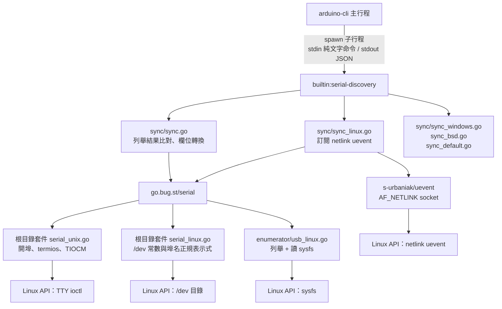
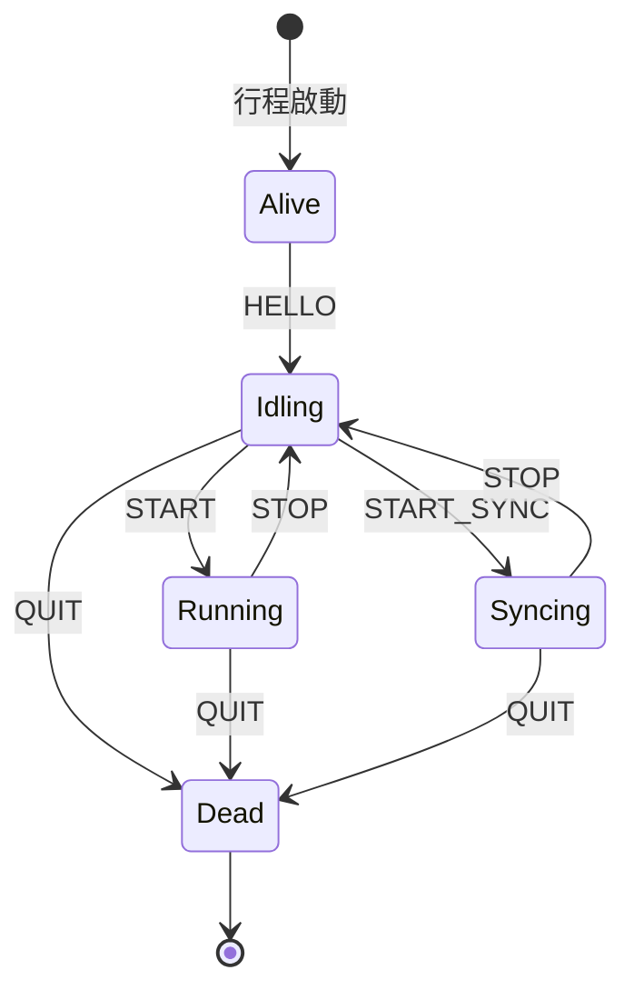
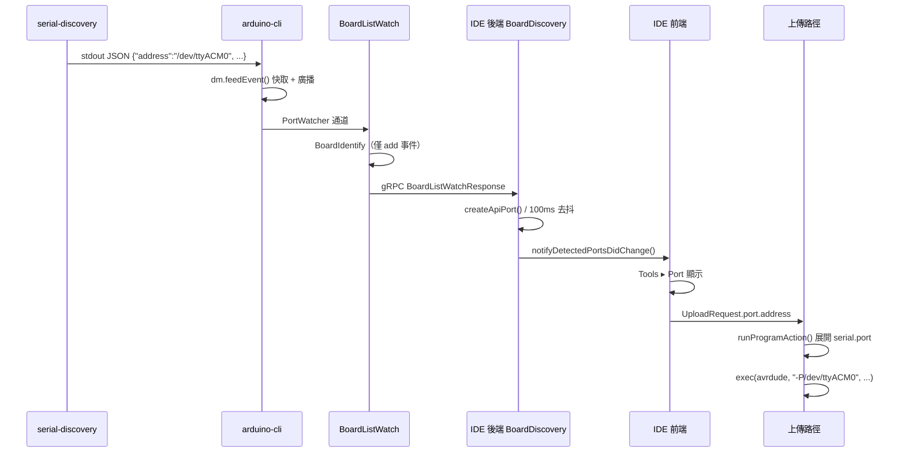
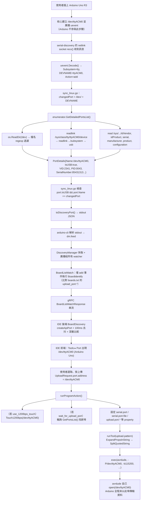

# Arduino 在 Linux 上呼叫了哪些系統介面

> 從 `/dev/ttyACM0` 到 GUI 選項，再回到上傳指令的參數

## 摘要

這份報告只回答一個問題：**Arduino 這一側**（`arduino-cli` → `builtin:serial-discovery` → `go.bug.st/serial`）在 Linux 上**實際呼叫了哪些作業系統介面**，以及 `/dev/ttyACM0` 這個字串如何一路變成 IDE 下拉選單裡的選項，最後再變回上傳指令的參數。

報告涵蓋四個層次：`/dev` 目錄掃描、sysfs 屬性讀取、netlink uevent 訂閱、以及 termios 開埠與控制。全部結論都直接對照各專案的原始碼逐行驗證，並在需要時對照 Linux man-pages 與 Arduino 官方規格文件。文末另附一份「依呼叫了什麼分類」的排查對照表，以及針對資料來源時效性與取捨的批判性反思。

---

## 1. 一句話總結

Arduino 在 Linux 上只用了**四個作業系統介面家族**[^gs-unix][^gs-usblinux][^uevent-reader]，全部是標準 POSIX／Linux API，沒有自己的核心模組，也沒有直接操作 USB 裝置節點：

| # | Arduino 呼叫的介面 | 目的 | 實際所在檔案 |
| --- | --- | --- | --- |
| 1 | `os.ReadDir("/dev")` ＋ Go `regexp` 比對檔名 | 找出「看起來像序列埠」的裝置節點 | 根目錄套件 `serial_unix.go`（掃描邏輯）＋ `serial_linux.go`（正規表示式與 `/dev` 常數） |
| 2 | `readlink`（`filepath.EvalSymlinks`）＋ `open`／`read` 於 `/sys/...` | 確認是不是 USB 裝置，並讀出 VID／PID／序號／製造商／產品名 | `enumerator/usb_linux.go` |
| 3 | `socket(AF_NETLINK, SOCK_RAW, 15)` ＋ `bind` ＋ `recv` | 取得「現在插上／拔掉」的即時核心通知 | `github.com/s-urbaniak/uevent`（`reader.go`／`decoder.go`） |
| 4 | `open()` ＋ `ioctl(TCGETS／TCSETS／TIOCMGET／TIOCMSET／TIOCEXCL／TIOCNXCL)` ＋ `read`／`write` | 真的開埠、設定傳輸參數、收送資料 | 根目錄套件 `serial_unix.go` |

換句話說：**Arduino 從不主動碰 USB 匯流排。** 它的角色是一個「`/dev` 目錄掃描器 ＋ sysfs 讀者 ＋ netlink 訂閱者 ＋ TTY 使用者」的組合。

唯一兩個例外，都發生在「列舉」以外的時機：對 `ttyS*`／`ttyHS*` 的試開（用來剔除主機板的佔位節點，見第 4 節）[^gs-unix]，以及原生 USB 板子的 1200 bps 觸碰（見第 15 節）[^gsu-reset]。

---

## 2. 研究範圍與方法[^cli-repo][^sd-repo][^gs-repo][^ide-repo][^uevent-repo][^pdph-repo][^gsu-repo]

**納入範圍**

- `arduino-cli` 的探索器管理層（`DiscoveryManager`、`BoardListWatch`、上傳路徑）。
- `builtin:serial-discovery` 這個探索器執行檔的實作。
- `go.bug.st/serial`（含 `enumerator` 子套件）在 Linux 上的底層行為。
- `arduino/go-serial-utils` 的 1200 bps 觸碰。
- Arduino IDE 2.x 後端接收與廣播埠清單的方式（僅止於「字串怎麼傳」）。

**排除範圍**

- Linux 核心內部如何實作 USB 與 TTY 驅動（`cdc_acm.c`、`usb-serial.c`、`tty_io.c` 等）。
- udev 規則與 `dialout`／`uaccess` 權限機制的設計。
- macOS 的 IOKit 與 Windows 的 SetupAPI 實作細節（只在需要對照時提及）。
- 網路埠探索器（`builtin:mdns-discovery`）的行為。

**涉及的專案**

| 專案 | 角色 | 星數／分支數 | 授權 |
| --- | --- | --- | --- |
| `arduino/arduino-cli` | 探索器管理與上傳指令展開 | 5097／509 | GPL-3.0 |
| `arduino/arduino-ide` | 探索事件的消費者（IDE 後端） | 3369／656 | AGPL-3.0 |
| `bugst/go-serial`（module `go.bug.st/serial`） | 實際呼叫 Linux 介面的函式庫 | 881／241 | BSD-3-Clause |
| `arduino/serial-discovery` | `builtin:serial-discovery` 探索器 | 26／8 | GPL-3.0 |
| `s-urbaniak/uevent` | netlink uevent 訂閱 | 15／5 | Apache-2.0 |
| `arduino/pluggable-discovery-protocol-handler` | 探索器協定的雙向實作 | 8／4 | GPL-3.0 |
| `arduino/go-serial-utils` | 1200 bps 觸碰與埠重掃 | 1／1 | GPL-3.0 |
| `facchinm/go-serial` | 實際被 `serial-discovery` 使用的 `go.bug.st/serial` 分支[^facchinm-repo] | （無法取得） | — |

星數為 2026-11-21 查詢 GitHub REST API 的結果。`arduino/serial-discovery`、`s-urbaniak/uevent`、`pluggable-discovery-protocol-handler`、`go-serial-utils` 的星數都很低，屬於「只有少數專案使用、但對 Arduino 生態不可或缺」的工具鏈內部元件，因此仍納入報告。`facchinm/go-serial` 的星數無法取得——該 repo 的 contents API 與 raw 檔案端點都回傳 404，詳見第 20.3 節。

**方法**

所有事實皆以各專案的公開原始碼為第一手來源，逐檔逐函式核對；協定與平台層級的敘述對照 Arduino 官方規格文件；Linux 系統介面的語意對照 man-pages。原始碼引用均指向各專案的預設分支（`arduino-cli` 為 `master`，`serial-discovery` 為 `main`，`go-serial` 為 `master`），而非發行標籤，因此行號與細節會隨時間漂移，這是本報告已知的限制（見第 20 節）。

---

## 3. 誰負責哪一段[^gs-doc]



Arduino 自己的程式庫只佔前三層；第四層（`go.bug.st/serial`）是外部函式庫[^gs-enum]，但**它是唯一真正與 Linux 核心互動的地方**，所以要理解行為就必須看它。

值得注意的一點：`go.bug.st/serial` 的埠名過濾規則與 `/dev` 路徑常數放在**根套件**[^gs-linux]（`serial_linux.go`、`serial_darwin.go`），而實際列舉函式放在 `serial_unix.go`；`enumerator` 子套件裡**沒有** `serial_linux.go` 這類檔案，它的 Linux 實作只有 `usb_linux.go`。這個檔案配置在閱讀原始碼時很容易被誤判。

---

## 4. 第一步：掃描 `/dev`[^gs-unix][^gs-linux]

### 4.1 程式碼

根套件 `serial_unix.go` 的 `nativeGetPortsList()`：

```go
func nativeGetPortsList() ([]string, error) {
	files, err := os.ReadDir(devFolder)
	if err != nil {
		return nil, err
	}

	ports := make([]string, 0, len(files))
	for _, f := range files {
		// Skip folders
		if f.IsDir() {
			continue
		}

		// Keep only devices with the correct name
		if !osPortFilter.MatchString(f.Name()) {
			continue
		}

		portName := devFolder + "/" + f.Name()

		// Check if serial port is real or is a placeholder serial port "ttySxx" or "ttyHSxx"
		if strings.HasPrefix(f.Name(), "ttyS") || strings.HasPrefix(f.Name(), "ttyHS") {
			port, err := nativeOpen(portName, &Mode{})
			if err != nil {
				continue
			} else {
				port.Close()
			}
		}

		// Save serial port in the resulting list
		ports = append(ports, portName)
	}

	return ports, nil
}
```

而路徑常數與過濾樣式在 `serial_linux.go`：

```go
const devFolder = "/dev"

var osPortFilter = regexp.MustCompile("(ttyS|ttyHS|ttyUSB|ttyACM|ttyAMA|rfcomm|ttyO|ttymxc)[0-9]{1,3}")
```

### 4.2 三個關鍵設計

1. **只看檔名。** `os.ReadDir` 取得目錄項後[^gs-unix]，純粹用正規表示式比對名稱，**不讀取任何 metadata**（不呼叫 `stat`、不開檔）。因此 `ttyACM0`、`ttyUSB3`、`ttyAMA0`、`rfcomm0` 都會被收進來。

2. **`ttyS*`／`ttyHS*` 必須「試開成功」才算數。** 這兩類前綴在 x86 主機上幾乎都是主機板 UART 的佔位節點（即使沒有實體 UART，`/dev/ttyS0` 到 `/dev/ttyS31` 依然存在）。所以程式會真的呼叫一次 `nativeOpen()`：**開得起來才留下，開不起來就丟掉**。這是整個列舉流程中唯一「為了探測而開埠」的地方。

   副作用值得一提：`nativeOpen()` 在成功路徑上會執行 `port.acquireExclusiveAccess()`（即 `ioctl(TIOCEXCL)`）。也就是說，這次探測性開啟**短暫取得了該 tty 的獨佔鎖定**，然後在 `port.Close()` 時以 `ioctl(TIOCNXCL)` 釋放。若同一瞬間有另一個行程已持有該埠，這裡的 `nativeOpen` 會回傳 `EBUSY`，該埠就會被判為「不存在」而從清單中消失。這是「並行開啟時埠會忽隱忽現」的其中一個可能成因。

3. **`/dev/pts/` 不會被誤收。** 因為 `pts` 本身是目錄（被 `f.IsDir()` 跳過），而 `pts/0` 這種巢狀名稱也不會被 `os.ReadDir("/dev")` 直接列出。

### 4.3 這一步不區分 USB 與非 USB

本步驟的產出只是「所有看起來像序列埠的字串」。判斷哪一個是 USB 裝置是下一步的事。這個分工很重要，因為它導致了第 6.4 節所述的行為不對稱。

### 4.4 跨平台對照

同樣的函式名稱在不同平台有不同實作，這是理解「為什麼 Linux 的埠清單長這樣」的關鍵：

| 平台 | 列舉方式 | 過濾規則所在檔案 |
| --- | --- | --- |
| Linux | `os.ReadDir("/dev")` ＋ `regexp` | `serial_linux.go`：`(ttyS / ttyHS / ttyUSB / ttyACM / ttyAMA / rfcomm / ttyO / ttymxc)[0-9]{1,3}` |
| macOS | `os.ReadDir("/dev")` ＋ `regexp` | `serial_darwin.go`：`^(cu / tty)\..*` |
| Windows | 讀註冊表 `HARDWARE\DEVICEMAP\SERIALCOMM\` 的機碼值 | `serial_windows.go`（無 `regexp`，改由 SetupAPI 端限制 `COM*`） |

Windows 的實作完全不掃描目錄[^gs-windows]，而是開啟 `HKEY_LOCAL_MACHINE\HARDWARE\DEVICEMAP\SERIALCOMM\` 並列出其值名稱與值；若機碼不存在（機器上沒有序列埠）則回傳空清單而非錯誤。

---

## 5. 第二步：用 sysfs 補上 USB 履歷[^gs-usblinux]

### 5.1 程式碼

`enumerator/usb_linux.go` 的 `nativeGetDetailedPortsList()` 與 `nativeGetPortDetails()`：

```go
func nativeGetDetailedPortsList(_ func(vid, pid string) bool) ([]*PortDetails, error) {
	// Retrieve the port list.
	// Note: on Linux all the USB details (including Configuration, Manufacturer
	// and Product) are read from sysfs, which is populated by the kernel at
	// enumeration time and does not require actively probing the device, so
	// the active-probe filter is not needed on this platform.
	ports, err := serial.GetPortsList()
	if err != nil {
		return nil, &PortEnumerationError{causedBy: err}
	}

	var res []*PortDetails
	for _, port := range ports {
		details, err := nativeGetPortDetails(port)
		if err != nil {
			return nil, &PortEnumerationError{causedBy: err}
		}
		res = append(res, details)
	}
	return res, nil
}

func nativeGetPortDetails(portPath string) (*PortDetails, error) {
	portName := filepath.Base(portPath)
	devicePath := fmt.Sprintf("/sys/class/tty/%s/device", portName)
	if _, err := os.Stat(devicePath); err != nil {
		return &PortDetails{}, nil
	}
	realDevicePath, err := filepath.EvalSymlinks(devicePath)
	if err != nil {
		return nil, fmt.Errorf("Can't determine real path of %s: %s", devicePath, err.Error())
	}
	subSystemPath, err := filepath.EvalSymlinks(filepath.Join(realDevicePath, "subsystem"))
	if err != nil {
		return nil, fmt.Errorf("Can't determine real path of %s: %s", filepath.Join(realDevicePath, "subsystem"), err.Error())
	}
	subSystem := filepath.Base(subSystemPath)

	result := &PortDetails{Name: portPath}
	switch subSystem {
	case "usb-serial":
		err := parseUSBSysFS(filepath.Dir(filepath.Dir(realDevicePath)), result)
		return result, err
	case "usb":
		err := parseUSBSysFS(filepath.Dir(realDevicePath), result)
		return result, err
	// TODO: other cases?
	default:
		return result, nil
	}
}
```

### 5.2 「這是 USB 埠嗎」的判準

判準是 **`subsystem` 這個 symlink 指向哪裡**：

| `subsystem` 指向 | 代表的裝置類型 | `IsUSB` | 往上幾層取 VID／PID |
| --- | --- | --- | --- |
| `usb-serial` | `/dev/ttyUSB0` 這類外接轉換晶片（`ch341`、`cp210x`、`ftdi_sio` 等） | `true` | 2 層 |
| `usb` | `/dev/ttyACM0` 這類 CDC-ACM 複合裝置 | `true` | 1 層 |
| 其他（`platform`、`pci` 等） | 主機板 UART、SoC UART | `false` | 不取 |

兩個 early return 值得記住：

- **`os.Stat` 失敗 → 回傳空的 `PortDetails{}`[^gs-usblinux]（`IsUSB` 為零值 `false`），而不是錯誤。** 因此像 `/dev/pts/0` 這種沒有 `device` 項目的節點，會被安靜地當成「非 USB 埠」。
- **`default:` 分支同樣回傳 `IsUSB=false` 且不報錯。**

### 5.3 真正讀值的地方

```go
func parseUSBSysFS(usbDevicePath string, details *PortDetails) error {
	vid, err := readLine(filepath.Join(usbDevicePath, "idVendor"))
	if err != nil {
		return err
	}
	pid, err := readLine(filepath.Join(usbDevicePath, "idProduct"))
	if err != nil {
		return err
	}
	serial, err := readLine(filepath.Join(usbDevicePath, "serial"))
	if err != nil {
		return err
	}

	configuration, _ := readLine(filepath.Join(usbDevicePath, "configuration"))
	// It's not an error if the configuration file is not present, so we ignore it.

	manufacturer, err := readLine(filepath.Join(usbDevicePath, "manufacturer"))
	if err != nil {
		return err
	}
	product, err := readLine(filepath.Join(usbDevicePath, "product"))
	if err != nil {
		return err
	}

	details.IsUSB = true
	// sysfs reports idVendor/idProduct in lowercase hex; the darwin and Windows
	// backends report them uppercase. Normalize to uppercase so VID/PID are
	// consistent across platforms.
	details.VID = strings.ToUpper(vid)
	details.PID = strings.ToUpper(pid)
	details.SerialNumber = serial
	details.Configuration = configuration
	details.Manufacturer = manufacturer
	details.Product = product
	return nil
}
```

所以在 Linux 上，Arduino 讀的就是這幾個 sysfs 屬性檔（依實際匯流排路徑而異）：

```text
/sys/class/tty/ttyACM0/device/../idVendor        → "2341"
/sys/class/tty/ttyACM0/device/../idProduct       → "0043"
/sys/class/tty/ttyACM0/device/../serial          → "85431313..."
/sys/class/tty/ttyACM0/device/../manufacturer    → "Arduino (www.arduino.cc)"
/sys/class/tty/ttyACM0/device/../product         → "Arduino Uno"
/sys/class/tty/ttyACM0/device/../configuration   → "iConfiguration"（可缺，忽略）
```

### 5.4 `readLine` 的錯誤政策

```go
func readLine(filename string) (string, error) {
	file, err := os.Open(filename)
	if os.IsNotExist(err) {
		return "", nil
	}
	if err != nil {
		return "", err
	}
	defer file.Close()
	reader := bufio.NewReader(file)
	line, _, err := reader.ReadLine()
	if err == io.EOF {
		// An empty sysfs attribute file (e.g. an empty "serial",
		// "manufacturer" or "product") yields io.EOF with no data.
		// Treat it as an empty value, not an error, so a single device
		// with a blank attribute does not abort the whole enumeration.
		return "", nil
	}
	return string(line), err
}
```

- 「檔案不存在」（`os.IsNotExist`）→ 空字串，不算錯誤。
- 「檔案存在但為空」（讀到 `io.EOF`）→ 空字串，不算錯誤。

**但 `idVendor`／`idProduct`／`serial`／`manufacturer`／`product` 的其他錯誤會直接往上拋**（只有 `configuration` 的錯誤被刻意忽略），導致整次列舉失敗。這是刻意的取捨：寧可整體失敗，也不要回報半套的資料。

### 5.5 Linux 不做任何主動 USB 通訊

`nativeGetDetailedPortsList` 的參數是 `_ func(vid, pid string) bool`——**刻意以底線命名**，表示接收但忽略。原始碼註解寫得很清楚：

> Note: on Linux all the USB details (including Configuration, Manufacturer and Product) are read from sysfs, which is populated by the kernel at enumeration time and does not require actively probing the device, so the active-probe filter is not needed on this platform.

對照 macOS 與 Windows：這兩個平台要取得 `Manufacturer`／`Product`／`Configuration`，必須對裝置送出 USB control request（macOS 走 `USBDeviceOpen` ＋ `DeviceRequest`；Windows 走 USB hub 的 `IOCTL_USB_GET_DESCRIPTOR_FROM_NODE_CONNECTION`，手法與 USBView 的 `enum.c` 相同）。在 Linux，這些字串全都已經躺在 sysfs 裡，**所以 Linux 不做任何主動 USB 通訊**。

這也意味著 Linux 上 `activeUSBProbeFilter`（`vid == "2341"`）**不影響列舉結果與可否取得欄位**，它只影響要不要把 `configuration`／`manufacturer`／`product` 這三個欄位放進輸出（見第 8.1 節）。

### 5.6 其他平台的列舉方式（對照用）

| 平台 | 列舉 API | VID／PID 來源 | Active probe |
| --- | --- | --- | --- |
| Linux | `serial.GetPortsList()` ＋ sysfs | `/sys/bus/usb/.../idVendor`、`idProduct`（`strings.ToUpper` 正規化） | 不需要 |
| macOS | IOKit（cgo）：比對 `IOSerialBSDClient`，讀 `IOCalloutDevice` 取埠名，再往上層找 `IOUSBDevice`／`IOUSBHostDevice` | `idVendor`、`idProduct`（以 `%04X` 格式化） | 僅 `Configuration` 需要（`USBDeviceOpen` ＋ control request 取 iConfiguration 字串） |
| Windows | SetupAPI：`SetupDiClassGuidsFromNameEx("Ports", "")` ＋ `SetupDiGetClassDevs(DIGCF_PRESENT)` | 解析裝置 instance ID：`USB\VID_xxxx&PID_xxxx\...` 或 `FTDIBUS\VID_xxxx+PID_xxxx+...` | `Manufacturer`／`Product`／`Configuration` 需要（hub IOCTL 取 string descriptor） |
| FreeBSD／OpenBSD | 尚未實作（回傳 `PortEnumerationError`）[^gs-usbfreebsd] | — | — |

macOS 的埠名來自 IOKit 屬性 `IOCalloutDevice`[^gs-usbdarwin]，且因為裝置「可能還沒完全列舉完成」，會**重試 5 次、每次間隔 50 ms**。macOS 的列舉還會在迭代器失效時重設並重試最多 5 次。

---

## 6. 第三步：訂閱 netlink uevent（即時插拔）[^sd-linux][^uevent-reader][^uevent-decoder]

### 6.1 程式碼

`sync/sync_linux.go` 的 `Start()`：

```go
func Start(ctx context.Context, eventCB discovery.EventCallback, errorCB discovery.ErrorCallback) error {
	// Get the current port list to send as initial "add" events
	current, err := enumerator.GetDetailedPortsList(activeUSBProbeFilter)
	if err != nil {
		return err
	}

	// Start sync reader from udev
	syncReader, err := uevent.NewReader()
	if err != nil {
		return err
	}

	go func() {
		<-ctx.Done()
		err := syncReader.Close()
		if err != nil {
			errorCB(fmt.Sprintf("Error closing sync reader: %s", err))
		}
	}()

	// Run synchronous event emitter
	go func() {
		// Output initial port state
		for _, port := range current {
			eventCB("add", toDiscoveryPort(port))
		}

		dec := uevent.NewDecoder(syncReader)
		for {
			evt, err := dec.Decode()
			if err == io.EOF {
				// The underlying syncReader has been closed
				// so there's nothing else to read
				return
			} else if err != nil {
				errorCB(fmt.Sprintf("Error decoding serial event: %s", err))
				return
			}
			if evt.Subsystem != "tty" {
				continue
			}
			changedPort := "/dev/" + evt.Vars["DEVNAME"]
			if evt.Action == "add" {
				portList, err := enumerator.GetDetailedPortsList(activeUSBProbeFilter)
				if err != nil {
					continue
				}
				for _, port := range portList {
					if port.IsUSB && port.Name == changedPort {
						eventCB("add", toDiscoveryPort(port))
						break
					}
				}
			}
			if evt.Action == "remove" {
				eventCB("remove", &discovery.Port{
					Address:  changedPort,
					Protocol: "serial",
				})
			}
		}
	}()

	return nil
}
```

### 6.2 netlink socket 怎麼開

`uevent/reader.go`：

```go
// NETLINK_KOBJECT_UEVENT is the socket protocol for kernel uevent,
// see /usr/include/linux/netlink.h
const NETLINK_KOBJECT_UEVENT = 15

func NewReader() (io.ReadCloser, error) {
	fd, err := syscall.Socket(
		syscall.AF_NETLINK,
		syscall.SOCK_RAW,
		NETLINK_KOBJECT_UEVENT,
	)
	if err != nil {
		return nil, err
	}

	// os/exec does not close existing file descriptors by convention as per
	// https://github.com/golang/go/blob/release-branch.go1.14/src/syscall/exec_linux.go#L483
	// so explicitly mark this file descriptor as close-on-exec to avoid leaking
	// it to child processes accidentally.
	syscall.CloseOnExec(fd)

	nl := syscall.SockaddrNetlink{
		Family: syscall.AF_NETLINK,
		Pid:    uint32(os.Getpid()),
		Groups: 1,
	}

	err = syscall.Bind(fd, &nl)
	return &Reader{fd: fd}, err
}
```

只有三個 syscall：`socket()` → `CloseOnExec()` → `bind()`。

- `AF_NETLINK` ＋ `SOCK_RAW` 是 netlink 家族的標準開法；man-pages 指出 netlink 是 datagram 導向服務[^man-netlink]，`SOCK_RAW` 與 `SOCK_DGRAM` 都是合法值，且 netlink 協定本身不區分兩者。
- `NETLINK_KOBJECT_UEVENT`（numeric value 15）是「核心送給使用者空間的字物件訊息」通道[^uevent-reader]，自 Linux 2.6.10 起提供[^man-netlink]。
- **`Groups: 1`** 對應 `nl_groups` 欄位，也就是核心廣播 uevent 所用的 multicast group bit 0。man-pages 明確記載 `NETLINK_KOBJECT_UEVENT` 屬於「允許非 root 使用者接收」的 netlink 群組之一（其他三者為 `NETLINK_GENERIC`、`NETLINK_ROUTE`、`NETLINK_SELINUX`）。
- `CloseOnExec` 是為了避免 fd 洩漏給之後 spawn 的子行程；原始碼註解特別引用了 Go 標準函式庫的 exec 慣例說明。

### 6.3 訊息怎麼解

`uevent/decoder.go`：

```go
func (d *Decoder) Decode() (*Uevent, error) {
	ev := &Uevent{
		Vars: map[string]string{},
	}

	h, err := d.next()
	if err != nil {
		return nil, err
	}
	ev.Header = h

loop:
	for {
		kv, err := d.next()
		if err != nil {
			return nil, err
		}

		i := strings.Index(kv, "=")
		if i < 0 {
			return nil, errors.New("error decoding uevent: unknown format")
		}

		k, v := kv[:i], kv[i+1:len(kv)-1] // last char is zero (0)
		ev.Vars[k] = v

		switch k {
		case "ACTION":
			ev.Action = v
		case "DEVPATH":
			ev.Devpath = v
		case "SUBSYSTEM":
			ev.Subsystem = v
		case "SEQNUM": // implicitely signals a complete uevent
			ev.Seqnum = v
			break loop
		}
	}

	return ev, nil
}

func (d *Decoder) next() (string, error) {
	s, err := d.r.ReadString(0x00)
	if err != nil {
		return "", err
	}
	return s, nil
}
```

netlink uevent 是一串以 `\0`（`0x00`）分隔的 token：第一項是 `action@devpath` 形式的 header，其後是 `KEY=VALUE`，最後以 `SEQNUM` 收尾（`SEQNUM` 一到即代表這筆訊息結束，用 `break loop` 跳出）。

一筆典型的 `add` 訊息長這樣：

```text
add@/devices/pci0000:00/0000:00:14.0/usb1/1-1/1-1:1.0/tty/ttyACM0
ACTION=add
DEVPATH=/devices/pci0000:00/0000:00:14.0/usb1/1-1/1-1:1.0/tty/ttyACM0
SUBSYSTEM=tty
DEVNAME=ttyACM0
MAJOR=166
MINOR=0
SEQNUM=1234
```

Arduino 實際上只用其中四個欄位：

| 欄位 | 用途 |
| --- | --- |
| `SUBSYSTEM` | 過濾條件，只處理 `tty` |
| `DEVNAME` | 還原成 `/dev/` ＋ 名稱 |
| `ACTION` | 判斷是 `add` 還是 `remove` |
| `DEVPATH` | 解析後存入結構，但未被使用 |

### 6.4 三個行為細節

1. **`add` 事件會重新列舉一次。** uevent 只告訴你「`ttyACM0` 出現了」，不含 VID／PID／序號。所以 Arduino 接到 `add` 後**重新呼叫 `GetDetailedPortsList()`**（也就是重跑一次第 4、5 節的 `/dev` 掃描 ＋ sysfs 讀取），再從結果裡找出名稱相符的那一筆，才送去問「這是哪塊板子」。這解釋了為何熱插拔時會有一次目錄掃描的成本。

2. **`add` 只認 USB 埠。** 條件是 `port.IsUSB && port.Name == changedPort`。非 USB 的埠不會產生 hotplug 的 `add` 事件。

3. **`remove` 不查 sysfs。** 因為裝置正在拆除，sysfs 內容已不可靠，所以只送出 `Address` 與 `Protocol` 兩個欄位（這正是探索器協定對 `remove` 事件的要求，見第 9.5 節）。

另外，`add` 的重新列舉若失敗，程式碼是 `continue` **而不是回報錯誤**——也就是說列舉暫時失敗時，該次熱插拔事件會被安靜地丟棄。

### 6.5 一個容易被忽略的不對稱

`Start()` 一開始的初始列舉，是**無條件**把**所有**找到的埠送出 `add`：

```go
		// Output initial port state
		for _, port := range current {
			eventCB("add", toDiscoveryPort(port))
		}
```

這個迴圈**沒有檢查 `port.IsUSB`**。所以：

- **啟動時**：`/dev/ttyS0`（真實存在的 UART）也會被送出，其 `IsUSB=false`。
- **熱插拔時**：只有 USB 埠會被送出。

結果就是「IDE 剛開啟時可能看到一個非 USB 的 `/dev/ttyS*`，但插拔後它不會有事件」。IDE 端靠 `Port.isVisiblePort` 與板子配對來決定要不要顯示（見第 10.4 節），所以多數使用者不會注意到。

---

## 7. 其他平台的同步機制（對照用）[^sd-bsd][^sd-windows][^sd-default]

`sync` 套件用 Go 的 build tag 分檔。三種實作的機制差異極大：

| 檔案 | Build tag | 機制 | 事件來源 |
| --- | --- | --- | --- |
| `sync_linux.go` | Linux | netlink uevent | 核心 multicast |
| `sync_bsd.go` | `darwin`／`freebsd` | kqueue 監看 `/dev` 目錄 | 檔案系統異動 |
| `sync_windows.go` | Windows | 隱藏視窗 ＋ 裝置通知 | WM_DEVICECHANGE |
| `sync_default.go` | 其他平台 | 回傳錯誤 | 不支援 |

### 7.1 BSD／macOS：kqueue 監看目錄

```go
	// create kqueue
	kq, err := syscall.Kqueue()
	...
	// open folder
	fd, err := syscall.Open("/dev", syscall.O_RDONLY, 0)
	...
	// build kevent
	ev1 := syscall.Kevent_t{
		Ident:  uint64(fd),
		Filter: syscall.EVFILT_VNODE,
		Flags:  syscall.EV_ADD | syscall.EV_ENABLE | syscall.EV_ONESHOT,
		Fflags: syscall.NOTE_DELETE | syscall.NOTE_WRITE,
		Data:   0,
		Udata:  nil,
	}
```

搭配 100 ms 的 `Timespec` 等待與 `EV_ONESHOT`（事件觸發後自動移除，因此需在每輪重新註冊），並且在每次事件後**重試列舉最多 5 次**。這與 Linux 的差異在於：kqueue 只知道「`/dev` 目錄被寫入或刪除」，不知道是哪個裝置，所以必須整批重掃並用 `processUpdates` 比對前後差異。

### 7.2 Windows：隱藏視窗 ＋ `RegisterDeviceNotification`

Windows 用 `user32` 的視窗訊息機制[^sd-windows]：建立一個視窗類別名為 `arduino-serialdiscovery` 的隱藏視窗（`WS_EX_TOPMOST`），向它註冊 USB 裝置介面的通知，再以 `GetMessage`／`DispatchMessage` 迴圈接收。

```go
// USB devices GUID used to filter notifications
var usbEventGUID guid = guid{
	data1: 0x10bfdca5,
	data2: 0x3065,
	data3: 0xd211,
	data4: [8]byte{0x90, 0x1f, 0x00, 0xc0, 0x4f, 0xb9, 0x51, 0xed},
}
```

這個 GUID 以文字表示是 `{a5dcbf10-6530-11d2-901f-00c04fb951ed}`（Windows 的 `GUID_DEVINTERFACE_USB_DEVICE`）。其他實作細節：

- 事件通道大小為 **1**；視窗回呼以 `select`／`default` 嘗試送入，送不進去就直接丟棄（因為後續事件會再做一次完整列舉，所以丟棄多餘通知是安全的）。
- 接收迴圈同時用 `time.After(time.Millisecond * 500)` 作為**兜底輪詢**，避免依賴通知而漏掉變化，同時也避免使用 `default` 造成 CPU 空轉。
- 建立與銷毀視窗必須在同一個 OS thread 上，因此該 goroutine 呼叫了 `runtime.LockOSThread()`。

### 7.3 不支援的平台

```go
//go:build !linux && !windows && !darwin && !freebsd

// Start fallback implementation
func Start(ctx context.Context, eventCB discovery.EventCallback, errorCB discovery.ErrorCallback) error {
	return fmt.Errorf("Command START_SYNC not supported")
}
```

`START_SYNC` 在這些平台上直接回報錯誤[^sd-default]。注意探索器協定規定「命令必須回應」，所以這裡是以錯誤訊息回應，而不是靜默失敗。

---

## 8. 送出去的資料長什麼樣[^sd-sync]

### 8.1 `toDiscoveryPort()`

`sync/sync.go`：

```go
func toDiscoveryPort(port *enumerator.PortDetails) *discovery.Port {
	protocolLabel := "Serial Port"
	hardwareID := ""
	props := properties.NewMap()
	if port.IsUSB {
		protocolLabel += " (USB)"
		props.Set("vid", "0x"+port.VID)
		props.Set("pid", "0x"+port.PID)
		props.Set("serialNumber", port.SerialNumber)
		if activeUSBProbeFilter(port.VID, port.PID) {
			props.Set("configuration", port.Configuration)
			props.Set("manufacturer", port.Manufacturer)
			props.Set("product", port.Product)
		}

		hardwareID = port.SerialNumber
	}
	res := &discovery.Port{
		Address:       port.Name,
		AddressLabel:  port.Name,
		Protocol:      "serial",
		ProtocolLabel: protocolLabel,
		Properties:    props,
		HardwareID:    hardwareID,
	}
	return res
}

var activeUSBProbeFilter = func(vid, _ /*pid*/ string) bool {
	// Only perform active probing on Arduino devices, to avoid issues with some devices that don't support it.
	return vid == "2341"
}
```

三個重點：

1. **`Address` 就是 `/dev/...` 原封不動的字串。** Arduino 從頭到尾不做任何名稱對應，也不做 `/dev/serial/by-id/` 轉換。你在 GUI 看到什麼，上傳時就用什麼。

2. **`vid`／`pid` 帶 `0x` 前綴且為大寫**（因為 `parseUSBSysFS` 已做 `strings.ToUpper`）。

3. **`configuration`／`manufacturer`／`product` 只有 VID 為 `2341`（Arduino 官方）時才會填入。** 這是 `activeUSBProbeFilter` 唯一的作用。在 Linux 它不影響列舉本身，只是決定要不要輸出這三個欄位。

`hardwareID` 設成 USB 序號，這是後面「上傳後找回新埠」的比對依據（見第 16.5 節）。

這個 `vid == "2341"` 的過濾條件有其歷史[^sd-rel-150]：`serial-discovery` v1.5.0 對所有裝置都做主動探測以取得 USB 描述元字串，結果對某些裝置造成不良影響；v1.5.1 起改為只對 Arduino VID 主動探測，其餘維持被動掃描以確保最大相容性[^sd-rel-151]。發行說明中明確寫著：

> Starting with this version, active USB probing is performed only on devices with the Arduino USB VID; on all other devices, we'll continue with the previous passive USB scanning to ensure maximum compatibility.

### 8.2 怎麼判斷「同一個埠還在不在」

```go
// portListHas checks if port is contained in list. The port metadata are
// compared in particular the port address, and vid/pid if the port is a usb port.
func portListHas(list []*enumerator.PortDetails, port *enumerator.PortDetails) bool {
	for _, p := range list {
		if port.Name == p.Name && port.IsUSB == p.IsUSB {
			if p.IsUSB &&
				port.VID == p.VID &&
				port.PID == p.PID &&
				port.SerialNumber == p.SerialNumber {
				return true
			}
			if !p.IsUSB {
				return true
			}
		}
	}
	return false
}
```

- **非 USB**：只要 `Name` 相同就算同一個。
- **USB**：`Name` ＋ `VID` ＋ `PID` ＋ `SerialNumber` 四項都要相同。

這是為了處理「同一個 `/dev/ttyACM0` 拔掉後換成另一塊板子插上」的情況——位址相同但序號不同，會被正確判定為「先 `remove` 再 `add`」，而不是誤認為同一個埠沒有任何變化。

`processUpdates()` 就是以此為基礎做雙向比對：

```go
func processUpdates(old, new []*enumerator.PortDetails, eventCB discovery.EventCallback) {
	for _, oldPort := range old {
		if !portListHas(new, oldPort) {
			eventCB("remove", &discovery.Port{
				Address:  oldPort.Name,
				Protocol: "serial",
			})
		}
	}

	for _, newPort := range new {
		if !portListHas(old, newPort) {
			eventCB("add", toDiscoveryPort(newPort))
		}
	}
}
```

注意 `add` 事件帶著完整的 `PortDetails`（含 properties），而 `remove` 事件只帶 `Address` 與 `Protocol`——這與探索器協定的規定一致。

### 8.3 一個與協定規格範例不符的地方

探索器協定規格書中的 `LIST` 回應範例把 `label` 寫成短名[^disc-spec]（`"label": "ttyACM0"`）：

> an `address` (for example `/dev/ttyACM0` for serial ports or `192.168.10.100` for network ports)
> a `label` that is the human readable form of the `address` (it may be for example `ttyACM0` or `SSH on 192.168.10.100`)

但 `serial-discovery` 的實作把 `AddressLabel` 設為與 `Address` 相同的完整路徑（`AddressLabel: port.Name`）。也就是說：

- 規格書說 `label` 是 `address` 的「人類可讀形式」，範例是去掉 `/dev/` 的短名。
- 實作送出的 `label` 是**完整路徑**。

這個差異不影響功能（IDE 顯示的是 `address`，tooltip 也用 `address`），但會讓「依規格書範例推論實際 GUI 顯示內容」的人得到錯誤結論。IDE 端的 `createBoardListItemLabels` 確實是取 `port.address` 而非 `port.addressLabel` 作為顯示用的埠標籤，所以 `addressLabel` 目前在 IDE 中幾乎沒有實際作用。

---

## 9. 探索器協定：CLI 與探索器之間說什麼話[^disc-spec]

### 9.1 協定的基本形狀

探索器是**可執行檔**，由 `arduino-cli` 以子行程方式啟動。兩邊的溝通方式非常單純：

- 命令（CLI → 探索器）走**標準輸入**，是純文字字串。
- 回應與事件（探索器 → CLI）走**標準輸出**，是 JSON 物件。
- 命令與回應的順序**嚴格配對**：送出一個命令後一定會有回應。

可用命令共六個：`HELLO`、`START`、`STOP`、`QUIT`、`LIST`、`START_SYNC`[^disc-spec]。規格書要求每個命令都要實作，且不得引入延遲。



狀態說明：`Alive` 指行程已啟動但尚未執行任何命令；`Dead` 指行程已停止、無法再接收任何命令。

### 9.2 命令與回應對照

| 命令（stdin） | 成功回應的 `eventType` | 錯誤回應 |
| --- | --- | --- |
| `HELLO <VERSION> "<USER_AGENT>"` | `hello`（附 `protocolVersion`） | `hello` ＋ `"error": true` |
| `START` | `start` | `start` ＋ `"error": true` |
| `STOP` | `stop` | `stop` ＋ `"error": true` |
| `QUIT` | `quit`（之後行程結束） | 規格書稱此命令「理應永遠成功」 |
| `LIST` | `list`（附 `ports` 陣列） | `list` ＋ `"error": true` |
| `START_SYNC` | `start_sync`，之後非同步送 `add`／`remove` | `start_sync` ＋ `"error": true` |
| （無法辨識的命令） | — | `command_error` ＋ `"error": true` |

### 9.3 `HELLO` 握手

`HELLO` **必須是第一個送出的命令**，用來告知客戶端名稱與支援的協定版本：

```text
HELLO <PROTOCOL_VERSION> "<USER_AGENT>"
```

- `<PROTOCOL_VERSION>` 是客戶端支援的最高協定版本，目前為 `1`。
- `<USER_AGENT>` 是客戶端名稱與版本，**不得包含雙引號**。

規格書的範例：

```text
HELLO 1 "Arduino IDE 1.8.13"
HELLO 1 "arduino-cli 1.2.3"
```

回應：

```json
{
  "eventType": "hello",
  "protocolVersion": 1,
  "message": "OK"
}
```

回應中的 `protocolVersion` 代表「後續通訊實際使用的版本」，規格書定義了三種降級情境：

- 客戶端版本 ≥ 探索器版本 → 客戶端進入相容模式，使用探索器支援的等級。
- 探索器版本 > 客戶端版本 → 探索器應自我降級，回報一個 ≤ 客戶端支援的版本。
- 探索器無法降級 → 必須回報自己支援的版本（即使高於客戶端），由客戶端決定是否中止或發出警告。

**客戶端實作**（`pluggable-discovery-protocol-handler` 的 `client.go`）：

```go
	if err = disc.sendCommand("HELLO 1 \"" + disc.userAgent + "\"\n"); err != nil {
		return err
	}
	if msg, err := disc.waitMessage(time.Second * 10); err != nil {
		return fmt.Errorf("calling HELLO: %w", err)
	} else if msg.EventType != "hello" {
		return fmt.Errorf("event out of sync, expected 'hello', received '%s'", msg.EventType)
	} else if msg.Error {
		return fmt.Errorf("command failed: %s", msg.Message)
	} else if strings.ToUpper(msg.Message) != "OK" {
		return fmt.Errorf("communication out of sync, expected 'OK', received '%s'", msg.Message)
	} else if msg.ProtocolVersion > 1 {
		return fmt.Errorf("protocol version not supported: requested 1, got %d", msg.ProtocolVersion)
	}
	return nil
```

三點值得注意：

1. **協定版本硬編碼在字面字串裡。** 客戶端送出的是 `HELLO 1 "arduino-cli <userAgent>"`，那個 `1` 不是變數。
2. **每個命令的等待逾時是 10 秒**，`QUIT` 是 5 秒。
3. **每個回應都做四重檢查**：`eventType` 是否相符、`error` 是否為 true、`message` 是否為 `OK`（不分大小寫）、以及 `HELLO` 特有的版本檢查。任何一項不符即視為「通訊失去同步」而失敗。

如果 process 啟動成功但 `HELLO` 失敗，客戶端會**直接殺掉該行程**，避免留下無法使用的狀態：

```go
	defer func() {
		// If the discovery process is started successfully but the HELLO handshake
		// fails the discovery is an unusable state, we kill the process to avoid
		// further issues down the line.
		if err == nil {
			return
		}
		disc.statusMutex.Lock()
		disc.killProcess()
		disc.statusMutex.Unlock()
	}()
```

### 9.4 `LIST` 與埠的欄位

`LIST` 回應長這樣：

```json
{
  "eventType": "list",
  "ports": [
    {
      "address":       "<THE ADDRESS OF THE PORT>",
      "label":         "<HOW THE PORT IS DISPLAYED ON THE GUI>",
      "protocol":      "<THE PROTOCOL USED BY THE BOARD>",
      "protocolLabel": "<HOW THE PROTOCOL IS DISPLAYED ON THE GUI>",
      "hardwareId":    "<A STRING THAT UNIQUELY IDENTIFIES A BOARD INSTANCE>",
      "properties": { }
    }
  ]
}
```

`hardwareId` 的定義值得完整引用，因為它是「上傳後找回新埠」的核心：

> `hardwareId` (optional) a string that uniquely identifies a specific board instance (even among other boards of the same model). Different ports with the same `hardwareId` must belong to the same board instance. The identifier should be sufficiently long to uniquely identify the board instance and reduce the probability of collisions. Good examples of `hardwareId` values are: Ethernet MAC Address, USB Serial Number, CPU-ID number, etc.
>
> This value **should not** be used to identify the board **model**.

規格書也說明 `LIST` 是「一次性輪詢」，探索器應盡快回應；對於需要時間才能發現新埠的協定（mDNS、藍牙等），回報空清單或不完整清單是允許的。

### 9.5 `START_SYNC` 的語意

`START_SYNC` 讓探索器進入「事件模式」。成功回應為 `start_sync` ＋ `OK`，之後探索器可以**在任何時刻**非同步送出 `add`／`remove`，客戶端必須隨時能處理。

三個重要規定：

1. **初始必須先送一批 `add`。** 規格書原文：*"After calling `START_SYNC` an initial burst of add events must be generated in sequence to report all the ports available at the moment of the start."*

2. **`remove` 只帶 `address` 與 `protocol`：**

```json
{
  "eventType": "remove",
  "port": {
    "address": "/dev/ttyACM0",
    "protocol": "serial"
  }
}
```

3. **重複的 `add` 代表覆蓋，不是重複新增：**

> If the information about a port needs to be updated the discovery may send a new `add` message for the same port address and protocol without sending a `remove` first: this means that all the previous information about the port must be discarded and replaced with the new one.

這一條解釋了 IDE 端 `calculateNewState()` 為何把 `add` 當成覆寫而非插入（見第 12.6 節）[^ide-discovery]。

客戶端的 `StartSync()` 有一個相當關鍵的實作順序問題，程式碼註解把它記錄得很清楚：

```go
	// Create the event channel *before* sending START_SYNC.
	//
	// A discovery may emit its initial "add" events very quickly after receiving the
	// START_SYNC command, and those events can reach the client's decode loop
	// before disc.waitMessage returns (the discovery emits events from
	// a separate goroutine, so the "start_sync OK" and the "add" reply race on the
	// wire). If the event channel is still nil when such an "add" is decoded,
	// jsonDecodeLoop silently drops it (see the eventChan nil checks there), and
	// the port is lost until the next re-sync. Creating the channel up-front
	// guarantees these initial events are delivered.
	disc.statusMutex.Lock()
	disc.stopSync()
	c := make(chan *Event, size)
	disc.eventChan = c
	disc.statusMutex.Unlock()
```

若頻道建立得太晚，第一批 `add` 會被 `jsonDecodeLoop` 內的 `if disc.eventChan != nil` 檢查悄悄丟棄。這是一個典型的「初始化順序競態」，且後果（埠遺失直到下次重新同步）不容易從症狀回推原因。

### 9.6 無效命令

無法辨識的命令回應：

```json
{
  "eventType": "command_error",
  "error": true,
  "message": "Unknown command XXXX"
}
```

### 9.7 板材識別（Board identification）

探索器只提供「埠的屬性」，至於「這是哪塊板子」是由 CLI 比對 `boards.txt` 決定的：

> - each board listed in the platform file `boards.txt` may declare a set of `upload_port.*` properties
> - if each `upload_port.*` property has a match in the `properties` set coming from the discovery then the board is a "candidate" board attached to that port.

規格書特別強調「candidate（候選）」一詞：屬性的精度可能不足以唯一識別板子，多塊板子可能同時匹配。以 `arduino_zero_native`、`mkr1000` 等板子為例，`vid` ＋ `pid` 是 0x2341 系列的多組配對；範例中只有 `mkr1000` 同時匹配 `vid=0x2341` 與 `pid=0x804e`。

而關於 `vid`／`pid` 的精度限制，規格書有一整節專門警告：

> Sometimes a board do not expose a unique vid/pid combination, this is the case for example if a USB-2-serial converter chip is used (like the omnipresent FT232 or CH340): those chips exposes their specific vid/pid that will be the same for all the other boards using the same chip. In such cases the board identification properties should NOT be used.

這正是第 8.1 節 `serial-discovery` 只對 VID `2341` 主動探測的另一面：USB 轉序列埠晶片的 VID／PID 是晶片廠商的，不是板子廠商的，因此對所有使用同一顆晶片的板子都相同。

規格書也支援將識別屬性綁定到自訂板子選項（custom board options），語法有兩種：

```text
BOARD_ID.menu.MENU_ID.OPTION_ID.upload_port.PORT_PROPERTY_KEY=PORT_PROPERTY_VALUE
BOARD_ID.menu.MENU_ID.OPTION_ID.upload_port.SET_INDEX.PORT_PROPERTY_KEY=PORT_PROPERTY_VALUE
```

同一個「集合」內的多個屬性必須**全部**匹配，不同集合之間則各自獨立、不可混合。

---

## 10. CLI 端：`DiscoveryManager` 怎麼轉發事件[^cli-dm][^pdph-client]

### 10.1 職責

`DiscoveryManager` 負責「多個探索器 ↔ 多個觀察者」的多對多廣播。每個探索器啟動後會產生一連串事件，這些事件會被廣播給所有正在監聽的 watcher。探索器在 `Start()` 被呼叫之前不會啟動。

### 10.2 結構與緩衝區大小

```go
type DiscoveryManager struct {
	discoveriesMutex   sync.Mutex
	discoveries        map[string]*discovery.Client // all registered PluggableDiscovery
	discoveriesRunning bool                         // set to true once discoveries are started
	feed               chan *discovery.Event        // all events will pass through this channel
	watchersMutex      sync.Mutex
	watchers           map[*PortWatcher]bool                  // all registered Watcher
	watchersCache      map[string]map[string]*discovery.Event // this is a cache of all active ports
	userAgent          string
}
```

幾個具體數值[^cli-dm]：

| 項目 | 大小 | 說明 |
| --- | --- | --- |
| `dm.feed` 通道緩衝 | **50** | 所有探索器事件匯入的中央通道 |
| `PortWatcher.feed` 通道緩衝 | **10** | 每個觀察者各自的通道 |
| `StartSync(size)` 的 `size` | **5** | 每個探索器的 client 事件通道 |
| 觀察者無法即時接收的容忍時間 | **500 ms** | 逾時即被移除 |
| 與探索器通訊的等待逾時 | **10 秒** | `HELLO`／`START`／`STOP`／`LIST`／`START_SYNC` |

### 10.3 啟動與事件匯流

```go
func (dm *DiscoveryManager) startDiscovery(d *discovery.Client) (discErr error) {
	...
	if err := d.Run(); err != nil {
		return fmt.Errorf("%s: %w", i18n.Tr("discovery %[1]s process not started", d.GetID()), err)
	}
	eventCh, err := d.StartSync(5)
	if err != nil {
		return fmt.Errorf("%s: %s", i18n.Tr("starting discovery %s", d.GetID()), err)
	}

	go func(d *discovery.Client) {
		// Transfer all incoming events from this discovery to the feed channel
		for ev := range eventCh {
			dm.feed <- ev
		}
		logrus.Infof("Discovery event channel closed %s. Exiting goroutine.", d.GetID())
	}(d)
	return nil
}
```

也就是：每個探索器的 5 格事件通道 → 中央 50 格 `feed` 通道 → 每個觀察者的 10 格通道。

### 10.4 `feedEvent()`：快取與 `stop` 事件的合成

這是整個管理層最值得細看的一段：

```go
func (dm *DiscoveryManager) feedEvent(ev *discovery.Event) {
	dm.watchersMutex.Lock()
	defer dm.watchersMutex.Unlock()

	sendToAllWatchers := func(ev *discovery.Event) {
		// Send the event to all watchers
		for watcher := range dm.watchers {
			select {
			case watcher.feed <- ev:
				// OK
			case <-time.After(time.Millisecond * 500):
				// If the watcher is not able to process event fast enough
				// remove the watcher from the list of watchers
				logrus.Error("Watcher is not able to process events fast enough, removing it from the list of watchers")
				delete(dm.watchers, watcher)
			}
		}
	}

	if ev.Type == "stop" {
		// Send remove events for all the cached ports of the terminating discovery
		cache := dm.watchersCache[ev.DiscoveryID]
		for _, addEv := range cache {
			removeEv := &discovery.Event{
				Type: "remove",
				Port: &discovery.Port{
					Address:       addEv.Port.Address,
					AddressLabel:  addEv.Port.AddressLabel,
					Protocol:      addEv.Port.Protocol,
					ProtocolLabel: addEv.Port.ProtocolLabel},
				DiscoveryID: addEv.DiscoveryID,
			}
			sendToAllWatchers(removeEv)
		}

		// Remove the cache for the terminating discovery
		delete(dm.watchersCache, ev.DiscoveryID)
		return
	}

	sendToAllWatchers(ev)

	// Cache the event for the discovery
	cache := dm.watchersCache[ev.DiscoveryID]
	if cache == nil {
		cache = map[string]*discovery.Event{}
		dm.watchersCache[ev.DiscoveryID] = cache
	}
	eventID := ev.Port.Address + "|" + ev.Port.Protocol
	switch ev.Type {
	case "add":
		cache[eventID] = ev
	case "remove":
		delete(cache, eventID)
	default:
		logrus.Errorf("Unhandled event from discovery: %s", ev.Type)
	}
}
```

四個關鍵行為：

1. **快取鍵是 `` ev.Port.Address + "|" + ev.Port.Protocol ``。** 這與 IDE 端的 `Port.keyOf` 概念相同（`arduino+${protocol}://${address}`），只是格式不同。

2. **`stop` 事件被合成為一整批 `remove`。** 當探索器停止（`stop_sync()` 會送出 `Event{"stop", nil, id}`），管理層會為該探索器快取中的所有埠產生對應的 `remove` 事件，然後清空快取。這是「探索器結束時，它的埠要從所有觀察者的視野中消失」的正確實作，而合成的 `remove` 事件帶有 `AddressLabel`／`ProtocolLabel`（即使協定規定 `remove` 只需要 address 與 protocol）。

   注意這個 `stop` 是**管理層內部的合成事件型別**，不是探索器在 stdout 上發送的事件型別。

3. **慢速觀察者會被直接移除。** 若某個 watcher 在 500 ms 內無法接收事件，它會被從 `dm.watchers` 刪除。這是一種保護機制，但也意味著觀察者若阻塞太久會**靜默地**失去後續所有事件。

4. **`default` 分支只記錯誤。** 除了 `add`／`remove`（以及被攔截的 `stop`）以外的事件型別都會被記錄為 "Unhandled event"。

### 10.5 `Watch()`：先補歷史，再開始接收

```go
func (dm *DiscoveryManager) Watch() (*PortWatcher, error) {
	dm.Start()

	watcher := &PortWatcher{
		feed: make(chan *discovery.Event, 10),
	}
	watcher.closeCB = func() {
		dm.watchersMutex.Lock()
		defer dm.watchersMutex.Unlock()
		delete(dm.watchers, watcher)
		close(watcher.feed)
		watcher.feed = nil
	}
	go func() {
		dm.watchersMutex.Lock()
		defer dm.watchersMutex.Unlock()

		// Check if the watcher is still alive (it could have been closed before the goroutine started...)
		if watcher.feed == nil {
			return
		}

		// When a watcher is started, send all the current active ports first...
		for _, cache := range dm.watchersCache {
			for _, ev := range cache {
				watcher.feed <- ev
			}
		}
		// ...and after that add the watcher to the list of watchers receiving events
		dm.watchers[watcher] = true
	}()
	return watcher, nil
}
```

順序很重要：**先把快取中所有已存在的埠灌進新觀察者的通道，然後才把觀察者加入廣播清單。** 由於整個過程持有 `watchersMutex`，而 `feedEvent()` 也需要同一把鎖，因此不會發生「既有埠與新事件交錯或重複」的問題。

`Close()` 的實作把 `watcher.feed` 設為 `nil`，配合 goroutine 開頭的 nil 檢查，處理了「觀察者在 goroutine 實際執行前就被關閉」的競態。

### 10.6 `List()`：一次性列舉

```go
func (dm *DiscoveryManager) List() []*discovery.Port {
	dm.Start()

	res := []*discovery.Port{}
	dm.watchersMutex.Lock()
	defer dm.watchersMutex.Unlock()
	for _, cache := range dm.watchersCache {
		for _, ev := range cache {
			res = append(res, ev.Port)
		}
	}
	return res
}
```

`List()` **不會呼叫探索器的 `LIST` 命令**——它只是把現有的快取攤平。這是因為 `DiscoveryManager` 一律以 `START_SYNC` 模式啟動探索器，埠資訊本來就會持續流入快取。探索器的 `LIST` 命令雖然在協定中存在、客戶端也有實作，但在這條路徑上並未被使用。

### 10.7 探索器是從哪裡註冊的

探索器的註冊分兩條路徑[^cli-loader]：

**（a）平台明確宣告。** `platform.txt` 可以宣告 `pluggable_discovery.required`：

```text
pluggable_discovery.required=builtin:serial-discovery
```

或需要多個時：

```text
pluggable_discovery.required.0=builtin:serial-discovery
pluggable_discovery.required.1=builtin:mdns-discovery
```

也支援開發用的直接命令列形式：

```text
pluggable_discovery.discovery_id.pattern=DISCOVERY_RECIPE
```

規格書對後者明確建議「僅用於開發用途，不要在已發行的平台上使用」[^platform-spec]。

**（b）向後相容的自動繼承。** 若平台完全沒有宣告任何 `pluggable_discovery.*` 屬性，就會自動繼承 `builtin:serial-discovery` 與 `builtin:mdns-discovery`：

```go
	if platform.Properties.SubTree("pluggable_discovery").Size() > 0 || platform.Properties.SubTree("pluggable_monitor").Size() > 0 {
		platform.PluggableDiscoveryAware = true
	} else {
		platform.Properties.Set("pluggable_discovery.required.0", "builtin:serial-discovery")
		platform.Properties.Set("pluggable_discovery.required.1", "builtin:mdns-discovery")
		platform.Properties.Set("pluggable_monitor.required.serial", "builtin:serial-monitor")
	}
```

**builtin 探索器的載入是硬編碼的：**

```go
// loadBuiltinDiscoveries loads the discovery tools that are part of the builtin package
func (pme *Explorer) loadBuiltinDiscoveries() []error {
	var merr []error
	for _, id := range []string{"builtin:serial-discovery", "builtin:mdns-discovery"} {
		if err := pme.loadDiscovery(id); err != nil {
			merr = append(merr, err)
		}
	}
	return merr
}
```

也就是說，**無論平台怎麼宣告，這兩個 builtin 探索器都會被嘗試載入**。

**探索器可執行檔的路徑解析：**

```go
func (pme *Explorer) loadDiscovery(id string) error {
	tool := pme.GetTool(id)
	if tool == nil {
		return errors.New(i18n.Tr("discovery %s not found", id))
	}
	toolRelease := tool.GetLatestInstalled()
	if toolRelease == nil {
		return errors.New(i18n.Tr("discovery %s not installed", id))
	}
	discoveryPath := toolRelease.InstallDir.Join(tool.Name).String()
	pme.discoveryManager.Add(id, discoveryPath)
	return nil
}
```

兩個重點：

1. **`GetLatestInstalled()`——永遠使用最新已安裝版本。** 套件索引中的 `discoveryDependencies` 欄位只有 `{packager, name}`，**不含版本**，所以無法指定特定版本的探索器。
2. **兩條不同的錯誤訊息**：`discovery %s not found`（找不到工具定義）與 `discovery %s not installed`（有定義但沒有安裝任何版本）。IDE 端會針對這兩者做不同的錯誤處理（見第 12.8 節）。

可執行檔路徑是 `toolRelease.InstallDir.Join(tool.Name)`，在 Linux 上就是 `~/.arduino15/packages/builtin/tools/serial-discovery/<version>/serial-discovery`[^sd-main]。

`serial-discovery` 的發行檔案命名可佐證其平台支援範圍：`Linux_32bit`、`Linux_64bit`、`Linux_ARM64`、`Linux_ARMv6`、`Linux_ARMv7`、`macOS_64bit`、`macOS_ARM64`、`Windows_32bit`、`Windows_64bit`、`Windows_ARM64`。**沒有 FreeBSD 的發行檔**——這與第 7 節的 `sync_bsd.go` 支援 FreeBSD（`//go:build darwin || freebsd`）形成對比：程式碼支援，但官方沒有提供預編譯檔。

`arduino-cli` 本身的發行檔案則**有** `Linux_ARMv6`／`ARMv7`／`ARM64`／`amd64`／`i386`、`macOS_64bit`／`ARM64`、`Windows_32bit`／`64bit`／`ARM64`，另提供 `.deb`（amd64／arm64／armel／armhf／i386）與 Windows `.msi`。

---

## 11. CLI 端：`BoardListWatch` 與 gRPC 轉換[^cli-boardlist][^cli-common][^cli-portproto]

### 11.1 一次性列舉：`BoardList`

```go
func (s *arduinoCoreServerImpl) BoardList(ctx context.Context, req *rpc.BoardListRequest) (*rpc.BoardListResponse, error) {
	...
	dm := pme.DiscoveryManager()
	warnings := f.Map(dm.Start(), (error).Error)
	release()
	time.Sleep(time.Duration(req.GetTimeout()) * time.Millisecond)

	ports := []*rpc.DetectedPort{}
	for _, port := range dm.List() {
		resp, err := s.BoardIdentify(ctx, &rpc.BoardIdentifyRequest{
			Instance:                            req.GetInstance(),
			Properties:                          port.Properties.CloneAsMap(),
			UseCloudApiForUnknownBoardDetection: !req.GetSkipCloudApiForBoardDetection(),
		})
		if err != nil {
			warnings = append(warnings, err.Error())
		}

		b := &rpc.DetectedPort{
			Port:           rpc.DiscoveryPortToRPC(port),
			MatchingBoards: resp.GetBoards(),
		}

		if fqbnFilter == nil || hasMatchingBoard(b, fqbnFilter) {
			ports = append(ports, b)
		}
	}
	return &rpc.BoardListResponse{
		Ports:    ports,
		Warnings: warnings,
	}, nil
}
```

值得注意的設計：

- **啟動探索器後刻意 `time.Sleep(timeout)`**，等埠資訊流入快取，才呼叫 `dm.List()`。逾時值來自請求（`req.GetTimeout()`，單位毫秒），是呼叫方決定的。
- **探索器的錯誤不會讓整個請求失敗**，而是收集成 `warnings` 回傳。註解明確寫著：*"In case of errors partial results from discoveries that didn't fail are returned."*（即使鄰近程式碼的註解文字略有出入，行為上就是部分結果 ＋ 警告。）
- **有 `UseCloudApiForUnknownBoardDetection` 這個選項**，代表 `BoardIdentify` 在本地 `boards.txt` 比對失敗後，可能還會查詢 Arduino 雲端 API 來辨識未知板子。

### 11.2 串流：`BoardListWatch`

```go
func (s *arduinoCoreServerImpl) BoardListWatch(req *rpc.BoardListWatchRequest, stream rpc.ArduinoCoreService_BoardListWatchServer) error {
	syncSend := NewSynchronizedSend(stream.Send)
	if req.GetInstance() == nil {
		err := errors.New(i18n.Tr("no instance specified"))
		syncSend.Send(&rpc.BoardListWatchResponse{
			EventType: "error",
			Error:     err.Error(),
		})
		return err
	}

	var watcher *discoverymanager.PortWatcher
	{
		pme, release, err := instances.GetPackageManagerExplorer(req.GetInstance())
		if err != nil {
			return err
		}
		dm := pme.DiscoveryManager()
		watcher, err = dm.Watch()
		release()
		if err != nil {
			return err
		}
	}

	go func() {
		for event := range watcher.Feed() {
			port := &rpc.DetectedPort{
				Port: rpc.DiscoveryPortToRPC(event.Port),
			}

			boardsError := ""
			if event.Type == "add" {
				resp, err := s.BoardIdentify(context.Background(), &rpc.BoardIdentifyRequest{
					Instance:                            req.GetInstance(),
					Properties:                          event.Port.Properties.CloneAsMap(),
					UseCloudApiForUnknownBoardDetection: !req.GetSkipCloudApiForBoardDetection(),
				})
				if err != nil {
					boardsError = err.Error()
				} else {
					port.MatchingBoards = resp.GetBoards()
				}
			}
			stream.Send(&rpc.BoardListWatchResponse{
				EventType: event.Type,
				Port:      port,
				Error:     boardsError,
			})
		}
	}()

	<-stream.Context().Done()
	logrus.Trace("closed watch")
	watcher.Close()
	return nil
}
```

四個關鍵行為：

1. **`event.Type` 原封不動轉發。** 從探索器來的事件型別（`add`／`remove`）直接成為 gRPC 回應的 `event_type`，中間不做任何轉換或重新命名。

2. **`BoardIdentify` 只對 `add` 執行。** `remove` 事件不會觸發板材識別，`MatchingBoards` 保持為空。

3. **識別錯誤透過 `Error` 欄位隨回應送出**，而不是讓整個串流失敗。注意這個 `Error` 與探索器本身的錯誤是不同的東西——它代表「板材識別失敗」。

4. **阻塞在 `<-stream.Context().Done()`**，客戶端取消串流時才呼叫 `watcher.Close()`。這正是 IDE 端「取消串流會殺掉探索器」機制的起點。

`instance == nil` 時會送出 `event_type = "error"` 的回應並回傳錯誤。**這是 `error` 這個事件型別出現的地方**，而它來自「請求本身不合法」，不是來自探索器。

### 11.3 gRPC 與探索器埠結構的欄位對應

```go
// DiscoveryPortToRPC converts a *discovery.Port into an *rpc.Port
func DiscoveryPortToRPC(p *discovery.Port) *Port {
	props := p.Properties
	if props == nil {
		props = properties.NewMap()
	}
	return &Port{
		Address:       p.Address,
		Label:         p.AddressLabel,
		Protocol:      p.Protocol,
		ProtocolLabel: p.ProtocolLabel,
		HardwareId:    p.HardwareID,
		Properties:    props.CloneAsMap(),
	}
}
```

| 探索器協定 JSON 欄位 | Go 結構欄位 | gRPC `Port` 欄位 | 備註 |
| --- | --- | --- | --- |
| `address` | `Address` | `address` | 原樣傳遞 |
| `label` | `AddressLabel` | `label` | **名稱換了**（`label` ↔ `AddressLabel`） |
| `protocol` | `Protocol` | `protocol` | 原樣傳遞 |
| `protocolLabel` | `ProtocolLabel` | `protocol_label` | snake_case 轉換 |
| `hardwareId` | `HardwareID` | `hardware_id` | camelCase → snake_case |
| `properties` | `Properties`（`*properties.Map`） | `properties`（`map<string,string>`） | 以 `CloneAsMap()` 攤平 |

`port.proto` 的定義與註解：

```protobuf
// Port represents a board port that may be used to upload or to monitor a board.
message Port {
  // Address of the port (e.g., `/dev/ttyACM0`).
  string address = 1;
  // The port label to show on the GUI (e.g. "ttyACM0").
  string label = 2;
  // Protocol of the port (e.g., `serial`, `network`, ...).
  string protocol = 3;
  // A human friendly description of the protocol (e.g., "Serial Port (USB)").
  string protocol_label = 4;
  // A set of properties of the port.
  map<string, string> properties = 5;
  // The hardware ID (serial number) of the board attached to the port.
  string hardware_id = 6;
}
```

反向轉換（IDE 送上傳請求時使用）：

```go
// DiscoveryPortFromRPCPort converts an *rpc.Port into a *discovery.Port
func DiscoveryPortFromRPCPort(o *Port) (p *discovery.Port) {
	if o == nil {
		return nil
	}
	res := &discovery.Port{
		Address:       o.GetAddress(),
		AddressLabel:  o.GetLabel(),
		Protocol:      o.GetProtocol(),
		ProtocolLabel: o.GetProtocolLabel(),
		HardwareID:    o.GetHardwareId(),
	}
	if o.GetProperties() != nil {
		res.Properties = properties.NewFromHashmap(o.GetProperties())
	}
	return res
}
```

另外，探索器客戶端的 `Port` 結構定義也值得對照[^pdph-port]，因為它是 JSON 序列化的實際依據：

```go
// Port is a descriptor for a board port
type Port struct {
	Address       string          `json:"address"`
	AddressLabel  string          `json:"label,omitempty"`
	Protocol      string          `json:"protocol,omitempty"`
	ProtocolLabel string          `json:"protocolLabel,omitempty"`
	Properties    *properties.Map `json:"properties,omitempty"`
	HardwareID    string          `json:"hardwareId,omitempty"`
}

// Equals returns true if the given port has the same address and protocol
// of the current port.
func (p *Port) Equals(o *Port) bool {
	return p.Address == o.Address && p.Protocol == o.Protocol
}
```

`Equals` 只比對 address 與 protocol——這是「同一個埠」的最寬鬆定義，用於偵測「使用者選定的埠已斷線」等情境。

### 11.4 事件型別的完整清單（含重要釐清）

綜合上述所有層次，可以在這條路徑上出現的事件型別有下列幾種，它們的來源各不相同：

| 事件型別 | 來源 | 是否會到達 IDE 前端 |
| --- | --- | --- |
| `add` | 探索器 stdout | 是 |
| `remove` | 探索器 stdout，或管理層為 `stop` 合成 | 是 |
| `stop` | **僅存在於 CLI 內部**（`dm.feedEvent` 攔截，不會送出） | 否 |
| `error` | `BoardListWatch` 在 `instance == nil` 時自行產生 | 是（但屬請求錯誤） |
| `quit` | — | **不會由這條路徑產生** |

**必須特別釐清一點：`quit` 不是這條事件路徑上的事件型別。** `quit` 在協定中確實存在，但它是探索器對 CLI 的 `QUIT` 命令的**回應**（`{"eventType": "quit", "message": "OK"}`），發生在 `discovery.Client.Quit()` 的 `waitMessage` 中，**不會進入 `dm.feed`，也就不會進入 `watcher.Feed()`**。`watcher.Feed()` 只承載 `add`、`remove` 以及內部的 `stop`。

因此，「CLI 會透過 `BoardListWatch` 串流送出 `quit` 事件」這個說法在目前的 `arduino-cli` 實作中並不成立。IDE 端雖然有處理 `quit` 的分支（見第 12.7 節），但該分支在正常運作下不會被觸發。

---

## 12. IDE 端：從 gRPC 串流到前端狀態[^ide-discovery][^ide-daemon][^ide-boardlist][^ide-boardsservice]

### 12.1 守護行程的啟動

IDE 不直接呼叫 `arduino-cli` 的每個子命令，而是先啟動一個常駐的 gRPC 守護行程：

```ts
  protected async getSpawnArgs(): Promise<string[]> {
    const [configDirUri, debug] = await Promise.all([
      this.envVariablesServer.getConfigDirUri(),
      this.debugDaemon(),
    ]);
    const cliConfigPath = join(FileUri.fsPath(configDirUri), CLI_CONFIG);
    const args = [
      'daemon',
      '--port',
      '0',
      '--config-file',
      cliConfigPath,
      '-v',
    ];
    if (debug) {
      args.push('--debug');
    }
    return args;
  }
```

- **`--port 0`** 表示由作業系統配發一個臨時埠[^ide-daemon]，IDE 再從 stdout 的 JSON 中解析出來：

```ts
        let port = '';
        let address = '';
        message
          .split('\n')
          .filter((line: string) => line.length)
          .forEach((line: string) => {
            try {
              const parsedLine = JSON.parse(line);
              if ('Port' in parsedLine) {
                port = parsedLine.Port;
              }
              if ('IP' in parsedLine) {
                address = parsedLine.IP;
              }
            } catch (err) {
              // ignore
            }
          });
```

- **環境變數中注入 `NO_COLOR=true`**，避免顏色逃逸序列干擾 JSON 解析。
- **`-v` 開啟詳細輸出**；設定 `arduino.cli.daemon.debug` 為 true 時再加上 `--debug`。
- 若守護行程啟動失敗（位址占用、埠號非法等），IDE 會嘗試**重啟最多 5 次、每次間隔 1 秒**，並依 stdout／stderr 的內容分類錯誤（`ADDRESS_IN_USE`、`UNKNOWN_ADDRESS`、`INVALID_PORT`、`UNKNOWN`）。

### 12.2 `BoardDiscovery`：觀察埠變化的單例服務

`BoardDiscovery` 是一個**非連線範圍（not connection scoped）的單例**，負責追蹤可用埠與板子，並把變化廣播給所有已連線的前端實例。

```ts
/**
 * Singleton service for tracking the available ports and board and broadcasting the
 * changes to all connected frontend instances.
 *
 * Unlike other services, this is not connection scoped.
 */
```

它建立 gRPC 串流並掛上事件處理：

```ts
  private async createWrapper(
    client: ArduinoCoreServiceClient,
    req: BoardListWatchRequest
  ): Promise<StreamWrapper> {
    if (this.wrapper) {
      throw new Error(`Duplex was already set.`);
    }
    const stream = client
      .boardListWatch(req)
      .on('end', () => {
        this.logger.info('received end');
        this.onStreamDidEndEmitter.fire();
      })
      .on('error', (error) => {
        this.logger.info('error received');
        if (ServiceError.isCancel(error)) {
          this.logger.info('cancel error received!');
          this.onStreamDidCancelEmitter.fire();
        } else {
          this.logger.error(
            'Unexpected error occurred during the boards discovery.',
            error
          );
          // TODO: terminate? restart? reject?
        }
      });
    const wrapper = {
      stream,
      uuid: UUID.uuid4(),
      dispose: () => {
        this.logger.info('disposing requesting cancel');
        // Cancelling the stream will kill the discovery `builtin:mdns-discovery process`.
        // The client (this class) will receive a `{"eventType":"quit","error":""}` response from the CLI.
        stream.cancel();
        this.logger.info('disposing canceled');
        this.wrapper = undefined;
      },
    };
    ...
  }
```

**兩點需要釐清：**

1. 程式碼註解聲稱「取消串流會殺掉探索器行程，客戶端會收到 `{"eventType":"quit","error":""}`」。但如第 11.4 節所建立的事實，`quit` **不會**由 `BoardListWatch` 路徑產生——CLI 端在這個情況下是 `watcher.Close()` 導致 `watcher.Feed()` 通道關閉、goroutine 迴圈結束，串流本身則因客戶端取消而結束（IDE 收到的是 `end` 或 `cancel` 事件，而非 `quit` 資料）。這段註解與目前的 CLI 實作不一致，應以程式實際接收的事件（`end`／`error`）為準。

2. 串流的取消確實會連帶影響探索器：`BoardListWatch` 在 `stream.Context().Done()` 後呼叫 `watcher.Close()`；而探索器行程的生死則由 `DiscoveryManager.Clear()`（呼叫 `d.Quit()`）或核心客戶端重建來控制。註解把兩個機制混在一起描述了。

### 12.3 事件進來之後

```ts
  protected onBoardListWatchResponse(resp: BoardListWatchResponse): void {
    this.logger.info(JSON.stringify(resp.toObject(false)));
    const eventType = EventType.parse(resp.getEventType());

    if (eventType === EventType.Quit) {
      this.logger.info('quit received');
      this.stop();
      return;
    }

    const rpcDetectedPort = resp.getPort();
    if (rpcDetectedPort) {
      const detectedPort = this.fromRpc(rpcDetectedPort);
      if (detectedPort) {
        this.fireSoon({ detectedPort, eventType });
      } else {
        this.logger.warn(...);
      }
    } else if (resp.getError()) {
      this.logger.error(...);
    }
  }
```

事件型別的解析是**嚴格列舉**的——遇到不認識的字串會直接丟出例外：

```ts
enum EventType {
  Add,
  Remove,
  Quit,
}
namespace EventType {
  export function parse(type: string): EventType {
    const normalizedType = type.toLowerCase();
    switch (normalizedType) {
      case 'add':
        return EventType.Add;
      case 'remove':
        return EventType.Remove;
      case 'quit':
        return EventType.Quit;
      default:
        throw new Error(
          `Unexpected 'BoardListWatchResponse' event type: '${type}.'`
        );
    }
  }
}
```

**這是一個值得注意的脆弱點：** CLI 端在 `instance == nil` 時會送出 `event_type = "error"`（第 11.2 節），而 `EventType.parse("error")` 會**丟出例外**。也就是說，若 CLI 真的送出 `error` 事件，IDE 這端會以未捕捉的例外回應，而不是走 `resp.getError()` 那條優雅的錯誤路徑。實務上 `instance` 由 IDE 自己建立、不會是 nil，所以這條路徑不太可能被觸發，但兩端的契約確實不完全一致。

### 12.4 `createApiPort`：gRPC 埠轉成前端模型

```ts
export function createApiPort(rpcPort: RpcPort): Port {
  return {
    address: rpcPort.getAddress(),
    addressLabel: rpcPort.getLabel(),
    protocol: rpcPort.getProtocol(),
    protocolLabel: rpcPort.getProtocolLabel(),
    properties: Port.Properties.create(rpcPort.getPropertiesMap().toObject()),
    hardwareId: rpcPort.getHardwareId() || undefined, // prefer undefined over empty string
  };
}
```

- `getLabel()` → `addressLabel`：名稱在此再次對應（gRPC `label` → 前端 `addressLabel`）。
- **`hardwareId` 空字串會被轉成 `undefined`**，註解寫得很清楚：*prefer undefined over empty string*。這個慣例在全檔多處出現（`fqbn` 也是如此）。
- `properties` 透過 `Port.Properties.create()` 把鍵值對陣列壓成物件；**若為空則回傳 `undefined`**。

```ts
  export namespace Properties {
    export function create(
      properties: [string, string][] | undefined
    ): Properties | undefined {
      if (!properties || !properties.length) {
        return undefined;
      }
      return properties.reduce((acc, curr) => {
        const [key, value] = curr;
        acc[key] = value;
        return acc;
      }, {} as Record<string, string>);
    }
  }
```

### 12.5 100 ms 去抖與深層比較

```ts
  private fireSoonHandle: NodeJS.Timeout | undefined;
  private readonly bufferedEvents: DetectedPortChangeEvent[] = [];
  private fireSoon(event: DetectedPortChangeEvent): void {
    this.bufferedEvents.push(event);
    clearTimeout(this.fireSoonHandle);
    this.fireSoonHandle = setTimeout(() => {
      const current = deepClone(this.detectedPorts);
      const newState = this.calculateNewState(this.bufferedEvents, current);
      if (!isDeepStrictEqual(current, newState)) {
        this._detectedPorts = newState;
        this.notificationService.notifyDetectedPortsDidChange({
          detectedPorts: this._detectedPorts,
        });
      }
      this.bufferedEvents.length = 0;
    }, 100);
  }
```

三個機制共同避免前端被洗版[^ide-discovery]：

1. **事件累積緩衝**：`bufferedEvents` 收集這 100 ms 內的所有事件。
2. **`clearTimeout` ＋ 重設計時器**（trailing debounce）：連續事件不斷把觸發時間往後推，直到靜默 100 ms 才真正處理。
3. **`isDeepStrictEqual` 深層比較**：若計算出來的新狀態與舊狀態深層相等，就**完全不發通知**。這是避免「收到事件但狀態沒變卻讓 UI 重繪」的關鍵。

### 12.6 `calculateNewState`：add 是覆寫

```ts
  private calculateNewState(
    events: DetectedPortChangeEvent[],
    prevState: Mutable<DetectedPorts>
  ): DetectedPorts {
    const newState = deepClone(prevState);
    for (const { detectedPort, eventType } of events) {
      const { port, boards } = detectedPort;
      const key = Port.keyOf(port);
      if (eventType === EventType.Add) {
        // Note that, the serial discovery might detect port details (such as addressLabel) in chunks.
        // For example, first, the Teensy 4.1 port is detected with the `[no_device] Triple Serial` address label,
        // Then, when more refinements are available, the same port is detected with `/dev/cu.usbmodem127902301 Triple Serial` address label.
        // In such cases, an `add` event is received from the CLI, and the the detected port is overridden in the state.
        newState[key] = { port, boards };
      } else if (eventType === EventType.Remove) {
        delete newState[key];
      }
    }
    return newState;
  }
```

**`add` 一律覆寫整個項目**（`newState[key] = { port, boards }`），而不是合併欄位。這正是探索器協定「重複的 `add` 代表捨棄舊資訊」規定（第 9.5 節）在前端的對應實作。程式碼中的 Teensy 註解提供了真實案例：同一個埠可能先以佔位標籤出現，稍後再以精確標籤重送 `add`。

**鍵的產生方式：**

```ts
  /**
   * Key is the combination of address and protocol formatted like `'arduino+${protocol}://${address}'` used to uniquely identify a port.
   */
  export function keyOf(port: PortIdentifier | Port | DetectedPort): string {
    if (isPortIdentifier(port)) {
      return `arduino+${port.protocol}://${port.address}`;
    }
    return keyOf(port.port);
  }
```

所以 `/dev/ttyACM0` 這個序列埠的鍵是 `arduino+serial:///dev/ttyACM0`（注意協定後的 `://` 加上路徑本身的 `/`，共三個斜線）。這與 CLI 端快取使用的 `地址|協定` 是兩套不同的鍵格式，因為它們各自在自己的行程內使用。

### 12.7 `quit` 不會重啟觀察

```ts
  async stop(restart = false): Promise<void> {
    this.logger.info('stop');
    if (this.stopping) {
      this.logger.info('stop already stopping');
      return this.stopping.promise;
    }
    if (!this.watching) {
      return;
    }
    this.stopping = new Deferred();
    this.logger.info('>>> Stopping boards watcher...');
    return new Promise<void>((resolve, reject) => {
      const timeout = this.createTimeout(10_000, reject);
      const toDispose = new DisposableCollection();
      const waitForEvent = (event: Event<unknown>) =>
        event(() => {
          this.logger.info('stop received event: either end or cancel');
          toDispose.dispose();
          this.stopping?.resolve();
          this.stopping = undefined;
          this.logger.info('stop stopped');
          resolve();
          if (restart) {
            this.start();
          }
        });
      toDispose.pushAll([
        timeout,
        waitForEvent(this.onStreamDidEndEmitter.event),
        waitForEvent(this.onStreamDidCancelEmitter.event),
      ]);
      this.logger.info('Canceling boards watcher...');
      this.toDisposeOnStopWatch.dispose();
    });
  }
```

`stop()` 的設計要點[^ide-discovery]：

- **支援 `restart` 參數**，但**所有 `quit` 事件的處理路徑呼叫的是 `this.stop()`（無參數，即 `restart = false`）**：

```ts
    if (eventType === EventType.Quit) {
      this.logger.info('quit received');
      this.stop();
      return;
    }
```

  在 `arduino-ide` 的程式碼庫中，**沒有任何呼叫端傳入 `true`**。因此「`quit` 事件會導致觀察器重啟」是錯誤的推論。

- **10 秒逾時**（`createTimeout(10_000, reject)`）：若在 10 秒內既沒收到 `end` 也沒收到 `cancel`，`stop()` 的 promise 會以錯誤拒絕。這是一個保護機制，避免取消流程永遠卡住。

- **等待的是兩個事件之一**：`onStreamDidEndEmitter`（串流正常結束）或 `onStreamDidCancelEmitter`（串流因取消而結束）。

### 12.8 誰會停止／重啟探索（含 PR #1107 的歷史脈絡）

實際上會停止探索流程的地方有兩組：

**（a）套件安裝／卸載期間暫停**——`boards-service-impl.ts` 的 `install()` 與 `uninstall()`：

```ts
    console.info('>>> Starting boards package installation...', item);

    // stop the board discovery
    await this.boardDiscovery.stop();

    const resp = client.platformInstall(req);
    resp.on(
      'data',
      ExecuteWithProgress.createDataCallback({ ... })
    );
    await new Promise<void>((resolve, reject) => {
      resp.on('end', () => {
        this.boardDiscovery.start(); // TODO: remove discovery dependency from boards service. See https://github.com/arduino/arduino-ide/pull/1107 why this is here.
        resolve();
      });
      resp.on('error', (error) => { ... });
    });
```

`library-service-impl.ts` 也有三個對應位置（`install()`、`installZip()`、`uninstall()`）[^ide-boards]：

```ts
    await this.boardDiscovery.stop();
```

這些位置全都帶著同一句 TODO 註解，指向 `arduino-ide` 的 PR #1107，說明「boards service 為何需要依賴 discovery」是一個已知的、被記錄下來的架構缺陷。

**（b）核心客戶端重建**——`core-client-provider.ts` 在偵測到 sketchbook 位置變更時會重新初始化 instance[^ide-coreprovider]：

```ts
      } else if (
        !!newState.config?.sketchDirUri &&
        oldState.config?.sketchDirUri !== newState.config.sketchDirUri
      ) {
        // If the sketchbook location has changed, the custom libraries has changed.
        // Reinitialize the core client and fire an event so that the frontend can refresh.
        // https://github.com/arduino/arduino-ide/issues/796 (see the file > examples and sketch > include examples)
        const client = await this.client;
        await this.initInstance(client);
        this.notificationService.notifyDidReinitialize();
      }
```

`ArduinoDaemonImpl.start()` 重新啟動守護行程時，也會先 `this.toDispose.dispose()`（殺掉舊的守護行程），連帶使探索器行程終止。

### 12.9 探索器找不到時的自我修復

IDE 啟動時會嘗試初始化核心客戶端；如果失敗是因為 builtin 工具（含探索器）不存在，它會**先更新索引再重試**。文件註解把三種觸發條件列得很清楚：

```ts
  /**
   * By default, calling this method is equivalent to the `initInstance(Client)` call.
   * When the IDE2 starts and one of the followings is missing,
   * the IDE2 must run the index update before the core client initialization:
   *
   *  - primary package index (`#directories.data/package_index.json`),
   *  - library index (`#directories.data/library_index.json`),
   *  - built-in tools (`builtin:serial-discovery` or `builtin:mdns-discovery`)
   *
   * This method detects such errors and runs an index update before initializing the client.
   * ...
   */
```

判定用的謂詞：

```ts
const IndexUpdateRequiredPredicates: [Predicate, IndexType][] = [
  [isPrimaryPackageIndexMissingStatus, 'platform'],
  [isDiscoveryNotFoundStatus, 'platform'],
  [isLibraryIndexMissingStatus, 'library'],
];
```

而 `isDiscoveryNotFoundStatus` 的判定條件是「同時包含 `discovery` 以及（`not found` 或 `loading hardware platform`）」：

```ts
// Error loading hardware platform: discovery $TOOL_NAME not found
function isDiscoveryNotFoundStatus(status: RpcStatus): boolean {
  const predicate = ({ message }: RpcStatus.AsObject) =>
    message.includes('discovery') &&
    (message.includes('not found') ||
      message.includes('loading hardware platform'));
  return evaluate(status, predicate);
}
```

這個字串比對直接對應第 10.7 節 CLI 端的兩條錯誤訊息：`discovery %s not found` 與 `discovery %s not installed`。因為 `not installed` 不含 `not found`，它只能靠 `loading hardware platform` 這個外層包裝字串命中——也就是說，判定實際上依賴的是錯誤訊息的**包裝文字**，而不是底層錯誤本身。若 CLI 改了包裝文字，這個判定就會失效。

修復流程：

```ts
      if (err instanceof MustUpdateIndexesBeforeInitError) {
        console.error(
          'The primary packages indexes are missing. Running indexes update before initializing the core gRPC client',
          err.message
        );
        await this.updateIndex(client, Array.from(err.indexTypesToUpdate));
        const updatedAt = new Date().toISOString();
        // Clients will ask for it after they connect.
        err.indexTypesToUpdate.forEach(
          (type) => (this.beforeInitSummary[type] = updatedAt)
        );
        await this.initInstance(client);
        console.info(
          `Downloaded the primary package indexes, and successfully initialized the core gRPC client.`
        );
      }
```

### 12.10 前端的可見性與排序規則

**只有 `serial` 與 `network` 埠一律顯示**，其他協定只有在偵測到板子時才顯示：

```ts
  /**
   * All ports with `'serial'` or `'network'` `protocol`, or any other port `protocol` that has at least one recognized board connected to.
   */
  export function isVisiblePort(detectedPort: DetectedPort): boolean {
    const protocol = detectedPort.port.protocol;
    if (protocol === 'serial' || protocol === 'network') {
      // Allow all `serial` and `network` boards.
      // IDE2 must support better label for unrecognized `network` boards: https://github.com/arduino/arduino-ide/issues/1331
      return true;
    }
    // All other ports with different protocol are
    // only shown if there is a recognized board
    // connected
    return Boolean(detectedPort?.boards?.length);
  }
```

**排序優先權：**

```ts
// the smaller the number, the higher the priority
const portProtocolPriorities: Record<string, number> = {
  serial: 0,
  network: 1,
} as const;
```

  - 其他協定的優先權為 `Number.MAX_SAFE_INTEGER`，因此排在最後。
  - 同協定內以 `naturalCompare(left.address, right.address)` 做**自然排序**（因此 `ttyACM2` 會排在 `ttyACM10` 之前，而不是字典序的相反）。

```ts
  export function compare(left: Port, right: Port): number {
    // Ports must be sorted in this order:
    // 1. Serial
    // 2. Network
    // 3. Other protocols
    const priorityResult = portProtocolComparator(left, right);
    return priorityResult || naturalCompare(left.address, right.address);
  }
```

**板子列表項目的排序層次**（`boardListItemComparator` 的註解）：

```ts
/**
 * Compare precedence:
 *  1. `BoardListItem#port#protocol`: `'serial'`, `'network'`, then natural compare of the `protocol` string.
 *  1. `BoardListItem`s with a `board` comes before items without a `board`.
 *  1. `BoardListItem#board`:
 *     1. Items with `'arduino'` vendor ID in the `fqbn` come before other vendors.
 *     1. Natural compare of the `name`.
 *  1. If the `BoardListItem`s do not have a `board` property:
 *     1. Ambiguous boards come before no boards.
 *     1. `BoardListItem#port#address` natural compare is the fallback.
 */
```

也就是：**協定 → 有無板子 → Arduino 官方廠牌優先 → 名稱 → 位址**。

### 12.11 板子資訊（VID／PID／序號）怎麼顯示

IDE 的「Board Info」功能會從埠的 properties 直接讀出三個值：

```ts
  const board = boards ? boards[0] : undefined;
  const BN = board?.name ?? unknownBoard;
  const VID = readProperty('vid', selectedPort);
  const PID = readProperty('pid', selectedPort);
  const SN = readProperty('serialNumber', selectedPort);
  return { VID, PID, SN, BN };
```

而**是否可取得這些資訊有前置條件**：

```ts
  if (selectedPort.protocol !== 'serial') {
    return nonSerialPort;
  }
  if (!isNonNativeSerial(selectedPort)) {
    return noNativeSerialPort;
  }
```

```ts
// serial protocol with one or many detected boards or available VID+PID properties from the port
function isNonNativeSerial(port: Port): boolean {
  return !!(
    port.protocol === 'serial' &&
    port.properties?.['vid'] &&
    port.properties?.['pid']
  );
}
```

所以：**非 `serial` 協定** → 「Non-serial port, can't obtain info.」；**是 `serial` 但沒有 `vid`／`pid`** → 「Native serial port, can't obtain info.」。第二種情況正對應主機板原生 UART（`IsUSB=false`，因此探索器不會設定 `vid`／`pid`）。

顯示值是**未經轉換的原始字串**（含 `0x` 前綴、大寫），因為 `readProperty` 只做「空值轉成 `(null)`」的處理：

```ts
function readProperty(property: string, port: Port): string {
  return falsyToNullString(port.properties?.[property]);
}

function falsyToNullString(s: string | undefined): string {
  return !!s ? s : '(null)';
}
```

另有一個與顯示相關的細節：`getBoardInfo` 的參數是一個 `BoardList`，而顯示用的埠標籤取自 `port.address`（見第 8.3 節）：

```ts
function createBoardListItemLabels(item: BoardListItem): BoardListItemLabels {
  const { port } = item;
  const portLabel = port.address;
  const portProtocol = port.protocol;
  ...
}
```

### 12.12 IDE 內建哪個 CLI 版本

`arduino-ide-extension/package.json` 明確釘住 CLI 版本[^ide-pkg][^cli-release]：

```json
  "arduino": {
    "arduino-cli": {
      "version": "1.6.0"
    },
    "arduino-fwuploader": {
      "version": "2.4.1"
    },
    "arduino-language-server": {
      "version": {
        "owner": "arduino",
        "repo": "arduino-language-server",
        "commitish": "05ec308"
      }
    },
    "clangd": {
      "version": "14.0.0"
    }
  }
```

同時，**依賴清單中完全沒有 `serialport` 這類 Node.js 原生序列埠模組**[^ide-pkg]。IDE 的序列埠相關能力全部來自 CLI 與其探索器，IDE 自己不開埠——唯一的例外是序列埠監控器的資料通道，那是由 CLI 的 `builtin:serial-monitor` 提供的（不屬本報告範圍）。

---

## 13. 從 `/dev` 到 GUI：字串的旅程

Arduino 這一側送出 `Address: "/dev/ttyACM0"` 之後，這個字串基本上是一路直傳：



| 階段 | 所在 | 角色 | 欄位名稱 |
| --- | --- | --- | --- |
| 探索器 stdout JSON | `serial-discovery` | 生產者 | `address` |
| CLI 事件快取 | `DiscoveryManager` | 快取 ＋ 廣播 | `Port.Address` |
| gRPC 串流 | `BoardListWatch` | 轉發 | `port.address` |
| gRPC → 前端模型 | `createApiPort()` | 欄位改名 | `port.address` |
| IDE → CLI 上傳 | `UploadRequest.port.address` | 回傳 | `address` |
| 上傳 recipe 變數 | `runProgramAction()` | 展開 | `serial.port`／`upload.port.address` |

**中間沒有任何一層會改寫這個字串。** IDE 的 `Port` 物件同時保留 `address` 與 `addressLabel`（而目前探索器把兩者設成一樣的值）。

**由此可得一個實務結論：在 Linux 上，`/dev/ttyUSB0` 編號不穩定的問題，Arduino 完全沒有處理。** 它不在任何一層改用 `/dev/serial/by-id/...`。若要穩定，必須靠使用者自己在 IDE 的埠選單裡認得那塊板子，或在 CLI 層面自行以 `--port /dev/serial/by-id/...` 指定路徑。

我對 `arduino-cli` 與 `serial-discovery` 兩個程式庫做過 `by-id` 的全庫文字搜尋，**兩者皆為零筆結果**。這可以作為「Arduino 不處理 by-id」這個結論的佐證。

---

## 14. Arduino 開埠時使用的 termios 設定[^gs-unix][^gs-linux][^man-termios][^man-ioctl-tty]

### 14.1 `nativeOpen()`

根套件 `serial_unix.go`：

```go
func nativeOpen(portName string, mode *Mode) (*unixPort, error) {
	h, err := unix.Open(portName, unix.O_RDWR|unix.O_NOCTTY|unix.O_NDELAY, 0)
	if err != nil {
		switch err {
		case unix.EBUSY:
			return nil, &PortError{code: PortBusy}
		case unix.EACCES:
			return nil, &PortError{code: PermissionDenied}
		}
		return nil, err
	}
	port := &unixPort{
		handle:      h,
		opened:      1,
		readTimeout: NoTimeout,
	}

	// Setup serial port
	settings, err := port.getTermSettings()
	if err != nil {
		port.Close()
		return nil, &PortError{code: InvalidSerialPort, causedBy: fmt.Errorf("error getting term settings: %w", err)}
	}

	// Set raw mode
	setRawMode(settings)

	// Explicitly disable RTS/CTS flow control
	setTermSettingsCtsRts(false, settings)

	if err = port.setTermSettings(settings); err != nil {
		port.Close()
		return nil, &PortError{code: InvalidSerialPort, causedBy: fmt.Errorf("error setting term settings: %w", err)}
	}
	...
	// MacOSX require that this operation is the last one otherwise an
	// 'Invalid serial port' error is returned... don't know why...
	if err := port.SetMode(mode); err != nil {
		port.Close()
		return nil, &PortError{code: InvalidSerialPort, causedBy: fmt.Errorf("error configuring port: %w", err)}
	}

	unix.SetNonblock(h, false)

	port.acquireExclusiveAccess()

	// This pipe is used as a signal to cancel blocking Read
	if pipe, err := unixutils.NewPipe(); err != nil {
		port.Close()
		return nil, &PortError{code: InvalidSerialPort, causedBy: fmt.Errorf("error opening signaling pipe: %w", err)}
	} else {
		port.closeSignal = pipe
	}

	return port, nil
}
```

對應的權限與 modem 控制函式：

```go
func (port *unixPort) getTermSettings() (*unix.Termios, error) {
	return unix.IoctlGetTermios(port.handle, ioctlTcgetattr)
}

func (port *unixPort) setTermSettings(settings *unix.Termios) error {
	return unix.IoctlSetTermios(port.handle, ioctlTcsetattr, settings)
}

func (port *unixPort) getModemBitsStatus() (int, error) {
	return unix.IoctlGetInt(port.handle, unix.TIOCMGET)
}

func (port *unixPort) setModemBitsStatus(status int) error {
	return unix.IoctlSetPointerInt(port.handle, unix.TIOCMSET, status)
}

func (port *unixPort) acquireExclusiveAccess() error {
	return unix.IoctlSetInt(port.handle, unix.TIOCEXCL, 0)
}

func (port *unixPort) releaseExclusiveAccess() error {
	return unix.IoctlSetInt(port.handle, unix.TIOCNXCL, 0)
}
```

而在 `serial_linux.go` 中，ioctl 常數是對 `unix` 套件的直接別名[^gs-linux]：

```go
const ioctlTcgetattr = unix.TCGETS
const ioctlTcsetattr = unix.TCSETS
const ioctlTcflsh = unix.TCFLSH
const ioctlTioccbrk = unix.TIOCCBRK
const ioctlTiocsbrk = unix.TIOCSBRK
```

**macOS 的常數不同**（`TIOCGETA`／`TIOCSETA`／`TIOCFLUSH`）[^gs-darwin]，這是 BSD 與 Linux 的既有差異。

### 14.2 `setRawMode()`

```go
func setRawMode(settings *unix.Termios) {
	// Set local mode
	settings.Cflag |= unix.CREAD
	settings.Cflag |= unix.CLOCAL

	// Set raw mode
	settings.Lflag &^= unix.ICANON
	settings.Lflag &^= unix.ECHO
	settings.Lflag &^= unix.ECHOE
	settings.Lflag &^= unix.ECHOK
	settings.Lflag &^= unix.ECHONL
	settings.Lflag &^= unix.ECHOCTL
	settings.Lflag &^= unix.ECHOPRT
	settings.Lflag &^= unix.ECHOKE
	settings.Lflag &^= unix.ISIG
	settings.Lflag &^= unix.IEXTEN

	settings.Iflag &^= unix.IXON
	settings.Iflag &^= unix.IXOFF
	settings.Iflag &^= unix.IXANY
	settings.Iflag &^= unix.INPCK
	settings.Iflag &^= unix.IGNPAR
	settings.Iflag &^= unix.PARMRK
	settings.Iflag &^= unix.ISTRIP
	settings.Iflag &^= unix.IGNBRK
	settings.Iflag &^= unix.BRKINT
	settings.Iflag &^= unix.INLCR
	settings.Iflag &^= unix.IGNCR
	settings.Iflag &^= unix.ICRNL
	settings.Iflag &^= tcIUCLC

	settings.Oflag &^= unix.OPOST

	// Block reads until at least one char is available (no timeout)
	settings.Cc[unix.VMIN] = 1
	settings.Cc[unix.VTIME] = 0
}
```

對照 man-pages 的 `cfmakeraw()` 語意[^man-termios]，可以確認這是一個更完整的 raw 模式實作（`cfmakeraw` 只清掉 `IGNBRK|BRKINT|PARMRK|ISTRIP|INLCR|IGNCR|ICRNL|IXON`、`OPOST`、`ECHO|ECHONL|ICANON|ISIG|IEXTEN`，並設定 `CS8`）。

**三個與 Arduino 直接相關的決定：**

1. **`CLOCAL`（忽略 modem 控制線）。** man-pages 定義為 *"Ignore modem control lines."*[^man-termios]。沒有這個旗標，許多板子（尤其是沒有 DCD 訊號的 CDC-ACM 裝置）在 `open()` 時會卡住等待載波偵測。

2. **先以 `O_NONBLOCK`（`O_NDELAY`）開啟，設定完 termios 後才 `SetNonblock(h, false)` 切回阻塞模式。** 這是序列埠程式設計的標準防卡死手法：避免 `open()` 本身因等待 modem 訊號而阻塞，同時讓後續的參數設定能夠完成。

3. **`TIOCEXCL`／`TIOCNXCL`（開埠時取獨佔，關閉時釋放）。** 這讓「同一埠被兩個行程同時開啟」直接失敗——**這就是 `Device or resource busy` 的來源之一**，也是為什麼 `lsof /dev/ttyACM0` 能查到佔用者。

另外，`setRawMode` 把 `VMIN` 設為 1、`VTIME` 設為 0。依 man-pages，這代表 noncanonical 模式的 **blocking read**：`read()` 會阻塞直到至少有 1 個位元組可用。但 `go.bug.st/serial` 的 `Read()` 實作並不直接依賴這個設定，而是在使用者空間用 `select`（`unixutils.Select`）加上自己的逾時機制——`SetReadTimeout()` 只設定 `port.readTimeout` 欄位：

```go
func (port *unixPort) SetReadTimeout(timeout time.Duration) error {
	if timeout < 0 && timeout != NoTimeout {
		return &PortError{code: InvalidTimeoutValue}
	}
	port.readTimeout = timeout
	return nil
}
```

並在 `Read()` 中使用 `select` 來等待可讀或訊號管道：

```go
		fds := unixutils.NewFDSet(port.handle, port.closeSignal.ReadFD())
		...
		res, err := unixutils.Select(fds, nil, fds, timeout)
```

`closeSignal` 是一個 pipe，用來在 `Close()` 時喚醒所有阻塞中的 `Read()`：

```go
	if port.closeSignal != nil {
		// Send close signal to all pending reads (if any)
		port.closeSignal.Write([]byte{0})
		...
	}
```

`Read()` 還處理了 Linux 的一個特性：**埠在讀取過程中被拔除時，會進入「可讀但資料長度為零」的狀態**（原始碼註解連結到一個 StackOverflow 討論），因此 `n == 0 && err == nil` 被解讀為埠已關閉：

```go
		// Linux: when the port is disconnected during a read operation
		// the port is left in a "readable with zero-length-data" state.
		// https://stackoverflow.com/a/34945814/1655275
		if n == 0 && err == nil {
			return 0, &PortError{code: PortClosed}
		}
```

### 14.3 錯誤碼對應

```go
	h, err := unix.Open(portName, unix.O_RDWR|unix.O_NOCTTY|unix.O_NDELAY, 0)
	if err != nil {
		switch err {
		case unix.EBUSY:
			return nil, &PortError{code: PortBusy}
		case unix.EACCES:
			return nil, &PortError{code: PermissionDenied}
		}
		return nil, err
	}
```

| `open()` 回傳的 errno | go-serial 錯誤碼 | 使用者看到的訊息 |
| --- | --- | --- |
| `EACCES` | `PermissionDenied` | `Permission denied` |
| `EBUSY` | `PortBusy` | `Device or resource busy` |
| 其他 | 原始 errno 透出 | 原樣呈現 |

Windows 端的對應不同：`ERROR_ACCESS_DENIED` → `PortBusy`，`ERROR_FILE_NOT_FOUND` → `PortNotFound`。注意 Windows 把「存取被拒」歸類為 `PortBusy`，這是因為 Windows 對已被獨佔開啟的 COM 埠就是回傳 `ERROR_ACCESS_DENIED`。

**列舉階段不會產生這些錯誤。** 第 5.4 節的 `readLine` 只讀 sysfs；唯一例外是第 4.2 節對 `ttyS*`／`ttyHS*` 的試開，但那個錯誤被 `continue` 吞掉了。所以「埠有列出來但打不開」與「埠根本沒列出來」是兩件不同的事，排查方向也不同。

### 14.4 其他 TTY 操作[^gs-unix]

`Drain()`（等待輸出傳送完畢）在 Linux 上以 `TCSBRK` 搭配參數 1 實作：

```go
func (port *unixPort) Drain() error {
	// It's not super well documented, but this is the same as calling tcdrain:
	// - https://git.musl-libc.org/cgit/musl/tree/src/termios/tcdrain.c
	// - https://elixir.bootlin.com/linux/v6.2.8/source/drivers/tty/tty_io.c#L2673
	return unix.IoctlSetInt(port.handle, unix.TCSBRK, 1)
}
```

`Break()`（送出 break 訊號）使用 `TIOCSBRK`／`TIOCCBRK`：

```go
func (port *unixPort) Break(t time.Duration) error {
	if err := unix.IoctlSetInt(port.handle, ioctlTiocsbrk, 0); err != nil {
		return err
	}

	time.Sleep(t)

	if err := unix.IoctlSetInt(port.handle, ioctlTioccbrk, 0); err != nil {
		return err
	}

	return nil
}
```

*macOS 額外需要 `IOSSIOSPEED`*（`0x80045402`）來設定非標準鮑率，且必須是設定流程中的最後一步，否則會得到 `Invalid serial port`：

```go
	if requireSpecialBaudrate {
		// MacOSX require this one to be the last operation otherwise an
		// 'Invalid serial port' error is produced.
		if err := port.setSpecialBaudrate(uint32(mode.BaudRate)); err != nil {
			return err
		}
	}
```

Linux 不需要這個步驟，因為 `TCSETS` 本身就能接受任意鮑率（`baudrateMap` 中有 50 到 4000000 的完整對應表）。

### 14.5 `SetDTR`：1200 bps 觸碰的關鍵[^gs-unix]

```go
func (port *unixPort) SetDTR(dtr bool) error {
	status, err := port.getModemBitsStatus()
	if err != nil {
		return err
	}
	if dtr {
		status |= unix.TIOCM_DTR
	} else {
		status &^= unix.TIOCM_DTR
	}
	return port.setModemBitsStatus(status)
}
```

實作是「讀取 → 修改位元 → 寫回」三步：`ioctl(TIOCMGET)` → 設定／清除 `TIOCM_DTR` → `ioctl(TIOCMSET)`。這是標準的 modem 控制線操作方式。

---

## 15. 1200 bps 觸碰：Arduino 唯一的「主動」埠操作[^gsu-reset][^gsu-mapper][^platform-spec]

### 15.1 為什麼需要

原生 USB 的板子（Leonardo、Micro、Nano 33 IoT、MKR 系列等）無法從 USB 端觸發重設。這是因為它們重新啟動進入 bootloader 時會**從 USB 上斷開**，接著 bootloader 再重新連上並提供新的序列埠；上傳完成後 bootloader 又斷開，執行 sketch 後再連上。因為這些反覆的重新連線，標準的「開埠觸發重設」機制行不通——開埠這個動作本身就會讓埠消失。

規格書對這個設計有完整說明：

> Because of these reconnections, the standard restart-on-serial open will not work, since that would cause the serial port to disappear and be closed again. Instead, the sketch running on these boards interprets a bitrate of 1200 bps as a signal the bootloader should be started.

因此取而代之的約定是：**以 1200 bps 開啟再關閉**。

平台層面由兩個板子屬性控制：

> - `use_1200bps_touch` causes the selected serial port to be briefly opened at 1200 bps (8N1) before starting the upload.
> - `wait_for_upload_port` causes the upload procedure to wait for the serial port to (re)appear before and after the upload. This is only used when `use_1200bps_touch` is also set. When set, after doing the 1200 bps touch, the development software will wait for a new serial port to appear and use that as the port for uploads. Alternatively, if the original port does not disappear within a few seconds, the upload continues with the original port (which can be the case if the board was already put into bootloader manually, or the disconnect and reconnect was missed).

在 `boards.txt` 裡的實際樣貌（以 Leonardo 為例）[^platform-spec]：

```text
leonardo.name=Arduino Leonardo
leonardo.upload.tool.serial=avrdude
leonardo.upload.protocol=avr109
leonardo.upload.maximum_size=28672
leonardo.upload.speed=57600
leonardo.upload.use_1200bps_touch=true
leonardo.upload.wait_for_upload_port=true
```

規格書也誠實地記錄了兩套實作的差異：

> Note that the IDE implementation of this 1200 bps touch has some peculiarities, and the newer `arduino-cli` implementation also seems different (does not wait for the port after the reset, which is probably only needed in the IDE to prevent opening the wrong port on the serial monitor, and does not have a shorter timeout when the port never disappears).

### 15.2 `Touch1200bps()`[^gsu-release]

`arduino/go-serial-utils` 的 `reset.go`：

```go
// Touch1200bps open and close the serial port at 1200 bps. This is used
// on many Arduino (and compatible) boards as a signal to put the MCU
// in bootloader mode.
func Touch1200bps(port string) error {
	p, err := serial.Open(port, &serial.Mode{BaudRate: 1200})
	if err != nil {
		return fmt.Errorf("opening port at 1200bps: %w", err)
	}

	if runtime.GOOS != "windows" {
		// This is not required on Windows
		// TODO: Investigate if it can be removed for other OS too

		// Set DTR to false
		if err = p.SetDTR(false); err != nil {
			_ = p.Close()
			return fmt.Errorf("setting DTR to OFF: %w", err)
		}
	}

	// Close serial port
	_ = p.Close()

	// Scanning for available ports seems to open the port or
	// otherwise assert DTR, which would cancel the WDT reset if
	// it happens within 250 ms. So we wait until the reset should
	// have already occurred before going on.
	time.Sleep(500 * time.Millisecond)

	return nil
}
```

在 Linux 上，這三步展開為下列系統呼叫：

| `serial.Open(port, Mode{BaudRate: 1200})` | `SetDTR(false)` | `Close()` |
| --- | --- | --- |
| `open(path, O_RDWR / O_NOCTTY / O_NDELAY)` | `ioctl(TIOCMGET)` 讀取目前狀態 | `ioctl(TIOCNXCL)` 解除獨佔 |
| `ioctl(TCGETS)` 取得目前 termios | 清掉 `TIOCM_DTR` 位元 | `close(fd)` |
| `setRawMode()` 修改旗標（含 `CLOCAL`） | `ioctl(TIOCMSET)` 寫回 | 喚醒並結束阻塞中的 `Read()` |
| `setTermSettingsCtsRts(false)` | | 關閉訊號 pipe |
| `ioctl(TCSETS)` 寫入 termios（含 `B1200`） | | |
| `ioctl(TIOCEXCL)` 取得獨佔 | | |
| `SetNonblock(fd, false)` 切回阻塞模式 | | |
| 建立 `closeSignal` pipe | | |

最後那個 **500 ms 的 `time.Sleep`** 有明確的理由（原始碼註解）：掃描可用埠的動作本身「似乎會開啟埠或以其他方式 assert DTR」，如果在 250 ms 內發生就會取消 WDT 重設。所以必須等重設理應已經發生之後才繼續。

這個註解也解釋了為什麼 100 ms 去抖、500 ms 等待這些數字會存在：**在 Arduino 的世界裡，「只是列舉一下」也可能造成可觀察的電氣副作用。**

### 15.3 `Reset()`：等待 bootloader 埠出現

```go
func Reset(portToTouch string, wait bool, dryRun bool, portsMapper PortsMapper, cb *ResetProgressCallbacks) (string, error) {
	if portsMapper == nil {
		portsMapper = DefaultPortMapper // non dry-run default
	}
	...
	last, err := portsMapper()
	...
	if portToTouch != "" && last[portToTouch] {
		...
		if err := Touch1200bps(portToTouch); err != nil && !wait {
			return "", fmt.Errorf("1200-bps touch: %w", err)
		}
	}

	if !wait {
		return "", nil
	}
	...
	deadline := time.Now().Add(10 * time.Second)
	...
	for time.Now().Before(deadline) {
		now, err := portsMapper()
		if err != nil {
			return "", err
		}
		hasNewPorts := false
		for p := range now {
			if !last[p] {
				hasNewPorts = true
				break
			}
		}

		if hasNewPorts {
			...
			// on OS X, if the port is opened too quickly after it is detected,
			// a "Resource busy" error occurs, add a delay to workaround.
			// This apply to other platforms as well.
			time.Sleep(time.Second)

			// Some boards have a glitch in the bootloader: some user experienced
			// the USB serial port appearing and disappearing rapidly before
			// settling.
			// This check ensure that the port is stable after one second.
			check, err := portsMapper()
			if err != nil {
				return "", err
			}
			...
			for p := range check {
				if !last[p] {
					if cb != nil && cb.BootloaderPortFound != nil {
						cb.BootloaderPortFound(p)
					}
					return p, nil // Found it!
				}
			}
			...
		}

		last = now
		time.Sleep(250 * time.Millisecond)
	}
	...
	return "", nil
}
```

具體參數：

| 參數 | 值 |
| --- | --- |
| 輪詢間隔 | 250 ms |
| 總逾時 | 10 秒（`dryRun` 模式下縮短為 100 ms） |
| 找到可能的埠後的穩定等待 | 1 秒 |
| 穩定等待後再確認一次 | 是（避免「快閃後又消失」的假的埠） |

**`portsMapper` 預設是 `DefaultPortMapper`：**

```go
// DefaultPortMapper returns a PortsMapper that lists the available serial ports
// using the go.bug.st/serial library enumerator.
func DefaultPortMapper() (map[string]bool, error) {
	ports, err := serial.GetPortsList()
	if err != nil {
		return nil, fmt.Errorf("listing serial ports: %w", err)
	}
	res := map[string]bool{}
	for _, port := range ports {
		res[port] = true
	}
	return res, nil
}
```

**也就是說，等待 bootloader 埠的過程會反覆回到第 4 節的 `/dev` 掃描。**[^gsu-mapper] 這解釋了兩個常見現象：

- **上傳 Leonardo 時埠號會跳動**（`ttyACM0` 消失、`ttyACM1` 出現），因為板子重新列舉了。
- **等待時偶爾失敗**，因為必須等到 bootloader 埠穩定 1 秒以上才被認可。

`Reset()` 還提供了 `ResetProgressCallbacks` 讓呼叫端取得進度：

```go
// ResetProgressCallbacks is a struct that defines a bunch of function callback
// to observe the Reset function progress.
type ResetProgressCallbacks struct {
	// TouchingPort is called to signal the 1200-bps touch of the reported port
	TouchingPort func(port string)
	// WaitingForNewSerial is called to signal that we are waiting for a new port
	WaitingForNewSerial func()
	// BootloaderPortFound is called to signal that the wait is completed and to
	// report the port found, or the empty string if no ports have been found and
	// the wait has timed-out.
	BootloaderPortFound func(port string)
	// Debug reports messages useful for debugging purposes. In normal conditions
	// these messages should not be displayed to the user.
	Debug func(msg string)
}
```

`arduino-cli` 在呼叫 `Reset()` 時，把 `WaitingForNewSerial` 接到一句使用者看得到的訊息——**「Waiting for upload port...」就是 verbose 輸出裡那行的來源**。

### 15.4 呼叫現場

```go
	// If not using programmer perform some action required
	// to set the board in bootloader mode
	actualPort := port.Clone()
	if programmer == nil && !burnBootloader && (port.Protocol == "serial" || forcedSerialPortWait) {
		// Perform reset via 1200bps touch if requested and wait for upload port also if requested.
		touch := uploadProperties.GetBoolean("upload.use_1200bps_touch")
		wait := false
		portToTouch := ""
		if touch {
			portToTouch = port.Address
			// Waits for upload port only if a 1200bps touch is done
			wait = waitForUploadPort
		}

		// if touch is requested but port is not specified, print a warning
		if touch && portToTouch == "" {
			fmt.Fprintln(outStream, i18n.Tr("Skipping 1200-bps touch reset: no serial port selected!"))
		}

		cb := &serialutils.ResetProgressCallbacks{
			TouchingPort: func(portAddress string) {
				logrus.WithField("phase", "board reset").Infof("Performing 1200-bps touch reset on serial port %s", portAddress)
				if verbose {
					fmt.Fprintln(outStream, i18n.Tr("Performing 1200-bps touch reset on serial port %s", portAddress))
				}
			},
			WaitingForNewSerial: func() {
				logrus.WithField("phase", "board reset").Info("Waiting for upload port...")
				if verbose {
					fmt.Fprintln(outStream, i18n.Tr("Waiting for upload port..."))
				}
			},
			BootloaderPortFound: func(portAddress string) {
				if portAddress != "" {
					logrus.WithField("phase", "board reset").Infof("Upload port found on %s", portAddress)
				} else {
					logrus.WithField("phase", "board reset").Infof("No upload port found, using %s as fallback", actualPort.Address)
				}
				if verbose {
					if portAddress != "" {
						fmt.Fprintln(outStream, i18n.Tr("Upload port found on %s", portAddress))
					} else {
						fmt.Fprintln(outStream, i18n.Tr("No upload port found, using %s as fallback", actualPort.Address))
					}
				}
			},
			Debug: func(msg string) {
				logrus.WithField("phase", "board reset").Debug(msg)
			},
		}

		if newPortAddress, err := serialutils.Reset(portToTouch, wait, dryRun, nil, cb); err != nil {
			fmt.Fprintln(errStream, i18n.Tr("Cannot perform port reset: %s", err))
		} else {
			if newPortAddress != "" {
				actualPort.Address = newPortAddress
				actualPort.AddressLabel = newPortAddress
			}
		}
	}
```

三個細節：

1. **`portsMapper` 傳入 `nil`**，因此使用預設的 `DefaultPortMapper`（即 `/dev` 掃描）。
2. **觸碰失敗時只有非 `wait` 模式才視為錯誤**（見 15.3 的 `Touch1200bps` 呼叫處）；`wait` 模式下會繼續等待，因為埠可能已經消失（這正是預期中要發生的）。
3. **找到新埠時，`Address` 與 `AddressLabel` 都被覆寫**；找不到則沿用原埠作為 fallback。

`forcedSerialPortWait` 這個變數處理的是一個特殊情境——**「未指定埠但要救援變磚的板子」**：

```go
	// Force port wait to make easier to unbrick boards like the Arduino Leonardo, or similar with native USB,
	// when a sketch causes a crash and the native USB serial port is lost.
	// See https://github.com/arduino/arduino-cli/issues/1943 for the details.
	//
	// In order to trigger the forced serial-port-wait the following conditions must be met:
	// - No upload port specified (protocol == "default")
	// - "upload.wait_for_upload_port" == true (developers requested the touch + port wait)
	// - "upload.tool.serial" not defined, or
	//   "upload.tool.serial" is the same as "upload.tool.default"
	forcedSerialPortWait := port.Protocol == "default" && // this is the value when no port is specified
		waitForUploadPort &&
		(!uploadProperties.ContainsKey("upload.tool.serial") || uploadProperties.Get("upload.tool.serial") == uploadProperties.Get("upload.tool.default"))
```

---

## 16. 從 GUI 回到 `/dev`：上傳時呼叫了什麼[^cli-upload][^avr-platform]

### 16.1 埠位址如何變成 property

使用者在 GUI 選了 `/dev/ttyACM0`、按下上傳後，`arduino-cli` 的 `commands/service_upload.go` 在 `runProgramAction()` 中把埠位址塞進上傳用的 property 集合：

```go
	if actualPort.Address != "" {
		// Set serial port property
		uploadProperties.Set("serial.port", actualPort.Address)
		if actualPort.Protocol == "serial" || actualPort.Protocol == "default" {
			// This must be done only for serial ports
			portFile := strings.TrimPrefix(actualPort.Address, "/dev/")
			uploadProperties.Set("serial.port.file", portFile)
		}
	}

	// Get Port properties gathered using pluggable discovery
	uploadProperties.Set("upload.port.address", port.Address)
	uploadProperties.Set("upload.port.label", port.AddressLabel)
	uploadProperties.Set("upload.port.protocol", port.Protocol)
	uploadProperties.Set("upload.port.protocolLabel", port.ProtocolLabel)
	if actualPort.Properties != nil {
		for prop, value := range actualPort.Properties.IterMap() {
			uploadProperties.Set("upload.port.properties."+prop, value)
		}
	}
```

**六個關鍵細節：**

1. **`serial.port` 是舊有相容屬性**。規格書說明[^platform-spec]：*"For backward compatibility with IDE 1.8.15 and older the old property `serial.port` is still available and is identical to `{upload.port.address}`."*

2. **`serial.port.file` 只在協定為 `serial` 或 `default` 時設定**（`default` 代表未指定埠的情形），且**值為去掉 `/dev/` 前綴的檔名**。註解「This must be done only for serial ports」對應規格書：*"`serial.port.file` is identical to `{upload.port.label}` and available only if protocol in use is `serial`."*

   注意 `upload.port.address` 用的是 `port`（未經 1200 bps 觸碰覆寫的原始埠），而 `serial.port`／`serial.port.file` 用的是 `actualPort`（可能已被觸碰後的新埠覆寫）。**這兩者在 1200 bps 觸碰成功後會不同。** 這是一個容易忽略的細節：`upload.pattern` 若用 `{serial.port}` 就會拿到新埠，用 `{upload.port.address}` 就會拿到舊埠。

3. **`upload.port.properties.*` 是前綴展開**。探索器送來的 `vid`／`pid`／`serialNumber`（Arduino 板子另加 `configuration`／`manufacturer`／`product`）會變成 `upload.port.properties.vid` 這類變數。

4. **`portFile` 的計算是 `strings.TrimPrefix(actualPort.Address, "/dev/")`**，這是硬編碼的 Linux／macOS 前綴處理；在 Windows 上 `COM3` 不含 `/dev/`，所以 `TrimPrefix` 不作用，值仍是 `COM3`。

5. **`upload.port.protocolLabel` 使用 camelCase**，與其他 `upload.port.*` 變數一致，而它是直接對應探索器 JSON 的 `protocolLabel` 欄位名。

6. **`upload.label` 來自 `AddressLabel`**，而如第 8.3 節所述，目前 `serial-discovery` 送出的 `AddressLabel` 等於完整路徑。

### 16.2 規格書的 property 對照範例

規格書提供了一個完整的輸入輸出對照。輸入（來自探索器）：

```json
   {
      "eventType": "add",
      "port": {
        "address": "/dev/ttyACM0",
        "label": "ttyACM0",
        "protocol": "serial",
        "protocolLabel": "Serial Port (USB)",
        "properties": {
          "pid": "0x804e",
          "vid": "0x2341",
          "serialNumber": "EBEABFD6514D32364E202020FF10181E",
          "name": "ttyACM0"
        }
      }
    }
```

輸出（供 recipe 使用的變數）：

```text
{upload.port.address} = /dev/ttyACM0
{upload.port.label} = ttyACM0
{upload.port.protocol} = serial
{upload.port.protocolLabel} = Serial Port (USB)
{upload.port.properties.pid} = 0x8043
{upload.port.properties.vid} = 0x2341
{upload.port.properties.serialNumber} = EBEABFD6514D32364E202020FF10181E
{upload.port.properties.name} = ttyACM0
{serial.port} = /dev/ttyACM0                # for backward compatibility
{serial.port.file} = ttyACM0                # only because protocol=serial
```

第二個範例是網路協定，展示 `serial.port` 在非序列埠時的行為：

```text
{upload.port.address} = 192.168.1.232
{upload.port.label} = SSH on my-board (192.168.1.232)
{upload.port.protocol} = ssh
{upload.port.protocolLabel} = SSH Network port
{upload.port.properties.macprefix} = AA:BB:CC
{upload.port.properties.macaddress} = AA:BB:CC:DD:EE:FF
{serial.port} = 192.168.1.232                  # for backward compatibility
```

注意這個範例**沒有 `serial.port.file`**——因為協定是 `ssh` 而非 `serial`，符合上面的實作。

規格書的 `Serial port` 一節對這兩個舊屬性有更精確的描述：

> The full path (e.g., `/dev/ttyACM0`) of the port selected via the IDE or `arduino-cli upload`'s `--port` option is available as a configuration property **{upload.port.address}**.
>
> The file component of the port's path (e.g., `ttyACM0`) is available as the configuration property **{upload.port.label}**.

也就是說，規格書把「去前綴」這件事綁在 **`label`** 上，而 `serial.port.file` 只是 `label` 的舊別名。這與實作一致（`serial.port.file` 由 `TrimPrefix` 產生），但**與 `serial-discovery` 實際填入 `label` 的方式不一致**（它填的是完整路徑，見第 8.3 節）。結果是：`serial.port.file` 由 CLI 正確地去前綴，而 `upload.port.label` 保留了完整路徑。

### 16.3 `upload.pattern` 的實際展開

以 Arduino AVR 核心的 `platform.txt` 為例[^avr-platform]：

```text
tools.avrdude.upload.pattern="{cmd.path}" "-C{config.path}" {upload.verbose} {upload.verify} -p{build.mcu} -c{upload.protocol} "-P{serial.port}" -b{upload.speed} -D "-Uflash:w:{build.path}/{build.project_name}.hex:i"
```

展開後大致是：

```text
/home/.../avrdude -C/home/.../avrdude.conf -v -patmega328p -carduino -P/dev/ttyACM0 -b115200 -D -Uflash:w:/tmp/build/Blink.ino.hex:i
```

**Arduino 自己完全不開這個埠來傳資料。** 它只是把 recipe 字串展開、切詞、然後 `exec` 一個外部工具（`avrdude`、`bossac`、`esptool` 等），由那個工具去 `open("/dev/ttyACM0")`。

property 與使用者的對照：

| property | 值 | 典型使用者 |
| --- | --- | --- |
| `serial.port` | `/dev/ttyACM0` | `avrdude -P`、`bossac -p` |
| `serial.port.file` | `ttyACM0`（去掉 `/dev/`） | 需要純檔名的工具 |
| `upload.port.address` | `/dev/ttyACM0` | 較新的平台腳本 |
| `upload.port.protocol` | `serial` | `-c{upload.port.protocol}` 之類的協定選擇 |
| `upload.port.properties.vid` | `0x2341` | 平台腳本自行判斷 |
| `upload.port.properties.serialNumber` | `85431313...` | 平台腳本自行判斷 |

注意 AVR 的 recipe 用的是 `-c{upload.protocol}`（來自 `boards.txt` 的 `uno.upload.protocol=arduino`）而非 `upload.port.protocol`。兩者是不同的東西：前者是「燒錄協定」，後者是「埠的協定」。

另外，`tools.arduino_ota.upload.pattern` 展示了網路協定使用新式變數的寫法：

```text
tools.arduino_ota.upload.pattern="{cmd}" -address {upload.port.address} -port {upload.port.properties.port} -sketch "{build.path}/{build.project_name}.hex" -upload {upload.port.properties.endpoint_upload} -sync {upload.port.properties.endpoint_sync} -reset {upload.port.properties.endpoint_reset} -sync_exp {upload.port.properties.sync_return}
```

而 `arduino-cli` 的 `loader.go` 中有一段程式碼[^cli-loader]，專門把舊式的 `upload.network_pattern`（使用 `{serial.port}` 與 `{network.*}`）自動轉換成新式的 `upload.pattern`（使用 `{upload.port.address}` 與 `{upload.port.properties.*}`），這說明了向後相容的處理方式：

```go
	pattern = strings.ReplaceAll(pattern, "{serial.port}", "{upload.port.address}")
	pattern = strings.ReplaceAll(pattern, "{network.port}", "{upload.port.properties.port}")
```

### 16.4 `runTool()`：真正的 `exec`

```go
func runTool(ctx context.Context, recipeID string, props *properties.Map, outStream, errStream io.Writer, verbose bool, dryRun bool, toolEnv []string) error {
	// if ctx is already canceled just exit
	if err := ctx.Err(); err != nil {
		return err
	}

	recipe, ok := props.GetOk(recipeID)
	if !ok {
		return errors.New(i18n.Tr("recipe not found '%s'", recipeID))
	}
	if strings.TrimSpace(recipe) == "" {
		return nil // Nothing to run
	}
	if props.IsPropertyMissingInExpandPropsInString("serial.port", recipe) || props.IsPropertyMissingInExpandPropsInString("serial.port.file", recipe) {
		return errors.New(i18n.Tr("no upload port provided"))
	}
	cmdLine := props.ExpandPropsInString(recipe)
	cmdArgs, _ := properties.SplitQuotedString(cmdLine, `"'`, false)

	// Run Tool
	logrus.WithField("phase", "upload").Tracef("Executing upload tool: %s", cmdLine)
	if verbose {
		fmt.Fprintln(outStream, cmdLine)
	}
	if dryRun {
		return nil
	}
	cmd, err := paths.NewProcess(toolEnv, cmdArgs...)
	if err != nil {
		return errors.New(i18n.Tr("cannot execute upload tool: %s", err))
	}

	cmd.RedirectStdoutTo(outStream)
	cmd.RedirectStderrTo(errStream)

	if err := cmd.Start(); err != nil {
		return errors.New(i18n.Tr("cannot execute upload tool: %s", err))
	}

	// If the ctx is canceled, kill the running command
	completed := make(chan struct{})
	defer close(completed)
	go func() {
		select {
		case <-ctx.Done():
			_ = cmd.Kill()
		case <-completed:
		}
	}()

	if err := cmd.Wait(); err != nil {
		return errors.New(i18n.Tr("uploading error: %s", err))
	}

	return nil
}
```

幾個值得注意的點：

1. **`if verbose { fmt.Fprintln(outStream, cmdLine) }` 就是 IDE「上傳指令」輸出的來源。** 這說明你在 verbose 輸出裡看到的那串 `avrdude -P/dev/ttyACM0 ...` 不是除錯訊息，而是**即將被執行的命令列本文**，由 `ExpandPropsInString` 展開後原樣印出。

2. **`IsPropertyMissingInExpandPropsInString` 是一個前置檢查**：如果 recipe 用到了 `serial.port` 或 `serial.port.file` 但該 property 不存在，就提早以 `no upload port provided` 失敗，而不是讓 recipe 展開成含空字串或未展開大括號的殘破命令。這解釋了「沒選埠就上傳」時看到的錯誤訊息。

3. **`SplitQuotedString(cmdLine, "\"'", false)`** 同時接受單引號與雙引號作為引號字元。

4. **`dryRun` 在印出命令之後、實際 spawn 之前返回**，所以 `--dry-run` 能看到完整命令而不執行。

5. **指令被取消時會被 `cmd.Kill()`**，這是 Ctrl-C 能中止上傳的機制。

### 16.5 上傳過程中監看埠變化

`runProgramAction` 在真正上傳前就啟動了一個埠變化偵測器：

```go
	// This context is kept alive for the entire duration of the upload
	uploadCtx, uploadCompleted := context.WithCancel(ctx)
	defer uploadCompleted()

	waitForUploadPort := uploadProperties.GetBoolean("upload.wait_for_upload_port")

	// Start the upload port change detector. With no port given and no wait requested
	// there is no port to follow: the detector would only wait out its timeout after
	// the upload and report the port as given.
	var updatedUploadPort chan *discovery.Port
	if port.Protocol != "default" || waitForUploadPort {
		watcher, err := pme.DiscoveryManager().Watch()
		if err != nil {
			return nil, err
		}
		defer watcher.Close()
		updatedUploadPort = make(chan *discovery.Port, 1)
		go func() {
			updatedUploadPort <- detectUploadPort(uploadCtx, port, watcher.Feed(), waitForUploadPort)
		}()
	}
```

**注意這裡用的是同一個 `DiscoveryManager().Watch()`**[^cli-dm]，與 `BoardListWatch` 用的是同一套廣播機制。這意味著上傳期間 CLI 內部有兩個觀察者在消費同一批探索事件。

`detectUploadPort` 分兩個階段：

**階段一：上傳期間忽略所有事件（但要偵測「使用者指定的埠斷線」）。**

```go
	// Ignore all events during the upload
	for {
		select {
		case ev, ok := <-watch:
			if !ok {
				log.Error("Upload port detection failed, watcher closed")
				return candidate
			}
			if candidate != nil && ev.Type == "remove" && ev.Port.Equals(candidate) {
				log.WithField("event", ev).Debug("User-specified port has been disconnected, forcing wait for upload port")
				waitForUploadPort = true
				candidate = nil
			} else {
				log.WithField("event", ev).Debug("Ignored watcher event before upload")
			}
			continue
		case <-uploadCtx.Done():
			// Upload completed, move to the next phase
		}
		break
	}
```

**階段二：用優先權挑選上傳後出現的埠。**

```go
			portPriority := func(port *discovery.Port) int {
				if port == nil {
					return 0
				}
				prio := 0
				if port.HardwareID == uploadPort.HardwareID {
					prio += 1000
				}
				if port.Protocol == uploadPort.Protocol {
					prio += 100
				}
				if port.Address == uploadPort.Address {
					prio += 10
				}
				return prio
			}
```

**序號（`HardwareID`）的權重最高（1000），協定（100）次之，位址（10）最低。** 這個設計正是為了在「位址換了」的情況下仍能認出同一塊板子——與第 8.2 節 `portListHas` 的比對邏輯同源。

逾時策略：

```go
	timeout := time.After(5 * time.Second)
	if !waitForUploadPort {
		timeout = time.After(time.Second)
	}
```

- 預設**1 秒**。
- 若 `wait_for_upload_port` 為 true（或候選埠在上傳期間被拔除而被迫切換），延長為 **5 秒**。
- 若找到了與目標 `HardwareID` 相符的候選，逾時**縮短為 1 秒**，讓結果更快回報：

```go
			// If the current candidate have the desired HW-ID return it quickly.
			if candidate.HardwareID == ev.Port.HardwareID {
				timeout = time.After(time.Second)
				log.Debug("New candidate port match the desired HW ID, timeout reduced to 1 second.")
				continue
			}
```

最後的結果會被寫回 gRPC 回應：

```go
	if updatedUploadPort == nil {
		return userPort, nil
	}
	updatedPort := <-updatedUploadPort
	if updatedPort == nil {
		// If the algorithms can not detect the new port, fallback to the user-provided port.
		return userPort, nil
	}
	return rpc.DiscoveryPortToRPC(updatedPort), nil
```

`arduino-cli` 的 gRPC 回應中有一個 `UpdatedUploadPort` 欄位[^cli-upload]——**這就是 IDE 得知「板子換埠了」的管道**，IDE 可據此更新它記住的埠位址。

---

## 17. 端到端：一次插拔到底發生了什麼[^cli-boardlist][^cli-upload]



**幾點值得強調：**

1. **Arduino 完全沒有參與 `/dev/ttyACM0` 的建立。** 節點是 Linux 核心在 USB 裝置列舉完成時建立的，uevent 也是核心廣播的。Arduino 只是一個訂閱者。
2. **`add` 事件觸發一次完整重掃。** uevent 不含 VID／PID，所以必須重新列舉（回到步驟 F）。
3. **`BoardIdentify` 只發生在 CLI 內部，且只針對 `add`。** 它比對 `boards.txt` 的 `upload_port.*`；若本地比對失敗且允許，還會查詢 Arduino 雲端 API。
4. **字串全程未被改寫。** 從探索器 stdout 的 `address` 到 `avrdude` 的 `-P` 參數，都是同一份 `/dev/ttyACM0`。
5. **「等待上傳埠」是一個獨立的觀察者。** 它與 `BoardListWatch` 平行消費同一批探索事件，並以 HardwareID 為主要判準。

---

## 18. 依「呼叫了什麼」分類的排查表[^man-udevadm]

| 症狀 | 對應的環節 | 直接查驗方式 |
| --- | --- | --- |
| 埠沒列出來，但 `dmesg` 顯示 `now attached to ttyUSB0` | 裝置節點被其他服務搶走（例如 `brltty`） | `ls -l /dev/ttyUSB0`；`dmesg` 搭配 `grep -i brltty` |
| 埠沒列出來，`/dev/ttyUSB0` 也不存在 | 核心層（不在本報告範圍） | `ls /sys/bus/usb/drivers/` |
| `/dev/ttyS0` 出現在清單但插拔沒反應 | 初始列舉不篩 USB、熱插拔只認 USB 的不對稱（第 6.5 節） | 正常現象 |
| 埠在清單中，但 VID／PID 是空的 | `readlink /sys/class/tty/<n>/device` 失敗，或非 USB 血統 | `readlink -f /sys/class/tty/ttyUSB0/device` |
| `manufacturer`／`product` 沒出現 | VID 不是 `2341`，被 `activeUSBProbeFilter` 過濾（第 8.1 節） | `cat /sys/.../idVendor` |
| `Permission denied` | `open()` 回傳 `EACCES`（第 14.3 節） | `ls -l /dev/ttyACM0`；`id` |
| `Device or resource busy` | `open()` 回傳 `EBUSY`（另一行程持有 `TIOCEXCL`，第 14.2 節） | `lsof /dev/ttyACM0` |
| 熱插拔不會自動更新清單 | netlink socket 沒綁上（權限或沙箱限制） | `udevadm monitor --kernel --subsystem-match=tty` |
| 熱插拔清單更新有延遲或漏一次 | `add` 的重新列舉失敗被 `continue` 吞掉（第 6.4 節） | `udevadm monitor` 對照時間 |
| 上傳時埠號跳動 | 1200 bps 觸碰導致重新列舉（第 15 節） | 正常現象 |
| 上傳說找不到埠，但 GUI 看得到 | 1200 bps 觸碰後 bootloader 埠還沒穩定 | 看 verbose 輸出的「Waiting for upload port...」 |
| `no upload port provided` | recipe 用到 `serial.port`／`serial.port.file` 但未設定（第 16.4 節） | 檢查 recipe 內容與 `--port` |
| GUI 顯示的埠標籤與規格書範例不同 | 實作把 `AddressLabel` 設為完整路徑（第 8.3 節） | 比對實際 JSON 輸出 |
| 探索器找不到（IDE 反覆要求更新索引） | `discovery ... not found`／`not installed`（第 10.7 節） | 檢查 `~/.arduino15/packages/builtin/tools/serial-discovery/` |

值得注意的是最後兩項之外的權限問題：`udevadm monitor` 是驗證「netlink 是否收到事件」最直接的工具[^man-udevadm]，而它的 man page 說明 `--kernel` 印核心 uevent、`--subsystem-match` 可依子系統過濾（可接受 `subsystem[/devtype]` 形式）。

---

## 19. 關鍵數值索引[^cli-dm][^sd-linux][^sd-windows][^sd-bsd][^ide-discovery][^gsu-reset][^cli-upload]

彙整本報告出現過的所有具體數值，方便查核：

| 數值 | 意義 | 出處 |
| --- | --- | --- |
| `/dev` | 掃描目錄（`devFolder` 常數） | `serial_linux.go` |
| `[0-9]{1,3}` | 埠名後綴的數字位數上限 | `serial_linux.go` |
| 50 | `DiscoveryManager.feed` 通道緩衝 | `discoverymanager.go` |
| 10 | `PortWatcher.feed` 通道緩衝 | `discoverymanager.go` |
| 5 | `StartSync(5)` 的探索器事件通道大小（另亦為 `startDiscovery` 傳入的 `5`） | `discoverymanager.go` |
| 500 ms | 觀察者無法接收事件時的容忍上限 | `discoverymanager.go` |
| 10 秒 | 與探索器通訊的等待逾時（`QUIT` 為 5 秒） | `client.go` |
| `1` | 探索器協定版本（`HELLO 1 "..."`） | `client.go`／規格書 |
| `15` | `NETLINK_KOBJECT_UEVENT` 的數值 | `uevent/reader.go`／man-pages |
| `1` | netlink multicast group bit（`Groups: 1`） | `uevent/reader.go` |
| 100 ms | kqueue 等待時間（BSD/macOS） | `sync_bsd.go` |
| 5 | kqueue 模式下事件後的重試列舉次數 | `sync_bsd.go` |
| 500 ms | Windows 兜底輪詢間隔 | `sync_windows.go` |
| 1 | Windows 事件通道大小 | `sync_windows.go` |
| 50 ms | macOS IOKit 埠名取得的重試間隔 | `enumerator/usb_darwin.go` |
| 5 | macOS 埠名與迭代器的重試次數 | `enumerator/usb_darwin.go` |
| 100 ms | IDE `fireSoon()` 去抖時間 | `board-discovery.ts` |
| 10 秒 | IDE `stop()` 的逾時 | `board-discovery.ts` |
| `2341` | 觸發 `activeUSBProbeFilter` 的 Arduino VID | `sync/sync.go` |
| 1200 bps | bootloader 觸碰的鮑率 | `reset.go` |
| 500 ms | `Touch1200bps()` 之後的等待 | `reset.go` |
| 250 ms | `Reset()` 的輪詢間隔 | `reset.go` |
| 10 秒 | `Reset()` 的總逾時 | `reset.go` |
| 1 秒 | bootloader 埠的穩定等待 | `reset.go` |
| 100 ms | `Reset()` 在 `dryRun` 下的逾時 | `reset.go` |
| 1000／100／10 | 上傳埠候選的 HardwareID／Protocol／Address 權重 | `service_upload.go` |
| 1 秒／5 秒 | `detectUploadPort` 的逾時 | `service_upload.go` |
| `0` | IDE 啟動守護行程時的 `--port`（由 OS 配發） | `arduino-daemon-impl.ts` |
| 5／1000 ms | IDE 守護行程啟動失敗的重試次數與間隔 | `arduino-daemon-impl.ts` |

---

## 20. 批判性反思[^sd-gomod][^gs-gomod]

### 20.1 資料來源的性質與限制

**（a）引用的是主分支，不是發行版本。** 本報告的原始碼引述全部指向各專案的預設分支（`arduino-cli` 的 `master`、`serial-discovery` 的 `main`、`go-serial` 的 `master`）。這些分支的內容會持續變動，因此：

- 行號與函式細節**必然會漂移**。
- IDE 實際使用的 `arduino-cli` 是 `1.6.0` 發行版（`arduino-ide-extension/package.json` 中釘住），其原始碼可能與 `master` 略有差異。

反過來說，IDE 的組態也提供了可交叉驗證的資訊[^ide-release]：`arduino-ide` 2.3.11 的發行說明第一條就是「Updated Arduino CLI to 1.6.0」，與 `package.json` 的釘選版本一致[^ide-pkg]。

**（b）`go.bug.st/serial` 有一層上游／分支的落差。** `serial-discovery` 的 `go.mod` 含有一條替代指令：

```text
replace go.bug.st/serial => github.com/facchinm/go-serial v0.0.0-20260721142242-f705fc98b886
```

也就是說，**實際出貨的探索器用的是 Arduino 維護者的分支**（`facchinm/go-serial` 的某個特定 commit），而非上游 `bugst/go-serial`。我嘗試列舉該分支的 `enumerator` 目錄內容，但 `raw.githubusercontent.com` 與 GitHub contents API 都回傳 404，因此**無法確認分支與上游的逐行差異**。

這是一個明確的限制：

- 本報告對 Linux 行為的描述引用的是**上游 `master`**。
- 上游 `master` 的 `go.mod` 只有 `golang.org/x/sys v0.43.0` 一個依賴，看似乾淨；而 `serial-discovery` 要求的 `go.bug.st/serial` 版本是 `v1.8.0`。
- 若該分支修改了列舉或 termios 邏輯，本報告的細節可能與實際出貨行為不完全一致。

不過，報告中引述的關鍵函式（`nativeGetPortsList`、`parseUSBSysFS`、`setRawMode`、`nativeOpen`）都與公開的歷史行為一致，且 `serial-discovery` 的公開發行說明也描述了 sysfs 讀取與主動探測的行為，因此這些結論的可信度高。

**（c）`go.bug.st/serial` 的模組路徑不是 GitHub 路徑。** 專案的實際 module 宣告是：

```text
module go.bug.st/serial

go 1.25.0

require golang.org/x/sys v0.43.0
```

而不是 `github.com/bugst/go-serial`。這在閱讀 `import` 陳述或查閱 `pkg.go.dev` 時很容易混淆。

**（d）`s-urbaniak/uevent` 的維護狀態。** 這個套件只有 15 顆星、最後一次推送是 2022-01-10，授權為 Apache-2.0[^uevent-repo]。以活躍度而言它是一個「凍結」的相依套件。好處是它的功能邊界很小（開 netlink socket、解析 `\0` 分隔的 token），凍結的風險相對可控；壞處是不會跟上核心介面的變化。以本報告涉及的範圍而言，`AF_NETLINK`／`NETLINK_KOBJECT_UEVENT`／`SOCK_RAW` 這組介面自 Linux 2.6.10 以來相當穩定，且 man-pages 至今仍記載 `NETLINK_KOBJECT_UEVENT` 可用，因此實務風險低。

**（e）關於 Linux 系統介面的語意，我使用 man-pages 而非核心原始碼。** man-pages 描述的是使用者空間介面的契約（例如 `CLOCAL` 是 "Ignore modem control lines"、`NETLINK_KOBJECT_UEVENT` 自 Linux 2.6.10 起提供、`TIOCEXCL` 屬於 "Exclusive mode" 等），這正是本報告所需的層級。若需理解「為什麼 CDC-ACM 沒有 DCD 時會卡住」這類因果，仍需往下看核心驅動，但那是本報告明確排除的範圍。

### 20.2 我修正掉的幾個常見誤解

以下幾點是核對原始碼後**與常見說法不符**的地方，也是本報告相對原始素材的主要修正：

| 常見說法 | 核對結果 |
| --- | --- |
| 「`quit` 事件會讓 IDE 重啟觀察器」 | `BoardDiscovery.stop()` 雖支援 `restart` 參數，但**所有呼叫端都不傳 `true`**；`quit` 分支呼叫的是無參數的 `this.stop()` |
| 「CLI 會透過 `BoardListWatch` 送出 `quit` 事件」 | `quit` 是探索器對 `QUIT` 命令的回應，**不會進入 `dm.feed`**；這條路徑只承載 `add`／`remove` 與內部的 `stop` |
| 「埠名過濾規則在 `enumerator/serial_linux.go`」 | **該檔案不存在**。過濾規則在**根套件**的 `serial_linux.go`，列舉函式在根套件的 `serial_unix.go` |
| 「`AddressLabel` 是去掉 `/dev/` 的短名」 | 規格書範例如此，但 `serial-discovery` 實作填入的是**完整路徑** |
| 「`upload.port.properties.*` 對所有板子都會有 `manufacturer`」 | 只有 VID 為 `2341` 時才會填入 `configuration`／`manufacturer`／`product` |
| 「Linux 也會主動探測 USB 裝置」 | **不會**。Linux 全數從 sysfs 取得；`activeUSBProbeFilter` 在 Linux 上不影響列舉，只影響輸出欄位 |
| 「`serial-discovery` 與上游 `go-serial` 用同一份程式碼」 | 有 `replace` 指令指向 `facchinm/go-serial` 的特定 commit |

### 20.3 仍存在的不確定性

以下是本報告無法完全確定、需要讀者留意的事項：

1. **`facchinm/go-serial` 分支的實際內容。** 如上所述，無法列舉該目錄（raw 與 contents API 都回 404）。本報告以「上游 `master` 的行為」描述 Linux 實作，並在此明確標示這個落差。若要徹底確認，需要以 `go` 工具鏈實際下載該 commit 並比對。

2. **`go.mod` 版本與實際執行版本的落差。** `serial-discovery` 的 `go.mod` 同時列出 `go.bug.st/serial v1.8.0`（透過 `replace` 被取代）與 `pluggable-discovery-protocol-handler/v2 v2.2.4`。這些版本號描述的是「相依關係宣告」，實際出貨的靜態連結二進位內容無法從這些檔案直接驗證。

3. **`serial-discovery` 發行檔的平台清單中沒有 FreeBSD。** 而 `sync_bsd.go` 的 build tag 明確包含 `freebsd`[^sd-bsd]，且 v1.5.2 的發行說明也提到「Add FreeBSD START_SYNC implementation (#122)」[^sd-rel-152]。結論上的落差（程式碼支援但無官方二進位）是基於發行檔清單的直接觀察；若 FreeBSD 使用者自行編譯，則可取得該功能。

4. **`arduino-cli` 的 `master` 與 `1.6.0` 之間的差異。** IDE 釘選的是 1.6.0，而本報告引述的是 `master`。我未逐檔比對兩者的差異；報告中的機制（事件轉發、欄位對應、上傳 property 展開）屬於長期穩定的核心邏輯，但**具體數值**（如通道大小、逾時）可能已有調整。

5. **`error` 事件型別在 IDE 端的處理。** `EventType.parse()` 對 `"error"` 會丟出例外，而 CLI 在 `instance == nil` 時會送出 `"error"`。實務上此路徑不太可能被觸發（IDE 自己建立 instance），因此這是**理論上的契約不一致**，我未找到實際觸發的紀錄或 issue。

6. **`DiscoveryManager.List()` 不使用探索器的 `LIST` 命令。** 這是基於「`List()` 只讀快取、未呼叫 `d.List()`」的直接觀察。並未排除其他路徑（例如未在本報告範圍內的其他 CLI 子命令）使用 `LIST` 的可能性。

### 20.4 關於本主題的取捨判斷

**值得記錄的一點：Arduino 的序列埠探索是完全被動的**（在 Linux 上）。它不主導 USB 列舉、不建立裝置節點、不傳送 USB 控制請求。它做的只是「讀取核心已經整理好的資訊」。這個設計讓 Linux 的路徑特別簡單且可靠——sysfs 是核心在列舉時就填好的，沒有時序問題，也沒有「探測可能干擾裝置」的風險。

相對地，macOS 與 Windows 必須主動送出 USB 控制請求，因而需要引入「哪些裝置可以探測」的過濾條件（`activeUSBProbeFilter`），也就產生了「某些板子的 manufacturer／product 拿不到」的取捨。**同一個功能在三平台上的實作複雜度差異，本質上來自作業系統是否提供了對等的被動資訊來源。**

**另一個值得記錄的取捨是 `quit`／`stop` 的雙重語意。** 協定中的 `QUIT` 命令是「終止探索器行程」，而管理層內部的 `stop` 事件是「探索器停止同步」。兩者都會導致「該探索器先前報告的埠從觀察者視野中消失」，但路徑完全不同：前者是 `Client.Quit()` → `stopSync()` → 送出內部 `stop` 事件；後者是探索器對 `STOP` 命令的回應[^pdph-client]。若只看到「埠突然全部消失」的症狀，很難從表面判斷是哪一條路徑造成的。

**最後，這份報告的一個方法論限制值得坦承：** 所有結論都來自閱讀原始碼，而非實際執行與觀察。這意味著我描述的是「程式碼表明會發生什麼」，而不是「我在機器上實測到什麼」。對於系統呼叫層級的行為（例如 `ioctl` 的實際參數、netlink 訊息的位元組佈局），原始碼是相當可靠的依據；但對於「在真實硬體上是否如預期運作」（例如某張特定的 USB 轉序列埠卡在 `CLOCAL` 下是否真的不卡住），仍需要實機驗證。

---

## 21. 常見問題[^sd-linux][^gs-usbwindows][^cli-upload]

**Q：為什麼 `board list` 有時會列出 `/dev/ttyS0` 到 `/dev/ttyS31`，有時只列出少數幾個？**

因為對 `ttyS*` 前綴採用了「試開成功才保留」的策略（第 4.2 節）。沒有實體 UART 的佔位節點會 `open()` 失敗而被剔除；有實體 UART 的則會保留。這也意味著清單內容取決於執行時期的開啟權限——如果使用者不在 `dialout` 群組，`open()` 會回傳 `EACCES`，**真實存在的 `ttyS0` 也會被判為不存在而從清單消失**。這是「列舉結果依賴權限」的一個具體例子。

**Q：為什麼我插上板子後 IDE 沒反應，但重新啟動 IDE 就看得到？**

可能的成因有兩個：

1. **netlink 訂閱失敗**（第 6.2 節）：`uevent.NewReader()` 若 `socket()` 或 `bind()` 失敗，`sync.Start()` 會回傳錯誤，探索器的 `StartSync` 就會失敗。這通常是沙箱或權限限制造成的。用 `udevadm monitor --kernel --subsystem-match=tty` 可驗證核心是否確實廣播了事件。
2. **`add` 的重新列舉暫時失敗**（第 6.4 節）：此時該事件被 `continue` 吞掉，埠要等下一次重新列舉（或 IDE 重啟時的初始列舉）才會出現。

**Q：`/dev/ttyUSB0` 每次插拔都換號碼，有辦法固定嗎？**

Arduino 本身不處理這個問題（第 13 節）。可行的做法是在 CLI 層面自行使用 udev 產生的穩定路徑：

```bash
arduino-cli upload --port /dev/serial/by-id/usb-...-if00 ...
```

但 IDE 的埠選單只會顯示探索器報告的 `/dev/tty*`，因此 GUI 路徑下無法直接使用 by-id。要在 GUI 中辨識，只能靠板子名稱（`boards.txt` 匹配的結果）來判斷。

**Q：為什麼 `manufacturer` 欄位有時是空的？**

因為只有 VID 為 `2341` 的裝置才會填入 `configuration`／`manufacturer`／`product`（第 8.1 節）。若你的板子透過 CH340 或 FT232 之類的轉換晶片連接，其 VID 是晶片廠商的，因此這三個欄位不會出現。這也是探索器協定規格書明確警告「不應使用這類晶片的 vid／pid 做板材識別」的原因（第 9.7 節）。

**Q：上傳 Leonardo 時為什麼 verbose 輸出會出現「Waiting for upload port...」然後又說「Upload port found on ...」？**

這是 1200 bps 觸碰流程的正常輸出（第 15.4 節）。`WaitingForNewSerial` 回呼印出前者，`BootloaderPortFound` 印出後者。板子重新列舉後取得新埠，上傳就是在**新埠**上進行的——因此 `serial.port` 的值與 `upload.port.address` 可能不同（第 16.1 節）。

---

## 22. 參考文獻

本節同時是本報告的註腳定義區。報告中的每一項技術性陳述都可回溯至下列其中一個來源。

### Arduino 官方規格文件

[^disc-spec]: Arduino SA. (n.d.). *Pluggable discovery specification*. Arduino CLI. Retrieved 2026-11-21, from https://arduino.github.io/arduino-cli/1.6/pluggable-discovery-specification/

[^platform-spec]: Arduino SA. (n.d.). *Platform specification*. Arduino CLI. Retrieved 2026-11-21, from https://arduino.github.io/arduino-cli/1.6/platform-specification/

### arduino-cli 原始碼

[^cli-boardlist]: Arduino SA. (n.d.). *commands/service_board_list.go* [Source code]. arduino-cli. Retrieved 2026-11-21, from https://raw.githubusercontent.com/arduino/arduino-cli/master/commands/service_board_list.go

[^cli-upload]: Arduino SA. (n.d.). *commands/service_upload.go* [Source code]. arduino-cli. Retrieved 2026-11-21, from https://raw.githubusercontent.com/arduino/arduino-cli/master/commands/service_upload.go

[^cli-loader]: Arduino SA. (n.d.). *internal/arduino/cores/packagemanager/loader.go* [Source code]. arduino-cli. Retrieved 2026-11-21, from https://raw.githubusercontent.com/arduino/arduino-cli/master/internal/arduino/cores/packagemanager/loader.go

[^cli-dm]: Arduino SA. (n.d.). *internal/arduino/discovery/discoverymanager/discoverymanager.go* [Source code]. arduino-cli. Retrieved 2026-11-21, from https://raw.githubusercontent.com/arduino/arduino-cli/master/internal/arduino/discovery/discoverymanager/discoverymanager.go

[^cli-common]: Arduino SA. (n.d.). *rpc/cc/arduino/cli/commands/v1/common.go* [Source code]. arduino-cli. Retrieved 2026-11-21, from https://raw.githubusercontent.com/arduino/arduino-cli/master/rpc/cc/arduino/cli/commands/v1/common.go

[^cli-portproto]: Arduino SA. (n.d.). *rpc/cc/arduino/cli/commands/v1/port.proto* [Source code]. arduino-cli. Retrieved 2026-11-21, from https://raw.githubusercontent.com/arduino/arduino-cli/master/rpc/cc/arduino/cli/commands/v1/port.proto

[^cli-repo]: Arduino SA. (n.d.). *arduino-cli* [Repository metadata; 5097 stars, 509 forks, GPL-3.0]. Retrieved 2026-11-21, from https://api.github.com/repos/arduino/arduino-cli

[^cli-release]: Arduino SA. (2026-11-10). *v1.6.0* [Release]. arduino-cli. Retrieved 2026-11-21, from https://api.github.com/repos/arduino/arduino-cli/releases/latest

### serial-discovery 原始碼與發行資訊

[^sd-main]: Arduino SA. (n.d.). *main.go* [Source code]. serial-discovery. Retrieved 2026-11-21, from https://raw.githubusercontent.com/arduino/serial-discovery/main/main.go

[^sd-gomod]: Arduino SA. (n.d.). *go.mod* [Source code]. serial-discovery. Retrieved 2026-11-21, from https://raw.githubusercontent.com/arduino/serial-discovery/main/go.mod

[^sd-sync]: Arduino SA. (n.d.). *sync/sync.go* [Source code]. serial-discovery. Retrieved 2026-11-21, from https://raw.githubusercontent.com/arduino/serial-discovery/main/sync/sync.go

[^sd-linux]: Arduino SA. (n.d.). *sync/sync_linux.go* [Source code]. serial-discovery. Retrieved 2026-11-21, from https://raw.githubusercontent.com/arduino/serial-discovery/main/sync/sync_linux.go

[^sd-bsd]: Arduino SA. (n.d.). *sync/sync_bsd.go* [Source code]. serial-discovery. Retrieved 2026-11-21, from https://raw.githubusercontent.com/arduino/serial-discovery/main/sync/sync_bsd.go

[^sd-windows]: Arduino SA. (n.d.). *sync/sync_windows.go* [Source code]. serial-discovery. Retrieved 2026-11-21, from https://raw.githubusercontent.com/arduino/serial-discovery/main/sync/sync_windows.go

[^sd-default]: Arduino SA. (n.d.). *sync/sync_default.go* [Source code]. serial-discovery. Retrieved 2026-11-21, from https://raw.githubusercontent.com/arduino/serial-discovery/main/sync/sync_default.go

[^sd-repo]: Arduino SA. (n.d.). *serial-discovery* [Repository metadata; 26 stars, 8 forks, GPL-3.0]. Retrieved 2026-11-21, from https://api.github.com/repos/arduino/serial-discovery

[^sd-rel-152]: Arduino SA. (2026-07-23). *v1.5.2* [Release; includes changelog entries on macOS iConfiguration scanning and the FreeBSD START_SYNC implementation]. serial-discovery. Retrieved 2026-11-21, from https://api.github.com/repos/arduino/serial-discovery/releases/latest

[^sd-rel-151]: Arduino SA. (2026-07-15). *v1.5.1* [Release; documents restricting active USB probing to Arduino devices]. serial-discovery. Retrieved 2026-11-21, from https://api.github.com/repos/arduino/serial-discovery/releases?per_page=3

[^sd-rel-150]: Arduino SA. (2026-06-15). *v1.5.0* [Release; documents the introduction of additional USB fields in the port message]. serial-discovery. Retrieved 2026-11-21, from https://api.github.com/repos/arduino/serial-discovery/releases?per_page=3

### go.bug.st/serial 原始碼

[^gs-unix]: Maglie, C. (n.d.). *serial_unix.go* [Source code]. go.bug.st/serial. Retrieved 2026-11-21, from https://raw.githubusercontent.com/bugst/go-serial/master/serial_unix.go

[^gs-linux]: Maglie, C. (n.d.). *serial_linux.go* [Source code]. go.bug.st/serial. Retrieved 2026-11-21, from https://raw.githubusercontent.com/bugst/go-serial/master/serial_linux.go

[^gs-darwin]: Maglie, C. (n.d.). *serial_darwin.go* [Source code]. go.bug.st/serial. Retrieved 2026-11-21, from https://raw.githubusercontent.com/bugst/go-serial/master/serial_darwin.go

[^gs-windows]: Maglie, C. (n.d.). *serial_windows.go* [Source code]. go.bug.st/serial. Retrieved 2026-11-21, from https://raw.githubusercontent.com/bugst/go-serial/master/serial_windows.go

[^gs-enum]: Maglie, C. (n.d.). *enumerator/enumerator.go* [Source code]. go.bug.st/serial. Retrieved 2026-11-21, from https://raw.githubusercontent.com/bugst/go-serial/master/enumerator/enumerator.go

[^gs-usblinux]: Maglie, C. (n.d.). *enumerator/usb_linux.go* [Source code]. go.bug.st/serial. Retrieved 2026-11-21, from https://raw.githubusercontent.com/bugst/go-serial/master/enumerator/usb_linux.go

[^gs-usbdarwin]: Maglie, C. (n.d.). *enumerator/usb_darwin.go* [Source code]. go.bug.st/serial. Retrieved 2026-11-21, from https://raw.githubusercontent.com/bugst/go-serial/master/enumerator/usb_darwin.go

[^gs-usbwindows]: Maglie, C. (n.d.). *enumerator/usb_windows.go* [Source code]. go.bug.st/serial. Retrieved 2026-11-21, from https://raw.githubusercontent.com/bugst/go-serial/master/enumerator/usb_windows.go

[^gs-usbfreebsd]: Maglie, C. (n.d.). *enumerator/usb_freebsd.go* [Source code; unimplemented stub]. go.bug.st/serial. Retrieved 2026-11-21, from https://raw.githubusercontent.com/bugst/go-serial/master/enumerator/usb_freebsd.go

[^gs-doc]: Maglie, C. (n.d.). *enumerator/doc.go* [Source code]. go.bug.st/serial. Retrieved 2026-11-21, from https://raw.githubusercontent.com/bugst/go-serial/master/enumerator/doc.go

[^gs-gomod]: Maglie, C. (n.d.). *go.mod* [Source code; declares the module path as go.bug.st/serial]. go.bug.st/serial. Retrieved 2026-11-21, from https://raw.githubusercontent.com/bugst/go-serial/master/go.mod

[^gs-repo]: Maglie, C. (n.d.). *go-serial* [Repository metadata; 881 stars, 241 forks, BSD-3-Clause]. Retrieved 2026-11-21, from https://api.github.com/repos/bugst/go-serial

### pluggable-discovery-protocol-handler 原始碼

[^pdph-client]: Arduino SA. (n.d.). *client.go* [Source code]. pluggable-discovery-protocol-handler. Retrieved 2026-11-21, from https://raw.githubusercontent.com/arduino/pluggable-discovery-protocol-handler/main/client.go

[^pdph-port]: Arduino SA. (n.d.). *port.go* [Source code]. pluggable-discovery-protocol-handler. Retrieved 2026-11-21, from https://raw.githubusercontent.com/arduino/pluggable-discovery-protocol-handler/main/port.go

[^pdph-repo]: Arduino SA. (n.d.). *pluggable-discovery-protocol-handler* [Repository metadata; 8 stars, 4 forks, GPL-3.0]. Retrieved 2026-11-21, from https://api.github.com/repos/arduino/pluggable-discovery-protocol-handler

### go-serial-utils 原始碼與發行資訊

[^gsu-reset]: Arduino SA. (n.d.). *reset.go* [Source code]. go-serial-utils. Retrieved 2026-11-21, from https://raw.githubusercontent.com/arduino/go-serial-utils/master/reset.go

[^gsu-mapper]: Arduino SA. (n.d.). *port_mapper.go* [Source code]. go-serial-utils. Retrieved 2026-11-21, from https://raw.githubusercontent.com/arduino/go-serial-utils/master/port_mapper.go

[^gsu-repo]: Arduino SA. (n.d.). *go-serial-utils* [Repository metadata; 1 star, 1 fork, GPL-3.0]. Retrieved 2026-11-21, from https://api.github.com/repos/arduino/go-serial-utils

[^gsu-release]: Arduino SA. (2026-09-01). *v0.1.4* [Release]. go-serial-utils. Retrieved 2026-11-21, from https://api.github.com/repos/arduino/go-serial-utils/releases/latest

### uevent 原始碼

[^uevent-reader]: Urbaniak, S. (n.d.). *reader.go* [Source code]. uevent. Retrieved 2026-11-21, from https://raw.githubusercontent.com/s-urbaniak/uevent/master/reader.go

[^uevent-decoder]: Urbaniak, S. (n.d.). *decoder.go* [Source code]. uevent. Retrieved 2026-11-21, from https://raw.githubusercontent.com/s-urbaniak/uevent/master/decoder.go

[^uevent-repo]: Urbaniak, S. (n.d.). *uevent* [Repository metadata; 15 stars, 5 forks, Apache-2.0, last pushed 2022-01-10]. Retrieved 2026-11-21, from https://api.github.com/repos/s-urbaniak/uevent

### arduino-ide 原始碼與發行資訊

[^ide-discovery]: Arduino SA. (n.d.). *arduino-ide-extension/src/node/board-discovery.ts* [Source code]. arduino-ide. Retrieved 2026-11-21, from https://raw.githubusercontent.com/arduino/arduino-ide/main/arduino-ide-extension/src/node/board-discovery.ts

[^ide-daemon]: Arduino SA. (n.d.). *arduino-ide-extension/src/node/arduino-daemon-impl.ts* [Source code]. arduino-ide. Retrieved 2026-11-21, from https://raw.githubusercontent.com/arduino/arduino-ide/main/arduino-ide-extension/src/node/arduino-daemon-impl.ts

[^ide-boards]: Arduino SA. (n.d.). *arduino-ide-extension/src/node/boards-service-impl.ts* [Source code]. arduino-ide. Retrieved 2026-11-21, from https://raw.githubusercontent.com/arduino/arduino-ide/main/arduino-ide-extension/src/node/boards-service-impl.ts

[^ide-coreprovider]: Arduino SA. (n.d.). *arduino-ide-extension/src/node/core-client-provider.ts* [Source code]. arduino-ide. Retrieved 2026-11-21, from https://raw.githubusercontent.com/arduino/arduino-ide/main/arduino-ide-extension/src/node/core-client-provider.ts

[^ide-boardlist]: Arduino SA. (n.d.). *arduino-ide-extension/src/common/protocol/board-list.ts* [Source code]. arduino-ide. Retrieved 2026-11-21, from https://raw.githubusercontent.com/arduino/arduino-ide/main/arduino-ide-extension/src/common/protocol/board-list.ts

[^ide-boardsservice]: Arduino SA. (n.d.). *arduino-ide-extension/src/common/protocol/boards-service.ts* [Source code]. arduino-ide. Retrieved 2026-11-21, from https://raw.githubusercontent.com/arduino/arduino-ide/main/arduino-ide-extension/src/common/protocol/boards-service.ts

[^ide-pkg]: Arduino SA. (n.d.). *arduino-ide-extension/package.json* [Source code; pins arduino-cli 1.6.0]. arduino-ide. Retrieved 2026-11-21, from https://raw.githubusercontent.com/arduino/arduino-ide/main/arduino-ide-extension/package.json

[^ide-repo]: Arduino SA. (n.d.). *arduino-ide* [Repository metadata; 3369 stars, 656 forks, AGPL-3.0]. Retrieved 2026-11-21, from https://api.github.com/repos/arduino/arduino-ide

[^ide-release]: Arduino SA. (2026-11-12). *2.3.11* [Release; notes record the update of the bundled Arduino CLI to 1.6.0]. arduino-ide. Retrieved 2026-11-21, from https://api.github.com/repos/arduino/arduino-ide/releases/latest

### Arduino AVR 核心

[^avr-platform]: Arduino SA. (n.d.). *platform.txt* [Source code]. ArduinoCore-avr. Retrieved 2026-11-21, from https://raw.githubusercontent.com/arduino/ArduinoCore-avr/master/platform.txt

### 未能列舉內容的相依專案

[^facchinm-repo]: facchinm. (n.d.). *go-serial* [Repository; referenced by the `replace` directive in serial-discovery's go.mod]. GitHub. Retrieved 2026-11-21, from https://github.com/facchinm/go-serial

### Linux 系統介面文件

[^man-ioctl-tty]: Kerrisk, M. (2026-07-02). *ioctl_tty(2) — Linux manual page*. man7.org. Retrieved 2026-11-21, from https://man7.org/linux/man-pages/man2/ioctl_tty.2.html

[^man-netlink]: Kerrisk, M. (2026-02-08). *netlink(7) — Linux manual page*. man7.org. Retrieved 2026-11-21, from https://man7.org/linux/man-pages/man7/netlink.7.html

[^man-termios]: Kerrisk, M. (2026-02-08). *termios(3) — Linux manual page*. man7.org. Retrieved 2026-11-21, from https://man7.org/linux/man-pages/man3/termios.3.html

[^man-udevadm]: systemd 專案. (n.d.). *udevadm*. freedesktop.org. Retrieved 2026-11-21, from https://www.freedesktop.org/software/systemd/man/latest/udevadm.html
