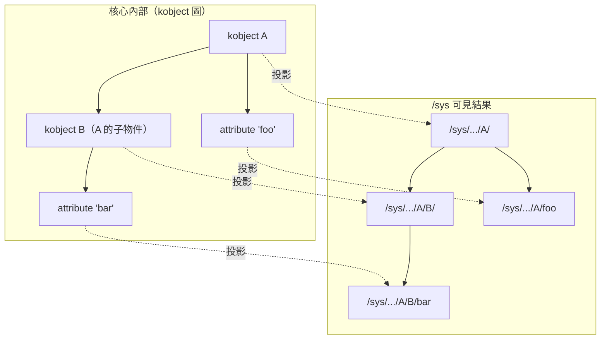
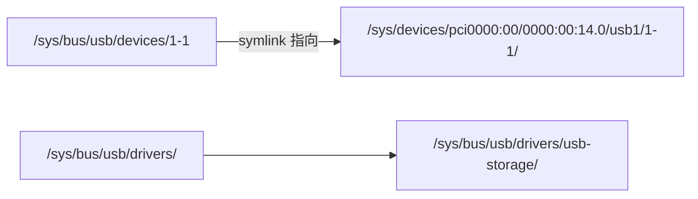
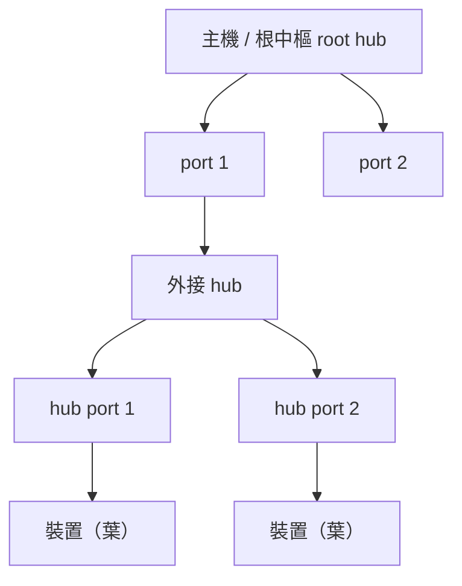
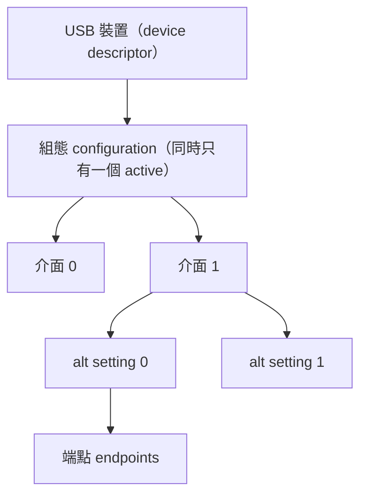
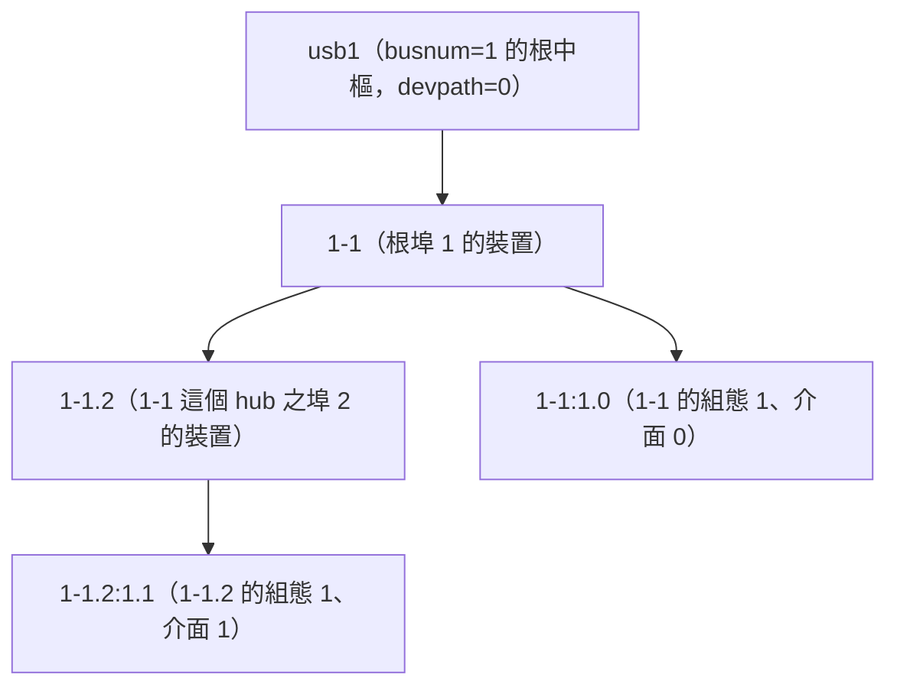

# 理解 Linux 下 `/sys/bus/usb/devices/**` 語意所需的心智模型、領域模型與先備知識

## 摘要

`/sys/bus/usb/devices/**` 不是一份文件，而是一個**由核心內部資料結構即時投影出來的目錄樹**。要讀懂它，必須同時具備四層知識：

1. **檔案系統層的心智模型**：sysfs 的「目錄 = kobject、檔案 = 屬性、符號連結 = 關係」，以及「一個檔案一個值」的設計哲學[^sysfsdoc]。
2. **Linux 裝置模型（driver model）的領域模型**：`bus_type` / `device` / `device_driver`、綁定（binding）與 `probe()`、`/sys/devices` 才是唯一的階層樹、`uevent` 事件[^drvmodel][^busrst][^kobject]。
3. **USB 協定本身的領域模型**：樹狀拓樸、host / hub / device、裝置描述元（descriptor）堆疊、以及「裝置（device）與介面（interface）是兩個不同層級」這一關鍵區分[^usbrst][^nutshell]。
4. **usbcore 把 USB 映射到裝置模型的具體規則**：包括目錄命名 `usbN`、`N-port.port`、`N-port:config.ifnum` 的產生方式與穩定性[^usbc][^msgc]。

外加一個**介面契約層**的認識：sysfs 是 ABI，有 `stable/testing/obsolete/removed` 四級穩定度，而且核心開發者明文建議使用者空間「優先透過 udev/libudev 的抽象」而非直接解析 sysfs[^abireadme][^sysfsrules]。缺少這一層的人，往往會把「目前在這個核心版本看起來能跑」誤認為「保證不會壞」。

---

## 1. 問題界定

本報告回答的問題是：**要具備什麼樣的心智模型、領域模型、先備知識，才能理解 `/sys/bus/usb/devices/**` 的語意？**

「理解語意」在此定義為能回答下列具體問題，而不只是能列出檔案：

- 為什麼 `/sys/bus/usb/devices/` 底下每一項都是符號連結，而真正的目錄在別處？
- 目錄名稱 `usb1`、`1-1`、`1-1.2.3`、`1-1.2.3:1.0` 各自編碼了什麼資訊？
- 為什麼驅動綁定的單位是 `:1.0`（介面），而不是裝置本身？
- 屬性檔名如 `idVendor`、`bDeviceClass` 是十進位還是十六進位？為什麼不一致？
- 為什麼 `devnum`、`busnum` 不該被寫進設定檔，而 `devpath` 相對可靠？
- 為什麼核心文件說「不要直接解析 sysfs」？

以下章節依「由外而內」的順序建立這四層知識，最後給出能力檢核表與學習路徑。

---

## 2. 第一層：sysfs 的心智模型（檔案系統只是投影）

### 2.1 sysfs 是什麼

sysfs 是 RAM 基礎的虛擬檔案系統，最初基於 ramfs，用途是「提供一個把核心資料結構、其屬性、以及它們之間的連結匯出到使用者空間的手段」[^sysfsdoc]。它是 2002–2003 年間由 Patrick Mochel 等人引入、以取代過去散落在 procfs 的裝置資訊，並隨 Linux 2.6.0 成為正式介面[^sysfsman][^sysfsdoc]。

關鍵一句在 `sysfs(5)` 手冊頁：

> 「更精確地說，sysfs 中的檔案與目錄提供了核心內部所定義之 kobject 結構的一個視圖（view）。」[^sysfsman]

也就是說 **sysfs 不是資料庫，而是視圖**。它沒有自己的儲存，讀取一個檔案其實是呼叫核心註冊的 `show()` 方法、把當下的記憶體狀態格式化後回傳。

### 2.2 三條最基本的對應規則

`sysfs` 核心文件給出的對應關係如下[^sysfsdoc]：

| sysfs 元素 | 對應的核心物件 |
|---|---|
| 目錄 | 一個註冊到系統的 kobject |
| 一般檔案 | 該 kobject 的一個屬性（attribute） |
| 符號連結 | 物件之間的關係（跨樹的指標） |

- **目錄**：「對於每一個註冊到系統的 kobject，sysfs 中都會為它建立一個目錄。該目錄建立為該 kobject 父物件的子目錄，向使用者空間表達內部的物件階層。」[^sysfsdoc]
- **檔案**：「屬性應該是一般 ASCII 文字檔，最好每個檔案只有一個值。……混用型別、表達多行資料、以及做花俏的格式化，是被強烈不認同的。」[^sysfsdoc]
- **符號連結**：`sysfs(5)` 說明「為避免重複，sysfs 大量使用符號連結來連接檔案系統樹各處的項目」[^sysfsman]。



### 2.3 讀寫語意：一次性、整頁緩衝

屬性讀寫不是普通的檔案 I/O。sysfs 配置一個 `PAGE_SIZE` 大小的緩衝區（x86 上為 4096 位元組）交給核心的 `show()` / `store()`，並且「sysfs 對每一次讀或寫，都只會呼叫該方法一次」[^sysfsdoc]。這造成三個必須內化的行為：

- 讀取時核心必須填滿整個緩衝區，因此使用者空間可以任意 seek 或 `pread()`；seek 回 0 會讓 `show()` 被重新叫用[^sysfsdoc]。
- 寫入時 sysfs 期待「第一次寫入就傳入整個緩衝區」，並在寫入資料後補上結尾的 NUL[^sysfsdoc]。
- 官方建議的寫入模式是：「先讀取整個檔案，修改想改的值，再把整個緩衝區寫回去。」[^sysfsdoc]

### 2.4 符號連結的重要性：因為同一個物件出現在多棵「觀點樹」下

sysfs 頂層有多個分類目錄：`block/`、`bus/`、`class/`、`dev/`、`devices/`、`firmware/`、`fs/`、`hypervisor/`、`kernel/`、`module/`、`power/`[^sysfsdoc]。其中：

- `devices/` 是**唯一的真實階層樹**，直接對應核心內部的裝置樹[^sysfsdoc]。
- `bus/` 是**依匯流排型別做平坦分類**，每個匯流排下有 `devices/`（指向 `/sys/devices` 各裝置目錄的符號連結）與 `drivers/`（該匯流排上已載入的每個驅動一個目錄）[^sysfsdoc]。
- `class/` 是**依功能型別分類**，同樣是符號連結的平坦清單[^sysfsdoc]。

這解釋了 `/sys/bus/usb/devices/**` 的第一個語意：它是一個**觀點（view）**，而不是位置（location）。`/sys/bus/usb/devices/` 底下的項目之所以是符號連結，是因為 `bus/` 是分類目錄；裝置真正「住」在 `/sys/devices/` 的樹裡[^sysfsdoc][^sysfsman]。



### 2.5 「一個值一個檔案」的哲學來源

「一個檔案一個值」不是風格偏好，而是設計時為了讓屬性可被獨立、原子地讀寫與比對，並讓 udev 之類的工具能用「屬性名 → 值」的簡單模型匹配規則[^sysfsdoc][^udevfd]。理解這點，才能接受 sysfs 中為什麼有 `idVendor` 與 `idProduct` 兩個檔案，而不是一個 `ids` 檔案。

---

## 3. 第二層：Linux 裝置模型的領域模型

### 3.1 driver model 的動機

核心文件的說法是：Linux 核心驅動模型是「過去各種互異驅動模型的統一」，目的在於「以全域可存取的資料結構，整合出描述一個匯流排、以及可在該匯流排下出現之裝置的共同資料模型」[^drvmodel]。它包含一組所有匯流排共有的屬性，以及一組共同的回呼（callback），例如匯流排探測時的裝置探索、匯流排關機、匯流排電源管理等[^drvmodel]。

同一份文件指出，這個模型之所以在 x86 通用系統上能幾乎適用所有裝置，是拜 ACPI 所賜[^drvmodel]。這也是為什麼在真實機器上，`/sys/bus/usb/devices/` 的實體裝置通常一路往上可以走到 PCI 裝置：USB 主機控制器本身就是一顆 PCI 裝置。

### 3.2 kobject / kset / ktype：sysfs 的最小單位

kobject 是「有名字、有參考計數、有父指標、有型別、且通常在 sysfs 中有表示」的物件；它很少單獨存在，而是嵌入在更大的結構中[^kobject]。官方文件給了三個定義[^kobject]：

- **kobject**：`struct kobject`，提供參考計數、名稱、父指標、階層能力。
- **ktype**：嵌入 kobject 之「容器型別」的型別描述，控制 kobject 建立與銷毀時的行為；`release()` 方法掛在 ktype 上，而非 kobject 本身[^kobject]。
- **kset**：kobject 的集合；它自己內含一個 kobject，常被當作其他 kobject 的父物件，並「能夠支援 kobject 的 hotplug，並影響 uevent 事件如何被回報給使用者空間」[^kobject]。

一句非常實用的判讀規則：

> 「當你看到一個 sysfs 目錄中塞滿其他目錄時，一般而言其中每個目錄都對應到同一個 kset 中的一個 kobject。」[^kobject]

這正是判讀 `/sys/bus/usb/devices/` 的思考方式：它是 usb 匯流排這個 kset 的 `devices/` 分類目錄，其中的項目就是 USB 匯流排上的各個 device kobject。

LWN 早期的〈The zen of kobjects〉（2003 年）提供了同一套概念的歷史版本，其中並提到 kobject 的「mission creep」——從單純的參考計數物件，變成撐起裝置模型與 sysfs 的黏著劑[^zen]。

### 3.3 bus / device / driver 三件組與「綁定」

匯流排型別由 `struct bus_type` 描述，每個匯流排型別宣告一個靜態物件並填好 `name`，可選地提供 `match` 回呼[^busrst]。註冊後，該匯流排的目錄會出現在 `/sys/bus/` 下，並自動帶有 `devices/` 與 `drivers/` 兩個子目錄[^busrst]。`match()` 的用途是「給匯流排一個機會，在不犧牲匯流排特異功能或型別安全的前提下，判斷某個驅動是否支援某個裝置」[^busrst]。

驅動的綁定由驅動的 `probe()` 完成[^driverrst]。`probe()` 在 task context 中被呼叫，此時匯流排的 rwsem 被鎖住、驅動已部分綁定到裝置；驅動通常用 `container_of()` 把 `struct device` 轉成匯流排特異型別[^driverrst]。USB 匯流排的 `probe()` 簽章特別指明它接的是「介面」：`int (*probe)(struct usb_interface *intf, const struct usb_device_id *id)`[^usbrst]。

### 3.4 裝置的屬性群組與 uevent 的時序約束

裝置可以透過 `struct device_attribute` 匯出屬性[^devicerst]。這裡有一個對使用者空間至關重要的時序規則：

> 「當一個新裝置在核心中被註冊，會產生一個 uevent 通知使用者空間（例如 udev）有新裝置可用。如果屬性是在裝置註冊之後才被加入，那麼使用者空間不會收到通知，也就不會知道這些新屬性的存在。」[^devicerst]

更嚴格地說，kobject 的屬性與子物件必須在 `KOBJ_ADD` 這個 uevent 被送出**之前**就初始化完成，因為「使用者空間會在這個呼叫發生的瞬間開始尋找它們」[^kobject]。這條規則直接解釋了：**為什麼可用屬性集合會隨裝置狀態而變**（例如 LPM 相關屬性只在具備該能力時才存在），以及為什麼「先讀到屬性清單、之後再讀同一屬性」可能失敗——裝置狀態可能已經改變。

### 3.5 uevent：使用者空間如何得知變化

`kobject_uevent()` 用來向世界宣告物件的建立；新增時用 `KOBJ_ADD`，移除時的 `KOBJ_REMOVE` 由 kobject 核心自動產生[^kobject]。USB 裝置與介面的 uevent 會附帶額外變數，這是 udev 規則能運作的基礎[^usbc][^msgc]：

- USB **裝置**的 uevent 加入 `BUSNUM=%03d` 與 `DEVNUM=%03d`[^usbc]。
- USB **介面**的 uevent 加入 `INTERFACE=<class>/<subclass>/<protocol>` 與 `MODALIAS=usb:v....`[^msgc]。

歷史上還存在 `/sbin/hotplug` 這個核心熱插拔協助程式機制，USB 子系統會傳遞 `ACTION`、`PRODUCT`、`TYPE`、`INTERFACE` 等環境變數[^hotplug]。現代系統則以 uevent → systemd-udevd 為主軸[^udevdsrv]。

### 3.6 分類目錄的層級關係與 `sysfs-rules` 的硬規則

核心文件 `sysfs-rules`（「如何在 sysfs 中存取資訊的規則」）是讀懂任何 sysfs 路徑前必須先讀的文本，因為它直接限制了「可以依賴什麼」。其開頭即聲明[^sysfsrules]：

> 「核心匯出的 sysfs 會洩漏核心內部實作細節，並依賴內部的核心結構與佈局。核心開發者一致同意 Linux 核心不提供穩定的內部 API。因此，sysfs 介面中有一些面向，可能無法跨核心版本保持穩定。」

同一文件的具體規則包括[^sysfsrules]：

- **不要使用 libsysfs**：它對 sysfs 做了不成立的假設，API 未提供抽象，失敗了「提供穩定介面」的目標。
- **sysfs 永遠在 `/sys`**：去解析 `/proc/mounts` 是浪費時間。
- **「裝置就是裝置」**：使用者空間不存在可依賴的 class / bus / physical device / interface 之分；這些都是核心實作細節。
- **devpath 的定義**：等同 uevent 中的 `DEVPATH`；是該時點的裝置唯一鍵；是「不含前置 `/sys`、且永遠以斜線開頭」的核心路徑；「其所有元素都必須是真實目錄。指向 `/sys/devices` 的符號連結必須總是被解析到真實目標」，而且「使用或暴露符號連結的值作為 devpath 字串的元素，是應用程式的 bug」。
- **父裝置的屬性不屬於子裝置**：要判斷子裝置的脈絡屬性就得去看父裝置本身；「父裝置的屬性可能動態改變而不通知子裝置」。
- **只有一棵有效階層樹**：位於 `/sys/devices` 之下。
- **裝置鏈上的位置可能改變**：不能依賴某個父裝置在 devpath 中的固定位置。

這一段是理解「為什麼不能把 `/sys/bus/usb/devices/1-1.2` 當成穩定 ID」的理論根據。

---

## 4. 第三層：USB 協定本身的領域模型

不懂 USB 而試圖讀 USB 的 sysfs，等於在讀一份未知語言的目錄。

### 4.1 拓樸：主機—中樞—周邊的樹

核心文件對 USB 的定義是：「USB 使用樹狀結構，主機為根（系統的主控者），中樞（hub）為內部節點，周邊為葉節點（並且是從屬者）。」並且「現代 PC 通常支援數個這樣的 USB 樹，通常是幾個 USB 3.0（5 Gbit/s）或 USB 3.1（10 Gbit/s）與一些為了相容而保留的 USB 2.0（480 Mbit/s）匯流排」[^usbrst]。

這個主從不對稱是刻意設計的：「在實體上不可能搞錯上游與下游……主機軟體也不需要處理分散式自動組態，因為被預先指定的主節點會管理這一切」[^usbrst]。

libusb 的文件補上了深度限制：`libusb_get_port_numbers()` 說明「依 USB 3.0 規格，目前深度上限為 7」[^libusb]。



### 4.2 描述元堆疊：device → configuration(s) → interface(s) → endpoint(s)

這是 USB 的「領域模型核心」。摘要如下[^usbrst][^nutshell]：

- **一個裝置只有一個裝置描述元（device descriptor）**，其中包括合規的 USB 修訂版、用來載入驅動的 Vendor / Product ID、以及可能的組態數量[^nutshell]。
- **一個裝置可以有多個組態（configuration），但同時只有一個是作用中的**（active）；裝置應能以其最高速度以下的速率運作[^usbrst]。組態描述元說明供電方式、最大耗電、以及介面數量[^nutshell]。
- 自 **USB 3.0 起，組態之下有一或多個「function」**，用以提供共同功能並被分組以便電源管理[^usbrst]。
- **組態 / function 之下有一或多個介面（interface），每個介面可有多個「alternate setting」**；介面可由 USB class 規格標準化，也可以是廠商或裝置專屬[^usbrst]。
- **介面之下有一或多個端點（endpoint）**，每個端點支援一種型別與方向的資料傳輸，例如「bulk out」或「interrupt in」；整個組態在每個方向最多可有十六個端點，依需要在所有介面之間分配[^usbrst]。

一句極重要的話：

> 「**USB 裝置驅動實際上綁定的是介面，而不是裝置。**把它們想成『介面驅動』，雖然你可能不會在許多裝置上看到這個區別有多重要。*大多數 USB 裝置很簡單，只有一個 function、一個組態、一個介面、一個 alternate setting。*」[^usbrst]

這就是為什麼 sysfs 目錄名稱尾端會有 `:1.0` 這種「組態.介面」後綴——那是驅動綁定的層級。



### 4.3 傳輸型別與 URB

USB 支援四種資料傳輸：control、bulk、interrupt、isochronous。其中 control 與 bulk 使用可用頻寬，而 interrupt 與 isochronous 會被排程以提供保證頻寬[^usbrst]。Linux 的 USB API 對 control 與 bulk 提供同步呼叫，對所有型別提供非同步呼叫，非同步是以稱為 URB（USB Request Block）的請求結構進行[^usbrst]。

### 4.4 Class code 三連組：Base Class / SubClass / Protocol

USB-IF 的定義是：class code 資訊「用來識別裝置的功能，並名目上用來據以載入裝置驅動」；資訊包含在三個位元組中，名為 Base Class、SubClass、Protocol[^classcodes]。**class code 可以出現在兩個地方**：裝置描述元，或介面描述元；有些 class code 只允許用在裝置描述元，有些兩者皆可，有些只能用在介面描述元[^classcodes]。

常見的 Base Class 與其允許出現的位置[^classcodes]：

| Base Class | 允許放在 | 說明 |
|---|---|---|
| `00h` | Device | 使用介面描述元中的 class 資訊 |
| `01h` | Interface | Audio |
| `02h` | Both | Communications and CDC Control |
| `03h` | Interface | HID（Human Interface Device） |
| `07h` | Interface | Printer |
| `08h` | Interface | Mass Storage |
| `09h` | Device | Hub |
| `0Ah` | Interface | CDC-Data |
| `0Eh` | Interface | Video |
| `E0h` | Interface | Wireless Controller |
| `EFh` | Both | Miscellaneous（含 Interface Association Descriptor） |
| `FEh` | Interface | Application Specific |
| `FFh` | Both | Vendor Specific |

Hub 的 class 三連組是例外，規格把完整三連組都定死了[^classcodes]：

| Base Class | SubClass | Protocol | 意義 |
|---|---|---|---|
| `09h` | `00h` | `00h` | Full speed Hub |
| `09h` | `01h` | Hi-speed hub with single TT |
| `09h` | `02h` | Hi-speed hub with multiple TTs |

而 `00h/00h/00h` 的意義是「從介面描述元取用 class code 資訊」；同一個值用在介面描述元時，代表空（null）的 class code 三連組[^classcodes]。這解釋了為什麼札實的 sysfs 裝置目錄常常看到 `bDeviceClass` 是 `00`，而真正的功能類別要看介面層的 `bInterfaceClass`。

USB in a NutShell 對這點有更直白的說明：「多數 class 規格選擇在介面層識別自己，因此把 `bDeviceClass` 設為 0x00。這讓一個裝置能支援多個 class。」[^nutshell]

### 4.5 速度世代與 `speed` 屬性的值

`sysfs.c` 中 `speed_show()` 的實作直接決定了 `speed` 檔案的內容[^sysfsc]：

| 核心列舉 | `speed` 輸出（Mbit/s） |
|---|---|
| `USB_SPEED_LOW` | `1.5` |
| `USB_SPEED_FULL` / `USB_SPEED_UNKNOWN` | `12` |
| `USB_SPEED_HIGH` | `480` |
| `USB_SPEED_SUPER` | `5000` |
| `USB_SPEED_SUPER_PLUS`（非 2x2） | `10000` |
| `USB_SPEED_SUPER_PLUS` + `USB_SSP_GEN_2x2` | `20000` |
| 其他 | `unknown` |

值得注意：`USB_SPEED_UNKNOWN` 與 `USB_SPEED_FULL` 都被映射成字串 `"12"`[^sysfsc]，也就是說 `speed` 讀到 `12` 並不能區分「確定是全速」與「速度未知」。

### 4.6 複合裝置、IAD 與 Type-C 的延伸領域

USB 3.0 之後出現了 function 概念，而複合裝置常需要 Interface Association Descriptor（IAD）把多個介面綁成一個功能；USB-IF 將 `EFh/02h/01h` 指定為 IAD，且「這個 class code 三連組只能用在裝置描述元」[^classcodes]。核心在介面上額外匯出 `iad_*` 系列屬性（`iad_bFirstInterface`、`iad_bInterfaceCount`、`iad_bFunctionClass` 等）[^sysfsc]。

若系統啟用 USB Type-C connector class，`port<X>/connector` 會是指向 Type-C 連接器的連結，而裝置目錄下也可能有指向 Type-C partner 的 `typec` 符號連結[^abitesting][^typec]。這是「讀 USB sysfs 需要知道隔壁子系統存在」的例子。

---

## 5. 第四層：usbcore 如何把 USB 映射到裝置模型（命名語意的真相）

這是本報告最核心的一節：把前面三層接起來，解釋目錄名的每一個字元從哪裡來。

### 5.1 命名規則的原始碼依據

`drivers/usb/core/usb.c` 的 `usb_alloc_dev()` 負責為 USB 裝置命名，邏輯如下[^usbc]：

- **根中樞（root hub）**：`dev_set_name(&dev->dev, "usb%d", bus->busnum);`
  → 產生 `usb1`、`usb2`、`usb3`……
  根中樞的 `devpath` 被設為 `'0'`[^usbc]。
- **一般裝置**：先算 `devpath`，再命名為 `"%d-%s"`（`busnum` + `devpath`）[^usbc]：
  - 掛在根中樞的埠上：`devpath` = `"<port1>"`（埠號，從 1 起算）[^usbc]。
  - 掛在中樞之下：`devpath` = `"<parent 的 devpath>.<port1>"`[^usbc]。

因此：

| 目錄名 | 解讀 |
|---|---|
| `usb1` | 第 1 條 USB 匯流排的根中樞（`busnum=1`） |
| `1-1` | 匯流排 1 上、根中樞連接埠 1 的裝置 |
| `1-1.2` | 上述裝置（本身是 hub）其連接埠 2 上的裝置 |
| `1-1.2.3` | 再下一層：埠 3 |

而 `:1.0` 這種後綴來自介面的命名，在 `usb_set_configuration()`（`message.c`）中[^msgc]：

```c
dev_set_name(&intf->dev, "%d-%s:%d.%d", dev->bus->busnum,
             dev->devpath, configuration, ifnum);
```

即 `<busnum>-<port 鏈>:<組態值>.<介面號>`。所以：

| 目錄名 | 解讀 |
|---|---|
| `1-1:1.0` | 匯流排 1、埠鏈 1 之裝置的第 1 號組態、第 0 號介面 |
| `1-1.2:1.1` | 匯流排 1、埠鏈 1.2 之裝置的第 1 號組態、第 1 號介面 |

ABI 文件也以同一種寫法描述屬性歸屬，例如 `supports_autosuspend` 的路徑被寫成 `/sys/bus/usb/devices/<busnum>-<port[.port]>...:<config num>-<interface num>/supports_autosuspend`[^abitesting]（此處 `-` 與 `.` 的用法與原始碼 `:%d.%d` 略有出入，見第 9 節批判性反思）。



### 5.2 為什麼根中樞叫 `usbN` 而不是 `N-0`

因為根中樞「不是真正的裝置」；原始碼註解明白寫著「Root hubs aren't true devices, so don't allocate HCD resources」[^usbc]。它由主機控制器驅動虛擬化產生，並且 `devpath` 固定為 `'0'`，子裝置的 `devpath` 在這一層不把根埠計入 route string[^usbc]。核心的 debugfs 文件中，根中樞也被描述為「host controller 被虛擬化為 root hub」[^usbrst]。

### 5.3 devpath 的穩定性與 busnum 的不穩定性

`usb_alloc_dev()` 中的註解是本主題最精華的一段，它同時給出穩定性判斷[^usbc]：

> 「儲存可讀且穩定的拓樸 id，以依位置區分裝置，供診斷、工具、驅動模型等使用。該字串是一條沿著中樞埠、從根出發的路徑。每個裝置的 `dev->devpath` 在 USB 重新佈線之前是穩定的，而中樞通常就標示著這些埠號。**名稱則沒有那麼穩定：`bus->busnum` 很容易因 modprobe 順序、CardBus 或 PCI 熱插拔而改變。**」

`usb_make_path()` 的說明文件進一步確立這個分野[^usbrst]：

- 該識別碼「意在成為『穩定』的，反映硬體中的實體路徑，例如主機控制器的實體匯流排位址或 USB 中樞上的埠」。
- 「增加與移除裝置，包括主機控制器驅動模組中的虛擬根中樞，都不會改變這些路徑識別碼；重新開機或重新列舉也不會。」
- 一個例外：「由於使用『companion』控制器，連接到 USB 2.0 根中樞（EHCI 主機控制器）埠上的裝置，如果是高速會得到一個路徑 ID，如果是全速或低速會得到不同的路徑 ID。」

這個「companion port」現象也出現在電源管理文件中：SuperSpeed 埠與其高速 peer 埠成對，`port<X>/peer` 會互相連結[^pm]。

### 5.4 裝置目錄下的屬性從哪裡來

`drivers/usb/core/sysfs.c` 是所有 USB 裝置與介面 sysfs 屬性的實作所在。此檔案開頭即說明：「所有 USB 裝置與介面的 sysfs 檔案屬性」[^sysfsc]。

**裝置層屬性群組**（`dev_attrs`）[^sysfsc]：

- 作用中組態的屬性：`configuration`、`bNumInterfaces`、`bConfigurationValue`、`bmAttributes`、`bMaxPower`
- 裝置屬性：`urbnum`、`idVendor`、`idProduct`、`bcdDevice`、`bDeviceClass`、`bDeviceSubClass`、`bDeviceProtocol`、`bNumConfigurations`、`bMaxPacketSize0`、`speed`、`rx_lanes`、`tx_lanes`、`busnum`、`devnum`、`devpath`、`version`、`maxchild`、`quirks`、`avoid_reset_quirk`、`authorized`、`remove`、`ltm_capable`
- 字串屬性（僅在裝置提供對應字串描述元時才可見）：`manufacturer`、`product`、`serial`
- 二進位屬性：`descriptors`、`bos_descriptors`
- `power/` 群組：`autosuspend`、`level`、`connected_duration`、`active_duration`，以及視能力而定的 `usb2_hardware_lpm`、`usb2_lpm_l1_timeout`、`usb2_lpm_besl`、`usb3_hardware_lpm_u1`、`usb3_hardware_lpm_u2`

**介面層屬性群組**（`intf_attrs`）[^sysfsc]：`bInterfaceNumber`、`bAlternateSetting`、`bNumEndpoints`、`bInterfaceClass`、`bInterfaceSubClass`、`bInterfaceProtocol`、`modalias`、`supports_autosuspend`、`authorized`。

可見性是可變的：字串屬性用 `is_visible()` 檢查對應字串是否為 `NULL`；`bos_descriptors` 只在裝置有 BOS 時才出現[^sysfsc]。

### 5.5 十進位 vs 十六進位的陷阱

從 `sysfs.c` 的格式化字串可以精確判定每個屬性的基底[^sysfsc]：

| 屬性 | 格式 | 基底 |
|---|---|---|
| `idVendor` / `idProduct` / `bcdDevice` | `%04x` | 十六進位 |
| `bDeviceClass` / `bDeviceSubClass` / `bDeviceProtocol` | `%02x` | 十六進位 |
| `bInterfaceClass` / `bInterfaceSubClass` / `bInterfaceProtocol` | `%02x` | 十六進位 |
| `bInterfaceNumber` | `%02x` | 十六進位 |
| `bNumEndpoints` | `%02x` | 十六進位 |
| `bmAttributes` | `%2x` | 十六進位 |
| `bAlternateSetting` | `%2d` | 十進位 |
| `bNumInterfaces` | `%2d` | 十進位 |
| `bNumConfigurations` | `%d` | 十進位 |
| `bMaxPacketSize0` | `%d` | 十進位 |
| `bMaxPower` | `%dmA` | 十進位（附單位） |
| `busnum` / `devnum` / `maxchild` | `%d` | 十進位 |
| `version` | `%2x.%02x` | 十六進位（BCD 拆解） |
| `speed` | 字串 | 不適用 |

ABI 文件對多數描述元欄位只寫「十六進位」或「十進位」並註明「See USB specs for its meaning」，因此**欄位語意必須回到 USB 規格，而不是 sysfs 文件**。例如 `bcdDevice`「是裝置的發行編號，以十六進位表示」[^abitesting]。

### 5.6 中樞的埠子目錄

除了裝置與介面目錄之外，中樞介面下還有一層埠目錄。ABI 文件定義 `/sys/bus/usb/devices/.../<hub_interface>/port<X>` 是「USB 埠裝置的 sysfs 目錄」，其下包含[^abitesting]：

- `connect_type`：由 ACPI 提供，讀值為 `hotplug`、`hardwired`、`not used` 或 `unknown`
- `location`：以十六進位整數表示埠的實體位置原始值
- `over_current_count`：過電流次數（支援 `poll()`）
- `state`：埠上裝置的狀態，合法值為 `not-attached`、`attached`、`powered`、`reconnecting`、`unauthenticated`、`default`、`addressed`、`configured`、`suspended`（支援 `poll()`）
- `disable`、`early_stop`、`quirks`、`usb3_lpm_permit`、`connector`

電源管理文件補充了埠層級電源控制的完整條件鏈，並警告「一旦電源關閉，這個埠就不會再回應新的連接事件」，且 `pm_qos_no_power_off` 預設為 `1`[^pm]。

### 5.7 匯流排層的其他檔案

`/sys/bus/usb/` 本身除了 `devices/` 與 `drivers/` 之外，還有 bus 層屬性。核心在每個 USB 裝置上呼叫 `add_default_authorized_attributes()`，但屬性群組的 `name` 被設為 NULL，意味著「我們希望它們在同一個目錄」——因此 `authorized_default` 與 `interface_authorized_default` 是**放在匯流排目錄上**的[^sysfsc]。驅動層則提供 `new_id`、`remove_id` 供動態新增／移除裝置 ID[^abitesting]。

---

## 6. 屬性語意速查（依語意分群，而非檔名排序）

以下整理讀者最常需要的屬性，並指出語意來源。**所有欄位語意最終以 USB 規格為準**，sysfs 只提供值的鏡射。

### 6.1 身分（identity）

`idVendor`、`idProduct`、`bcdDevice`、`manufacturer`、`product`、`serial`、`version`[^sysfsc][^abitesting]。其中 `version` 是把 `bcdUSB` 拆成 `major.minor` 的形式輸出[^sysfsc]；`manufacturer` / `product` / `serial` 只在裝置提供字串描述元時存在[^sysfsc]。

### 6.2 類別（class 三連組）

`bDeviceClass` / `bDeviceSubClass` / `bDeviceProtocol` 與 `bInterfaceClass` / `bInterfaceSubClass` / `bInterfaceProtocol`[^sysfsc]。搭配 `modalias` 可得到完整字串，其格式為 `usb:v%04Xp%04Xd%04Xdc%02Xdsc%02Xdp%02Xic%02Xisc%02Xip%02Xin%02X`[^sysfsc]。這同時也是介面 uevent 的 `MODALIAS` 內容[^msgc]。

### 6.3 組態與介面結構

`bConfigurationValue`（作用中組態；寫入會改變組態，寫 `0` 或 `-1` 會取消組態設定）[^abistable]、`configuration`（作用中組態的字串描述元內容）[^abitesting]、`bNumConfigurations`、`bNumInterfaces`、`bConfigurationValue`、`bNumEndpoints`、`bAlternateSetting`[^sysfsc]。

`bInterfaceNumber` 的 ABI 描述為「介面編號，十六進位」；`bAlternateSetting` 為「目前介面 alternate setting 編號，十進位」[^abitesting]。

### 6.4 拓樸與位址

`devpath`（「USB 介面裝置路徑」字串）[^abitesting]、`busnum`、`devnum`[^sysfsc]。ABI 明確標示 `devnum` 的用途為「匯流排上的裝置位址」，且使用者為 libusb；`busnum` 為「裝置所連接之 USB 匯流排的匯流排編號」，使用者同樣是 libusb[^abistable]。`/sys/devices/*/dev` 則是裝置對應字元裝置的 major:minor[^abidevices]。

### 6.5 速度與鏈路寬度

`speed`[^sysfsc][^abistable]、`rx_lanes` 與 `tx_lanes`（USB 3.2 的雙通道支援；USB 3.2 之前的裝置 `rx_lanes = 1`）[^abitesting]。

### 6.6 電源管理

`power/control`（`on` / `auto`）、`power/autosuspend_delay_ms`（預設 2000 毫秒；0 表示一閒置即自動暫停；負值表示永不自動暫停）、`power/wakeup`（remote wakeup）[^pm]。`power/persist` 表示 USB-Persist 是否啟用，中樞永遠啟用因此其目錄不會有這個檔案[^abistable]。`power/connected_duration` 與 `power/active_duration` 分別是連接總時長與非暫停總時長（毫秒），文件甚至給了計算活躍百分比的範例[^abistable]。

裝置層另有 `authorized`（1/0，決定驅動能否使用該裝置；有線 USB 裝置預設授權）[^abitesting]，介面層亦有不帶前綴的 `authorized`，可個別授權／撤銷授權單一介面[^sysfsc][^abitesting]。

### 6.7 端點

`ep_<N>/` 下有 `bEndpointAddress`、`direction`（`both` / `in` / `out`）、`type`（`Control` / `Isoc` / `Bulk` / `Interrupt` / `unknown`）、`bInterval`、`interval`、`bLength`、`bmAttributes`、`wMaxPacketSize`[^abitesting]。

### 6.8 二進位描述元

`descriptors` 是「包含裝置快取描述元的二進位檔。二進位資料由裝置描述元開始，接著是該裝置每個組態的描述元」；文件特別警告「組態描述元的 `wTotalLength` 不可信任，因為裝置可能提供比它宣稱更小的組態描述元。每個（子）描述元的 `bLength` 欄位可以信任」[^abistable]。`bos_descriptors` 是 BOS 快取，且「若裝置的 `bcdUSB` 小於 0x0201，核心不會向裝置要求 BOS」[^abitesting]。

這兩個屬性要求讀者**懂 USB 二進位描述元格式**——這是「先備知識」中最硬的一塊。描述元共通格式是：第一位元組為長度（`bLength`），第二位元組為型別（`bDescriptorType`）[^nutshell]。`bcdUSB` 是 BCD 編碼，格式為 `0xJJMN`（JJ 主版號、M 次版號、N 次次版號），例如 USB 2.0 為 `0x0200`、USB 1.1 為 `0x0110`[^nutshell]。

### 6.9 驅動綁定狀態

介面目錄下的 `driver/` 符號連結指向綁定的驅動；`supports_autosuspend` 表示介面驅動是否支援自動暫停，「未宣稱的介面也回傳 1，因為未被宣稱的介面不會阻止裝置被自動暫停」[^abistable][^sysfsc]。

`/dev/bus/usb/BBB/DDD` 這些字元裝置節點與 sysfs 是兩條不同路徑：前者由 devtmpfs（傳統上掛在 `/dev/bus/usb/`）提供，「魔法檔案」揭露出裝置的組態描述元並支援一系列 ioctl[^usbrst]；核心明確指出這些檔案可用於撰寫使用者層驅動，需先讀取描述元確認裝置身分，再用 ioctl 宣佔（claim）介面[^usbrst]。核心文件亦明確警告：「那些 BBB/DDD 路徑不是穩定識別碼；即使你總是把裝置插在同一個中樞埠，也要預期它們會變。**連想都不要想把這些存進應用程式設定檔。**」[^usbrst]

---

## 7. 「可以依賴什麼」：介面契約與抽象層

### 7.1 ABI 的四級穩定度

`Documentation/ABI/README` 定義四級穩定度[^abireadme]：

| 目錄 | 意義 |
|---|---|
| `stable/` | 開發者認定穩定。使用者空間可無限制使用，**向後相容性保證至少 2 年**；多數介面被期待永不改變 |
| `testing/` | 被認為穩定、主要開發已完成，可新增功能但不會破壞現有介面，除非發現重大錯誤或安全問題；使用者空間可開始依賴，但須留意進入 stable 前的變動 |
| `obsolete/` | 仍在核心中，但已標示將於日後移除 |
| `removed/` | 已移除之舊介面的清單 |

每個檔案都包含 `What`、`Date`、`KernelVersion`（選用）、`Contact`、`Description`、`Users` 等欄位；`Users` 欄位存在的目的是「讓所有想在此介面變更時被通知的使用者登記」，對 `testing` 階段的介面尤其重要[^abireadme]。

同一份文件也列出「任何情況下都不該被視為穩定」的非 ABI 項目：**Kconfig**（使用者空間不應依賴任何 Kconfig 符號的存在與否）以及**核心內部符號**（不應依賴 `System.map` 或核心二進位中任何符號的存在、缺席、位置或型別）[^abireadme]。

`Documentation/ABI/testing/sysfs-bus-usb` 的 `Users` 欄位就是這個機制的實例：`power/connected_duration` 與 `power/active_duration` 登記的使用者是 PowerTOP[^abistable]；`devnum`、`bConfigurationValue`、`busnum`、`descriptors`、`speed` 登記的使用者是 libusb[^abistable]；`avoid_reset_quirk` 登記的使用者是 `usb_modeswitch`[^abistable]。這些登記本身就是「誰在依賴什麼」的地圖。

### 7.2 核心明文建議：優先使用 udev / libudev

`sysfs-rules` 的立場非常清楚[^sysfsrules]：

> 「為降低使用者空間（多數是低階使用者空間應用程式）因新版核心而損壞的風險，sysfs 的使用者必須遵循一些規則，以盡可能抽象的方式存取這個檔案系統。**目前的 udev 與 HAL 程式已經實作了這一點，並且鼓勵使用者盡可能接入這些程式所提供的抽象，而不是直接存取 sysfs。**」

udev 手冊頁也自陳其角色：「核心通常只是依探索順序指定不可預測的裝置名稱。有意義的符號連結或網路裝置名稱，提供了一種依裝置屬性或其目前組態可靠識別裝置的方法。」[^udevfd] udev 也保管一個資料庫：「udev 處理的所有裝置資訊都存放在 udev 資料庫中，並發送給可能的事件訂閱者。存取所有已存放資料與事件來源，是由 libudev 函式庫提供的。」[^udevfd]

udev 規則比對的鍵包含 `DEVPATH`、`KERNEL`、`KERNELS`、`SUBSYSTEM`、`SUBSYSTEMS`、`DRIVER`、`DRIVERS`、`ATTR{filename}`、`ATTRS{filename}`、`ENV{key}` 等[^udevfd]。其中 `KERNELS`、`SUBSYSTEMS`、`DRIVERS`、`ATTRS` 的語意是「沿 devpath 向上搜尋」，這正是把 `sysfs-rules` 所說「必須靠子系統值尋找父裝置」轉成實務工具的形式[^sysfsrules][^udevfd]。

### 7.3 udev 資料庫中的 USB 衍生屬性

`udevadm info` 會把資料庫內容以帶前綴的簡式格式印出，其中 `P:` 是 `/sys/` 中的裝置路徑、`M:` 是裝置名（即 `P:` 的最後一項）、`U:` 是核心子系統、`V:` 是所連接的驅動、`E:` 是裝置屬性[^udevadm]。

`udevadm info --attribute-walk` 的用途是「印出指定裝置所有可用於 udev 規則比對的 sysfs 屬性。它會印出沿著鏈路向上的所有裝置，直到 sysfs 的根」[^udevadm]。這是把「一棵樹的屬性往上蒐集」變成單一指令的工具。

此外，systemd 會為被標記 `systemd` 標籤的核心裝置動態建立 device unit，其命名是依 `/sys/` 與 `/dev/` 路徑逃逸而來；`systemd.device` 文件指出 device unit「編碼了 sysfs/udev 裝置樹中所曝露之裝置的資訊」，且服務管理員會理解 udev 資料庫中的 `SYSTEMD_WANTS`、`SYSTEMD_READY`、`ID_MODEL` 等屬性[^systemddev]。這是「sysfs 屬性被上層系統進一步消費」的典型例子。

### 7.4 libusb：另一種抽象層，但同源

libusb 提供 `libusb_get_bus_number()`、`libusb_get_port_number()`、`libusb_get_port_numbers()`、`libusb_get_parent()`、`libusb_get_device_address()`、`libusb_get_device_speed()`、`libusb_open()`、`libusb_claim_interface()`、`libusb_set_interface_alt_setting()`、`libusb_detach_kernel_driver()` 等[^libusb]。它的說明直接對應前面所有概念：

- **埠號的穩定性**：「除非作業系統做了什麼奇怪的處理，或者你在熱插拔 USB 擴充卡，這個呼叫回傳的埠號通常保證唯一綁定到一個實體埠……但除此之外，不保證這個呼叫回傳的埠號會保持不變，甚至不保證與 HUB/HCD 製造商編號埠的順序一致。」[^libusb]
- **使用者空間驅動的權限模型**：在 Linux 上，udev 可放寬權限，而 `libusb_detach_kernel_driver()` 允許在核心驅動已綁定時搶佔介面[^libusb][^usbrst]。
- `libusb_get_session_data()` 在 Linux/BSD 後端回傳 `busnum << 8 | devnum`[^libusb]——與 USB sysfs 的 uevent 變數同構[^usbc]。

核心文件也指出 `BBB/DDD` 的重新編號現象：「裝置在仍連接著的情況下重新列舉是相對常見的（也許有人碰到了它的電源、中樞或 USB 線），所以一個裝置可能在你第一次連接時是 `002/027`，稍後變成 `002/048`。」[^usbrst]

### 7.5 `/sys/kernel/debug/usb/devices`：文字化的替代視圖

核心還提供一個 debugfs 檔案，以純文字列出所有 USB 裝置與其組態描述元，並且「你也可以對它 `poll()` 來得知新裝置」[^usbrst]。 

這份檔案的欄位語意基本上就是 USB 描述元結構的文字化，例如：

- `T:` 行帶有 `Bus`、`Lev`、`Prnt`、`Port`、`Cnt`、`Dev#`、`Spd`、`MxCh`，而「前四個欄位（拓樸資訊 Lev、Prnt、Port、Cnt）可以用來建立 USB 拓樸圖」[^usbrst]。
- 文件還留下一個著名的歷史怪癖：「基於早已失落的理由，Port number 永遠少 1。例如插在 port 4 的裝置會顯示 `Port=03`。」[^usbrst]
- `I:` 行的 `Cls=`/`Sub=`/`Prot=` 顯示介面 class 三連組，且會直接顯示綁定的驅動名或 `(none)`[^usbrst]。

理解 `T:` 行與 sysfs 目錄名的對應關係（`Lev` ≈ `devpath` 中點的數量、`Port` ≈ `devpath` 最後一段減一、`Dev#` ≈ `devnum`），是驗證自己心智模型是否正確的極佳練習。

---

## 8. 能力檢核表：真正「讀懂」的判準

以下清單可作為自我評估。若某項答不出來，代表對應層次的知識仍有缺口。

### 8.1 sysfs 層

- [ ] 能否解釋為什麼 `ls -l /sys/bus/usb/devices/` 每一項都是連結，而 `ls -l /sys/devices/.../usb1/1-1/` 是真目錄？
- [ ] 能否說出「目錄 = kobject、檔案 = attribute、連結 = 關係」並舉一個例子？
- [ ] 是否知道「一個檔案一個值」是設計約束，因此不會期待單一檔案含多個欄位？
- [ ] 是否知道屬性檔案寫入時應該「讀取整份、修改、整份寫回」？

### 8.2 裝置模型層

- [ ] 能否說明 `bus_type`、`device`、`device_driver` 三者的關係，以及 `probe()` 由誰呼叫？
- [ ] 是否知道 `/sys/devices` 是唯一有效階層樹，`/sys/bus`、`/sys/class` 是分類視圖？
- [ ] 是否知道 kobject 的屬性必須在 `KOBJ_ADD` uevent 之前建立，因此屬性集合會隨裝置能力變動？
- [ ] 是否知道 uevent 是使用者空間得知變化的機制（USB 裝置帶 `BUSNUM`/`DEVNUM`，介面帶 `INTERFACE`/`MODALIAS`）？

### 8.3 USB 協定層

- [ ] 能否畫出 device → configuration → interface → endpoint 的階層，並說明同時只有一個組態是 active？
- [ ] 是否知道「驅動綁定的是介面而非裝置」，並能對應到 `:1.0` 的命名？
- [ ] 能否解釋 `bDeviceClass = 00h` 的意義（改用介面描述元的 class 資訊）？
- [ ] 是否知道 class code 三連組是 Base Class / SubClass / Protocol，且某些值只能出現在裝置層或介面層？
- [ ] 是否知道 `speed` 只可能是 `1.5`、`12`、`480`、`5000`、`10000`、`20000`、`unknown`？

### 8.4 命名與穩定性層

- [ ] 能否拆解 `2-1.4:1.1` 的每一位？（busnum=2、根埠 1、中樞埠 4、組態 1、介面 1）
- [ ] 是否知道根中樞叫 `usbN` 是因為它不是真正的裝置？
- [ ] 是否知道 `devpath` 相對穩定（除 EHCI companion port 情況），而 `busnum` / `devnum` 不穩定？
- [ ] 是否知道 `/dev/bus/usb/BBB/DDD` 不該被寫入設定檔？
- [ ] 是否知道 `devnum` 可能只因重新列舉就改變？

### 8.5 契約與工具層

- [ ] 是否知道 sysfs ABI 的 `stable` / `testing` / `obsolete` / `removed` 四級差異？
- [ ] 是否知道核心建議改用 udev / libudev 的抽象？
- [ ] 能否使用 `udevadm info --attribute-walk` 取得 udev 可用的屬性集合？
- [ ] 是否知道 `descriptors` 是二進位且 `wTotalLength` 不可信任、必須靠 `bLength` 逐個前進？

---

## 9. 學習路徑建議

依「投入產出比」排序：

1. **先讀 `sysfs` 與 `kobject` 兩份核心文件**，建立「視圖」而非「資料庫」的心智模型[^sysfsdoc][^kobject]。這一步能立刻消除「為什麼都是連結」與「為什麼一個檔案只有一個值」兩個最常見的困惑。
2. **再讀 `sysfs-rules`**，把「可以依賴什麼」的邊界畫出來[^sysfsrules]。這一步的成本最低、避免的錯誤最大。
3. **讀 `driver-model` 的 `overview`、`bus`、`device`、`driver`** 四份短文件，建立 bus/device/driver 三件組與綁定的概念[^drvmodel][^busrst][^devicerst][^driverrst]。
4. **讀 Linux-USB Host Side API 的「USB Host-Side API Model」一節**，取得 device/configuration/interface/endpoint 的權威敘述與「驅動綁定介面」這句話[^usbrst]。
5. **讀 USB-IF 的 Defined Class Codes 頁面**，取得 class 三連組與「允許出現在何處」的對照表[^classcodes]。
6. **讀 `drivers/usb/core/usb.c` 的 `usb_alloc_dev()` 與 `message.c` 的 `usb_set_configuration()`**，親眼確認目錄名的產生方式[^usbc][^msgc]。
7. **最後讀 `drivers/usb/core/sysfs.c`**，確認每個屬性的名稱、格式與可見性條件[^sysfsc]。
8. **實作練習**：用 `udevadm info --attribute-walk` 對一個實體 USB 裝置走一遍，把每一層屬性對應到 USB 描述元欄位；再對照 `/sys/kernel/debug/usb/devices` 的 `T:` 行與 `I:` 行，驗證 `devpath` 與 `Lev`/`Port` 的關係[^udevadm][^usbrst]。

---

## 10. 批判性反思

### 10.1 來源的權威性與偏誤

- **核心文件（kernel.org / docs.kernel.org）** 是最高權威，且多數文本有明確作者與日期（`sysfs` 由 Patrick Mochel 與 Mike Murphy 撰寫、2011 年修訂；`power-management` 由 Alan Stern 撰寫、2014 年更新）[^sysfsdoc][^pm]。但須注意**核心文件經常落後於程式碼**：例如 `power-management` 仍描述 `autosuspend_delay_ms` 的歷史沿革（2.6.37 加入、2.6.38 才生效），而 `sysfs.c` 目前同時存在 `autosuspend` 屬性[^pm][^sysfsc]。因此本報告在涉及「格式」與「可見性」的斷言上，一律以原始碼為準，而以文件為語意佐證。
- **ABI 文件（`Documentation/ABI/**`）** 是介面契約的權威，但其品質不一致：`stable/sysfs-bus-usb` 只有 8 個條目，`testing/sysfs-bus-usb` 卻有數十個，且部分條目缺 `Date` 或 `Contact`[^abistable][^abitesting]。這本身就是重要訊息：**「有沒有被 ABI 文件收錄」不等於「存不存在」**，更不等於「穩定」。
- **`testing/sysfs-bus-usb` 的路徑寫法與原始碼不一致**：ABI 把介面路徑寫成 `<config num>-<interface num>`（用減號）[^abitesting]，而 `usb_set_configuration()` 用的是 `:%d.%d`（冒號與點）[^msgc]。這不是筆誤而是文件與實作的漂移，正好印證 `sysfs-rules` 所說「sysfs 洩漏內部實作細節、可能跨版本不穩定」[^sysfsrules]。實務上應以實際 `ls` 所見為準。
- **USB-IF 的 Defined Class Codes 頁面** 是 class code 的權威來源，且有明確的「Last Update」日期[^classcodes]。但它是**商業組織維護的行銷導向網站**，頁面結構（表格有時缺少分隔）不夠嚴謹，且部分說明指向需另購或另註冊的文件。因此本報告只引用其明確的 Base Class / 位置對照與 Hub 的完整三連組，對細節 subclass 一律標註「see the spec」。
- **`USB in a NutShell`（beyondlogic.org）** 是長期存在、廣被引用的教學文件，其描述元表格清楚且與 USB 2.0 規格一致[^nutshell]。但它**不是官方規格**，且最後更新於 2010 年（頁尾標示 2018 年僅為頁面時間戳）[^nutshell]，對 USB 3.x 的 BOS、function、Type-C 等完全未涵蓋。本報告僅用它補充描述元欄位的基礎語意，並以核心文件補足 USB 3.0 之後的概念[^usbrst]。
- **`man7.org` 上的 `sysfs(5)`** 明確自我標註「這份手冊頁不完整、可能不精確，而且是那種需要非常頻繁更新的東西」[^sysfsman]。本報告因此只採用它對 `bus/`、`class/`、`dev/`、`devices/` 的結構性敘述，不用它作為屬性細節的依據。
- **`libusb` 官方 API 文件** 對「埠號穩定性」的敘述相當誠實（明言無保證）[^libusb]，是本報告在穩定性議題上重要的**獨立佐證**，因為它與核心 `usb_alloc_dev()` 的註解精神一致[^usbc]。

### 10.2 內容的時效性與版本依賴

本報告引用的核心文件基準為 **Linux 7.4.0-rc3** 的文件樹[^sysfsdoc]，原始碼片段取自 `torvalds/linux` 的 `master` 分支[^usbc][^msgc][^sysfsc]。這意味著：

- `speed` 的 `20000`（SuperSpeed+ Gen 2x2）與 `rx_lanes`/`tx_lanes` 屬於 USB 3.2 之後才出現的屬性，較舊的核心不會有[^sysfsc][^abitesting]。
- `bos_descriptors` 標示為 2024 年 3 月加入[^abitesting]，更舊核心不會有。
- `port<X>/state` 標示為 2023 年 6 月加入[^abitesting]。
- `wireless_status` 標示為 2023 年 2 月加入[^abitesting]。

因此，「某屬性是否存在」這件事**本身就是版本相關的資訊**，這也是為什麼任何以 sysfs 為基礎的工具都必須具備優雅的降級路徑。

### 10.3 反覆出現的「穩定性」主題

本報告幾乎每一層都遇到同一個張力：**sysfs 看起來像檔案系統，但它的語意是核心實作細節的投影，而核心明文不保證內部 API 穩定**[^sysfsrules]。

這造成一個實務上的兩難：

- 若把 sysfs 當成穩定 API 來寫程式，程式會在核心更新後損壞。
- 若完全不碰 sysfs，又無法取得 udev 尚未抽象化的資訊（例如特定 LPM 調校參數）。

核心給出的折衷是：**以「盡可能抽象」的方式存取**，並以 udev/libudev 為主要介面，只在必要時直接讀取、且不假設固定路徑或固定屬性集合[^sysfsrules][^udevfd]。而 ABI 目錄中 `testing` 與 `stable` 的分級，正是「哪些可以直接依賴」的官方答案[^abireadme]。

### 10.4 本報告的局限

- 未涵蓋 USB4 / Thunderbolt 隧道化對 sysfs 的影響，僅在 `usb_device` 結構中見到 `tunnel_mode` 與 `usb4_link` 欄位的存在[^usbrst]。
- 未深入 `usb-serial` 這個「額外匯流排」的細節（ABI 文件提到 `usb-serial` 有自己的 `drivers/*/new_id`）[^abitesting]。
- 未涵蓋 `usbguard`、`USB 授權`的安全性脈絡，僅描述 `authorized` 屬性的存在與預設值[^abitesting]。
- class code 的 subclass / protocol 細節未逐一展開，因 USB-IF 頁面本身即指向各 class 規格，逐一列舉將超出本報告的「先備知識」範圍[^classcodes]。

---

## 參考文獻

[^sysfsdoc]: Mochel, P., & Murphy, M. (2011, August 16). *sysfs - The filesystem for exporting kernel objects*. The Linux Kernel documentation. Retrieved 2026-11-21, from https://docs.kernel.org/filesystems/sysfs.html

[^sysfsman]: Kerrisk, M. (2026, February 8). *sysfs(5) - Linux manual page*. man-pages 6.19. Retrieved 2026-11-21, from https://man7.org/linux/man-pages/man5/sysfs.5.html

[^kobject]: Kroah-Hartman, G. (2007, December 19). *Everything you never wanted to know about kobjects, ksets, and ktypes*. The Linux Kernel documentation. Retrieved 2026-11-21, from https://docs.kernel.org/core-api/kobject.html

[^zen]: Corbet, J. (2003, October 1). The zen of kobjects. *LWN.net*. Retrieved 2026-11-21, from https://lwn.net/Articles/51437/

[^drvmodel]: Mochel, P. (2006, January 31). *The Linux Kernel Device Model*. The Linux Kernel documentation. Retrieved 2026-11-21, from https://docs.kernel.org/driver-api/driver-model/overview.html

[^busrst]: The kernel development community. (n.d.). *Bus Types*. The Linux Kernel documentation, Documentation/driver-api/driver-model/bus.rst. Retrieved 2026-11-21, from https://raw.githubusercontent.com/torvalds/linux/master/Documentation/driver-api/driver-model/bus.rst

[^devicerst]: The kernel development community. (n.d.). *The Basic Device Structure*. The Linux Kernel documentation, Documentation/driver-api/driver-model/device.rst. Retrieved 2026-11-21, from https://raw.githubusercontent.com/torvalds/linux/master/Documentation/driver-api/driver-model/device.rst

[^driverrst]: The kernel development community. (n.d.). *Device Drivers*. The Linux Kernel documentation, Documentation/driver-api/driver-model/driver.rst. Retrieved 2026-11-21, from https://raw.githubusercontent.com/torvalds/linux/master/Documentation/driver-api/driver-model/driver.rst

[^sysfsrules]: The kernel development community. (n.d.). *Rules on how to access information in sysfs*. Linux kernel source, Documentation/admin-guide/sysfs-rules.rst. Retrieved 2026-11-21, from https://raw.githubusercontent.com/torvalds/linux/master/Documentation/admin-guide/sysfs-rules.rst

[^abireadme]: The kernel development community. (n.d.). *Documentation/ABI/README*. Linux kernel source. Retrieved 2026-11-21, from https://raw.githubusercontent.com/torvalds/linux/master/Documentation/ABI/README

[^abistable]: The kernel development community. (n.d.). *sysfs-bus-usb (stable ABI)*. Linux kernel source, Documentation/ABI/stable/sysfs-bus-usb. Retrieved 2026-11-21, from https://raw.githubusercontent.com/torvalds/linux/master/Documentation/ABI/stable/sysfs-bus-usb

[^abitesting]: The kernel development community. (n.d.). *sysfs-bus-usb (testing ABI)*. Linux kernel source, Documentation/ABI/testing/sysfs-bus-usb. Retrieved 2026-11-21, from https://raw.githubusercontent.com/torvalds/linux/master/Documentation/ABI/testing/sysfs-bus-usb

[^abidevices]: The kernel development community. (n.d.). *sysfs-devices*. Linux kernel source, Documentation/ABI/stable/sysfs-devices. Retrieved 2026-11-21, from https://raw.githubusercontent.com/torvalds/linux/master/Documentation/ABI/stable/sysfs-devices

[^usbrst]: The kernel development community. (n.d.). *The Linux-USB Host Side API*. The Linux Kernel documentation, Documentation/driver-api/usb/usb.rst. Retrieved 2026-11-21, from https://docs.kernel.org/driver-api/usb/usb.html

[^usbc]: Torvalds, L., et al. (n.d.). *drivers/usb/core/usb.c*. Linux kernel source, master branch. Retrieved 2026-11-21, from https://raw.githubusercontent.com/torvalds/linux/master/drivers/usb/core/usb.c

[^msgc]: Torvalds, L., et al. (n.d.). *drivers/usb/core/message.c*. Linux kernel source, master branch. Retrieved 2026-11-21, from https://raw.githubusercontent.com/torvalds/linux/master/drivers/usb/core/message.c

[^sysfsc]: Torvalds, L., et al. (n.d.). *drivers/usb/core/sysfs.c*. Linux kernel source, master branch. Retrieved 2026-11-21, from https://raw.githubusercontent.com/torvalds/linux/master/drivers/usb/core/sysfs.c

[^classcodes]: USB Implementers Forum, Inc. (2023, September 22). *Defined Class Codes*. Retrieved 2026-11-21, from https://www.usb.org/defined-class-codes

[^nutshell]: Peacock, C. (2010). *USB in a NutShell - Chapter 5 - USB Descriptors*. Beyond Logic. Retrieved 2026-11-21, from https://www.beyondlogic.org/usbnutshell/usb5.shtml

[^pm]: Stern, A. (2014, February). *Power Management for USB*. The Linux Kernel documentation. Retrieved 2026-11-21, from https://www.kernel.org/doc/html/latest/driver-api/usb/power-management.html

[^typec]: Krogerus, H., et al. (n.d.). *USB Type-C connector class*. The Linux Kernel documentation. Retrieved 2026-11-21, from https://www.kernel.org/doc/html/latest/driver-api/usb/typec.html

[^hotplug]: The kernel development community. (n.d.). *USB hotplugging*. The Linux Kernel documentation, Documentation/driver-api/usb/hotplug.rst. Retrieved 2026-11-21, from https://docs.kernel.org/driver-api/usb/hotplug.html

[^udevfd]: systemd project. (2026, August 4). *udev(7) - Dynamic device management*. Retrieved 2026-11-21, from https://www.freedesktop.org/software/systemd/man/latest/udev.html

[^udevdsrv]: systemd project. (2026, August 4). *systemd-udevd.service(8) - Device event managing daemon*. Retrieved 2026-11-21, from https://www.freedesktop.org/software/systemd/man/latest/systemd-udevd.service.html

[^udevadm]: Kerrisk, M. (2026, September 9). *udevadm(8) - Linux manual page*. man-pages 6.19. Retrieved 2026-11-21, from https://man7.org/linux/man-pages/man8/udevadm.8.html

[^libusb]: libusb project. (n.d.). *libusb: Device handling and enumeration*. libusb 1.0.30 API documentation. Retrieved 2026-11-21, from https://libusb.sourceforge.io/api-1.0/group__libusb__dev.html

[^systemddev]: systemd project. (2026, August 4). *systemd.device(5) - Device unit configuration*. Retrieved 2026-11-21, from https://man7.org/linux/man-pages/man5/systemd.device.5.html
