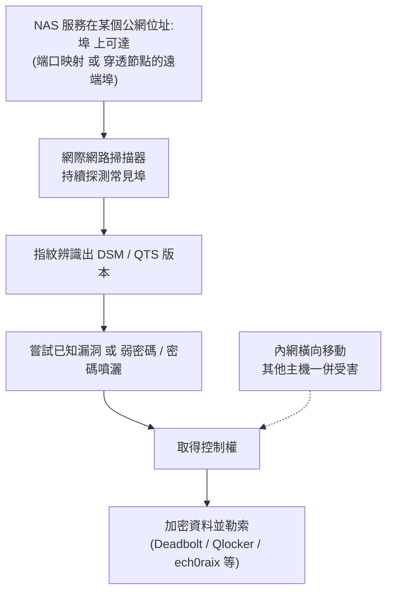

# 「使用內網穿透訪問 NAS 比較安全」是什麼意思？

## 摘要

「使用內網穿透訪問 NAS 比較安全」是一句在中文自架圈（homelab）常見的斷言。它的完整意思必須拆成兩層來讀：

1. **技術層**：它是在說「與把 NAS 的管理埠直接映射到公網（連接埠轉發／端口映射 + DDNS）相比，改用內網穿透來對外提供存取，攻擊面較小」。
2. **判斷層**：它是一個**有條件的比較句**，不是絕對命題。在特定前提下（家寬沒有公網 IP、不開放路由器入站埠、穿透服務額外提供身分驗證）它成立；但在另一組前提下（穿透節點把服務暴露在公網固定埠、沒有端到端加密、沒有額外驗證）它**不成立**。

換句話說，這句話的意思接近「**不要為了讓 NAS 能被外網連上，就在路由器上開一個永遠對全世界敞開的入站埠**」，而不是「只要用了內網穿透，NAS 就安全了」。

本報告先定義內網穿透，再逐項檢驗這個斷言成立與不成立的條件，最後整理可稽核的來源與風險清單。

---

## 1. 什麼是「內網穿透」

### 1.1 問題背景：家寬沒有公網 IP

一般家用路由器建立的網路（內網／LAN）內部裝置可以互相存取，但不同路由器後面的兩台機器彼此無法直接連線，因為雙方都沒有可被網際網路路由到的公網 IP。SakuraFrp 的官方科普文件描述：

> 「由於 IPv4 地址的稀缺，國內三大運營商（電信、移動、聯通）基本都不給家寬用戶分配公網 IP，更不用說一些二線小運營商了。」[^natfrp-basics]

當沒有公網 IP 時，要讓外部連上內網服務，就得靠內網穿透或 UDP 打洞等技術[^natfrp-basics]。

### 1.2 定義：用一台有公網 IP 的機器當中間人

SakuraFrp 對內網穿透的定義是：

> 「簡單的說，內網穿透就是使用一台有公網 IP 的電腦（SakuraFrp 將其稱為**節點**）作為『中間人』來與沒有公網 IP 的電腦建立連接並轉發數據。」[^natfrp-basics]

運作流程是：內網機器執行客戶端程式（例如 frp 的 `frpc`），主動向公網節點建立一條連線，這條連線被稱為**隧道**；節點為每條隧道分配一個**遠端埠**；外部使用者連到「節點位址:遠端埠」，流量再經由隧道回到內網服務[^natfrp-basics]。

### 1.3 與相鄰概念的差別

| 方案 | 對外暴露的是什麼 | 需要家寬公網 IP | 誰看得到流量 |
|---|---|---|---|
| 端口映射 + DDNS | 你家路由器的公網 IP 與一個入站埠 | 需要 | 只有你與 ISP |
| 內網穿透（第三方中轉節點） | **節點服務商**的公網 IP 與一個遠端埠 | 不需要 | 你、服務商（視加密方式而定） |
| 點對點內網穿透（P2P） | 打洞成功後不經伺服器中轉 | 不需要 | 只有兩端 |
| VPN／Mesh 覆蓋網路 | 不開放任何公網入站埠（或僅 VPN 埠） | 不需要 | 只有授權節點 |

以 frp 為例，官方同時提供兩種型態：`stcp`／`xtcp` 需要**存取端也部署 frpc**才能連線，文件明白寫出理由是「某些內網服務，如果直接暴露在公網上，可能存在安全風險」[^frp-stcp]；其中 `xtcp` 更進一步「流量不會通過伺服器中轉」[^frp-xtcp]。這點很關鍵：**同樣叫「內網穿透」，中轉式與 P2P 式的安全性質完全不同。**

---

## 2. 這個斷言在什麼意義上成立

### 2.1 不開放路由器入站埠，等於刪掉一整類攻擊路徑

中轉式穿透的客戶端是**由內往外**建立連線的。Cloudflare 對其 Tunnel 產品的說明完整表達了這種模型的價值：

> 「With Tunnel, you do not send traffic to an external IP — instead, a lightweight daemon in your infrastructure (`cloudflared`) creates **outbound-only connections** to Cloudflare's global network.」[^cf-tunnel]
>
> 「You can then configure your firewall to allow only these outbound connections and **block all inbound traffic**, effectively blocking access to your origin from anything other than Cloudflare.」[^cf-tunnel]

（譯：你不需把流量送到一個外部 IP，而是在你的基礎設施內跑一個守護程式，由它主動向 Cloudflare 建立**僅向外**的連線。你可以把防火牆設成只允許這些向外連線並封鎖所有入站流量，實質上讓你的來源主機只接受 Cloudflare 的存取。）

用白話說：**路由器上不再有一個對全世界敞開的門。** 這確實減少了「被網際網路上的掃描器直接敲到 NAS 管理介面」的機會。

### 2.2 官方與政府的共同建議方向一致

美國網路安全暨基礎設施安全局（CISA）在其〈Internet Exposure Reduction Guidance〉中把「移除不必要的暴露、其餘改走受控通道」列為核心原則：

> 「CISA urges all critical infrastructure organizations to **route all necessary remote access through a secure gateway, firewall, VPN, or other centrally managed access solution**, rather than connecting directly to a PLC, human-machine interface (HMI), or remote terminal unit (RTU).」[^cisa-exposure]

（譯：CISA 呼籲所有關鍵基礎設施組織，把一切必要的遠端存取改走安全閘道、防火牆、VPN 或其他集中管理的存取方案，而不是直接連上裝置本身。）

同一份文件也要求「關閉或限制沒有書面作業需求的埠」，並列出應優先檢查的常見遠端存取埠：22（SSH）、23（Telnet）、80（HTTP）、443（HTTPS）、3389（RDP）、5900（VNC）等[^cisa-exposure]。NAS 的管理介面正好落在 80/443/5000/5001 這一類。

### 2.3 NAS 廠商自己的官方建議也是如此

QNAP 在多份安全公告中反覆給出同一組建議。2022 年 Deadbolt 勒索軟體利用 Photo Station 漏洞攻擊「直接連上網際網路」的 NAS 時，QNAP 公告（經 Security Affairs 逐字引用）寫道：

> 「We strongly urge that **their QNAP NAS should not be directly connected to the Internet**. ... **We recommend users to make use of the myQNAPcloud Link feature provided by QNAP, or enable the VPN service.** This can effectively harden the NAS and decrease the chance of being attacked.」[^sa-deadbolt-2022]

（譯：我們強烈呼籲使用者的 QNAP NAS 不應直接連上網際網路。……建議改用 QNAP 提供的 myQNAPcloud Link 功能，或啟用 VPN 服務。這能有效強化 NAS 並降低被攻擊的機會。）

另一波攻擊時 QNAP 的建議是「避免將 NAS 暴露在網際網路上」，並在最初一波時提醒使用者「**停用 UPnP 與連接埠轉發**」[^sa-deadbolt-may][^sa-deadbolt-jan]。

換句話說，「用穿透／VPN 取代直接映射」正是廠商與政府機關共同推薦的方向。斷言在這層意義上是有依據的。

---

## 3. 這個斷言在什麼情況下**不**成立

這是本題最需要說清楚的部分。把「內網穿透」當成安全保證是常見誤解，原因有四。

### 3.1 中轉式穿透通常仍然把服務暴露在公網

中轉節點會給每條隧道分配一個**遠端埠**，外部使用者就是連到「節點位址:遠端埠」[^natfrp-basics]。除非額外設定存取控制，**任何知道該位址的人都連得上**——包括掃描器。SakuraFrp 自己的 NAS 穿透教學就直接給出可公開存取的範例位址（`https://<節點>:23333/`）[^natfrp-synology]。

因此，「內網穿透」若沒有搭配驗證機制，其暴露程度與「端口映射」的差別只在於**IP 換成了服務商的 IP、埠換成了服務商指派的埠**，本質上仍是公網可達。SakuraFrp 因此在安全指南中把「訪問認證」列為**強烈推薦**項目：

> 「我們**強烈推薦**所有用戶啟用此功能……啟用訪問認證後，未經授權的 IP 將無法訪問您的隧道，這可以有效回避密碼被爆破、遭到 0day 攻擊等安全風險。」[^natfrp-auth][^natfrp-security]

### 3.2 穿透服務商成為新的信任對象（可視性與中間人問題）

中轉節點是流量路徑上的一個第三方。是否能看到內容，取決於加密終止在哪一端：

- **未加密或由服務商終止 TLS**：服務商可讀取、可記錄、技術上可竄改。
- **端到端加密（隧道層加密）**：服務商只能看到密文。frp 自 v0.50.0 起預設開啟 TLS 加密，且支援單向與雙向憑證驗證；官方並明確指出 `useEncryption`／STCP 這類功能「無法判斷對方的身份是否合法，存在被中間人攻擊的風險」，因此才需要 TLS 與雙向驗證[^frp-tls]。

Mesh VPN 把這點講得更白。Tailscale 對其中繼伺服器 DERP 的說明是：

> 「Remember that Tailscale private keys never leave the node where they were generated; that means there is **never a way for a DERP server to decrypt your traffic**. It just blindly forwards already-encrypted traffic from one node to another.」[^tailscale]

（譯：Tailscale 的私鑰永不離開產生它的節點，因此 DERP 伺服器**永遠無法解密**你的流量，它只是盲目轉發已加密的流量。）

EasyTier 的隱私政策則同時說明「中繼節點不具備解密能力」與「節點發現階段的部分中繼資料可能以明文傳輸」兩件事，並明白表示對公共伺服器與中繼節點上的傳輸安全「不負責」：

> 「即便在此場景下，流量依然保持對稱加密狀態。中繼節點僅負責數據包的透傳與路由，**不具備解密能力**，無法獲取或分析被加密的原始數據內容。」[^easytier-privacy]
>
> 「對於公共伺服器和中繼節點，客戶端**可能採用明文傳輸此類數據**，我們不對傳輸過程中的數據安全性負責，請知悉相關風險。」[^easytier-privacy]

這正是判斷「用了穿透是否比較安全」的關鍵分岔：**沒有端到端加密時，你只是把信任從 ISP 換成了穿透服務商。** 而自建 frp／自架 relay 能移除「服務商看得到」這個變數，卻換來「你必須自己維運一台公網主機並正確設定 TLS 與驗證」的責任。

### 3.3 隧道並不能修補 NAS 本身的漏洞

穿透只是改變連線路徑，服務本身仍是同一個 DSM／QTS。Synology 2026 年 10 月 29 日的公告即指出，攻擊者利用一個**2024 年 12 月就已修補**的漏洞，攻擊「執行過舊 DSM 版本」的裝置以加密資料並勒索[^synology-c3rb3r]。該漏洞（CVE-2024-10441）CVSS 3.1 基礎分數為 **9.8（Critical）**，屬未經驗證即可遠端執行任意程式碼[^synology-sa2420]。CISA 並於 2026 年 11 月 18 日將該漏洞列入〈Known Exploited Vulnerabilities〉目錄，理由是已有實際利用證據[^cisa-kev]。

換句話說，只要 NAS 管理介面能從網際網路到達——**不論是透過端口映射還是透過穿透節點的遠端埠**——未修補的漏洞就仍可被利用。2020 年 V2EX 上一則被廣泛引用的案例即是此類：使用者以 frp 將單位伺服器做內網穿透，因資料庫弱密碼被提權，最終內網 14 台伺服器遭勒索病毒感染[^v2ex-frp]。

### 3.4 穿透客戶端本身是高權限元件

`frpc`／`cloudflared` 這類客戶端需要常駐在 NAS 上並能連到本機服務，部分安裝方式以套件或高權限服務執行[^natfrp-synology]。這等於在 NAS 上多了一個需要持續更新、且其認證憑證（token／存取金鑰）必須妥善保管的元件。frp 官方文件即提醒 token 檔案應設為 600 權限，且僅能被執行 frp 的使用者讀取[^frp-authn]。

---

## 4. 攻擊鏈：暴露 → 掃描 → 利用

CISA 在 2026 年 10 月發布的聯合公告（AA26-281A）描述的手法，正好構成這條鏈的前兩段：攻擊者使用大量開源掃描工具（BBScan、dirsearch、Fscan、masscan、NMAP、OneForAll、ShuiZe、wpscan 等）尋找具漏洞的網路與網頁應用，並「一般聚焦於掃描 21、22、53、80、443、1080 等埠」[^cisa-aa26281a]。其建議的首要緩解措施就是：

> 「**Disable unused services and ports**, such as automatic configuration, remote access, or file sharing protocols.」[^cisa-aa26281a]

（譯：停用未使用的服務與埠，例如自動組態、遠端存取或檔案分享協定。）

以 QNAP 為例，實際發生的規模：2022 年 Deadbolt 高峰時，Censys 在當時網際網路上約 13 萬台 QNAP 裝置中觀測到 **4,988** 個遭 Deadbolt 感染的服務；BleepingComputer 則報導已加密超過 **3,600** 台裝置[^sa-deadbolt-mar][^sa-deadbolt-jan]。2021 年 Qlocker 利用 HBS 3 的 CVE-2021-28799，把檔案搬進**有密碼保護的 7z 壓縮檔**並索取 550 美元贖金，感染數「每天暴增至數百台」[^sa-qlocker]。ech0raix 自 2019 年起即針對 NAS，2021 年 12 月又出現一波攻擊[^sa-ech0raix]。

這些案例的共同點是：**受害裝置都是能從網際網路直接到達的**。

---

## 5. 那麼，「比較安全」該怎麼正確表述

把上述材料整理成可操作的判準：

| 前提 | 「內網穿透比較安全」是否成立 |
|---|---|
| 相較於「把 DSM 5000/5001 直接映射到公網且無任何額外驗證」 | **成立**：少了一個長期敞開的入站埠，且可疊加服務商層的身分驗證 |
| 穿透節點的遠端埠仍公開可達，且未啟用存取認證 | **不成立**：與端口映射的暴露程度相當，仍會被掃描與爆破[^natfrp-auth] |
| 隧道未提供端到端加密（或由服務商終止 TLS） | **部分成立**：路徑變了，但信任對象變成穿透服務商[^frp-tls][^easytier-privacy] |
| 使用 P2P／Mesh（`xtcp`、WireGuard、Tailscale、ZeroTier、EasyTier） | **較成立**：不開放公網監聽埠，未授權節點連不上，且中繼無法解密[^frp-xtcp][^tailscale][^easytier-privacy] |
| NAS 未修補已知漏洞 | **不成立**：穿透無法修補服務本身漏洞[^synology-c3rb3r][^cisa-kev] |
| 使用弱密碼、未啟用多因素驗證 | **不成立**：QNAP 與 CISA 皆把強密碼與 MFA 列為必要措施[^sa-deadbolt-jan][^cisa-aa26281a] |

若要一句話總結這句話的意思，最精確的版本是：

> **「與其在路由器上開一個對全世界敞開的入站埠，不如讓 NAS 主動向外建立連線，並把身分驗證與存取控制放在隧道這一層。」**

而它**不是**在說「內網穿透本身提供安全性」。安全性來自三件事的組合：(1) 不開放公網入站埠；(2) 端到端加密與雙向驗證，使中繼不可讀；(3) NAS 自身持續修補、強密碼與多因素驗證。

---

## 6. 實務建議（依風險由低到高排序）

1. **首選：Mesh VPN（WireGuard／Tailscale／ZeroTier／EasyTier 等）或自架 VPN**。不開放公網服務埠，未授權節點無法建立連線；中繼僅轉發密文[^tailscale][^easytier-privacy]。
2. **次選：自建 frp + `stcp`／`xtcp`**。需存取端也部署 frpc，並啟用 TLS 與雙向憑證驗證[^frp-stcp][^frp-xtcp][^frp-tls]。
3. **中轉式穿透（第三方節點）**：務必啟用存取認證（密碼／TOTP，可組合成 2FA），並只穿透**必要**的埠[^natfrp-auth][^natfrp-security]。
4. **無論採用何者**：停用 UPnP 與不必要的埠轉發；啟用 DSM／QTS 的自動更新；啟用多因素驗證與自動封鎖；關閉預設 admin 帳號；將管理介面與對外服務分離[^cisa-exposure][^cisa-aa26281a][^sa-deadbolt-jan]。
5. **避免**：把 NAS 管理介面（DSM 5000/5001、QTS 8080/443）直接映射到公網並長期開啟。

---

## 7. 來源評註（Critical reflection）

- **廠商文件（SakuraFrp、Cloudflare、ngrok、Tailscale、EasyTier、frp）具有商業或推廣動機**，其安全性描述應與政府機關文件（CISA）交叉比對後採用。本報告僅採用其**技術機制說明**（連線方向、加密終止點、中繼能否解密），未採用其「比較安全」的行銷結論。
- **QNAP 的原始公告頁面在本次檢索中無法直接取得內容**（站點阻擋），本報告中的 QNAP 公告引文係透過 Security Affairs 逐字引用該公告的轉載，屬二手來源，可信度低於一手公告。
- **Synology 知識庫文章（kb.synology.com）為 JavaScript 動態渲染**，本次無法取得正文；因此本報告在 Synology 部分僅引用可完整取得的**安全性諮詢**與**新聞稿**，未引用知識庫的操作教學內容。
- **未能取得可驗證的「暴露後多久被掃描」具體數值**。本次檢索嘗試取得 SANS Internet Storm Center 的掃描速度日誌與相關蜜罐研究，但頁面內容未能成功擷取，因此本報告**不提供**任何「幾分鐘內被掃描」的數字，以免引用未經核實的數據。
- **未找到專門針對 NAS 的美國政府聯合公告**。CISA 目前可取得的是〈Internet Exposure Reduction Guidance〉與 AA26-281A 這類**一般性**的暴露削減與掃描手法公告；NAS 專屬的官方建議主要來自廠商（QNAP、Synology）。
- **V2EX 案例屬個人自述**，非經司法或鑑識確認的公開報告，引用時僅作為「弱密碼 + 內網穿透可導致橫向感染」的示意，不宜當作統計證據。

---

## 參考文獻

[^natfrp-basics]: SakuraFrp 帮助文档. (n.d.). *内网穿透基础知识*. Retrieved 2026-11-21, from https://doc.natfrp.com/basics.html

[^natfrp-security]: SakuraFrp 帮助文档. (n.d.). *安全指南*. Retrieved 2026-11-21, from https://doc.natfrp.com/bestpractice/security.html

[^natfrp-auth]: SakuraFrp 帮助文档. (n.d.). *配置访问认证功能*. Retrieved 2026-11-21, from https://doc.natfrp.com/bestpractice/frpc-auth.html

[^natfrp-synology]: SakuraFrp 帮助文档. (n.d.). *群晖 (Synology) NAS 穿透指南*. Retrieved 2026-11-21, from https://doc.natfrp.com/app/synology.html

[^frp-tls]: The frp Authors. (2026-10-21). *自定义 TLS 协议加密*. Retrieved 2026-11-21, from https://gofrp.org/zh-cn/docs/features/common/network/network-tls/

[^frp-stcp]: The frp Authors. (2026-10-21). *安全地暴露内网服务*. Retrieved 2026-11-21, from https://gofrp.org/zh-cn/docs/examples/stcp/

[^frp-xtcp]: The frp Authors. (2026-10-21). *点对点内网穿透*. Retrieved 2026-11-21, from https://gofrp.org/zh-cn/docs/examples/xtcp/

[^frp-authn]: The frp Authors. (2026-10-21). *身份认证*. Retrieved 2026-11-21, from https://gofrp.org/zh-cn/docs/features/common/authentication/

[^cf-tunnel]: Cloudflare. (2026-11-18). *Cloudflare Tunnel*. Retrieved 2026-11-21, from https://developers.cloudflare.com/cloudflare-one/connections/connect-networks/

[^tailscale]: Pennarun, A. (2020-03-20). *How Tailscale works*. Tailscale. Retrieved 2026-11-21, from https://tailscale.com/blog/how-tailscale-works

[^easytier-privacy]: EasyTier 开源版本开发团队. (2026-07-15). *EasyTier 隐私政策*. Retrieved 2026-11-21, from https://easytier.cn/guide/privacy.html

[^cisa-exposure]: Cybersecurity and Infrastructure Security Agency. (2026-08-21). *Internet Exposure Reduction Guidance*. Retrieved 2026-11-21, from https://www.cisa.gov/resources-tools/resources/exposure-reduction

[^cisa-aa26281a]: Cybersecurity and Infrastructure Security Agency. (2026-10-08). *Chinese Government-linked Cyber Threat Actors Combine Automated and Hands-on Hacking Tools to Steal Sensitive Data* (Alert Code AA26-281A). Retrieved 2026-11-21, from https://www.cisa.gov/news-events/cybersecurity-advisories/aa26-281a

[^cisa-kev]: Cybersecurity and Infrastructure Security Agency. (2026-11-18). *CISA Adds Four Known Exploited Vulnerabilities to Catalog*. Retrieved 2026-11-21, from https://www.cisa.gov/news-events/alerts/2026/11/18/cisa-adds-four-known-exploited-vulnerabilities-catalog

[^cisa-edge]: Cybersecurity and Infrastructure Security Agency. (2025-02-04). *Guidance and Strategies to Protect Network Edge Devices*. Retrieved 2026-11-21, from https://www.cisa.gov/resources-tools/resources/guidance-and-strategies-protect-network-edge-devices

[^synology-sa2420]: Synology Inc. (2024-11-05). *Synology-SA-24:20 DSM (PWN2OWN 2024)*. Retrieved 2026-11-21, from https://www.synology.com/en-global/security/advisory/Synology_SA_24_20

[^synology-c3rb3r]: Synology Inc. (2026-10-29). *Synology urges users to update DSM following ransomware attacks on outdated DSM versions*. Retrieved 2026-11-21, from https://www.synology.com/en-global/company/news/article/C3RB3R/Synology%20urges%20users%20to%20update%20DSM%20following%20ransomware%20attacks%20on%20outdated%20DSM%20versions

[^sa-deadbolt-2022]: Paganini, P. (2022-09-05). *QNAP warns new Deadbolt ransomware attacks exploiting zero-day*. Security Affairs. Retrieved 2026-11-21, from https://securityaffairs.com/135347/malware/qnap-deadbolt-ransomware-new-attacks.html

[^sa-deadbolt-mar]: Paganini, P. (2022-03-22). *A new wave of DeadBolt Ransomware attacks hit QNAP NAS devices*. Security Affairs. Retrieved 2026-11-21, from https://securityaffairs.com/129373/malware/qnap-nas-deadbolt-ransomware.html

[^sa-deadbolt-may]: Paganini, P. (2022-05-20). *QNAP warns of a new wave of DeadBolt ransomware attacks against its NAS devices*. Security Affairs. Retrieved 2026-11-21, from https://securityaffairs.com/131494/iot/qnap-nas-deadbolt-ransomware-2.html

[^sa-deadbolt-jan]: Paganini, P. (2022-01-29). *QNAP force-installs update against the recent wave of DeadBolt ransomware infections*. Security Affairs. Retrieved 2026-11-21, from https://securityaffairs.com/127353/malware/qnap-force-installs-update-deadbolt-ransomware.html

[^sa-qlocker]: Paganini, P. (2021-05-22). *Qlocker ransomware leverages HBS flaw to infect QNAP NAS devices*. Security Affairs. Retrieved 2026-11-21, from https://securityaffairs.com/118179/malware/qlocker-ransomware-qnap-nas.html

[^sa-ech0raix]: Paganini, P. (2021-12-27). *A new wave of ech0raix ransomware attacks targets QNAP NAS devices*. Security Affairs. Retrieved 2026-11-21, from https://securityaffairs.com/126081/malware/ech0raix-ransomware-targeting-qnap-nas.html

[^v2ex-frp]: shoreywong. (2020-07-21). *把公司内网穿透 然后被勒索了 我得付多大责任*. V2EX. Retrieved 2026-11-21, from https://www.v2ex.com/t/692012
