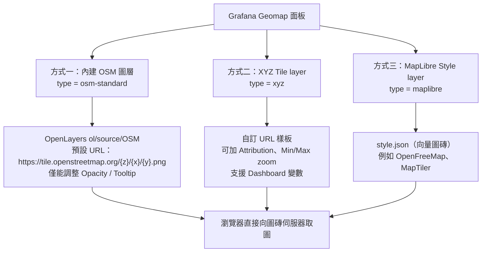
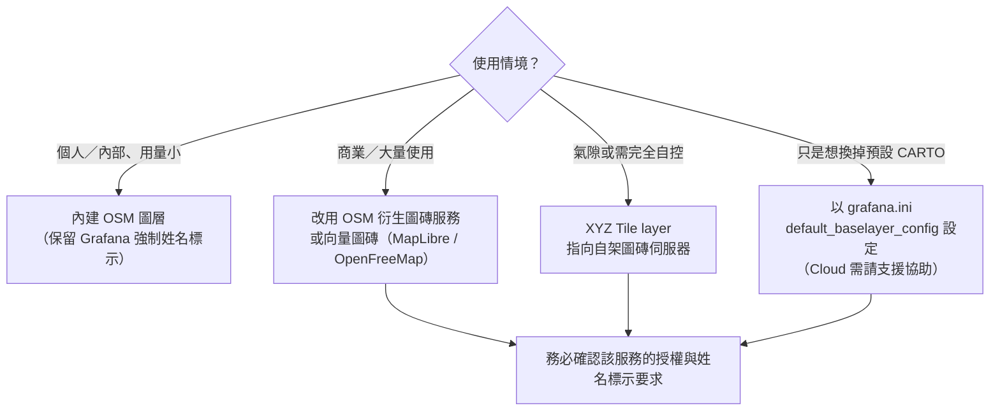

# Grafana Geomap 是否可以使用 OpenStreetMap 圖磚？

## 摘要

**可以。** Grafana 的 Geomap 面板原生支援 OpenStreetMap（OSM），而且不只一種方式：

1. **內建「OpenStreetMap」底圖圖層**（內部 id 為 `osm-standard`），直接使用 OSM 官方圖磚伺服器[^geomap-layer]。
2. **XYZ Tile layer**：可自行填入任何 `{z}/{x}/{y}` 圖磚網址，官方文件給的範例正是 `https://tile.openstreetmap.org/{z}/{x}/{y}.png`[^geomap-layer]。
3. **MapLibre Style layer**：改用向量圖磚（vector tiles）與 `style.json`，例如 OpenFreeMap 這類以 OSM 資料為基礎、無需 API key 的服務[^geomap-layer][^openfreemap]。

需要注意的是：**Grafana 的預設底圖並不是 OSM，而是 CARTO**[^geomap-default]，而且 CARTO 於 2026 年 8 月起開始要求 API key，導致大量使用者的地圖出現浮水印，社群因此轉向 OSM 或其他開放圖磚來源[^issue-131638]。此外，使用 OSM 官方圖磚**必須遵守 OSMF 的圖磚使用政策與姓名標示（attribution）要求**，否則可能被無預警封鎖[^osm-policy]。

---

## 1. 背景：Geomap 是什麼

Geomap 是 Grafana 於 **8.1 版（2021-08-05 發布）** 導入的官方核心面板，用來取代舊的 Worldmap 面板，底層採用開放原始碼地圖函式庫 **OpenLayers**，提供多種底圖（base layer）與資料圖層（data layer）選項[^whatsnew-81][^blog-geomap-81]。

Grafana 主專案 `grafana/grafana` 在 GitHub 上有 **78,021 顆星**（擷取於 2026-11-21），授權為 AGPL-3.0[^gh-grafana]。Geomap 面板本身即隨 Grafana 主程式一起發布，不需要另外安裝外掛。

Grafana 8.1 的官方說明指出：

> The panel ships with multiple map layer options, such as Open Street Maps and a number of ArcGIS options, as well as the existing CartoDB tile set, which is the default base map.[^blog-geomap-81]

也就是說，**OSM 從 Geomap 誕生的第一天就是內建選項之一**。

---

## 2. 三種使用 OSM 圖磚的方式



### 2.1 方式一：內建 OpenStreetMap 圖層

Geomap 的底圖圖層共有五種：OpenStreetMap、CARTO、ArcGIS MapServer、XYZ Tile layer、MapLibre Style layer[^geomap-layer]。其中 OpenStreetMap 圖層的可設定項目最少，只有 **Opacity**（透明度 0–1）與 **Display tooltip**[^geomap-layer]。

從原始碼可以看出它的實作方式非常單純：

```typescript
// public/app/plugins/panel/geomap/layers/basemaps/osm.ts
import TileLayer from 'ol/layer/Tile';
import OSM from 'ol/source/OSM';

export const standard: MapLayerRegistryItem = {
  id: 'osm-standard',
  name: 'OpenStreetMap',
  description: 'Add map from a collaborative free geographic world database',
  isBaseMap: true,
  requiresAttribution: true,
  create: async (_map, options) => ({
    init: () => {
      const noRepeat = options.noRepeat ?? false;
      return new TileLayer({
        source: new OSM({ wrapX: !noRepeat }),
      });
    },
  }),
};
```

[^src-osm]

`ol/source/OSM` 的預設圖磚網址即為 `https://tile.openstreetmap.org/{z}/{x}/{y}.png`，預設 `crossOrigin` 為 `anonymous`、`referrerPolicy` 為 `origin-when-cross-origin`、`maxZoom` 為 19[^ol-osm-api][^ol-osm-src]。也就是說，**圖磚是由使用者瀏覽器直接向 OSM 伺服器抓取，不經過 Grafana 後端**，因此用戶端的網路與防火牆必須能連到 `tile.openstreetmap.org`[^issue-83063]。

另外原始碼中的 `requiresAttribution: true` 是關鍵欄位，代表這個圖層的授權**強制要求顯示姓名標示**（詳見第 5 節）。

### 2.2 方式二：XYZ Tile layer（自訂圖磚網址）

如果要用非官方的 OSM 衍生圖磚服務、或想自架圖磚伺服器，應使用 **XYZ Tile layer**。官方文件的範例直接就是 OSM：

```ini
URL template: https://tile.openstreetmap.org/{z}/{x}/{y}.png
Attribution:  OpenStreetMap
Min zoom:     最小縮放層級，低於此層級不載入圖磚
Max zoom:     伺服器提供的最大縮放層級，超過則以放大既有圖磚方式呈現
Opacity:      0（透明）到 1（不透明）
```

URL 樣板支援 Dashboard 變數，例如 `https://example.com/maps/${version}/{z}/{x}/{y}.png`[^geomap-layer]。

其原始碼（`layers/basemaps/generic.ts`）顯示 URL 與 attribution 都會經過樣板變數替換與安全清理（`textUtil.sanitizeUrl` / `sanitizeTextPanelContent`），並且會把 `minZoom`、`maxZoom` 一併傳給 OpenLayers 的 `XYZ` source[^src-generic]。

### 2.3 方式三：MapLibre Style layer（向量圖磚）

若想要現代化的向量圖磚與深色主題，可使用 MapLibre Style layer，填入 `style.json` 網址即可（例如 `https://demotiles.maplibre.org/style.json`），必要時可提供 Mapbox 存取權杖[^geomap-layer]。

由於 CARTO 預設底圖在 2026 年開始要求 API key，社群提出以 **OpenFreeMap**（`https://tiles.openfreemap.org/styles/dark`）取代預設底圖的做法，理由是 OpenFreeMap 以 OSM 資料為基礎、**不需 API key、允許商業使用、且可自架**[^issue-131638]。OpenFreeMap 在 GitHub 上有 **6,495 顆星**（擷取於 2026-11-21）[^openfreemap]。

---

## 3. 如何把 OSM 設為「預設底圖」

Grafana 的預設底圖是 CARTO[^geomap-default]。若要改成 OSM，可透過 `grafana.ini` 的 `[geomap]` 區段設定 `default_baselayer_config`[^geomap-layer][^conf-grafana]。

設為內建 OSM 圖層：

```ini
[geomap]
default_baselayer_config = `{
  "type": "osm-standard",
  "config": {}
}`
```

設為指向 OSM 官方圖磚的 XYZ 圖層：

```ini
[geomap]
default_baselayer_config = `{
  "type": "xyz",
  "config": {
    "attribution": "OpenStreetMap",
    "url": "https://tile.openstreetmap.org/{z}/{x}/{y}.png"
  }
}`
```

[^geomap-layer]

`default_baselayer_config` 目前支援五種型別：`carto`、`esri-xyz`、`osm-standard`、`xyz`、`maplibre`[^geomap-layer]。另有 `enable_custom_baselayers`（預設 `true`），設為 `false` 會停用並在使用者介面中隱藏其他自訂底圖[^geomap-layer][^conf-grafana]。

這套後端設定機制是在 Grafana 8.1 開發期間透過 PR #37041（標題「Geomap: Base layer server configuration」）加入的，於 **2021-07-21 合併**；該 PR 說明其目的為「allow users to provision tile servers for the new GeoMaps plugin」，並在前端 PR 中接上預設底圖的載入[^pr-37041]。

設定也可以透過環境變數覆寫（`GF_GEOMAP_DEFAULT_BASELAYER_CONFIG`）或以 Grafana Operator 的 YAML 形式提供[^conf-grafana][^issue-131638]：

```yaml
spec:
  config:
    geomap:
      default_baselayer_config: '{"type":"maplibre","config":{"url":"https://tiles.openfreemap.org/styles/dark"}}'
```

**重要限制：Grafana Cloud 使用者沒有 `grafana.ini` 的存取權**，因此無法自行更改預設底圖，只能在使用者介面逐一面板調整，或請 Grafana 支援協助設定[^issue-131638]。

### 3.1 文件不一致之處（批判性觀察）

官方兩份文件的敘述互相矛盾：

- **Geomap 面板文件**（較新、較權威）列出五種型別：`carto`、`esri-xyz`、`osm-standard`、`xyz`、`maplibre`[^geomap-layer]。
- **Configure Grafana 設定文件**（`[geomap]` 區段）卻寫「Four base map options to choose from are `carto`, `esriXYZTiles`, `xyzTiles`, `standard`」，並附上以 OSM 圖磚為範例的設定[^conf-grafana]。

後者的型別名稱與實際程式碼中的 id（`carto`、`esri-xyz`、`xyz`、`osm-standard`、`maplibre`）不符，屬於**過時或未同步的敘述**。實務上應以面板文件與原始碼為準。此為文件品質問題，不影響功能本身。

---

## 4. 已知問題與注意事項

### 4.1 OSM 底圖縮放後變黑（v12.4.3）

2026-07-20 有兩筆 GitHub Issue（#128752、#128756）回報在 **Grafana v12.4.3 / Windows / Chrome** 上，OSM 底圖在縮放後會持續呈現黑畫面，資料點仍正常顯示，需再縮放一次或等待數秒才會出現圖磚，並表示舊版 Grafana 11 很少遇到[^issue-128752][^issue-128756]。截至 2026-11-21，Issue #128752 仍為開啟狀態[^issue-128752]。

### 4.2 代理／VPN 環境下底圖空白

若 Grafana 部署在需要透過代理或 VPN 才能連外的主機上，**伺服器端設定代理並不足以讓地圖出現**，因為圖磚是由瀏覽器直接抓取，用戶端必須能連線到圖磚伺服器[^issue-83063]。

### 4.3 反向代理的 CSP 會擋掉圖磚

社群案例顯示，Nginx 的 Content-Security-Policy 標頭若未允許圖磚網域，會導致底圖完全不顯示，需在 CSP 中加入對應網域（例如 `https://*.basemaps.cartocdn.com`）[^forum-csp]。

### 4.4 離線／氣隙環境

Grafana 本身不需要網際網路，但底圖圖層需要連到外部端點。AWS 在 Geomap 外掛的技術說明中寫道：

> Although Grafana itself does not require an internet connection, some map panels need internet access to reach a base layer endpoint. Allowing you to configure your own base layer lets you also configure one that is compatible offline.[^aws-geomap]

因此在氣隙環境中必須改用 XYZ 或 MapLibre 圖層指向自架的圖磚伺服器[^community-offline][^aws-geomap]。社群案例中，設定失敗的常見原因是 URL 樣板路徑寫錯（回傳 404）[^community-offline]。

### 4.5 姓名標示欄位的安全漏洞（CVE-2026-9029）

**XYZ tile layer 的 attribution 欄位曾存在儲存型 XSS 漏洞**：具 Editor 權限的使用者可透過樣板變數注入惡意腳本，並在任何檢視該儀表板的使用者瀏覽器中執行（CVSS 7.3）。修補版本為 **>= 12.4.4 與 >= 13.0.2**[^cve-9029]。使用自訂 attribution 時應確保已升級。

---

## 5. 授權與 OSM 圖磚使用政策（最重要的一節）

### 5.1 姓名標示是法律義務，不是選項

OSM 資料以 **Open Database License（ODbL）** 釋出，使用者必須標示 OpenStreetMap。OSMF 的官方指引要求：

- 標示文字必須是「OpenStreetMap」，並讓人清楚知道資料以 ODbL 提供（例如把文字連到 `openstreetmap.org/copyright`）。
- 「© OpenStreetMap contributors」或「© OpenStreetMap」皆為可接受的傳統形式。
- 互動式地圖的標示通常置於地圖角落，且**不得需要使用者互動才能看到**[^osm-attribution]。

Grafana 對此有對應實作：原始碼中 OSM 與 CARTO 底圖都設定了 `requiresAttribution: true`，而面板的「Show optional attribution」選項說明為：

> Displays attribution for basemap layers whose license doesn't require it. When a layer license requires attribution, Grafana always displays it and this option has no effect.[^geomap-layer][^src-osm]

換句話說，**只要使用內建 OSM 圖層，Grafana 一律顯示姓名標示，無法關閉**。這項行為源自社群 Issue #103887（標題為「Legal: Geomap: attribution should not be able to be hidden with certain layers」），該 Issue 指出提供關閉選項等同「Disrespect map licensing」選項，並已於 2026-08-05 關閉[^issue-103887]。

### 5.2 OSM 圖磚伺服器不是免費資源

OSMF 明確指出：**OSM 資料對所有人免費，但圖磚伺服器不是**；它們由捐款與贊助支撐、容量有限[^osm-policy]。使用 `tile.openstreetmap.org` 時必須：

| 類別 | 要求 |
|---|---|
| 網址 | 必須使用 `https://tile.openstreetmap.org/{z}/{x}/{y}.png`（不可用 http、不可換子網域） |
| 姓名標示 | 必須清楚可見，通常置於地圖右下角 |
| 身分識別 | 必須送出可辨識應用程式的 User-Agent；網頁須送出 Referer |
| 快取 | 依伺服器快取標頭（或至少 7 天）在本機快取 |
| 禁止 | 禁止批次下載／預取（scraping）、禁止離線下載功能、禁止預設送出 no-cache 標頭 |

政策同時聲明：**可用性是 best-effort，沒有 SLA**，且可能無預警封鎖[^osm-policy]。

對 Grafana 而言，圖磚請求來自瀏覽器：現代瀏覽器在預設設定下通常已自動滿足 User-Agent、Referer 與快取等技術要求（OSMF 政策原文亦如此說明）[^osm-policy]。真正需要留意的是**「不要拿 Grafana 面板當批次抓圖工具」**：Geomap 的自動刷新（auto-refresh）若搭配大範圍高縮放層級，可能被視為不當使用。

### 5.3 生產環境的建議

若用量較大或屬商業用途，OSMF 建議改用 **OSM 衍生的替代服務、向量圖磚或自架**，而非直接打官方圖磚伺服器[^osm-policy][^osm-vector-policy]。向量圖磚服務 `vector.openstreetmap.org` 有獨立的使用政策，同樣要求姓名標示與可辨識的 User-Agent，並明文禁止批次下載[^osm-vector-policy]。

OSMF 另設有 `openstreetmap/tile-attribution` 倉庫，專門追蹤**使用 OSM 圖磚卻未標示來源的網站**（48 顆星，擷取於 2026-11-21）[^tile-attribution]。這代表姓名標示並非紙上規定，而是會被實際舉報與處理。

---

## 6. 決策建議



---

## 7. 結論

- **Geomap 完全可以使用 OpenStreetMap 圖磚**，且有三條路徑：內建 `osm-standard` 圖層、XYZ Tile layer、MapLibre Style layer。
- 內建 OSM 圖層由 OpenLayers 的 `ol/source/OSM` 驅動，**圖磚由瀏覽器直連 `tile.openstreetmap.org` 取得**，因此用戶端網路必須可連外，且反向代理的 CSP 不能阻擋圖磚網域。
- 預設底圖是 **CARTO 而非 OSM**，需以 `[geomap] default_baselayer_config` 更改；Grafana Cloud 使用者無法自行修改設定檔。
- **姓名標示為 ODbL 的法律義務**，Grafana 對需要標示的圖層設有 `requiresAttribution: true`，使用者無法關閉。商用或高流量情境應改用 OSM 衍生服務、向量圖磚或自架，以符合 OSMF 圖磚使用政策。
- 使用自訂 attribution 時應確認已修補 CVE-2026-9029（>= 12.4.4 或 >= 13.0.2）。

---

## 參考文獻

[^geomap-layer]: Grafana Labs. (n.d.). *Geomap*. Grafana documentation. Retrieved 2026-11-21, from https://grafana.com/docs/grafana/latest/visualizations/panels-visualizations/visualizations/geomap/

[^geomap-default]: Grafana Labs. (n.d.). *Geomap — Basemap layer options*. Grafana documentation. Retrieved 2026-11-21, from https://grafana.com/docs/grafana/latest/visualizations/panels-visualizations/visualizations/geomap/#basemap-layer-options

[^conf-grafana]: Grafana Labs. (n.d.). *Configure Grafana — `[geomap]`*. Grafana documentation. Retrieved 2026-11-21, from https://grafana.com/docs/grafana/latest/setup-grafana/configure-grafana/

[^whatsnew-81]: Grafana Labs. (n.d.). *What's new in Grafana v8.1*. Grafana documentation. Retrieved 2026-11-21, from https://grafana.com/docs/grafana/latest/whatsnew/whats-new-in-v8-1/

[^blog-geomap-81]: Le, A. (2021, August 18). *What's new in Grafana 8.1: Geomap panel*. Grafana Labs Blog. Retrieved 2026-11-21, from https://grafana.com/blog/whats-new-in-grafana-8-1-geomap-panel/

[^gh-grafana]: Grafana Labs. (n.d.). *grafana/grafana* [Repository]. GitHub. Retrieved 2026-11-21, from https://github.com/grafana/grafana

[^src-osm]: Grafana Labs. (n.d.). *osm.ts* [Source code]. GitHub. Retrieved 2026-11-21, from https://github.com/grafana/grafana/blob/main/public/app/plugins/panel/geomap/layers/basemaps/osm.ts

[^src-generic]: Grafana Labs. (n.d.). *generic.ts* [Source code]. GitHub. Retrieved 2026-11-21, from https://github.com/grafana/grafana/blob/main/public/app/plugins/panel/geomap/layers/basemaps/generic.ts

[^ol-osm-api]: OpenLayers. (n.d.). *Class: OSM*. OpenLayers API documentation (v10.11.0). Retrieved 2026-11-21, from https://openlayers.org/en/latest/apidoc/module-ol_source_OSM-OSM.html

[^ol-osm-src]: OpenLayers. (n.d.). *OSM.js* [Source code]. GitHub. Retrieved 2026-11-21, from https://github.com/openlayers/openlayers/blob/main/src/ol/source/OSM.js

[^osm-policy]: OpenStreetMap Foundation. (n.d.). *Tile usage policy*. Retrieved 2026-11-21, from https://operations.osmfoundation.org/policies/tiles/

[^osm-vector-policy]: OpenStreetMap Foundation. (n.d.). *Vector tile usage policy*. Retrieved 2026-11-21, from https://operations.osmfoundation.org/policies/vector/

[^osm-attribution]: OpenStreetMap Foundation. (2021, June 25). *Licence/Attribution Guidelines*. OpenStreetMap Foundation Wiki. Retrieved 2026-11-21, from https://osmfoundation.org/wiki/Licence/Attribution_Guidelines

[^tile-attribution]: OpenStreetMap. (n.d.). *tile-attribution* [Repository]. GitHub. Retrieved 2026-11-21, from https://github.com/openstreetmap/tile-attribution

[^issue-103887]: ElementW. (2025, April 11). *Legal: Geomap: attribution should not be able to be hidden with certain layers* (Issue No. 103887). GitHub. Retrieved 2026-11-21, from https://github.com/grafana/grafana/issues/103887

[^issue-131638]: tedraymond-prog. (2026, August 26). *GeoMap Carto Base layer now requires API key* (Issue No. 131638). GitHub. Retrieved 2026-11-21, from https://github.com/grafana/grafana/issues/131638

[^issue-128752]: marimgadou-glitch. (2026, July 20). *Grafana v12.4.3 GeoMap Map tiles loading issues* (Issue No. 128752). GitHub. Retrieved 2026-11-21, from https://github.com/grafana/grafana/issues/128752

[^issue-128756]: marimgadou-glitch. (2026, July 20). *Grafana v12.4.3 GeoMap Black Background Map tiles Not loading issues* (Issue No. 128756). GitHub. Retrieved 2026-11-21, from https://github.com/grafana/grafana/issues/128756

[^issue-83063]: Bilal-SG. (2024, February 19). *Grafana: World map doesn't show up in Geomap plugin* (Issue No. 83063). GitHub. Retrieved 2026-11-21, from https://github.com/grafana/grafana/issues/83063

[^cve-9029]: Grafana Labs. (2026, June 9). *CVE-2026-9029: Stored XSS in the Geomap panel tile-layer attribution*. Grafana Labs Security Advisories. Retrieved 2026-11-21, from https://grafana.com/security/security-advisories/cve-2026-9029/

[^community-offline]: Mikihiro. (2025, December 12). *How to display offline map tiles in Geomap panel?* Grafana Labs Community Forums. Retrieved 2026-11-21, from https://community.grafana.com/t/how-to-display-offline-map-tiles-in-geomap-panel/160160

[^forum-csp]: Grafana Labs Community Forums. (2023, September 5). *Geomap panel no background*. Retrieved 2026-11-21, from https://community.grafana.com/t/geomap-panel-no-background/102896

[^openfreemap]: hyperknot. (n.d.). *openfreemap* [Repository]. GitHub. Retrieved 2026-11-21, from https://github.com/hyperknot/openfreemap

[^aws-geomap]: Amazon Web Services. (2021, August 12). *Building the Geomap plugin for Grafana 8.1*. AWS Open Source Blog. Retrieved 2026-11-21, from https://aws.amazon.com/blogs/opensource/building-the-geomap-plugin-for-grafana-8-1/

[^pr-37041]: euniceek. (2021, July 21). *Geomap: Base layer server configuration* (Pull request No. 37041). GitHub. Retrieved 2026-11-21, from https://github.com/grafana/grafana/pull/37041
