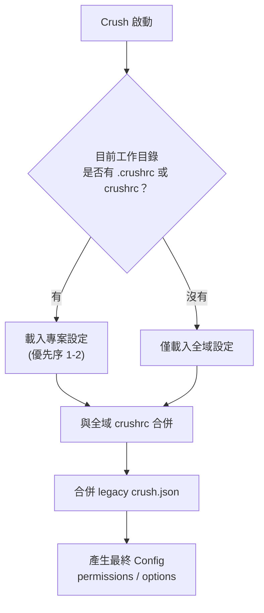

# 在單一 workspace／資料夾中建立 Crush 工具呼叫的白名單與黑名單

## 摘要

Crush 是一套以 Go 撰寫的終端機 AI 編碼代理（agentic coding tool），由 Charm 團隊開發，發佈於 GitHub 的 `charmbracelet/crush` 專案[^repo]。截至 2026-11-21，該專案累積 29,152 顆星、2,386 個 fork，最新正式版本為 `v0.102.0`[^repo][^release]。

本報告回答一個具體的操作問題：**如何針對「某個 workspace／資料夾」建立工具呼叫（tool call）的白名單（allow list）與黑名單（deny list）**。Crush 的權限控制並非單一開關，而是分為四個層次，且全部可以只寫在專案資料夾內的設定檔中，不影響其他專案：

1. **工具層級白名單**：`permissions allow`，寫入 `permissions.allowed_tools`，讓指定工具不再跳出權限詢問[^permsrc][^cfgsrc]。
2. **工具層級黑名單**：`permissions deny`，寫入 `options.disabled_tools`，把指定工具整個隱藏、模型完全看不到[^permsrc][^cfgsrc]。
3. **MCP 伺服器工具層級白／黑名單**：`mcp add` 的 `--enabled-tools`／`--disabled-tools`[^cfgsrc][^configdocs]。
4. **Shell 指令層級白／黑名單**：`permissions safe`／`block`／`unblock`，分別寫入 `permissions.safe_commands`、`permissions.blocked_commands`、`permissions.allowed_commands`[^permsrc][^cfgsrc]。

若需要「依內容判斷」的動態白／黑名單（例如只擋 `git push --force`、只放行唯讀的 `bash` 指令），則要使用 **hooks** 機制中的 `PreToolUse` 事件[^hooksdocs]。

---

## 背景：Crush 是什麼

Crush 的官方描述為「Glamourous agentic coding for all」，是一套在終端機中運作的 AI 編碼代理，可串接多家 LLM 供應商，並透過 MCP（Model Context Protocol）擴充能力，透過 LSP 取得程式碼脈絡[^repo]。它提供多種內建工具（tool），例如 `bash`、`view`、`ls`、`grep`、`edit`、`write`、`fetch`、`sourcegraph`、`todos`、LSP 系列工具等，程式碼中有一份完整清單[^cfgsrc]。

預設情況下，Crush 在執行工具呼叫前會先詢問使用者是否允許（permission prompt）[^configdocs]。

---

## 設定檔的發現順序與「只影響本資料夾」的作法

Crush 支援兩種設定格式：

- **`crushrc`**：一個 Bash 腳本，透過 Crush 專屬的內建指令（`provider`、`model`、`mcp`、`lsp`、`hook`、`permissions`、`option`）在載入時建構設定。官方標示為**偏好格式**，因為它本身就是真正的 Bash，可直接使用變數、條件判斷、`source` 引入其他檔案與密鑰管理工具[^configdocs][^configskill]。
- **`crush.json`**：原本的靜態 JSON 格式，仍受支援，但已被標示為 deprecated，新選項只會加入 Bash 設定格式[^configdocs]。

設定檔的搜尋位置與優先序（數字越小優先序越高）如下[^configdocs]：

| 優先序 | Unix-like | Windows |
| --- | --- | --- |
| 1 | `./.crushrc` | `.\.crushrc` |
| 2 | `./crushrc` | `.\crushrc` |
| 3 | `$XDG_CONFIG_HOME/crush/crushrc` | `%XDG_CONFIG_HOME%\crush\crushrc` |

舊版 JSON 使用相同目錄下的 `.crush.json`／`crush.json`。所有找到的設定會合併，專案設定覆蓋全域設定，同一目錄內 `crushrc` 覆蓋 JSON；若同一目錄同時存在兩者，會合併並記錄一則警告[^configdocs]。

**因此，若要把白／黑名單限制在某個 workspace／資料夾，只要在該資料夾根目錄放一個 `.crushrc`（或 `crushrc`）即可**，其效果僅限於從該目錄啟動的 Crush 工作區。相對地，放在 `~/.config/crush/crushrc` 的設定則會套用到所有專案[^configdocs]。



---

## 層次一：工具層級白名單（allow）

### 語法

在 `crushrc` 中：

```bash
permissions allow view ls grep edit
```

這會把工具名稱加入 `permissions.allowed_tools`，被列入的工具**不再跳出權限詢問**[^permsrc][^configdocs]。

### 等價的 JSON

```json
{
  "permissions": {
    "allowed_tools": ["view", "ls", "grep"]
  }
}
```

`schema.json` 對 `permissions.allowed_tools` 的定義為：型別 `array`，元素為 `string`，說明文字是「List of tools that don't require permission prompts」，範例值為 `bash`、`view`[^schema]。

### 執行期行為

權限服務在處理請求時，會先檢查 `allowedTools` 清單。判斷鍵值為 `工具名:動作`（例如 `bash:execute`），同時也接受只有工具名的形式；只要命中就直接回傳允許，不進入詢問流程[^permsrc2]。

---

## 層次二：工具層級黑名單（deny）

### 語法

```bash
permissions deny bash sourcegraph
```

`deny` 是 `allow` 的反向操作：它寫入的是 `options.disabled_tools`，被 deny 的工具**不是「需要詢問」，而是直接從代理可見的工具集合中移除**，模型完全無法呼叫[^permsrc][^configdocs]。

### 等價的 JSON

```json
{
  "options": {
    "disabled_tools": ["bash", "sourcegraph"]
  }
}
```

`schema.json` 對 `options.disabled_tools` 的定義為：型別 `array`，元素為 `string`，說明文字是「List of built-in tools to disable and hide from the agent」，範例值為 `bash`、`sourcegraph`[^schema]。要注意 `disabled_tools` 只存在於 `options` 之下（以及各 MCP 伺服器設定內），`permissions` 物件本身並沒有這個欄位[^schema]。

### 優先順序

原始碼註解明確指出：**deny 優先於 allow**。若同一工具同時出現在 allow 與 deny，它仍會因為 `disabled_tools` 而從代理的有效工具集合中被移除[^permsrc]。

### 代理層面的影響

Crush 內部會在建立代理時，以 `options.disabled_tools` 過濾全部內建工具清單。例如 coder 代理取得過濾後的工具集；task 子代理只能拿到唯讀工具再加上 `bash`；plan 代理則限制在規劃所需的一組工具[^cfgsrc]。因此 `deny` 也會連帶影響子代理的能力範圍。

---

## 層次三：MCP 伺服器工具的白／黑名單

若工具來自 MCP 伺服器，Crush 提供伺服器層級的過濾開關。`mcp add` 支援[^configdocs][^configskill]：

- `--disabled-tools TOOL`（可重複）：拒用該伺服器的指定工具，對應 `disabled_tools`。
- `--enabled-tools TOOL`（可重複）：只允許這些工具，對應 `enabled_tools`（白名單模式）。

```bash
# 黑名單：停用會寫入遠端的工具
mcp add github --type http \
  --url "https://api.github.com/mcp/" \
  --header Authorization "Bearer $GH_PAT" \
  --disabled-tools create_issue --disabled-tools create_pull_request

# 白名單：只放行單一工具
mcp add context7 --type http --url "https://example.com/mcp" \
  --enabled-tools get-library-doc
```

對應的 JSON 欄位為 `mcp.<name>.disabled_tools` 與 `mcp.<name>.enabled_tools`，兩者在 `schema.json` 中皆有定義[^schema]。

此外，也可以整個伺服器關閉：`mcp add <name> --disabled true`[^configdocs]。

---

## 層次四：Shell 指令層級的白／黑名單

`bash` 工具因為可執行的指令無窮無盡，另有獨立的指令層級控制。`permissions` 內建指令實際上接受五個子指令，但官方內嵌的 `crush-config` 技能說明只列出 `allow` 與 `deny`，這是已回報的文件落差[^issue4362]：

```bash
permissions allow <tool> [<tool> ...]          # 不需權限詢問的工具
permissions deny <tool> [<tool> ...]           # 對代理完全隱藏的工具
permissions safe "<command line>" [...]        # 精確符合的指令列，不需詢問
permissions block <command> [<command> ...]    # 額外視為危險的指令
permissions unblock <command> [<command> ...]  # 從危險清單移除（含內建項目）
```

原始碼中的 `permissions` 內建指令處理函式說明如下[^permsrc]：

- `safe` → `permissions.safe_commands`：執行時不跳出詢問，**以給定的完整指令列精確比對**。
- `block` → `permissions.blocked_commands`：視為危險指令，因此會被警告並詢問。
- `unblock` → `permissions.allowed_commands`：把指令從危險清單移除，包含內建項目。

### safe 的精確比對語意

`safe` 的每個參數各自成為一筆獨立條目，所以帶參數的指令列必須加引號[^permsrc]：

```bash
permissions safe "go build" "cargo check"     # 正確：兩筆條目
# permissions safe go build                   # 錯誤：會變成 "go" 與 "build" 兩筆
```

`userSafeCommands` 的實作會把設定中的字串以空白切分為 argv，並設定 `restrictFlags: true` 且 `allowFlags` 為空，因此**任何額外的旗標都會讓比對失敗**[^safesrc]。換言之：

| 設定條目 | 涵蓋 | 不涵蓋 |
| --- | --- | --- |
| `"go build"` | `go build` | `go build ./...`、`go build -o x` |
| `"cargo check"` | `cargo check` | `cargo check --all-targets` |

這個刻意從嚴的設計理由，原始碼註解有明確說明：內建清單對每個指令都有逐一審查過的旗標政策（例如 `git log` 可以通過，但 `git push` 與 `git diff --output=FILE` 不行）；若讓使用者自訂條目自行擴張到未經審查的旗標，就等於給了遠超原本意圖的權限[^safesrc]。

### block／unblock 與內建危險指令清單

Crush 的 `bash` 工具內建一份危險指令清單 `defaultBlockedCommands`，涵蓋網路／下載工具（`curl`、`wget`、`ssh`、`scp`、`nc` 等）、系統管理（`sudo`、`su`、`doas`）、間接執行（`env`、`eval`、`nohup`、`xargs`）、套件管理器（`apt`、`pacman`、`brew` 不在清單但另有參數規則、`yum` 等）、系統修改（`systemctl`、`mount`、`crontab`、`mkfs` 等）與網路設定（`iptables`、`ufw`、`ip` 等）[^bashsrc]。

有效清單由 `resolveBlockedCommands` 計算：**內建預設 + `permissions.blocked_commands` − `permissions.allowed_commands`**，並在比對前透過 `NormalizeCommandName` 正規化（去除路徑前綴、去除 `.exe` 等副檔名、轉小寫），最後去重[^bashsrc][^shellsrc]。

除了指令名稱清單，`blockFuncs` 還包含結構化的參數規則，例如 `npm install --global`、`pip install --user`、`cargo install`、`go install`、`go test -exec` 等，這些是「特定旗標組合才算危險」的規則，屬於內建、不隨設定調整[^bashsrc]。

### 內建的唯讀指令自動放行

即使沒有設定，`bash` 工具也會自動放行一小批可證明為唯讀的指令，例如 `ls`、`pwd`、`git status`、`git log` 等。判斷方式是**解析指令的語法樹**，而非比對字串：管線、`&&`／`||`、重導向、背景執行、變數賦值、指令替換、非字面參數都會讓分析失敗並退回正常詢問流程（fail closed）[^safesrc][^shellsrc]。

`safeCommands` 清單中每個條目都帶有旗標政策，例如[^safesrc]：

- `date` 拒絕 `-s`／`--set`（會設定系統時鐘）。
- `git branch`、`git tag` 只接受列舉類旗標，且不允許運算元（因為 `git branch <name>` 是建立分支）。
- `git config` 要求必須帶 `--get`／`--get-all`／`--list`／`-l` 其中一個旗標（`git config x y` 是寫入）。
- `git log`、`git diff`、`git show` 等拒絕 `gitCodeExecFlags`（如 `--ext-diff`、`--textconv`、`--output`），因為它們能執行外部程式或寫檔。

---

## 進階：以 hooks 實作動態白／黑名單

上述四種層次都是「靜態清單」。若黑名單需要看指令內容（例如只擋 `rm -rf /`、只擋 `git push --force`），或白名單需要看參數（例如只放行 `bash` 中的 `ls`、`cat`、`grep`），就要用 hooks[^hooksdocs]。

Crush 支援 13 種 hook 事件，其中與工具呼叫直接相關的是 `PreToolUse`（工具執行前）、`PostToolUse`、`PostToolUseFailure`、`PermissionRequest`、`PermissionResult`[^hooksdocs][^configskill]。`--matcher` 是以工具名為對象的正規表示式，省略則符合所有工具[^hooksdocs]。

### 黑名單：擋掉特定指令

```bash
# 專案 .crushrc
hook add PreToolUse \
  --matcher '^bash$' \
  --command "./hooks/no-rm-rf.sh" \
  --name "no-rm-rf" \
  --timeout 30
```

```bash
#!/usr/bin/env bash
# hooks/no-rm-rf.sh
if echo "$CRUSH_TOOL_INPUT_COMMAND" | grep -qE 'rm\s+-(rf|fr)\s+/'; then
  echo "Refusing to run rm -rf against root" >&2
  exit 2
fi
exit 0
```

**結束碼 2 代表封鎖該工具呼叫**，stderr 內容會成為拒絕理由；**結束碼 49 代表中止整個回合**，使用者取回控制權[^hooksdocs]。

### 白名單：自動放行

hook 也可以輸出 JSON 來預先核准，`decision: "allow"` 是**肯定式**的，會直接跳過權限詢問[^hooksdocs]：

```bash
# 內嵌指令：唯讀工具全部自動放行
hook add PreToolUse \
  --matcher '^(view|ls|grep|glob)$' \
  --command "echo '{\"decision\":\"allow\"}'"
```

```bash
#!/usr/bin/env bash
# hooks/safe-bash.sh — 只自動放行唯讀的 shell 指令
case "$CRUSH_TOOL_INPUT_COMMAND" in
  ls*|cat*|grep*|rg*|echo*|pwd*)
    echo '{"decision":"allow"}'
    ;;
  *)
    exit 0   # 靜默：交回正常權限詢問流程
    ;;
esac
```

hook 也能改寫工具輸入（`updated_input`，淺層合併）、注入額外脈絡（`context`）或替換工具輸出（`updated_output`）[^hooksdocs][^configskill]。

### hooks 與靜態清單的關係

hook 的結果在權限檢查**之前**套用：若彙總結果為 `deny`，工具呼叫被封鎖且不會出現詢問視窗；若為 `allow`，Crush 視為預先核准並跳過詢問；若無意見（靜默），則回到正常權限流程[^hooksdocs]。多個 hook 平行執行，但結果依設定順序彙總：**deny 勝過 allow，allow 勝過無意見**[^hooksdocs][^configskill]。

此外，hook 命令的相對路徑是相對於**目前工作目錄**解析，而非設定檔所在目錄；因此專案層級 `.crushrc` 使用 `./hooks/x.sh` 可行，全域設定則必須用絕對路徑或內嵌指令[^hooksdocs]。

---

## 完整範例：只影響單一 workspace 的設定

在專案根目錄建立 `.crushrc`：

```bash
#!/usr/bin/env bash
# 本專案的 Crush 權限設定：只影響此資料夾

# 白名單：唯讀與編輯工具不再詢問
permissions allow view ls grep glob edit multiedit

# 黑名單：整個隱藏 bash 與 sourcegraph
permissions deny sourcegraph

# shell 指令層級白名單：這些指令列不再詢問
permissions safe "go build" "go test ./..." "cargo check"

# shell 指令層級黑名單：把部署工具視為危險
permissions block kubectl terraform

# 把某個內建危險指令解除（例如本專案需要 curl 抓取內部 API）
# permissions unblock curl

# 動態黑名單：禁止強制推送
hook add PreToolUse \
  --matcher '^bash$' \
  --command "echo '{\"decision\":\"deny\",\"reason\":\"force push is not allowed in this repo\"}'
    ; exit 2" \
  --name "no-force-push"
```

對應的 JSON 版本（`crush.json`，仍可運作但已 deprecated）：

```json
{
  "$schema": "https://charm.land/crush.json",
  "permissions": {
    "allowed_tools": ["view", "ls", "grep", "glob", "edit", "multiedit"],
    "safe_commands": ["go build", "go test ./...", "cargo check"],
    "blocked_commands": ["kubectl", "terraform"],
    "allowed_commands": []
  },
  "options": {
    "disabled_tools": ["sourcegraph"]
  },
  "hooks": {
    "PreToolUse": [
      { "matcher": "^bash$", "command": "./hooks/no-force-push.sh" }
    ]
  }
}
```

---

## 注意事項與已知陷阱

| 項目 | 說明 |
| --- | --- |
| `safe` 必須加引號 | 未加引號會把一個指令列拆成多筆條目，設定看似生效但實際不符[^permsrc][^issue4362] |
| `safe` 不接受額外旗標 | `"go build"` 不涵蓋 `go build ./...`；此為刻意的從嚴設計[^safesrc] |
| deny 勝於 allow | 同時出現時工具仍會被隱藏[^permsrc] |
| `allow bash` 風險高 | 等於放行所有 shell 指令；官方文件建議改用更精確的 allowlist[^configdocs][^hooksdocs] |
| 鏈式指令的歷史問題 | 曾有 issue 指出鏈式指令（`&&`、`|`）的比對在兩個方向都不安全：安全的鏈被擋下，而含惡意片段的鏈可能被前綴 glob 放行；該問題已被標記為 security[^issue3892] |
| 設定檔即受信任程式碼 | `crushrc` 會以完整 shell 權限執行，`crush.json` 中的 `$(...)` 也在載入時執行；不要在自己未審查過的目錄啟動 Crush[^configdocs] |
| 子代理的能力範圍 | `disabled_tools` 會連帶限縮 task／plan 子代理的工具集[^cfgsrc] |
| hook 逾時 | 預設 30 秒，逾時會被取消並視為「無意見」，工具照常執行[^hooksdocs] |

---

## 結論

要在**單一 workspace／資料夾**建立 Crush 的工具呼叫白／黑名單，做法是在該資料夾根目錄放置 `.crushrc`（或 `crush.json`），然後依需求選用四個層次：

- 想「不詢問」→ `permissions allow`（`permissions.allowed_tools`）
- 想「完全不讓模型看到」→ `permissions deny`（`options.disabled_tools`）
- 想「針對特定 shell 指令」→ `permissions safe`／`block`／`unblock`
- 想「依指令內容動態判斷」→ `hook add PreToolUse` 搭配結束碼 2（封鎖）或 `{"decision":"allow"}`（放行）

四者可混用，且因為設定檔的優先序是以「距離目前工作目錄較近者勝出」，專案層級設定會覆蓋全域設定，達到只影響單一資料夾的效果[^configdocs]。

---

## 參考文獻

[^repo]: Charmbracelet. (n.d.). *crush* [Computer software]. GitHub. Retrieved 2026-11-21, from https://github.com/charmbracelet/crush

[^release]: Charmbracelet. (2026-11-19). *Release v0.102.0* [Computer software release]. GitHub. Retrieved 2026-11-21, from https://github.com/charmbracelet/crush/releases/tag/v0.102.0

[^configdocs]: Charmbracelet. (n.d.). *Config*. Crush documentation. Retrieved 2026-11-21, from https://github.com/charmbracelet/crush/blob/main/docs/config/README.md

[^hooksdocs]: Charmbracelet. (n.d.). *Hooks*. Crush documentation. Retrieved 2026-11-21, from https://github.com/charmbracelet/crush/blob/main/docs/hooks/README.md

[^configskill]: Charmbracelet. (n.d.). *crush-config SKILL.md* [Agent skill definition]. GitHub. Retrieved 2026-11-21, from https://github.com/charmbracelet/crush/blob/main/internal/skills/builtin/crush-config/SKILL.md

[^permsrc]: Charmbracelet. (n.d.). *internal/shellconfig/permissions.go* [Source code]. GitHub. Retrieved 2026-11-21, from https://github.com/charmbracelet/crush/blob/main/internal/shellconfig/permissions.go

[^permsrc2]: Charmbracelet. (n.d.). *internal/permission/permission.go* [Source code]. GitHub. Retrieved 2026-11-21, from https://github.com/charmbracelet/crush/blob/main/internal/permission/permission.go

[^cfgsrc]: Charmbracelet. (n.d.). *internal/config/config.go* [Source code]. GitHub. Retrieved 2026-11-21, from https://github.com/charmbracelet/crush/blob/main/internal/config/config.go

[^safesrc]: Charmbracelet. (n.d.). *internal/agent/tools/safe.go* [Source code]. GitHub. Retrieved 2026-11-21, from https://github.com/charmbracelet/crush/blob/main/internal/agent/tools/safe.go

[^bashsrc]: Charmbracelet. (n.d.). *internal/agent/tools/bash.go* [Source code]. GitHub. Retrieved 2026-11-21, from https://github.com/charmbracelet/crush/blob/main/internal/agent/tools/bash.go

[^shellsrc]: Charmbracelet. (n.d.). *internal/shell/shell.go* [Source code]. GitHub. Retrieved 2026-11-21, from https://github.com/charmbracelet/crush/blob/main/internal/shell/shell.go

[^schema]: Charmbracelet. (n.d.). *schema.json* [JSON schema]. GitHub. Retrieved 2026-11-21, from https://github.com/charmbracelet/crush/blob/main/schema.json

[^issue4362]: swf1996120. (2026-11-20). *crush-config skill: `permissions` docs leave out safe/block/unblock and how safe entries match* [Issue #4362]. GitHub. Retrieved 2026-11-21, from https://github.com/charmbracelet/crush/issues/4362

[^issue3892]: jonaz. (2026-09-18). *config permissions allow possible security issue and inconsistent behaviour?* [Issue #3892]. GitHub. Retrieved 2026-11-21, from https://github.com/charmbracelet/crush/issues/3892
