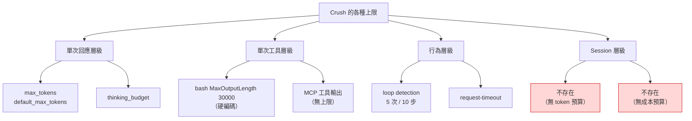

# Crush 是否有「session budget」（單一 session 的 token 花費上限）？

## 摘要

**結論：沒有。** Crush（`charmbracelet/crush`）目前不存在「session budget」這個概念，也沒有任何設定項可以限制「一個 session 總共可以消耗多少 token 或多少成本」。Crush 只有**單次回應的輸出上限**（`max_tokens` / `default_max_tokens`）、**context window 用量的自動摘要（auto-summarize）機制**，以及**迴圈偵測**等間接保護。這些機制的設計目標是「避免請求超出模型視窗而失敗」，而不是「限制 agent 的花費」[^repo][^configdocs][^schema]。

截至 2026-11-21，本報告查證時的狀態如下：

| 項目 | 內容 |
| --- | --- |
| 專案 | `charmbracelet/crush`（Charmbracelet）[^repo] |
| 語言 | Go[^repo] |
| Star 數 | 29,152[^repo] |
| 最新 release | `v0.102.0`（2026-11-19 發佈）[^rel] |
| 是否存在 session budget | 否（無設定項、無程式碼路徑）[^configdocs][^schema] |
| 最接近的替代機制 | `max_tokens`（單次輸出）、auto-summarize（視窗管理）、loop detection（迴圈保護）[^configdocs][^agentgo] |

---

## 1. 什麼是「session budget」

「Session budget」通常指以下任一能力：

1. **Token 上限**：一個 session 累積消耗的 prompt + completion token 超過某個數字時，強制停止 agent。
2. **成本上限**：一個 session 累積花費超過某個金額（例如 5 美元）時強制停止。
3. **回合／步驟上限**：一個 session 最多執行 N 回合或 N 次工具呼叫。

這三者在 Crush 中**都不存在**。

---

## 2. Crush 實際擁有的「上限」機制

Crush 中所有帶有「上限」語意的機制，都可以歸類為「單次請求」或「單一工具輸出」層級，而非「session 層級」。

### 2.1 單次回應的輸出 token 上限

Crush 允許針對模型設定「單次回應最多產生多少 token」，這是**唯一**與 token 數量相關的使用者可設定上限。

```bash
# crushrc
model add deepseek/deepseek-chat \
  --name "Deepseek V3" \
  --context-window 64000 \
  --default-max-tokens 5000 \
  --price-input 0.27 \
  --price-output 1.1
```

`--default-max-tokens` 對應 JSON 的 `default_max_tokens`，是「模型的預設最大輸出 token 數」[^readme][^schema]。另外在選擇 large / small 模型時可用 `--max-tokens`（JSON：`max_tokens`）覆寫該 slot 的輸出上限，schema 中其最大值為 `200000`[^configdocs][^schema]。

程式碼層面，`applySelection` 會以 `model.DefaultMaxTokens` 為基底，若 `sel.MaxTokens > 0` 則以使用者設定覆寫[^loadgo]。

**關鍵限制**：這只約束「單次 LLM 呼叫產生的 token 數」，不會因為 session 累積了很多次呼叫而停止。一個 session 可以呼叫模型 1,000 次，每次都用到輸出上限，Crush 不會有任何反應。

### 2.2 Context window 與 auto-summarize

Crush 為每個模型記錄 `context_window`（context 視窗大小），並用它做兩件事：

1. **UI 顯示**：TUI 標頭與側邊欄會以 `(PromptTokens + CompletionTokens) / ContextWindow` 計算百分比[^header][^sidebar]。
2. **自動摘要觸發**：當剩餘視窗空間不足時觸發 compaction。

觸發門檻在 `internal/agent/agent.go` 中是**硬編碼常數**，不是設定項[^agentgo]：

```go
const (
	DefaultSessionName = "Untitled Session"

	largeContextWindowThreshold = 200_000
	largeContextWindowBuffer    = 20_000
	smallContextWindowRatio     = 0.2
)
```

判斷邏輯為[^agentgo]：

```go
tokens := currentSession.CompletionTokens + currentSession.PromptTokens
remaining := cw - tokens
var threshold int64
if cw > largeContextWindowThreshold {
	threshold = largeContextWindowBuffer
} else {
	threshold = int64(float64(cw) * smallContextWindowRatio)
}
if (remaining <= threshold) && !a.disableAutoSummarize {
	shouldSummarize = true
	return true
}
```

也就是說：context window 大於 200,000 的模型，剩餘空間低於固定的 20,000 token 才觸發摘要；小於 200,000 的模型則用 20% 比例[^agentgo]。使用者只能透過 `option auto-summarize false`（JSON：`disable_auto_summarize`）整個關閉它，**不能調整門檻**，更不能設定「總共只准花多少」[^configdocs][^schema]。

這一點是社群已回報的痛點：issue #3620 指出在 1,000,000 token 視窗的模型上，固定的 20,000 token buffer 意味著必須累積到約 980k token 才會開始壓縮，而「單一回合」就可能一次塞入超過剩餘視窗的內容，導致 session 永久損毀（provider 回 400，token 計數器凍結，連 `Summarize()` 也無法救回）[^i3620]。

### 2.3 迴圈偵測（loop detection）

Crush 有工具呼叫的迴圈偵測，作為 agent 的 stop condition：同一組工具簽章（name + input + output）在 10 步滑動視窗內出現超過 5 次時自動停止，使用 SHA-256 雜湊比對[^pr2214]。這可以避免「無限重複同一動作」燒 token，但它是**行為層面**的保護，不是 token 預算。

後續也有 issue 指出這個機制的漏洞：當 LLM 每次用**略有不同的參數**重試同一個失敗工具（例如 401 的 MCP 工具）時，簽章不同，偵測不會觸發，會形成無限迴圈[^i2856]。

### 2.4 單次工具輸出上限

內建 `bash` 工具有硬編碼的 `MaxOutputLength = 30000`，超過就截斷並把完整輸出寫入 spill 檔案[^i3989]。這是**單一工具呼叫的輸出**上限，且已被回報有缺陷：它是以「顯示寬度（display columns）」而非位元組計算，因此二進位／NUL 內容會完全繞過上限，曾有單一工具結果達 26 MB（約 2M token）而撐爆 context window[^i3989]。

MCP 工具則**完全沒有**對應的截斷路徑，issue #3480 即為此提出功能請求[^i3480]。

### 2.5 其他「非 token」的資源上限

Crush 有一些資源上限，但都與 token 預算無關：

- `option request-timeout`：單次 LLM API 請求的逾時（文件標示預設 60 秒；streaming 回應只在 token 之間閒置超過此時間才中止）[^configdocs]。
- `option max-background-jobs`：同時可執行的背景 shell 工作數（預設 50；已完成的工作不計入）[^configdocs][^schema]。
- `thinking_budget`：Anthropic 模型的思考 token 預算，曾是硬編碼 2000，經 issue #1711 後改為可依模型設定[^i1711]。



---

## 3. Crush 會記錄用量，但不會據此設限

Crush **確實有**完整的用量記錄，這也是它「看起來像有預算」的原因。

Session 資料表包含以下欄位[^db][^proto]：

```go
type Session struct {
	ID               string
	ParentSessionID  string
	Title            string
	MessageCount     int64
	PromptTokens     int64
	CompletionTokens int64
	Cost             float64
	...
}
```

每次成功回應後，Crush 會呼叫 `UpdateTitleAndUsage` 原子性地累加 prompt token、completion token 與成本[^agentgo]。成本計算支援快取分潤（cache create / cache hit 各有不同費率），且若 provider 提供覆寫成本（例如 OpenRouter、Hyper Prism）則優先採用；`flat_rate` 為 true 的 provider 則把成本記為 0[^agentgo]。

這些數字可透過 CLI 匯出：

```bash
crush session show <session-id>
```

其 JSON 輸出包含 `cost`、`prompt_tokens`、`completion_tokens`、`total_tokens`[^sessioncmd]。

**重點**：這些數字只被用於 (a) 顯示在 TUI、(b) 計算 auto-summarize 的觸發門檻。**沒有任何程式路徑**拿 `session.Cost` 或累積 token 數去跟一個使用者設定的預算比較並中止 agent。

---

## 4. 社群中關於「預算」的相關請求與討論

以下為 GitHub 上與此議題相關的 issue / PR（查證日 2026-11-21）：

| 編號 | 標題 | 狀態 | 與 session budget 的關係 |
| --- | --- | --- | --- |
| [#4290](https://github.com/charmbracelet/crush/issues/4290) | feat: allow restricting which models subagents may use | open | 明確提到「a generic cost/budget cap: harder to define across providers」，作者自己承認成本上限難以實作，改提模型白名單[^i4290] |
| [#3620](https://github.com/charmbracelet/crush/issues/3620) | Auto-summarize waits for a flat 20k-token buffer even on 1M-token windows | open | 指出壓縮門檻硬編碼、單回合可撐爆視窗、session 永久死亡[^i3620] |
| [#3733](https://github.com/charmbracelet/crush/issues/3733) | A single uncapped 1.7MB tool result deadlocked a 131K-window session | open | 單一工具結果 1.68 MB 造成 412,533 token 請求、session 不可回復[^i3733] |
| [#3989](https://github.com/charmbracelet/crush/issues/3989) | bash tool output truncation is bypassed by binary output | open | 30,000 的「預算」以顯示欄寬計，二進位內容可達 26 MB / 約 2M token[^i3989] |
| [#3480](https://github.com/charmbracelet/crush/issues/3480) | Feature request: cap/truncate MCP tool results before they enter model context | open | 請求為 MCP 工具結果加上可設定的位元組上限[^i3480] |
| [#2066](https://github.com/charmbracelet/crush/issues/2066) | Subagents go on forever and cannot be stopped | open | subagent 沒有回合上限，使用者口頭要求「20 次工具呼叫內結束」被模型忽略[^i2066] |
| [#1851](https://github.com/charmbracelet/crush/issues/1851) | Crush uses too much context and tokens even for simple tasks | closed | 使用者請求「Option to limit max context size or tokens」與「low-context / fast mode」[^i1851] |
| [#1864](https://github.com/charmbracelet/crush/pull/1864) | feat: add first-class headless/CI execution mode | closed（未合併） | PR 內含 `--max-turns` 旗標，用於限制 agent 迭代次數，但未被採用[^pr1864] |
| [#3340](https://github.com/charmbracelet/crush/pull/3340) | fix(agent): enforce context-window admission and recovery | closed（未合併） | 提出在送出前做 context 視窗准入檢查與有界壓縮（32 輪、64 次 provider 呼叫）[^pr3340] |
| [#4190](https://github.com/charmbracelet/crush/pull/4190) | fix(agent): compact oversized tool output before the next request | open | 在下一回合送出前先壓縮過大的工具輸出[^pr4190] |
| [#3146](https://github.com/charmbracelet/crush/pull/3146) | feat(hooks): add more lifecycle hooks | merged | 新增 13 個 hook 事件，可用於外部監控（但仍拿不到 token 用量）[^pr3146] |

**值得注意**：#1864 是唯一一個曾在 PR 中實作 `--max-turns`（回合上限）的嘗試，但該 PR 已關閉且未合併[^pr1864]。目前的 `crush run` 只支援 `--quiet`、`--verbose`、`--model`、`--small-model`、`--reasoning-effort`、`--session`、`--continue`，沒有任何回合或 token 上限旗標[^rungo]。

---

## 5. 目前唯一可行的「土砲」預算控制

由於沒有原生支援，使用者能做的替代方案如下。

### 5.1 外部監控 `crush session show`

因為 `crush session show` 會輸出 `cost` 與 token 數[^sessioncmd]，可以用外部腳本輪詢，在超過自訂門檻時手動中止 Crush 或刪除 session。

### 5.2 使用 Hooks（能力有限）

Crush 支援 13 個 hook 事件，包含 `TurnEnd`、`PostToolUse`、`PreCompact` 等[^hooks]。Hook 可以：

- `halt: true`（或 exit code 49）**直接結束整個回合**[^hooks]。
- `PreCompact` 可以 `halt` 阻擋壓縮[^hooks]。

因此理論上可以寫一個 hook，用**外部狀態檔計數回合數或工具呼叫數**，達到「最多 N 回合」的粗略預算。

但必須指出其**根本限制**：hook 的 stdin payload 中**沒有任何 token 或成本欄位**。文件中列出的欄位為 `event`、`hook_event_name`、`session_id`、`cwd`、`tool_name`、`tool_input`、`tool_use_id`、`tool_response`、`error`、`last_assistant_message`、`decision`、`source`、`reason`、`trigger`[^hooks]。`TurnEnd` 只提供 `last_assistant_message`[^hooks]。因此 hook **無法**實作真正的 token 或成本預算，只能做回合／呼叫次數的近似計數。

### 5.3 用 `PreToolUse` 擋掉高風險的爆量指令

issue #3989 的報告者提供了一個 `PreToolUse` hook 範例，用 `CRUSH_TOOL_INPUT_COMMAND` 擋掉 `cat` SQLite session store、`cat .crush/*`、`find -exec cat`、`xargs cat` 等會一次灌入巨量內容的指令[^i3989]。這是**防止單次爆量**而非 session 預算。

---

## 6. 批判性反思

- **來源權威性**：本報告的主要事實來自 Crush 官方 repository 的 README、`docs/config/README.md`、`schema.json`、`docs/hooks/README.md` 與 Go 原始碼，屬第一手來源[^repo][^configdocs][^schema][^hooks]。issue / PR 內容屬使用者回報，個別數字（例如 26 MB、2M token）為單一使用者量測，未經維護者獨立驗證，本報告僅以「該報告者聲稱」的方式引用。
- **時效性**：Crush 開發活躍（`v0.102.0` 於 2026-11-19 發佈，查證前兩日）[^rel]。本結論為 2026-11-21 的快照，隨時可能因新增功能而失效。特別注意 `docs/config/FUTURE.md` 明確標示其內容為「尚未實作」的規劃，不構成現行契約[^future]；該檔案中列出的規劃項目（即時 config、state 分離、permission-level deny）也**不包含** session budget。
- **「不存在」的證明性質**：本報告的否定結論是基於 (a) 官方設定文件與 JSON schema 中不存在對應欄位、(b) 原始碼搜尋不到任何將累積用量與門檻比較的中止邏輯。這屬於「未發現」而非「形式證明」；若 Crush 有未公開或極新的分支實作，本報告無法涵蓋。
- **反面證據的處理**：搜尋過程中確實找到大量帶 "budget" 字樣的程式碼（例如 MCP 初始化的 `InitWaitBudget`、shell 輸出截斷的 `withinBudget`、`requestGuardModel` 的 first-part budget），但逐一檢視後**全部**都是時間預算或單次輸出的位元組／欄寬預算，與 session token 預算無關。這類同名不同義的情況是本議題最容易誤判之處，特此註明。
- **一份可能的文件不一致**：`docs/config/README.md` 與 `schema.json` 標示 `request_timeout` 預設為 60 秒，而 `internal/config/config.go` 中 `DefaultRequestTimeout` 常數為 `2 * time.Minute`[^configdocs][^schema]。兩者不一致，但與 session budget 議題無關，僅記錄供後續查證。

---

## 7. 結論

Crush **沒有** session budget 的概念。它有的是：

1. 單次回應的輸出 token 上限（`max_tokens` / `default_max_tokens`）[^configdocs]。
2. 以 context window 為基礎的 auto-summarize，門檻硬編碼、不可調整[^agentgo]。
3. 工具呼叫迴圈偵測（5 次 / 10 步）[^pr2214]。
4. 完整的用量與成本**記錄**（session 層級），但只用於顯示與摘要判斷，不用於限制[^db][^agentgo][^sessioncmd]。

若要「防止 agent 在一個 session 花掉太多 token」，目前在 Crush 中只能靠外部腳本輪詢 `crush session show` 的用量，或以 hook 做回合數的粗略上限；真正的 token／成本預算需要上游實作。社群已有相關請求（#1851、#4290、#3480、#1864 的 `--max-turns`），但截至查證日尚無任何一個被合併[^i1851][^i4290][^i3480][^pr1864]。

---

## 參考文獻

[^repo]: Charmbracelet. (n.d.). *charmbracelet/crush: Glamourous agentic coding for all*. GitHub. Retrieved 2026-11-21, from https://github.com/charmbracelet/crush

[^readme]: Charmbracelet. (n.d.). *README.md*. In charmbracelet/crush. Retrieved 2026-11-21, from https://raw.githubusercontent.com/charmbracelet/crush/main/README.md

[^configdocs]: Charmbracelet. (n.d.). *Config*. In charmbracelet/crush (docs/config/README.md). Retrieved 2026-11-21, from https://raw.githubusercontent.com/charmbracelet/crush/main/docs/config/README.md

[^schema]: Charmbracelet. (n.d.). *schema.json*. In charmbracelet/crush. Retrieved 2026-11-21, from https://raw.githubusercontent.com/charmbracelet/crush/main/schema.json

[^hooks]: Charmbracelet. (n.d.). *Hooks*. In charmbracelet/crush (docs/hooks/README.md). Retrieved 2026-11-21, from https://raw.githubusercontent.com/charmbracelet/crush/main/docs/hooks/README.md

[^future]: Charmbracelet. (n.d.). *Config: Future Work*. In charmbracelet/crush (docs/config/FUTURE.md). Retrieved 2026-11-21, from https://raw.githubusercontent.com/charmbracelet/crush/main/docs/config/FUTURE.md

[^agentgo]: Charmbracelet. (n.d.). *internal/agent/agent.go*. In charmbracelet/crush. Retrieved 2026-11-21, from https://github.com/charmbracelet/crush/blob/main/internal/agent/agent.go

[^loadgo]: Charmbracelet. (n.d.). *internal/config/load.go*. In charmbracelet/crush. Retrieved 2026-11-21, from https://github.com/charmbracelet/crush/blob/main/internal/config/load.go

[^db]: Charmbracelet. (n.d.). *internal/db/sessions.sql.go*. In charmbracelet/crush. Retrieved 2026-11-21, from https://github.com/charmbracelet/crush/blob/main/internal/db/sessions.sql.go

[^proto]: Charmbracelet. (n.d.). *internal/proto/session.go*. In charmbracelet/crush. Retrieved 2026-11-21, from https://github.com/charmbracelet/crush/blob/main/internal/proto/session.go

[^sessioncmd]: Charmbracelet. (n.d.). *internal/cmd/session.go*. In charmbracelet/crush. Retrieved 2026-11-21, from https://github.com/charmbracelet/crush/blob/main/internal/cmd/session.go

[^rungo]: Charmbracelet. (n.d.). *internal/cmd/run.go*. In charmbracelet/crush. Retrieved 2026-11-21, from https://github.com/charmbracelet/crush/blob/main/internal/cmd/run.go

[^header]: Charmbracelet. (n.d.). *internal/ui/model/header.go*. In charmbracelet/crush. Retrieved 2026-11-21, from https://github.com/charmbracelet/crush/blob/main/internal/ui/model/header.go

[^sidebar]: Charmbracelet. (n.d.). *internal/ui/model/sidebar.go*. In charmbracelet/crush. Retrieved 2026-11-21, from https://github.com/charmbracelet/crush/blob/main/internal/ui/model/sidebar.go

[^rel]: Charmbracelet. (2026, November 19). *v0.102.0*. GitHub Releases. Retrieved 2026-11-21, from https://github.com/charmbracelet/crush/releases/tag/v0.102.0

[^i4290]: LiuYinCarl. (2026, November 14). *feat: allow restricting which models subagents may use* (Issue No. 4290). GitHub. Retrieved 2026-11-21, from https://github.com/charmbracelet/crush/issues/4290

[^i3620]: teamgbg. (2026, August 23). *Auto-summarize waits for a flat 20k-token buffer even on 1M-token windows; one turn's tool results can overshoot the whole remaining window and permanently kill the session* (Issue No. 3620). GitHub. Retrieved 2026-11-21, from https://github.com/charmbracelet/crush/issues/3620

[^i3733]: DuLiangMin. (2026, September 7). *A single uncapped 1.7MB tool result deadlocked a 131K-window session (412K-token request, unrecoverable)* (Issue No. 3733). GitHub. Retrieved 2026-11-21, from https://github.com/charmbracelet/crush/issues/3733

[^i3989]: Lujc0523. (2026, September 29). *bash tool output truncation is bypassed by binary output: the 30,000 budget is measured in display columns, so tool results can reach tens of MB* (Issue No. 3989). GitHub. Retrieved 2026-11-21, from https://github.com/charmbracelet/crush/issues/3989

[^i3480]: enkiEng. (2026, August 1). *Feature request: cap/truncate MCP tool results before they enter model context* (Issue No. 3480). GitHub. Retrieved 2026-11-21, from https://github.com/charmbracelet/crush/issues/3480

[^i2066]: taoeffect. (2026, January 30). *Subagents go on forever and cannot be stopped* (Issue No. 2066). GitHub. Retrieved 2026-11-21, from https://github.com/charmbracelet/crush/issues/2066

[^i1851]: kuxoapp. (2026, January 13). *Crush uses too much context and tokens even for simple tasks* (Issue No. 1851). GitHub. Retrieved 2026-11-21, from https://github.com/charmbracelet/crush/issues/1851

[^i1711]: DAddYE. (2025, December 23). *feat: make thinking budget_tokens configurable* (Issue No. 1711). GitHub. Retrieved 2026-11-21, from https://github.com/charmbracelet/crush/issues/1711

[^i2856]: ehdwn1991. (2026, May 11). *Tool error loop not detected when LLM varies input arguments* (Issue No. 2856). GitHub. Retrieved 2026-11-21, from https://github.com/charmbracelet/crush/issues/2856

[^pr1864]: kuxoapp. (2026, January 14). *feat: add first-class headless/CI execution mode* (Pull Request No. 1864). GitHub. Retrieved 2026-11-21, from https://github.com/charmbracelet/crush/pull/1864

[^pr2214]: huaiyuWangh. (2026, February 13). *fix(agent): detect and stop tool call infinite loops* (Pull Request No. 2214). GitHub. Retrieved 2026-11-21, from https://github.com/charmbracelet/crush/pull/2214

[^pr3340]: josh-socium. (2026, July 16). *fix(agent): enforce context-window admission and recovery* (Pull Request No. 3340). GitHub. Retrieved 2026-11-21, from https://github.com/charmbracelet/crush/pull/3340

[^pr4190]: ykakade. (2026, October 30). *fix(agent): compact oversized tool output before the next request* (Pull Request No. 4190). GitHub. Retrieved 2026-11-21, from https://github.com/charmbracelet/crush/pull/4190

[^pr3146]: taciturnaxolotl. (2026, June 18). *feat(hooks): add more lifecycle hooks* (Pull Request No. 3146). GitHub. Retrieved 2026-11-21, from https://github.com/charmbracelet/crush/pull/3146
