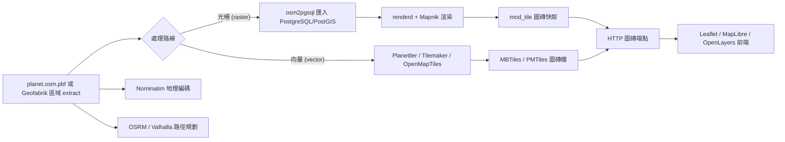

# 自架 OpenStreetMap 可行性與資源需求評估

## 摘要（先講結論）

**可以自架，而且完全合法、完全免費的軟體堆疊已經成熟。** OpenStreetMap（以下簡稱 OSM）不是一個「安裝起來就會跑」的單體軟體，而是一組由多個開源元件組成的資料與圖磚生產線：地圖資料以 Open Database License（ODbL）釋出，任何人都能下載、加工、重新發布[^planet]。真正決定成本的不是授權，而是**覆蓋範圍**與**是否自己重新產生圖磚**這兩件事。

資源需求橫跨兩個數量級以上：

- **單一城市或小國（例如台灣）**：一台 2 核心、4 GB 記憶體、10-20 GB 儲存的虛擬主機即可服務光柵（raster）圖磚[^s2o-tiles]。
- **整個地球（planet）自算圖磚**：約 1 TB 高速 SSD、24 GB 記憶體、四核心是「能跑但很慢」的入門線[^s2o-tiles]；要達到可接受的完成時間則需要 64 GB 以上的記憶體與大量 CPU 核心[^planetiler-planet][^protomaps-build]。
- **想複製官方 tile.openstreetmap.org 那種即時渲染規模**：單一渲染節點官方要求 256 GB 以上記憶體（建議 384 GB）、24 核心以上、近 4 TB NVMe，外加每月至少 25 TB 的網路流量[^osm-tile-rendering]。

實務上最省力的路線是**「下載別人算好的向量圖磚，只自架伺服與快取層」**，此時 planet 等級只需約 200-400 GB 儲存與一台便宜 VPS[^ofm-selfhost]。

---

## 一、先釐清：「自架 OSM」是什麼意思

OSM 專案由三個彼此獨立、可分別自架的功能層組成，理解這一點是評估資源的前提，因為它決定了成本的分佈。

1. **資料層**：原始 OSM 資料，來自 `planet.osm.pbf` 或 Geofabrik 等來源的區域 extract[^planet][^geofabrik]。
2. **圖磚層**：把資料變成可以給瀏覽器畫的地圖。分成兩大流派：**光柵圖磚**（伺服器端畫好 PNG）與**向量圖磚**（傳資料、由客戶端渲染）[^osm-vector-tiles][^osm-tile-servers]。
3. **加值層**：地理編碼（搜尋地址，Nominatim）、路徑規劃（OSRM 等），這些是另外的服務，資源需求獨立計算。

若只需要「把地圖顯示出來」，做第 2 層即可；第 1 層是輸入，第 3 層通常是選配。

---

## 二、路線 A：自架光柵圖磚（傳統 Mapnik 堆疊）

### 2.1 元件組成

這是與 openstreetmap.org 主站最接近的經典作法，標準堆疊包含五個主要元件[^s2o-debian13]：

- **Apache** 作為前端網頁伺服器。
- **mod_tile**：Apache 模組，負責判斷圖磚是否已快取、是否需要重新渲染[^s2o-debian13]。
- **renderd**：渲染佇列管理與排程常駐程式[^s2o-debian13]。
- **Mapnik**：實際繪製圖磚的渲染函式庫[^s2o-debian13]。
- **PostgreSQL + PostGIS + osm2pgsql**：資料庫與資料匯入工具[^s2o-debian13]。

選用 Debian 13 或 Ubuntu 是官方推薦的平台[^s2o-tiles]。

### 2.2 官方資源估算

Switch2OSM 給出最常被引用的粗略區間：**城市規模需要 10-20 GB 儲存、4 GB 記憶體、一顆現代雙核心處理器；整個 planet 需要 1 TB 快速儲存、24 GB 記憶體、四核心處理器**[^s2o-tiles]。官方同時明確建議**從區域 extract 開始**，不要一上手就 import 全世界，因為 planet import 可能耗時一週，配置錯誤就得重來[^s2o-tiles]。

值得注意的是，即使只匯入一個小國家，Docker 封裝版仍建議準備約 **30 GB 磁碟空間**，原因是 OSM Carto 樣式需要額外載入全球邊界與海岸線等外部資料[^s2o-docker]。這是很容易低估的隱藏成本。

### 2.3 實際匯入時間與資料庫膨脹（第一手 benchmark）

`osm2pgsql` 官方 wiki 長期收集使用者 benchmark，呈現出硬體對匯入時間的巨大影響[^osm2pgsql-benchmarks]：

| 範圍 | 輸入大小 | 硬體 | 匯入耗時 | 資料庫終態 |
|---|---|---|---|---|
| 亞塞拜然（範例） | 約 32 MB | 一般伺服器，`-C 2500`、1 process | 約 238 秒 | 未記錄 |
| 歐洲 | 22.5 GB PBF（2020-12） | AMD EPYC 7502P 32C/64T、128 GB RAM、960 GB NVMe | 約 5.8 小時 | 158 GB（另有 80 GB node cache） |
| planet | 92.6 GB PBF（2026-04-27） | HP Z840：2×Xeon E5-2699v4 22C、512 GB RAM、NVMe RAID | 約 11.5 小時 | 未記錄（同機型前次約 1.6 TB 等級） |
| planet | 66 GB PBF（2022-12-26） | 32 核心、128 GB RAM、SSD | 約 56 小時 | 約 1.6 TB |

要特別注意**資料庫大小與 PBF 大小不成比例**：22.5 GB 的歐洲 PBF 匯入後資料庫是 158 GB，約 7 倍；planet 的資料庫則落在 0.75-1.6 TB 區間[^osm2pgsql-benchmarks][^crunchy]。

另一份來自 Crunchy Data 的 2024 年 benchmark 顯示，在 128 GB RAM、單顆高階消費級 CPU（AMD 9600X）與 PCIe 5.0 NVMe 的組合下，planet 匯入可以壓到 **4 小時以內**（3 小時 39 分），資料庫約 750 GB，但峰值記憶體用量達 158 GB[^crunchy]。這說明「24 GB RAM」是能跑的下限，而非舒適區間。

### 2.4 渲染階段的資源

匯入只是第一步。實際服務請求時，**renderd/Mapnik 會佔用大量記憶體**；官方 Debian 教學特別提醒，若只有約 4 GB 記憶體，應把 `num_threads` 降到 2[^s2o-debian13]。這印證了 4 GB 是「勉強能跑」而非「流暢」的門檻。

### 2.5 對照：官方與社群實際運行的機器

想估算「真實世界需要多大」，最直接的方法是看已經在服務的機器。OpenStreetMap 基金會（OSMF）公開其伺服器清單[^osm-hardware]：

- **光柵渲染節點**為 1U 機架式伺服器，例如 Amsterdam 的 `odin` 與 London 的 `ysera`（Supermicro SYS-1029P-WTRT）、Dublin 的 `quetzal`（HPE ProLiant DL360 Gen10 Plus）、OSUOSL 的 `piasa`（HPE ProLiant DL360 Gen10）、Kansas City 的 `orm`（Dell PowerEdge R730）、台灣的 `azure-01`／`azure-02`（Lenovo ThinkSystem HR630X）[^osm-hardware]。
- 也有以虛擬機形式捐贈的節點，例如 Warsaw 的 `wawel`（OpenStack VM），以及 Ohio 的 `palulukon`（AWS EC2 `m7gd.16xlarge`，即 64 vCPU ARM、256 GB 記憶體等級）[^osm-hardware]。
- **向量圖磚節點**同樣存在，例如 Amsterdam 的 `dribble`、Warsaw 的 `cmok`[^osm-hardware]。這些機器執行 Debian 13[^osm-hardware]，與官方教學選用的版本一致[^s2o-debian13]。

社群層面亦有長期公開運作的區域服務，例如涵蓋英國、愛爾蘭與王室屬地的 SomeoneElse-style，其公開政策同樣要求「正常使用、禁止批量下載」[^osm-raster-providers]。這說明**中型覆蓋範圍的服務在單一伺服器上長期運行是可行的**，前提是流量可控。

### 2.6 兩份官方教學的實測差異

Switch2OSM 的 Debian 12 與 Ubuntu 24.04 兩份教學都使用相同的小型 extract（亞塞拜然，約 32 MB）作為測試資料，可以在相同工作量下比較不同年代的軟硬體表現[^s2o-tiles]。兩者都以 `-C 2500`（2.5 GB 記憶體）與 `--number-processes 1` 進行匯入[^s2o-debian13]。這個「單一 process、2.5 GB 快取」的設定值本身，就是小型 extract 的實用基準線：它顯示區域性自架不需要為 osm2pgsql 配置誇張的記憶體。

---

## 三、路線 B：自架向量圖磚（現代、效率高得多）

向量圖磚把「資料」與「樣式」分離：伺服器只傳送二進位幾何與屬性，由客戶端（MapLibre GL、Leaflet）即時渲染。好處是縮放平滑、可切換樣式、可互動查詢，而且**伺服器端不需要 Mapnik 渲染佇列**[^osm-vector-tiles]。

生成工具主要有[^osm-vector-tiles][^osm-tilemaker]：

- **Planetiler**：Java 撰寫，目標是「單機數小時內做完地球」[^planetiler-wiki]。
- **Tilemaker**：C++ 單一執行檔，不需要資料庫，直接從 `.osm.pbf` 產生 MBTiles[^osm-tilemaker]。
- **OpenMapTiles Tools**：MapTiler 生態系的工具鏈，輸出 OpenMapTiles schema[^openmaptiles-docs]。

### 3.1 Planetiler 的資源公式

Planetiler 官方文件給出可直接套用的經驗公式：**需要約 10 倍輸入檔大小的磁碟空間，以及至少 0.5 倍輸入檔大小的記憶體**[^planetiler-planet]。以目前約 90 GB 的 planet PBF 計算，等於約 900 GB 磁碟與約 45 GB 記憶體，與「64 GB RAM + 1 TB NVMe」的實務建議吻合[^protomaps-build]。

Wiki 版本的文件則給出較保守的數字：約 1.5 倍輸入檔的 RAM、5-10 倍輸入檔的磁碟，整體約 **40 CPU 小時**；16 核心約 3 小時完成，64 核心可壓到 1 小時以內[^planetiler-wiki]。

官方提供的實測範例：以 64.7 GB 的 planet PBF，在 16 vCPU、128 GB RAM、1.17 TB 磁碟的 DigitalOcean droplet 上，費時 **3 小時 21 分**，輸出 **99 GB** 的 MBTiles[^planetiler-planet]。

### 3.2 Protomaps 與 OpenFreeMap 的實測

Protomaps 建議「**3 小時內**完成 planet 圖磚」的配置為：**盡可能多的 CPU 核心（建議 Intel Core i9 或 AMD Ryzen 9 等級，或 AWS `c7gd.8xlarge`）、64 GB RAM、至少 1 TB NVMe SSD（或 VPS 的 instance store，不可用網路儲存），另需約 512 GB 暫存空間**[^protomaps-build]。他們發布的完整 planet PMTiles 檔（z0-15）約 **120 GB**[^protomaps-downloads]。

OpenFreeMap 公布的實際生產數據更為具體：其 2026-05-26 的 planet run 中，**Planetiler 本身花 5 小時 22 分**，加上 MBTiles 上傳、Btrfs 映像建置、PMTiles 轉檔等步驟，**總 wall time 約 15 小時 19 分**[^ofm-cadence]。產出物大小為：MBTiles 約 105 GB、Btrfs 映像約 165 GB、PMTiles 約 90 GB[^ofm-cadence]。

---

## 四、路線 C：自架「別人算好的圖磚」（最省資源，實務推薦）

向量圖磚有個關鍵優勢：**輸出是一份靜態檔案**，可以是單一 PMTiles 檔，或一組可由 nginx 直接服務的檔案。因此可以完全跳過資料匯入與渲染這兩件重活。

### 4.1 OpenFreeMap 的自架模式

OpenFreeMap 每週發布完整 planet 圖磚，提供 Btrfs 映像、MBTiles、PMTiles 三種格式[^ofm-readme]。它把自架拆成兩個可獨立部署的模組[^ofm-selfhost]：

- **linux_host（幾乎所有人都只需要這個）**：只負責下載並掛載圖磚。
  - 一個 planet 版本約 **170 GB**。
  - `auto_update: false`（釘選版本、之後不再連網）需要 **200 GB** 磁碟。
  - `auto_update: true`（跟隨每週更新）在版本切換期間會同時保留新舊兩份，需要 **400 GB**。
  - SSD 建議但非必要。
  - 官方實測並推薦的方案是每月 **€4.5 的 Contabo Storage VPS**[^ofm-selfhost]。
- **tilegen（自己產生圖磚）**：需要 **1 TB SSD 與至少 64 GB RAM**，planet 建置過程中尖峰佔用約 **500 GB** 磁碟[^ofm-selfhost]。官方直言這個模組「很慢、需要超大機器，而且完全沒有必要」[^ofm-selfhost]。

OpenFreeMap 也公開了其效能數據：在 Hetzner 伺服器上，於冷快取狀態下曾達到 **30 Gbit 的 loopback 服務吞吐量**[^ofm-readme]，顯示純檔案系統服務圖磚的效率極高。

### 4.2 Protomaps 的替代方案

Protomaps 同樣免費發布每日 planet 建置的 PMTiles 檔，約 **120 GB**，並鼓勵使用者複製到自己的雲端儲存或伺服器，而非直接 hotlink[^protomaps-downloads]。若只想涵蓋特定區域，可用其 CLI 的 `extract` 指令切出局部範圍，或用 `--maxzoom` 降低最高縮放層級（每多一層約使檔案加倍）[^protomaps-downloads]。

---

## 五、資源需求對照表

下表綜合各官方來源，依「覆蓋範圍 × 路線」整理。數值皆為來源中的原始數字，非換算推估。

| 覆蓋範圍 | 路線 | CPU | 記憶體 | 磁碟 | 來源 |
|---|---|---|---|---|---|
| 城市／小區域 | 光柵（Mapnik + PostgreSQL） | 現代雙核 | 4 GB | 10-20 GB | [^s2o-tiles] |
| 小國 extract | 光柵（Docker 封裝） | 4 threads（預設） | 800 MB 快取（可調） | 約 30 GB | [^s2o-docker][^overv] |
| 台灣（313 MB PBF） | 向量（Planetiler 本機） | 視核心數 | 64 GB 上限內寬鬆 | 數 GB 級 | [^geofabrik-tw][^planetiler-planet] |
| 歐洲（33.1 GB PBF） | 光柵 | 32 核以上建議 | 128 GB 較舒適 | 資料庫 158 GB+ | [^geofabrik][^osm2pgsql-benchmarks] |
| 全球 planet | 光柵 | 四核（入門） | 24 GB（入門） | 1 TB 快速儲存 | [^s2o-tiles] |
| 全球 planet | 光柵（追求速度） | 16 核以上 | 128-512 GB | 2 TB 以上 NVMe | [^crunchy][^osm2pgsql-benchmarks] |
| 全球 planet | 向量（Planetiler） | 16-64 核 | 64-128 GB | 1 TB NVMe + 512 GB 暫存 | [^protomaps-build][^planetiler-planet] |
| 全球 planet | 僅自架（下載現成圖磚） | 1-2 核足夠 | 1-4 GB | 200 GB（釘選）／400 GB（自動更新） | [^ofm-selfhost] |
| 全球 planet | 官方級即時渲染節點 | 24 核心以上（48+ threads） | 256 GB 以上（建議 384 GB） | 1.92 TB 資料庫 + 1.92 TB 圖磚，皆 NVMe | [^osm-tile-rendering] |

### 5.1 作為對照：planet 資料本身的體積

- 2026-11-01 的 planet 檔：**OSM XML 未壓縮超過 2306.0 GB**，bzip2 壓縮 167.3 GB，**PBF 壓縮 89.1 GB**[^planet]。
- `osm2pgsql` benchmark 中使用的 planet PBF 從 2020 年的 49 GB 成長到 2026 年的 92.6 GB[^osm2pgsql-benchmarks]。
- Geofabrik 各洲 extract（2026-11-21 查詢）：非洲 7.4 GB、亞洲 15.4 GB、歐洲 33.1 GB、北美洲 18.2 GB、南美洲 3.9 GB、大洋洲 1.5 GB、中美洲 758 MB、南極洲 31.6 MB[^geofabrik]。
- 台灣 extract：313 MB PBF（2026-11-20 最後更新），另有 174 MB 的 Shortbread 向量圖磚包[^geofabrik-tw]。

---

## 六、網路流量需求

自架的流量成本取決於是「自己用」還是「對外公開服務」。

官方 `tile.openstreetmap.org` 的規模可作為上限參考：**2026 年 8 月，其 CDN 每月服務約 1.7 PB 出流量與約 1350 億次請求**[^osm-tile-rendering]。若要捐贈一台渲染節點給 OSMF，門檻包含**每月至少 25 TB 流量與 100 Mbps 峰值**[^osm-tile-rendering]。

對自架者而言，這個數字的重要性有兩層：

1. **不要濫用官方圖磚服務。** 官方 Tile Usage Policy 明文禁止「bulk download／scraping」與任何形式的離線預抓（prefetch），也禁止在 `tile.openstreetmap.org` 上做離線地圖功能；政策直接建議需要離線或大量使用時「改用自己的圖磚或明確允許 prefetch 的供應商」[^osm-tile-policy]。**這正是自架最正當的理由。**
2. **若只是內部或低流量使用**，一般 VPS 的流量額度通常足夠；OpenFreeMap 甚至推薦用 €4.5/月的 Storage VPS 來跑 planet 等級的自架服務[^ofm-selfhost]。

---

## 七、更新與長期維護成本

自架不是一次性工作，資料會持續變動，因此要考慮「如何保持新鮮」。

### 7.1 差異更新（diff）機制

OSM 提供多種粒度的變更串流[^osm-diffs]：

- **minutely／hourly／daily**：來自 `planet.openstreetmap.org/replication/`，涵蓋全球，含完整歷史與 transaction id[^osm-diffs]。
- **Geofabrik 區域 diff**：每日一份 `.osc.gz`，只涵蓋該 extract 的範圍[^osm-diffs][^geofabrik]。
- 一份 daily diff 一般約 40-80 MB（壓縮），異常情況可達 300-400 MB[^planet]。

### 7.2 光柵路線的更新流程

使用 osm2pgsql 1.4.2 以上版本提供的 `osm2pgsql-replication`，可以相對簡單地套用更新：初始化後以 cron 定期執行 `update`，並透過 `--post-processing` 呼叫 `render_expired` 把受影響的圖磚標記為過期或刪除後重繪[^s2o-update]。官方範例建議 Geofabrik 來源每日跑一次即可，而使用 OSM 官方 minutely 來源時可每 5 分鐘執行一次[^s2o-update]。

這條路線的維護成本較高：需要持續調整 PostgreSQL 參數、監控 renderd 記憶體、並處理圖磚過期策略[^s2o-update][^s2o-debian13]。

### 7.3 向量路線的更新流程

向量路線通常是**整份重算**：OpenFreeMap 每週三重建 planet，週二在低流量時段切換版本，主機在切換前會先完整下載並驗證新版映像，確認 nginx 設定無誤後才上線[^ofm-cadence]。它也提供每日重建的小區域（Monaco）作為快速驗證機制[^ofm-cadence]。

若需要近乎即時的更新，可搭配如 SliceOSM 這類 minutely 更新的 extract 來源[^planet]。

---

## 八、具體建議配置

### 情境 1：個人或團隊內部使用，只要台灣地圖

- **路線**：向量圖磚。用 Planetiler 或 Tilemaker 在個人電腦上把 313 MB 的台灣 PBF 轉成 MBTiles/PMTiles[^geofabrik-tw][^osm-tilemaker]。
- **伺服器**：1-2 vCPU、1-2 GB RAM、10-50 GB SSD。
- **更新**：每週或每月重跑一次轉檔。
- **成本**：一台最低階 VPS，或甚至純靜態檔案託管。

### 情境 2：想涵蓋全球，但不在意即時性

- **路線**：路線 C。下載 OpenFreeMap 或 Protomaps 的現成 planet 圖磚[^ofm-selfhost][^protomaps-downloads]。
- **伺服器**：200 GB 儲存（不自動更新）或 400 GB（自動更新），SSD 建議但非必要；記憶體 1-4 GB 即足夠[^ofm-selfhost]。
- **成本**：官方實測的 €4.5/月 Storage VPS 等級即可[^ofm-selfhost]。

### 情境 3：想自己產生全球圖磚，並定期更新

- **路線**：路線 B，Planetiler + PMTiles/MBTiles。
- **伺服器**：至少 64 GB RAM、1 TB NVMe、512 GB 以上暫存空間、盡量多的 CPU 核心[^protomaps-build][^planetiler-planet]。
- **預期時間**：16 核約 3-5 小時，64 核可壓到 1 小時級別[^planetiler-wiki][^ofm-cadence]。
- **產出**：PMTiles 約 90-120 GB，MBTiles 約 99-105 GB[^protomaps-downloads][^ofm-cadence]。

### 情境 4：自建即時渲染服務（不建議個人嘗試）

- **伺服器**：24 核心以上（48+ threads）、256 GB 以上記憶體（建議 384 GB）、約 3.84 TB NVMe（資料庫與圖磚分開）、每月 25 TB 以上流量、Debian 13[^osm-tile-rendering]。
- **注意**：官方明確表示不接受容器（OpenVz、LXC）作為渲染節點，需要專用主機或效能極高的 VM[^osm-tile-rendering]。

---

## 九、結論

- **可自架性**：完全可行。資料採 ODbL 免費釋出[^planet]，軟體堆疊全為開源（Mapnik/mod_tile/renderd 為 GPL-2.0 等授權，Planetiler 為 Apache-2.0，Tilemaker 為 FTWPL，OpenMapTiles 為 BSD/CC-BY）[^osm-tile-servers][^planetiler-wiki][^osm-tilemaker][^openmaptiles-docs]。
- **資源門檻分級**：區域性自架最低只要一台雙核 4 GB 的小 VPS[^s2o-tiles]；planet 級自算圖磚約需 64 GB RAM + 1 TB NVMe[^protomaps-build]；planet 級即時渲染服務則需 256 GB+ RAM、24+ 核、近 4 TB NVMe 與 25 TB/月流量[^osm-tile-rendering]。
- **最容易低估的三件事**：(1) 資料庫會膨脹到 PBF 的數倍，歐洲 extract 從 22.5 GB 變成 158 GB[^osm2pgsql-benchmarks]；(2) 即使小 extract 也可能需要約 30 GB 空間，因為要載入全球邊界資料[^s2o-docker]；(3) 匯入 planet 的峰值記憶體可達 158 GB，遠高於常見的 24 GB 建議值[^crunchy]。
- **最務實的建議**：若目標只是「有地圖可用」，選路線 C（下載現成向量圖磚），用一台 €5/月等級的 VPS 即可服務全球；只有在需要高度自訂樣式、特定資料快照或完全離線環境時，才值得投入路線 B 的重算流程；路線 A（傳統光柵堆疊）在向量圖磚成熟後，已主要是為了與既有生態相容而保留的選項[^osm-vector-tiles][^s2o-tiles]。

---

## 參考資料

[^planet]: OpenStreetMap Wiki. (n.d.). *Planet.osm*. Retrieved 2026-11-21, from https://wiki.openstreetmap.org/wiki/Planet.osm

[^s2o-tiles]: Switch2OSM. (n.d.). *Serving your own tiles*. Retrieved 2026-11-21, from https://switch2osm.org/serving-tiles/

[^s2o-docker]: Switch2OSM. (n.d.). *Using a Docker container*. Retrieved 2026-11-21, from https://switch2osm.org/serving-tiles/using-a-docker-container/

[^s2o-debian13]: Switch2OSM. (n.d.). *Manually building a tile server (Debian 13, pgsql)*. Retrieved 2026-11-21, from https://switch2osm.org/serving-tiles/manually-building-a-tile-server-debian-13/

[^s2o-update]: Switch2OSM. (n.d.). *Updating your database as people edit OpenStreetMap using osm2pgsql*. Retrieved 2026-11-21, from https://switch2osm.org/serving-tiles/updating-as-people-edit-osm2pgsql-replication/

[^osm-tile-rendering]: OpenStreetMap Wiki. (n.d.). *Servers/Tile Rendering*. Retrieved 2026-11-21, from https://wiki.openstreetmap.org/wiki/Servers/Tile_Rendering

[^osm2pgsql-benchmarks]: OpenStreetMap Wiki. (n.d.). *Osm2pgsql/benchmarks*. Retrieved 2026-11-21, from https://wiki.openstreetmap.org/wiki/Osm2pgsql/benchmarks

[^osm-vector-tiles]: OpenStreetMap Wiki. (n.d.). *Vector tiles*. Retrieved 2026-11-21, from https://wiki.openstreetmap.org/wiki/Vector_tiles

[^osm-tile-servers]: OpenStreetMap Wiki. (n.d.). *Tile servers*. Retrieved 2026-11-21, from https://wiki.openstreetmap.org/wiki/Tile_servers

[^osm-tilemaker]: OpenStreetMap Wiki. (n.d.). *Tilemaker*. Retrieved 2026-11-21, from https://wiki.openstreetmap.org/wiki/Tilemaker

[^planetiler-wiki]: OpenStreetMap Wiki. (n.d.). *Planetiler*. Retrieved 2026-11-21, from https://wiki.openstreetmap.org/wiki/Planetiler

[^osm-diffs]: OpenStreetMap Wiki. (n.d.). *Planet.osm/diffs*. Retrieved 2026-11-21, from https://wiki.openstreetmap.org/wiki/Planet.osm/diffs

[^osm-tile-policy]: OpenStreetMap Operations Working Group. (n.d.). *Tile Usage Policy*. Retrieved 2026-11-21, from https://operations.osmfoundation.org/policies/tiles/

[^geofabrik]: Geofabrik. (n.d.). *Geofabrik Download Server*. Retrieved 2026-11-21, from https://download.geofabrik.de/

[^geofabrik-tw]: Geofabrik. (n.d.). *Download OpenStreetMap for Taiwan*. Retrieved 2026-11-21, from https://download.geofabrik.de/asia/taiwan.html

[^planetiler-planet]: Planetiler. (n.d.). *Generating a Map of the World* [PLANET.md]. Retrieved 2026-11-21, from https://github.com/onthegomap/planetiler/blob/main/PLANET.md

[^protomaps-build]: Protomaps. (n.d.). *Building a custom basemap*. Retrieved 2026-11-21, from https://docs.protomaps.com/basemaps/build

[^protomaps-downloads]: Protomaps. (n.d.). *Basemap Downloads*. Retrieved 2026-11-21, from https://docs.protomaps.com/basemaps/downloads

[^ofm-selfhost]: OpenFreeMap. (n.d.). *Self-hosting Howto*. Retrieved 2026-11-21, from https://github.com/hyperknot/openfreemap/blob/main/docs/self_hosting.md

[^ofm-cadence]: OpenFreeMap. (n.d.). *tilegen release cadence*. Retrieved 2026-11-21, from https://github.com/hyperknot/openfreemap/blob/main/docs/tilegen_release_cadence.md

[^ofm-readme]: OpenFreeMap. (n.d.). *OpenFreeMap* [README]. Retrieved 2026-11-21, from https://github.com/hyperknot/openfreemap

[^overv]: Overv. (n.d.). *openstreetmap-tile-server* [README]. Retrieved 2026-11-21, from https://github.com/Overv/openstreetmap-tile-server

[^osm-hardware]: OpenStreetMap Foundation. (n.d.). *OSMF Server Info*. Retrieved 2026-11-21, from https://hardware.openstreetmap.org/

[^osm-raster-providers]: OpenStreetMap Wiki. (n.d.). *Raster tile providers*. Retrieved 2026-11-21, from https://wiki.openstreetmap.org/wiki/Raster_tile_providers

[^crunchy]: Smith, G. (2024-11-19). *Loading the World! OpenStreetMap Import In Under 4 Hours*. Crunchy Data. Retrieved 2026-11-21, from https://www.crunchydata.com/blog/loading-the-world-openstreetmap-import-in-under-4-hours

[^openmaptiles-docs]: OpenMapTiles. (n.d.). *Documentation and tutorials*. Retrieved 2026-11-21, from https://openmaptiles.org/docs/
