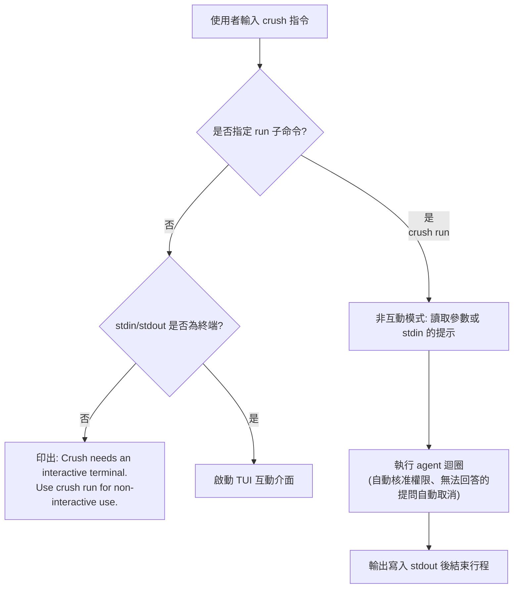

# Crush 是否支援 CLI 單次執行模式（非 TUI 互動）

## 摘要

**是，支援。** Charm 的 Crush（`github.com/charmbracelet/crush`）除了預設的 TUI 互動介面外，另外提供 `crush run` 子命令，可在**不啟動 TUI**的情況下，於命令列一次送出單一提示（prompt）、把結果寫到標準輸出（stdout），然後結束行程。`crush run` 支援從參數或標準輸入（stdin，管線 `|` 或檔案重導向 `<`）取得提示，也支援指定模型、接續既有 session，以及非互動式的權限自動核准。

本報告說明該模式的介面、旗標、可取得的版本，以及官方對「一次性執行」與「互動式執行」的分工方式。

## 一、結論：`crush run` 就是不經 TUI 的單次執行模式

`crush run` 的說明文字為「Run a single non-interactive prompt」，即在非互動模式下執行單一提示後結束[^run-go]：

```text
Run a single prompt in non-interactive mode and exit.
The prompt can be provided as arguments or piped from stdin.
```

Crush 的根命令（`crush`）在沒有可用終端時，會直接拒絕啟動並提示使用者改用 `crush run`，這是官方刻意把「TUI 互動」與「非互動一次性執行」分流的設計[^root-go]：

```text
Crush needs an interactive terminal. Use `crush run` for non-interactive use.
```

官方範例同時示範了 stdin 與 stdout 的組合用法[^readme]：

```bash
# 從 stdin 管線輸入
cat README.md | crush run "make this more glamorous" > GLAMOROUS_README.md
```



## 二、可用的旗標（flag）

依目前主線分支（`main`）的 `internal/cmd/run.go`，`crush run` 實際註冊的旗標如下[^run-go]：

| 旗標 | 縮寫 | 用途 |
| --- | --- | --- |
| `--quiet` | `-q` | 隱藏 spinner |
| `--verbose` | `-v` | 顯示日誌（log），便於除錯 |
| `--model` | `-m` | 指定使用的大模型，接受 `model` 或 `provider/model` |
| `--small-model` | （無） | 指定小模型；未提供時使用該 provider 的預設小模型 |
| `--reasoning-effort` | （無） | 指定推理強度（例如 `low`、`medium`、`high`），實際可接受值依模型而定 |
| `--session` | `-s` | 以 session ID 接續先前的 session |
| `--continue` | `-C` | 接續最近一次的 session；與 `--session` 互斥 |

此外，`--prompt name=path` 這個旗標在較新版本存在，但**語意不是「一次性提示」**，而是「以自訂檔案取代 Crush 內建的系統提示」[^config-docs]：

```bash
crush run --prompt summary=./summary.md "tidy up the changelog"
```

## 三、非互動模式的行為特性

`crush run` 為了在沒有人可以回應的環境中順利完成，做了以下處理[^run-go]：

1. **自動核准權限**：非互動模式會對該 session 自動核准所有權限請求（`AutoApproveSession`），因為沒有任何介面可以回答權限提示，否則執行會永遠卡在第一個權限請求上。
2. **自動取消 agent 的提問**：若 agent 在非互動 session 中提出需要人回答的 question batch，Crush 會直接取消它，讓該回合結束，避免整個執行停滯。
3. **串流輸出到 stdout**：非互動模式以 SSE 事件流逐段輸出內容，並在最終以 `RunComplete` 事件的完整文字作為 stdout 的權威來源（reconcile），確保最終答案完整出現在標準輸出。
4. **支援中斷訊號**：`crush run` 會在多種終止訊號（含 SIGTERM、SIGHUP）下停止，並在離開時取消伺服器端的執行[^release-0102]。

官方維護者也明確說明，`crush run` 因為是非互動，所以等同處於 yolo（略過權限提示）狀態[^issue-1030]。

## 四、可接續既有 session

非互動執行可以接續先前（包含在 TUI 中建立的）session，讓同一段對話脈絡被重複使用。這項能力由 PR #2401「feat: be able to continue non-interactive sessions」加入，該 PR 於 2026-03-16 合併[^pr-2401]，且關閉了 issue #1124「Continue sessions in non-interactive mode」[^issue-1124]。

```bash
# 以 session ID 接續
crush run --session {session-id} "Follow up on your last response"

# 接續最近一次 session
crush run --continue "Follow up on your last response"
```

## 五、支援該模式的版本

| 時間 | 事件 |
| --- | --- |
| 2025-07-11 | PR #133「feat: stream content in non-interactive mode」合併，非互動模式開始支援串流輸出[^pr-133] |
| 2025-07-28 | PR #322「feat: crush run」合併，確立以子命令 `crush run` 取代 `crush -p "提示"` 的介面[^pr-322] |
| 2025-07-29 | Git tag `v0.1.0` 建立（tag 時間 2025-07-29T17:55:12Z），原始碼中已含 `runCmd` 定義[^tag-010] |
| 2025-08-02 | `v0.2.0` 發布[^rel-020] |
| 2025-08-07 | `v0.3.0` 發布，`crush run` 已是穩定介面的一部分[^rel-030] |
| 2026-11-20 | `v0.102.0` 發布，非互動模式納入大量伺服器端修正（含逾時、取消、訊號處理）[^rel-0102] |

也就是說，**最早的正式發行版本 v0.1.0（2025-07-29）即已具備 `crush run`**。在該版本之前，非互動輸出能力已在開發線中存在。

## 六、曾提出但未被採納的替代介面

在 `crush run` 成為官方做法之前與之後，社群提出過數個不同的介面設計，但多數未被合併，值得區分以免混淆：

| 提案 | 內容 | 結果 |
| --- | --- | --- |
| PR #1008 | 在根命令加入 `--prompt/-p`（單次提示即結束）、`--model/-m`、`--quiet/-q` | 未被合併（2025-11-07 關閉）[^pr-1008] |
| PR #307 | 加入 `-i`（interactive）：帶初始提示但仍進入互動介面 | 未被合併（2025-11-03 關閉）[^pr-307] |
| PR #2391 | 為 `crush run` 加入 `--output-format/-o`（`text`/`json`）與 JSON 輸出 | 未被合併（2026-03-10 關閉）[^pr-2391] |

相對地，issue #1030「Run `crush` from the `cli` (no `TUI`) so it can be used as a non-interactive batch command」被維護者判定為既有能力的重複需求而關閉，並在回覆中列出現行做法[^issue-1030]：

> You can run Crush non-interactively with `crush run`
>
> `crush run` is always in yolo mode (because it's non interactive).

## 七、其他相關的非互動功能

- **JSON 輸出**：目前主線**沒有** `crush run --output-format json`；若需要機器可讀結果，需改由其他命令取得，例如 `crush session show <id> --json` 可輸出 session 的中繼資料與訊息內容[^session-go]。
- **伺服器模式**：當設定 `CRUSH_CLIENT_SERVER=1` 且已有 `crush server` 在執行時，`crush run` 會連上既有伺服器執行，而不會為了單次執行而留下一個 detached server[^run-go]。
- **MCP 工具的載入**：非互動模式會等待 MCP 等工具初始化完成（`waitForAgent`），並在執行前強制更新 agent 模型以載入 MCP 工具，這是為了避免 agent 在工具尚未就緒時就開始呼叫工具[^run-go]；相關修正見 PR #1894「fix: mcps loading in non interactive mode」[^pr-1894]。
- **專案熱度**：截至 2026-11-21，`charmbracelet/crush` 在 GitHub 上有約 29,152 顆星、2,386 個 fork[^repo-meta]。

## 八、批判性反思

- **來源權威性**：本報告的事實主要來自專案官方儲存庫（README、原始碼、PR 與 issue 討論）與 GitHub REST API 的 metadata，屬一手來源；版本與日期直接取自 API 回傳欄位，可信度高。
- **版本對照的限制**：`v0.1.0` 的 GitHub Release 物件透過 API 查詢時回傳 404，因此該版本的發布內容無法逐字引用；本報告改以 Git tag 物件的建立時間（2025-07-29T17:55:12Z）與該 tag 下的原始碼作為存在性證據，並以 `v0.2.0` 之後的正式 Release 補足時間軸。
- **主線與發行的落差**：旗標清單取自 `main` 分支；主線可能領先最新發行版本，故「目前支援哪些旗標」在特定已安裝版本上可能略有差異，建議以實際安裝版本的 `crush run --help` 為準。
- **維護者陳述 vs 原始碼**：維護者稱「`crush run` 一律是 yolo 模式」；原始碼顯示非互動模式是透過自動核准該 session 的權限請求達成，而非等同 `-y` 的全域略過，兩者效果相近但機制不同，本報告並列兩者以免誤導。

## 參考文獻

[^readme]: charmbracelet. (n.d.). *README.md* [Source code]. GitHub. Retrieved 2026-11-21, from https://raw.githubusercontent.com/charmbracelet/crush/main/README.md

[^run-go]: charmbracelet. (n.d.). *internal/cmd/run.go* [Source code]. GitHub. Retrieved 2026-11-21, from https://raw.githubusercontent.com/charmbracelet/crush/main/internal/cmd/run.go

[^root-go]: charmbracelet. (n.d.). *internal/cmd/root.go* [Source code]. GitHub. Retrieved 2026-11-21, from https://raw.githubusercontent.com/charmbracelet/crush/main/internal/cmd/root.go

[^session-go]: charmbracelet. (n.d.). *internal/cmd/session.go* [Source code]. GitHub. Retrieved 2026-11-21, from https://raw.githubusercontent.com/charmbracelet/crush/main/internal/cmd/session.go

[^config-docs]: charmbracelet. (n.d.). *docs/config/README.md* [Source code]. GitHub. Retrieved 2026-11-21, from https://raw.githubusercontent.com/charmbracelet/crush/main/docs/config/README.md

[^tag-010]: charmbracelet. (2025, July 29). *Tag v0.1.0* [Git tag object]. GitHub. Retrieved 2026-11-21, from https://api.github.com/repos/charmbracelet/crush/git/tags/a335d18e2f903e45f8f091fd5c776c218f71cfc4

[^rel-020]: charmbracelet. (2025, August 2). *Release v0.2.0* [Release]. GitHub. Retrieved 2026-11-21, from https://github.com/charmbracelet/crush/releases/tag/v0.2.0

[^rel-030]: charmbracelet. (2025, August 7). *Release v0.3.0* [Release]. GitHub. Retrieved 2026-11-21, from https://github.com/charmbracelet/crush/releases/tag/v0.3.0

[^rel-0102]: charmbracelet. (2026, November 20). *Release v0.102.0: Channels, custom prompts and server hardening* [Release notes]. GitHub. Retrieved 2026-11-21, from https://github.com/charmbracelet/crush/releases/tag/v0.102.0

[^pr-133]: caarlos0. (2025, July 11). *feat: stream content in non-interactive mode* [Pull request #133]. GitHub. Retrieved 2026-11-21, from https://github.com/charmbracelet/crush/pull/133

[^pr-322]: caarlos0. (2025, July 28). *feat: crush run* [Pull request #322]. GitHub. Retrieved 2026-11-21, from https://github.com/charmbracelet/crush/pull/322

[^pr-1008]: SubodhSenpai. (2025, September 10). *feat(cmd): add --prompt and --model flags; quiet mode; auto-load .env in yolo; root non-interactive run* [Pull request #1008]. GitHub. Retrieved 2026-11-21, from https://github.com/charmbracelet/crush/pull/1008

[^pr-307]: hems. (2025, July 26). *implementing -i flag where user can drop inside of a new session* [Pull request #307]. GitHub. Retrieved 2026-11-21, from https://github.com/charmbracelet/crush/pull/307

[^pr-2391]: ZeitbyteRepo. (2026, March 9). *feat(run): add session resume and JSON output for non-interactive mode* [Pull request #2391]. GitHub. Retrieved 2026-11-21, from https://github.com/charmbracelet/crush/pull/2391

[^pr-2401]: seroperson. (2026, March 16). *feat: be able to continue non-interactive sessions* [Pull request #2401]. GitHub. Retrieved 2026-11-21, from https://github.com/charmbracelet/crush/pull/2401

[^pr-2998]: andreynering. (2026, November 14). *feat: show thinking and tool activity in non-interactive runs* [Pull request #4298]. GitHub. Retrieved 2026-11-21, from https://github.com/charmbracelet/crush/pull/4298

[^pr-1894]: kujtimiihoxha. (2026, January 16). *fix: mcps loading in non interactive mode* [Pull request #1894]. GitHub. Retrieved 2026-11-21, from https://github.com/charmbracelet/crush/pull/1894

[^issue-1124]: adriens. (2025, September 24). *Continue sessions in non-interactive mode* [Issue #1124]. GitHub. Retrieved 2026-11-21, from https://github.com/charmbracelet/crush/issues/1124

[^issue-1030]: meowgorithm. (2025, December 10). *Comment on "Run `crush` from the `cli` (no `TUI`) so it can be used as a non-interactive batch command"* [Issue comment]. GitHub. Retrieved 2026-11-21, from https://github.com/charmbracelet/crush/issues/1030

[^repo-meta]: charmbracelet. (n.d.). *charmbracelet/crush* [Repository metadata]. GitHub REST API. Retrieved 2026-11-21, from https://api.github.com/repos/charmbracelet/crush
