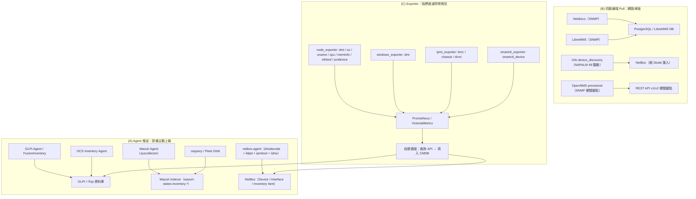
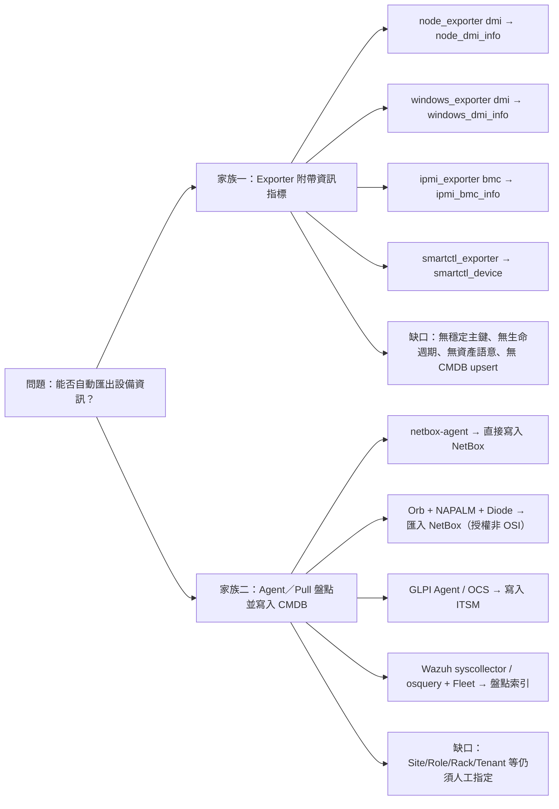
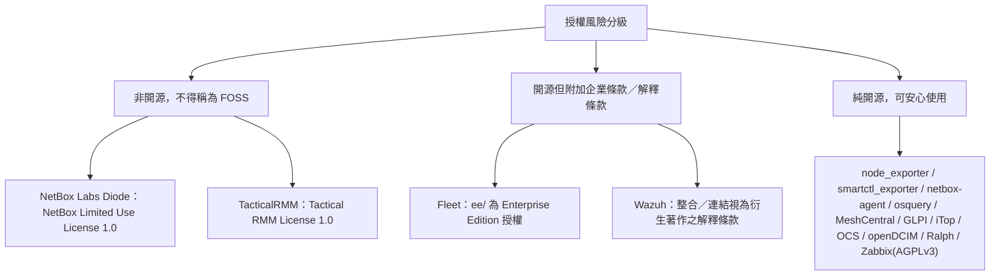
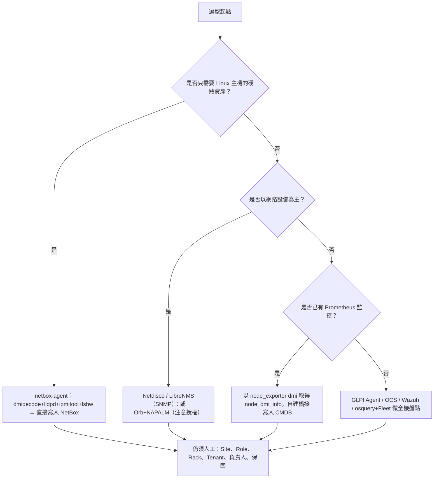

# 是否存在類似 Prometheus node_exporter 但輸出「設備資訊」而非「指標」的 FOSS 方案？

## 摘要

IPAM（IP Address Management，如 NetBox）與 ITSM／ITIL（如 GLPI、iTop、Snipe-IT）這類軟體，其設計前提是「有人把設備資訊輸入進去」：資產編號、廠牌、型號、序號、CPU、記憶體、硬碟、作業系統、網路介面與 IP。Prometheus 生態的 `node_exporter` 則相反，它輸出的是時間序列指標（metrics），例如 CPU 使用率與磁碟 I/O。

本報告要回答的問題是：**有沒有 FOSS 方案能像 `node_exporter` 匯出指標那樣，自動「匯出設備資訊」，而不必人工鍵入？**

結論分成三層：

1. **有，而且比預期更直接**：`node_exporter` 本身就有預設啟用的 `dmi` 收集器，輸出 `node_dmi_info`，這是一個值固定為 1、以標籤承載 SMBIOS 資產欄位（product serial、product UUID、board serial、chassis serial、system vendor、BIOS 版本）的「資訊指標」（info metric）。也就是說，使用者要的東西有一半已經在 `node_exporter` 裡了[^nerdm]。
2. **真正把設備資訊「寫進 IPAM／CMDB」的，是 Agent 型盤點系統**，不是 exporter：`netbox-agent`（dmidecode + lldpd + ipmitool + lshw 直接寫入 NetBox）、Orb agent + NAPALM + Diode（寫入 NetBox）、Nautobot Device Onboarding（netmiko + NAPALM）、GLPI Agent、OCS Inventory、Wazuh syscollector、osquery／Fleet。這些才是真正替代人工鍵入的 FOSS[^nbagent][^orbdd][^nbod][^glpiagent][^ocsreadme][^wazuhreadme][^osqspec][^fleetrdm]。
3. **Exporter 本身不是 CMDB**：`node_dmi_info` 沒有穩定主鍵、沒有生命週期、不認識機櫃／站點／租戶，也不做 upsert 與人工欄位保護。它需要一座「橋」才能變成資產記錄；而社群層級的現成橋樑並不多，多數是自建[^nerdm][^windmidoc][^bridges404]。

換句話說：**FOSS 能自動匯出設備資訊，而且已經有成熟方案；但「自動匯出」與「自動成為 CMDB 的 source of truth」之間仍有一段工程落差，落差主要在於資產語意（誰擁有、放在哪、屬哪個租戶）與人工欄位的保護。**

本報告的檢索日期為 2026-11-21，所有星數與版本皆以此日期自 `ungh.cc` 與原始碼檔案擷取。

---

## 一、問題定義：設備「指標」與設備「資訊」的差異

| 面向 | device metrics（`node_exporter` 的典型輸出） | device information（資產／CMDB 要的資料） |
|---|---|---|
| 資料形狀 | 時間序列，持續被 scrape | 記錄（record），鍵值為穩定主鍵 |
| 範例 | `node_cpu_seconds_total`、`node_memory_MemAvailable_bytes` | 廠牌、型號、序號、UUID、機櫃位置、租戶 |
| 識別方式 | `instance`／`job` 標籤（通常只是 IP:port） | 序號或 UUID 這種跨重裝仍穩定的主鍵 |
| 更新語意 | 每次 scrape 覆寫 | upsert／reconcile，且不得覆蓋人工欄位 |
| 生命週期 | 無（只分 up／down） | 採購、保固、退役、報廢 |
| 歸屬關係 | 無 | 站點、機櫃、機架、租戶、負責人 |
| 典型消費者 | 告警、儀表板 | 資產報表、稽核、保固管理、ITIL 流程 |

值得注意的是，Prometheus 世界中的「資訊指標」（`*_info`）其實就是 exporter 對這個問題的折衷：把靜態資訊塞進一個值恆為 1 的指標，用標籤承載欄位。`node_exporter` 的 `dmi` 收集器與 `textfile` 收集器都屬於此類做法[^nerdm]。

`textfile` 收集器的官方說明正好點出這個用途：它「類似 Pushgateway……也可用來匯出**靜態指標，例如某台機器的角色**」，做法是解析 `--collector.textfile.directory` 目錄下的 `*.prom` 檔案[^nerdm]。這等於官方認可了「用指標通道傳遞靜態設備資訊」的模式。

---

## 二、三種自動蒐集架構



三條路線的性質差異很大：

- **(A) Agent 推送**：拿到最完整的本地資訊（DMI、磁碟序號、PCI 裝置、已安裝軟體），但要求在每台機器安裝 agent。
- **(B) 伺服器端 Pull**：不需裝 agent，靠 SNMP 或 SSH/NETCONF 連線，適合網路設備；但拿不到作業系統內部的硬體細節。
- **(C) Exporter**：資料已經在監控系統裡，改造成本最低；但資料形狀是時間序列，需要橋接層與語意補齊。

---

## 三、Exporter 家族：實際上匯出了哪些設備資訊

### 3.1 `node_exporter` 的 `dmi` 收集器（最直接命中需求）

`node_exporter` 目前為 13,945 星，最新版本 v1.13.0（2026-11-18 發布），預設分支為 `master`[^nestats][^nerel]。其 README 的收集器清單中列有 **`dmi`**，預設啟用，說明為「Expose Desktop Management Interface (DMI) info from `/sys/class/dmi/id/`」[^nerdm]。

同時預設啟用且帶有盤點性質的收集器還包括：`os`（從 `/etc/os-release` 匯出 OS 版本資訊）、`uname`、`cpu`、`meminfo`、`nvme`、`hwmon`、`netclass`、`netdev`[^nerdm]。預設關閉但與盤點相關者：`ethtool`（網路介面資訊與驅動統計，等同 `ethtool`、`ethtool -S`、`ethtool -i`）、`pcidevice`、`drm`、`fibrechannel`、`nvmesubsystem`、`tapestats`[^nerdm]。

`node_exporter` 官方倉庫中的 `docs/collector/dmi.md` 在本次檢索中無法取得（404），因此 `node_dmi_info` 的標籤清單改由「明示對齊 `node_exporter` 的 `windows_exporter`」交叉驗證。

### 3.2 `windows_exporter` 的 `dmi` 收集器（標籤與 Linux 版一致）

`windows_exporter` 的 `internal/collector/dmi/dmi.go` 使用 `sysinfoapi.GetSMBIOSInfo()`，原始碼註解寫明「Label names match node_exporter's `node_dmi_info`. Fields the firmware does not provide stay empty; Prometheus drops empty labels on ingestion.」[^windmi]

其匯出的指標 `windows_dmi_info` 說明為：值固定為 1，標籤包含 `bios_date`、`bios_release`、`bios_vendor`、`bios_version`、`board_asset_tag`、`board_name`、`board_serial`、`board_vendor`、`board_version`、`chassis_asset_tag`、`chassis_serial`、`chassis_vendor`、`chassis_version`、`product_family`、`product_name`、`product_serial`、`product_sku`、`product_uuid`、`product_version`、`system_vendor`，全部來自 SMBIOS[^windmi][^windmidoc]。

官方文件給出的實際輸出範例為[^windmidoc]：

```
windows_dmi_info{bios_date="04/01/2014",bios_release="0.0",bios_vendor="SeaBIOS",
  bios_version="rel-1.16.3-...",chassis_vendor="QEMU",chassis_version="pc-q35-9.2",
  product_name="Standard PC (Q35 + ICH9, 2009)",
  product_uuid="12345678-1234-1234-1234-123456789abc",
  product_version="pc-q35-9.2",system_vendor="QEMU"} 1
```

文件並強調「標籤名稱與 `node_exporter` 的 `node_dmi_info` 一致，因此儀表板與告警可跨 Linux 與 Windows 客體共用」，並建議以 PromQL `{__name__=~"node_dmi_info|windows_dmi_info"}` 查詢[^windmidoc]。

`node_dmi_info` 確實存在於真實環境：Sourcegraph 於公開 GitHub 程式碼搜尋命中 `shinthink/blitzstrike` 與 `hanc00l/nemo_go` 的 Nuclei 樣板，使用正規表示式 `'node_dmi_info\{([^}]*)\}\s+1'` 解析該指標[^sgnuclei]。這從側面證實 `node_dmi_info` 是一個可被工具直接消費的欄位承載指標。

### 3.3 `ipmi_exporter` 的 `bmc` 收集器（注意：不是 `ipmi_dmi_info`）

`ipmi_exporter` 為 628 星[^ipmistats]。其 `docs/metrics.md` 顯示與盤點相關的指標是 **`ipmi_bmc_info`**：「a constant metric `ipmi_bmc_info` with value `1` and labels providing the firmware revision and manufacturer as returned from the BMC, and the host system's firmware version (usually the BIOS version)」[^ipmimd]。

實際輸出與注意事項[^ipmimd]：

```
ipmi_bmc_info{firmware_revision="1.66",manufacturer_id="Dell Inc. (674)",system_firmware_version="2.6.1"} 1
```

文件並註明：「some systems do not expose the system's firmware version, in which case it will be exported as `"N/A"`」[^ipmimd]。其餘指標多為感測器讀值，例如 `ipmi_dcmi_power_consumption_watts`、`ipmi_chassis_power_state`、`ipmi_temperature_celsius`、`ipmi_fan_speed_rpm`、`ipmi_voltage_volts`、`ipmi_power_watts`、`ipmi_sensor_state`，以及 `ipmi_sel_logs_count`、`ipmi_sel_free_space_bytes`[^ipmimd]。可用收集器為 `ipmi`、`dcmi`、`bmc`、`bmc-watchdog`、`chassis`、`sel`、`sel-events`、`sm-lan-mode`[^ipmimd]。

**重要更正**：本報告不以 `ipmi_dmi_info` 作為 exporter 指標。以 Sourcegraph 搜尋 `ipmi_dmi_info` 只命中 Linux 核心的 `struct ipmi_dmi_info`，即該名稱屬於核心資料結構，而非 exporter 指標[^sghits]。

### 3.4 `smartctl_exporter`（實體磁碟身分）

`smartctl_exporter` 為 611 星，Apache-2.0 授權（原始碼檔頭）[^smartstats][^smartgo]。其 `metrics.go` 定義了磁碟身分指標 `smartctl_device`，說明為「Device info」，標籤包含 `device`、`interface`、`protocol`、`model_family`、`model_name`、`serial_number`、`ata_additional_product_id`、`firmware_version`、`ata_version`、`sata_version`、`form_factor`、`scsi_model_name`、`scsi_vendor`、`scsi_product`、`scsi_revision`、`scsi_version`[^smartgo]。

其他指標包括 `smartctl_version`、`smartctl_devices`（已設定或動態探索到的裝置數）、`smartctl_device_capacity_bytes`、`smartctl_device_nvme_capacity_bytes`、`smartctl_device_block_size`、`smartctl_device_interface_speed`、`smartctl_device_rotation_rate`、`smartctl_device_power_on_seconds`、`smartctl_device_power_cycle_count`、`smartctl_device_percentage_used`、`smartctl_device_available_spare`、`smartctl_device_media_errors`、`smartctl_device_smart_status`、`smartctl_device_erc_seconds`、`smartctl_scsi_grown_defect_list` 等[^smartgo]。README 指出需 smartmontools >= 7.0 且需 root，並支援 `--smartctl.device`（可用 `/dev/bus/0;megaraid,1` 語法涵蓋 RAID 後方磁碟）、`--smartctl.scan-device-type`（特殊值 `by-id`）等選項[^smartstats]。

### 3.5 已消失或未能證實的 exporter

`prometheus-community/dmi_exporter` 在該路徑下為 404[^dmigone]。以此推測其功能已被收進 `node_exporter` 的 `dmi` 收集器，但**此沿革未經證實**，僅能作為觀察記錄。Redfish 相關 exporter（`jennings/redfish_exporter`、`prometheus-community/redfish_exporter`）在本次檢索中皆為 404[^rfgone]。Telegraf 的 `inputs.dmidecode` 精確欄位亦未能取得（猜測路徑 404），因此本報告不主張 Telegraf 的具體欄位，只記錄 Telegraf 為 17,916 星、最新版 v1.40.3（2026-11-02 發布）的通用型 agent，其價值在於能把各種 input 的資料寫往任意 output（含資料庫與 JSON），但此「設備資訊載體」的具體說法**未經證實**[^telegraf]。

---

## 四、真正把設備資訊寫進 IPAM／CMDB 的 Agent 型方案

第 3 節的 exporter 解決了「資料取得」，但沒有解決「寫成資產記錄」。真正處理後半段的方案如下。

### 4.1 `netbox-agent`（Solvik）：最接近「node_exporter 但輸出設備資訊並寫入 IPAM」

`netbox-agent` 為 395 星，Apache License 2.0[^nbagentstats][^nbagentlic]。其 README 開頭即說明了宗旨：「This project aims to create hardware automatically into Netbox based on standard tools (dmidecode, lldpd, parsing /sys/, etc).」[^nbagent]

功能清單（節錄自官方 README）[^nbagent]：

- 透過 `dmidecode` 建立實體機、虛擬機、機箱（chassis）與刀鋒（blade）。
- 建立實體、bonding、VLAN 網路介面及其 IP（IPv4 與 IPv6）。
- 若偵測到 IPMI 介面則建立。
- 建立或取用既有 VLAN 並關聯到介面。
- 以 `cmd`／`file` 驅動取得機房／機櫃位置。
- 更新既有的 `Device` 與 `Interface`。
- 處理刀鋒換槽、換機箱的情境。
- 處理刀鋒 GPU 擴充。
- **以 LLDP 自動建立線纜（伺服器介面到交換器介面）**。
- **以 `Inventory Item` 建立本機盤點：CPU、GPU、RAM、RAID 卡、實體磁碟（含 RAID 卡後方磁碟）**。
- **建立 PSU 並回報功耗（依賴廠商工具）**。
- 將 hypervisor 裝置關聯到虛擬化叢集，將 VM 關聯到 hypervisor。

需求為 Netbox >= 3.7、Python >= 3.8，以及 pynetbox、python3-netaddr、python3-netifaces、jsonargparse；系統工具需 ethtool、dmidecode、ipmitool、lldpd、lshw，若要做盤點另需 hpassacli、storcli、omreport[^nbagent]。已知限制：僅支援 Linux（因使用 `ethtool` 與解析 `/sys/`），不支援 BSD[^nbagent]。廠商支援清單列出 Dell（PowerEdge MX7000、M1000e、MX740c、M640、M630、M620、M610、DSS7500）、HPE（BladeSystem c7000 G2/G3、ProLiant BL460c Gen8/Gen9/Gen10 含 Graphics Expansion、Moonshot 1500、DL380p Gen8、SL4540、XL450 Gen10）、Supermicro（SBI-*/SBA-*、SSG-6028R、SYS-6018R）、QCT（QuantaMicro X10E-9N）[^nbagent]。設定鍵包含 `netbox.url`、`netbox.token`、`network.ignore_interfaces`、`network.lldp`、`chassis_role`、`blade_role`、`server_role`、`tenant.driver`、`virtual`、`inventory: true` 等；CLI 旗標包含 `--register`、`--update-network`、`--update-inventory`、`--expansion-as-device`、`--dump-disks-map`[^nbagent]。最新版本 1.2.0（發布於 2026-01-02）[^nbagentrel]。

這是本次調查中最貼近使用者提問的單一專案：它以「設備的主動上報」取代人工鍵入，且輸出的不是指標，而是 NetBox 中的資產記錄。

### 4.2 Orb agent + NAPALM + Diode：NetBox Labs 官方的探索路線（授權有重大保留）

NetBox 本身為 21,913 星、Apache-2.0 授權，最新版 v4.7.4（2026-10-27 發布）[^nb][^nbrel]。NetBox 官方定位是「資料來源」（source of truth），自動化的輸入路徑由 NetBox Labs 提供的 **Diode**（資料匯入服務，167 星）與 **Orb agent**（探索 agent，107 星）構成[^diode][^orb]。

Diode README 說明：「Diode is a data ingestion service for NetBox that greatly simplifies and enhances the process of adding and updating data in NetBox, ensuring your network source of truth is always accurate and up to date.」狀態為 GA，需 NetBox 4.2.3+，提供 Python 與 Go SDK，透過 gRPC 匯入[^diode]。**然而 Diode 採用的是「NetBox Limited Use License 1.0」，並非 OSI 認可的開源授權**；其 protobuf 定義才是 Apache-2.0[^diodelic]。授權原文寫明：「NetBox Labs grants you a copyright license to use and modify the software only as part of a NetBox installation obtained from NetBox Labs or a NetBox distributor authorized by NetBox Labs, and only for your own internal use.」，並進一步限制「To provide a managed service or software products that includes, integrates with, or extends NetBox in a way that competes with any product or service of NetBox Labs.」[^diodelic]。**對「FOSS 方案」這個問題而言，這是必須明講的保留。**

Orb agent 目前狀態為 Public Preview[^orb]。其 README 說明：「The device discovery backend leverages [NAPALM] to connect to network devices and collect network information.」，支援「48 NAPALM drivers covering 17+ network vendors」，輸出為 Diode 實體：Device、Interface、Device Type、Platform、Manufacturer、Site、Role、IP Address、Prefix、VLAN、VRF、VirtualChassis、Module、ModuleBay[^orbdd]。

Orb 的選項表是「NAPALM 到底能自動取得什麼」最清楚的官方陳述[^orbdd]：

- **自動取得**：Name（`get_facts()` → hostname）、Model（`get_facts()` → model）、Manufacturer（`get_facts()` → vendor）、Platform（`os_version` 加驅動名稱，可覆寫；`platform_omit_version: true`）、Serial number（`get_facts()` → serial_number）。
- **不會取得**：Site、Role、Location、Rack、Position、face、Tenant、Description、Comments、Tags。
- 另註明「Status | — | Always set to `"active"`」[^orbdd]。

其他已文件化的行為：`capture_running_config`／`capture_startup_config` 會把設定檔匯入為 `DeviceConfig` 實體；`sanitize_config` 預設為 `true`（遮蔽密碼與 PSK）；`discover_modules` 可為 off／linecards／full；`discover_vrfs`；`emit_lag_membership`（預設 `true`）；`emit_host_prefixes`（預設 `false`，且 `/32`、`/128` 不會被推導為前綴）；IPv6 link-local `fe80::/10` 永不推導；每個 policy 的位址展開上限為 65,536；機櫃位置僅支援逐裝置的 `position` 與 `face`；支援以 `ssh_config_file` 設定 SSH jumphost[^orbdd]。Orb 以長駐程序執行政策（cron `schedule`），需 `--net=host` 或 root，容器最低需求為 CPU 2 核、記憶體 1.5 GB、磁碟 1 GB[^orbdd]。

### 4.3 Nautobot Device Onboarding：NetBox 外掛的後繼者

NetBox 生態中的 onboarding 外掛 `networktocode/ntc-netbox-plugin-onboarding` 為 257 星，**最後推送日為 2023-01-17，已形同棄置**；`netbox-community/netbox-plugin-onboarding` 與 `netboxlabs/netbox-plugin-onboarding` 兩個路徑皆為 404[^ntconboard][^nbonboard404]。

仍在維護的後繼者是 Nautobot 的 App：`nautobot/nautobot-app-device-onboarding`（僅 59 星，屬低成熟度需標註），最新版 v5.6.0（2026-09-25 發布）[^nbodstats][^nbodrel]。它以 netmiko 加 NAPALM 實作，官方說明為「simplify the onboarding process of a new device into Nautobot down to, in many cases, an IP Address and a Location」[^nbod]。其支援矩陣將 Hostname、Platform、Manufacturer、Serial Number、Device Type、Mgmt Interface、Mgmt IP Address 列為 Cisco IOS/XE/NXOS/WLC、Juniper Junos、Arista EOS、Aruba AOS-CX 的支援／穩定項目（部分廠商標註「limited testing」），Virtual Chassis 僅 Cisco IOS/XE 與 Aruba AOS-CX 支援[^nbod]。Nautobot 本體為 1,642 星[^nautobot]。此 App v5.6.0 的發布說明提及新增 Palo Alto PAN-OS mapper、經 `show vsf detail` 支援 Aruba AOS-CX Virtual Chassis、以及以 `show module` 偵測模組[^nbodrel]。

### 4.4 GLPI 生態：GLPI Agent

GLPI 為 6,642 星，GPL-3.0 授權[^glpi][^glpilic]。`glpi-agent` 為 520 星，GPL-2.0+ 授權（README 明載「This software is licensed under the terms of GPLv2+, see LICENSE file for details」），最新版 v1.21（2026-10-08 發布）[^glpiagent][^glpiagentlic][^glpiagentrel]。其發行檔提供了相當廣的平台覆蓋：`GLPI-Agent-1.21-x64.msi`、x64 zip、macOS（x86_64/arm64 的 pkg 與 dmg）、`glpi-agent-1.21-linux-installer.pl`、snap、AppImage，以及 `.deb` 與 `.rpm` 的 Inventory／NetInventory／ESX／Collect／Deploy／IEC61850／WakeOnLan／Cron 等變體[^glpiagentrel]。GLPI 本體最新版 12.0.1（2026-10-28 發布，為安全性更新）[^glpirel]。

另有 `glpi-project/glpi-inventory-plugin`（83 星，屬低成熟度需標註）[^glpiinv]。GLPI Agent 的前身 FusionInventory 已停滯：`fusioninventory/fusioninventory-agent` 為 268 星、最後推送 2023-08-09；`fusioninventory/fusioninventory-for-glpi` 為 363 星、最後推送 2023-04-26，最新版本 `glpi10.0.6+1.1`（2023-02-13 發布）[^fia][^figlpi][^figlpirel]。**在 2026 年選用 FusionInventory 已屬高風險。**

### 4.5 OCS Inventory

`OCSInventory-NG/OCSInventory-Server` 為 405 星，README 明載「OCS Inventory is GPLv2 licensed」[^ocs][^ocsreadme]。`OCSInventory-NG/OCSInventory-ocsreports` 為 255 星[^ocsrep]。最新版本 2.12.6（2026-08-25 發布），其發布說明包含 CVE-2026-76174 至 76178 的修補與一個 SSRF 修補[^ocsrel]。注意 OCS Inventory 的 agent 倉庫命名在本次檢索中多次 404（`OCSInventory-Agent`、`-Windows-Agent`、`-Linux-Agent` 等），因此 agent 端的細節未經證實[^ocsagent404]。

### 4.6 Wazuh syscollector

Wazuh 為 17,841 星，最新版 v4.14.10（2026-11-09 發布）[^wazuh][^wazuhrel]。其 syscollector 為 agent 型**推送**架構：agent 掃描後寫入本地持久化 SQLite DB（DBSync），再透過既有的 HTTPS 連線、以「Agent Sync Protocol」把變更送到 manager 的 `remoted`，最終寫入 Wazuh Indexer 的 `wazuh-states-inventory-*` 索引，使用「Wazuh Common Schema (WCS)，an ECS-based schema」[^wazuhschema]。

其 schema 文件包含 `dbsync_osinfo`（hostname、architecture、os_name、os_version、os_codename、os_full 等）、**`dbsync_hwinfo`（`serial_number`、`cpu_name`、`cpu_cores`、`cpu_speed`、`memory_total`、`memory_free`、`memory_used`）**、`dbsync_packages`、`dbsync_network_iface`、網路位址、`dbsync_ports`、`dbsync_processes`、使用者、群組、服務、瀏覽器擴充、Windows 修補程式[^wazuhschema]。README 說明「Wazuh agents pull software inventory data and send this information to the server」[^wazuhreadme]。

Wazuh 的授權為多重授權：`src/engine/` 為 AGPLv3，部分共用函式庫為 `GPL-2.0-only OR AGPL-3.0-or-later`，「Everything else is licensed under the GNU General Public License (version 2)」，另加一項非 OSI 的解釋性條款（把整合／連結視為衍生著作，官方自稱是「a clarification of how we interpret 'derived works'」，而非新增限制），以及 OpenSSL 連結例外[^wazuhlic]。

### 4.7 osquery 與 Fleet

osquery 為 23,787 星，採 `Apache-2.0 OR GPL-2.0-only` 雙授權，最新版 5.24.1（2026-10-29 發布）[^osquery][^osqlic][^osqrel]。其核心表格 `system_info` 的規格檔說明為「System information for identification.」，欄位包含 `hostname`、`uuid`（系統提供的唯一 ID）、`cpu_type`、`cpu_subtype`、`cpu_brand`、`cpu_physical_cores`、`cpu_logical_cores`、`cpu_sockets`、`cpu_microcode`、`physical_memory`、`hardware_vendor`、`hardware_model`、`hardware_version`、**`hardware_serial`（Device serial number）**、`board_vendor`、`board_model`、`board_version`、`board_serial`、`computer_name`、`local_hostname`；Windows 擴充另加 `emulated_cpu_type`[^osqspec]。可以說 osquery 的 `system_info` 一張表就等於「`node_dmi_info` 加 CPU 加記憶體盤點」[^osqspec]。

**更正**：osquery 核心**沒有** `hardware_info.table`；DMI 類資料分布在 `system_info`、`platform_info`（EFI/UEFI/ROM 與平台開機資訊，欄位 vendor、version、date、revision、extra、firmware_type）、`cpu_info`、`memory_devices`[^osqspec][^osqtables]。

Fleet 為 7,232 星，其 agent 為建構於 osquery 之上的 **Orbit**，最新版 `fleet-v4.94.1`（2026-11-06 建立）[^fleet][^fleetrel]。授權需注意：多數內容為 MIT Expat，`docs/` 為 CC BY-SA 4.0，而 `ee/` 採 Fleet Enterprise Edition 授權，其原文寫明「...may only be used in production, if you ... have a valid Fleet Enterprise Edition subscription ... Subject to the foregoing, it is forbidden to copy, merge, publish, distribute, sublicense, and/or sell the Software.」[^fleetlic]。

### 4.8 其他 ITSM／CMDB 端

- **iTop**：1,221 星，GPL-3.0 授權，最新版 3.3.0-1（2026-11-06 發布）[^itop][^itoplic][^itoprel]。iTop 的蒐集機制**不是 agent 型，而是同步型**：`Combodo/itop-data-collector-base`（僅 12 星，屬低成熟度需標註）README 說明它「is a small framework for creating your own data collectors for iTop」，collector「collect data from an external application and load/synchronize the information into iTop using the data synchronization mechanism built into iTop」[^itopdc][^itopdcrdm]。
- **Snipe-IT**：15,211 星，最新版 v8.8.3（2026-10-22 發布），需 PHP 8.2.0+（建議 8.4+）[^snipe][^sniperel]。注意其倉庫已由 `snipe/snipe-it` 遷移至 `grokability/snipe-it`（原路徑 404）[^snipemoved]。`snipe/snipe-it-agent` 為 404，即**並無官方 agent**[^snipeagent404]。
- **Ralph**：2,532 星，Apache-2.0 授權[^ralph][^ralphlic]。README 載明維護模式警訊：「As Allegro, we continue to publish Ralph's source code and will maintain its development under a 'Sources only' model, without guarantees... we are not operating under a contribution-based model.」[^ralphrdm]。`allegro/ralph-agent` 為 404[^ralphagent404]。
- **openDCIM**：373 星，GPL-3.0 授權[^odcim][^odcimlic]。最新版 26.01（2026-10-26 發布），發布說明提及「Updated upstream composer packages」與「Container version patches the PHP2SHELL vulnerability」[^odcimrel]。**重大風險**：其 README 開頭即為「**Maintainer needed**」公告，作者表示投入近 20 年、「looking towards retirement」，將打包最後一個版本 26.01，並在 opendcim.org 網域註冊到期後退役該網域；README 亦指出目前 GitHub 上的版本「FOR DEVELOPMENT ONLY」[^odcimrdm]。
- **RackTables**：814 星，最後推送 2026-06-26（活躍度低於同類）[^racktables]。
- **TeemIP**：`teemIP/teemip-core-ipmgt` 僅 33 星（低成熟度需標註），自述為「Core modules of TeemIP, a WEB based IP Address Management tool」[^teemip]。
- **phpIPAM**：2,828 星，最新版 v1.9.1（2026-11-17 發布）[^phpipam][^phpipamrel]。
- **CMDBuild**：`CMDBuild/CMDBuild` 路徑為 404，本次無法查證[^cmdbuild404]。**Open-AudIT** 僅 `Opmantek/open-audit` 可解析（217 星，最新版 Open-AudIT_6.0.4，2026-10-12 發布），其現行授權與社群版是否仍為 FOSS **未經證實**[^openaudit][^openauditrel]。**TacticalRMM**（4,566 星）經查其授權為「Tactical RMM License Version 1.0」，**並非開源授權**：條文寫明該功能「may not be made available as part of a SaaS ... service ... without the express prior permission of the Licensor」，且「The prior written approval of AmidaWare LLC must be obtained for all commercial use and/or for-profit service use.」[^trmmlic]；其 README 雖列有「Software and hardware inventory」，但因授權不符 FOSS 定義，本報告不將其列為 FOSS 方案[^trmm]。

### 4.9 其他可用的輔助元件

- **Netdisco**：943 星，最新版 2.119000（2026-11-15 發布），以 SNMP 探索網路設備並寫入 PostgreSQL[^netdisco][^netdiscorel]。
- **LibreNMS**：5,018 星，最新版 26.10.2（2026-10-21 發布）[^librenms][^librenmsrel]。
- **Oxidized**：3,667 星，網路設備設定備份（RANCID 替代品）；對設定檔有用，對盤點無直接幫助[^oxidized]。
- **OpenNMS**：1,183 星，AGPLv3 授權[^opennms][^opennmslic]。其 SNMP 硬體盤點整合於 provisiond（`SnmpHardwareInventoryProvisioningAdapter`），並提供確認存在的 REST 資源 `HardwareInventoryResource`（v1）與 `NodeHardwareInventoryRestService`（v2）[^opennmsrest]。這是少數「確認存在的程式化匯出途徑」。
- **Checkmk**：2,653 星，GPLv2 授權[^checkmk][^checkmklic]。其硬體／軟體盤點樹確認可透過 OpenAPI 端點匯出（`cmk/gui/inventory/_openapi/_get_inventory_trees.py`），另有 `omd/packages/check_mk/skel/etc/cron.d/cmk_transform_inventory_trees`[^checkmkinv]。
- **Zabbix**：6,586 星，**授權為 AGPLv3**（`COPYING` 檔為 AGPLv3，此為對「GPLv2」常見誤解的更正）[^zabbix][^zabbixlic]。自動盤點能力已確認：其 API 測試檔使用 `HOST_INVENTORY_AUTOMATIC`、`HOST_INVENTORY_MANUAL`、`HOST_INVENTORY_DISABLED`，例如 `'inventory_mode' => HOST_INVENTORY_AUTOMATIC` 搭配 `'inventory' => ['os' => 'Windows']`，並支援 `host.get` 的 `selectInventory`；但自動填入的完整欄位清單未經證實[^zabbixinv]。其 GitHub `releases/latest` 端點 404，故版本資訊無法由此取得[^norelease]。
- **Netdata**：81,557 星，`GPL-3.0-or-later` 授權，最新版 v2.13.0（2026-11-19 發布）[^netdata][^netdatalic][^netdatarev]。說它「只有指標」並不精確：它具備 Redfish BMC 硬體盤點與 SMBIOS 記憶體盤點等程式碼路徑[^netdatainv]。
- **Glances**：33,997 星，自述「An Eye on your system. A top/htop alternative」，為系統監控工具[^glances]。
- **Nagios Core**（GPLv2）與 **Icinga 2**（GPLv3）：**未發現內建的自動硬體盤點功能**[^nagiosicinga]。
- **NAPALM**：2,530 星，自述「Network Automation and Programmability Abstraction Layer with Multivendor support」，是 Orb 與 Nautobot Onboarding 的底層[^napalm]。
- **Ohai**：692 星，自述「Ohai profiles your system and emits JSON」，可作為取得本機資訊的輔助元件[^ohai]。
- **jc**：8,705 星，自述「CLI tool and python library that converts the output of popular command-line tools, file-types, and common strings to JSON, YAML, or Dictionaries」，是把 `dmidecode`／`lshw` 輸出轉成結構化資料的實用黏著工具，本身不是 CMDB[^jc]。
- **Foreman**：3,003 星，`releases/latest` 端點 404，版本資訊無法由此取得[^foreman][^norelease]。
- **MeshCentral**：7,733 星，Apache License 2.0（「Copyright 2017-2025 Intel Corporation」），最新版 1.3.1（2026-10-23 發布）[^meshcentral][^meshcLic][^meshrel]。其發行說明為資安警語：「PLEASE UPGRADE URGENTLY TO THIS VERSION, THIS IS A SECURITY UPDATE / THE IS AN ACTIVE EXPLOIT/HACKER ATTACKING MESHCENTRAL SERVERS AND TAKING CONTROL OF IT AND REMOTE CLIENTS」[^meshrel]。程式碼中可見 `meshagent.js` 引用 `command.data.hardware?.windows?.volumes`、`command.data.hardware.windows.bitlocker`，以及 `sysinfohash` 事件（「this will notify everyone that the sysinfo document was changed」）與 `saveSysInfo()`；伺服器端的 node 文件具有 `hardware` 欄位[^meshinv]。

---

## 五、專案對照總表

星數與版本皆以 2026-11-21 之檢索結果為準。

| 專案 | 授權 | 星數 | 蒐集機制 | 取得的設備資訊 | 最新版本（發布日） |
|---|---|---|---|---|---|
| `prometheus/node_exporter` | Apache-2.0 | 13,945 | Exporter（指標通道） | SMBIOS/OS/uname/CPU/記憶體/NVMe/網路介面（`dmi` 等收集器） | v1.13.0（2026-11-18）[^nestats][^nerel] |
| `windows_exporter` | MIT（依官方倉庫慣例） | 未查 | Exporter（指標通道） | `windows_dmi_info`：bios/board/chassis/product 系列標籤 | 未查[^windmi] |
| `ipmi_exporter` | Apache-2.0 | 628 | Exporter（指標通道） | `ipmi_bmc_info`：BMC 韌體版本、製造商、系統韌體（BIOS）版本 | v1.10.1（2025-07-11）[^ipmistats][^ipmimd] |
| `smartctl_exporter` | Apache-2.0 | 611 | Exporter（指標通道） | `smartctl_device`：型號、序號、韌體、介面、規格、容量 | 未查[^smartstats][^smartgo] |
| `Solvik/netbox-agent` | Apache-2.0 | 395 | Agent 推送（寫入 IPAM） | 機型、序號、介面與 IP、LLDP 線纜、CPU/GPU/RAM/RAID/磁碟、PSU 功耗 | 1.2.0（2026-01-02）[^nbagentstats][^nbagentrel] |
| `netboxlabs/orb-agent` | **未證實**（兄弟專案 Diode 為非 OSI） | 107 | Agent 執行政策 + NAPALM Pull | hostname、model、vendor、OS 版本、serial（+ 設定檔） | 未查[^orb][^orbdd] |
| `netboxlabs/diode` | **NetBox Limited Use License 1.0（非 OSI）** | 167 | 匯入服務（gRPC） | 承接 Orb 輸出的實體 | diode-reconciler/v2.4.0（2026-11-05）[^diode][^diodeRel][^diodelic] |
| `glpi-project/glpi-agent` | GPL-2.0+ | 520 | Agent 推送（寫入 ITSM） | 硬體與軟體盤點（跨 Windows/macOS/Linux/ESX） | v1.21（2026-10-08）[^glpiagent][^glpiagentrel] |
| `OCSInventory-NG/OCSInventory-Server` | GPL-2.0 | 405 | Agent 推送（寫入 ITSM） | 硬體與軟體盤點 | 2.12.6（2026-08-25）[^ocs][^ocsrel] |
| `wazuh/wazuh` | 多重（AGPLv3 / GPL-2.0 / 另加解釋條款） | 17,841 | Agent 推送（DBSync → Indexer） | `dbsync_hwinfo`：序號、CPU 名稱/核心/頻率、記憶體；OSE 資訊、套件、網卡、連接埠 | v4.14.10（2026-11-09）[^wazuh][^wazuhschema][^wazuhrel] |
| `osquery/osquery` | Apache-2.0 OR GPL-2.0-only | 23,787 | Agent（本地查詢） | `system_info`：UUID、`hardware_serial`、廠牌型號、CPU、記憶體、主機板 | 5.24.1（2026-10-29）[^osquery][^osqspec][^osqrel] |
| `fleetdm/fleet` | MIT + `ee/` 企業授權 | 7,232 | Agent（Orbit）推送 | 主機軟體盤點與主機摘要 | fleet-v4.94.1（2026-11-06）[^fleet][^fleetlic][^fleetrel] |
| `nautobot/nautobot-app-device-onboarding` | 未查 | **59（低）** | netmiko + NAPALM Pull | Hostname、Platform、Manufacturer、Serial、Device Type、Mgmt IP | v5.6.0（2026-09-25）[^nbodstats][^nbodrel] |
| `networktocode/ntc-netbox-plugin-onboarding` | 未查 | 257 | NAPALM Pull | 同上（NetBox 版） | 最後推送 2023-01-17（**棄置**）[^ntconboard] |
| `Combodo/iTop` + `itop-data-collector-base` | GPL-3.0 | 1,221 / **12（低）** | 同步型（framework） | 由使用者自寫 collector 匯入 | 3.3.0-1（2026-11-06）[^itop][^itopdc][^itoprel] |
| `grokability/snipe-it` | 未查 | 15,211 | **無官方 agent** | 需人工或 API 匯入 | v8.8.3（2026-10-22）[^snipe][^sniperel] |
| `allegro/ralph` | Apache-2.0 | 2,532 | 自建（`ralph-agent` 404） | 自建 | 未查（**Sources only**）[^ralph][^ralphrdm] |
| `opendcim/openDCIM` | GPL-3.0 | 373 | 自建 | 機房與電力資產 | 26.01（2026-10-26，**終止維護**）[^odcim][^odcimrdm][^odcimrel] |
| `netdisco/netdisco` | 未查 | 943 | SNMP Pull | 網路設備與拓撲 | 2.119000（2026-11-15）[^netdisco][^netdiscorel] |
| `librenms/librenms` | GPL-3.0 | 5,018 | SNMP Pull | 網路設備與硬體 | 26.10.2（2026-10-21）[^librenms][^librenmsrel] |
| `OpenNMS/opennms` | AGPLv3 | 1,183 | SNMP Pull（provisiond） | 硬體盤點（REST v1/v2 可匯出） | 未查[^opennms][^opennmsrest] |
| `Checkmk/checkmk` | GPLv2 | 2,653 | Agent + OpenAPI 匯出 | HW/SW 盤點樹 | 未查[^checkmk][^checkmkinv] |
| `zabbix/zabbix` | AGPLv3 | 6,586 | Agent + 自動盤點模式 | 可由 `inventory_mode` 自動填入 | 未查[^zabbix][^zabbixinv] |
| `netdata/netdata` | GPL-3.0-or-later | 81,557 | Agent | Redfish BMC／SMBIOS 記憶體盤點 | v2.13.0（2026-11-19）[^netdata][^netdatainv] |
| `Ylianst/MeshCentral` | Apache-2.0 | 7,733 | Agent 推送 | `hardware` 文件（如 BitLocker、磁碟區） | 1.3.1（2026-10-23）[^meshcentral][^meshinv][^meshrel] |

---

## 六、直接回答問題

**問：有沒有 FOSS 方案能像 `node_exporter` 匯出指標那樣，自動匯出「設備資訊」？**

**答：有，而且分屬兩個家族，性質不同。**



**家族一（Exporter）**：`node_exporter` 的 `dmi` 收集器即已輸出 `node_dmi_info`，其標籤正是資產系統想要的 SMBIOS 欄位（product serial、product UUID、board serial、chassis serial、system vendor、BIOS 版本），且與 `windows_exporter` 的 `windows_dmi_info` 標籤命名一致，跨平台可共用查詢[^nerdm][^windmi][^windmidoc]。因此「像 `node_exporter` 那樣」這個問法的答案就是：**`node_exporter` 本身已經在做這件事了**，只是資料停在指標系統裡。

**家族二（盤點 Agent）**：如果目標是「設備資訊自動進入 IPAM／ITSM，取代人工鍵入」，那就是 `netbox-agent`、Orb + Diode、Nautobot Device Onboarding、GLPI Agent、OCS Inventory、Wazuh syscollector、osquery／Fleet 這一類[^nbagent][^orbdd][^nbod][^glpiagent][^ocsreadme][^wazuhschema][^osqspec][^fleet]。

**Exporter 單獨不是 CMDB。** 這是本報告最重要的判斷：`node_dmi_info` 這類資訊指標沒有穩定主鍵（`instance` 標籤通常只是 IP:port）、沒有生命週期、不認識機櫃／站點／租戶、也不做 upsert 與人工欄位保護[^nerdm][^windmidoc]。要把 exporter 資料變成資產記錄，必須自建橋接層（定期查詢 API 再寫入 CMDB），而本次檢索**未找到現成的 FOSS 橋接專案**：`osquery/osquery-netbox`、`snipe/snipe-it-agent`、`allegro/ralph-agent`、`bloomberg/python-dsc` 皆為 404[^bridges404]。

### 6.1 一個值得注意的旁證：指標通道被當成「盤點外洩」而非盤點饋送

`node_dmi_info` 在真實世界被資安與偵察工具當成資訊洩漏面來利用。本次檢索取得的 Prometheus 偵察備忘錄列出這類查詢：`GET /api/v1/query?query=node_dmi_info`、`node_network_info`、`kube_pod_info`、`kube_node_info`、`{__name__=~"..._build_info"}`、`GET /api/v1/label/__name__/values`（列舉所有指標名稱以推得應用清單）、`GET /federate?match[]={__name__=~".%2b"}`（經 federation 大量外洩序列），並註記「Target lists + `__meta_*`/`__address__` labels = a free internal network map」[^recon]。

這正好從反面說明：**資訊指標確實承載了資產資訊，但被設計成可被任意具讀取權者取得，且不具備 CMDB 應有的權限與生命週期語意。** 因此若要把它當成資產來源，必須把「取得」與「寫入受控資料庫」這兩段明確分開，並加上存取控制。

---

## 七、缺口、風險與注意事項

### 7.1 授權風險（對「FOSS」這個問題最關鍵）



1. **Diode 採用 NetBox Limited Use License 1.0，非 OSI 認可開源授權**[^diodelic]。Orb agent 的授權**未能取得**（LICENSE 猜測路徑 404）[^orblic404]，但其兄弟專案 Diode 的授權狀況已足以構成警示。若使用者對「FOSS」有嚴格定義，NetBox Labs 的官方探索路線**不完全符合**。
2. **TacticalRMM 並非開源授權**[^trmmlic]，不得列入 FOSS 清單，即使其 README 寫有硬體盤點功能[^trmm]。
3. **Fleet 的 `ee/` 目錄採 Enterprise Edition 授權**，禁止未訂閱情況下的生產使用，且禁止複製、合併、發佈、再授權與販售[^fleetlic]。
4. **Wazuh 為多重授權**，含一項把整合／連結視為衍生著作的解釋性條款（官方自稱是解釋而非新增限制），以及 OpenSSL 連結例外[^wazuhlic]。
5. **更正常見誤解**：Zabbix 為 **AGPLv3**（非 GPLv2）[^zabbixlic]；`osquery` 為 `Apache-2.0 OR GPL-2.0-only` 雙授權[^osqlic]。

### 7.2 維護與生命週期風險

- **openDCIM 正在收攤**：README 為「Maintainer needed」公告，作者將退休、將以 26.01 作結、並在網域到期後退役 opendcim.org，且現行 GitHub 版本標為「FOR DEVELOPMENT ONLY」[^odcimrdm]。
- **Ralph 為「Sources only」模式**：官方明言「without guarantees」且不採貢獻導向模式[^ralphrdm]。
- **FusionInventory 已停滯**：agent 最後推送 2023-08-09，GLPI 外掛最後推送 2023-04-26[^fia][^figlpi]。
- **NetBox onboarding 外掛已棄置**：`ntc-netbox-plugin-onboarding` 最後推送 2023-01-17，其後繼者為 Nautobot App[^ntconboard][^nbod]。
- **RackTables 活躍度偏低**：最後推送 2026-06-26[^racktables]。

### 7.3 低成熟度專案標註（星數 < 100）

依研究規範，以下專案星數低於約 100，使用前須評估：

| 專案 | 星數 | 說明 |
|---|---|---|
| `Combodo/itop-data-collector-base` | 12 | 自建 collector 的框架，非成品[^itopdc] |
| `teemIP/teemip-core-ipmgt` | 33 | TeemIP 核心模組[^teemip] |
| `nautobot/nautobot-app-device-onboarding` | 59 | 已棄置 NetBox 外掛的後繼者[^nbodstats] |
| `glpi-project/glpi-inventory-plugin` | 83 | GLPI 盤點外掛[^glpiinv] |
| `netboxlabs/orb-agent` | 107 | 官方探索 agent（Public Preview）[^orb] |

### 7.4 未經證實的事項（不得當作結論引用）

- **Orb agent 的授權**[^orblic404]。
- **Telegraf `inputs.dmidecode` 的精確欄位**（猜測路徑 404）[^telegraf]。
- **任何現成的「Prometheus／`node_exporter` 資料 → NetBox／GLPI／iTop」橋接專案**（相關倉庫皆 404）[^bridges404]。
- **`prometheus-community/dmi_exporter` 是否曾存在及其沿革**[^dmigone]。
- **Redfish exporter 專案**（兩個候選路徑皆 404）[^rfgone]。
- **Zabbix、Checkmk、Foreman 的具體最新版本號**（`releases/latest` 端點皆 404）[^norelease]。
- **Open-AudIT 現行授權與社群版是否仍為 FOSS**（僅 `Opmantek/open-audit` 可解析）[^openaudit]。
- **CMDBuild**：倉庫路徑 404，無法查證[^cmdbuild404]。
- **OCS Inventory agent 端細節**：多個 agent 倉庫路徑 404[^ocsagent404]。
- **Zabbix 自動盤點模式的完整欄位清單**[^zabbixinv]。

### 7.5 方法論陷阱：套件清單不是整合

TacticalRMM 綁定的 `api/tacticalrmm/software/chocos.json` 僅列出 Chocolatey 套件名稱（含 `glpi-agent`、`fusioninventory-agent`、`check_mk_agent`、`zabbix-agent`、`osquery`、`fleet`、`wazuh-agent`），這些是**可安裝的套件名稱，不是整合功能**，不得引用為整合證據[^chocotrap]。

### 7.6 實務建議路徑



無論走哪條路，**殘餘的人工缺口一致**：Site、Role、Location、Rack、Position、face、Tenant、Description、Comments、Tags 這些欄位在 Orb 的官方文件中被明列為「不會自動取得」[^orbdd]，而這些正是 ITIL／資產管理流程的核心欄位。因此自動化能取代的是「硬體事實的鍵入」，無法取代的是「組織語意的指派」。

---

## 八、結語

- **技術上可行，且已有成熟 FOSS**：`node_exporter` 的 `dmi` 收集器直接輸出 `node_dmi_info` 這類資產資訊指標[^nerdm][^windmi]；真正把設備資訊寫入 IPAM／ITSM 的是 `netbox-agent`、GLPI Agent、OCS Inventory、Wazuh、osquery／Fleet 等 Agent 型方案[^nbagent][^glpiagent][^ocsreadme][^wazuhschema][^osqspec]。
- **最貼近提問的單一專案是 `netbox-agent`**：以標準工具（dmidecode、lldpd、ipmitool、lshw）自動在 NetBox 建立硬體、介面、IP、線纜與 Inventory Item，並回報 PSU 功耗[^nbagent]。
- **官方路線（Orb + Diode）功能完整但授權非 OSI**，且 Orb 仍在 Public Preview[^diode][^diodeRel][^diodelic][^orb]。
- **Exporter 單獨不是 CMDB**：缺主鍵、缺生命週期、缺資產語意、缺 upsert，且本次未找到現成橋接專案[^bridges404][^recon]。
- **最大的殘餘人工缺口是組織語意**：Site／Role／Rack／Tenant／負責人仍需人工指派[^orbdd]。

---

## 參考資料

[^nerdm]: Prometheus. (n.d.). *node_exporter README* [Source code]. Retrieved 2026-11-21, from https://raw.githubusercontent.com/prometheus/node_exporter/master/README.md

[^nestats]: ungh.cc. (n.d.). *prometheus/node_exporter* [Repository metadata]. Retrieved 2026-11-21, from https://ungh.cc/repos/prometheus/node_exporter

[^nerel]: ungh.cc. (n.d.). *prometheus/node_exporter latest release*. Retrieved 2026-11-21, from https://ungh.cc/repos/prometheus/node_exporter/releases/latest

[^windmi]: Prometheus Community. (n.d.). *windows_exporter: internal/collector/dmi/dmi.go* [Source code]. Retrieved 2026-11-21, from https://raw.githubusercontent.com/prometheus-community/windows_exporter/master/internal/collector/dmi/dmi.go

[^windmidoc]: Prometheus Community. (n.d.). *windows_exporter: docs/collector.dmi.md* [Documentation]. Retrieved 2026-11-21, from https://raw.githubusercontent.com/prometheus-community/windows_exporter/master/docs/collector.dmi.md

[^sgnuclei]: Sourcegraph. (n.d.). *Code search results for node_dmi_info (shinthink/blitzstrike, hanc00l/nemo_go)*. Retrieved 2026-11-21, from https://sourcegraph.com/search

[^sghits]: Sourcegraph. (n.d.). *Code search results for ipmi_dmi_info*. Retrieved 2026-11-21, from https://sourcegraph.com/search

[^ipmistats]: ungh.cc. (n.d.). *prometheus-community/ipmi_exporter* [Repository metadata]. Retrieved 2026-11-21, from https://ungh.cc/repos/prometheus-community/ipmi_exporter

[^ipmimd]: Prometheus Community. (n.d.). *ipmi_exporter: docs/metrics.md* [Documentation]. Retrieved 2026-11-21, from https://raw.githubusercontent.com/prometheus-community/ipmi_exporter/master/docs/metrics.md

[^smartstats]: ungh.cc. (n.d.). *prometheus-community/smartctl_exporter* [Repository metadata]. Retrieved 2026-11-21, from https://ungh.cc/repos/prometheus-community/smartctl_exporter

[^smartgo]: Prometheus Community. (n.d.). *smartctl_exporter: metrics.go* [Source code]. Retrieved 2026-11-21, from https://raw.githubusercontent.com/prometheus-community/smartctl_exporter/master/metrics.go

[^dmigone]: Prometheus Community. (n.d.). *dmi_exporter* [Repository, not found]. Retrieved 2026-11-21, from https://github.com/prometheus-community/dmi_exporter

[^rfgone]: GitHub. (n.d.). *redfish_exporter repositories* [Not found]. Retrieved 2026-11-21, from https://github.com/jennings/redfish_exporter and https://github.com/prometheus-community/redfish_exporter

[^telegraf]: ungh.cc. (n.d.). *influxdata/telegraf* [Repository metadata]. Retrieved 2026-11-21, from https://ungh.cc/repos/influxdata/telegraf

[^nbagent]: Solvik. (n.d.). *netbox-agent README* [Source code]. Retrieved 2026-11-21, from https://raw.githubusercontent.com/Solvik/netbox-agent/master/README.md

[^nbagentstats]: ungh.cc. (n.d.). *Solvik/netbox-agent* [Repository metadata]. Retrieved 2026-11-21, from https://ungh.cc/repos/Solvik/netbox-agent

[^nbagentlic]: Solvik. (n.d.). *netbox-agent LICENSE* [Source code]. Retrieved 2026-11-21, from https://raw.githubusercontent.com/Solvik/netbox-agent/master/LICENSE

[^nbagentrel]: ungh.cc. (n.d.). *Solvik/netbox-agent latest release*. Retrieved 2026-11-21, from https://ungh.cc/repos/Solvik/netbox-agent/releases/latest

[^nb]: ungh.cc. (n.d.). *netbox-community/netbox* [Repository metadata]. Retrieved 2026-11-21, from https://ungh.cc/repos/netbox-community/netbox

[^nbrel]: ungh.cc. (n.d.). *netbox-community/netbox latest release*. Retrieved 2026-11-21, from https://ungh.cc/repos/netbox-community/netbox/releases/latest

[^diode]: NetBox Labs. (n.d.). *diode README* [Source code]. Retrieved 2026-11-21, from https://raw.githubusercontent.com/netboxlabs/diode/develop/README.md

[^diodeRel]: ungh.cc. (n.d.). *netboxlabs/diode latest release*. Retrieved 2026-11-21, from https://ungh.cc/repos/netboxlabs/diode/releases/latest

[^diodelic]: NetBox Labs. (n.d.). *NetBox Limited Use License 1.0* [License text]. Retrieved 2026-11-21, from https://raw.githubusercontent.com/netboxlabs/diode/develop/LICENSE.md

[^orb]: ungh.cc. (n.d.). *netboxlabs/orb-agent* [Repository metadata]. Retrieved 2026-11-21, from https://ungh.cc/repos/netboxlabs/orb-agent

[^orbdd]: NetBox Labs. (n.d.). *orb-agent device_discovery README* [Documentation]. Retrieved 2026-11-21, from https://raw.githubusercontent.com/netboxlabs/orb-agent/develop/agent/backend/device_discovery/README.md

[^orblic404]: GitHub. (n.d.). *netboxlabs/orb-agent LICENSE* [Not found]. Retrieved 2026-11-21, from https://raw.githubusercontent.com/netboxlabs/orb-agent/develop/LICENSE

[^ntconboard]: ungh.cc. (n.d.). *networktocode/ntc-netbox-plugin-onboarding* [Repository metadata]. Retrieved 2026-11-21, from https://ungh.cc/repos/networktocode/ntc-netbox-plugin-onboarding

[^nbonboard404]: GitHub. (n.d.). *netbox-plugin-onboarding repositories* [Not found]. Retrieved 2026-11-21, from https://github.com/netbox-community/netbox-plugin-onboarding and https://github.com/netboxlabs/netbox-plugin-onboarding

[^nbodstats]: ungh.cc. (n.d.). *nautobot/nautobot-app-device-onboarding* [Repository metadata]. Retrieved 2026-11-21, from https://ungh.cc/repos/nautobot/nautobot-app-device-onboarding

[^nbodrel]: ungh.cc. (n.d.). *nautobot/nautobot-app-device-onboarding latest release*. Retrieved 2026-11-21, from https://ungh.cc/repos/nautobot/nautobot-app-device-onboarding/releases/latest

[^nbod]: Nautobot. (n.d.). *nautobot-app-device-onboarding README* [Source code]. Retrieved 2026-11-21, from https://raw.githubusercontent.com/nautobot/nautobot-app-device-onboarding/develop/README.md

[^nautobot]: ungh.cc. (n.d.). *nautobot/nautobot* [Repository metadata]. Retrieved 2026-11-21, from https://ungh.cc/repos/nautobot/nautobot

[^glpi]: ungh.cc. (n.d.). *glpi-project/glpi* [Repository metadata]. Retrieved 2026-11-21, from https://ungh.cc/repos/glpi-project/glpi

[^glpilic]: GLPI Project. (n.d.). *glpi LICENSE* [Source code]. Retrieved 2026-11-21, from https://raw.githubusercontent.com/glpi-project/glpi/12.0/bugfixes/LICENSE

[^glpirel]: ungh.cc. (n.d.). *glpi-project/glpi latest release*. Retrieved 2026-11-21, from https://ungh.cc/repos/glpi-project/glpi/releases/latest

[^glpiagent]: Teclib. (n.d.). *glpi-agent README* [Source code]. Retrieved 2026-11-21, from https://raw.githubusercontent.com/glpi-project/glpi-agent/develop/README.md

[^glpiagentlic]: GLPI Project. (n.d.). *glpi-agent LICENSE* [Source code]. Retrieved 2026-11-21, from https://raw.githubusercontent.com/glpi-project/glpi-agent/develop/LICENSE

[^glpiagentrel]: ungh.cc. (n.d.). *glpi-project/glpi-agent latest release*. Retrieved 2026-11-21, from https://ungh.cc/repos/glpi-project/glpi-agent/releases/latest

[^glpiinv]: ungh.cc. (n.d.). *glpi-project/glpi-inventory-plugin* [Repository metadata]. Retrieved 2026-11-21, from https://ungh.cc/repos/glpi-project/glpi-inventory-plugin

[^fia]: ungh.cc. (n.d.). *fusioninventory/fusioninventory-agent* [Repository metadata]. Retrieved 2026-11-21, from https://ungh.cc/repos/fusioninventory/fusioninventory-agent

[^figlpi]: ungh.cc. (n.d.). *fusioninventory/fusioninventory-for-glpi* [Repository metadata]. Retrieved 2026-11-21, from https://ungh.cc/repos/fusioninventory/fusioninventory-for-glpi

[^figlpirel]: ungh.cc. (n.d.). *fusioninventory/fusioninventory-for-glpi latest release*. Retrieved 2026-11-21, from https://ungh.cc/repos/fusioninventory/fusioninventory-for-glpi/releases/latest

[^ocs]: ungh.cc. (n.d.). *OCSInventory-NG/OCSInventory-Server* [Repository metadata]. Retrieved 2026-11-21, from https://ungh.cc/repos/OCSInventory-NG/OCSInventory-Server

[^ocsreadme]: OCS Inventory NG. (n.d.). *OCSInventory-Server README* [Source code]. Retrieved 2026-11-21, from https://raw.githubusercontent.com/OCSInventory-NG/OCSInventory-Server/master/README.md

[^ocsrep]: ungh.cc. (n.d.). *OCSInventory-NG/OCSInventory-ocsreports* [Repository metadata]. Retrieved 2026-11-21, from https://ungh.cc/repos/OCSInventory-NG/OCSInventory-ocsreports

[^ocsrel]: ungh.cc. (n.d.). *OCSInventory-NG/OCSInventory-ocsreports latest release*. Retrieved 2026-11-21, from https://ungh.cc/repos/OCSInventory-NG/OCSInventory-ocsreports/releases/latest

[^ocsagent404]: GitHub. (n.d.). *OCS Inventory agent repositories* [Not found]. Retrieved 2026-11-21, from https://github.com/OCSInventory-NG/OCSInventory-Agent

[^wazuh]: ungh.cc. (n.d.). *wazuh/wazuh* [Repository metadata]. Retrieved 2026-11-21, from https://ungh.cc/repos/wazuh/wazuh

[^wazuhrel]: ungh.cc. (n.d.). *wazuh/wazuh latest release*. Retrieved 2026-11-21, from https://ungh.cc/repos/wazuh/wazuh/releases/latest

[^wazuhreadme]: Wazuh. (n.d.). *wazuh README* [Source code]. Retrieved 2026-11-21, from https://raw.githubusercontent.com/wazuh/wazuh/master/README.md

[^wazuhschema]: Wazuh. (n.d.). *Wazuh syscollector inventory schema documentation (Wazuh Common Schema)* [Documentation]. Retrieved 2026-11-21, from https://github.com/wazuh/wazuh

[^wazuhlic]: Wazuh. (n.d.). *wazuh LICENSE* [Source code]. Retrieved 2026-11-21, from https://raw.githubusercontent.com/wazuh/wazuh/master/LICENSE

[^osquery]: ungh.cc. (n.d.). *osquery/osquery* [Repository metadata]. Retrieved 2026-11-21, from https://ungh.cc/repos/osquery/osquery

[^osqlic]: osquery. (n.d.). *osquery LICENSE*. Retrieved 2026-11-21, from https://github.com/osquery/osquery

[^osqrel]: ungh.cc. (n.d.). *osquery/osquery latest release*. Retrieved 2026-11-21, from https://ungh.cc/repos/osquery/osquery/releases/latest

[^osqspec]: osquery. (n.d.). *osquery: specs/system_info.table* [Source code]. Retrieved 2026-11-21, from https://raw.githubusercontent.com/osquery/osquery/master/specs/system_info.table

[^osqtables]: osquery. (n.d.). *osquery: specs/ptables/ (platform_info, cpu_info, memory_devices)* [Source code]. Retrieved 2026-11-21, from https://github.com/osquery/osquery

[^fleet]: ungh.cc. (n.d.). *fleetdm/fleet* [Repository metadata]. Retrieved 2026-11-21, from https://ungh.cc/repos/fleetdm/fleet

[^fleetrel]: ungh.cc. (n.d.). *fleetdm/fleet latest release*. Retrieved 2026-11-21, from https://ungh.cc/repos/fleetdm/fleet/releases/latest

[^fleetlic]: Fleet Device Management. (n.d.). *fleet LICENSE* [Source code]. Retrieved 2026-11-21, from https://raw.githubusercontent.com/fleetdm/fleet/main/LICENSE

[^fleetrdm]: Fleet Device Management. (n.d.). *fleet README* [Source code]. Retrieved 2026-11-21, from https://raw.githubusercontent.com/fleetdm/fleet/main/README.md

[^itop]: ungh.cc. (n.d.). *Combodo/iTop* [Repository metadata]. Retrieved 2026-11-21, from https://ungh.cc/repos/Combodo/iTop

[^itoplic]: Combodo. (n.d.). *iTop LICENSE* [Source code]. Retrieved 2026-11-21, from https://raw.githubusercontent.com/Combodo/iTop/develop/LICENSE

[^itoprel]: ungh.cc. (n.d.). *Combodo/iTop latest release*. Retrieved 2026-11-21, from https://ungh.cc/repos/Combodo/iTop/releases/latest

[^itopdc]: ungh.cc. (n.d.). *Combodo/itop-data-collector-base* [Repository metadata]. Retrieved 2026-11-21, from https://ungh.cc/repos/Combodo/itop-data-collector-base

[^itopdcrdm]: Combodo. (n.d.). *itop-data-collector-base README* [Source code]. Retrieved 2026-11-21, from https://raw.githubusercontent.com/Combodo/itop-data-collector-base/master/README.md

[^snipe]: ungh.cc. (n.d.). *grokability/snipe-it* [Repository metadata]. Retrieved 2026-11-21, from https://ungh.cc/repos/grokability/snipe-it

[^sniperel]: ungh.cc. (n.d.). *grokability/snipe-it latest release*. Retrieved 2026-11-21, from https://ungh.cc/repos/grokability/snipe-it/releases/latest

[^snipemoved]: GitHub. (n.d.). *snipe/snipe-it* [Not found; repository moved to grokability/snipe-it]. Retrieved 2026-11-21, from https://github.com/snipe/snipe-it

[^snipeagent404]: GitHub. (n.d.). *snipe/snipe-it-agent* [Not found]. Retrieved 2026-11-21, from https://github.com/snipe/snipe-it-agent

[^ralph]: ungh.cc. (n.d.). *allegro/ralph* [Repository metadata]. Retrieved 2026-11-21, from https://ungh.cc/repos/allegro/ralph

[^ralphlic]: Allegro. (n.d.). *ralph README (license statement)*. Retrieved 2026-11-21, from https://raw.githubusercontent.com/allegro/ralph/ng/README.md

[^ralphrdm]: Allegro. (n.d.). *ralph README* [Source code]. Retrieved 2026-11-21, from https://raw.githubusercontent.com/allegro/ralph/ng/README.md

[^ralphagent404]: GitHub. (n.d.). *allegro/ralph-agent* [Not found]. Retrieved 2026-11-21, from https://github.com/allegro/ralph-agent

[^odcim]: ungh.cc. (n.d.). *opendcim/openDCIM* [Repository metadata]. Retrieved 2026-11-21, from https://ungh.cc/repos/opendcim/openDCIM

[^odcimlic]: openDCIM. (n.d.). *openDCIM README (license statement)*. Retrieved 2026-11-21, from https://raw.githubusercontent.com/opendcim/openDCIM/master/README.md

[^odcimrdm]: openDCIM. (n.d.). *openDCIM README* [Source code]. Retrieved 2026-11-21, from https://raw.githubusercontent.com/opendcim/openDCIM/master/README.md

[^odcimrel]: ungh.cc. (n.d.). *opendcim/openDCIM latest release*. Retrieved 2026-11-21, from https://ungh.cc/repos/opendcim/openDCIM/releases/latest

[^racktables]: ungh.cc. (n.d.). *RackTables/racktables* [Repository metadata]. Retrieved 2026-11-21, from https://ungh.cc/repos/RackTables/racktables

[^teemip]: ungh.cc. (n.d.). *teemIP/teemip-core-ipmgt* [Repository metadata]. Retrieved 2026-11-21, from https://ungh.cc/repos/teemIP/teemip-core-ipmgt

[^phpipam]: ungh.cc. (n.d.). *phpipam/phpipam* [Repository metadata]. Retrieved 2026-11-21, from https://ungh.cc/repos/phpipam/phpipam

[^phpipamrel]: ungh.cc. (n.d.). *phpipam/phpipam latest release*. Retrieved 2026-11-21, from https://ungh.cc/repos/phpipam/phpipam/releases/latest

[^cmdbuild404]: GitHub. (n.d.). *CMDBuild* [Not found]. Retrieved 2026-11-21, from https://github.com/CMDBuild/CMDBuild

[^openaudit]: ungh.cc. (n.d.). *Opmantek/open-audit* [Repository metadata]. Retrieved 2026-11-21, from https://ungh.cc/repos/Opmantek/open-audit

[^openauditrel]: ungh.cc. (n.d.). *Opmantek/open-audit latest release*. Retrieved 2026-11-21, from https://ungh.cc/repos/Opmantek/open-audit/releases/latest

[^trmm]: ungh.cc. (n.d.). *amidaware/tacticalrmm* [Repository metadata]. Retrieved 2026-11-21, from https://ungh.cc/repos/amidaware/tacticalrmm

[^trmmlic]: AmidaWare. (n.d.). *Tactical RMM License Version 1.0* [License text]. Retrieved 2026-11-21, from https://raw.githubusercontent.com/amidaware/tacticalrmm/develop/LICENSE

[^chocotrap]: AmidaWare. (n.d.). *tacticalrmm: api/tacticalrmm/software/chocos.json* [Source code]. Retrieved 2026-11-21, from https://raw.githubusercontent.com/amidaware/tacticalrmm/develop/api/tacticalrmm/software/chocos.json

[^netdisco]: ungh.cc. (n.d.). *netdisco/netdisco* [Repository metadata]. Retrieved 2026-11-21, from https://ungh.cc/repos/netdisco/netdisco

[^netdiscorel]: ungh.cc. (n.d.). *netdisco/netdisco latest release*. Retrieved 2026-11-21, from https://ungh.cc/repos/netdisco/netdisco/releases/latest

[^librenms]: ungh.cc. (n.d.). *librenms/librenms* [Repository metadata]. Retrieved 2026-11-21, from https://ungh.cc/repos/librenms/librenms

[^librenmsrel]: ungh.cc. (n.d.). *librenms/librenms latest release*. Retrieved 2026-11-21, from https://ungh.cc/repos/librenms/librenms/releases/latest

[^oxidized]: ungh.cc. (n.d.). *ytti/oxidized* [Repository metadata]. Retrieved 2026-11-21, from https://ungh.cc/repos/ytti/oxidized

[^opennms]: ungh.cc. (n.d.). *OpenNMS/opennms* [Repository metadata]. Retrieved 2026-11-21, from https://ungh.cc/repos/OpenNMS/opennms

[^opennmslic]: OpenNMS. (n.d.). *opennms LICENSE* [Source code]. Retrieved 2026-11-21, from https://github.com/OpenNMS/opennms

[^opennmsrest]: OpenNMS. (n.d.). *HardwareInventoryResource (v1) and NodeHardwareInventoryRestService (v2)* [Source code]. Retrieved 2026-11-21, from https://github.com/OpenNMS/opennms

[^checkmk]: ungh.cc. (n.d.). *Checkmk/checkmk* [Repository metadata]. Retrieved 2026-11-21, from https://ungh.cc/repos/Checkmk/checkmk

[^checkmklic]: Checkmk. (n.d.). *checkmk COPYING* [Source code]. Retrieved 2026-11-21, from https://raw.githubusercontent.com/Checkmk/checkmk/master/COPYING

[^checkmkinv]: Checkmk. (n.d.). *cmk/gui/inventory/_openapi/_get_inventory_trees.py and cmk_transform_inventory_trees* [Source code]. Retrieved 2026-11-21, from https://github.com/Checkmk/checkmk

[^zabbix]: ungh.cc. (n.d.). *zabbix/zabbix* [Repository metadata]. Retrieved 2026-11-21, from https://ungh.cc/repos/zabbix/zabbix

[^zabbixlic]: Zabbix. (n.d.). *zabbix COPYING (AGPLv3)* [Source code]. Retrieved 2026-11-21, from https://raw.githubusercontent.com/zabbix/zabbix/master/COPYING

[^zabbixinv]: Zabbix. (n.d.). *Zabbix API tests using HOST_INVENTORY_AUTOMATIC* [Source code]. Retrieved 2026-11-21, from https://github.com/zabbix/zabbix

[^netdata]: ungh.cc. (n.d.). *netdata/netdata* [Repository metadata]. Retrieved 2026-11-21, from https://ungh.cc/repos/netdata/netdata

[^netdatalic]: Netdata. (n.d.). *netdata LICENSE* [Source code]. Retrieved 2026-11-21, from https://github.com/netdata/netdata

[^netdatarev]: ungh.cc. (n.d.). *netdata/netdata latest release*. Retrieved 2026-11-21, from https://ungh.cc/repos/netdata/netdata/releases/latest

[^netdatainv]: Netdata. (n.d.). *Redfish and SMBIOS memory inventory collectors* [Source code]. Retrieved 2026-11-21, from https://github.com/netdata/netdata

[^glances]: ungh.cc. (n.d.). *nicolargo/glances* [Repository metadata]. Retrieved 2026-11-21, from https://ungh.cc/repos/nicolargo/glances

[^nagiosicinga]: Nagios and Icinga. (n.d.). *Nagios Core (GPLv2) and Icinga 2 (GPLv3) repositories; no built-in hardware inventory found*. Retrieved 2026-11-21, from https://github.com/NagiosEnterprises/nagioscore and https://github.com/Icinga/icinga2

[^napalm]: ungh.cc. (n.d.). *napalm-automation/napalm* [Repository metadata]. Retrieved 2026-11-21, from https://ungh.cc/repos/napalm-automation/napalm

[^ohai]: ungh.cc. (n.d.). *chef/ohai* [Repository metadata]. Retrieved 2026-11-21, from https://ungh.cc/repos/chef/ohai

[^jc]: ungh.cc. (n.d.). *kellyjonbrazil/jc* [Repository metadata]. Retrieved 2026-11-21, from https://ungh.cc/repos/kellyjonbrazil/jc

[^foreman]: ungh.cc. (n.d.). *theforeman/foreman* [Repository metadata]. Retrieved 2026-11-21, from https://ungh.cc/repos/theforeman/foreman

[^norelease]: ungh.cc. (n.d.). *releases/latest endpoints returning no GitHub release object (zabbix, Checkmk, foreman)*. Retrieved 2026-11-21, from https://ungh.cc/repos/zabbix/zabbix/releases/latest

[^meshcentral]: ungh.cc. (n.d.). *Ylianst/MeshCentral* [Repository metadata]. Retrieved 2026-11-21, from https://ungh.cc/repos/Ylianst/MeshCentral

[^meshcLic]: Intel Corporation. (n.d.). *MeshCentral LICENSE (Apache License 2.0)* [Source code]. Retrieved 2026-11-21, from https://raw.githubusercontent.com/Ylianst/MeshCentral/master/LICENSE

[^meshrel]: ungh.cc. (n.d.). *Ylianst/MeshCentral latest release*. Retrieved 2026-11-21, from https://ungh.cc/repos/Ylianst/MeshCentral/releases/latest

[^meshinv]: Ylianst. (n.d.). *MeshCentral: meshagent.js hardware and sysinfo handling* [Source code]. Retrieved 2026-11-21, from https://github.com/Ylianst/MeshCentral

[^bridges404]: GitHub. (n.d.). *osquery/osquery-netbox, snipe/snipe-it-agent, allegro/ralph-agent, bloomberg/python-dsc* [Not found]. Retrieved 2026-11-21, from https://github.com/osquery/osquery-netbox

[^recon]: Sourcegraph. (n.d.). *Prometheus reconnaissance notes listing node_dmi_info and label enumeration queries (vaamonde/ubuntu-2204, deckhouse/prompp)*. Retrieved 2026-11-21, from https://sourcegraph.com/search
