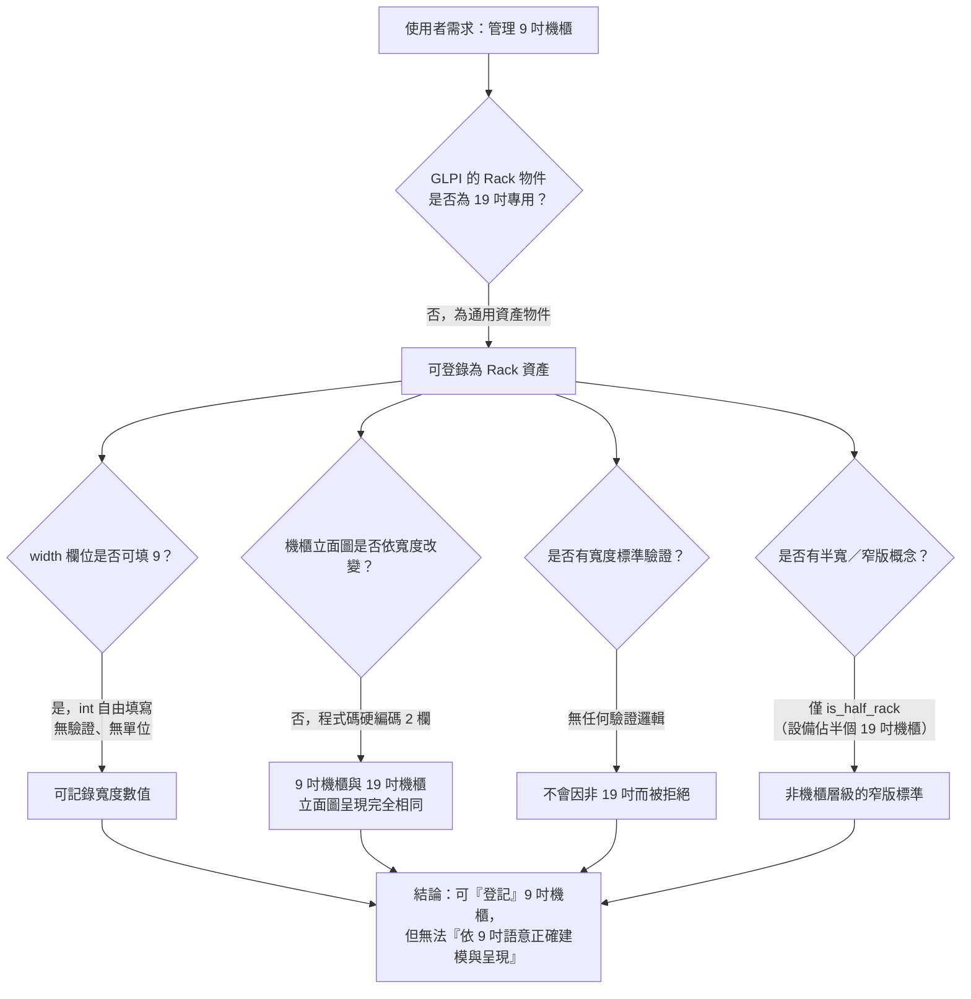

# GLPI 是否支援 9 吋機櫃（9-inch rack）？

## 摘要

**結論：GLPI 沒有「9 吋機櫃」這個概念，也沒有任何機櫃寬度標準（例如 19 吋 EIA-310）的內建支援或驗證。** GLPI 的機櫃（Rack）是一個通用的資產物件，其資料表提供一個自由填寫的 `width`（寬度）欄位，因此你「可以」把一台 9 吋機櫃登錄為一筆 Rack 資產並在寬度欄位填入任意數字；但 GLPI 的機櫃視覺化（機櫃立面圖）在程式碼中固定為 **2 欄**，並不會依寬度改變，且 GLPI 官方文件從未定義寬度欄位的單位，也從未提及 9 吋、10 吋或 19 吋標準。

換句話說：

| 需求 | GLPI 是否支援 |
| --- | --- |
| 把 9 吋機櫃登錄為資產 | 可（Rack 是通用物件，寬度欄位可自由填寫） |
| 記錄 9 吋機櫃的實體寬度 | 可（`width` 欄位，但無單位定義） |
| 依寬度標準驗證或限制 | 不支援（無任何標準驗證邏輯） |
| 機櫃立面圖依 9 吋 / 10 吋寬度正確呈現 | 不支援（固定 2 欄） |
| 官方文件提及 9 吋機櫃 | 沒有 |
| 外掛提供 9 吋 / 10 吋機櫃支援 | 查無此類外掛 |

---

## 背景：什麼是 19 吋、10 吋與 9 吋機櫃

要理解 GLPI 的支援程度，必須先釐清機櫃寬度標準的定義。

- **19 吋機櫃（19-inch rack）** 是電子設備機架的事實標準，每個模組前面板寬 19 吋（482.6 mm），此寬度包含設備兩側用來鎖固於機架的「耳片」。設備高度以 1.75 吋（44.45 mm）為一個「機架單位」（rack unit，簡稱 U 或 RU）計算。此標準由 AT&T 於 1922 年前後建立，後續由 EIA-310 等標準規範[^wikipedia19]。
- **10 吋機櫃（10-inch rack）** 是較窄的格式，高度單位與標準 19 吋機櫃相同，部分電信與網路設備提供此窄版規格，近年因空間有限的愛好者市場而再度流行[^wikipedia19]。
- **9 吋機櫃** 並非任何主流標準機構定義的機架標準。維基百科在「19-inch rack」條目的「相關標準」一節中列出 10 吋機櫃、11 呎機架、ETSI 機架、23 吋機櫃、Open Rack、OpenVPX、Eurorack、Eurocard 等，**並未列出「9 吋機櫃」**[^wikipedia19]。實務上「9 吋」通常被用來描述約 9 吋寬的迷你／桌上型機架或機櫃產品，屬於廠商自訂尺寸，而非標準機架寬度。

因此「GLPI 是否支援 9 吋機櫃」實質上等於兩個問題：(1) GLPI 是否允許非 19 吋的機櫃寬度；(2) GLPI 是否理解並正確呈現窄版機櫃。以下逐一檢視。

---

## GLPI 機櫃功能的實際實作

### Rack 是通用資產物件，不是 19 吋專用物件

GLPI 的 `Rack` 類別（`src/Rack.php`）繼承 `CommonDBTM`，其用途為「虛擬地代表機櫃或機架的實體結構」，用來視覺化與管理安裝於其中的設備[^glpirack][^glpidocracks]。類別定義中沒有任何與 19 吋、EIA-310 或機櫃寬度標準相關的常數或驗證：

```php
class Rack extends CommonDBTM implements AssignableItemInterface, DCBreadcrumbInterface, StateInterface
{
    use DCBreadcrumb;
    use Glpi\Features\State;
    use AssignableItem { /* ... */ }

    public const FRONT    = 0;
    public const REAR     = 1;

    public const POS_NONE = 0;
    public const POS_LEFT = 1;
    public const POS_RIGHT = 2;

    // orientation in room
    public const ROOM_O_NORTH = 1;
    public const ROOM_O_EAST  = 2;
    public const ROOM_O_SOUTH = 3;
    public const ROOM_O_WEST  = 4;
}
```

這些常數全部與「前後方向」「水平位置」「機櫃門在房間中的朝向」有關，**沒有任何一個常數描述機櫃寬度標準**[^glpirack]。

### 資料表有自由的 width 欄位，但無單位、無標準

`glpi_racks` 資料表的結構中包含 `width`、`height`、`depth` 三個整數欄位，皆可為 NULL：

```sql
CREATE TABLE `glpi_racks` (
  ...
  `width` int DEFAULT NULL,
  `height` int DEFAULT NULL,
  `depth` int DEFAULT NULL,
  `number_units` int DEFAULT '0',
  ...
)
```

此結構自 GLPI 9.3.1 的安裝 SQL 即已存在，且欄位型別為一般 `int`，**沒有列舉（ENUM）、沒有檢查約束（CHECK）、沒有外鍵指向任何「機櫃寬度標準」的字典表**[^glpisqldump][^glpisqldump931]。

對應的表單範本 `templates/pages/assets/rack.html.twig` 將這三個欄位呈現為純數字輸入框，最小值為 0、步進為 1，**沒有預設值、沒有單位標示、沒有可選標準清單**：

```twig
{{ fields.numberField(
    'width',
    item.fields['width'],
    __('Width'),
    field_options|merge({
       'rand': rand,
       'min': 0,
       'step': 1,
    })
) }}
```

`height`、`depth` 亦以相同方式呈現[^glpiracktwig]。GLPI 官方文件在「Racks」頁面列出機櫃可填寫的資訊時，也只列出「Width」「Height」「Depth」欄位名稱，**未說明其單位，也未說明是否限制為 19 吋**[^glpidocracks]。

值得補充的是，GLPI 上游社群自己也承認欄位單位不明確：2025 年 11 月 26 日有一則功能請求「Make Field Units of Measurement Explicit on Device Models」被提出，明確指出包含可安裝於機櫃的資產模型（Network Devices、Computers、Enclosures 等）在內，許多數值欄位（功率、質量、尺寸）「沒有在欄位標籤或輔助文字中清楚標示單位」，可能導致使用者輸入錯誤（例如把公克當公斤）。該請求至 2026 年 11 月仍為開啟狀態[^issue22075]。這佐證了機櫃寬度欄位確實缺乏單位定義。

### 寬度甚至不是可搜尋欄位

`Rack::rawSearchOptions()` 定義了機櫃所有可搜尋／可列表的欄位，其中包含名稱、ID、位置、類型、型號、狀態、序號、盤點編號、機房、**U 數（`number_units`）**、最大功率、註解、建立／修改日期、製造商、技術負責人、群組、實體、資料中心等，但**完全沒有列出 `width`、`height`、`depth`**：

```php
$tab[] = [
    'id'                 => '8',
    'table'              => $this->getTable(),
    'field'              => 'number_units',
    'name'               => __('Number of units'),
    'datatype'           => 'number',
];
```

這意味著在 GLPI 中，機櫃的「U 數」是一等公民（可搜尋、可篩選、可排序），而「寬度」則否——你無法用搜尋條件篩出「寬度為 9 的機櫃」，也無法在機櫃列表中加入寬度欄位。這進一步說明寬度在 GLPI 的機櫃模型中只是附帶的說明性資料，而非可運用的維度[^glpirack]。

### 機櫃立面圖固定為 2 欄，與寬度無關

GLPI 的機櫃視覺化由 `Item_Rack::showItemsGraph()` 產生，使用 GridStack 前端函式庫。其欄數在程式碼中是**硬編碼的 2**：

```php
echo '<ul class="indexes"></ul>
    <div class="grid-stack grid-stack-2 grid-rack"
         id="grid-front"
         gs-column="2"
         gs-max-row="' . htmlescape($rack->fields['number_units'] + 1) . '">';
```

每一筆設備在圖上的寬度 `gs-w` 只有兩種可能：一般設備為 `2`（佔滿整個機櫃寬度），或 `is_half_rack` 模型為 `1`（佔一半寬度）：

```php
$gs_item = [
    'id'        => $row['id'],
    'name'      => $item->getName(),
    'x'         => $row['hpos'] >= 2 ? 1 : 0,
    'y'         => $rack->fields['number_units'] - $row['position'],
    'height'    => 1,
    'width'     => 2,
    ...
];
```

換言之，GLPI 的機櫃圖只有「全寬」與「半寬（左／右）」兩種維度，**並不存在「依 `width` 欄位換算成不同欄數」的邏輯**[^glpiitemrack]。`Rack::showForRoom()` 中雖然讀取伺服器機房的 `vis_cell_width`、`vis_cell_height` 來計算機房平面圖的網格尺寸，但那是「機房平面圖的格線大小」，而非機櫃寬度[^glpirack]。

### 「半機櫃」（is_half_rack）不是窄版機櫃標準

GLPI 機櫃功能中唯一與寬度相關的概念是資產模型上的 `is_half_rack` 旗標。此欄位定義在 `glpi_computermodels`、`glpi_pdumodels` 等機櫃相關模型資料表中，並由 `CommonDCModelDropdown` 呈現為「Is half rack」的布林欄位：

```php
if ($DB->fieldExists($this->getTable(), 'is_half_rack')) {
    $fields[] = [
        'name'   => 'is_half_rack',
        'type'   => 'bool',
        'label'  => __('Is half rack'),
    ];
}
```

當模型被標記為半機櫃時，放置於機櫃中的該設備會被要求指定水平位置（左或右），且在立面圖上寬度由 2 改為 1[^glpicommondcmodel][^glpiitemrack]。

必須強調：`is_half_rack` 描述的是「**一台設備在一個 19 吋機櫃中只佔一半寬度**」，而非「一個較窄（如 10 吋或 9 吋）的機櫃」。GLPI 並沒有「半寬機櫃」這種機櫃種類。此外，此功能本身仍有已知缺陷：2026 年 1 月的 issue #22814 指出，兩台半機櫃設備無法同時放在同一列（一台靠左、一台靠右），系統會錯誤地回報「Not enough space available to place item」[^issue22814]。

---

## 搜尋證據：GLPI 生態系中找不到 9 吋 / 10 吋機櫃支援

為了確認是否存在任何官方或社群層級的支援，本次研究進行了下列檢索，結果皆為否定：

- 在 GLPI 主程式碼庫中搜尋 `"10 inch"`、`"10-inch"`、`"9 inch"`、`"9-inch"`、`"19 inch"`、`"19-inch"`：**0 筆結果**[^sourcegraph]。
- 在 GLPI 主程式碼庫中搜尋 `EIA-310`、`19 inches`、`half-rack` 等字樣：僅命中與機櫃寬度無關的內容（例如 CSS 的 `x2="19"`、版本號 `4.4`、日期字串等）[^sourcegraph]。
- 透過 GitHub 搜尋 API 檢索 GLPI issue／PR 中的 `"10 inch"`：僅 1 筆結果，且與機櫃無關（是一則關於 `NORMAL_MODE` 常數的舊 issue #10）[^ghsearch10inch]。
- 透過 GitHub 搜尋 API 檢索 GLPI issue／PR 中含 `rack` 與 `width` 的項目：33 筆結果，內容涵蓋影響分析、搜尋排序、權限檢查、機櫃背景顏色、半機櫃擺放、機房軸標籤等，**無任何一筆討論非 19 吋機櫃寬度**[^ghsearchrackwidth]。
- 檢索 GitHub 上名稱含 `glpi` 與 `rack` 的專案，僅找到 4 個[^ghsearchrepos]：
  - `InfotelGLPI/racks`：10 顆星，**已封存**，說明為「Plugin racks for GLPI / Integrated to core into GLPI 9.3.X」，即該外掛已於 GLPI 9.3 併入核心，最後推送為 2019 年[^infotelracks]。
  - `d1m007/RacksDirections`：0 顆星，功能為「change slots numbering directions in racks views」（改變機櫃視圖的槽位編號方向）[^racksdirections]。
  - `OpenMandrivaAssociation/glpi-plugin-racks`：1 顆星，僅為 Linux 發行版的打包倉庫[^openmandriva]。
  - `chengyuchen-sideproject/glpi-assetwatch`：0 顆星，功能為設備停報、磁碟不足、硬體變更或機櫃位置移動的郵件告警[^assetwatch]。

以上均**沒有任何一個提供 9 吋、10 吋或其他非 19 吋機櫃寬度標準的支援**。

### 必須誠實指出的「未找到」項目

- **未找到** GLPI 官方文件中任何關於機櫃寬度單位的定義（mm？吋？）。
- **未找到** GLPI 官方文件中任何「機櫃必須為 19 吋 / EIA-310」的敘述或驗證規則。此點經 GLPI 官方文件的 AI 查詢介面確認，該介面回覆「文件並未指定欄位單位，也未記載要求機櫃為 19 吋 / EIA-310 寬度的驗證規則」[^glpidocask]。
- **未找到** 任何 GLPI 外掛提供窄版機櫃標準支援。
- **未找到** 任何 GLPI issue 或 PR 請求新增 9 吋 / 10 吋機櫃支援。

需要說明的是，本次檢索未能成功查詢 GLPI 官方論壇（forum.glpi-project.org）的搜尋端點（回傳 HTTP 404），也未能查詢 plugins.glpi-project.org 與 Reddit，因此無法排除這些非程式碼來源中存在零星的相關討論；但基於主程式碼庫、官方文件、GitHub issue／PR 與外掛倉庫的檢索結果，整體結論不受影響。

另有一次獨立的程式碼複查（僅使用程式碼搜尋，未使用網路擷取）針對同一問題執行，結果一致：在 `glpi-empty.sql` 的 `glpi_racks` 表中確認 `width int DEFAULT NULL` 為一般可空整數、在 `rack.html.twig` 中確認寬度標籤僅為 `__('Width')` 而無單位字串、在 `Item_Rack.php` 中確認 `grid-stack-2` 與 `gs-column="2"` 為硬編碼、在 `Rack.php` 中確認無任何寬度標準常數、以及在 `CommonDCModelDropdown.php` 中確認 `is_half_rack` 僅為布林旗標。該複查另指出：搜尋 `"10 inch"`、`"19 inch"`、`"9 inch"`、`"EIA-310"`、`"mini rack"` 於 GLPI 主程式碼庫皆為 0 筆結果，且 `Rack::rawSearchOptions()` 不包含 `width`、`height`、`depth`。該複查因工具限制無法自行查證 issue #22075、#22814 與官方文件引文。

---

## 綜合分析



### 實務影響

1. **可以做的事**：把 9 吋機櫃當成一台 Rack 資產建檔，名稱寫「9-inch rack」，`width` 欄位填 9（或 229，若想以 mm 為單位）、`number_units` 填實際 U 數，並把安裝於其中的設備以 `Item_Rack` 關聯進去。GLPI 不會阻止你。

2. **做不到的事**：
   - 無法讓 GLPI「知道」這是一台 9 吋機櫃。系統中不存在機櫃寬度標準這個維度，寬度只是一個沒有單位的自由數字。
   - 無法讓立面圖反映窄版寬度。所有機櫃都只有「全寬／左半／右半」三種格位，9 吋機櫃的立面圖與 42U 標準機櫃長得一模一樣。
   - 無法用搜尋或篩選依「機櫃寬度標準」分類，因為寬度欄位根本不在 `Rack::rawSearchOptions()` 的可搜尋欄位清單中，無法篩選、排序或加入列表[^glpirack]；且該欄位無單位，不同管理者可能分別以吋或 mm 填寫，造成資料不一致。
   - 無法依寬度自動判斷設備是否放得下。放置邏輯只檢查「所需 U 數是否超出機櫃高度」與「水平位置是否衝突」，完全不參考機櫃 `width`[^glpiitemrack]。

3. **可行的替代方案**：
   - 以 `Rack Type`（機櫃類型）或 `Rack Model`（機櫃型號）字典項自訂「9-inch」「10-inch」等分類，這是 GLPI 唯一能表達機櫃種類的機制。Rack Type 與 Rack Model 皆為通用下拉字典[^glpirack][^glpirackmodel]。
   - 以自訂欄位外掛（例如 GLPI Network 的 Fields 外掛）或自建欄位記錄標準名稱。
   - 若必須精確呈現窄版機櫃立面圖，需自行開發外掛覆寫 `Item_Rack::showItemsGraph()` 的 2 欄硬編碼，或改用其他支援多寬度標準的 DCIM 工具。

---

## 結論

**GLPI 不支援 9 吋機櫃，而且嚴格說來，它也不「支援」任何特定機櫃寬度標準——包含 19 吋在內。** GLPI 的機櫃功能是圍繞「高度（U 數）」與「前後／左右位置」設計的通用資產管理與視覺化工具；寬度只是一個沒有單位、沒有驗證、不影響視覺化的自由數字欄位。因此 9 吋機櫃可以被「登記」，但無法被「理解」或「正確呈現」。若專案需求是以 9 吋或 10 吋迷你機櫃為核心的實體配置管理，GLPI 的內建機櫃功能並不足夠，需依賴類型字典的變通作法或自行開發外掛。

---

## 參考文獻

[^wikipedia19]: Wikipedia contributors. (n.d.). 19-inch rack. In Wikipedia. Retrieved 2026-11-21, from https://en.wikipedia.org/wiki/19-inch_rack

[^glpirack]: GLPI Project. (n.d.). src/Rack.php [Source code]. Retrieved 2026-11-21, from https://github.com/glpi-project/glpi/blob/main/src/Rack.php

[^glpiitemrack]: GLPI Project. (n.d.). src/Item_Rack.php [Source code]. Retrieved 2026-11-21, from https://github.com/glpi-project/glpi/blob/main/src/Item_Rack.php

[^glpisqldump]: GLPI Project. (n.d.). install/mysql/glpi-empty.sql [Database schema]. Retrieved 2026-11-21, from https://github.com/glpi-project/glpi/blob/main/install/mysql/glpi-empty.sql

[^glpisqldump931]: GLPI Project. (n.d.). install/mysql/glpi-9.3.1-empty.sql [Database schema]. Retrieved 2026-11-21, from https://github.com/glpi-project/glpi/blob/master/install/mysql/glpi-9.3.1-empty.sql

[^glpiracktwig]: GLPI Project. (n.d.). templates/pages/assets/rack.html.twig [Source code]. Retrieved 2026-11-21, from https://github.com/glpi-project/glpi/blob/main/templates/pages/assets/rack.html.twig

[^glpicommondcmodel]: GLPI Project. (n.d.). src/CommonDCModelDropdown.php [Source code]. Retrieved 2026-11-21, from https://github.com/glpi-project/glpi/blob/main/src/CommonDCModelDropdown.php

[^glpirackmodel]: GLPI Project. (n.d.). src/RackModel.php [Source code]. Retrieved 2026-11-21, from https://github.com/glpi-project/glpi/blob/main/src/RackModel.php

[^glpidocracks]: GLPI Project. (n.d.). Racks. GLPI Help Center. Retrieved 2026-11-21, from https://help.glpi-project.org/documentation/modules/assets/racks.md

[^glpidocitems]: GLPI Project. (n.d.). Items. GLPI Help Center. Retrieved 2026-11-21, from https://help.glpi-project.org/documentation/modules/assets/tabs/rack_items.md

[^glpidocask]: GLPI Project. (n.d.). Does GLPI support non-standard rack widths such as 10-inch or 9-inch mini racks, or only 19-inch racks? What units is the rack Width field in? [Query response]. GLPI Help Center. Retrieved 2026-11-21, from https://help.glpi-project.org/documentation/modules/assets/racks.md

[^issue22075]: Schaefer, A. (2025, November 26). Make Field Units of Measurement Explicit on Device Models [Issue #22075]. GitHub. Retrieved 2026-11-21, from https://github.com/glpi-project/glpi/issues/22075

[^issue22814]: FMG-Jay. (2026, January 23). Cannot place Two 'Half Rack' assets together [Issue #22814]. GitHub. Retrieved 2026-11-21, from https://github.com/glpi-project/glpi/issues/22814

[^ghsearch10inch]: GitHub. (n.d.). Issue search: repo:glpi-project/glpi "10 inch" [Search results]. Retrieved 2026-11-21, from https://api.github.com/search/issues?q=repo:glpi-project/glpi+%2210+inch%22

[^ghsearchrackwidth]: GitHub. (n.d.). Issue search: repo:glpi-project/glpi rack width [Search results]. Retrieved 2026-11-21, from https://api.github.com/search/issues?q=repo:glpi-project/glpi+rack+width

[^ghsearchrepos]: GitHub. (n.d.). Repository search: glpi rack [Search results]. Retrieved 2026-11-21, from https://api.github.com/search/repositories?q=glpi+rack

[^sourcegraph]: Sourcegraph. (n.d.). Code search results for GLPI repository. Retrieved 2026-11-21, from https://sourcegraph.com/search?q=repo:%5Egithub%5C.com/glpi-project/glpi%24

[^infotelracks]: InfotelGLPI. (n.d.). racks [Source code repository]. GitHub. Retrieved 2026-11-21, from https://github.com/InfotelGLPI/racks

[^racksdirections]: d1m007. (n.d.). RacksDirections [Source code repository]. GitHub. Retrieved 2026-11-21, from https://github.com/d1m007/RacksDirections

[^openmandriva]: OpenMandrivaAssociation. (n.d.). glpi-plugin-racks [Source code repository]. GitHub. Retrieved 2026-11-21, from https://github.com/OpenMandrivaAssociation/glpi-plugin-racks

[^assetwatch]: chengyuchen-sideproject. (n.d.). glpi-assetwatch [Source code repository]. GitHub. Retrieved 2026-11-21, from https://github.com/chengyuchen-sideproject/glpi-assetwatch

[^ghrepo]: GLPI Project. (n.d.). glpi [Repository metadata]. GitHub API. Retrieved 2026-11-21, from https://api.github.com/repos/glpi-project/glpi
