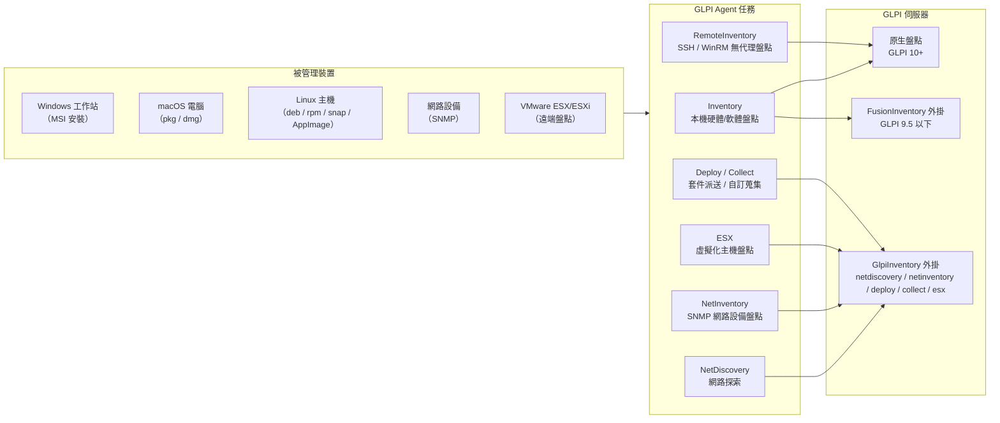
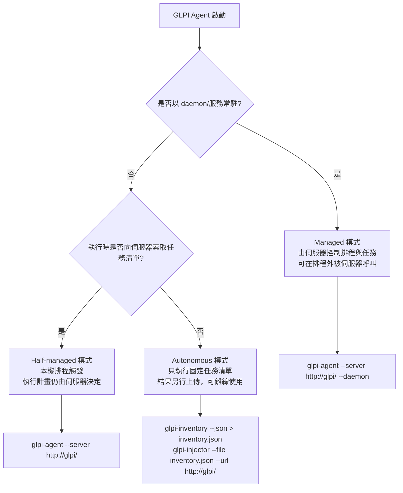

# GLPI Agent 介紹：GLPI 資產盤點生態系的用戶端代理程式

## 摘要

GLPI Agent 是 GLPI 專案（glpi-project）所維護的「通用管理代理程式」（generic management agent），以 Perl 撰寫，為 FusionInventory Agent 的後繼產品[^readme]。它負責從被管理的終端裝置（個人電腦、伺服器、網路設備、虛擬化主機）蒐集硬體與軟體資訊，並將盤點結果傳送至中央的 GLPI 伺服器，讓 IT 人員能取得資產的即時快照[^docsindex]。截至 2026-11-19，該專案在 GitHub 上約有 520 顆星、126 個 fork，授權條款為 GPLv2+[^ghapi]。最新穩定版本為 v1.21，於 2026-10-08 發佈[^release121]。

本報告為獨立文件，旨在完整說明 GLPI Agent 是什麼、解決什麼問題、具備哪些任務能力、如何安裝與設定，以及它與 GLPI 伺服器版本之間的相容性關係。

---

## 一、什麼是 GLPI Agent

GLPI Agent 是一個「通用管理代理程式」，它會依自身的執行計畫，或依 GLPI 伺服器作為控制點（control point）所下的指令，執行一系列任務[^readme]。其定位可歸納為三點：

1. **它是 FusionInventory Agent 的分支與後繼者**：程式碼基礎相同，因此可以幾乎無痛地取代既有環境中的 FusionInventory Agent[^docsindex]。
2. **它引入新協定與新功能**：新增了直接與 GLPI 伺服器及其原生盤點（native inventory）功能溝通的協定，但同時仍保留與 FusionInventory for GLPI 外掛的相容性[^readme]。
3. **它在伺服器端從 GLPI 10 起才直接依賴 GLPI**：若使用 GLPI 9.5 或更舊版本，則仍需搭配 FusionInventory for GLPI 外掛[^docsindex][^config]。

### 專案血統與版權

GLPI Agent 的程式碼可追溯至多個時期的貢獻者，這也解釋了它為何同時支援多種盤點協定[^readme]：

| 時期 | 貢獻者 | 版權聲明 |
|---|---|---|
| 2006–2010 | OCS Inventory contributors | 早期盤點代理程式血統 |
| 2010–2019 | FusionInventory Team | FusionInventory Agent |
| 2011–2021 | Teclib Editions | 商業維護與後續演進 |

目前主要活躍作者為 Guillaume Bougard（Teclib 公司）[^readme]。

---

## 二、在 GLPI 生態系中的位置

GLPI 本身是一套自由授權的資產與 IT 管理軟體，涵蓋資料中心管理、ITIL 服務台、授權追蹤與軟體稽核[^ghglpi]。GLPI Agent 則是這個生態系中的「資料蒐集端」。下圖說明兩者的關係：

上圖中值得注意的是「任務分流」：本機盤點與遠端盤點可由 GLPI 10+ 的原生盤點功能直接接收；而網路探索、網路設備盤點、套件派送、自訂蒐集與 ESX 盤點等任務，在 GLPI 10 上仍需透過 GlpiInventory 外掛處理，直到這些功能被整併進核心為止[^config]。

---

## 三、主要任務能力

GLPI Agent 將功能切割為多個「任務」（task），可個別啟用或停用[^readme][^tasksindex]。核心任務如下：

### 3.1 本機盤點（Inventory）

對執行代理程式的本機進行硬體與軟體盤點。可蒐集的資訊包含：

- **硬體**：DMI 資料（透過 `dmidecode`）、PCI 匯流排（`lspci`）、磁碟機資訊（`hdparm`）、EDID 顯示器資訊、BIOS、記憶體、CPU、網路介面、儲存裝置[^readme]
- **軟體**：已安裝的應用程式與作業系統資訊[^readme]
- **虛擬化偵測**：Vmsystem 偵測（程式碼源自 imvirt 專案）[^readme]
- **印表機**：透過 `Net::CUPS`[^readme]
- **時區資訊**：透過 `DateTime` 模組可靠地取出時區名稱[^readme]
- **SSH 公鑰**：透過 `ssh-keyscan` 取得主機 SSH 公鑰[^readme]

盤點結果可選擇以 HTML、XML 或 JSON 格式輸出[^config]。

### 3.2 遠端盤點（RemoteInventory，又稱 Agent-less 盤點）

這是 GLPI Agent 相對 FusionInventory Agent 的重要新增能力，可在不安裝代理程式的情況下盤點遠端電腦[^remoteinv]：

- 對 Unix/Linux 電腦透過 **SSH** 進行
- 對 Windows 電腦透過 **WinRM** 進行（預設連接埠 5985/HTTP、5986/HTTPS）
- 遠端使用者必須具備管理權限；`--remote-workers` 選項（v1.5 起）可設定同時處理的遠端數量[^remoteinv]

需注意遠端盤點的**限制**：由於無法在遠端執行 `dmidecode` 等工具，WinRM 遠端盤點可能缺少軟體安裝日期、BIOS 資訊、裝置名稱/類型/描述與資料庫服務等資訊；SSH 遠端盤點則可能缺少印表機與資料庫服務資訊[^remoteinv]。

### 3.3 網路探索（NetDiscovery）

掃描 IP 網路，找出並回報網路上的裝置，使其被加入已知資產清單[^netdisc]。使用的協定包括[^netdisc]：

- ARP 本機表查詢（`arp -a` 或 `ip neighbor show`）
- ICMP Echo（ping），並以 ICMP Timestamp 掃描作為備援
- NetBIOS 掃描（需 `Net::NBName` 模組）
- SNMP 掃描（需 `Net::SNMP` 模組）

裝置辨識的主要方法，是讀取 SNMP 變數 `SNMPv2-MIB::sysObjectID.0`，再與代理程式內建的 `sysobject.ids` 資料庫比對；比對成功即可得知裝置型號、類型與製造商，否則改用較低可靠度的啟發式方法[^netdisc]。次要方法則透過 `MibSupport` 機制，以專屬 Perl 模組支援特定裝置（例如 Synology 或 Ubiquiti 裝置）[^netdisc]。

若裝置需 SNMP v3 存取，Linux 上需額外安裝 `Crypt::Rijndael` 模組[^netdisc]。

### 3.4 網路設備盤點（NetInventory）

對已是已知資產的 SNMP 相容裝置（網路設備或印表機）取回詳細資訊，並更新至 GLPI[^netinv]：

- 印表機的耗材存量與列印計數
- 網路設備的 VLAN 定義、網路拓撲、網路埠狀態

此任務只能對已存在的資產執行，來源為先前的網路探索結果或手動建立、且具備正確 SNMP 認證的裝置[^netinv]。

### 3.5 其他任務

| 任務 | 說明 |
|---|---|
| ESX Remote Inventory | 盤點 VMware ESX/ESXi 主機[^readme] |
| Package Deployment | 派送套件，支援 P2P 傳輸[^readme] |
| Collect | 自訂資料蒐集[^readme] |
| Wake-on-LAN | 透過網路喚醒裝置[^readme] |

`Deploy` 任務的 P2P 功能需要 `Net::Ping` 與 `Parallel::ForkManager` 模組[^readme]。

---

## 四、執行模式：誰控制何時執行與執行什麼

GLPI Agent 的執行模式（execution modes）區分了「執行排程」與「執行計畫」兩種控制權[^usage]。下表與下圖為其核心概念：

| 執行模式 | 執行排程由誰控制 | 執行計畫由誰控制 | 是否常駐記憶體 |
|---|---|---|---|
| Managed（受管理） | 伺服器端 | 伺服器端 | 是（daemon / 服務） |
| Half-managed（半受管理） | 代理程式端 | 伺服器端 | 否 |
| Autonomous（自主） | 代理程式端 | 代理程式端 | 否 |

### Managed 模式

代理程式以服務或 daemon 常駐，依 GLPI 伺服器端的 `PROLOG_FREQ` 或 Contact 到期設定喚醒（例如設定 24 小時，實際會隨機落在 23 至 24 小時之間），伺服器亦可隨時發出排程外的執行請求[^usage]。優點是設定最簡單、功能最完整；缺點是常駐一個 Perl 直譯器，且在網路上開啟一個具權限的監聽埠[^usage]。

**安全性提醒**：在 Managed 模式下，控制 GLPI 伺服器的人等同於控制所有安裝代理程式的資產，可在任何時間執行任意程式碼（若 Deploy 任務已安裝且啟用）[^usage]。官方文件直言這正是該模式的設計目的[^usage]。

### Half-managed 模式

由本機排程機制（cron、工作排程器）週期性觸發，執行時才向伺服器索取任務清單，不常駐記憶體[^usage]。此模式下建議搭配 `--lazy` 設定，讓伺服器決定下次可執行任務的時間，避免大量代理程式同時打爆伺服器[^usage]。若排程時間固定，也可用 `--wait` 加入隨機延遲，例如 `0 0 * * * /usr/bin/glpi-agent --wait=1800`[^usage]。

### Autonomous 模式

只執行固定任務清單，伺服器僅接收執行結果，不具控制權；由於結果可另行傳送，此模式支援離線使用[^usage]。目前僅有本機盤點、網路探索與網路設備盤點提供專屬啟動器（`glpi-inventory`、`glpi-netdiscovery`、`glpi-netinventory`）[^usage]。

**重要陷阱**：設定多個執行目標（多台伺服器或多個本機目錄）**不等於**「執行一次、上傳多次」，而是「對每個目標各自嘗試執行一次所有可用任務」，因此結果不保證相同[^usage]。若要產生單一份盤點並傳送給多個目標，唯一可靠做法是在 Autonomous 模式下執行一次，再用 `glpi-injector` 多次上傳[^usage]。

---

## 五、安裝方式

GLPI Agent 針對各平台提供多種封裝[^readme][^release121]：

| 平台 | 安裝方式 |
|---|---|
| Windows | MSI 安裝檔（x64）、可攜式 ZIP；另可用 `winget install glpi-agent` |
| macOS | PKG 與 DMG，分別提供 Intel（x86_64）與 Apple Silicon（arm64）版本；另有非官方 Homebrew cask |
| GNU/Linux | Linux Perl Installer（自動偵測 RedHat/CentOS/Debian/Ubuntu 並使用 dnf/yum/apt/snap）、AppImage（x86_64）、Snap（amd64）、deb、rpm、原始碼 tarball |

### 下載熱度（v1.21 發佈資產）

可從官方發佈資產的下載次數觀察實際使用分布[^release121]：

| 資產 | 下載次數 |
|---|---|
| `GLPI-Agent-1.21-x64.msi` | 785,167 |
| `GLPI-Agent-1.21_arm64.pkg` | 288,164 |
| `glpi-agent-1.21-linux-installer.pl` | 43,411 |
| `glpi-agent_1.21-1_all.deb` | 20,666 |
| `GLPI-Agent-1.21_x86_64.pkg` | 2,200 |
| `glpi-agent_1.21_amd64.snap` | 432 |

由下載量可見 Windows 是絕對主力的部署平台，其次為 Apple Silicon macOS。

### 相依套件

核心最低需求為 **Perl 5.8**，強制相依模組包括 `File::Which`、`LWP::UserAgent`、`Net::IP`、`Text::Template`、`UNIVERSAL::require`、`XML::LibXML` 與 `Cpanel::JSON::XS`；選用模組則依啟用的任務而定，例如 `Compress::Zlib`（訊息壓縮）、`HTTP::Daemon`（網頁介面）、`IO::Socket::SSL`（HTTPS）、`Net::SNMP`（SNMP 任務）[^readme]。網路探索與網路設備盤點任務另強制需要 `Thread::Queue`[^readme]。

---

## 六、設定方式

設定檔位置依平台而異[^config]：

- **Unix 相容系統**：`/etc/glpi-agent/agent.cfg`
- **macOS（pkg 安裝）**：`/Applications/GLPI-Agent/etc/agent.cfg`
- **Windows**：登錄機碼 `HKEY_LOCAL_MACHINE\SOFTWARE\GLPI-Agent`（32 位元代理程式安裝於 64 位元系統時為 `...\Wow6432Node\GLPI-Agent`）；可攜版則使用 `etc` 下的 `agent.cfg`

官方強烈建議**不要直接修改 `agent.cfg`**，因為更新時（尤其透過套件管理器）設定很可能遺失；正確做法是保留 `include conf.d/` 這行未被註解，再把自己的設定放到 `conf.d/*.cfg` 中[^config]。

唯一必要的設定參數是「執行目標」，也就是 `server`（伺服器 URL）或 `local`（本機目錄路徑）[^config]。常用的其他參數包括[^config]：

| 參數 | 用途 |
|---|---|
| `server` | GLPI 伺服器 URL；多個值以逗號分隔 |
| `local` | 將結果寫入本機檔案或目錄，`-` 代表 STDOUT |
| `tasks` / `no-task` | 指定要執行或停用的任務 |
| `httpd-port` | 內嵌網頁介面埠號，預設 62354 |
| `httpd-trust` | 允許發出執行請求的來源 IP 範圍 |
| `no-httpd` | 完全停用內嵌網頁介面 |
| `lazy` | 在前景執行時，未到排定時間就不聯絡伺服器 |
| `delaytime` | 首次聯絡伺服器前的延遲上限，預設 3600 秒 |
| `no-ssl-check` | 停用伺服器 SSL 憑證驗證（預設關閉） |
| `ssl-fingerprint` | 指定要信任的 SSL 伺服器憑證指紋 |
| `oauth-client-id` / `oauth-client-secret` | OAuth2 認證（v1.10 起；伺服器端需 GLPI 11+） |

### 伺服器 URL 的設定陷阱

`server` 參數的正確值取決於 GLPI 版本與外掛安裝狀況[^config]：

- **GLPI 9.5.x + FusionInventory for GLPI 9.5+3.0 外掛**：`https://my-glpi-server/plugins/fusioninventory/`
- **GLPI 10+ 且未安裝 GlpiInventory 外掛**：`https://my-glpi-server/` 或 `https://my-glpi-server/glpi`
- **GLPI 10 且已安裝 GlpiInventory 外掛**：`https://my-glpi-server/marketplace/glpiinventory/`
- **GLPI 11+ 且已安裝 GlpiInventory 外掛**：`https://my-glpi-server/plugins/glpiinventory/`

若 GLPI 部署於 IIS 上，可能需要在 `server` 值末尾加上 `index.php`[^config]。

### 減少伺服器負載的關鍵設定：`full-inventory-postpone`

自 v1.8 起，`full-inventory-postpone` 可讓代理程式在部分次數內只回報「有變動的分類」的部分盤點（partial inventory），預設為 14 次[^config]。此功能**僅支援 JSON 格式，因此伺服器端需為 GLPI 10**；官方指出這能大幅降低 GLPI 工作負載並減少伺服器碳足跡[^config]。設為 0 可停用並回復為每次都完整盤點[^config]。

---

## 七、與 GLPI 伺服器的相容性對照

| GLPI 版本 | 伺服器端需求 | 對應 `server` URL |
|---|---|---|
| GLPI 9.5 或更舊 | 需 FusionInventory for GLPI 外掛 | `/plugins/fusioninventory/` |
| GLPI 10 | 原生盤點即可；網路探索/盤點、派送、蒐集、ESX 需 GlpiInventory 外掛 | `/` 或 `/glpi`；裝外掛時為 `/marketplace/glpiinventory/` |
| GLPI 11+ | 原生盤點、支援 OAuth2 與 genericity | `/` 或 `/glpi`；裝外掛時為 `/plugins/glpiinventory/` |

（依[^config][^docsindex]整理）

此外，GLPI 本體於 2026-11-12 發佈 12.0.2，該版為安全性修補版本，修復了多項高危漏洞（含舊版 API 的權限提升、OAuth 同意繞過、帳號接管、儲存型 XSS 等）[^glpi1202]。這提醒我們：盤點系統會集中大量資產資訊，其伺服器端的安全性更新不可輕忽。

---

## 八、與 FusionInventory Agent 的比較

GLPI Agent 為 FusionInventory Agent 的後繼產品，後者的 GitHub 專案最後一次推送為 2023-08-09，開發已明顯停滯，目前約 268 顆星[^fia]。主要差異如下：

| 面向 | FusionInventory Agent | GLPI Agent |
|---|---|---|
| 專案狀態 | 2023 年後未再推送 | 持續維護，2026-10 仍有發佈[^fia][^release121] |
| 與 GLPI 的關係 | 必須搭配 FusionInventory for GLPI 外掛 | GLPI 10+ 可直接使用原生盤點[^config] |
| 盤點格式 | XML | XML 與 JSON（JSON 支援部分盤點）[^config] |
| OAuth2 認證 | 無 | v1.10 起支援（伺服器端需 GLPI 11+）[^config] |
| 遠端盤點（免代理） | 無 | 支援 SSH 與 WinRM[^remoteinv] |
| Snap 封裝 | 無 | 有[^release121] |
| 遷移注意事項 | — | 安裝 GLPI Agent 前應先解除安裝 FusionInventory Agent，但可沿用同一份 `conf.d/` 設定[^docsindex] |

---

## 九、關鍵事實速覽

| 項目 | 內容 |
|---|---|
| 專案 | glpi-project/glpi-agent[^readme] |
| 定位 | 通用管理代理程式、FusionInventory Agent 接班人[^readme] |
| 主要語言 | Perl（最低 5.8）[^readme] |
| 授權 | GPLv2+[^readme] |
| GitHub 星數 | 520（截至 2026-11-19）[^ghapi] |
| Fork 數 | 126[^ghapi] |
| 未解 issue 數 | 28[^ghapi] |
| 最新版本 | v1.21（2026-10-08 發佈）[^release121] |
| 預設倉庫分支 | `develop`[^ghapi] |
| 內嵌網頁介面埠 | 62354[^usage] |
| 模組化任務 | Inventory、RemoteInventory、NetDiscovery、NetInventory、ESX、Deploy、Collect、Wake-on-LAN[^readme] |
| 相關專案 | GLPI 主體（6,645 星、GPL-3.0、PHP）[^ghglpi]、doc-agent 文件專案、sysobject.ids 資料庫、dmidecode 分支[^readme] |

---

## 十、來源批判性反思

在整理本報告時，以下幾點值得讀者留意：

1. **官方文件為第一手來源，但仍有推廣性質**：本報告多數技術細節來自 GLPI 專案的 README 與 Read the Docs 官方文件[^readme][^docsindex]。這類來源對功能描述準確度高，但對於「與競品的優劣比較」與「遷移成本」著墨較少，屬合理範圍內的自我陳述。
2. **版本日期需注意時間脈絡**：本報告撰寫時（2026-11-21），最新版為 v1.21（2026-10-08）[^release121]，最新 GLPI 為 12.0.2（2026-11-12）[^glpi1202]。專案推送時間為 2026-11-19[^ghapi]，顯示仍在活躍開發中。
3. **GitHub 星數僅為活躍度的粗略指標**：520 星看似不高，但企業資產管理工具多為「內部部署、低調使用」類型，且此專案的下載量（單一 MSI 版本逾 78 萬次）[^release121] 更能反映其實際部署規模。因此不應以星數低估其重要性。
4. **「Go 元件」一說未能從第一手文件證實**：在初步檢索過程中，曾有第三方摘要聲稱 `glpi-injector` 為 Go 二進位檔，但官方 README 明確記載 `glpi-injector` 是基於 fusioninventory-injector 腳本（作者 Pascal Danek）[^readme]，兩者說法不一致。本報告採取官方 README 的敘述，並在此標明此不確定性。
5. **FusionInventory 的「停滯」判斷基於推送時間**：以最後推送日 2023-08-09 判定開發停滯，屬合理推論，但不排除有未推送至 GitHub 的內部維護[^fia]。

---

## 參考文獻

[^readme]: GLPI Project. (n.d.). *GLPI Agent* [README]. GitHub. Retrieved 2026-11-21, from https://raw.githubusercontent.com/glpi-project/glpi-agent/develop/README.md

[^docsindex]: GLPI Project, Teclib'. (2026). *GLPI Agent documentation — GLPI Agent 1.21 documentation*. Retrieved 2026-11-21, from https://glpi-agent.readthedocs.io/en/latest/index.html

[^config]: GLPI Project, Teclib'. (2026). *Configuration — GLPI Agent 1.21 documentation*. Retrieved 2026-11-21, from https://glpi-agent.readthedocs.io/en/latest/configuration.html

[^usage]: GLPI Project, Teclib'. (2026). *Usage — GLPI Agent 1.21 documentation*. Retrieved 2026-11-21, from https://glpi-agent.readthedocs.io/en/latest/usage.html

[^tasksindex]: GLPI Project, Teclib'. (2026). *Tasks — GLPI Agent 1.21 documentation*. Retrieved 2026-11-21, from https://glpi-agent.readthedocs.io/en/latest/tasks/index.html

[^remoteinv]: GLPI Project, Teclib'. (2026). *Remote inventory — GLPI Agent 1.21 documentation*. Retrieved 2026-11-21, from https://glpi-agent.readthedocs.io/en/latest/tasks/remote-inventory.html

[^netdisc]: GLPI Project, Teclib'. (2026). *Network discovery — GLPI Agent 1.21 documentation*. Retrieved 2026-11-21, from https://glpi-agent.readthedocs.io/en/latest/tasks/network-discovery.html

[^netinv]: GLPI Project, Teclib'. (2026). *Network inventory — GLPI Agent 1.21 documentation*. Retrieved 2026-11-21, from https://glpi-agent.readthedocs.io/en/latest/tasks/network-inventory.html

[^ghapi]: GLPI Project. (2026, November 19). *Repository metadata for glpi-project/glpi-agent* [Data file]. Retrieved 2026-11-21, from https://api.github.com/repos/glpi-project/glpi-agent

[^release121]: GLPI Project. (2026, October 8). *GLPI Agent v1.21* [Release]. GitHub. Retrieved 2026-11-21, from https://github.com/glpi-project/glpi-agent/releases/tag/1.21

[^ghglpi]: GLPI Project. (2026, November 20). *Repository metadata for glpi-project/glpi* [Data file]. Retrieved 2026-11-21, from https://api.github.com/repos/glpi-project/glpi

[^glpi1202]: GLPI Project. (2026, November 12). *12.0.2* [Release]. GitHub. Retrieved 2026-11-21, from https://github.com/glpi-project/glpi/releases/tag/12.0.2

[^fia]: FusionInventory Project. (2026, November 13). *Repository metadata for fusioninventory/fusioninventory-agent* [Data file]. Retrieved 2026-11-21, from https://api.github.com/repos/fusioninventory/fusioninventory-agent
