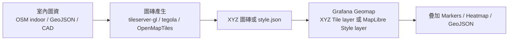
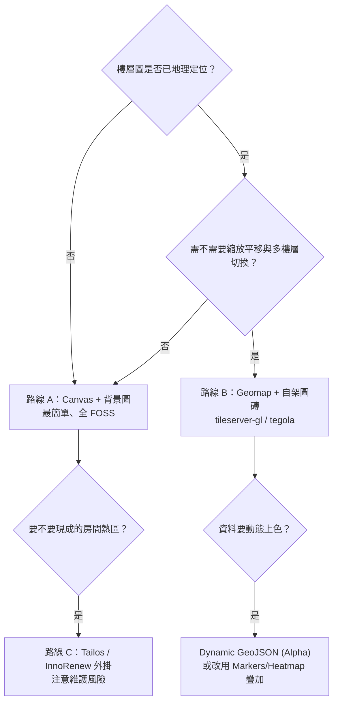

# Grafana 能否以 FOSS 方式呈現室內地圖（Indoor Map）？

## 摘要

**可以，但有條件。** Grafana 本身不是室內地圖工具，它沒有內建室內樓層（floor plan）視覺化元件；然而，透過既有 FOSS 能力可以拼裝出室內地圖，主要有四條路線：

| 路線 | 做法 | 是否 FOSS | 適用情境 |
|---|---|---|---|
| A. Canvas 面板 + 背景圖 | 將樓層平面圖（PNG/SVG）設為 Canvas 背景，疊加資料驅動元素 | Grafana 本體開源（AGPLv3），無需付費元件 | 靜態樓層、房間狀態燈號、不需縮放平移 |
| B. Geomap + 自架 XYZ/MapLibre 圖磚 | 在 Geomap 的 XYZ Tile layer 指向自架圖磚伺服器 | 是（tileserver-gl、tegola 等） | 需要地理座標、縮放平移、多樓層切換 |
| C. 社群「室內地圖」面板外掛 | 安裝 Tailos Indoor Map / InnoRenew 樓層面板等 | 是（Apache-2.0） | 需要房間熱區、樓層平面互動 |
| D. Geomap 的 GeoJSON layer | 以 `min_lon/lat` 等欄位重投影室內圖層為經緯度 | 是（純社群做法） | 少量、不需圖磚的示意圖 |

其中 **Canvas + 背景圖** 與 **自架圖磚** 是兩條最成熟、不依賴第三方授權的路線。下文逐項展開並附來源。

---

## 一、使用者問題的界定

「Grafana 能不能顯示室內地圖」需拆解為兩個獨立問題：

1. **Grafana 是否能渲染非地理座標（像素座標）的樓層平面圖？** —— 可以，靠 Canvas 面板。
2. **Grafana 是否能渲染地理座標的室內圖層（樓層圖資）？** —— 可以，靠 Geomap 面板再加上自架圖磚或 GeoJSON。

「FOSS 方式」的判準為：整體鏈路（資料、圖磚服務、渲染器、外掛）皆為開源授權，且不強制使用商業 SaaS。

---

## 二、Grafana 的面板選項

### 2.1 Geomap（內建）

Geomap 是 Grafana 內建的地理視覺化面板，用於「檢視與自訂世界地圖」[^geomap]。Geomap 支援 **九種資料圖層**（data layer）與 **五種底圖圖層**（basemap layer）[^geomap]：

- 資料圖層：Markers、Heatmap、GeoJSON、Night / Day、Route、Photos、Network，以及底圖型的 OpenStreetMap、CARTO、ArcGIS MapServer、XYZ Tile、MapLibre Style layer。
- 另有兩種實驗性圖層（需 `enable_alpha = true`）：Icon at last point (Alpha)、Dynamic GeoJSON (Alpha)[^geomap]。

其中與室內地圖最相關者：

- **XYZ Tile layer**：可設定 `URL template`，格式含 `{z}/{x}/{y}`，例如 `https://tile.openstreetmap.org/{z}/{x}/{y}.png`，並支援 dashboard 變數如 `${version}`；可設定 Attribution、Min zoom、Max zoom、Opacity[^geomap]。這代表 **任何提供標準 XYZ 圖磚的自架伺服器都能接上**。
- **MapLibre Style layer**：以 MapLibre/Mapbox `style.json` URL 定義地圖，官方文件指出其通常基於向量圖磚（vector tiles）而非點陣圖磚[^geomap]。此為接自架向量圖磚的關鍵路徑。
- **GeoJSON layer**：載入靜態 GeoJSON 檔（可為 Grafana 內建檔或手動輸入 URL，支援變數），並可依 `properties` 中的 feature 屬性設定 style rules[^geomap]。

底圖的預設值也可在設定檔中以 provisioning 方式指定，官方文件列出五種型別：`carto`、`esri-xyz`、`osm-standard`、`xyz`、`maplibre`；其中 `xyz` 的範例為：

```ini
[geomap]
default_baselayer_config = `{
  "type": "xyz",
  "config": {
    "attribution": "OpenStreetMap",
    "url": "https://tile.openstreetmap.org/{z}/{x}/{y}.png"
  }
}`
```

來源：[^geomap]。

**重點限制**：Geomap 的座標系統繫於地理座標（經緯度、geohash、lookup code），官方文件的 Location mode 僅提供 Auto / Coords / Geohash / Lookup 四種[^geomap]。**沒有「像素座標」或「任意座標系」模式**。因此若樓層圖未地理定位（georeference），Geomap 需繞道處理（見第四節路線 D）。

### 2.2 Canvas（內建，Grafana 13.3 起為獨立外掛）

Canvas 是「可自訂元素、可任意擺放」的視覺化面板，官方定義為「結合 Grafana 的能力與自訂元素的彈性」[^canvas]。與室內地圖直接相關的能力：

- **整塊面板的背景圖**：`Layer → Background (canvas)` 提供 Color、Image、Image size（可設為 tile）三種選項；官方說明「在面板上按右鍵即可設定背景圖並新增元素」[^canvas]。
- **元素**：Metric value、Text、Ellipse、Rectangle、Icon、Server、Triangle、Cloud、Parallelogram、Button；可依資料設定顏色、文字與閾值[^canvas]。
- **自訂圖片**：除 Button 外的所有元素都可透過 URL 指定背景圖，圖片需可由 Grafana 實例存取[^canvas]。
- **連線（Connections）**：可在元素之間畫線並設定角度、線寬與樣式[^canvas]。
- **資料連結與動作**：Grafana 11.0 起，資料連結（data links）可用於幾乎所有與資料綁定的元素或元素屬性[^whatsnew11]。

Grafana 11.0 亦強化了 Canvas 的流程圖能力，包含新增 cloud / parallelogram / triangle 元素、連接線中點控制、樣式與圓角、元素旋轉，以及可透過 `canvasPanelPanZoom` feature toggle 啟用的「無限平移（infinite panning）」[^whatsnew11]。

**已知限制**：Canvas 元素的位置是相對於**面板尺寸**而非背景圖尺寸；社群已提出 issue 要求能「相對背景圖縮放元素」，截至該 issue 更新時仍為 open（6 個 👍 反應）[^canvasissue]。實務上意味著：若面板被縮放，背景圖與元素可能錯位，需固定面板比例或改用 Scale 約束。

### 2.3 舊版 Worldmap 面板（已棄用）

舊的 Worldmap 面板（plugin ID `grafana-worldmap-panel`）為社群外掛，其頁面聲明「此儲存庫的支援已結束，將被封存」，最後更新為 2024-06-27，且過去一年 0 次發佈[^worldmap]。不建議作為新方案。

### 2.4 是否支援 WMS / WMTS？

查閱 Grafana Geomap 官方文件所列的五種底圖與九種資料圖層，**並未包含 WMS 或 WMTS 圖層型別**[^geomap]。Geomap 可用的圖磚協定為 XYZ（`{z}/{x}/{y}`）與 MapLibre style。若要使用 WMS/WMTS，需經由中介（如 GeoServer/MapProxy 轉出 XYZ 或 MapLibre style）或另寫外掛。

---

## 三、Grafana 的室內地圖外掛（FOSS）

Grafana 外掛目錄中確實存在以室內地圖為主題的面板外掛，皆為 Apache-2.0 開源授權：

| 外掛 | 開發者 | 授權 | 說明 | 採用（active instances） | 最後更新 | 需求版本 |
|---|---|---|---|---|---|---|
| Indoor Map（`tailosstg-map-panel`） | tailos | Apache-2.0 | 視覺化由 S3 資料源提供的室內地圖影像（「同一參考框架的多層空間資料」）[^tailos] | 433 | 2023-12-12，近一年 0 次發佈[^tailos] | Grafana ≥ 9.5.3[^tailos] |
| Indoor air quality floor plan（`innorenew-iaq-panel`） | innorenew | Apache-2.0 | 以 SVG 樓層圖呈現室內空氣品質；以 `room:` 前綴尋找房間[^innorenew] | 194 | 2024-06-07，近一年 0 次發佈[^innorenew] | Grafana ≥ 10.3.3[^innorenew] |

`innorenew-iaq-panel` 的上游儲存庫為 `InnoRenew-CoE/grafana-floor-panel`，以 TypeScript 撰寫、Apache-2.0，約 11 顆星；其外掛頁面註明「尚未簽章（not yet signed），未上架 grafana store」[^innorenewgh]。資料格式要求為 Flux 查詢，把 `_field` / `_value` 依 `sensor_id` 分組，並以 CSV 範例展示[^innorenew]。

另一個 GitHub 上（未上架外掛目錄）的專案為 `dkhoa-dev/grafana-sensor-floor-map`，MIT 授權，描述為「no-code 樓層平面 + 即時感測器疊圖」；但需注意其 GitHub 顯示 0 顆星、建立於 2026-10-25，且 README 聲稱需求 Grafana ≥ 13.3，社群驗證不足[^dkhoa]。

**結論**：外掛路線技術上可行，且授權為 FOSS，但兩個已上架目錄的外掛皆已逾一年未更新、且非官方維護；採用前需自行評估相容性與維護風險。

---

## 四、把室內圖資餵給 Grafana 的 FOSS 路徑

### 路線 A：Canvas + 樓層平面圖

最單純。流程：取得或自製樓層平面圖（PNG/SVG）→ 於 Canvas 設為面板背景 → 以元素標示房間／感測器 → 綁定資料連結或閾值顏色[^canvas]。不需地理座標、不需圖磚伺服器。適合「顯示整棟樓各房間狀態」的儀表板。

### 路線 B：Geomap + 自架 XYZ / MapLibre 圖磚



可用的 FOSS 圖磚伺服器：

- **tileserver-gl**（`maptiler/tileserver-gl`）：以 MapLibre GL Native 做伺服器端渲染，支援向量與點陣地圖、GL styles、WMTS，供 MapLibre GL JS、Leaflet、OpenLayers、GIS 使用；授權為 BSD-2-Clause；約 2,922 顆星[^tileserver]。可離線自架。
- **tegola**（`go-spatial/tegola`）：Go 撰寫的 Mapbox Vector Tile 伺服器，支援 PostGIS、WKB 等來源；MIT 授權；約 1,507 顆星[^tegola]。

Geomap 端只要在 XYZ Tile layer 填入自架 URL template（含 `{z}/{x}/{y}`）即可[^geomap]；若要向量圖磚與樣式彈性，改用 MapLibre Style layer 指向自架 `style.json`[^geomap]。

**注意**：Geomap 需地理座標，室內圖層必須先地理定位（把樓層平面圖對應到真實經緯度）才能正確疊合。

### 路線 C：社群室內地圖外掛

見第三節。適合已有 S3 影像或 SVG 樓層圖、且想快速套用的情境。

### 路線 D：Geomap 的 GeoJSON layer 搭配座標轉換

若室內資料已是 GeoJSON（例如由 OSM indoor 標記以 Overpass API 匯出），可直接作為 Geomap 的 GeoJSON layer 載入，並以 feature 屬性設定 style rules；官方文件明列 Polygon/MultiPolygon 支援 `fill`、`fill-opacity`、`stroke-width`，Point 支援 `marker-color`、`marker-size`，LineString 支援 `stroke`、`stroke-width`[^geomap]。若室內座標非經緯度，需先做仿射／投影轉換為經緯度（可自行以 QGIS 等 FOSS 工具處理並匯出 GeoJSON）。

### 補充：Grafana 的動態 GeoJSON（Alpha）

Geomap 另有實驗性的 **Dynamic GeoJSON (Alpha)** 圖層，可依查詢結果為 GeoJSON 上色，選項包含 GeoJSON URL、ID Field、Data style、Default style，需在設定檔設 `[panels] enable_alpha = true` 或 Docker 環境變數 `GF_PANELS_ENABLE_ALPHA=true`[^geomap]。這對「依感測值即時改變房間顏色」的室內地圖很有用，但屬 alpha，穩定性需自負。

---

## 五、室內圖資本身：FOSS 標準與工具

Grafana 只是渲染端，室內圖資的來源與格式同樣是 FOSS 鏈路的一環。

### 5.1 OpenStreetMap Simple Indoor Tagging（SIT）

SIT 是 OSM 上策劃式的室內標記標準，2014 年由 SimonPoole、Tordanik、Peda、Andi 建立，並依實務經驗（如 2022、2026 年的 OSM indoor workshop）持續更新[^sit]。特性[^sit]：

- 以 `level=*` 指派元素到不同樓層；室內空間（房間、走廊）以面（area）繪製。
- 沿用既有的 OSM 標籤；與 Simple 3D Buildings（S3DB）相容為明確目標。
- 主要標籤：`indoor=room`、`indoor=area`、`indoor=corridor`、`indoor=wall`、`indoor=level`；門為 `indoor=door` + `door=*`；電梯為 `highway=elevator`；樓梯為 `stairs=yes`；多樓層元素以 `level=1;2` 或 `level=-1-5` 表示，重複元素用 `repeat_on=*`。
- 建築物標 `min_level=*` / `max_level=*` 便於資料消費端辨識。

OSM 資料可經 Overpass API 匯出，再轉為 GeoJSON（社群常用 `osmtogeojson` 之類工具）或導入圖磚管線。

### 5.2 以 indoor 標記為基礎的 FOSS 渲染器

| 專案 | 授權 | 星數 | 功能 |
|---|---|---|---|
| `indoorequal/indoorequal` | 非標準（NOASSERTION，需自行確認）[^ieq] | 51 | 由 OpenStreetMap indoor 資料產生向量圖磚[^ieq] |
| `indoorequal/indoorequal.org` | AGPL-3.0[^ieqorg] | 67 | 網頁室內檢視器，可顯示向量圖磚、GeoJSON、OSM、IMDF[^ieqorg] |
| `indoorequal/maplibre-gl-indoorequal` | BSD-3-Clause[^ieqml] | 46 | MapLibre GL JS 外掛，顯示 `indoor=` 資料[^ieqml] |
| `indoorequal/openlayers-indoorequal` | BSD-3-Clause[^ieqol] | 15 | OpenLayers 外掛，顯示 `indoor=` 資料[^ieqol] |
| OpenLevelUp | AGPL-3.0（OSM 應用目錄所載）[^osmapps] | — | 逐層瀏覽建築物內部、可顯示網路照片；自 2016 起運作[^osmindoor] |
| OsmInEdit | ISC[^osmapps] | 36 | 簡易網頁室內編輯器[^osmapps] |

`indoorequal` 系列（含 maplibre / openlayers 外掛）是「由 OSM indoor 資料產生向量圖磚」的關鍵 FOSS 元件，可作為路線 B 的圖磚來源之一。

OSM Wiki 的 Indoor Mapping 頁列出可用渲染器：「An Overpass API based renderer：OpenLevelUp」與「OpenIndoor renderer（MapLibre based）」[^osmindoor]。

### 5.3 IndoorGML 與 IMDF

- **IndoorGML** 為 OGC 標準，用於室內空間資訊（偏導航模型）。其相關工具鏈零散、以學術實作居多，且並非直接輸出圖磚；作為與 Grafana 銜接的格式需額外轉換。
- **IMDF（Apple Indoor Mapping Data Format）** 亦為室內資料格式之一；上述 `indoorequal.org` 檢視器已列為支援 IMDF 的輸入格式之一[^ieqorg]。

由於本次研究未取得足夠的一手官方來源可佐證 IndoorGML 的具體工具授權與輸出細節，**此處不作進一步斷言**。

---

## 六、決策建議（針對 FOSS 室內地圖儀表板）



- 若樓層圖**不需要地理座標**：直接走 Canvas，零額外服務、零授權風險。
- 若需要**地理座標、縮放、多樓層**：走 Geomap + 自架 tileserver-gl 或 tegola，配合 MapLibre Style layer 或 XYZ Tile layer。
- 若圖資來自 **OSM indoor**：以 `indoorequal` 產生向量圖磚，或匯出 GeoJSON 走 GeoJSON layer。
- 若想要**快速現成**：可用社群室內地圖外掛，但兩者皆逾一年未更新，須自行 fork 維護。

**整體答案：可以。** Grafana 本身無原生室內地圖功能，但 Canvas 與 Geomap 兩個內建面板加上 FOSS 圖磚伺服器與開源室內圖資標準，足以在不使用任何商業元件的前提下呈現室內地圖。代價是需要自行處理座標定位、圖磚產生與（必要時）外掛維護。

---

## 七、來源批判性反思

1. **官方文件 vs 部落格**：本報告的 Grafana 能力描述一律以官方文件（`grafana.com/docs`）與 `whats-new` 頁面為主，避免依賴第三方教學的版本落差。唯 Grafana 版本迭代快（文件已見 Grafana 13.3、14.0 的規劃描述），實作前應核對自身部署版本。
2. **外掛採用數的時效性**：Grafana 外掛頁的 active instances 與「最後更新」為該頁當下顯示值；Tailos 外掛顯示 433 個實例但近一年 0 次發佈，這組數字同時揭示「有一定採用」與「已停止維護」兩個互相張力的事實，不能只看採用數就判斷可用。
3. **低星數專案**：`dkhoa-dev/grafana-sensor-floor-map` 為 0 星、且建立時間極新，本次仍收錄，原因是「Grafana 室內樓層面板」主題本身極冷門，現存專案本就稀少；但其可信度明顯低於已上架外掛目錄的專案，故未作為主要建議。
4. **Obsidian 與開源定義**：`indoorequal/indoorequal` 的授權在 GitHub API 回報為 `NOASSERTION`（未能自動識別），其實際條款需人工確認後方可用於商用；本報告已標示此不確定性，未逕自宣告為標準 FOSS 授權。
5. **未取得充分來源者**：IndoorGML 與 IMDF 的具體 FOSS 工具鏈授權與星數，本次研究未取得足夠可靠的一手來源，故明確標示「不作進一步斷言」，而非以推測填補。這符合「寧可承認資料不足，也不虛構來源」的原則。
6. **時效性註記**：本報告所有 URL 均於 2026-11-21 檢索；GitHub 星數與 Grafana 外掛採用數為該日快照，會隨時間變動。

---

[^geomap]: Grafana Labs. (n.d.). *Geomap*. Grafana documentation. Retrieved 2026-11-21, from https://grafana.com/docs/grafana/latest/visualizations/panels-visualizations/visualizations/geomap/
[^canvas]: Grafana Labs. (n.d.). *Canvas*. Grafana documentation. Retrieved 2026-11-21, from https://grafana.com/docs/grafana/latest/visualizations/panels-visualizations/visualizations/canvas/
[^whatsnew11]: Grafana Labs. (n.d.). *What's new in Grafana v11.0*. Grafana documentation. Retrieved 2026-11-21, from https://grafana.com/docs/grafana/latest/whatsnew/whats-new-in-v11/whats-new-in-v11-0/
[^canvasissue]: Grafana Labs. (2024-01-20). *Canvas: Layout elements relative to background image* (Issue No. 115) [Issue]. GitHub. Retrieved 2026-11-21, from https://github.com/grafana/grafana-canvas-panel/issues/115
[^worldmap]: Grafana Labs. (n.d.). *Worldmap Panel*. Grafana plugin catalog. Retrieved 2026-11-21, from https://grafana.com/grafana/plugins/grafana-worldmap-panel/
[^tailos]: tailos. (n.d.). *Indoor Map*. Grafana plugin catalog. Retrieved 2026-11-21, from https://grafana.com/grafana/plugins/tailosstg-map-panel/
[^innorenew]: innorenew. (n.d.). *Indoor air quality floor plan*. Grafana plugin catalog. Retrieved 2026-11-21, from https://grafana.com/grafana/plugins/innorenew-iaq-panel/
[^innorenewgh]: InnoRenew-CoE. (n.d.). *grafana-floor-panel* [Computer software]. GitHub. Retrieved 2026-11-21, from https://github.com/InnoRenew-CoE/grafana-floor-panel
[^dkhoa]: dkhoa-dev. (n.d.). *grafana-sensor-floor-map* [Computer software]. GitHub. Retrieved 2026-11-21, from https://github.com/dkhoa-dev/grafana-sensor-floor-map
[^sit]: OpenStreetMap Wiki. (2026-07-27). *Simple Indoor Tagging*. OpenStreetMap Wiki. Retrieved 2026-11-21, from https://wiki.openstreetmap.org/wiki/Simple_Indoor_Tagging
[^osmindoor]: OpenStreetMap Wiki. (n.d.). *Indoor Mapping*. OpenStreetMap Wiki. Retrieved 2026-11-21, from https://wiki.openstreetmap.org/wiki/Indoor_Mapping
[^osmapps]: OpenStreetMap Wiki. (2024-01-06). *Indoor Mapping — Apps* [Table generated by the OSM Apps Catalog]. OpenStreetMap Wiki. Retrieved 2026-11-21, from https://wiki.openstreetmap.org/wiki/Indoor_Mapping
[^tileserver]: MapTiler. (n.d.). *tileserver-gl* [Computer software]. GitHub. Retrieved 2026-11-21, from https://github.com/maptiler/tileserver-gl
[^tegola]: go-spatial. (n.d.). *tegola* [Computer software]. GitHub. Retrieved 2026-11-21, from https://github.com/go-spatial/tegola
[^ieq]: indoorequal. (n.d.). *indoorequal* [Computer software]. GitHub. Retrieved 2026-11-21, from https://github.com/indoorequal/indoorequal
[^ieqorg]: indoorequal. (n.d.). *indoorequal.org* [Computer software]. GitHub. Retrieved 2026-11-21, from https://github.com/indoorequal/indoorequal.org
[^ieqml]: indoorequal. (n.d.). *maplibre-gl-indoorequal* [Computer software]. GitHub. Retrieved 2026-11-21, from https://github.com/indoorequal/maplibre-gl-indoorequal
[^ieqol]: indoorequal. (n.d.). *openlayers-indoorequal* [Computer software]. GitHub. Retrieved 2026-11-21, from https://github.com/indoorequal/openlayers-indoorequal
