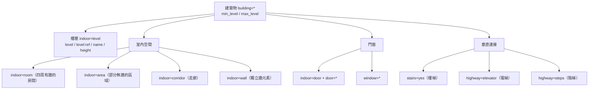
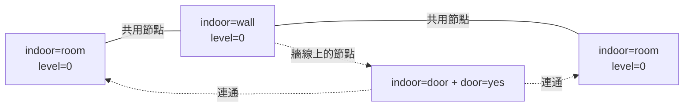
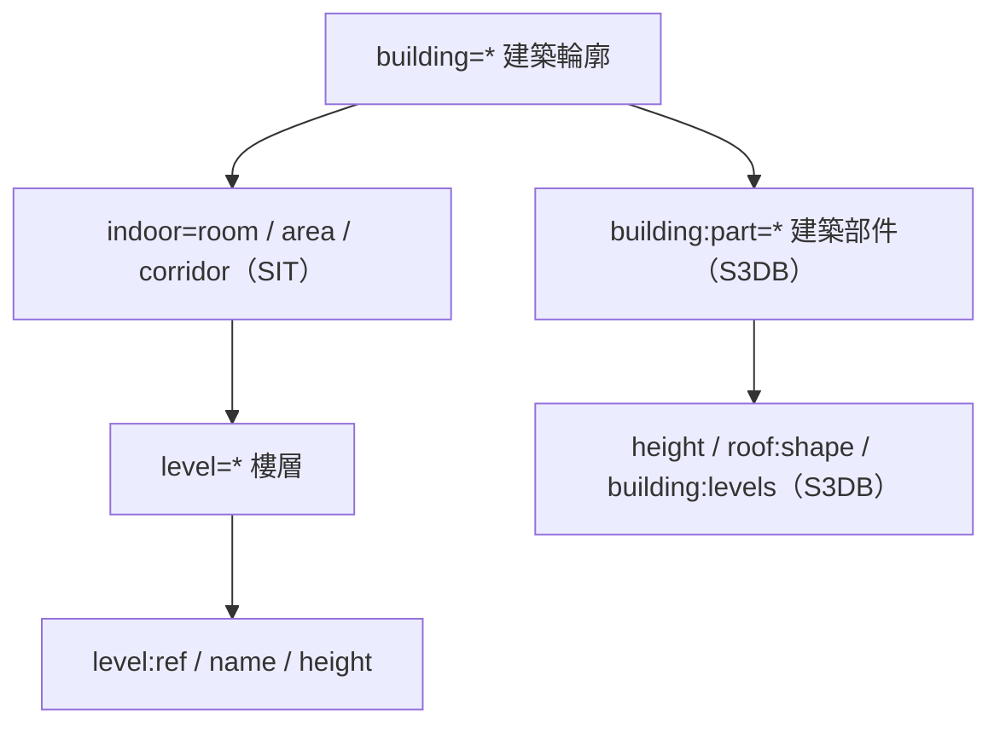

# OpenStreetMap Simple Indoor Tagging 介紹

## 摘要

Simple Indoor Tagging（常簡稱 SIT）是 OpenStreetMap (OSM) 社群針對「室內地圖」(Indoor Mapping) 所制定的標記規範 (tagging schema)。它的設計目標是「簡單易用，但仍足以涵蓋複雜情境」，並支援室內導航／路徑規劃 (routing)、樓層平面圖以及公共建築的 3D 地圖等應用[^sit]。SIT 於 2014 年由 Simon Poole、Tordanik、Peda 與 Saerdnaer 等社群成員共同起草，之後依據實際繪製經驗與 2022 年、2026 年兩次 OSM 室內工作坊的討論持續修訂[^sit]。本報告說明 SIT 的核心概念、標記模型、與 Simple 3D Buildings 的關係、實際使用狀況，以及它目前的爭議與發展方向。

## 一、什麼是 Simple Indoor Tagging

Simple Indoor Tagging 是一套用於描繪建築物內部的標記規範，目的是讓 OSM 的資料模型能夠表達「哪一個空間位於哪一個樓層、彼此如何連通」等資訊[^sit]。OSM 本身是一個開放、由志願者共同編輯的世界地圖，傳統上以道路、建築輪廓 (footprint)、景點 (POI) 等戶外資料為主；SIT 則把同樣的資料模型延伸到建築物內部[^sit]。

SIT 的核心特徵包括[^sit]：

- 以 `level=*` 標籤把元素歸屬到建築物的不同樓層。
- 把房間、走廊等室內空間繪製為**面 (area)**，而非僅是單一節點。
- 對於室內外皆存在的特徵，沿用既有 OSM 標籤（例如 `door=*`、`highway=elevator`），避免另創一套重複的模型。

SIT 與 Simple 3D Buildings (S3DB) 的相容性是明確的設計目標。S3DB 是一套描述建築物基本 3D 屬性（高度、屋頂形狀等）的標記方案；當 SIT 與 S3DB 併用時，兩套標籤應同時出現在同一個物件上[^sit][^s3db]。

## 二、歷史與制定背景

SIT 是「經過整理 (curated)」的標準，最初於 2014 年由 SimonPoole、Tordanik、Peda、Andi 等四位成員建立，其後根據實際使用回饋以及 OSM 室內工作坊（2022 年於法蘭克福、2026 年於柏林）的討論持續更新[^sit]。在 SIT 之前，社群曾提出多個室內標記提案，例如 IndoorOSM、Proposed features/indoor、Termite 的室內模型、CompoundFacility，以及 Level Map、Level 等關聯 (relation) 提案，但這些方案多已廢棄或不再活躍[^indoor]。OSM Wiki 的 Indoor Mapping 頁面明白指出：「當前共識請見 Simple Indoor Tagging」，其他列出的標籤可能已過時或不再使用[^indoor]。

值得注意的是，`indoor=*` 這個鍵的部分用法早於 SIT，來自更早期、現已作廢的提案，因此資料庫中仍存在一些不符合現行 SIT 的標記[^keyindoor]。

## 三、標記模型（tagging schema）

SIT 的模型可以概略分為四個層次：建築物 (building)、室內元素 (indoor elements)、門窗 (doors and windows)、以及垂直連接 (vertical connections)[^sit]。下圖為簡化的概念結構：

### 3.1 簡單的 POI 對應

OSM 的繪製通常由粗略逐步走向精細。為了讓「尚未有詳細平面圖」的建築也能被視覺化，SIT 允許室內景點僅以 `level=*` 標籤標示，並在建築輪廓或建築關聯上標記 `min_level=*` 與 `max_level=*`[^sit]。在這種最簡單的情況下，只要在建築多邊形上增加兩個標籤、並在 POI 上加上 level 標籤，粗略的視覺化即可運作（但若無其他室內元素，則不支援路徑規劃）[^sit]。

| 鍵 | 說明 | 範例值 |
| --- | --- | --- |
| `level=*` | POI 所在的實體樓層編號 | `level=3`、`level=-1` |
| `level:ref=*` | POI 所在樓層的標示編號（見於指標、電梯按鈕） | `level:ref=B1`、`level:ref=LG` |

[^sit]

### 3.2 建築物 (Building)

為了讓資料消費者能輕易找出具備室內資料的建築物，SIT 建議使用 `min_level=*` 與 `max_level=*`[^sit]。由於某些國家會刻意跳過特定樓層編號（例如西方國家常跳過 13 樓，東亞部分地區跳過 4 樓），SIT 另外提出 `non_existent_levels=*` 來記錄這些不存在的樓層，避免資料消費者在計算上方樓層時發生錯誤[^sit][^keylevel]。

| 鍵 | 說明 | 範例值 |
| --- | --- | --- |
| `min_level=*` | 室內涵蓋的最低樓層 | `min_level=-1` |
| `max_level=*` | 室內涵蓋的最高樓層 | `max_level=14` |
| `non_existent_levels=*` | （選用）因地區習慣而不存在的樓層編號 | `non_existent_levels=4;13` |

[^sit]

### 3.3 室內元素 (Indoor elements)

室內空間的整體配置由帶有 `level=*` 的 `indoor=*` 元素描述[^sit]：

| 鍵／值 | 元素型別 | 說明 |
| --- | --- | --- |
| `indoor=room` | 面 (area) | 四周被牆圍繞的傳統房間 |
| `indoor=area` | 面 (area) | 未（完全）被牆圍繞的區域；僅在明確標記 `indoor=wall` 或與相鄰房間相接處才有牆 |
| `indoor=corridor` | 面 (area) | 連接房間的封閉走道；與 `indoor=area` 類似，不一定四周有牆 |
| `indoor=wall` | 線 (way) 或面 (area) | 獨立的（不可穿越）牆元素，用於 `indoor=room` 不足以描述的情況 |
| `indoor=level` | 面 (area) | （選用）描述某一樓層的輪廓，可附加樓層名稱等資訊 |

[^sit]

其中 `indoor=room` 與 `indoor=area` 的主要區別在於：前者假設四周（含 multipolygon 的內環）皆有牆，後者只有在明確對應 `indoor=wall` 或與鄰接房間相接處才有牆[^sit]。`indoor=corridor` 則是一種功能特別常見的 `indoor=area`[^sit]。除了上述「主要標籤」外，室內元素可再附加 `room=*` 子標籤描述用途，以及其他常見標籤[^sit]：

| 鍵 | 說明 | 範例值 |
| --- | --- | --- |
| `level=*` | **必填**，室內元素所在的樓層 | `level=111`、`level=-1` |
| `name=*` | 室內元素的名稱（例如房間名稱） | `name=Vesalius Aula` |
| `ref=*` | 室內元素的編號（例如房間號碼） | `ref=101`、`ref=01.15` |
| `height=*` | 該室內元素的個別高度（預設單位為公尺） | `height=3`、`height=2.5 m` |

[^sit]

另有一個常見的結構性元素 `indoor=column`，用於標示建築物結構中的柱子；它可用於節點，也可與 `area=yes` 併用以描述較複雜的形狀[^keyindoor]。

### 3.4 牆 (Walls)

所有 `indoor=room` 假設皆被牆包圍。此外，也可以把牆明確繪製為 `indoor=wall` 加 `level=*` 的元素[^sit]。這在以下情境特別有用：想標記兩個 `indoor=area` 之間的隔牆、想對牆附加額外標籤（如 `width=*`）、或想以面描繪形狀不規則的牆[^sit]。

牆通常沿著牆中心線繪製為線 (way)，這是偏好做法；但也可以繪製為 `indoor=wall` + `area=yes` 的面，用來表示不規則、厚度不均的牆[^sit]。無論哪種方式，`indoor=wall` 元素都應與相鄰的室內空間共用節點；同樣地，現實中相鄰的室內空間也應共用節點[^sit]。房間與 `indoor=wall` 元素（線或面）共用節點之處，明確繪製的牆會取代該段房間輪廓中隱含的牆[^sit]。房間之間的連通則以位於牆線上的門節點表示；門節點只能放在以線繪製的牆（或由房間輪廓隱含的牆）上，不能放在以面繪製的牆上[^sit]。

下圖示意牆與門的關係：

### 3.5 門與窗 (Doors and windows)

**門 (doors)** 以同時帶有 `indoor=door` 與 `door` 的節點繪製[^sit]。門節點由它所連接的兩個房間與（若存在）牆線共用[^sit]。若門是建築物的出入口，則依慣例改標為 `entrance=*`，但仍保留 `door` 鍵[^sit]。

| 鍵 | 值 | 元素 | 說明 |
| --- | --- | --- | --- |
| `door` | `yes` | 節點 | 未知型別的門 |
| `door` | `no` | 節點 | 牆上的開口，可通行但未裝設門扇 |
| `door` | `*` | 節點 | 特定型別的門（見 Key:door） |

[^sit]

**窗 (windows)** 同樣以位於牆、房間輪廓與建築輪廓上的節點繪製，可存在於內牆或外牆[^sit]。`window=*` 標籤標示單一窗戶的位置；若與 `repeat_on=*` 併用，則代表垂直方向上一整排窗戶[^sit]。關於門窗更細節的標記標準，另有獨立的提案與文件（例如 Proposed features/door、Tordanik 的窗戶標記討論），並不包含在 SIT 本身[^sit]。

### 3.6 垂直連接 (Vertical connections)

樓梯、電扶梯與電梯遵循與「跨樓層房間」相同的邏輯：它們跨越多个樓層，並在每一層透過 `door=*` 節點與其他室內空間（例如 `indoor=corridor`）相連；若該層沒有實體門，也應使用 `door=no` 標示[^sit]。跨樓層的範圍以分號分隔的樓層清單或樓層範圍表示，例如 `level=0;1` 或 `level=0-1`[^sit]。連接 2 樓與 4 樓的樓梯應標為 `level=2;3;4` 或 `level=2-4`，無論 3 樓是否能從該樓梯進入[^sit]。

對於上下樓層位置完全相同、因而會產生重複門節點的樓梯或電梯，SIT 建議只使用一個 `door=*` 節點並加上 `repeat_on=*`（例如 `repeat_on=1;2` 或 `repeat_on=1-5`）；同時建議資料消費者在預處理階段把這些物件複製展開，每一份使用一個 level 值[^sit]。

| 照片／用途 | 標記 |
| --- | --- |
| 樓梯 | `stairs=yes` + （無牆時）`indoor=room` 或 `indoor=area`；設有電扶梯時再加 `conveying=yes` |
| 電梯 | `highway=elevator` + `indoor=room`，特殊情況下（無牆時）用 `indoor=area` |
| 階梯 (steps) | `highway=steps`，樓層值應為樓層範圍或分號分隔清單 |
| 電扶梯 | `highway=steps` + `conveying=yes` |

[^sit]

單獨的階梯（位於樓梯間之外，或作為樓梯間內部的額外細節）可用帶有適當 `level=*` 的 `highway=steps` 線繪製[^sit]。與戶外階梯類似，也可選擇性地另外繪製 `area:highway=steps` 多邊形來表示階梯的範圍，並在線與多邊形上標相同的 `level=*`[^sit]。

### 3.7 樓層的進階建模

同一樓層的所有元素都帶有 level 標籤。`level=*` 描述元素位於哪一層（0 通常為地面層，-1 為第一層地下室）[^sit]。SIT 強調應沿用各建築物自身的樓層標示慣例，例如慕尼黑機場以 3 為地面層[^sit]。

`level=*` 採用「從 0 起算」的編號方式，這與許多國家的日常樓層編號（從 1 起算）不同[^keylevel]。OSM Wiki 指出，`level=*` 最初是為 3D 建築彩現而設想的機器可讀鍵，因此支援 SIT 的資料消費者要求其值必須是**數值且連續**，即使是現實中以「B」、「B1」、「G」、「M」、「2M」等助憶符號稱呼的地下室或夾層亦然[^keylevel]。因此，當建築物使用非數值或非標準的樓層標示時，應在個別特徵上加上 `level:ref=*`，最好與 `level=*` 並用，以免資料消費者誤判[^keylevel]。

SIT 也建議可為每個樓層建立輪廓並標記 `indoor=level`，在其上同時加上 `level=*` 與 `level:ref=*`，藉此整合樓層的相對垂直順序資訊[^keylevel]。

| 鍵 | 說明 | 範例值 |
| --- | --- | --- |
| `name=*` | 該樓層的名稱 | `name=Ground floor` |
| `level:ref=*` | 該樓層的編號或代碼，即建築物內部顯示的樓層編號方案（可能與 `level=*` 不同） | `level:ref=K`、`level:ref=E`、`level:ref=3` |
| `height=*` | 該樓層的高度（預設單位公尺） | `height=4` |
| `level=*` | 該樓層的編號（0 通常為地面層，-1 為第一層地下室） | `level=0`、`level=-2`、`level=3` |

[^sit]

### 3.8 跨樓層特徵與重複特徵

除了前述情形外，跨越多个樓層的特徵（例如樓梯、電梯井、挑高房間）可在 `level=*` 的值中列出多個樓層，例如 `level=1;2`、`level=-1-5`、`level=-4--2`[^sit]。此外，若某特徵在其他樓層有完全相同的複本，可用單一節點加上 `repeat_on=*` 標示；SIT 提醒此做法應謹慎使用，僅在必要時採用（常見於窗戶與電梯／樓梯門）[^sit]。`repeat_on=*` 的清單**不包含起始樓層**，例如某特徵的 `level=0`，則 `repeat_on` 由 `1` 起算[^sit]。

| 鍵 | 說明 | 範例值 |
| --- | --- | --- |
| `level=*` | 列出多個樓層以表示跨樓層特徵 | `level=1;2`、`level=-1-5` |
| `repeat_on=*` | 在其他樓層有相同複本的特徵 | `repeat_on=1;3`、`repeat_on=0-6` |

[^sit]

## 四、與 Simple 3D Buildings 的關係

Simple 3D Buildings (S3DB) 描述建築物的基本 3D 屬性，其模型以兩類面構成建築量體：建築輪廓 (`building=*`) 與建築部件 (`building:part=*`)[^s3db]。S3DB 用於標記高度 (`height=*`)、屋頂形狀 (`roof:shape=*`)、立面材質與顏色等屬性[^s3db]。

SIT 與 S3DB 是互補的：SIT 處理「建築物內部」的空間結構，S3DB 處理「建築物外殼」的 3D 形狀，兩者相容併用是 SIT 的明確目標[^sit]。在實務上，`building:part=*` 主要供 3D 彩現使用，2D 彩現器會忽略其屬性；而 `building:part=*` **不屬於** SIT，不應用於標記房間，因為它描述的是包含牆、屋頂與其他結構的「總體 (gross)」建築部件[^keyindoor][^s3db]。SIT 中的 3D 建模常與 S3DB 的 `building:part=*`（例如用於建築中庭、挑高空間）互相搭配[^sit]。

## 五、主要使用情境

OSM Wiki 的 Indoor Mapping 頁面列出室內地圖的常見應用，包括室內導航／路徑規劃、3D 視覺化、2D 地圖、公眾參與、緊急應變，以及有興趣設施的顯示（例如廁所、滅火器、急救箱）[^indoor]。適用的場所涵蓋機場、醫院、飯店、大學、學校、博物館、火車與地鐵站、購物中心、智慧建築、多層停車場與其他公共建築[^indoor]。

Indoor/use cases 頁面則針對不同場所討論其特有的「內部地址 (internal addresses)」——也就是類似郵政地址、但用於定位室內物件（如「room 324」、「aisle 8 bin E shelf 4」、「section 123 row 24 seat H」）的識別方式[^usecases]。各場所的關注重點不同[^usecases]：

| 場所 | 主要內部地址／關注物件 |
| --- | --- |
| 購物中心 | unit、section；店家更換頻繁，維護不易 |
| 機場 | gates、units（商店與餐廳）、carousels（行李轉盤） |
| 學術建築／校園 | rooms、buildings、units、section/row/seat |
| 火車站 | track、platform（是「非建築物」的室內地圖例子） |
| 體育場 | section、row、seat、洗手間、販賣部、票務 |
| 停車場 | 停車位、樓層或區段；坡道是主要複雜點 |
| 醫院 | rooms、buildings、departments、電梯與樓梯（可能編號） |
| 零售店 | aisle/bin/shelf（階層式地址）、section、units |
| 公寓大廈 | 停車位與單位 (units)；通常不繪製單位內部房間 |
| 遊輪 | staterooms、decks；因座標不固定，須以相對座標系繪製 |

[^usecases]

## 六、工具與生態系

OSM Wiki 的 Indoor Mapping 頁面整理了支援室內資料的工具[^indoor]：

| 名稱 | 網站 | 類型 | 說明 |
| --- | --- | --- | --- |
| indoor= | https://indoorequal.org | 地圖／彩現器 | 顯示室內資料，具樓層選擇器與熱度圖 |
| MapComplete indoors | https://mapcomplete.org/indoors | 編輯器／室內 | 顯示可公開進入的室內場所主題 |
| OpenLevelUp | https://openlevelup.net | 室內／互動／路徑規劃 | 可互動瀏覽建築各樓層，支援 `indoor=*` 與 `buildingpart=*` |
| OsmInEdit | https://osminedit.pavie.info | 編輯器 | 簡易的網頁室內編輯器 |
| MapGL Indoor Plugin | https://map-gl-indoor.github.io | 3D／室內／路徑規劃 | MapLibre 為基礎的室內外掛 |
| OSM Indoor Mapping Browser | https://clement-lagrange.github.io/osmtools-indoor | 瀏覽器 | 純 JavaScript 的室內建築瀏覽器 |

[^indoor]

此外，KDE 的 Volker Krause 維護 `kosmindoormap` 函式庫（彩現與路徑規劃），另有 indrz 等開源後端專案，以及 OpenStationMap（以 SIT 加上門與樓梯間延伸標記來描繪火車站）等計畫[^indoor]。已廢棄或不再活躍的專案則包括 ID-indoor（由 OsmInEdit 取代）、Poliba Maps、openindoor.io 與 OpenStationMap[^indoor]。

部分主流行動 App 目前仍**不支援**室內資料，例如 Organic Maps、OsmAnd、Every Door、StreetComplete（明確表示不會支援）與 CoMaps（開發中）[^indoor]。

## 七、實際使用狀況與資料量

根據 OSM 官方統計服務 Taginfo 的資料（統計基準時間為 2026-11-21），`indoor=*` 鍵的總使用量為 1,105,213 次（節點 438,818、線 634,644、關聯 31,751），共 238 種不同的值[^taginfo-indoor]。主要值的分布如下[^taginfo-indoor]：

| `indoor=*` 值 | 使用次數 | 佔比 | 是否收錄於 Wiki |
| --- | --- | --- | --- |
| `yes` | 398,423 | 36.05% | 是 |
| `room` | 273,895 | 24.78% | 是 |
| `no` | 210,548 | 19.05% | 否 |
| `wall` | 78,075 | 7.06% | 是 |
| `door` | 66,666 | 6.03% | 是 |
| `corridor` | 27,852 | 2.52% | 是 |
| `area` | 25,597 | 2.32% | 是 |
| `column` | 11,469 | 1.04% | 是 |
| `level` | 6,055 | 0.55% | 是 |

[^taginfo-indoor]

作為對照，通用性極高的 `level=*` 鍵總使用量為 2,517,574 次[^taginfo-level]。這些數字顯示：雖然 SIT 是「當前共識」，但資料庫中仍存在大量非 SIT 的 `indoor=*` 用法（例如佔近 19% 的 `indoor=no`，用於表示戶外物件），也有若干被 Wiki 列為「可能的標記錯誤」的值（例如 `indoor=highway`、`indoor=stairs`、`inside=*`）[^keyindoor]。這反映出標記慣例在社群中仍有分歧。

`indoor=*` 鍵目前的 Wiki 狀態被標為 **de facto**（事實上的標準），而非正式核准的提案[^keyindoor]。

## 八、爭議與發展方向

### 8.1 現行爭議

SIT 雖然是當前共識，但仍有多項未解或正在演進的議題。2026 年 7 月 11 至 12 日於柏林 HTW 大學舉行的 Indoor OSM Workshop，列出了社群正在討論的多個主題，包括牆的面積 (wall areas)、`indoor=column`、level 值語法、多樓層特徵、`indoor=door`、門窗的方向性標記、分數樓層 (fractional levels) 等[^workshop]。

### 8.2 工作坊的決議

該工作坊提出了用於評估變更的準則（OSM 相容性、對既有資料的影響、與戶外繪製的一致性、對 2D／3D／觸覺彩現與路徑規劃的影響、無障礙情境的可建模性、以及對匯入 BIM 資料的影響）[^workshop]。重要的討論與決議包括[^workshop]：

- **厚牆 (thick walls)**：社群普遍同意需要能描繪厚牆；薄牆仍是偏好且鼓勵的做法，厚牆僅用於無法以其他方式合理描繪的複雜情況。多數與會者傾向「明確厚牆」做法，其提案已交付表決。
- **門**：共識是**拒絕**以線 (way) 表示門；可（活）動的牆應以牆加上額外標籤描繪（如 `indoor=wall` + `movable=yes`）；具方向性的門屬性應以「基本方向 (cardinal direction) 參照」來標記。同時建議 `door=*` 應成為門的偏好且通用做法，`indoor=door` 應逐步淘汰（但仍有約 5,000 次使用）。
- **樓梯**：接受「Detailed indoor stairs mapping2」提案，並允許 `area:highway=steps` 作為額外細節層級。
- **樓層**：反對反向的樓層範圍（如 `5-3`），但建議寬容的解析器仍應視為等價；`level=*` 沒有順序語意，`1;2` 與 `1;2;1` 等價。分數樓層雖在使用中，但尚未正式定義，需要謹慎檢視其語意後才能引入。
- **SIT 文件修訂**：釐清 `indoor=corridor` 沒有隱含的牆；並移除關於「level relation」的歷史殘留敘述。

### 8.3 跨社群協作

OSM 室內繪製社群透過論壇標籤（community.openstreetmap.org/tag/indoor）、定期線上會議與上述工作坊進行協作[^indoor][^workshop]。社群也提出了 API 提案（Indoor Navigation App Content Discovery API），讓室內導航 App 的內容更容易被其他應用程式探索與連結[^indoor]。

## 九、來源評析

本報告的所有事實均來自 OSM Wiki 與 OSM 官方統計服務 Taginfo，並輔以 Wikimedia 上的相關圖片來源。以下針對來源品質進行反思：

- **來源權威性**：OSM Wiki 是該專案標記慣例的**主要**權威來源，且 SIT 條目為受保護頁面，編輯門檻較高[^sit]。然而，OSM 標記慣例本質上由社群共識而非中央機構制定，條目本身也標註「de facto」狀態，說明其並非正式標準化文件[^keyindoor]。
- **時效性**：SIT 條目的最後修訂時間為 2026-07-27，`Key:level` 為 2026-11-19，均屬近期，時效性良好[^sit][^keylevel]。但部分引用（如農民曆式的「2022 年工作坊」）僅有摘要，細節需另尋。
- **一手與二手**：本報告主要引用 Wiki 的**整理性**敘述（二手來源），因此對於個別標籤的精確語意，仍以原始提案與實際資料為準。Taginfo 資料則屬一手統計，但僅呈現「使用量」而非「正確性」。
- **可能的偏誤**：Wiki 條目可能反映**積極編輯者**的觀點，未必代表整體社群；工作坊的「決議」是小規模與會者的共識，尚未經全體投票或大規模驗證[^workshop]。此外，`Key:level` 條目本身帶有「questionable, contentious or controversial information」的標記，提醒讀者其中部分內容仍有爭議[^keylevel]。
- **交叉驗證**：本報告所引用的模型、歷史、工具與統計數字來自多個獨立頁面，彼此大致一致；但對於「SIT 為當前共識」這一陳述，主要仍來自 Wiki 自身，缺乏獨立的第三方驗證。

## 十、結論

Simple Indoor Tagging 是 OSM 社群用來描繪建築物內部的現行主流標記規範，核心是以 `level=*` 把以面為主的室內空間（房間、走廊、區域）歸屬到各樓層，並沿用既有的門窗、樓梯、電梯等標籤，同時與 Simple 3D Buildings 保持相容[^sit]。它的使用量已達百萬級別，並有多個開源工具與應用生態系支持[^taginfo-indoor][^indoor]。然而，它仍是一個事實上的標準 (de facto)，而非正式核准的規範；厚牆、門的方向性、分數樓層等議題仍在演進，2026 年柏林工作坊的決議也尚未完全落實為文件或資料[^workshop][^keyindoor]。

---

[^sit]: OpenStreetMap Wiki. (2026, July 27). Simple Indoor Tagging. Retrieved 2026-11-21, from https://wiki.openstreetmap.org/wiki/Simple_Indoor_Tagging

[^keyindoor]: OpenStreetMap Wiki. (2026, July 11). Key:indoor. Retrieved 2026-11-21, from https://wiki.openstreetmap.org/wiki/Key:indoor

[^keylevel]: OpenStreetMap Wiki. (2026, November 19). Key:level. Retrieved 2026-11-21, from https://wiki.openstreetmap.org/wiki/Key:level

[^indoor]: OpenStreetMap Wiki. (n.d.). Indoor Mapping. Retrieved 2026-11-21, from https://wiki.openstreetmap.org/wiki/Indoor_Mapping

[^usecases]: OpenStreetMap Wiki. (2025, July 2). Indoor/use cases. Retrieved 2026-11-21, from https://wiki.openstreetmap.org/wiki/Indoor/use_cases

[^workshop]: OpenStreetMap Wiki. (2026, July 28). Indoor OSM Workshop 2026. Retrieved 2026-11-21, from https://wiki.openstreetmap.org/wiki/Indoor_OSM_Workshop_2026

[^s3db]: OpenStreetMap Wiki. (n.d.). Simple 3D Buildings. Retrieved 2026-11-21, from https://wiki.openstreetmap.org/wiki/Simple_3D_Buildings

[^taginfo-indoor]: OpenStreetMap Taginfo. (2026). Key: indoor. Retrieved 2026-11-21, from https://taginfo.openstreetmap.org/keys/indoor

[^taginfo-level]: OpenStreetMap Taginfo. (2026). Key: level. Retrieved 2026-11-21, from https://taginfo.openstreetmap.org/keys/level
