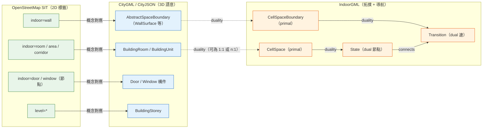
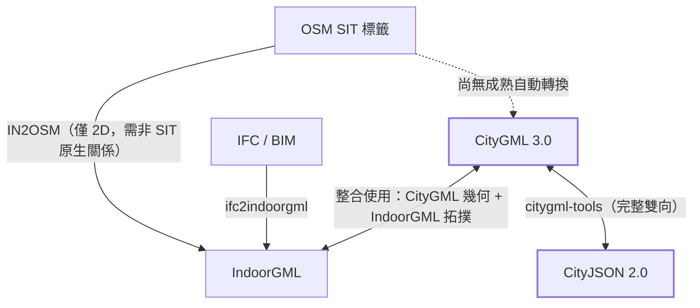

# OpenStreetMap Simple Indoor Tagging 與 CityJSON、IndoorGML 之比較研究

## 摘要

本報告比較三種常被並列討論的室內空間資料模型：社群驅動的 OpenStreetMap **Simple Indoor Tagging (SIT)**、OGC 的 **CityGML / CityJSON**，以及專為室內導航而生的 **IndoorGML**。三者並非同一層次的競爭者：SIT 是一套標籤慣例（tagging schema），CityJSON 是 3D 城市模型資料模型的 JSON 編碼，IndoorGML 則是拓撲導向的室內導航網路模型[^sit][^cityjson][^indoorgml2]。本報告依序說明三者定位、資料模型細節、概念對應、互通轉換工具、生態系現況與適用情境，並反思各來源的可信度。

---

## 1. 問題背景：為何室內資料模型難以統一

室內空間與室外空間在本質上不同，因此「一個模型通用所有需求」並不現實。室內空間由走廊、門、樓梯、電梯等複雜約束構成，如同道路網路之於室外空間；語意表徵（哪些是可通行單元、哪些是不可通行單元）與拓撲關係因此成為室內資訊建模的核心問題[^indoorgml1]。

室內資訊的應用可粗分為兩類：一是建築構件與設施的管理（關注屋頂、牆體等實體構件），二是室內空間的使用（關注房間、走廊等空間單元，以及門等約束）[^indoorgml1]。定位感知（例如室內定位與路線導引）與路徑規劃屬於後者，而 BIM 施工與設施管理屬於前者。三個模型恰好落在這條光譜的不同位置。

此外，群眾外包（crowdsourcing）的室內資料還額外面臨法規與營運挑戰：多數室內空間屬私人所有，建築圖的著作權通常屬於建築師，取得授權困難；商場店鋪的高流動性也與「貼在圖上就不易更新」的資料結構衝突[^challenges]。這些非技術因素會反向影響資料模型的設計取向。

---

## 2. 三個模型的基本定位

### 2.1 OpenStreetMap Simple Indoor Tagging (SIT)

SIT 是 OpenStreetMap 室內製圖的策劃型標準（curated standard），由 SimonPoole、Tordanik、Peda、Andi 等人於 2014 年建立，之後依實際使用經驗與 2022 年、2026 年兩次室內工作坊的成果持續修訂[^sit]。其核心特徵是[^sit]：

- 以 `level=*` 標籤將元素歸屬到不同樓層；
- 將房間、走廊等室內空間繪為區域（area）；
- 盡量沿用既有的 OSM 標籤來描述室內外共有的特徵；
- 與 Simple 3D Buildings（S3DB）相容是明確目標。

主要標籤包括 `indoor=room`（四周有牆的房間）、`indoor=area`（並非四周皆有牆的開放區域）、`indoor=corridor`（連接房間的封閉走道）、`indoor=wall`（個別不可通行的牆元）、`indoor=level`（樓層輪廓，用於進階樓層建模），以及 `indoor=column`（結構柱）[^sit][^keyindoor]。垂直連結以 `highway=steps`、`conveying=yes`（電扶梯）、`highway=elevator` 表示[^sit]。

門與窗以節點表示：門為同時具有 `indoor=door` 與 `door=*` 的節點，且由相連的兩個房間與（若存在）牆線共享；建築出入口則慣例使用 `entrance=*`[^sit]。窗以節點搭配 `window=*` 表示，可存在於內牆與外牆[^sit]。

建築層級的整體標籤為 `min_level=*`、`max_level=*`，並可選用 `non_existent_levels=*` 處理西方跳過 13 樓、東亞跳過 4 樓之類的區域慣例[^sit]。

在資料規模方面，OSM 主資料庫中 `indoor` 鍵約有 110 萬次使用，`level` 鍵約有 252 萬次使用（資料截至 2026-11-21）；其中 `indoor=room` 約 27.4 萬、`indoor=wall` 約 7.8 萬、`indoor=door` 約 6.7 萬、`indoor=corridor` 約 2.8 萬、`indoor=area` 約 2.6 萬[^taginfoindoor][^taginfolevel][^taginfovalues]。`indoor=*` 鍵在 OSM 社群中屬「de facto」狀態[^keyindoor]。

### 2.2 CityGML 與 CityJSON

**CityGML** 是 OGC 的 3D 城市模型標準。CityGML 3.0 採 Model-Driven Architecture：第一部分「概念模型」（20-010）於 2021-06-04 通過、2021-09-13 發布；第二部分「GML 編碼」（21-006r2）於 2023-05-10 通過、2023-06-20 發布[^citygml1][^citygml2]。CityGML 定義了城市與地景的語意資訊模型，包含建築、橋梁、隧道、植被、水體、交通設施、土地利用、城市家具等主題模組，並支援多種細節層級（LOD）與 ADE（Application Domain Extension）擴充機制[^citygml1]。

與室內特別相關的是 Building 模組，其包含八個類別：`Building`、`BuildingPart`、`BuildingInstallation`、`BuildingConstructiveElement`、`BuildingFurniture`、`BuildingStorey`、`BuildingRoom`、`BuildingUnit`[^cityjson_spec202]。其中 `Building`、`BuildingPart`、`BuildingStorey`、`BuildingRoom`、`BuildingUnit` 的幾何僅能以 Solid、CompositeSolid、MultiSurface 或 CompositeSurface 表示，也就是以 3D 立體或面集合為主[^cityjson_spec202]。CityGML 3.0 亦引入 AbstractSpace 與 AbstractSpaceBoundary 概念，用以描述空間及其邊界，並讓相鄰空間透過共享邊界產生接觸關係[^citygml2]。

**CityJSON** 則是 CityGML 資料模型（3.0 版）的 JSON 編碼，只實作其一個子集。它由 Ledoux 等人的論文提出[^ledoux2019]，並成為 OGC Community Standard（20-072r5，v2.0.0 於 2022-12-12 通過、2023-10-20 發布）[^cityjson_cs]。官方規格目前最新為 2.0.2（2026-03-27）[^cityjson_spec202]。

CityJSON 的設計目標是精簡與對程式設計者友善：使用 JSON 而非 GML，官方稱檔案平均比對應的 CityGML-XML 小約 7 倍（規格摘要則稱可壓縮約 6 倍）[^cityjson_about][^cityjson_spec202]。其物件結構扁平化，僅實作 CityGML 階層中的「葉節點」類別[^cityjson_about]。CityJSON v2.0 支援 Building 模組（含 `BuildingRoom`）等大多數模組[^cityjson_about][^cityjson_v30]。CityJSON 的 `cityjson/specs` 儲存庫有 127 顆星、`cjio` 有 151 顆星（皆為 GitHub 星數，2026-11 查詢）[^gh_cityjsonspecs][^gh_cjio]。

CityJSON 以「Extensions」機制取代 CityGML 的 ADE，官方明言 Extensions 刻意比 ADE 簡單，以利實務使用[^cityjson_v30]。CityJSON 未支援的 CityGML 特性包括：同一資料集中使用多個 CRS、低階幾何的識別碼、拓撲關係（如 `relativeToTerrain`、`relativeToWater`）與 XLink 共享面、地形交線（TIC）、以及複雜屬性（例如 `gml:Measure` 的單位）之簡化[^cityjson_v30]。

### 2.3 IndoorGML

IndoorGML 是 OGC 的室內導航網路模型標準。1.0 版於 2014-12-03 發布，1.1 版於 2020-05-11 通過、2020-11-05 發布（19-011r4）[^indoorgml_news][^indoorgml1]。2.0 版拆分為多部分：Part 1「概念模型」（22-045r5）於 2025-03-10 通過、2025-06-26 發布，Part 2 則規劃以 GML、SQL、JSON 提供實作 schema[^indoorgml2][^indoorgml_site]。

IndoorGML 的定位非常明確：它**不是**用來描述建築構件的完整幾何與語意，而是聚焦於室內空間的建模及其鄰接關係，以支援室內定位服務[^indoorgml2]。其自我定位是 CityGML、IFC、LADM、IMDF 等標準的**互補**標準，而非替代品[^indoorgml2]。

IndoorGML 的兩個理論支柱是 **Structured Space Model**（將 primal space 與 dual space、幾何與純拓撲分離）與 **Multi-Layered Space Model**（支援多個不同語意分層，例如地形層、Wi-Fi 感測器層）[^indoorgml_site]。其核心機制為 **Poincaré duality**：primal 空間中的 k 維物件映射到 dual 空間的 (N−k) 維物件，因此 3D 房間映射為節點（0D），兩房間共享的 2D 面則映射為連接兩節點的邊（1D）[^indoorgml1]。

---

## 3. 資料模型細節對照

### 3.1 空間單元

| 面向 | SIT | CityGML / CityJSON | IndoorGML |
|---|---|---|---|
| 房間 | `indoor=room`（區域，四周有牆） | `BuildingRoom`（隸屬 `Building`/`BuildingStorey`/`BuildingPart`）[^cityjson_spec202] | `CellSpace`（primal），其 dual 為 `State`[^indoorgml1] |
| 走廊 | `indoor=corridor`（區域，無隱含牆）[^sit][^workshop2026] | 無專屬類別，通常以 `BuildingRoom` 的屬性（如 usage）或 `BuildingUnit` 表達 | `CellSpace`，Navigation 模組中多對應 `GeneralSpace`[^indoorgml1] |
| 開放區域 | `indoor=area` | `BuildingRoom` 或 `AbstractSpace` 衍生類別 | `CellSpace` |
| 樓層 | `level=*` 標籤；選用 `indoor=level` 輪廓[^sit] | `BuildingStorey` 類別；CityGML 3.0 支援「stories/floors within buildings」[^citygml1] | `CellSpace` 的 `level` 屬性（1.1 起），型別為 `xs:string` 以容納 `M`（夾層）、`RC`（地面層）等非數值[^indoorgml1] |
| 柱 | `indoor=column`（節點或區域）[^keyindoor][^workshop2026] | `BuildingConstructiveElement` / `BuildingInstallation` | 通常不特別建模（非導航關注） |

SIT 的關鍵設計是「隱含牆」：`indoor=room` 預設四周皆有牆，兩相鄰房間共享的邊即為隱含牆的中心線；只有需要附加標籤（如 `width=*`）或形狀不規則時，才需明確繪製 `indoor=wall`[^sit]。2026 年工作坊決定傾向支援「明確厚牆」（`indoor=wall` + `area=yes`），並要求厚牆必須包含門的開口，以維持相鄰空間共享邊的拓撲性[^workshop2026]。

### 3.2 邊界、門與窗

SIT 以節點表達門與窗，屬 0 維特徵；門節點同時被兩個相連空間與牆線共享[^sit]。2022 年工作坊曾指出應釐清 `door=*` 在 SIT 中的重要性（房間應有門），並研議是否考慮以線（way）表示門，但 2026 年工作坊最終**否決** way door，共識為可（重）移動的牆應以額外標籤（如 `movable=yes`）表達，且 `door=*` 應取代 `indoor=door`[^workshop2022][^workshop2026]。

CityGML 以 `AbstractSpaceBoundary` 概念描述空間邊界，並以 WallSurface、Door、Window 等構件類別表達，屬 3D 面或實體幾何；CityGML 3.0 的空間邊界同時「實現相鄰空間之間的接觸」[^citygml2]。門窗在 CityGML 中通常是幾何化的表面與構件。

IndoorGML 以 `CellSpaceBoundary` 描述空間邊界，其幾何於 3D 模型中通常為 Surface；每個 `CellSpaceBoundary` 的 dual 為 `Transition`（邊）[^indoorgml1]。IndoorGML 的一致性要求明確規定：`CellSpace` 與 `CellSpaceBoundary` 的維度必須一致（CellSpace 為 Surface 時 Boundary 為 Curve；CellSpace 為 Solid 時 Boundary 為 Surface）[^indoorgml1]。

值得注意的一點：IndoorGML 的拓撲由**明確關聯**表達，而非依賴 ISO 19107 的拓撲；其 adjacency 與 connectivity 關係定義在 IndoorGML 資料模型之內[^indoorgml_site]。這與 SIT「靠共享節點隱含拓撲」形成鮮明對比。

### 3.3 幾何與維度

- **SIT**：本質為 2D。空間以區域（閉合 way 或多邊形關係）表示並附加 `level=*`；3D 資訊需搭配 Simple 3D Buildings 的 `height=*`、`building:levels=*`、`roof:shape=*` 等標籤[^sit][^s3db]。
- **CityGML / CityJSON**：完整 3D 語意模型，支援多個 LOD 與多種幾何原語（Solid、MultiSurface 等）[^citygml1][^cityjson_spec202]。CityJSON 另支援「TU Delft LoDs」，為建築提供更細緻的 LOD 細化[^cityjson_v30]。
- **IndoorGML**：幾何有三種選項：(1) 完全不存幾何，僅以外部參考（xlink）指向 CityGML、IFC 等外部資料集中的物件；(2) 於 IndoorGML 內以 ISO 19107 的 GM_Solid（3D）或 GM_Surface（2D）表示；(3) 完全不含幾何[^indoorgml_site]。此設計使 IndoorGML 能維持高度抽象（也因此相對不洩漏隱私細節），但代價是實務上難以手工產生[^diakite2022]。

### 3.4 拓撲與網路

| 面向 | SIT | CityGML / CityJSON | IndoorGML |
|---|---|---|---|
| 拓撲表達 | 隱含：靠共享節點與區塊相鄰推導[^guidelines] | 明示幾何與空間邊界，但 CityJSON 不支援 CityGML 的部分拓撲關係[^cityjson_v30] | 明示關聯：State/Transition、CellSpace/CellSpaceBoundary 之 duality[^indoorgml1] |
| 導航網路 | 無標準網路模型；以 `highway=footway`/`highway=steps` 線性路網或區域路由表達[^guidelines] | 無專用導航網路；Application Domain Extension 可擴充 | 內建：Navigation 模組定義 RouteNode、RouteSegment、Route[^indoorgml1] |
| 多樓層連結 | `level=0;1` 或 `level=0-1`；`repeat_on=*` 表達重複特徵[^sit] | `BuildingStorey` 階層 + 3D 幾何 | `CellSpace.level`（可為多值）、SpaceLayer 與 InterLayerConnection[^indoorgml1] |
| 室內外銜接 | `entrance=*` 節點[^sit] | 建築輪廓與室內空間共享邊界 | `AnchorSpace` / anchor node，可含室內到絕對座標的轉換參數[^indoorgml_site][^indoorgml1] |

IndoorGML 的核心模組由九個類別組成：`State`、`Transition`、`CellSpace`、`CellSpaceBoundary`、`InterLayerConnection`、`SpaceLayer`、`MultilayeredGraph`、`PrimalSpaceFeatures`、`IndoorFeatures`[^indoorgml1]。其一致性要求包括[^indoorgml1]：

- `CellSpace` 與 `CellSpaceBoundary` 維度必須一致；
- 同一 `SpaceLayer` 內的 `CellSpace` 實例不得重疊；
- 子空間劃分（subspacing）時，子空間不得與原 `CellSpace` 同屬一個 `SpaceLayer`，須形成新的 `SpaceLayer`；
- 每個 `InterLayerConnection` 必須連接分屬不同 `SpaceLayer` 的兩個 `State`。

### 3.5 語意

- **SIT**：語意主要來自沿用既有的 OSM 標籤體系（`amenity=*`、`shop=*`、`room=*` 等），而非另建一套室內專屬語意；`indoor=*` 本身僅描述「空間型態」[^sit][^workshop2022]。
- **CityGML / CityJSON**：具備豐富的類別階層與屬性，可表達建築構件的功能與使用[^citygml1]。
- **IndoorGML**：113 語意用於兩件事：分類（cell 的型態）與決定 cell 之間的連通性；最常見的分類是將 cell 分為可通行（房間、走廊、門）與不可通行（牆、障礙物）[^indoorgml1]。Navigation 模組進一步細分為 NavigableSpace（含 GeneralSpace、AnchorSpace、ConnectionSpace、TransferSpace 等）與 NavigableBoundary[^indoorgml1]。

---

## 4. 概念對應圖

下圖以 mermaid 呈現三者最核心的概念對應關係。注意 IndoorGML 的 `State`/`Transition` 屬於 dual space（拓撲圖），其對應的 primal 物件為 `CellSpace`/`CellSpaceBoundary`。

圖中「概念對應」是領域語意上的對應，而非任何工具保證的自動轉換；點線部分為 IndoorGML 規範定義的 duality 關聯[^indoorgml1]。

---

## 5. 互通性與轉換實務

### 5.1 OSM ↔ IndoorGML：IN2OSM

STEMLab（釜山國立大學）開發的 **IN2OSM** 是少數的開源雙向轉換器，支援 OSM 室內資料與 IndoorGML 1.0.3 之間的互轉，授權為 MIT，但**僅處理 2D IndoorGML**，且最後一次推送為 2020-03-10，GitHub 星數僅 2[^gh_in2osm][^in2osm_readme]。

轉換時，OSM 的 `indoor=room`/`corridor`/`area` way 對應為 `CellSpace`，`indoor=wall` 對應為 `CellSpaceBoundary`；`level=*` 在轉換中被改寫為 `storey` 屬性，其餘標籤串接進 `gml:description`；房間多邊形的質心用來產生 `State`，而 `Transition` 則由連接狀態的 way 產生[^in2osm_readme]。工具依賴 InFactory（產生 IndoorGML）、rapidxml 與 rapidjson[^in2osm_readme]。

值得注意的是，IN2OSM 期望的 OSM 輸入使用一套**非 SIT 原生**的關係標籤約定（如 `type=cellspace`、`type=state`、`type=duality`），因此嚴格說來它是「OSM 資料結構 ↔ IndoorGML」的轉換器，而非「SIT 標籤慣例 ↔ IndoorGML」的無縫轉換器[^in2osm_readme]。這也反映出目前仍缺乏能直接消化標準 SIT 標籤、自動推導 IndoorGML 拓撲的成熟工具。

### 5.2 CityGML ↔ CityJSON

這條路徑是三者中互通性最好的：CityJSON 本即 CityGML 資料模型的 JSON 編碼，可用開源工具 `citygml-tools` 一鍵雙向轉換，官方亦提供轉換教學[^cityjson][^cityjson_about]。此外 `cjio` 可進行合併、篩選物件、變更 CRS、管理貼圖等操作[^cityjson][^gh_cjio]。轉換的資訊損失有限，主要在於前述 CityJSON 未支援的 CityGML 特性[^cityjson_v30]。

### 5.3 CityGML 與 IndoorGML：互補而非互轉

OGC 對兩者的定位是互補：CityGML 提供建築的幾何與語意（含室內），IndoorGML 提供空間切割與拓撲網路[^indoorgml2][^indoorgml1]。學術上已有整合研究，例如 Kim、Yoo 與 Li（2014）探討 IndoorGML 與 CityGML 的整合[^kim2014]；Li 等人（2015）以真實場域進行兩者的使用案例比較[^li2015]；Ryoo、Kim 與 Li（2015）比較兩個 OGC 室內標準[^ryoo2015]。實作層面，Montilla 等人（2022）的無障礙室內導航系統同時整合 IndoorGML（導航網路）與 CityGML（3D 幾何）與 BLE 定位，定位 RMSE 為 0.88 公尺（同高）與 1.06 公尺（有高差）[^montilla2022]。

IndoorGML 亦定義了與 CityGML 的對應關係，例如 Navigation 模組中的 GeneralSpace 對應 CityGML 的 `bldg::Room`，AnchorSpace 與 ConnectionSpace 對應 `bldg::Door`，NavigableBoundary 對應 `bldg::BoundarySurface`[^indoorgml1]。

### 5.4 IFC → IndoorGML

由於 IndoorGML 手工產生困難，Diakite 等人（2022）開發了開源工具 `ifc2indoorgml`，從 BIM/IFC 資料自動產生 IndoorGML[^diakite2022]。該研究也指出，多數 3D 室內模型以點雲（非結構化）或 BIM/IFC（結構化但過度詳細）形式存在，而 IndoorGML 的高抽象性可在不犧牲隱私的前提下表達複雜室內環境[^diakite2022]。

### 5.5 轉換路徑總覽

實線代表已有可用工具或成熟做法，虛線代表缺乏成熟自動化路徑。

---

## 6. 生態系與工具現況

| 標準 | 主要工具 | GitHub 星數 | 授權 | 維護狀態 |
|---|---|---|---|---|
| SIT | indoor=（地圖網站）、OpenLevelUp、OsmInEdit、MapComplete 室內主題、OpenIndoor | 未以本報告查核 | AGPL／GPL／ISC 等[^indoor_mapping] | 活躍；2026 年召開工作坊修訂標準[^workshop2026] |
| CityJSON | cjio、citygml-tools、ninja（檢視器）、cjval／validator、3DCityDB、tyler | `cityjson/specs` 127、`cjio` 151[^gh_cityjsonspecs][^gh_cjio] | CC0（規格）／MIT（cjio）[^cityjson_spec202][^gh_cjio] | 活躍；規格至 2.0.2（2026-03）[^cityjson_spec202] |
| IndoorGML | InViewer-Desktop、InViewer、InEditor、InFactory、IN2OSM | 16（InViewer-Desktop）、18（InFactory）、2（IN2OSM）[^gh_inviewer][^gh_infactory][^gh_in2osm] | MIT／LGPL[^indoorgml_site] | 標準 2.0 於 2025 發布，但參考工具多為 2018–2020 年產物[^indoorgml_site][^gh_inviewer] |

需注意 GitHub 星數並非使用廣度的唯一指標，但小於約 100 顆星的專案通常代表社群規模有限；此處 IndoorGML 參考實作多屬此類，與官方文件所述「缺乏實務工具」的評論一致[^diakite2022]。

---

## 7. 三者優缺點與適用情境

### 7.1 綜合對照

| 面向 | SIT | CityGML / CityJSON | IndoorGML |
|---|---|---|---|
| 標準性質 | 社群 wiki 慣例（de facto） | OGC 標準（CityJSON 為 OGC Community Standard） | OGC 標準 |
| 主要目的 | 群眾外包室內平面圖、POI、基本視覺化 | 3D 城市模型交換、數位孿生 | 室內導航與 LBS 的拓撲網路 |
| 幾何 | 2D 區域 + level 標籤 | 完整 3D、多 LOD | 可選（外部參考／自帶幾何／無幾何） |
| 拓撲 | 隱含（共享節點） | 部分明示；CityJSON 不支援部分拓撲關係 | 明示（duality、NRG） |
| 導航網路 | 無標準網路；以既有路徑標籤表達 | 無專用網路 | 內建 Navigation 模組 |
| 語意豐富度 | 中（沿用 OSM 標籤） | 高 | 中（聚焦空間與連通性） |
| 資料規模 | 全球、百萬級使用[^taginfoindoor] | 多為政府／機構資料集 | 相對小眾 |
| 主要優勢 | 好上手、社群龐大、免費開放、與 S3DB 相容 | 語意與幾何完整、LOD 明確、工具生態成熟（尤其 CityJSON） | 專為導航設計、理論嚴謹（Poincaré duality）、可多分層、抽象度高 |
| 主要限制 | 無標準導航網路、3D 有限、品質不一 | GML 編碼繁瑣（CityJSON 已改善）、非為導航而設計、不易群眾外包 | 工具少、手工產生困難、幾何細節有限、社群規模小 |
| 隱私 | 資料公開，需靠社群自律 | 通常為官方授權資料 | 高抽象可在不揭露細節下表達環境[^diakite2022] |

### 7.2 適用情境建議

- **需要全球覆蓋、群眾協作、室內平面圖與基本導航**：SIT 為唯一現實選擇；其以 `indoor=*` 搭配 `highway=steps`、`door=*`、`entrance=*` 已足以支撐區域路由與線性路由[^guidelines]。
- **需要城市尺度 3D、語意分析、與其他 3D 城市模型整合**：CityJSON 為實務首選；與 CityGML 可雙向轉換，工具鏈成熟，檔案更精簡[^cityjson_about][^cityjson_v30]。
- **需要嚴謹的室內導航網路、多語意分層（如感測器層）、或含隱私考量**：IndoorGML 最合適；但應預期需自建工具鏈，並考慮由 IFC 自動產生[^diakite2022]。
- **同時需要豐富幾何與導航拓撲**：以 CityGML（或 CityJSON）承載幾何與語意，以 IndoorGML 承載拓撲網路，這正是 OGC 與多篇研究採用之互補架構[^indoorgml2][^montilla2022]。

---

## 8. 現況與未來發展

- **SIT**：2026 年 7 月於柏林舉行的 Indoor OSM Workshop 針對厚牆表達、門的表示法、樓梯細節、`level=*` 的範圍與順序語意、觸覺鋪面、柱等議題進行討論並做出決議，例如否決 way door、確定 `door=*` 應取代 `indoor=door`、明確 `indoor=corridor` 無隱含牆[^workshop2026]。SIT 的「非正式但高度被採用」性質，使其演進速度取決於社群共識而非正式標準流程。
- **CityJSON**：規格持續演進至 2.0.2，並有 FlatCityBuf 等新世代雲端優化編碼方向[^cityjson]。CityJSON 生態系是目前三者中開發動能最明確的一支。
- **IndoorGML**：2.0 將標準拆分為 Part 1（概念模型）與 Part 2（GML／SQL／JSON 實作 schema），主要變動聚焦於**資料模型簡化**[^indoorgml_site][^indoorgml2]。新增 JSON 實作 schema 對開發者友善度是可期待的改善方向。官方 SWG 於 GitHub 維護（`opengeospatial/IndoorGML-SWG`，3 顆星）[^gh_igswg]。

---

## 9. 對資料來源的批判性反思

1. **來源型態差異**：SIT 的主要權威來源是 OSM Wiki 與工作坊紀錄，屬社群共識文件，權威性來自實際使用而非正式標準流程；CityGML／CityJSON 與 IndoorGML 則有 OGC 正式標準文件，規範性強但社群採用度不一。閱讀時應分別以「實務採用度」與「規範完備度」兩把尺衡量。

2. **官方規格的樂觀陳述**：CityJSON 官方網站稱檔案比 CityGML-XML 小「7 倍」，而規格摘要與 OGC Community Standard 稱「約 6 倍」[^cityjson_about][^cityjson_spec202][^cityjson_cs]。兩者略有出入，官方性質的推廣文案（如「one-click 轉換」、「意味著你正在使用 CityGML 資料模型」）宜與技術文件分開看待。

3. **AI 次級摘要的風險**：本研究過程中，部分檢索工具回報了若干「三方比較」的論文清單，但經 Crossref API 與原始出版頁面查證，其中有數篇標題與作者無法對應到任何真實紀錄。本報告因此僅採用能透過 Crossref 或原始標準文件驗證的文獻[^ryoo2015][^kim2014][^li2015][^ledoux2019][^diakite2022][^montilla2022][^mobasheri2017][^ahmadian2022][^goetz2011]。凡未能驗證者一律不予引用。

4. **搜尋引擎限制**：MDPI 等出版平台的網頁對自動擷取回傳 403，Crossref API 亦曾出現 429 速率限制；因此部分論文的完整內文無法直接閱讀，僅能以摘要與書目資料佐證。這使本報告在「論文的具體結論細節」上保守處理，僅陳述可從摘要或官方文件確認的內容。

5. **時效性**：三個標準均在活躍演進中（SIT 2026 年工作坊、CityJSON 2.0.2 於 2026-03、IndoorGML 2.0 於 2025）。本報告所述狀態以 2026-11-21 前可查得資料為準，後續可能變動。

6. **未涵蓋面向**：本報告未深入探討 IMDF（Indoor Mapping Data Format）與 CityGML 間之關係、LADM 與 IndoorGML 之整合，以及實務上三模型間轉換的幾何品質（如 val3dity 驗證結果），這些可作為後續研究主題。

---

## 參考文獻

[^sit]: OpenStreetMap Wiki. (2026, July 27). Simple Indoor Tagging. Retrieved 2026-11-21, from https://wiki.openstreetmap.org/wiki/Simple_Indoor_Tagging

[^indoor_mapping]: OpenStreetMap Wiki. (2026, January 6). Indoor Mapping. Retrieved 2026-11-21, from https://wiki.openstreetmap.org/wiki/Indoor_Mapping

[^keyindoor]: OpenStreetMap Wiki. (2026, July 11). Key:indoor. Retrieved 2026-11-21, from https://wiki.openstreetmap.org/wiki/Key:indoor

[^s3db]: OpenStreetMap Wiki. (n.d.). Simple 3D Buildings. Retrieved 2026-11-21, from https://wiki.openstreetmap.org/wiki/Simple_3D_Buildings

[^guidelines]: OpenStreetMap Wiki. (n.d.). Guidelines for pedestrian navigation. Retrieved 2026-11-21, from https://wiki.openstreetmap.org/wiki/Guidelines_for_pedestrian_navigation

[^challenges]: OpenStreetMap Wiki. (2026, February 14). Challenges for Indoor Maps. Retrieved 2026-11-21, from https://wiki.openstreetmap.org/wiki/Challenges_for_Indoor_Maps

[^workshop2022]: OpenStreetMap Wiki. (2025, December 11). Arbeitstreffen Indoor OSM 2022. Retrieved 2026-11-21, from https://wiki.openstreetmap.org/wiki/Arbeitstreffen_Indoor_OSM_2022

[^workshop2026]: OpenStreetMap Wiki. (2026, July 28). Indoor OSM Workshop 2026. Retrieved 2026-11-21, from https://wiki.openstreetmap.org/wiki/Indoor_OSM_Workshop_2026

[^taginfoindoor]: OpenStreetMap Taginfo. (2026). Key statistics for indoor. Retrieved 2026-11-21, from https://taginfo.openstreetmap.org/keys/indoor

[^taginfolevel]: OpenStreetMap Taginfo. (2026). Key statistics for level. Retrieved 2026-11-21, from https://taginfo.openstreetmap.org/keys/level

[^taginfovalues]: OpenStreetMap Taginfo. (2026). Values for indoor. Retrieved 2026-11-21, from https://taginfo.openstreetmap.org/keys/indoor#values

[^citygml1]: Open Geospatial Consortium. (2021, September 13). OGC City Geography Markup Language (CityGML) Part 1: Conceptual Model Standard (Version 3.0.0, OGC 20-010). Retrieved 2026-11-21, from https://docs.ogc.org/is/20-010/20-010.html

[^citygml2]: Open Geospatial Consortium. (2023, June 20). OGC City Geography Markup Language (CityGML) Part 2: GML Encoding Standard (Version 3.0, OGC 21-006r2). Retrieved 2026-11-21, from https://docs.ogc.org/is/21-006r2/21-006r2.html

[^cityjson]: CityJSON. (n.d.). Home. Retrieved 2026-11-21, from https://www.cityjson.org/

[^cityjson_about]: CityJSON. (n.d.). What is CityJSON? Retrieved 2026-11-21, from https://www.cityjson.org/about/

[^cityjson_spec202]: CityJSON. (2026, March 27). CityJSON Specifications 2.0.2. Retrieved 2026-11-21, from https://www.cityjson.org/specs/2.0.2/

[^cityjson_v30]: CityJSON. (n.d.). CityGML v3.0 implementation details. Retrieved 2026-11-21, from https://www.cityjson.org/citygml/v30/

[^cityjson_cs]: Open Geospatial Consortium. (2023, October 20). CityJSON Community Standard (Version 2.0.0, OGC 20-072r5). Retrieved 2026-11-21, from https://docs.ogc.org/cs/20-072r5/20-072r5.html

[^indoorgml1]: Open Geospatial Consortium. (2020, November 5). OGC IndoorGML 1.1 (OGC 19-011r4). Retrieved 2026-11-21, from https://docs.ogc.org/is/19-011r4/19-011r4.html

[^indoorgml2]: Open Geospatial Consortium. (2025, June 26). OGC IndoorGML 2.0 Part 1: Conceptual Model (OGC 22-045r5). Retrieved 2026-11-21, from https://docs.ogc.org/is/22-045r5/22-045r5.html

[^indoorgml_site]: IndoorGML. (2023, February 25). IndoorGML OGC. Retrieved 2026-11-21, from https://www.indoorgml.net/

[^indoorgml_news]: IndoorGML. (2023, February 25). News. Retrieved 2026-11-21, from https://www.indoorgml.net/news/

[^ledoux2019]: Ledoux, H., Arroyo Ohori, K., Kumar, K., Dukai, B., Labetski, A., & Vitalis, S. (2019). CityJSON: a compact and easy-to-use encoding of the CityGML data model. Open Geospatial Data, Software and Standards, 4, 4. Retrieved 2026-11-21, from https://doi.org/10.1186/s40965-019-0064-0

[^ryoo2015]: Ryoo, H.-G., Kim, T., & Li, K.-J. (2015, November 3). Comparison between two OGC standards for indoor space. In Proceedings of the Seventh ACM SIGSPATIAL International Workshop on Indoor Spatial Awareness (pp. 1-8). Retrieved 2026-11-21, from https://doi.org/10.1145/2834812.2834813

[^kim2014]: Kim, J.-S., Yoo, S.-J., & Li, K.-J. (2014). Integrating IndoorGML and CityGML for Indoor Space. In Web and Wireless Geographical Information Systems (Lecture Notes in Computer Science, pp. 184-196). Retrieved 2026-11-21, from https://doi.org/10.1007/978-3-642-55334-9_12

[^li2015]: Li, K.-J., Kim, T.-H., Ryu, H.-G., & Kang, H.-K. (2015). Comparison of CityGML and IndoorGML: A Use-Case Study on Indoor Spatial Information Construction at Real Sites. Journal of Korea Spatial Information Society, 23(4), 91-101. Retrieved 2026-11-21, from https://doi.org/10.12672/ksis.2015.23.4.091

[^diakite2022]: Diakite, A. A., Díaz-Vilariño, L., Biljecki, F., Isikdag, Ü., Simmons, S., Li, K.-J., & Zlatanova, S. (2022). IFC2INDOORGML: an open-source tool for generating IndoorGML from IFC. The International Archives of the Photogrammetry, Remote Sensing and Spatial Information Sciences, XLIII-B4-2022, 295-301. Retrieved 2026-11-21, from https://doi.org/10.5194/isprs-archives-XLIII-B4-2022-295-2022

[^montilla2022]: Montilla, Y. M., León-Sánchez, C., & Lizarazo Salcedo, I. (2022). Creation, implementation and evaluation of an indoor navigation system for users with disabilities. ISPRS Annals of the Photogrammetry, Remote Sensing and Spatial Information Sciences, X-4/W2-2022, 201-208. Retrieved 2026-11-21, from https://doi.org/10.5194/isprs-annals-X-4-W2-2022-201-2022

[^mobasheri2017]: Mobasheri, A., Sun, Y., Loos, L., & Ali, A. L. (2017). Are Crowdsourced Datasets Suitable for Specialized Routing Services? Case Study of OpenStreetMap for Routing of People with Limited Mobility. Sustainability, 9(6), 997. Retrieved 2026-11-21, from https://doi.org/10.3390/su9060997

[^ahmadian2022]: Ahmadian, S., & Pahlavani, P. (2022). Semantic integration of OpenStreetMap and CityGML with formal concept analysis. Transactions in GIS, 26(8), 3349-3373. Retrieved 2026-11-21, from https://doi.org/10.1111/tgis.13006

[^goetz2011]: Goetz, M., & Zipf, A. (2011). Extending OpenStreetMap to indoor environments: Bringing volunteered geographic information to the next level. In Urban and Regional Data Management (pp. 57-68). Retrieved 2026-11-21, from https://doi.org/10.1201/b11647-7

[^in2osm_readme]: Kim, B. (2020). IndoorData Converter (IN2OSM) [Computer software]. GitHub. Retrieved 2026-11-21, from https://github.com/STEMLab/IN2OSM

[^gh_in2osm]: GitHub. (2026). STEMLab/IN2OSM. Retrieved 2026-11-21, from https://api.github.com/repos/STEMLab/IN2OSM

[^gh_inviewer]: GitHub. (2026). STEMLab/InViewer-Desktop. Retrieved 2026-11-21, from https://api.github.com/repos/STEMLab/InViewer-Desktop

[^gh_infactory]: GitHub. (2026). STEMLab/InFactory. Retrieved 2026-11-21, from https://api.github.com/repos/STEMLab/InFactory

[^gh_cityjsonspecs]: GitHub. (2026). cityjson/specs. Retrieved 2026-11-21, from https://api.github.com/repos/cityjson/specs

[^gh_cjio]: GitHub. (2026). cityjson/cjio. Retrieved 2026-11-21, from https://api.github.com/repos/cityjson/cjio

[^gh_igswg]: GitHub. (2026). opengeospatial/IndoorGML-SWG. Retrieved 2026-11-21, from https://api.github.com/repos/opengeospatial/IndoorGML-SWG
