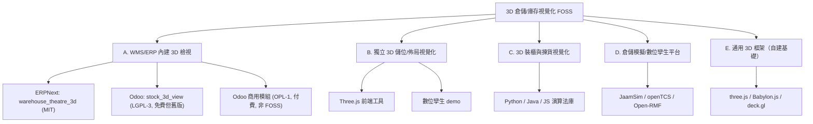
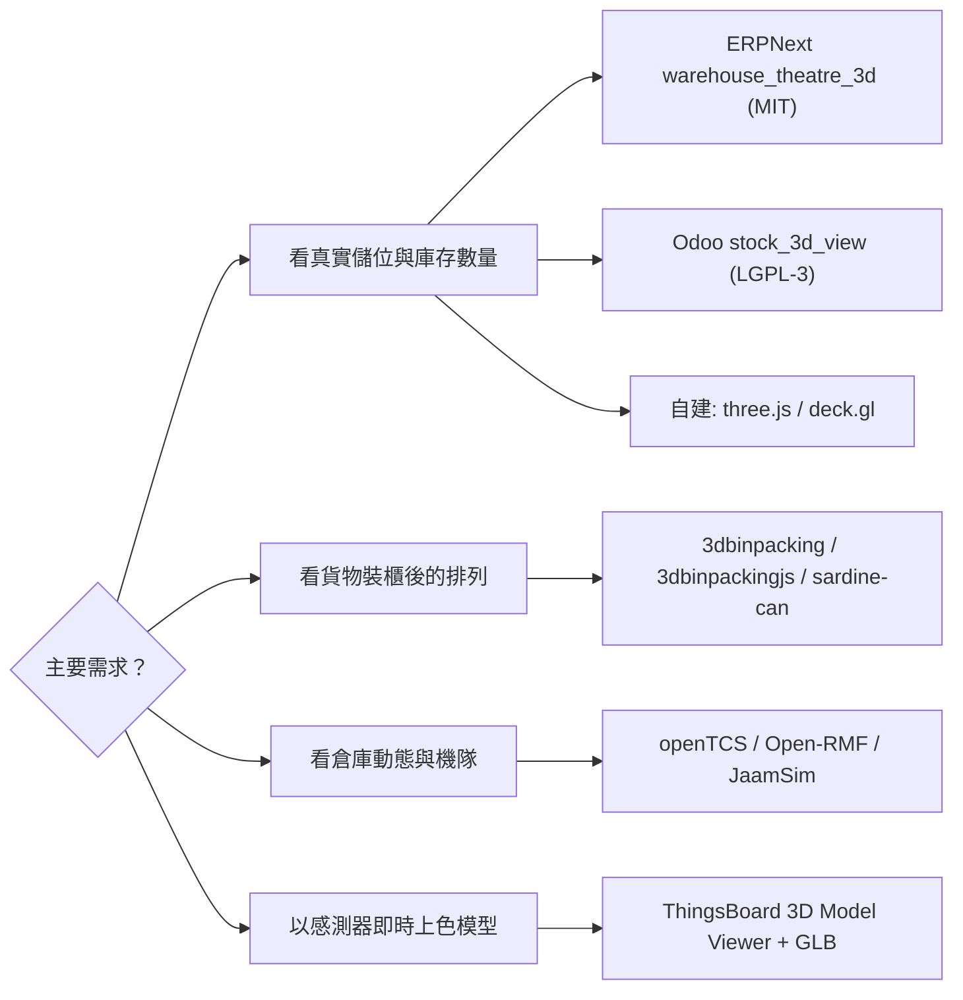

# 以 3D 視覺化呈現倉儲與庫存品項的自由開源軟體調查

## 摘要

本報告調查「可用於庫存品項（例如倉庫）之 3D 視覺化」的自由與開源軟體（FOSS, Free and Open Source Software）。調查範圍涵蓋四類：

1. **WMS/ERP 內建的 3D 倉儲檢視**：由 Odoo 或 ERPNext 之類的系統，將既有儲位階層（warehouse → zone → rack → shelf → bin）直接繪成 3D 場景，並疊上即時庫存數量。
2. **獨立的 3D 倉儲／儲位視覺化專案**：前端（多為 Three.js）為主的倉庫佈局與儲位檢視工具。
3. **裝櫃與揀貨的 3D 視覺化（3D bin packing / container loading）**：將品項裝入貨櫃、棧板或貨架的演算法，附帶互動式 3D 呈現。
4. **倉儲模擬與數位孿生平台**：離散事件模擬、AGV/AMR 機隊管理，以及其 3D 呈現元件。

另收錄可作為自建基礎的通用 3D 框架與引擎。

本報告以 GitHub API 查詢、專案頁面與官方文件為事實來源，所有星數為 2026-11-21 查詢時的數值。報告中多數專案星數低於 100，原因是「以 3D 呈現實際儲位庫存」本身就是小眾題目；本報告依規則仍予收錄並標註其成熟度，讀者選型時應以維護狀況與授權完整性為主要判斷依據，而非單看星數。

---

## 一、問題定義與分類

判斷「是否符合需求」的關鍵在於 3D 場景是否反映**真實儲位與庫存資料**（哪個貨架、哪一格、放了多少），而非只是把箱子排進貨櫃的模擬動畫。以下各節依此區分。

---

## 二、A 類：WMS/ERP 內建的 3D 倉儲檢視

### 2.1 ERPNext：Warehouse Theatre 3D（MIT，免費，推薦首選）

由 Aravind Govindaraj 開發，以 MIT 授權發布，可在 ERPNext/ Frappe v15、v16 與 nightly 上安裝，Frappe Cloud Marketplace 亦上架[^erpnext][^frappe]。功能包括：

- 以 Three.js 將貨架（rack）與層架（shelf level）繪成 3D，並依**填充率**上色；平置儲區（floor storage / godown）以堆疊的貨堆呈現並隨庫存升高[^erpnext]。
- 另有 2D 格狀樓層檢視、第一人稱走道導覽。
- 熱區圖（heatmap）：依移動量、揀貨頻率、庫存價值、庫齡、批次效期[^erpnext]。
- 讀取 ERPNext `tabBin` 的即時數量、保留量、UoM 填充率、庫存價值[^erpnext]。
- 品項定位（item locator）、上架建議（putaway suggestion）、揀貨路徑最佳化、走道流量、時間軸重播（最多一年）、容量告警[^erpnext]。
- 附可安裝的 PWA 手機端，支援上架、揀貨、循環盤點與 QR 標籤[^erpnext]。

**評註**：這是目前調查中，唯一同時滿足「開源授權明確（MIT）」、「免費」、「直接反映真實庫存資料」、「含 3D 貨架與儲位」條件的成熟方案。GitHub 星數 27（2026-11-21）[^erpnext]，屬小眾但授權與功能完整度最佳。

### 2.2 Odoo：Stock 3D View（LGPL-3，免費，僅 Odoo 16）

由 Cybrosys 發布、以 GitHub 倉庫 `riteshsingh422/3D-WareHouse-Odoo-Module` 形式流通，模組技術名稱為 `stock_3d_view`，授權 LGPL-3，僅支援 Odoo 16[^cybro]。以 Three.js 將 Odoo 的 `stock.location` 記錄繪成互動式 3D，呈現庫存與產品擺放位置[^cybro]。

**評註**：授權為 FOSS（LGPL-3），但版本綁死 Odoo 16，功能相對基本（無熱區圖與揀貨路徑），且未上架 Odoo Apps Store，取得與升級須自行處理[^cybro]。

### 2.3 Odoo：商用 3D 倉儲模組（非 FOSS，僅供對照）

調查中兩款功能最完整的 Odoo 3D 倉儲模組皆為**專有授權（OPL-1）且需付費**，不符合本報告的 FOSS 條件，但值得作為功能標竿，說明「若自建需要補足哪些能力」：

| 模組 | 開發者 | 價格 | 版本 | 授權 | 重點功能 |
|---|---|---|---|---|---|
| Warehouse 3D View（`warehouse_3d_view`） | Surekha Technologies | US$76.23 | Odoo 19、20 | OPL-1 | 樓層圖描繪、貨架/儲格、儲格內產品圖、三種熱區圖（揀貨活動、佔用率、停留時間）、揀貨路線（會繞牆與走門）、容量儀表板、效期檢視[^odoo3d] |
| Odoo 3D Warehouse（`techultra_warehouse_3d`） | TechUltra Solutions | US$248.99（已下架） | Odoo 19 | OPL-1 | 2D（MapLibre GL）+ 3D（Three.js）數位孿生、Dijkstra 揀貨路徑、地圖上掃條碼、AI 由文字生成佈局、DXF/PDF 樓層圖匯入[^odooapps2] |

上述兩者的官方說明明確寫出「每個 3D 物件都是真實記錄，具備真實座標與尺寸；在 3D 中移動貨架，Odoo 中的儲位也跟著移動」[^odoo3d]，可視為此類工具的設計原則。

### 2.4 其他 ERP/WMS 的 3D 支援狀況

OpenBoxes 為 EPL-1.0 授權的醫療物流倉儲管理系統（GitHub 星數 934，2026-11-21）[^openboxes]，本調查未發現其內建 3D 儲位視覺化。整體而言，「內建 3D 儲位檢視」在主流 FOSS WMS/ERP 中仍是罕見功能，多數系統只提供樹狀儲位或 2D 平面圖。

---

## 三、B 類：獨立的 3D 儲位／佈局視覺化專案

此類專案多為單一開發者的示範或作品集，功能與維護程度差異大，但程式碼可作為自建 3D 儲位檢視的參考實作。

| 專案 | 授權 | 星數 | 技術 | 3D 內容 | 維護狀態 |
|---|---|---|---|---|---|
| `Xxcool/smart-warehouse` | MIT | 41 | Vue 3 + Three.js + TypeScript | 3D 智慧倉儲數位孿生管控平台，含 AGV、物流與資料視覺化[^xxcool] | 2026 年建立，持續更新 |
| `MarioDelgadoSr/MyWarehouseVisualizer` | 未標示授權 | 61 | JavaScript | 以 3D/2D 呈現實體倉庫佈局與其對應資料[^mario] | 2024 最後推送 |
| `SebLeich/storage-manager-2.0` | 未標示授權 | 54 | TypeScript / Angular | 3D bin packing 與裝載最佳化的 Web App[^sebleich] | 2024 最後推送 |
| `Elabar/warehouse-layout` | 未標示授權 | 25 | Three.js / HTML | 依特定資料結構繪製的倉庫 3D 模型（含 GitHub Pages demo）[^elabar] | 2021 最後推送 |
| `hookex/warehouse-3d` | MIT | 15 | Three.js / JavaScript | 互動式 3D 倉庫模擬[^hookex] | 2026 年仍有推送 |
| `confxsd/3d-warehouse-simulator` | 未標示授權 | 15 | JavaScript | 物流倉庫**儲位規劃（slotting）**的 3D 視覺化[^confxsd] | 2023 最後推送 |
| `WayneChou-bot/WareTwin` | MIT | 165 | React Three Fiber + FastAPI | 20 台 AMR 的即時 3D 數位孿生、機隊排程、故障注入、Vision-Language Model 攝影機感知[^waretwin] | 2026 年，維護中 |
| `KelvinW918/digital-twin-threejs` | 未標示授權 | 2 | Three.js | 3D 倉庫數位孿生，庫存以顏色（綠/黃/紅）標示、點擊提示、模擬 IoT 即時回饋[^kelvin] | 2026 年 |
| `Stegocode/warehouse_layout_editor` | MIT | 4 | Vanilla JS + three.js | 瀏覽器內的倉庫樓層編輯器：區域、貨架、動線，含即時 2D 平面與 3D 預覽[^stegocode] | 2026 年 |
| `aravindsprint/warehouse_theatre_3d` | MIT | 27 | JavaScript | 見 2.1 節，ERPNext 版；本身亦可作為獨立前端參考[^erpnext] | 2026 年，維護中 |

**評註**：此類專案中，授權完整且維護中者為 `Xxcool/smart-warehouse`（MIT）、`WayneChou-bot/WareTwin`（MIT）、`Stegocode/warehouse_layout_editor`（MIT）與 `hookex/warehouse-3d`（MIT）。但需注意，**MIT 授權與「已串接真實庫存資料」是兩件事**：多數專案使用假資料或僅呈現佈局，要接上自家庫存仍需自行開發資料層。

---

## 四、C 類：3D 裝櫃與揀貨視覺化（3D bin packing / container loading）

這類工具解決「把品項裝進貨櫃、棧板或貨架空間」的排列問題，通常附互動式 3D 呈現。若需求是「看某批貨裝進貨櫃後長什麼樣」，此類最直接；若需求是「看倉庫裡哪一格放了什麼」，則此類不適用。

### 4.1 高星演算法專案

| 專案 | 授權 | 星數 | 語言 | 說明 |
|---|---|---|---|---|
| `alexfrom0815/Online-3D-BPP-PCT` | MIT | 1247 | Python | 以「packing configuration tree」學習線上 3D 裝箱，學術論文實作[^pct] |
| `alexfrom0815/Online-3D-BPP-DRL` | 未標示 | 707 | Python | 線上 3D 裝箱的約束深度強化學習實作[^drl] |
| `skjolber/3d-bin-container-packing` | Apache-2.0 | 578 | Java | Largest Area Fit First（LAFF）變體 + 暴力搜尋演算法[^skjolber] |
| `enzoruiz/3dbinpacking` | MIT | 464 | Python | 常被引用的 Python 3D 裝箱函式庫[^enzoruiz] |
| `jerry800416/3D-bin-packing` | MIT | 292 | Python | 基於 `enzoruiz/3dbinpacking` 的改良版，含 matplotlib 視覺化[^jerry] |
| `olragon/binpackingjs` | MIT | 193 | TypeScript | 支援 2D/3D/4D 的 JS 裝箱函式庫[^olragon] |
| `Wadaboa/3d-bpp` | MIT | 136 | Jupyter | 以 layers 與 superitems 求解，使用 OR-Tools[^wadaboa] |
| `betterway-tinyman/packer` | BSD-3-Clause | 132 | TypeScript | 支援多包裝容器（multiple wrappers）的 3D 裝箱[^packer] |
| `merschformann/sardine-can` | MIT | 109 | C# | 3D knapsack / bin packing 求解器，含 GUI 與 MIP（CPLEX/Gurobi）支援[^sardine] |
| `gedex/bp3d` | MIT | 103 | Go | Go 語言的 3D 裝箱套件[^gedex] |

### 4.2 具互動式 3D 前端示範者

- `keremdemirer/3dbinpackingjs`（89 星）：JavaScript 3D 裝箱，附**互動式 demo**、逐品項旋轉規則，可作為 Node.js/瀏覽器 API 使用，且有 GitHub Pages 線上展示[^kerem]。
- `SebLeich/storage-manager-2.0`（54 星）：以 Angular 實作的 3D 裝載最佳化 Web App[^sebleich]。
- `nano71/ContainerPacker3D`：Three.js 的 3D 貨櫃裝載視覺化工具，支援旋轉、縮放、箱體放置與匯出 JSON，但星數僅 4 且無授權標示，僅供參考。
- `MichelBernasconi/palletter`：以 Godot 4 製作的 3D 倉庫棧板堆疊與物流模擬器，MIT 授權，屬遊戲引擎路線的實作範例[^palletter]。

---

## 五、D 類：倉儲模擬與數位孿生平台

此類平台的 3D 場景呈現的是**製程、動線與載具**，而非單一品項的儲位，但若要建構「可即時反映倉庫狀態」的 3D 檢視，這些是成熟的開源骨幹。

| 專案 | 授權 | 星數 | 語言 | 3D 內容與用途 |
|---|---|---|---|---|
| `open-rmf/rmf_demos` | Apache-2.0 | 633 | Python / ROS 2 | 以 Gazebo 呈現倉庫/大樓內的配送機器人機隊、任務與動線示範[^rmf] |
| `openTCS/opentcs` | 多授權（含 Apache-2.0、MIT、LGPL-2.1） | 607 | Java | Fraunhofer IML 的運輸控制系統，含 Plant Overview 圖形化 3D 廠區檢視、AGV 調度、模擬負載產生器[^opentcs] |
| `jaamsim/jaamsim` | Apache-2.0 | 244 | Java | 免費開源離散事件模擬，內建互動式 3D 圖形；物件庫含貯存筒倉（storage bins）、輸送帶、車輛與貨櫃[^jaamsimgh][^jaamsim] |
| `OpenRobOps/oro` | Apache-2.0 | 42 | JavaScript | 開源機器人機隊管理與觀測平台，原生支援 ROS 2、Open-RMF，自架部署[^oro] |
| `open-rmf/rmf_visualization` | Apache-2.0 | 32 | C++ | Open-RMF 的視覺化工具集（Rviz 等）[^rmfvis] |

Open-RMF 的展示專案明確以倉庫、醫院的機器人協作場景為例[^rmf]；openTCS 的 Plant Overview 則是以 2D/3D 廠區圖同時顯示多台 AGV 位置與路線，適合「倉庫動態」的視覺化需求[^opentcs]。

---

## 六、E 類：通用 3D 框架與 IoT 儀表板（自建基礎）

若既有 FOSS 方案都不合用，可自行以通用框架建構。以下為授權明確、生態成熟的選項：

| 專案 | 授權 | 星數 | 語言 | 用途 |
|---|---|---|---|---|
| `mrdoob/three.js` | MIT | 119054 | JavaScript | 最廣泛使用的 WebGL 3D 函式庫；本報告中多數自製倉儲視覺化皆以其為基礎[^threejs] |
| `BabylonJS/Babylon.js` | Apache-2.0 | 26415 | TypeScript | 功能完整的 Web 3D 引擎，含 WebGPU/WebXR，適合大型場景與工業應用[^babylon] |
| `visgl/deck.gl` | MIT | 14789 | TypeScript | WebGL2 大規模資料視覺化框架，適合把數千個儲位/棧板當作資料點繪製[^deckgl] |
| `visgl/loaders.gl` | 未標示（Other） | 860 | TypeScript | 載入 glTF/GLB、點雲、3D Tiles 等格式，常搭配 deck.gl 使用[^loaders] |
| `furnishup/blueprint3d` | MIT | 2006 | TypeScript | 「在 3D 中建構室內空間」：2D 平面圖編輯器 + 3D 檢視，可延伸為倉庫佈局編輯器[^bp3d] |
| `aalavandhaann/blueprint-js` | MIT | 591 | JavaScript | 上者的 ES6 版本，提供平面圖與 3D 場景程式碼[^bpjs] |
| `charmlinn/blueprint3d-modern` | MIT | 159 | TypeScript | blueprint3d 的現代化重寫版，標榜更快、更乾淨、持續維護[^bpmodern] |

### 6.1 IoT 平台上的 3D 模型疊加：ThingsBoard

ThingsBoard 為 Apache-2.0 授權的開源 IoT 平台（星數 22701，2026-11-21）[^tbcore]。其官方內建 widget 並不包含 3D 檢視，但社群在官方 IoT Hub 提供名為 **「3D Model Viewer」** 的 widget：載入 GLB 模型後，可把資料來源中的每個實體對應到模型內的具名 mesh，並以 JavaScript 函式依即時遙測值上色、顯示 tooltip 與標籤，並支援「液位/料位」動畫（例如筒倉存量、槽體液位）[^tb]。官方另有 Silo Monitoring 範例模板，示範以 3D 模型呈現筒倉與倉庫建築，並依告警狀態變色（綠/紅）[^tbsilo]；對應的 GLB 模型集另開源於 `pinkevmladchy/thingsboard-silo-glb-models`[^tbsilogh]。

**適用情境**：若倉庫現場已部署感測器（料位計、重量計），且希望以「倉庫建築/料塔的 3D 模型」呈現即時狀態，這種「3D 模型 + 遙測上色」的做法比「逐儲位建模」更容易落地。

---

## 七、綜合比較與選型建議

| 需求 | 首選（FOSS） | 授權 | 備註 |
|---|---|---|---|
| 在既有 ERP 上看 3D 儲位與即時庫存 | ERPNext `warehouse_theatre_3d` | MIT | 功能最完整，含熱區圖、揀貨路徑、PWA 手機端[^erpnext] |
| 在 Odoo 免費看 3D 儲位 | Odoo `stock_3d_view` | LGPL-3 | 僅 Odoo 16，功能陽春[^cybro] |
| 3D 裝櫃/裝載最佳化 | `keremdemirer/3dbinpackingjs`（前端 demo）、`enzoruiz/3dbinpacking`（Python）、`skjolber/3d-bin-container-packing`（Java） | MIT / Apache-2.0 | 依語言選擇[^kerem][^enzoruiz][^skjolber] |
| AGV/AMR 機隊與倉庫動態 | `openTCS`、`open-rmf/rmf_demos` | Apache-2.0 等 | 工業級，但導入門檻高[^opentcs][^rmf] |
| 離散事件模擬 + 3D | `jaamsim/jaamsim` | Apache-2.0 | 內建 3D 與輸送帶/筒倉物件庫[^jaamsim] |
| 感測器遙測疊加於 3D 模型 | ThingsBoard + 3D Model Viewer widget | Apache-2.0（平台） | widget 為社群提供、免費[^tb] |
| 完全自建 | `three.js` / `Babylon.js` / `deck.gl` + blueprint3d 系列 | MIT / Apache-2.0 | 授權與彈性最佳，工程量最大[^threejs][^babylon][^deckgl][^bp3d] |

---

## 八、觀察、限制與批判性反思

1. **「3D 視覺化」不等於「3D 庫存視覺化」。** 星數最高的專案多半是 3D 裝箱演算法（`Online-3D-BPP-PCT` 1247 星）[^pct]，其 3D 呈現的是「裝入容器後的排列」，而非倉庫儲位狀態。若需求明確是「倉庫裡哪一格放了什麼」，應直接看 A 類與 B 類，勿被高星數誤導。

2. **FOSS 授權完整性落差大。** B 類專案中，`MyWarehouseVisualizer`（61 星）、`storage-manager-2.0`（54 星）、`Elabar/warehouse-layout`（25 星）、`confxsd/3d-warehouse-simulator`（15 星）皆**未標示授權**[^mario][^sebleich][^elabar][^confxsd]。未標示授權在預設著作權下等於「保留所有權利」，嚴格說不可再散布或用於商業專案，選型時應優先排除或向作者確認。

3. **功能最完整的 Odoo 3D 倉儲模組是專有軟體。** Odoo 生態中兩款功能最強（樓層圖描繪、儲格內產品圖、三種熱區圖、避牆揀貨路徑、效期檢視）的模組皆為 OPL-1 且需付費，一款售價 US$76.23，另一款 US$248.99 且已自 Apps Store 下架[^odoo3d][^odooapps2]。這與「開源」的期待有落差，也說明此功能的商業價值已被市場驗證；想要同等功能又不付費，實務上得走 ERPNext 路線或自建。

4. **小眾題材導致星數整體偏低。** 本報告收錄的 B 類專案星數多在 2 至 65 之間。依 star 判斷標準，這些屬低星專案；但「以 3D 呈現實際儲位庫存」確實是利基需求，可用的公開實作本就稀少，因此仍予收錄，並逐一標註維護狀態供讀者判斷風險。

5. **資料層才是難點。** 多數 B 類專案的 3D 場景使用假資料或僅呈現靜態佈局；真正困難的是把 WMS 的儲位階層、即時數量、批次效期正確映射到 3D 座標，並處理多倉、多公司與權限[^odoo3d]。ERPNext 與 Odoo 兩條路線之所以值得考慮，正是因為它們已解決了這層資料映射。

6. **即時性方案的替代路徑。** 若不想逐儲位建模，ThingsBoard 的「3D 模型 + 遙測上色」模式是成本較低的替代方案：以建築或料塔的 GLB 模型搭配感測器數值上色與液位動畫，即可表達倉庫的即時狀態[^tb][^tbsilo]。

7. **查證方法說明。** 本報告的專案清單以 GitHub Search API 查詢多組關鍵字（`warehouse 3d visualization`、`3d bin packing`、`digital twin warehouse`、`warehouse layout 3d`、`odoo warehouse 3d`、`warehouse simulation godot` 等）彙整，並逐一以 GitHub Repositories API 取得授權、星數、語言與最後推送時間；Odoo 模組與 ERPNext 應用的功能描述則取自其官方上架頁面與 GitHub 倉庫。所有星數與狀態為 2026-11-21 之快照，日後可能變動。

---

## 參考文獻

[^threejs]: Three.js authors. (n.d.). *three.js — JavaScript 3D library* [Computer software]. GitHub. Retrieved 2026-11-21, from https://github.com/mrdoob/three.js

[^babylon]: Babylon.js contributors. (n.d.). *Babylon.js — Powerful, beautiful, simple, and open game and rendering engine* [Computer software]. GitHub. Retrieved 2026-11-21, from https://github.com/BabylonJS/Babylon.js

[^deckgl]: VIS.gl contributors. (n.d.). *deck.gl — WebGL2 powered visualization framework* [Computer software]. GitHub. Retrieved 2026-11-21, from https://github.com/visgl/deck.gl

[^loaders]: VIS.gl contributors. (n.d.). *loaders.gl — Loaders for big data visualization* [Computer software]. GitHub. Retrieved 2026-11-21, from https://github.com/visgl/loaders.gl

[^bp3d]: Furnishup. (n.d.). *blueprint3d — Build interior spaces in 3D* [Computer software]. GitHub. Retrieved 2026-11-21, from https://github.com/furnishup/blueprint3d

[^bpjs]: Aalavandhaann. (n.d.). *blueprint-js — The JavaScript ES6 version of blueprint3d* [Computer software]. GitHub. Retrieved 2026-11-21, from https://github.com/aalavandhaann/blueprint-js

[^bpmodern]: Charmlinn. (n.d.). *blueprint3d-modern — A modern TypeScript-based rewrite of blueprint3d* [Computer software]. GitHub. Retrieved 2026-11-21, from https://github.com/charmlinn/blueprint3d-modern

[^odoo3d]: Surekha Technologies Pvt. Ltd. (n.d.). *Warehouse 3D View* [Odoo 應用模組, Odoo 20.0]. Odoo Apps Store. Retrieved 2026-11-21, from https://apps.odoo.com/apps/modules/20.0/warehouse_3d_view/

[^odooapps2]: TechUltra Solutions Private Limited. (n.d.). *Odoo 3D Warehouse | Digital Twin, AI CAD Layout, WMS & Picking Route Optimization* [Odoo 應用模組, Odoo 19.0]. Odoo Apps Store. Retrieved 2026-11-21, from https://apps.odoo.com/apps/modules/19.0/techultra_warehouse_3d/

[^cybro]: Riteshsingh422. (n.d.). *3D-WareHouse-Odoo-Module* [Computer software]. GitHub. Retrieved 2026-11-21, from https://github.com/riteshsingh422/3D-WareHouse-Odoo-Module

[^erpnext]: Govindaraj, A. (n.d.). *warehouse_theatre_3d — See your warehouse in 3D* [Computer software]. GitHub. Retrieved 2026-11-21, from https://github.com/aravindsprint/warehouse_theatre_3d

[^frappe]: Frappe Technologies. (n.d.). *Warehouse Theatre 3D*. Frappe Cloud Marketplace. Retrieved 2026-11-21, from https://frappecloud.com/marketplace/apps/warehouse_theatre_3d

[^openboxes]: OpenBoxes. (n.d.). *OpenBoxes — Warehouse management system for healthcare facilities* [Computer software]. GitHub. Retrieved 2026-11-21, from https://github.com/openboxes/openboxes

[^xxcool]: Xxcool. (n.d.). *smart-warehouse — 3D 智慧倉儲數字孿生平台* [Computer software]. GitHub. Retrieved 2026-11-21, from https://github.com/Xxcool/smart-warehouse

[^mario]: Delgado, M. (n.d.). *MyWarehouseVisualizer — Visualize physical warehouse layouts and their associated data* [Computer software]. GitHub. Retrieved 2026-11-21, from https://github.com/MarioDelgadoSr/MyWarehouseVisualizer

[^sebleich]: Leich, S. (n.d.). *storage-manager-2.0 — Web app for 3D bin packing and loading optimization* [Computer software]. GitHub. Retrieved 2026-11-21, from https://github.com/SebLeich/storage-manager-2.0

[^elabar]: Elabar. (n.d.). *warehouse-layout — A warehouse 3D model based on a specific data structure* [Computer software]. GitHub. Retrieved 2026-11-21, from https://github.com/Elabar/warehouse-layout

[^hookex]: Hookex. (n.d.). *warehouse-3d — Interactive 3D warehouse simulation built with Three.js* [Computer software]. GitHub. Retrieved 2026-11-21, from https://github.com/hookex/warehouse-3d

[^confxsd]: Confxsd. (n.d.). *3d-warehouse-simulator — Visualisation for slotting in logistics warehouses* [Computer software]. GitHub. Retrieved 2026-11-21, from https://github.com/confxsd/3d-warehouse-simulator

[^waretwin]: Chou, W. (n.d.). *WareTwin — Real-time 3D digital twin of an autonomous warehouse* [Computer software]. GitHub. Retrieved 2026-11-21, from https://github.com/WayneChou-bot/WareTwin

[^kelvin]: KelvinW918. (n.d.). *digital-twin-threejs — 3D warehouse digital twin with Three.js* [Computer software]. GitHub. Retrieved 2026-11-21, from https://github.com/KelvinW918/digital-twin-threejs

[^stegocode]: Stegocode. (n.d.). *warehouse_layout_editor — Browser-based warehouse floor layout editor* [Computer software]. GitHub. Retrieved 2026-11-21, from https://github.com/Stegocode/warehouse_layout_editor

[^pct]: Zhao, H., She, Q., Zhu, C., Yang, Y., & Xu, K. (n.d.). *Online-3D-BPP-PCT — Learning efficient online 3D bin packing on packing configuration trees* [Computer software]. GitHub. Retrieved 2026-11-21, from https://github.com/alexfrom0815/Online-3D-BPP-PCT

[^drl]: Zhao, H., She, Q., Zhu, C., Yang, Y., & Xu, K. (n.d.). *Online-3D-BPP-DRL — Online 3D bin packing with constrained deep reinforcement learning* [Computer software]. GitHub. Retrieved 2026-11-21, from https://github.com/alexfrom0815/Online-3D-BPP-DRL

[^skjolber]: Skjolber. (n.d.). *3d-bin-container-packing — A variant of the Largest Area Fit First (LAFF) algorithm* [Computer software]. GitHub. Retrieved 2026-11-21, from https://github.com/skjolber/3d-bin-container-packing

[^enzoruiz]: Ruiz, E. (n.d.). *3dbinpacking — A Python library for 3D bin packing* [Computer software]. GitHub. Retrieved 2026-11-21, from https://github.com/enzoruiz/3dbinpacking

[^jerry]: Jerry800416. (n.d.). *3D-bin-packing — Improvements based on enzoruiz/3dbinpacking* [Computer software]. GitHub. Retrieved 2026-11-21, from https://github.com/jerry800416/3D-bin-packing

[^olragon]: Olragon. (n.d.). *binpackingjs — 2D, 3D, 4D bin packing JS library* [Computer software]. GitHub. Retrieved 2026-11-21, from https://github.com/olragon/binpackingjs

[^kerem]: Demirer, K. (n.d.). *3dbinpackingjs — JavaScript 3D bin packing with an interactive demo* [Computer software]. GitHub. Retrieved 2026-11-21, from https://github.com/keremdemirer/3dbinpackingjs

[^wadaboa]: Wadaboa. (n.d.). *3d-bpp — 3D bin packing solutions with layers and superitems* [Computer software]. GitHub. Retrieved 2026-11-21, from https://github.com/Wadaboa/3d-bpp

[^packer]: Betterway-tinyman. (n.d.). *packer — 3D bin packing with multiple wrappers* [Computer software]. GitHub. Retrieved 2026-11-21, from https://github.com/betterway-tinyman/packer

[^sardine]: Merschformann, M. (n.d.). *sardine-can — Humble 3D knapsack / bin packing solver* [Computer software]. GitHub. Retrieved 2026-11-21, from https://github.com/merschformann/sardine-can

[^gedex]: Gedex. (n.d.). *bp3d — Golang package for 3D bin packing problem* [Computer software]. GitHub. Retrieved 2026-11-21, from https://github.com/gedex/bp3d

[^opentcs]: Fraunhofer IML. (n.d.). *openTCS — The Open Transportation Control System* [Computer software]. GitHub. Retrieved 2026-11-21, from https://github.com/openTCS/opentcs

[^rmf]: Open-RMF contributors. (n.d.). *rmf_demos — Demonstrations of Open-RMF* [Computer software]. GitHub. Retrieved 2026-11-21, from https://github.com/open-rmf/rmf_demos

[^rmfvis]: Open-RMF contributors. (n.d.). *rmf_visualization — Visualization tools for Open-RMF* [Computer software]. GitHub. Retrieved 2026-11-21, from https://github.com/open-rmf/rmf_visualization

[^oro]: OpenRobOps. (n.d.). *oro — Open-source robot fleet management and operations platform* [Computer software]. GitHub. Retrieved 2026-11-21, from https://github.com/OpenRobOps/oro

[^jaamsimgh]: JaamSim Software Inc. (n.d.). *jaamsim — Master repository for JaamSim source code* [Computer software]. GitHub. Retrieved 2026-11-21, from https://github.com/jaamsim/jaamsim

[^jaamsim]: JaamSim Software Inc. (n.d.). *JaamSim — Free discrete event simulation software*. Retrieved 2026-11-21, from https://jaamsim.com/

[^palletter]: Bernasconi, M. (n.d.). *palletter — 3D warehouse palletizing & logistics simulator built with Godot* [Computer software]. GitHub. Retrieved 2026-11-21, from https://github.com/MichelBernasconi/palletter

[^tb]: ThingsBoard. (n.d.). *3D Model Viewer widget*. ThingsBoard IoT Hub. Retrieved 2026-11-21, from https://thingsboard.io/iot-hub/widgets/3d-model-viewer/

[^tbsilo]: ThingsBoard. (n.d.). *Silo monitoring solution template*. ThingsBoard IoT Hub. Retrieved 2026-11-21, from https://thingsboard.io/iot-hub/solution-templates/silo-monitoring/

[^tbsilogh]: Pinkevych, D. (n.d.). *thingsboard-silo-glb-models* [Computer software]. GitHub. Retrieved 2026-11-21, from https://github.com/pinkevmladchy/thingsboard-silo-glb-models

[^tbcore]: ThingsBoard contributors. (n.d.). *thingsboard — Open-source IoT platform* [Computer software]. GitHub. Retrieved 2026-11-21, from https://github.com/thingsboard/thingsboard
