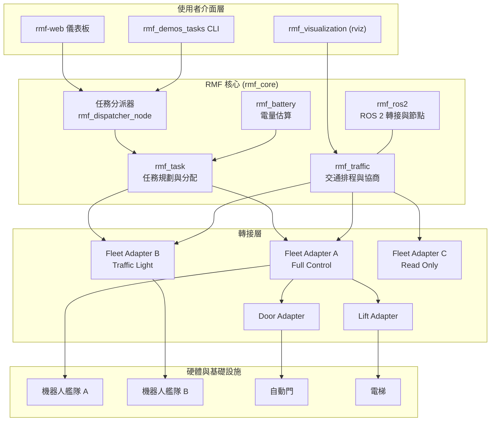
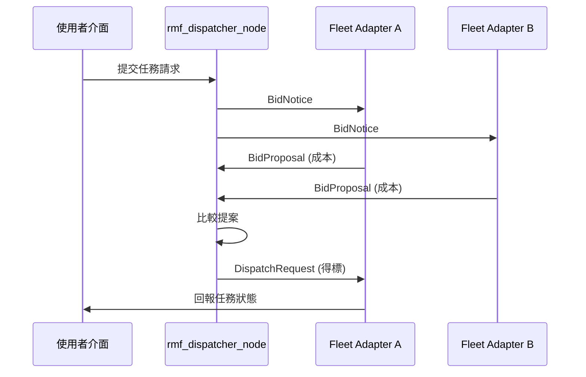

# Open Robotics Middleware Framework (Open-RMF) 介紹

> 本報告為獨立文件，所有背景資訊均收錄於本文內。資料檢索日期：2026-11-21。

## 摘要

Open Robotics Middleware Framework（以下簡稱 Open-RMF 或 RMF）是一套自由、開放原始碼、模組化的軟體系統，目的是讓「多個不同廠商的機器人艦隊」與「建築物基礎設施」（如電梯、門、建築管理系統）之間能夠互相溝通與共享資源[^rmf-site]。它建立在 ROS 2 之上，提供可重複使用且可擴充的函式庫與工具，處理異質機器人艦隊之間的互通性，並透過標準化通訊協定與基礎設施、環境及自動化系統溝通，以最佳化關鍵資源（機器人、電梯、門、通道等）的使用[^rmf-book-intro]。

Open-RMF 最初是為醫療照護產業開發，但其設計同樣適用於辦公室、機場、海港、購物中心、工廠、物流中心等場域[^rmf-site]。它於 2021 年獲選為 RBR50 Robotics Innovation Award 的 Honoree[^rmf-site][^businesswire-rbr50]，並自 2024 年起由 Open Source Robotics Alliance（OSRA）依專案章程管理[^rmf-site]。

---

## 1. 問題背景與設計動機

### 1.1 多廠商機器人共存的需求

RMF 官方教材以一個具體場景說明其存在理由：想像一棟大型建築（購物中心、宿舍、大學、機場、醫院、飯店），裡面同時有物品配送與地板清潔的需求。當這兩件事由人類執行時，配送員與清潔人員只需彼此對看一眼，就能迅速達成妥協，其中一方稍微調整任務時序即可[^rmf-book-intro]。

但機器人遠不及人類具備抽象推理、規劃與非正式溝通的能力。若所有機器人都採購自同一家廠商，單一廠商系統內的機器人會彼此知道對方存在並自行避讓；然而「多廠商、多機器人系統」仍是未解問題，而多廠商部署被預期將成為未來所有大型建築的常態[^rmf-book-intro]。

### 1.2 單一供應商鎖定與共享資源衝突

教材指出，若缺乏多廠商機器人框架，建築營運方與終端使用者被迫綁定單一系統或平台供應商時，會產生顯著但隱藏的風險；這些隱藏風險會促使用戶在未來選型時自我限縮於同一供應商，以避免營運風險與重複的整合成本，並阻礙市場新進者的機器人被採用[^rmf-book-intro]。

除了成本風險，共享資源本身就存在衝突：電梯、門口、走廊、網路頻寬、充電樁、營運中心螢幕空間，以及 IT 人員與維護技師等人力資源。隨著機器人規模擴大，營運團隊管理大型、異質、多廠商機器人環境將愈發笨重[^rmf-book-intro]。

### 1.3 RMF 的定位

在上述「清潔與配送」場景中，RMF 可扮演交通控制者，協助配送機器人與清潔機器人協商出兩項任務都能完成的方式。若清潔任務急迫（例如繁忙走廊發生潑灑），RMF 可讓配送任務改走其他走廊；若配送任務具時效性，RMF 可指示清潔機器人暫停工作並讓出通道，直到配送機器人清空該走廊[^rmf-book-intro]。

RMF 官方對自身的定義是：

> RMF 是一組可重複使用、可擴充的函式庫與工具，建立在 ROS 2 之上，讓任何類型機器人系統的異質艦隊得以互通。RMF 運用標準化通訊協定連接基礎設施、環境與自動化系統，以最佳化關鍵資源（機器人、電梯、門、通道等）的使用。它透過資源分配與防止共享資源衝突來為系統增添智慧。[^rmf-book-intro]

---

## 2. 歷史沿革

### 2.1 起源：新加坡的 RoMi-H 專案

Open-RMF 的前身是新加坡的 **RoMi-H**（Robotic Middleware for Healthcare，醫療照護機器人中介軟體）。Open Robotics 的部落格說明，RoMi-H 於 2018 年 7 月首次發表，是一套獨特的開放原始碼系統，建立在 ROS 2 之上[^osr-romih]。RMF 官方教材亦以新加坡政府為感謝對象，明確寫出其支持的研究發展專案名稱為「Development of Standardised Robotics Middleware Framework - RMF detailed design and common services, large-scale virtual test farm infrastructure, and simulation modelling」，並由新加坡衛生部（Ministry of Health, MOH）與國家機器人計畫（National Robotics Programme, NRP）支持[^rmf-book-intro]。

RoMi-H 由 Changi General Hospital（CGH）的 Centre for Healthcare Assistive and Robotics Technologies（CHART）、Integrated Health Information Systems、以及工程公司 Hope Technik 與 Open Source Robotics 共同開發[^straitstimes-romih]。

### 2.2 關鍵時間軸

| 時間 | 事件 |
|---|---|
| 2018-07 | RoMi-H 於新加坡首次發表[^osr-romih] |
| 2019-10-31 | RoMi-H 於 ROSCon 2019（澳門）正式發表[^cgh-romih] |
| 2021-06-17 | Open-RMF 獲選為 2021 RBR50 Robotics Innovation Award Honoree[^businesswire-rbr50][^rmf-site] |
| 2022-05-28 | RoMi-H 由新加坡副總理 Heng Swee Keat 公開發表[^straitstimes-romih] |
| 2022-10-10 | Open Robotics 宣布與 NCS 合作擴充 Open-RMF 能力[^osr-ncs] |
| 2022-12-15 | Alphabet 旗下 Intrinsic 收購 Open Robotics 的營利子公司 OSRC 與 OSRC-SG；OSRF 維持獨立非營利[^osr-intrinsic][^ieee-intrinsic] |
| 2024-03-18 | Open Source Robotics Foundation 宣布成立 Open Source Robotics Alliance（OSRA）[^osr-osra] |
| 2024-04-15 | OSRA 正式開始運作，專案移交 PMC 治理[^osr-osra] |
| 2025-10 | 新加坡 NRP 於 ROSCon 2025 宣布 ELEVATE at BCA Braddell Campus 國家級 RMF 沙盒[^robotreport-nrp] |

### 2.3 治理變遷

Open Robotics 的 Brian Gerkey 在 2022 年 12 月的公告中說明組織結構的來龍去脈：Open Source Robotics Foundation（OSRF）於 2012 年成立，是以管理 ROS 社群為使命的非營利組織；2016 年 OSRF 成立營利子公司 Open Source Robotics Corporation（OSRC）；兩年後又成立 Open Source Robotics Corporation Singapore（OSRC-SG），而**正是 OSRC-SG 的成立直接促成了 Open-RMF 的發布**[^osr-intrinsic]。

該公告強調，Intrinsic 收購的是 OSRC 與 OSRC-SG 的資產，OSRF 則繼續以獨立非營利組織身分運作，因此「OSRF 對 ROS、Gazebo、Open-RMF 及整個社群的核心承諾，在日常活動上沒有任何中斷」[^osr-intrinsic]。IEEE Spectrum 的報導亦明確指出「Intrinsic 並沒有收購 ROS，也沒有收購 Gazebo」[^ieee-intrinsic]。

2024 年 3 月 18 日，OSRF 宣布成立 Open Source Robotics Alliance（OSRA），以確保其開放原始碼機器人軟體專案的長期穩定與健全。公告明確寫道：OSRF 董事會已將以下專案的管理責任指派給 OSRA：**ROS、Gazebo、Open-RMF，以及支持它們的基礎設施**[^osr-osra]。OSRA 採用「會員制／菁英制混合參與模式」，核心活動單位為 Technical Governance Committee（TGC），下轄各專案的 Project Management Committee（PMC），TGC 向 OSRF 董事會負責[^osr-osra]。公告同時任命 Open-RMF 的 Project Leader 為 Michael X. Grey[^osr-osra]。Open-RMF 官網則說明「自 2024 年起，Open-RMF 依專案章程由 Open Source Robotics Alliance（OSRA）管理」[^rmf-site]。

---

## 3. 系統架構

### 3.1 整體架構

RMF 的核心概念是：每個參與部署的機器人艦隊都擁有一個「艦隊轉接器（fleet adapter）」，負責把該艦隊專屬的 API 接到 RMF 核心的交通排程與協商介面上；艦隊轉接器同時負責艦隊與各種標準化智慧基礎設施介面（開門、叫電梯、喚醒出料裝置等）之間的通訊[^rmf-book-core]。

### 3.2 RMF 核心（rmf_core）組成

官方教材列出 `rmf_core` 的組成如下[^rmf-book-core]：

| 元件 | 說明 |
|---|---|
| `rmf_traffic` | 核心排程與交通管理系統[^rmf-book-core] |
| `rmf_traffic_ros2` | `rmf_traffic` 的 ROS 2 版本[^rmf-book-core] |
| `rmf_task` | RMF 的任務規劃器[^rmf-book-core] |
| `rmf_battery` | RMF 電量估算[^rmf-book-core] |
| `rmf_ros2` | `rmf_core` 的 ROS 2 轉接器、節點與 Python 綁定[^rmf-book-core] |
| `rmf_utils` | RMF 工具函式[^rmf-book-core] |

其中 `rmf_traffic` 提供「與中介軟體無關（middleware-neutral）」的核心交通排程演算法實作，本身不使用也不依賴 ROS 2；`rmf_traffic_ros2` 則提供便利的包裝，讓 `rmf_traffic` 能在分散式 ROS 2 系統中使用[^rmf-book-faq]。

### 3.3 交通去衝突（Traffic Deconfliction）

避免移動機器人交通衝突是 `rmf_core` 的關鍵功能，分為兩個層次：**預防（prevention）** 與 **解決（resolution／協商）**[^rmf-book-core]。

**預防**：實作一個平台無關的 Traffic Schedule Database（交通排程資料庫）。這是一個活的資料庫，內容會隨延誤、取消或路線變更而改變。所有整合進 RMF 部署的艦隊管理者都必須向交通排程回報其車輛的預期行程；有了排程上的資訊，合規的艦隊管理者便能為自己的車輛規劃出不會與任何其他車輛（無論屬於哪個艦隊）衝突的路線。`rmf_traffic` 提供 `Planner` 類別來協助行為類似標準 AGV（沿預定路網行進）的車輛達成此事[^rmf-book-core]。

交通排程是設施內所有預期機器人軌跡的集中式資料庫。注意它儲存的是「預期」軌跡，也就是望向未來；其職責是識別不同機器人艦隊意圖之間的衝突，並在識別到衝突時通知各艦隊[^rmf-book-core]。

**協商**：衝突不可能總是被完美預防，移動機器人可能因環境中未預期的障礙而延誤，或預測排程因任何理由而有缺陷。當衝突真的發生時，交通排程資料庫會向相關艦隊管理者發出衝突通知，艦隊管理者之間的協商便開始。每個艦隊管理者提交自己偏好的行程，並回應能容納他方的行程；由系統整合者部署的「第三方裁判（third-party judge）」選出被認為較佳的一組提案，並通知各艦隊管理者應遵循哪些行程[^rmf-book-core]。

教材亦指出，當有突發緊急任務無法被現行交通排程及時容納時，交通參與者可刻意在排程上發布一個交通衝突以強制進行協商，並可透過實作「總是偏好高優先級參與者」的第三方裁判，讓協商結果傾向緊急任務[^rmf-book-core]。

**核心演算法**：`rmf_traffic` 中 AGV 的衝突避免是以**時間相依的 A\* 搜尋（time-dependent extension to A\* search）** 實作，該搜尋將時間納入考量，因此能在時空中找出考量其他 agent 運動的路徑[^rmf-book-faq]。

**安全距離**：系統中有兩個相關參數：`footprint_radius` 代表車輛實體足跡的估計；`vicinity_radius` 代表機器人需要其他車輛保持淨空的區域估計。「排程衝突」被定義為某車輛的「足跡」被排定進入另一車輛的「淨空區」；協商系統的任務就是找出排程修正方案，使所有車輛的足跡都不進入其他車輛的淨空區[^rmf-book-faq]。

**協商中的提案計算**：協商會使用多執行緒的 `Negotiate` 服務，每一步都以相同方式使用該服務，差別僅在於需要處理的約束條件，這些約束由傳入 `respond(~)` 函式的 `rmf_traffic::schedule::Negotiation::Table::Viewer` 物件描述。系統另有「拒絕（reject）」與「棄權（forfeit）」兩條路徑：當某艦隊無法容納他方提案時會執行拒絕，並提供一組可行軌跡（通常 10 至 200 條）供對方重新尋找理想提案；當規劃器極難找到任何解時會使用棄權。最壞情況下若協商持續失敗，機器人可能發生真實世界的死結；但死結發生時參與者會靜止不動，協商將達到穩態而不受非同步不一致影響，此時幾乎可保證能成功解決[^rmf-book-faq]。

**優先級**：協商系統的概念支援機器人優先級（任何任意指標或加權系統皆可用於解決協商），但目前實作將所有車輛視為平等，選擇使所有機器人總延誤最小的解法，不做優先級或加權。由於程式碼開放原始碼，可 fork 後將 `rmf_traffic::schedule::QuickestFinishEvaluator()` 替換為自訂的 `Negotiation::Evaluator` 類別[^rmf-book-faq]。

### 3.4 艦隊轉接器的四種控制等級

不同機器人艦隊的能力取決於其設計與開發方式。交通排程與協商系統不對艦隊能力做任何假設；但為降低整合工作的重複，官方歸納出四種預期會遇到的廣泛控制類別[^rmf-book-core]：

| 等級 | 提供的能力 | 說明 |
|---|---|---|
| **Full Control** | 讀取機器人當前位置 `[x, y, yaw]`、要求機器人移動到指定座標、導航中暫停、恢復、取得路徑、取得 ETA、讀取電量、推斷導航完成、送往充電站、切換地圖並重新定位、啟動製程（如清掃 Zone_A）、暫停／恢復／停止製程、推斷製程完成 | RMF 取得即時狀態更新，並對每台機器人的路徑擁有完整控制權，提供最高的整體效率與合規性，讓 RMF 能最小化停頓並優雅處理突發狀況（API 已提供）[^rmf-book-core] |
| **Traffic Light** | 讀取位置、暫停、恢復、讀取電量、送往充電站、啟動／暫停／恢復／停止製程、推斷製程完成 | RMF 取得狀態以及暫停／恢復控制權，適合在共享走廊、電梯、門等資源時去衝突（API 已提供）[^rmf-book-core] |
| **Read Only** | 讀取位置、讀取或推斷路徑、讀取平均速度或 ETA、讀取電量、推斷製程完成 | RMF 對機器人沒有任何控制權，僅取得定期狀態更新，讓控制等級較高的其他艦隊能避開此艦隊。注意任何共享空間最多只允許一個 Read Only 艦隊，沒有是最好的（初步 API 已提供）[^rmf-book-core] |
| **No Interface** | 無任何介面 | 其他艦隊無法透過 RMF 與之協調，共享同一可航行環境或資源時很可能導致死結，此等級無法在 RMF 環境中運作（不相容）[^rmf-book-core] |

官方強調：艦隊對 RMF 愈具協作性，所有艦隊與系統就能愈和諧地共同運作。共享空間中永遠只能有一個 Read Only 艦隊，因為兩個以上此類艦隊將使避免死結或資源衝突變得幾乎不可能[^rmf-book-core]。

在 API 供給方面：官方提供可重複使用的 C++ API（以及 Python 綁定）用於整合 **Full Control** 類別；**Read Only** 類別有初步的 ROS 2 訊息 API，但該 API 將被 C++ API（附 Python 綁定）取代；**Traffic Light** 類別與核心排程系統相容，但當時尚未實作可重複使用的 API，系統整合者必須直接使用核心交通排程與協商 API[^rmf-book-core]。後續官方補上了 Traffic Light 的 API，包含 `TrafficLight` 與更便利的 `EasyTrafficLight`[^rmf-book-fleets]。

**Read Only** 類別的整合方式是撰寫一個 ROS 2 應用程式（稱為 Fleet Driver），將 `rmf_fleet_msgs/FleetState` 訊息發布到 `fleet_states` 主題；其中最重要的欄位是 `name`（機器人名稱）、`location`（當前位置）與 `path`（機器人將行經的位置序列）。由於假設 Fleet Driver 難以做出時間預測，`Location` 訊息中的 `t` 欄位一般會被忽略，改由 read-only 艦隊轉接器依車輛特性代為預測。啟動時需以 `ros2 launch` 載入 `rmf_fleet_adapter/fleet_adapter.launch.xml`，並將 `control_type` 設為 `"read_only"`，同時提供 `linear_velocity`、`angular_velocity`、`linear_acceleration`、`angular_acceleration`、`footprint_radius`、`vicinity_radius` 等參數；官方建議運動學參數寧可高估（視為上界）以利排程[^rmf-book-readonly]。

### 3.5 艦隊轉接器的實作方式

**Full Control 的 C++ API** 位於 `rmf_ros2` 儲存庫的 `rmf_fleet_adapter` 套件中，由四個關鍵類別組成[^rmf-book-fleets]：

- `Adapter`：初始化並維護與其他 RMF 核心系統的通訊，用來註冊一或多個艦隊，並為每個艦隊取得 `FleetUpdateHandle`[^rmf-book-fleets]
- `FleetUpdateHandle`：設定艦隊（例如加入機器人、指定艦隊可執行的配送類型），新機器人可隨時加入[^rmf-book-fleets]
- `RobotUpdateHandle`：更新機器人位置，並在機器人進度中斷時通知轉接器[^rmf-book-fleets]
- `RobotCommandHandle`：純抽象介面類別，必須實作其函式以呼叫被轉接的特定艦隊管理器 API[^rmf-book-fleets]

另有 **Easy Full Control** API，讓使用者不需修改函式庫內部邏輯即可整合；其 `EasyFullControl` 類別提供方法從 YAML 檔建立 `Configuration` 物件（封裝艦隊設定參數與導航圖），並以該物件建立自己的艦隊轉接器。`add_robot(~)` 方法接收使用者撰寫的各種回呼，當 RMF 取得機器人狀態或發出命令（導航、對接、動作等）時被觸發[^rmf-book-fleets]。

**Python 綁定**位於 `rmf_fleet_adapter_python`，直接將 C++ API 移植到 Python，API 與工作流程完全相同。官方指出這對使用 REST API 的艦隊特別有用，因為可以使用 Swagger 等工具產生艦隊 REST API 伺服器的客戶端程式碼[^rmf-book-fleets]。

**Fleet Adapter Template** 是官方開源的 Full Control 範本套件，使用者只需更新特定程式碼區塊，填入自己機器人／艦隊管理器的 API 呼叫。需要填寫的關鍵回呼包括[^rmf-book-fleets]：

- `navigate()`：命令機器人前往目標座標 `[x, y, yaw]`
- `stop()`：命令機器人原地停止
- `execute_action()`：在給定 `category` 與 `description` 時觸發自訂動作
- `map()`、`position()`、`battery_soc()`：讓 RMF 取得機器人相關資料

每個艦隊需建立一份 `config.yaml`，內含艦隊參數，且必須在 `robots` 下列出所有機器人以確保完成註冊[^rmf-book-fleets]。官方也提供 `door_adapter_template` 簡化門的整合[^rmf-book-doors]。

### 3.6 任務分派與競標機制

RMF 支援三種開箱即用的任務類型[^rmf-book-task]：

- **Clean（清掃）**：供能清潔設施地板空間的機器人使用[^rmf-book-task]
- **Delivery（配送）**：供能在設施內兩地之間運送物品的機器人使用[^rmf-book-task]
- **Loop（巡迴）**：供能在設施內兩地之間往返導航的機器人使用[^rmf-book-task]

單一機器人可能具備上述一種或多種任務能力，艦隊轉接器可被設定以反映其機器人的能力[^rmf-book-task]。

在 RMF 版本 `21.04` 及以上，任務是依競標程序結果分配給機器人艦隊，該程序由 Dispatcher 節點 `rmf_dispatcher_node` 統籌[^rmf-book-task][^rmf-demos]。當 Dispatcher 從儀表板或終端機收到新的任務請求，它會向所有艦隊轉接器發送 `rmf_task_msgs/BidNotice` 訊息；若艦隊轉接器能處理該請求，便回送 `rmf_task_msgs/BidProposal` 訊息，附上容納該任務的成本。艦隊轉接器使用 `rmf_task::agv::TaskPlanner` 的實例來決定如何最佳地容納新請求[^rmf-book-task]。Dispatcher 比較收到的所有 `BidProposal`，然後發出 `rmf_task_msgs/DispatchRequest` 訊息，附上得標的機器人所屬艦隊名稱。Dispatcher 評估提案有數種不同方式（最快完成、最低成本等），可加以設定[^rmf-book-task]。

RMF 教材的 FAQ 補充說明競標概念的細節：每個能執行任務請求的艦隊會提出「成本」報價，成本最低者勝出；成本由兩項因素決定，分別是任務完成的速度，以及新任務若需搶占既有任務時會延誤其他任務的程度[^rmf-book-faq]。

**電池充電**與任務規劃器緊密整合：當機器人電量不足以完成一連串任務時，`ChargeBattery` 任務會被最佳地注入機器人的排程中。目前假設地圖上每台機器人都有專屬充電位置，並在交通編輯器地圖中以 `is_charger` 選項標註[^rmf-demos][^rmf-book-task]。充電任務屬 RMF 艦隊轉接器自行產生的任務，當充電條件滿足時機器人會被引導回充電站；使用者可在 `fleet_adapter.launch.xml` 中以 `recharge_threshold`（如 `0.2`）與 `finishing_request`（支援 `charge`、`park`、`nothing`）設定[^rmf-book-tasktypes]。

### 3.7 三種任務類型的整合細節

**Clean 任務**：設施地板空間被劃分為若干「區域（zone）」，每個區域有機器人的起點與終點，機器人沿著特殊路徑行進同時執行清潔作業。RMF 的目標是引導機器人到起點、觸發清潔程序、並在完成後引導機器人到待命航點[^rmf-book-tasktypes]。

整合時需在導航圖加入兩個航點，名稱須分別為 `<zone_name>_start` 與 `<zone_name>`；當機器人從 `zone_1_start` 進入通往 `zone_1` 的車道時，艦隊轉接器會要求機器人啟動對接（此處即清掃）程序，`dock_name` 參數設為 `zone_1` 會使艦隊轉接器觸發 `RobotCommandHandle::dock()`。為觸發 `DockPhase`，車道方向必須是從 `<zone_name>_start` 指向 `<zone_name>`[^rmf-book-tasktypes]。此外需發布 `DockSummary` 訊息至 `/dock_summary` 主題，以估計清潔程序的資源消耗，這是任務分配最佳化所必需[^rmf-book-tasktypes]。

**Delivery 任務**：典型配送包含機器人前往取貨點裝載物品，再導航至卸貨點卸載。在取貨與卸貨地點，機器人可能需與機械手臂、輸送帶或其他自動化系統互動。RMF 將裝載物品的系統稱為 `dispenser`（出料裝置），卸載的稱為 `ingestor`（收料裝置）[^rmf-book-tasktypes]。

流程上，`Delivery` 任務會引導機器人前往 dispenser 所在的取貨點，`rmf_fleet_adapter` 發布 `DispenserRequest` 訊息，工作單元接收後開始處理；裝載成功時 dispenser 發布狀態為 `SUCCESS` 的 `DispenserResult` 訊息。接著艦隊轉接器引導機器人前往 ingestor 所在的卸貨航點，發布 `IngestorRequest`，完成後對方發布 `SUCCESS` 的 `IngestorResult`[^rmf-book-tasktypes]。

**Loop 任務**：要求機器人在兩個航點之間往返給定次數[^rmf-book-tasktypes]。

三種任務類型都必須在艦隊轉接器上設定接受，否則艦隊不會在競標時投標[^rmf-book-tasktypes]。教材並列出三種 Dispatcher 收不到投標的除錯情境：艦隊未被設定接受該任務類型、請求欄位無效（例如 Loop 請求的起訖航點不存在於機器人導航圖上）、以及 Dispatcher 接受投標的時限短於艦隊轉接器計算與提交投標所需時間[^rmf-book-tasktypes]。

### 3.8 建築基礎設施整合

**門（Doors）**：只有自動門能整合進 RMF，即電子驅動、可遠端控制（透過遠端觸發或加裝可依特定介面命令開關的運算單元）的門[^rmf-book-doors]。整合使用 ROS 2 的 door node 與 door adapter（有時稱 door supervisor）[^rmf-book-doors]：

| 訊息類型 | ROS 2 主題 | 說明 |
|---|---|---|
| `rmf_door_msgs/DoorState` | `/door_states` | 由 door node 發布的門狀態[^rmf-book-doors] |
| `rmf_door_msgs/DoorRequest` | `/door_requests` | 由 door node 訂閱、door adapter 發布的直接請求[^rmf-book-doors] |
| `rmf_door_msgs/DoorRequest` | `/adapter_door_requests` | 送往 door adapter／supervisor 以請求安全操作門的請求[^rmf-book-doors] |

door adapter 位於 RMF 核心系統、艦隊轉接器與 door node 之間，扮演狀態監督者，確保門不會執行可能阻礙進行中機器人任務或誤夾機器人的請求；只有在 door adapter 認為請求足夠安全時，才會以請求指示 door node。直接送到 door node 而未經 door adapter 的請求也會被 door adapter 撤銷，以回復先前狀態[^rmf-book-doors]。

**電梯（Lifts／Elevators）**：電梯整合讓 RMF 能跨多樓層運作，在更大尺度上解決衝突並管理共享資源[^rmf-book-lifts]：

| 訊息類型 | ROS 2 主題 | 說明 |
|---|---|---|
| `rmf_lift_msgs/LiftState` | `/lift_states` | 由 lift node 發布的電梯狀態[^rmf-book-lifts] |
| `rmf_lift_msgs/LiftRequest` | `/lift_requests` | 由 lift node 訂閱、lift adapter 發布的直接請求[^rmf-book-lifts] |
| `rmf_lift_msgs/LiftRequest` | `/adapter_lift_requests` | 送往 lift adapter／supervisor 以請求安全操作電梯的請求[^rmf-book-lifts] |

lift adapter 訂閱 `lift_states`，同時追蹤電梯的內部與期望狀態，以避免執行任何可能中斷機器人或正常運作的行為；它接收來自艦隊轉接器與 RMF 核心系統的電梯請求，只在判斷適當時才把指令轉發給 lift node。未經 lift adapter 直接送往 lift node 的請求同樣會被撤銷[^rmf-book-lifts]。

關於「誰負責開關門與操作電梯」的責任歸屬，官方 FAQ 明確說明：知道何時需要開門並送出開門指令，是「艦隊轉接器」的責任。基本設計是艦隊轉接器追蹤機器人進度，在機器人需要通過門時辨識出此事、向門送出開啟訊號、待門開啟後命令機器人前進、待機器人通過後命令其等待門關閉、命令門關閉、門關閉後再命令機器人繼續。艦隊轉接器之所以知道門的存在，是靠解析提供給它的導航圖（`full_control` 型艦隊轉接器的必要參數）[^rmf-book-faq]。

**導航圖與成本地圖**：RMF 核心中沒有 costmap 表示法。交通工具主要關切的是識別自動駕駛車輛預期路線之間的衝突，不負責車輛在環境中靜態障礙物周圍的「局部」導航。不同機器人平台常有不同的 costmap 表示或導航演算法（許多可能是專有的），且即使表示相同，也可能因機器人足跡差異而需要不同數值。因此官方讓機器人平台自行決定其 costmap 表示；若系統整合者需要在交通規劃中納入機器人 costmap，可實作自訂的 `rmf_traffic::agv::RouteValidator`[^rmf-book-faq]。

### 3.9 工具鏈

**Traffic Editor**：`traffic_editor` 是一套 GUI 工具，目標是填補「多機器人系統缺乏交通慣例」的缺口，以標準化、廠商中立的方式，透過圖形介面表達各艦隊的意圖；彙整後的交通資訊可匯出供規劃與控制使用。其次要目標是協助產生能準確反映實體環境的 3D 模擬世界[^rmf-book-traffic-editor]。

其 GUI 專案儲存為 `.building.yaml` 檔。標註項目包括：樓層（level）、頂點（vertex）、量測（measurement，用於設定比例尺）、牆（wall）、地板（floor）、門（door）、車道（lane）、基準標記（fiducial，用於對齊多樓層）、電梯（lift）、環境模型（model）[^rmf-book-traffic-editor]。

頂點可設定的屬性包括 `is_holding_point`（允許機器人無限期等待）、`is_parking_spot`、`is_passthrough_point`（機器人不應停下）、`is_charger`（充電站）、`is_cleaning_zone`、`dock_name`（接近該航點時發出 `MODE_DOCKING` 的 `ModeRequest`）、`spawn_robot_type`、`spawn_robot_name`、`pickup_dispenser`、`dropoff_ingestor`、`human_goal_set_name`（群眾模擬用）[^rmf-book-traffic-editor]。車道屬性則有 `bidirectional`、`graph_idx`、`orientation`（限制機器人以前進或後退方向行進）、`demo_mock_floor_name`、`demo_mock_lift_name`[^rmf-book-traffic-editor]。

關於座標系，教材特別提醒：GUI 內部以底圖影像的像素座標建立交通地圖，原點在影像左上角、+X 向右、+Y 向下；但在建築地圖產生階段垂直軸會被翻轉，因此 RMF 絕大部分下游元件使用「正常」的笛卡爾座標系。由於機器人產生的地圖原點、方向與比例可能不同，正確推導 `traffic_editor` 地圖與機器人地圖之間的座標轉換至關重要，因為艦隊轉接器期望所有機器人以 RMF 座標系發布位置，並以同一座標系發出路徑請求[^rmf-book-traffic-editor]。

**rmf-web**：官方說明「Open-RMF Web 是一組套件，提供以網頁為基礎的介面，讓使用者視覺化並控制 Open-RMF 部署的所有面向」[^rmf-web]。其套件包括 API server、API client、RMF Dashboard Framework（React 前端）與可設定的儀表板[^rmf-web]。儀表板經 TLS 提供服務以確保加密、完整性與與最終使用者通訊的認證；伺服器使用 openid-connect（OIDC）進行認證，目前使用 Keycloak 這個 OIDC 開放原始碼實作，提供使用者管理系統，每個使用者被指派角色並反映在 id token 中，API server 可據此決定行為[^rmf-book-security]。

**rmf_visualization**：以 rviz 為基礎的 `rmf_core` 視覺化工具與控制面板，定位為 RMF 開發者的功能性工具；相對地，`rmf-web` 儀表板在設計上更「操作員友善」[^rmf-book-intro]。

**rmf_simulation**：包含模擬 RMF 的插件，可用於 `gazebo` 與 `ignition`[^rmf-book-intro]。

**Free Fleet**：開放原始碼的機器人艦隊管理系統，供沒有自家艦隊管理器、或偏好使用並貢獻開放原始碼艦隊管理工具的機器人開發者使用[^rmf-book-intro]。若機器人／艦隊已提供原生 ROS 導航端點，可透過 `free_fleet` 直接整合[^rmf-readme]。

**rmf_site**：官方藍圖中的 Site Editor，用於視覺化、事件模擬與數位孿生[^rmf-book-roadmap]。其 GitHub 描述為「Experimental visualizer for dense buildings in RMF」，以 Rust 撰寫[^gh-rmf-site]。

**SOSS（System-of-Systems Synthesizer）**：提供不同子系統之間的協定轉譯。動機在於：若部署中有 `N` 種不同的訊息傳遞框架與 `M` 種訊息類型，手動建立互通橋接可能成為 `O(MN^2)` 複雜度問題；透過為每個框架撰寫外掛，可降為 `O(N)` 複雜度[^rmf-book-soss]。

**安全性**：RMF 系統的安全性可分為 ROS 2 元素與儀表板兩部分。ROS 2 元素的安全性由 DDS Security 工具提供，確保認證、加密與存取控制；儀表板則透過 TLS 確保與伺服器連線的加密、完整性與認證。使用者認證與存取控制透過比對資料庫的使用者名稱／密碼完成，然後依該使用者角色授予相應等級的安全 ROS 2 網路存取權[^rmf-book-security]。

---

## 4. 支援的機器人與基礎設施

官方維護的 `awesome_adapters` 儲存庫彙整社群可用的轉接器[^awesome-adapters]。以下為 Fleet Adapters（皆為 Full Control 等級）：

| 公司／專案 | 儲存庫 |
|---|---|
| Andino（Ekumen） | `Ekumen-OS/andino_rmf`[^awesome-adapters] |
| Clearpath Robotics | `open-rmf/fleet_adapter_clearpath`[^awesome-adapters] |
| Gaussian Robotics | `open-rmf/fleet_adapter_ecobot`[^awesome-adapters] |
| InOrbit | `inorbit-ai/ros_amr_interop`[^awesome-adapters] |
| Institute for Infocomm Research（I2R） | `sharp-rmf/i2r-rmf-fleet-adapter`[^awesome-adapters] |
| LionsBot | `lionsbot-official/fleet_adapter_lionsbot`[^awesome-adapters] |
| Mobile Industrial Robots（MiR／MiRFleet） | `osrf/fleet_adapter_mir`[^awesome-adapters] |
| OTTO Motors | `open-rmf/fleet_adapter_clearpath`[^awesome-adapters] |
| QuikSync | `quikbot/open-rmf-adapters-quiksync`[^awesome-adapters] |
| Senserbot | `bitbucket.org/rmf-sb/fleet_adapter_aurora`[^awesome-adapters] |
| temi Robots | `open-rmf/temi_fleet_adapter_python`[^awesome-adapters] |
| TurtleBot4（Clearpath） | `open-rmf/fleet_adapter_tb4`[^awesome-adapters] |
| TurtleBot3（Robotis）、TurtleBot2（Yujin／Kobuki）、Ubiquity Robotics | `open-rmf/free_fleet`[^awesome-adapters] |
| Kabam Robotics | `KABAM-Robotics/fleet_adapter_kabam`[^awesome-adapters] |

電梯／升降機轉接器：KONE（`sharp-rmf/kone_lift_controller`）、Octa Robotics、Plynth、QuikSync[^awesome-adapters]。

門轉接器：Dormakaba（`open-rmf/door_adapter_dormakaba`）、Octa Robotics、Megazo、Plynth、QuikSync[^awesome-adapters]。

裝置：C-kell Technology 的 K3 Pro 紅外線測溫儀、通用條碼掃描器[^awesome-adapters]。工作單元（workcells）區塊則標示為「Searching for open source adapters… coming soon!」[^awesome-adapters]。

---

## 5. 版本、ROS 2 發行版與授權

### 5.1 支援的 ROS 2 發行版

Open-RMF 是一組套件，其中部分具有 ROS 2 相依性。官方為方便起見將 Open-RMF 與 ROS 2 一併散布與安裝，目前支援下列 ROS 2 發行版[^rmf-readme]：

- Humble Hawksbill（`humble`）[^rmf-readme]
- Jazzy Jalisco（`jazzy`）[^rmf-readme]
- Kilted Kaiju（`kilted`）[^rmf-readme]
- Rolling Ridley（`rolling`）[^rmf-readme]

主要支援 Ubuntu 上的 Debian 套件，以及 RHEL／Fedora 的精選 RPM 套件，涵蓋 `amd64` 與 `aarch64` 架構[^rmf-readme]。安裝方式有兩種：二進位安裝（建議）與從原始碼建置。二進位安裝透過 `sudo apt install ros-<distro>-rmf-dev` 進行，但該命令不會安裝 `rmf_demos` 中的套件[^rmf-readme]。

官方亦提供 Docker 映像檔（自 `main` 分支每夜建置），可用於容器化測試或作為後續開發與測試的 underlay。官方警告這些映像檔自 `main` 每夜建置，因此可能遇到預期中的損壞，對較早的 ROS 2 發行版（例如 Humble）尤其如此；為確保行為一致（例如部署時），應使用已驗證可運作的特定映像檔雜湊／版本，而非 `latest` 映像檔[^rmf-readme]。

### 5.2 版本發布

根儲存庫 `open-rmf/rmf` 是 meta-repository，內容為釘選各元件版本的 `rmf.repos` 檔[^gh-rmf]。其標籤對應 ROS 2 發行版發布，包括 `release-jazzy-240617`（2024-06-17，Jazzy Jalisco）、`release-rolling-231229`、`release-iron-231229`、`release-humble-231229`（皆為 2023-12-29）等[^gh-rmf-releases]。

各子元件的標籤（依 GitHub API 於 2026-11-21 查詢）：

| 儲存庫 | 最新標籤 | 說明 |
|---|---|---|
| `rmf_traffic` | `3.10.0` | 交通管理函式庫[^gh-rmf-traffic] |
| `rmf_demos` | `2.11.0` | 示範集[^gh-rmf-demos] |
| `rmf-web` | `0.3.0`（2025-08-05 發布） | 網頁介面[^gh-rmf-web-releases] |

`rmf_demos` 的 `main` 分支其系統需求為 Ubuntu 24.04 LTS、ROS 2 Kilted、Gazebo Ionic；該 README 同時註明核心 RMF 函式庫的 `main` 分支在 ROS 2 Humble、Iron、Jazzy 上也完全支援，但 `rmf_traffic_editor` 與 `rmf_simulation` 需使用對應發行版的分支[^rmf-demos]。

`rmf-web` 從原始碼建置時，官方文件記載支援 Ubuntu 26.04、ROS 2 Lyrical 與最新的 Open-RMF 發布；其他發行版可能可行但不保證，其他 ROS 發行版需切換到對應分支（例如 `jazzy`）[^rmf-web]。

### 5.3 授權

根儲存庫 `rmf`、`rmf_traffic`、`rmf_task`、`rmf_ros2`、`rmf_demos`、`rmf-web`、`rmf_traffic_editor`、`rmf_simulation`、`free_fleet`、`fleet_adapter_template`、`rmf_site` 皆採用 **Apache License 2.0**[^gh-rmf][^gh-rmf-traffic][^gh-rmf-task][^gh-rmf-ros2][^gh-rmf-demos][^gh-rmf-web][^gh-rmf-traffic-editor][^gh-rmf-simulation][^gh-free-fleet][^gh-fleet-adapter-template][^gh-rmf-site]。

### 5.4 社群關注度（GitHub 星數）

依 GitHub API 於 2026-11-21 查詢，主要儲存庫的星數如下：

| 儲存庫 | 星數 | 分支數 |
|---|---|---|
| `open-rmf/rmf_demos` | 633 | 170[^gh-rmf-demos] |
| `open-rmf/rmf` | 469 | 94[^gh-rmf] |
| `open-rmf/free_fleet` | 252 | 101[^gh-free-fleet] |
| `open-rmf/rmf_traffic_editor` | 173 | 81[^gh-rmf-traffic-editor] |
| `open-rmf/rmf-web` | 141 | 87[^gh-rmf-web] |
| `open-rmf/rmf_ros2` | 122 | 114[^gh-rmf-ros2] |
| `open-rmf/rmf_site` | 67 | 41[^gh-rmf-site] |
| `open-rmf/rmf_traffic` | 43 | 46[^gh-rmf-traffic] |
| `open-rmf/fleet_adapter_template` | 31 | 27[^gh-fleet-adapter-template] |
| `open-rmf/rmf_task` | 29 | 31[^gh-rmf-task] |
| `open-rmf/rmf_simulation` | 22 | 30[^gh-rmf-simulation] |

值得注意的是，單一子元件的星數偏低（多數低於 200），但這是因為專案被拆分為多個儲存庫，社群關注度分散所致；根儲存庫與示範集仍分別有 469 與 633 顆星，顯示專案整體並非邊緣專案。示範集的星數高於根儲存庫，也反映使用者通常從「跑得起來的示範」入門。

---

## 6. 實際部署案例

### 6.1 新加坡 Changi General Hospital

CGH 是 RoMi-H／Open-RMF 的發源地。WIRED 報導描述：CGH 內機器人數量之多，直到不久前仍常見兩台配送機器人卡在走廊或電梯前對峙，這類僵局過去「一天會發生好幾次」；CGH 的 CHART 主任 Selina Seah 表示該院約有 **50 台機器人，來自 8 家製造商**[^wired-changi]。

CGH 執行長 Ng Wai Hoe 表示：「當我們一開始使用機器人時，它們需要獨立的軌道或系統。但隨著醫院成長，我們不能讓不同的機器人各自需要不同的電梯系統來運作。」[^straitstimes-romih]

RoMi-H 曾於 CGH 試行數年，並自 2022 年 3 月起在 Covid-19 治療設施（如 Singapore Expo 的設施）測試[^straitstimes-romih]。

### 6.2 新加坡樟宜機場

Changi Airport Group（CAG）自 2020 年起積極探索以 Open-RMF 管理機場內多種清潔機器人艦隊的可行性，並已在日常運作中使用 Open-RMF[^vimeo-changi]。樟宜機場的官方刊物說明：「樟宜機場 RMF 的起源來自一項名為 Open-RMF 的國家計畫，該計畫開發了一套軟體，使不同類型的機器人與實體基礎設施之間得以互通。它最初是為醫療照護產業所創，之後被開放原始碼以供其他情境應用。」[^changi-journeys]

### 6.3 愛沙尼亞 Tartu University Hospital

塔爾圖大學（University of Tartu）智慧材料與系統實驗室與 Tartu University Hospital 合作，部署異質移動機器人艦隊，在人群密集與狹窄走廊的區域執行物件運輸任務，主要使用情境是將時間緊迫的檢體從加護病房運送至醫院實驗室。該研究明確表示其工作建立在 RMF 之上，並形容 RMF 是「一個開放原始碼、積極成長且能力強大的艦隊管理平台，但尚未完全成熟（yet to reach full maturity）」[^frontiers-tartu]。使用的機器人包括 PAL Robotics TIAGo（主要配送機器人）與 Clearpath Jackal，未來工作規劃使用 MiR100 搭配 UR5e 機械手臂[^frontiers-tartu]。

### 6.4 NCS 與安全機器人

2022 年 9 月，Open Robotics 宣布與新加坡 NCS 合作，將 Open-RMF 的能力延伸以更好地支援其安全機器人艦隊管理需求。該合作為期四個月的共同開發，期間為 Open-RMF 新增了 GPS 座標支援、遙操作、視訊串流、事件通知與自訂任務等功能[^osr-ncs]。Open Robotics Singapore 總經理 Matthew Festo 表示：「與 NCS 的合作是 Open-RMF 發展藍圖上的一個關鍵里程碑，進一步展示了產業採用與平台互通性。」[^robotreport-ncs]

### 6.5 新加坡國家級沙盒

2025 年 10 月，新加坡國家機器人計畫（NRP）宣布在 BCA Braddell Campus 設立 **ELEVATE**，一個 RMF 的國家級沙盒，同時提供實體與虛擬測試環境，讓終端使用者、機器人與基礎設施 OEM、系統整合者齊聚，驗證機器人、電梯與建築系統如何在設施管理中以 Open-RMF 互動[^robotreport-nrp]。首批參與者包括 Black Sesame Technologies、Delta Electronics、HOPE Technik、KABAM Robotics、LionsBot、MEGAZO Technologies、Panasonic 與 SIMPPLE[^robotreport-nrp]。

相關的國家標準亦已制定，包括 **SS 713**（機器人、電梯與自動門之間的資料交換）與 **TR 130**（機器人與中央指揮系統之間的互通性），由 CHART 與 HOPE Technik 共同召集的工作小組在 Enterprise Singapore 監督下的新加坡標準理事會架構內制定[^robotreport-nrp]。

在醫療照護端，CGH 的 RoMi-H Empanelment Programme 頁面說明：「RoMi-H 基於最初概念化的 Robotics Middleware Framework（RMF）與 Open Robotics（OpenRMF）。衛生部已認可 RoMi-H 作為所有公共醫療機構（PHIs）自動化的整合平台。」[^cgh-empanelment]

---

## 7. 發展藍圖

官方藍圖頁面說明其描述「目前正在進行並預期在未來 12 個月內推進」的主題，並強調無法承諾具體的開發時程，社群對哪些主題最感興趣是影響優先順序的因素之一[^rmf-book-roadmap]。

### 7.1 可擴充性（Scalability）

官方將可擴充性問題拆解為「變數」與其衍生的「成本」[^rmf-book-roadmap]：

變數包括：(A) 共享空間的移動機器人數量、(B) 每台移動機器人的能力、(C) 共享空間的規模、(D) 狹窄通道與瓶頸的嚴重程度、(E) 系統網路拓撲（LAN、有線、Wi-Fi、遠端／雲端）[^rmf-book-roadmap]。

成本包括：(1) 運算資源（CPU 負載、RAM）、(2) 尋找解的時間、(3) 解的品質（接近全域最佳、Pareto 效率或其他準則的程度）、(4) 運作品質（反應性、執行流暢度）[^rmf-book-roadmap]。

正在進行的改善項目：

- **Reservation System（預約系統）**：以全域最佳方式將相關資源指派給機器人。最初構想用於停車位，也適用於電梯與工作單元的使用[^rmf-book-roadmap]。
- **Queuing System（排隊系統）**：當多台機器人需要依序使用同一資源（例如通過一道門）時，以嚴格定義的排隊程序管理，而非仰賴交通協商系統解決狹窄走廊的使用[^rmf-book-roadmap]。
- **Hierarchical Planning（階層式規劃）**：將整體規劃空間分解為由瓶頸點分隔的區域，每個瓶頸點由一個佇列管理。交通協商系統只需處理機器人從一個佇列轉換到另一個佇列時發生的衝突。縮小衝突範圍將使協商更快、更少發生且更不耗費 CPU[^rmf-book-roadmap]。
- **Custom Negotiation（自訂協商）**：並非所有移動機器人或使用情境都能整齊地歸入「Full Control」、「Traffic Light」、「Read-Only」三種既有類別。讓系統整合者完全自訂其機器人的艦隊轉接器規劃與協商方式，將使 Open-RMF 能以更好的結果支援更多種類的機器人[^rmf-book-roadmap]。
- **Zenoh**：Open-RMF 在 ROS 2 實作上存在與 DDS 探索機制以及 ROS 2 缺乏訊息鍵（message key）支援相關的各種低效率。使用 Zenoh（直接使用或作為 ROS 2 的 RMW 實作）可實現顯著更有效率的通訊，尤其是在 Wi-Fi 網路上以及大量 agent 與子系統的情況下[^rmf-book-roadmap]。

### 7.2 工具（Tools）

官方正推動將 **Site Editor**（`rmf_site`）發展為視覺化、事件模擬與數位孿生的基準工具，協助開發者與終端使用者了解 Open-RMF 系統（無論模擬或實際部署）正在發生什麼以及為什麼。規劃能力包括[^rmf-book-roadmap]：

- 大規模事件驅動模擬（以即時或快於即時的速度模擬數百台移動機器人與其他 Open-RMF 系統）
- 實際部署的數位孿生 3D 檢視，並視覺化正在做出的決策
- 用於檢視規劃與協商過程的除錯工具，並以視覺化說明每個解決方案為何產生

### 7.3 能力（Capabilities）

為擴展 Open-RMF 可使用的地點與方式，規劃中的新能力包括：自由空間交通協商、以繪製行為圖描述任務、支援具有平行活動執行緒的多 agent 任務、允許在任務之間定義約束條件[^rmf-book-roadmap]。

### 7.4 開發者體驗（Developer Experience）

為擴大採用並加快部署，官方希望改善系統整合者的開發者體驗：更簡單且允許更大程度自訂機器人行為的 API；更容易的整合選項，例如與 ROS 2 Nav Stack 的「原生」整合（將提供一個 ROS 2 nav stack 外掛，讓任何使用它的機器人具備 Open-RMF 相容性）；更多文件（包括更新教材）；以及在 site editor 中的互動式教學[^rmf-book-roadmap]。

---

## 8. 已知限制與批判性觀察

1. **成熟度仍在演進**：同儕審查的研究文獻直接形容 RMF 是「開放原始碼、積極成長且能力強大的艦隊管理平台，但尚未完全成熟（yet to reach full maturity）」[^frontiers-tartu]。官方教材中亦有章節標題為「Coming soon…」（任務分配規劃器）[^rmf-book-task-planner]，顯示部分文件尚未完成。

2. **Read Only 艦隊的硬性限制**：任何共享空間最多只能有一個 Read Only 艦隊，因為兩個以上將使避免死結幾乎不可能；No Interface 艦隊則根本無法在 RMF 環境中運作[^rmf-book-core]。

3. **優先級尚未實作**：協商系統的概念支援優先級，但目前實作將所有車輛視為平等，只最小化總延誤[^rmf-book-faq]。緊急任務的優先化需要自行 fork 並替換 evaluator。

4. **無 costmap 表示**：RMF 核心不含 costmap，交通工具不負責局部導航；需要將機器人 costmap 納入交通規劃者必須自行實作 `RouteValidator`[^rmf-book-faq]。

5. **教材與程式碼的時滯**：官方教材中的安裝章節已標註「關於最新指示與更新，請直接查閱 open-rmf/rmf 儲存庫」，且教材內容仍提及已過時的 ROS 2 發行版（如 Eloquent、Foxy、Galactic）[^rmf-book-print]。查閱時應以儲存庫 README 為準。

6. **Docker 映像檔的穩定性警告**：官方明確警告自 `main` 每夜建置的映像檔可能遇到損壞，部署時應使用已驗證的特定版本[^rmf-readme]。

7. **社群關注度分散**：專案拆分為 80 個以上的儲存庫，多數子元件的星數偏低（見 5.4 節），可能增加新進者評估專案活躍度的困難。

8. **治理集中於單一公司**：Open-RMF 的 PMC 成員在可查證的資料中皆隸屬 Intrinsic[^rmf-site]，雖然 OSRA 提供多層級會員參與架構，但核心維護人力仍高度集中。

---

## 9. 來源評估

**權威性**：本報告最可靠的來源是官方一手資料，包括 `open-rmf/rmf` 及其子儲存庫的 README 與 GitHub API 回應、官方教材《Programming Multiple Robots with ROS 2》（由 OSRF 維護、存放於 GitHub）、以及 Open Robotics 官方部落格。這些來源直接由專案維護者產出。

**即時性**：GitHub API 查詢的星數、標籤與時間戳皆為 2026-11-21 當日數值。教材內容則有明顯時滯（部分章節仍描述 2020 至 2021 年的狀態，例如 FAQ 中「目標於 1.2.0 版納入競標系統」已被後續版本實作取代），因此凡涉及版本與 API 現況者，本報告以儲存庫與 API 為主要依據，教材僅用於架構與設計理念的說明。

**佐證與偏誤**：關於 Intrinsic 收購與 OSRA 治理，本報告交叉引用了 Open Robotics 官方部落格、IEEE Spectrum 與 TechCrunch 三方來源，三者對「OSRF 維持獨立非營利、Intrinsic 取得的是 OSRC 與 OSRC-SG」的敘述一致。關於 Changi General Hospital 的部署規模，WIRED 與《海峽時報》的報導一致指向約 50 台機器人、8 家製造商。

**需保留的部分**：Open-RMF 官網（`open-rmf.org`）為 Squarespace 動態網站，直接抓取時僅取得頁面骨架，因此關於「RBR50 2021 Honoree」與「PMC 成員皆隸屬 Intrinsic」的敘述，本報告採用透過網頁檢索工具取得的該站內容，並以 `businesswire` 的 2021-06-17 官方新聞稿作為 RBR50 的獨立佐證。官方教材中的架構圖為 PNG 影像，本報告未直接引用該影像，而是以自行繪製的 Mermaid 圖呈現架構關係，圖中節點與關係皆對應教材文字描述，未加入教材未提及的元件。

**未查證事項**：本報告未取得 Open-RMF 各子元件的下載量或實際部署數量統計，亦未取得任何第三方對 Open-RMF 與商業替代方案（如 MiR Fleet、OTTO Fleet Manager 等單一廠商方案）的成本效益比較研究。此外，`rmf_traffic` 與 `rmf_task` 的最新標籤日期係由第三方檢索結果提供，未能以 GitHub API 的 releases 端點獨立驗證（該端點對這些儲存庫回傳 404）。

---

## 參考文獻

[^rmf-site]: Open-RMF. (n.d.). *Open-RMF*. Retrieved 2026-11-21, from https://www.open-rmf.org/

[^rmf-readme]: Open-RMF. (n.d.). *Robotics Middleware Framework (Open-RMF)* [README]. Retrieved 2026-11-21, from https://github.com/open-rmf/rmf/blob/main/README.md

[^rmf-demos]: Open-RMF. (n.d.). *RMF Demos* [README]. Retrieved 2026-11-21, from https://github.com/open-rmf/rmf_demos/blob/main/README.md

[^rmf-web]: Open-RMF. (n.d.). *RMF Web* [README]. Retrieved 2026-11-21, from https://github.com/open-rmf/rmf-web/blob/main/README.md

[^awesome-adapters]: Open-RMF. (n.d.). *Awesome Adapters* [README]. Retrieved 2026-11-21, from https://github.com/open-rmf/awesome_adapters/blob/main/README.md

[^rmf-book-intro]: Open Source Robotics Foundation. (n.d.). Introduction. In *Programming Multiple Robots with ROS 2*. Retrieved 2026-11-21, from https://osrf.github.io/ros2multirobotbook/intro.html

[^rmf-book-core]: Open Source Robotics Foundation. (n.d.). RMF Core Overview. In *Programming Multiple Robots with ROS 2*. Retrieved 2026-11-21, from https://osrf.github.io/ros2multirobotbook/rmf-core.html

[^rmf-book-faq]: Open Source Robotics Foundation. (n.d.). Frequently Asked Questions. In *Programming Multiple Robots with ROS 2*. Retrieved 2026-11-21, from https://osrf.github.io/ros2multirobotbook/rmf-core_faq.html

[^rmf-book-task]: Open Source Robotics Foundation. (n.d.). Tasks in RMF. In *Programming Multiple Robots with ROS 2*. Retrieved 2026-11-21, from https://osrf.github.io/ros2multirobotbook/task.html

[^rmf-book-task-planner]: Open Source Robotics Foundation. (n.d.). RMF Task Allocation Planner. In *Programming Multiple Robots with ROS 2*. Retrieved 2026-11-21, from https://osrf.github.io/ros2multirobotbook/task_planner.html

[^rmf-book-tasktypes]: Open Source Robotics Foundation. (n.d.). Currently supported Tasks. In *Programming Multiple Robots with ROS 2*. Retrieved 2026-11-21, from https://osrf.github.io/ros2multirobotbook/task_types.html

[^rmf-book-fleets]: Open Source Robotics Foundation. (n.d.). Mobile Robot Fleet Integration. In *Programming Multiple Robots with ROS 2*. Retrieved 2026-11-21, from https://osrf.github.io/ros2multirobotbook/integration_fleets.html

[^rmf-book-readonly]: Open Source Robotics Foundation. (n.d.). Read-only Fleet Integration. In *Programming Multiple Robots with ROS 2*. Retrieved 2026-11-21, from https://osrf.github.io/ros2multirobotbook/integration_read-only.html

[^rmf-book-doors]: Open Source Robotics Foundation. (n.d.). Doors. In *Programming Multiple Robots with ROS 2*. Retrieved 2026-11-21, from https://osrf.github.io/ros2multirobotbook/integration_doors.html

[^rmf-book-lifts]: Open Source Robotics Foundation. (n.d.). Lifts (Elevators). In *Programming Multiple Robots with ROS 2*. Retrieved 2026-11-21, from https://osrf.github.io/ros2multirobotbook/integration_lifts.html

[^rmf-book-traffic-editor]: Open Source Robotics Foundation. (n.d.). Traffic Editor. In *Programming Multiple Robots with ROS 2*. Retrieved 2026-11-21, from https://osrf.github.io/ros2multirobotbook/traffic-editor.html

[^rmf-book-security]: Open Source Robotics Foundation. (n.d.). Security. In *Programming Multiple Robots with ROS 2*. Retrieved 2026-11-21, from https://osrf.github.io/ros2multirobotbook/security.html

[^rmf-book-soss]: Open Source Robotics Foundation. (n.d.). SOSS. In *Programming Multiple Robots with ROS 2*. Retrieved 2026-11-21, from https://osrf.github.io/ros2multirobotbook/soss.html

[^rmf-book-roadmap]: Open Source Robotics Foundation. (n.d.). Roadmap. In *Programming Multiple Robots with ROS 2*. Retrieved 2026-11-21, from https://osrf.github.io/ros2multirobotbook/roadmap.html

[^rmf-book-print]: Open Source Robotics Foundation. (n.d.). *Programming Multiple Robots with ROS 2* [Full text]. Retrieved 2026-11-21, from https://osrf.github.io/ros2multirobotbook/print.html

[^gh-rmf]: GitHub. (n.d.). *open-rmf/rmf* [Repository metadata]. Retrieved 2026-11-21, from https://api.github.com/repos/open-rmf/rmf

[^gh-rmf-releases]: GitHub. (n.d.). *Releases · open-rmf/rmf*. Retrieved 2026-11-21, from https://github.com/open-rmf/rmf/releases

[^gh-rmf-traffic]: GitHub. (n.d.). *open-rmf/rmf_traffic* [Repository metadata and tags]. Retrieved 2026-11-21, from https://api.github.com/repos/open-rmf/rmf_traffic

[^gh-rmf-task]: GitHub. (n.d.). *open-rmf/rmf_task* [Repository metadata]. Retrieved 2026-11-21, from https://api.github.com/repos/open-rmf/rmf_task

[^gh-rmf-ros2]: GitHub. (n.d.). *open-rmf/rmf_ros2* [Repository metadata]. Retrieved 2026-11-21, from https://api.github.com/repos/open-rmf/rmf_ros2

[^gh-rmf-demos]: GitHub. (n.d.). *open-rmf/rmf_demos* [Repository metadata and tags]. Retrieved 2026-11-21, from https://api.github.com/repos/open-rmf/rmf_demos

[^gh-rmf-web]: GitHub. (n.d.). *open-rmf/rmf-web* [Repository metadata]. Retrieved 2026-11-21, from https://api.github.com/repos/open-rmf/rmf-web

[^gh-rmf-web-releases]: GitHub. (2025-08-05). *Release 0.3.0 · open-rmf/rmf-web*. Retrieved 2026-11-21, from https://api.github.com/repos/open-rmf/rmf-web/releases/latest

[^gh-rmf-traffic-editor]: GitHub. (n.d.). *open-rmf/rmf_traffic_editor* [Repository metadata]. Retrieved 2026-11-21, from https://api.github.com/repos/open-rmf/rmf_traffic_editor

[^gh-rmf-simulation]: GitHub. (n.d.). *open-rmf/rmf_simulation* [Repository metadata]. Retrieved 2026-11-21, from https://api.github.com/repos/open-rmf/rmf_simulation

[^gh-rmf-site]: GitHub. (n.d.). *open-rmf/rmf_site* [Repository metadata]. Retrieved 2026-11-21, from https://api.github.com/repos/open-rmf/rmf_site

[^gh-free-fleet]: GitHub. (n.d.). *open-rmf/free_fleet* [Repository metadata]. Retrieved 2026-11-21, from https://api.github.com/repos/open-rmf/free_fleet

[^gh-fleet-adapter-template]: GitHub. (n.d.). *open-rmf/fleet_adapter_template* [Repository metadata]. Retrieved 2026-11-21, from https://api.github.com/repos/open-rmf/fleet_adapter_template

[^businesswire-rbr50]: Business Wire. (2021-06-17). *Robotics Business Review announces 2021 RBR50 Robotics Innovation Award winners*. Retrieved 2026-11-21, from https://www.businesswire.com/news/home/20210617005181/en/Robotics-Business-Review-Announces-2021-RBR50-Robotics-Innovation-Award-Winners

[^osr-romih]: Open Robotics. (2021-02-10). *RoMi-H: Bringing robot traffic control to healthcare*. Retrieved 2026-11-21, from https://www.openrobotics.org/blog/2021/2/10/romi-h-bringing-robot-traffic-control-to-healthcare

[^osr-intrinsic]: Gerkey, B. (2022-12-15). *Intrinsic acquires OSRC and OSRC-SG*. Open Robotics. Retrieved 2026-11-21, from https://www.openrobotics.org/blog/2022/12/15/intrinsic-acquires-osrc-and-osrc-sg

[^ieee-intrinsic]: Ackerman, E. (2022-12-15). Alphabet's Intrinsic acquires majority of Open Robotics. *IEEE Spectrum*. Retrieved 2026-11-21, from https://spectrum.ieee.org/alphabet-intrinsic-open-robotics-acquisition

[^osr-osra]: Open Robotics. (2024-03-18). *Announcing the Open Source Robotics Alliance*. Retrieved 2026-11-21, from https://www.openrobotics.org/blog/2024/3/18/announcing-the-open-source-robotics-alliance-osra

[^osr-ncs]: Open Robotics. (2022-10-10). *Open-RMF capabilities extended in collaboration with NCS*. Retrieved 2026-11-21, from https://www.openrobotics.org/blog/2022/9/22/open-rmf-capabilities-extended-in-collaboration-with-ncs

[^straitstimes-romih]: Ang, H. M. (2022-05-28). New software enables different robots to communicate with each other and building infrastructure. *The Straits Times*. Retrieved 2026-11-21, from https://www.straitstimes.com/singapore/new-software-enables-different-robots-to-communicate-with-each-other-and-building-infrastructure

[^wired-changi]: Knight, W. (2021). Robots fill the workplace, and must learn to get along. *WIRED*. Retrieved 2026-11-21, from https://www.wired.com/story/robots-fill-workplace-must-learn-get-along

[^cgh-romih]: Changi General Hospital, Centre for Healthcare Assistive and Robotics Technologies. (n.d.). *RoMi-H*. Retrieved 2026-11-21, from https://www.cgh.com.sg/chart/projects/romi-h

[^cgh-empanelment]: Changi General Hospital. (n.d.). *Empanelment for Robotic Middleware for Healthcare (RoMi-H) system*. Retrieved 2026-11-21, from https://www.cgh.com.sg/news/robotics/empanelment-for-robotic-middleware-for-healthcare--romi-h--system

[^changi-journeys]: Changi Airport Group. (2025). Robotic Middleware Framework. *Changi Journeys*. Retrieved 2026-11-21, from https://www.changiairport.com/en/corporate/our-media-hub/publications/changi-journeys/2025/robotic-middleware-framework.html

[^frontiers-tartu]: Valner, R., Masnavi, H., et al. (2022-08-23). Deploying a heterogeneous robot fleet at Tartu University Hospital. *Frontiers in Robotics and AI*. Retrieved 2026-11-21, from https://www.frontiersin.org/journals/robotics-and-ai/articles/10.3389/frobt.2022.922835/full

[^robotreport-nrp]: The Robot Report. (2025-10). *Singapore's National Robotics Programme reveals initiatives to advance robot adoption*. Retrieved 2026-11-21, from https://www.therobotreport.com/singapores-national-robotics-programme-reveals-initiatives-advance-robot-adoption/

[^robotreport-ncs]: The Robot Report. (2022). *NCS Robotics adding security robot capabilities to Open-RMF*. Retrieved 2026-11-21, from https://www.therobotreport.com/ncs-robotics-adding-security-robot-capabilities-to-open-rmf/

[^vimeo-changi]: Tay, A., & Tan, J. Y. (2025). Orchestrating interoperable indoor robots at scale with Open-RMF: The Changi Airport experience [Video]. Retrieved 2026-11-21, from https://vimeo.com/1136163354
