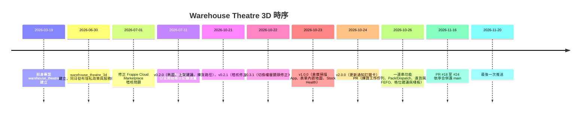
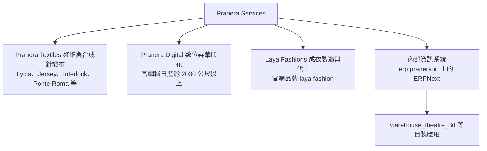

# Warehouse Theatre 3D 專案背景調查

## 摘要

`warehouse_theatre_3d` 是一個以 MIT 授權釋出的 ERPNext（Frappe）應用程式，把 ERPNext 既有的倉庫（Warehouse）樹狀結構轉換成可操作的 3D／2D 倉庫視圖，並附帶一支手機掃描 App。專案由印度紡織集團 **Pranera Services and Solutions Private Limited** 的內部 ERPNext 開發者 **Aravind Govindaraj**（GitHub 帳號 `aravindsprint`）以個人名義發布，免費上架 Frappe Cloud Marketplace[^marketplace][^readme]。

本報告回答的問題包括：這個專案是什麼、歷史與版本演進、維護者與團隊、背後公司與其資金狀況、社群與採用情形，以及開發方式。**結論先講**：這是一個「企業內部工具對外開源」的案例，不存在創投、融資或獨立公司實體；其資金來源就是母公司的紡織本業，開發在 2026 年 10 月之後大量導入 AI 編碼代理（Claude Code）協作，並在 2026 年 10 月下旬迎來一波明顯的外部關注。

---

## 一、專案基本資料

以下數據取自 GitHub REST API 與倉庫檔案，查詢時間為 2026-11-21[^ghapi][^langs][^tags]。

| 項目 | 內容 |
|---|---|
| 倉庫全名 | `aravindsprint/warehouse_theatre_3d` |
| 描述 | "See your warehouse in 3D — built on the hierarchy you already have" |
| 建立時間 | 2026-06-30（UTC） |
| 最後推送 | 2026-11-20（UTC） |
| 主要語言 | JavaScript（約 573 KB）、Python（約 290 KB）、CSS（約 20 KB）、HTML（約 4.8 KB） |
| 授權 | MIT |
| 星星數 | 27 |
| 分支（fork）數 | 21 |
| 追蹤者（watchers） | 27；訂閱者（subscribers）3 |
| 未結議題 | 0 |
| GitHub Discussions | 未啟用 |
| 應用版本 | 2.0.0（`pyproject.toml` 與 `hooks.py`） |
| 依賴 | 無 Python 套件依賴；Frappe `>=15.0.0-dev,<=17.0.0-dev`；Python `>=3.10` |
| 發布者欄位 | `app_publisher = "Aravind G"`，`app_email = "aravindsprint@gmail.com"` |
| 首頁欄位 | 未設定（`homepage: null`） |
| Topics | 未設定 |

以「研究對象為 GitHub 專案時應載明星星數」的標準來看，27 顆星屬於低關注度專案；但本報告的主題是「這個特定專案與其開發者的背景」，屬於必須報告的小眾案例，因此仍完整記錄並在後文說明其關注度變化[^ghapi]。

---

## 二、這個專案在做什麼

### 2.1 功能定位

專案 README 的自我描述是「給 ERPNext 的免費 3D 與 2D 倉庫儲存視覺化工具，運作在你既有的倉庫階層上」，並強調**不需要重新命名或搬移任何倉庫**：安裝後執行一次性的設定精靈，由使用者把既有的倉庫樹每一層指定角色（Building／Floor／Slot／Bin），程式只讀取 ERPNext 既有的 `tabBin` 資料，不做資料搬遷[^readme]。

主要功能包含[^readme]：

- **設定精靈**：依深度掃描既有倉庫樹並指派角色，官方宣稱兩分鐘內完成。
- **3D 視圖**：Three.js 機架視覺化，可環繞、平移、縮放。
- **2D 樓層視圖**：網格與層架填滿率指示。
- **走道第一人稱瀏覽**：以 WASD 在走道間行走。
- **即時庫存**：數量、UOM 填滿百分比、庫存金額。
- **物品搜尋、明細側欄與明細彈窗**。
- **貨架層數設定、樓層平面編輯器**、深／淺色主題、PWA 離線支援、行動裝置響應式、角色權限（System Manager 可編輯，Stock Manager／Stock User 唯讀）。
- **倉庫掃描手機 App**（`/warehouse-scan`）：上架（putaway）、揀貨（pick）、盤點（count）、查詢、標籤列印。
- **Stock Health 報告**：滯銷品、慢流動品、庫齡、即期批號、低於再訂購點、負庫存等。
- **作業視圖（Operations）**：訂單狀態、個人工作、團隊指標、系統診斷。

### 2.2 技術堆疊

README 與 `pyproject.toml` 顯示的技術選擇刻意保持輕量：前端使用 **Vue 3（透過 CDN，無建置步驟）**、3D 引擎為 **Three.js r128**、後端為 **Frappe／ERPNext v15**，PWA 以 Web App Manifest 加 Service Worker 實作，沒有 Python 套件依賴[^readme][^pyproject]。`hooks.py` 另外顯示它掛載了：

- `/apps` 畫面兩個入口：`warehouse_theatre_3d` 與 `warehouse_scan`。
- 11 種 DocType 的表單按鈕（`Item`、`Warehouse`、`Stock Entry`、`Purchase Receipt`、`Purchase Invoice`、`Subcontracting Receipt`、`Delivery Note`、`Sales Invoice`、`Pick List`、`Material Request`、`Purchase Order`）。
- `Pick List` 的 `on_submit`／`on_cancel` 事件，用來記錄是誰揀的貨。
- 排程事件：每小時與每日的告警與通知工作。

以企業內部工具而言，這種「無建置步驟、CDN 載入函式庫」的策略降低了部署門檻，但同時引入了對外部 CDN 的執行期依賴；專案自己的隱私政策與服務條款都為此加註說明，指出會從 `cdnjs.cloudflare.com` 與 `unpkg.com` 載入靜態函式庫，且不傳送站內資料[^privacy][^terms]。

---

## 三、歷史與版本演進

### 3.1 從前身專案到現在的倉庫

同一位開發者名下有一個更早的專案 `warehouse_theatre`，於 2026-03-19 建立[^other_repos][^predecessor]。該前身版本的 README 明確要求**固定的四層倉庫階層**（Building→Floor→Slot→Bin），並要求使用者以自訂欄位 `wt_warehouse_type` 手動標記每一筆倉庫，同時提供 `wt_row`、`wt_col`、`wt_row_gap`、`wt_uom_capacities` 等自訂欄位[^predecessor]。現在的 `warehouse_theatre_3d`（2026-06-30 建立）把這個限制拿掉，改用「掃描既有樹、由使用者指派角色」的精靈，是設計上的關鍵轉向[^ghapi][^readme]。

### 3.2 版本時序

CHANGELOG 記錄了完整的版本節奏[^changelog]：

值得注意的落差是：**CHANGELOG 與程式碼已標示 2.0.0，但 GitHub 上公開發布的 Release 只有三個（v0.3.1、v0.3.0、v0.2.0），tag 只有四個（v0.2.0、v0.2.1、v0.3.0、v0.3.1）**，v1.0.0 與 v2.0.0 沒有對應的 GitHub Release 或 tag[^releases][^tags]。也就是說，版本號的宣告與可追溯的發布紀錄之間存在不一致，這是閱讀該專案時容易被誤導的地方。

### 3.3 2026 年 10 月下旬的功能爆發

10 月 26 日當天建立的 PR 編號一路排到 #24，內容涵蓋揀貨員工作佇列與批次揀貨、Pack 與 Dispatch、對採購單收貨與品質保留與客戶退貨、揀貨面補貨與 FEFO、ABC 格位建議與棧板，以及離線掃描、告警、翻譯與型別註解[^prs]。這些 PR 在 2026-11-16 才依序合併進 `main`，合併訊息顯示 PR 之間是**堆疊（stacked）關係**，必須按順序合併[^prs]。

---

## 四、維護者與團隊

### 4.1 貢獻者結構

GitHub 的貢獻者統計顯示四人[^contrib]：

| 貢獻者 | 貢獻數 | 身分說明 |
|---|---|---|
| `github-actions[bot]` | 70 | 自動化流程（主要在 `traffic-data` 分支寫入流量紀錄） |
| `aravindsprint` | 29 | 專案所有人、主要開發者 |
| `claude` | 16 | AI 代理以提交者身分出現在 commit 紀錄中 |
| `aravind-eng` | 16 | 第二位人類帳號 |

其中 `aravind-eng`（建立於 2026-09-24）沒有任何公開倉庫，但 commit 的作者欄位使用 `aravind@praneraservices.com`，與 `aravindsprint` 在 2026 年 10 月之後的提交使用同一個電子郵件[^user_eng][^commits]。合理推論是同一位開發者的第二個帳號，用於區分「公司身分」與「個人身分」的提交，但公開資料沒有明文說明，此處僅陳述可觀察到的事實。

### 4.2 開發者身分

發布者欄位為 "Aravind G"[^hooks]，Frappe Cloud Marketplace 顯示的發布者全名為 **Aravind Govindaraj**[^marketplace]。公開資訊指向：

- 地點：印度泰米爾納德邦蒂魯布爾（Tirupur）[^linkedin_aravind][^pranera_li]。
- 現職：Pranera Services and Solutions 的 Frappe／ERPNext 開發者[^pranera_li]；同時被列為 ERPNext 導入服務公司 AtlasProds 的 Lead Engineer[^atlas]。
- 專業認證：Frappe Framework Development（由 Frappe Technologies 核發）[^linkedin_aravind]。
- 社群活動：曾在 Frappeverse 2026（2026-08-21 至 08-22，孟買 Nehru Centre Auditorium）以本專案為題演講[^frappeverse]；Frappe 官方 YouTube 頻道上有其「Migrating to ERPNext from Tally」的演講影片[^youtube]。

需要注意，LinkedIn 與 AtlasProds 這類來源屬於二手或自我描述性質，且 AtlasProds 與 Pranera 之間的關係（是否為同一集團的品牌或獨立公司）在公開資料中無法確認[^atlas]。

### 4.3 同一開發者的其他 ERPNext 應用

`aravindsprint` 名下有 27 個公開倉庫，與 ERPNext 相關且較具規模者包括[^other_repos]：

| 倉庫 | 說明 | 星星／分支 |
|---|---|---|
| `warehouse_theatre_3d` | 本報告主角 | 27／21 |
| `doc_intelligence` | 自架式 AI 文件分析與 ERPNext 自動化（PDF、DOCX、影像；可建立草稿單據） | 3／4 |
| `whatsnext` | ERPNext 的 WhatsApp Business 訊息中心（Meta Cloud API 與 Twilio） | 2／1 |
| `textiles_and_garments` | 紡織與成衣業垂直應用（2024-09 建立，屬於較早期作品） | 1／0 |
| `warehouse_control` | 以建築為單位的倉庫存取控制 | 1／0 |
| `warehouse_theatre` | 本專案前身 | 1／0 |
| `pranera_knit`、`pranera_roll`、`pranera_visitor`、`pranera_planning`、`pranera_sample` | 名稱帶有 `pranera_` 前綴的內部用應用（編織生產線 PWA、捲布、訪客、排程等） | 0–1 |

`pranera_*` 這一系列倉庫的存在，是判斷「Pranera 是這批工具的實際使用場域」最直接的間接證據[^other_repos][^pranera_knit]。

---

## 五、開發方式：AI 編碼代理高度介入

這是本專案最值得記錄的特徵之一。從 2026-10-26 起的大量提交與 PR，明確帶有以下痕跡[^prs][^commits]：

- PR 內文結尾附有 `_Generated by [Claude Code](https://claude.ai/code)_`。
- commit 訊息含 `Co-Authored-By: Claude Opus 5.5 <noreply@anthropic.com>` 與 `Claude-Session: https://claude.ai/code/session_...` 的 session 連結。
- commit 的 **committer 欄位直接是 `Claude <noreply@anthropic.com>`**，顯示部分提交由 AI 代理發起。
- 貢獻者統計中 `claude` 帳號有 16 次貢獻[^contrib]。

另外，專案在同期間補上了過去較少見的工程基礎設施：`.github/workflows/server-tests.yml` 會在真實的 ERPNext v15 bench（MariaDB 加 Redis）上跑端到端測試，並把結果貼回 PR；`.github/workflows/track-traffic.yml` 則每日把 clone 與 view 流量寫進獨立的 `traffic-data` 分支[^workflows]。後者的註解說明了動機：把每日提交隔離在主分支之外，避免在 Frappe Cloud 上被誤判為新的草稿版本[^workflows]。

這種「功能由 AI 代理大量產出、人類負責審閱與合併」的流程，解釋了本專案在 2026 年 10 月出現的開發速度異常。

---

## 六、背後的公司：Pranera Services

### 6.1 公司概況

| 項目 | 內容 |
|---|---|
| 法定名稱 | Pranera Services and Solutions Private Limited |
| 註冊地 | 印度泰米爾納德邦蒂魯布爾（Tirupur） |
| 成立時間 | 2008 年（公司註冊日期 2008-05-29） |
| 統一編號（CIN） | U74140TZ2008PTC014508 |
| 登記地址 | 10/11 Eswaran Nagar, Tirupur 641603；企業辦公室為 1-A, Sasthri Nagar, S.A.K Layout, Angeripalayam Road, Tirupur 641602 |
| 產業 | 紡織品製造（聚酯與合成針織布）、數位昇華印花、成衣 |
| 員工規模 | LinkedIn 標示 201–500 人；Tracxn 對該法人列約 151 人 |
| 主要關係人 | 執行長 Sivabalan Thangavelu；另一位被描述為「導師」的 Thangapandi P |
| 對外網站 | praneraservices.com、pranera.com |

以上公司資料來自公司官網存檔、LinkedIn 公司頁與第三方公司資料庫[^pranera_site][^pranera_li][^tracxn][^zauba]。

### 6.2 事業結構

官網存檔（2025-11-16 擷取）把集團分為三個事業體[^pranera_site]：

同一份存檔的頁尾標示「Pranera Services 2015. All rights reserved」，而第三方資料庫與官網其他頁面則記載 2008 年成立[^pranera_site][^tracxn]。兩者的落差可能是網站版權年份未更新，也可能是品牌沿革所致，公開資料不足以判定。

集團自家的 ERP 系統位於 `erp.pranera.in`，是 Frappe／ERPNext 部署[^erp]；換言之，**Pranera 是 ERPNext 的使用者，公開資料沒有任何證據顯示它是 ERPNext 的顧問服務商、官方夥伴或貢獻者**[^pranera_site][^erp]。

### 6.3 資金狀況

這是本調查中答案最明確的一項：**沒有創投資金、沒有外部融資**。

- Tracxn 將 Pranera Services 列為「Unfunded（未融資）」[^tracxn]。
- 第三方資料顯示其年營收約落在 ₹50–100 億盧比區間（約 600 萬至 1,200 萬美元），時間基準為 2025-03-31，並稱有約 16% 的年複合成長率[^tracxn]。
- 股權結構為發起人 100% 持有[^companycheck]。

就 `warehouse_theatre_3d` 這個應用本身而言，商業模式是**完全免費**：README 宣稱「Free. Always.」，以 MIT 授權釋出，上架 Frappe Cloud Marketplace 並加入 Frappe 對免費應用程式的營收分潤計畫[^readme][^marketplace]。因此這個專案沒有直接的收入來源，其開發成本由母公司的本業支應，可視為企業的技術品牌投資。

### 6.4 一個值得注意的設計：更新訂閱卡轉為潛在客戶名單

v2.0.0 加入了一個 opt-in 的「Get updates」卡片，在 System Manager 第二次造訪後顯示，由使用者主動勾選同意才會送出姓名、電子郵件與選填的公司名稱、手機；README 說明這些資料會以 **Lead（潛在客戶）**的形式進入發布者自己的 ERPNext，透過公開 Web Form 接收，並強調不包含任何庫存或業務資料[^changelog][^readme]。這是「免費企業應用作為獲客管道」的具體實作，也是本專案在商業意圖上最清楚的線索。

---

## 七、社群與採用情形

### 7.1 關注度與採用數據

| 指標 | 數值 | 來源 |
|---|---|---|
| GitHub 星星 | 27 | GitHub API |
| GitHub 分支（fork） | 21 | GitHub API |
| GitHub 訂閱者 | 3 | GitHub API |
| Frappe Cloud Marketplace 安裝數 | 17 | Marketplace 頁面 |
| 支援版本 | Version 16、Version 15、Nightly | Marketplace 頁面 |
| Marketplace 分類 | Free、Business、Utility、E-Commerce | Marketplace 頁面 |
| Frappe Gems 收錄 | 有（分類 Developer Tools，標記 Actively Maintained） | Frappe Gems |

[^ghapi][^marketplace][^gems]

21 個 fork 相對於 27 顆星是偏高的比例，且 fork 者包含組織帳號（例如 `NEW-MTC-ERP`、`duocronsol`）與來自越南、印度等地的個人帳號，時間集中在 2026 年 8 月至 11 月[^forks]。這通常代表「被拿去試裝評估」的行為，而非單純的收藏。

### 7.2 流量軌跡

專案自 2026-07-11 起以自動化流程每日記錄 clone 與 view 數[^traffic][^views]：

- 7 月至 10 月中旬：每日 clone 多為 5–40 次。
- **2026-10-21：clone 99 次（其中 45 次為不重複來源）；10-22：109 次**。此時點正好對應 v0.2.0／v0.2.1／v0.3.0 的發布。
- **2026-10-25：view 116 次（56 次不重複）**，同期 clone 為 42 次。
- 10-24 至 10-27 連續四天 clone 維持在 78–81 次的高檔。
- 11 月之後回落到每日 10–35 次。

值得注意的是 10-21 至 10-27 這一週，與 Frappe Cloud Marketplace 上架曝光、以及 GitHub Release 的發布時間高度重疊，顯示這波關注主要來自分發平台而非 GitHub 自身的探索機制。

### 7.3 第三方報導與社群討論

截至目前，**幾乎沒有第三方獨立報導**：

- Frappe 官方論壇（discuss.frappe.io）以 `warehouse_theatre_3d` 搜尋查無任何貼文[^forum]。
- 未發現 YouTube 教學、Reddit 討論串或部落格評論。
- 開發者本人確實在 Frappeverse 2026 演講並在 LinkedIn 發布相關貼文，但這屬於作者自身的宣傳，而非第三方評述[^frappeverse][^linkedin_aravind]。

在 Frappe 生態系中，它目前是「有收錄、有安裝數、但尚未進入社群討論循環」的狀態。

---

## 八、專案治理文件

值得一提的細節是，這個專案雖然是免費的企業內部工具，卻備齊了對外商用文件：`LICENSE`（MIT）、`PRIVACY.md`、`TERMS_OF_SERVICE.md`。三者都於 2026-06-30 更新[^privacy][^terms]。隱私政策明言：不收集、不儲存、不傳送任何資料到自有 ERPNext 站點之外，沒有分析、沒有遙測、沒有第三方追蹤；並列出存取哪些 DocType，以及唯一的外部連線是 CDN 上的 Three.js 與 Vue 3[^privacy]。服務條款則載明「按現狀提供、無保證」，並將支援定義為 GitHub Issues 上的盡力而為（best-effort）[^terms]。

這類文件通常是為了通過 Frappe Cloud Marketplace 的上架審核而準備，也與 v0.2.1 的 CHANGELOG 條目（修正稽核發現：改用 POST、移除手動 commit、SQL 參數化）互相呼應[^changelog]。

---

## 九、來源評析與研究限制

依研究規範，對來源的可靠性做以下批判性說明：

1. **一手與二手的分野**。本報告的倉庫數據（星星、fork、程式語言、檔案內容、PR、貢獻者、流量）全部取自 GitHub 官方 API 與原始檔案，屬於一手資料，可信度高[^ghapi][^langs][^hooks][^workflows][^traffic]。公司與個人資訊則多來自 LinkedIn、Tracxn、ZaubaCorp、The Company Check 等第三方聚合平台，這些平台本身也是二手整理，且對私人公司的資料常有滯後或衝突（例如員工人數在不同來源間差異達 151 至 500 人）[^tracxn][^pranera_li]。本報告已在各處標明衝突。
2. **無法由本次直接抓取佐證的項目**。Marketplace 頁面的使用者評分與評論數（據查詢工具回報為 3 則評論、4.7／5 分）並未出現在本次直接抓取的頁面快照中，僅有安裝數 17 得到直接確認[^marketplace]。此類數字應視為未經第一手驗證，引用時請保留懷疑。
3. **公司官方網站的自我描述性質**。Pranera 官網的產能、客戶與事業體描述屬於企業自我陳述，未經第三方查核[^pranera_site]。官方網站的存檔頁尾年份（2015）與成立年份（2008）不一致，也是一個提醒：企業官網並非可靠的沿革史料。
4. **LinkedIn 與個人檔案的可信度**。開發者的學歷、認證、以及與 AtlasProds 的關係，來自 LinkedIn 個人頁與 AtlasProds 服務頁，後者是自我宣傳內容[^linkedin_aravind][^atlas]。Pranera 與 AtlasProds 之間的組織關係在公開資料中不明，本報告不做推論。
5. **「無報導」本身是一種發現，但也有搜尋限制**。Frappe 官方論壇搜尋為空是明確的查詢結果[^forum]；但「YouTube、Reddit 皆無討論」這類否定性結論受搜尋引擎覆蓋率限制，無法窮盡，僅能表述為「本次調查未發現」。
6. **時間敏感性**。本專案處於高速變動期，2026 年 10 月至 11 月間幾乎每週都有合併；本報告的所有數據截至 2026-11-21，之後可能已失效。

---

## 十、綜合結論

- **它是什麼**：一個免費、MIT 授權、自架式的 ERPNext 視覺化與倉儲作業應用，把倉庫樹變成 3D／2D 地圖，並延伸到手機掃描作業與庫存健康報告[^readme]。
- **誰做的**：印度蒂魯布爾紡織集團 Pranera Services 的內部 ERPNext 開發者 Aravind Govindaraj，以個人 GitHub 帳號發布[^marketplace][^pranera_li]。
- **資金與創投**：沒有創投、沒有融資；團體本身被列為未融資，年營收約 ₹50–100 億盧比；應用本身完全免費並加入 Frappe 免費應用分潤計畫[^tracxn][^readme]。
- **商業邏輯**：以開源免費工具累積 Frappe 生態系的曝光，並以 opt-in 的更新訂閱卡把使用者轉為自家 ERPNext 的潛在客戶名單[^changelog]。
- **開發模式**：2026 年 10 月起由 AI 編碼代理（Claude Code）大量產出功能與 PR，人類負責合併，是理解其異常開發速度的關鍵[^prs][^contrib]。
- **社群狀態**：27 星、21 fork、Marketplace 17 次安裝，10 月下旬有一波明顯但短暫的關注高峰，尚無第三方獨立報導或論壇討論[^ghapi][^marketplace][^traffic][^forum]。

---

## 註腳

[^marketplace]: Frappe. (2026). *Warehouse Theatre 3D — Frappe Cloud Marketplace*. Retrieved 2026-11-21, from https://frappecloud.com/marketplace/apps/warehouse_theatre_3d
[^ghapi]: GitHub. (2026). *REST API: repositories/aravindsprint/warehouse_theatre_3d*. Retrieved 2026-11-21, from https://api.github.com/repos/aravindsprint/warehouse_theatre_3d
[^readme]: Aravind G. (2026). *README.md — Warehouse Theatre 3D*. GitHub. Retrieved 2026-11-21, from https://raw.githubusercontent.com/aravindsprint/warehouse_theatre_3d/main/README.md
[^changelog]: Aravind G. (2026). *CHANGELOG.md — Warehouse Theatre 3D*. GitHub. Retrieved 2026-11-21, from https://raw.githubusercontent.com/aravindsprint/warehouse_theatre_3d/main/CHANGELOG.md
[^hooks]: Aravind G. (2026). *hooks.py — Warehouse Theatre 3D*. GitHub. Retrieved 2026-11-21, from https://raw.githubusercontent.com/aravindsprint/warehouse_theatre_3d/main/warehouse_theatre_3d/hooks.py
[^pyproject]: Aravind G. (2026). *pyproject.toml — Warehouse Theatre 3D*. GitHub. Retrieved 2026-11-21, from https://raw.githubusercontent.com/aravindsprint/warehouse_theatre_3d/main/pyproject.toml
[^privacy]: Aravind G. (2026). *PRIVACY.md — Warehouse Theatre 3D*. GitHub. Retrieved 2026-11-21, from https://raw.githubusercontent.com/aravindsprint/warehouse_theatre_3d/main/PRIVACY.md
[^terms]: Aravind G. (2026). *TERMS_OF_SERVICE.md — Warehouse Theatre 3D*. GitHub. Retrieved 2026-11-21, from https://raw.githubusercontent.com/aravindsprint/warehouse_theatre_3d/main/TERMS_OF_SERVICE.md
[^langs]: GitHub. (2026). *REST API: languages for aravindsprint/warehouse_theatre_3d*. Retrieved 2026-11-21, from https://api.github.com/repos/aravindsprint/warehouse_theatre_3d/languages
[^contrib]: GitHub. (2026). *REST API: contributors for aravindsprint/warehouse_theatre_3d*. Retrieved 2026-11-21, from https://api.github.com/repos/aravindsprint/warehouse_theatre_3d/contributors
[^prs]: GitHub. (2026). *REST API: pull requests for aravindsprint/warehouse_theatre_3d*. Retrieved 2026-11-21, from https://api.github.com/repos/aravindsprint/warehouse_theatre_3d/pulls?state=all
[^releases]: GitHub. (2026). *REST API: releases for aravindsprint/warehouse_theatre_3d*. Retrieved 2026-11-21, from https://api.github.com/repos/aravindsprint/warehouse_theatre_3d/releases
[^tags]: GitHub. (2026). *REST API: tags for aravindsprint/warehouse_theatre_3d*. Retrieved 2026-11-21, from https://api.github.com/repos/aravindsprint/warehouse_theatre_3d/tags
[^forks]: GitHub. (2026). *REST API: forks for aravindsprint/warehouse_theatre_3d (sort=newest)*. Retrieved 2026-11-21, from https://api.github.com/repos/aravindsprint/warehouse_theatre_3d/forks?sort=newest
[^commits]: GitHub. (2026). *REST API: commits for aravindsprint/warehouse_theatre_3d*. Retrieved 2026-11-21, from https://api.github.com/repos/aravindsprint/warehouse_theatre_3d/commits
[^user_eng]: GitHub. (2026). *REST API: user aravind-eng*. Retrieved 2026-11-21, from https://api.github.com/users/aravind-eng
[^traffic]: Aravind G. (2026). *clones-history.csv (traffic-data branch)*. GitHub. Retrieved 2026-11-21, from https://raw.githubusercontent.com/aravindsprint/warehouse_theatre_3d/traffic-data/traffic-data/clones-history.csv
[^views]: Aravind G. (2026). *views-history.csv (traffic-data branch)*. GitHub. Retrieved 2026-11-21, from https://raw.githubusercontent.com/aravindsprint/warehouse_theatre_3d/traffic-data/traffic-data/views-history.csv
[^workflows]: Aravind G. (2026). *GitHub Actions workflows — server-tests.yml, track-traffic.yml*. GitHub. Retrieved 2026-11-21, from https://raw.githubusercontent.com/aravindsprint/warehouse_theatre_3d/main/.github/workflows/track-traffic.yml
[^gems]: Frappe Gems. (2026). *Warehouse Theatre 3D*. Retrieved 2026-11-21, from https://frappegems.com/gems/apps/aravindsprint/warehouse_theatre_3d
[^predecessor]: Aravind G. (2026). *README.md — warehouse_theatre*. GitHub. Retrieved 2026-11-21, from https://raw.githubusercontent.com/aravindsprint/warehouse_theatre/main/README.md
[^other_repos]: GitHub. (2026). *REST API: repositories of aravindsprint*. Retrieved 2026-11-21, from https://api.github.com/users/aravindsprint/repos?per_page=100&sort=updated
[^pranera_knit]: Aravind G. (2026). *README.md — Pranera Knit*. GitHub. Retrieved 2026-11-21, from https://raw.githubusercontent.com/aravindsprint/pranera_knit/main/README.md
[^pranera_site]: Pranera Services. (2025, November 16). *Pranera Services, Tirupur*. Internet Archive. Retrieved 2026-11-21, from http://web.archive.org/web/20251116063022/https://www.praneraservices.com/
[^pranera_li]: LinkedIn. (n.d.). *Pranera Services & Solutions Private Limited*. Retrieved 2026-11-21, from https://www.linkedin.com/company/pranera
[^tracxn]: Tracxn. (n.d.). *Pranera Services*. Retrieved 2026-11-21, from https://tracxn.com/d/companies/pranera-services/__iU5aYonFEVLa1Og59gBP8bkQAX7akn4y46_Zee4P4zY
[^zauba]: ZaubaCorp. (n.d.). *Pranera Services and Solutions Private Limited (U74140TZ2008PTC014508)*. Retrieved 2026-11-21, from https://www.zaubacorp.com/PRANERA-SERVICES-AND-SOLUTIONS-PRIVATE-LIMITED-U74140TZ2008PTC014508
[^companycheck]: The Company Check. (n.d.). *Pranera Services And Solutions Private Limited*. Retrieved 2026-11-21, from https://www.thecompanycheck.com/company/pranera-services-and-solutions-private-limited/U74140TZ2008PTC014508
[^erp]: Pranera Services. (n.d.). *erp.pranera.in*. Retrieved 2026-11-21, from https://erp.pranera.in/
[^linkedin_aravind]: LinkedIn. (n.d.). *Aravind Govindaraj*. Retrieved 2026-11-21, from https://in.linkedin.com/in/aravind-govindaraj-b249999a
[^atlas]: AtlasProds. (n.d.). *ERPNext Implementation*. Retrieved 2026-11-21, from https://atlasprods.com/services/erpnext-implementation
[^frappeverse]: LinkedIn. (2026). *Frappeverse 2026 — Aravind Govindaraj 貼文*. Retrieved 2026-11-21, from https://www.linkedin.com/in/aravind-govindaraj-b249999a
[^youtube]: Frappe. (n.d.). *Aravind Govindaraj — Migrating to ERPNext from Tally*. YouTube. Retrieved 2026-11-21, from https://www.youtube.com/watch?v=CzgOAQ21Bo4
[^forum]: Frappe. (n.d.). *討論區搜尋結果：warehouse_theatre_3d（無結果）*. Retrieved 2026-11-21, from https://discuss.frappe.io/search.json?q=warehouse_theatre_3d
