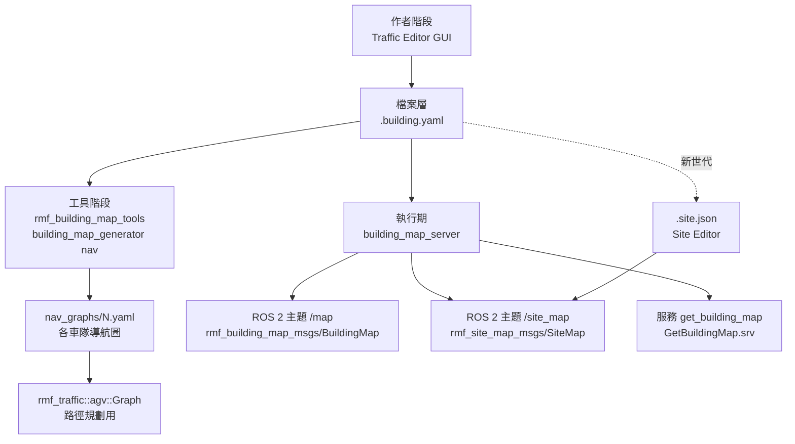
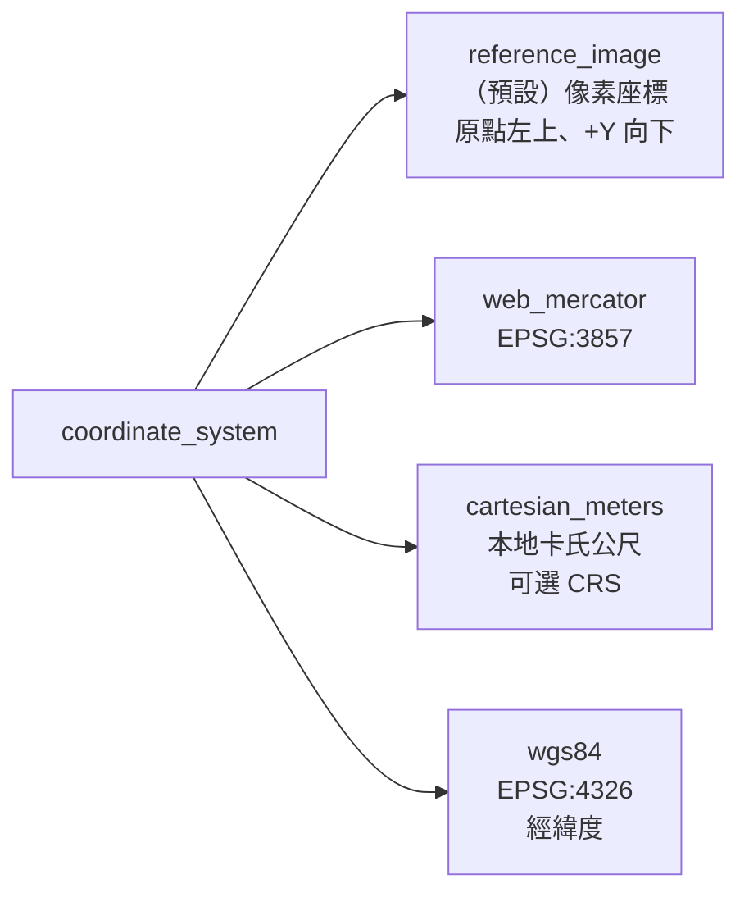
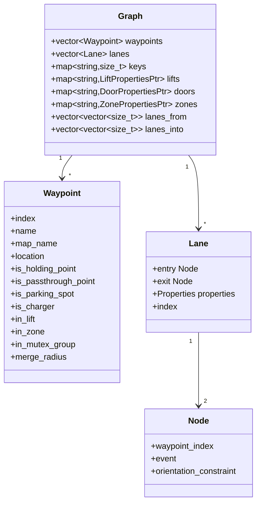

# Open-RMF 對室內資訊採用的資料模型

## 摘要

Open Robotics Middleware Framework（Open-RMF，以下簡稱 RMF）是一套由 Open Source Robotics Foundation（OSRF）主導的開源多機器人協調框架，目標是讓不同廠牌的機器人車隊在同一棟建築物內共用電梯、門、走廊與交通空間[^rmf-root]。對於「室內資訊」這個問題，RMF 的答案不是採用既有的室內空間資訊標準（如 IndoorGML、CityGML、IFC/BIM），而是**自建一套以機器人通行為中心（traffic-centric）的建築物模型**，並以三層結構呈現：

1. **概念層**：`BuildingMap` 由多個 `Level`（樓層）與 `Lift`（電梯）組成；每個 Level 包含樓層平面圖影像、門、地點與「導航圖」（navigation graph，由 waypoint 與 lane 構成的拓樸圖）[^msg-level][^te-page]。
2. **檔案層（作者格式）**：`.building.yaml`，由 Traffic Editor 圖形介面產生，是人類可讀、可版控的權威來源[^te-page][^building-py]。
3. **執行期訊息層**：ROS 2 訊息套件 `rmf_building_map_msgs`，由 `building_map_server` 節點載入 `.building.yaml` 後，發佈到 `/map` 主題並透過 `get_building_map` 服務提供[^bms-py][^msg-pkg]。

RMF 的室內模型**沒有** CellSpace / State / Transition 這類室內空間代數結構；它有的是一組離散路徑點（waypoint）與有向車道（lane），加上門與電梯的通行事件（event）。近年 RMF 生態系正逐步轉向新的 **Site Editor**（Rust + Bevy 實作）與 `.site.json` 格式，並以 `rmf_site_map_msgs/SiteMap` 訊息承載 GeoJSON / GeoPackage 形式的場址資料[^site-readme][^sitemap-msg]。

---

## 一、背景：RMF 是什麼、為何需要室內模型

RMF 是一套「多機器人隊（multi-fleet）交通管理」框架，核心問題不是「如何描述一棟建築」，而是「如何讓多台不同廠牌機器人安全共用同一棟建築的有限通道與垂直運輸設施」[^rmf-root][^rmf-demos-readme]。因此其資料模型的設計取向是**通行能力與衝突協商**，而非建築構件的幾何精度或空間語意分層。

RMF 生態系中與室內模型直接相關的專案如下（星數為 2026-11-21 檢視）：

| 專案 | 角色 | 語言 | GitHub 星數 |
|---|---|---|---|
| `open-rmf/rmf` | 根倉庫（meta repo） | Python | 469[^api-rmf] |
| `open-rmf/rmf_demos` | 示範場景與 `.building.yaml` 範例地圖 | Python | 633[^api-demos] |
| `open-rmf/rmf_traffic_editor` | Traffic Editor GUI 與 `rmf_building_map_tools`（含 `building_map_server`） | C++ / Python | 173[^api-te] |
| `open-rmf/rmf_building_map_msgs` | 建築物地圖 ROS 2 訊息定義 | CMake | 2[^api-msgs] |
| `open-rmf/rmf_traffic` | 交通管理函式庫（含 `rmf_traffic::agv::Graph`） | C++ | 43[^api-traffic] |
| `open-rmf/rmf_site` | 新世代 Site Editor（實驗性視覺化／編輯器） | Rust | 67[^api-site] |

> 註：`rmf_building_map_msgs` 星數極低（2 星），但它並非獨立的社群專案，而是 Open-RMF 組織內部由 OSRF 維護的訊息套件，其權威性來自母體框架而非星數，因此仍具報告價值[^api-msgs]。

---

## 二、三層資料模型總覽



這三層的關係可以理解為：**概念層定義語意契約，檔案層是權威來源，訊息層是執行期投影**[^building-py][^bms-py]。

---

## 三、概念層：Level、平面圖、導航圖、門、電梯

### 3.1 Level（樓層）

`Level` 是 RMF 室內模型最上層的空間單位，代表「同一水平面上的一組可通行設施」[^te-page][^msg-level]。一個 Level 包含：

- `name`：樓層名稱（例如 `L1`）；
- `elevation`：樓層高程（公尺，相對其他樓層）；
- `images`：樓層平面圖（見 3.2）；
- `places`：具名地點及容差（見 3.5）；
- `doors`：門（見 3.3）；
- `nav_graphs`：導航圖陣列（每個車隊一張，見 3.4）；
- `wall_graph`：牆面圖（用於視覺化／模擬，非路徑規劃用）。

> RMF 的 Level **不是** IndoorGML 的 CellSpace：它沒有內部拓樸細分，樓層內部的可通行性完全由導航圖的 lane 決定[^msg-level][^te-page]。

### 3.2 樓層平面圖與仿射轉換

樓層平面圖在 Traffic Editor 內是一張 2D 影像（通常 PNG），使用者把牆、waypoint、lane 等註記疊在影像上[^te-page]。影像與世界座標之間的關係以**仿射轉換**描述，對應執行期的 `AffineImage` 訊息：

| 欄位 | 意義 |
|---|---|
| `name` | 影像名稱（由檔名去副檔名取得）[^bms-py] |
| `encoding` | 影像編碼（由副檔名取得，如 `png`、`jpg`）[^bms-py] |
| `data` | 影像原始位元組[^msg-affine] |
| `scale` | 比例（Traffic Editor 中換算自 measurement 工具標定的物理比例）[^bms-py] |
| `x_offset`、`y_offset` | 平移量[^bms-py] |
| `yaw` | 旋轉角[^bms-py] |

要注意的是，Traffic Editor 內部的像素座標系是**原點在左上、+Y 向下**（標準影像座標）；產生地圖時會翻轉 Y 軸，使下游改用一般的卡氏座標（+Y 向上）[^te-page]。這個翻轉在程式碼中以 `CoordinateSystem.y_flip_scalar()` 明確表示：`reference_image` 回傳 `-1`，其餘座標系回傳 `1`[^coord-sys]。

### 3.3 門（Door）

門以兩個端點 `(v1_x, v1_y)` 與 `(v2_x, v2_y)` 描述，並帶有型別與運動參數[^msg-door]。RMF 支援 7 種門型：

| 常數 | 值 | 說明 |
|---|---|---|
| `DOOR_TYPE_UNDEFINED` | 0 | 未定義 |
| `DOOR_TYPE_SINGLE_SLIDING` | 1 | 單向平移門 |
| `DOOR_TYPE_DOUBLE_SLIDING` | 2 | 雙向平移門 |
| `DOOR_TYPE_SINGLE_TELESCOPE` | 3 | 單向伸縮門（常見於電梯） |
| `DOOR_TYPE_DOUBLE_TELESCOPE` | 4 | 雙向伸縮門 |
| `DOOR_TYPE_SINGLE_SWING` | 5 | 單開鉸鏈門 |
| `DOOR_TYPE_DOUBLE_SWING` | 6 | 雙開鉸鏈門 |

門的幾何慣例（依 `.msg` 內註解）[^msg-door]：

- **單鉸鏈門**：鉸鏈位於 `(v1_x, v1_y)`，門扇延伸至 `(v2_x, v2_y)`；
- **雙鉸鏈門**：兩側各有鉸鏈；
- **單平移門**：門扇由 `(v2_x, v2_y)` 滑向 `(v1_x, v1_y)`；
- **雙平移門**：兩門扇由 v1↔v2 中點分別滑向兩端；
- **伸縮門**：參數同平移門，但開閉更快、佔用牆內空間更小。

**重要陷阱**：`Door.msg` 的註解明文寫「`motion_range` = door swing range in DEGREES」，但 `building_map_server` 實作時把它換算成**弧度**再填入訊息（`math.pi * motion_degrees / 180`）[^msg-door][^bms-py]。也就是說，註解與實作不一致，實際 ROS 訊息內是弧度。這是使用此模型時最容易誤判的欄位之一。

### 3.4 導航圖（Navigation Graph）：waypoint 與 lane

導航圖是 RMF 室內模型真正的核心。它是一組**離散的路徑點（waypoint，訊息中稱 vertex）**與連接它們的**車道（lane，訊息中稱 edge）**[^te-page][^msg-graph]。

- 每個 Level 可帶多達 9 張圖（索引 0–8），通常「一張圖對應一個機器人車隊」[^te-page][^building-py]。
- 車道可以是有向（單向）或無向（雙向）：`EDGE_TYPE_UNIDIRECTIONAL = 1` 表示 `v1 → v2`；`EDGE_TYPE_BIDIRECTIONAL = 0` 表示 `v1 ↔ v2`[^msg-edge]。
- 產生導航圖時，雙向車道會被拆成兩條單向車道，並可能分別帶有不同參數（例如 `dock_name` 與 `undock_name`）[^level-py]。

waypoint 可承載的典型屬性（以 `Param` 形式表示）包括[^bms-py][^parse-graph]：

| 屬性 | 型別 | 意義 |
|---|---|---|
| `is_charger` | bool | 充電站 |
| `is_parking_spot` | bool | 緊急停靠點 |
| `is_holding_point` | bool | 可等待的點 |
| `is_passthrough_point` | bool | 中繼點（規劃器不在此停等，可降低分支數）[^graph-hpp] |
| `is_cleaning_zone` | bool | 清掃區 |
| `dock_name` | string | 停靠動作名稱 |
| `undock_name` | string | 離站動作名稱 |
| `pickup_dispenser` | string | 取物裝置名稱 |
| `dropoff_ingestor` | string | 放置裝置名稱 |
| `mutex` | string | 互斥群組（同一群組同時僅允許一台機器人）[^graph-hpp] |
| `spawn_robot_name` / `spawn_robot_type` | string | 模擬用機器人生成設定 |
| `merge_radius` | double | 可併入此 waypoint 的距離[^graph-hpp] |

車道可承載的屬性包括[^parse-graph][^graph-hpp]：

| 屬性 | 意義 |
|---|---|
| `speed_limit` | 車道速限 |
| `mutex` | 車道所屬互斥群組 |
| `orientation_constraint` | `forward` / `backward`，限制機器人沿車道的姿態 |
| `dock_name` | 車道終點為停靠動作 |
| `undock_name` | 車道起點為離站動作 |
| `door_name` | 穿越門（需開門事件） |
| `demo_mock_floor_name` / `demo_mock_lift_name` | 模擬用假樓層／假電梯 |

導航圖也支援**區域（zone）**擴充：`GraphZone` 描述一個具名區域的幾何（中心、yaw、長寬），`ZoneVertex` 描述區域內部的「內部頂點」及其 `group`（群組）與 `priority`（優先序）[^msg-zone][^msg-zonevertex]。區域的進出透過自動生成的過渡車道（transition lane）與 `entry` / `exit` 型別表示[^level-py]。依套件 CHANGELOG，`GraphZone`、`ZoneVertex` 與區域過渡車道是 1.8.0 版（2026-11-13）為 GoToZone 功能新增的[^msg-changelog]；這說明 RMF 的室內模型仍在持續擴充。

### 3.5 Place（地點）

`Place` 提供「具名位置 + 容差」的輕量語意：`name`、`x`、`y`、`yaw`、`position_tolerance`、`yaw_tolerance`[^msg-place]。值得注意的是，在 `building_map_server` 的現行實作中，`Level.msg` 雖有 `places` 欄位，但程式碼並未填充它[^bms-py][^msg-level]；RMF 生態系中「前往某個具名地點」的需求，實務上更常由導航圖中的具名 waypoint 承擔。

### 3.6 Lift（電梯）

電梯是 RMF 處理垂直運輸的關鍵構件，欄位包含[^msg-lift]：

| 欄位 | 意義 |
|---|---|
| `name` | 電梯名稱 |
| `levels` | 服務的樓層名稱清單 |
| `doors` | 廂門（Door 結構） |
| `wall_graph` | 廂體牆面圖 |
| `ref_x`、`ref_y`、`ref_yaw` | 廂體參考姿態，用於對齊各樓層 |
| `width`、`depth` | 廂體寬與深 |

`building_map_server` 在填充電梯門時，會先把門的兩個鉸鏈點以「廂體內部座標」計算，再依序套用兩次轉換（先廂體內部旋轉平移、再套用電梯的全域 yaw 與參考點），最後把 `motion_range` 固定填 `1.571`（約 π/2）、`motion_direction` 固定填 `-1`[^bms-py]。這說明執行期訊息中的電梯門姿態是**推導結果**，而非直接來自檔案。

---

## 四、檔案層：`.building.yaml`

`.building.yaml` 是 Traffic Editor 的專案檔，也是整個 RMF 室內模型的權威來源[^te-page][^building-py]。其頂層結構包含 `name`、`coordinate_system`、`reference_level_name`、`levels`、`lifts`，以及可選的 `zones`、`crowd_sim`、`graphs`[^building-py][^office-yaml]。

以下為一個真實範例（節錄自 `open-rmf/rmf_demos` 的 office 場景）[^office-yaml]：

```yaml
coordinate_system: reference_image
levels:
  L1:
    doors:
      # [起點頂點索引, 終點頂點索引, {參數...}]
      - [31, 13, {motion_axis: [1, start], motion_degrees: [3, 90],
                  motion_direction: [2, 1], name: [1, main_door],
                  plugin: [1, normal], right_left_ratio: [3, 1],
                  type: [1, double_hinged]}]
    drawing:
      filename: office.png
    elevation: 0
    lanes:
      # [start_idx, end_idx, {雙向?, graph_idx, 速限, 互斥群組, 姿態限制}]
      - [39, 40, {bidirectional: [4, true], graph_idx: [2, 0],
                  mutex: [1, ""], orientation: [1, ""], speed_limit: [3, 0]}]
    measurements:
      # 用於標定像素↔公尺比例：[頂點a, 頂點b, {distance: 實際公尺}]
      - [1, 0, {distance: [3, 9.3149999999999995]}]
    vertices:
      # [x, y, z, name, {屬性...}]
      - [1232.421, 658.567, 0, tinyRobot1_charger,
         {is_charger: [4, true], is_holding_point: [4, true],
          is_parking_spot: [4, true],
          spawn_robot_name: [1, tinyRobot1],
          spawn_robot_type: [1, Open-RMF/TinyRobot]}]
    walls:
      - [6, 7, {alpha: [3, 1], texture_height: [3, 2.5],
                texture_name: [1, wall_white]}]
lifts: {}
name: building
```

可以看到，`.building.yaml` 中的每個屬性都以 `[型別代碼, 值]` 的配對形式儲存。型別代碼對應執行期 `Param.msg` 的常數：`TYPE_STRING = 1`、`TYPE_INT = 2`、`TYPE_DOUBLE = 3`、`TYPE_BOOL = 4`[^param-msg][^office-yaml]。這個設計讓 YAML 得以容納異質屬性而不必為每種屬性開一個欄位。

`Level` 的 YAML 子鍵包含：`drawing`、`elevation`、`fiducials`、`vertices`、`measurements`、`lanes`、`walls`、`doors`、`models`、`floors`、`holes`、`layers`、`constraints`、`features`[^level-py][^office-yaml]。

多樓層之間的對齊透過兩套機制[^building-py]：

1. **fiducials**：在相鄰樓層中放置同名、非共線的參考標記，程式以「共同 fiducial 對」計算縮放與平移；`calculate_level_offsets_and_scales()` 只有在 `reference_image` 座標系下才會執行[^building-py]。
2. **measurements**：在參考樓層上畫已知實長，程式取平均以推得該樓層的比例尺[^level-py]。

> 若 `reference_image` 模式下沒有任何 measurement，程式會輸出警告「Nav graph generated in pixel units, not meters!」，導航圖將以像素為單位產生[^level-py]。這是室內資訊導入時極常見的錯誤來源。

---

## 五、座標系統

RMF 支援四種座標系，於 `.building.yaml` 的 `coordinate_system` 鍵指定[^coord-sys][^building-py]：



- `reference_image`：以平面圖影像像素為單位，需要 measurement 標定；Y 軸需翻轉[^te-page][^coord-sys]。
- `web_mercator`：需宣告 `generate_crs`，並找尋具名的 origin 頂點作為原點偏移[^building-py]。
- `cartesian_meters`：本地公尺座標，可有 `offset_x` / `offset_y`；這是 GeoPackage 產生的前提條件[^building-py]。
- `wgs84`：經緯度，需 `generate_crs`，並支援 `suggested_offset_x` / `suggested_offset_y`[^building-py]。

此外，`Building.generate_nav_graphs()` 會依座標系把 `crs_name` 與 `offset` 寫入產生的導航圖檔，讓下游 `rmf_fleet_adapter` 能把本地座標還原到地理座標[^building-py]。

---

## 六、執行期訊息層：`rmf_building_map_msgs` 完整欄位

`rmf_building_map_msgs` 的套件說明為「用於傳送建築物地圖的訊息」[^msg-pkg-readme]，內含 12 個訊息與 1 個服務。以下欄位皆逐字取自各 `.msg` 檔[^msg-affine][^msg-graph][^msg-edge][^msg-nodemsg][^param-msg][^msg-zone][^msg-zonevertex]。

**BuildingMap.msg**[^msg-building]

```text
string name
Level[] levels
Lift[] lifts
```

**Level.msg**[^msg-level]

```text
string name
float32 elevation
AffineImage[] images
Place[] places
Door[] doors
Graph[] nav_graphs
Graph wall_graph
```

**Graph.msg**[^msg-graph]

```text
string name
GraphNode[] vertices
GraphEdge[] edges
GraphZone[] zones
Param[] params
```

**GraphNode.msg**[^msg-nodemsg]

```text
float32 x
float32 y
string name
Param[] params
```

**GraphEdge.msg**[^msg-edge]

```text
uint32 v1_idx
uint32 v2_idx
Param[] params
uint8 edge_type            # 0=BIDIRECTIONAL(v1<->v2), 1=UNIDIRECTIONAL(v1->v2)
```

**Door.msg**[^msg-door]

```text
string name
float32 v1_x
float32 v1_y
float32 v2_x
float32 v2_y
uint8 door_type            # 0..6，見 3.3 節
float32 motion_range
int32 motion_direction     # +1 順時針 / -1 逆時針
```

**Lift.msg**[^msg-lift]

```text
string name
string[] levels
Door[] doors
Graph wall_graph
float32 ref_x
float32 ref_y
float32 ref_yaw
float32 width
float32 depth
```

**AffineImage.msg**[^msg-affine]

```text
string name
float32 x_offset
float32 y_offset
float32 yaw
float32 scale
string encoding
uint8[] data
```

**Place.msg**[^msg-place]

```text
string name
float32 x
float32 y
float32 yaw
float32 position_tolerance
float32 yaw_tolerance
```

**Param.msg**[^param-msg]

```text
string name
uint32 type                # 0=UNDEFINED, 1=STRING, 2=INT, 3=DOUBLE, 4=BOOL
int32 value_int
float32 value_float
string value_string
bool value_bool
```

**GraphZone.msg**[^msg-zone]

```text
string name
string level
string type
float32 center_x
float32 center_y
float32 yaw
float32 length
float32 width
ZoneVertex[] vertices
```

**ZoneVertex.msg**[^msg-zonevertex]

```text
string name
string group
uint8 priority
```

**GetBuildingMap.srv**[^getmap-srv]

```text
---
BuildingMap building_map
```

（請求為空；回應為一張 `BuildingMap`。）

### 6.1 `building_map_server` 節點

`building_map_server` 位於 `rmf_traffic_editor` 倉庫的 `rmf_building_map_tools` 套件中，是檔案層通往執行期訊息層的橋樑[^bms-py]。

- 節點名稱：`building_map_server`；
- 可讀取的輸入格式：`.building.yaml`、`.gpkg`、`.geojson`、`.geojson.gz`；地圖路徑取自命令列參數或環境變數 `RMF_MAP_PATH`[^bms-py]；
- 發佈主題 `map`（型別 `BuildingMap`），QoS 為 `KEEP_LAST` / depth 1 / `RELIABLE` / `TRANSIENT_LOCAL`，於啟動時發佈一次[^bms-py]；
- 發佈主題 `site_map`（型別 `SiteMap`），QoS 同上[^bms-py]；
- 提供服務 `get_building_map`（型別 `GetBuildingMap`），直接回傳內部已建好的 `map_msg`[^bms-py]。

`create_map_msg()` 會走訪 `building.levels` 與 `building.lifts`，逐一產生 `Level` 與 `Lift` 訊息；每個 Level 會對索引 0–8 各產生一張導航圖（`level.generate_nav_graph(i)`）並另產生一張牆面圖（`level.generate_wall_graph()`）[^bms-py]。

值得注意的是，`load_geopackage()` 目前**只讀取 GPKG 位元組填入 `SiteMap`**，並未回填 `BuildingMap`（程式碼內有 `todo: populate the BuildingMap from the GeoPackage`）[^bms-py]。也就是說，GPKG 路徑下 `/map` 主題的內容是空的。

---

## 七、導航圖在 `rmf_traffic::agv::Graph` 的模型

車隊介面（fleet adapter）在啟動時讀取由 `building_map_generator nav` 產生的 `nav_graphs/N.yaml`，並透過 `parse_graph()` 建立 `rmf_traffic::agv::Graph`[^parse-graph]。此 C++ 圖模型的結構為[^graph-hpp]：



- **Waypoint** 對應導航圖的頂點，帶有地圖名、座標、旗標與所屬 lift / zone / mutex[^graph-hpp]。
- **Lane** 由 entry node 與 exit node 組成；每個 node 可攜帶一個**事件（Event）**與一個**姿態限制（OrientationConstraint）**[^graph-hpp]。
- 支援的事件型別包含：`DoorOpen` / `DoorClose`、`LiftSessionBegin` / `LiftDoorOpen` / `LiftMove` / `LiftSessionEnd`、`Dock`、`Wait`，以及區域用的 `ZonePreEntry` / `ZonePostEntry` / `ZonePreExit` / `ZonePostExit`[^graph-hpp]。
- 姿態限制有兩種：指定一組可接受的絕對角度，或指定「必須朝前／朝後」並結合車輛前向向量[^graph-hpp]。

`parse_graph()` 的行為揭示了不少模型細節[^parse-graph]：

1. **電梯事件自動生成**：若車道一端在電梯內、另一端在外，程式自動加上 `LiftSessionBegin`（進入）或 `LiftDoorOpen` + `LiftSessionEnd`（離開），事件時長固定為 4 秒；若兩端都在同一部電梯內則不產生事件，但若兩端分屬不同電梯則**直接丟出錯誤**[^parse-graph]。
2. **電梯垂直對齊檢查**：同一部電梯內所有 waypoint 的座標變異若超過 0.1 公尺，會丟出 `Bad vertical alignment` 錯誤；通過檢查後，所有電梯內 waypoint 會被強制移到該電梯的平均中心點，連帶連動「堆疊頂點」（stacked vertex）[^parse-graph]。
3. **門事件生成**：若車道帶有 `door_name`，自動加上 4 秒的 `DoorOpen` / `DoorClose`[^parse-graph]。
4. **停靠事件**：`dock_name` 為 5 秒的 `Dock`；若該車道同時已有 entry event，會額外插入一個 waypoint 以確保動作順序[^parse-graph]。
5. **區域事件**：帶 `zone` 的車道會依 `transition_type` 為 `entry` 或 `exit`，掛上對應的區域事件；且「車道同時具有 zone 與 lift」目前**不支援**，會丟出錯誤[^parse-graph]。
6. **假電梯**：`demo_mock_floor_name` / `demo_mock_lift_name` 用於示範用假電梯，程式碼註解明言其實作「並非滴水不漏（not air tight）」[^parse-graph]。

---

## 八、新世代：`rmf_site` 與 `.site.json`

RMF 生態系正在開發以 Rust + Bevy 實作的 **RMF Site Editor**，用以視覺化與編輯大型 RMF 部署場址，可同時編譯為桌面與 WebAssembly 版本[^site-readme]。其專案檔為 `.site.json`，由 Rust crate `rmf_site_format` 定義[^site-format-lib]。

`Site` 結構的核心欄位為[^site-rs]：

| 欄位 | 意義 |
|---|---|
| `format_version` | 檔案格式版本（語意化版本） |
| `anchors` | 跨樓層共用的錨點（點位） |
| `properties` | 場址層級屬性（名稱、地理偏移、底層 SDF 等） |
| `levels` | 各樓層 |
| `navigation` | 導航資料（見下） |
| `lifts` | 電梯 |
| `textures`、`fiducial_groups`、`fiducials` | 材質與基準標記 |
| `model_descriptions`、`model_instances` | 模型描述與實例 |
| `robots`、`tasks`、`scenarios` | 機器人、任務、情境 |
| `extensions` | 供下游擴充的序列化資料槽 |

`navigation.guided` 內含 `graphs`（導航圖）、`ranking`（顯示疊放順序）、`lanes`（車道）、`locations`（特殊地點）與 `mutex_groups`（互斥群組）[^navigation-rs]。其中 `NavGraph` 本身僅有 `name` 與 `color`（顯示用顏色）兩個欄位，導航圖與車道、地點之間的關聯則由各車道與地點的 `graphs` 欄位（`AssociatedGraphs`）反向表達[^nav-graph-rs]。

舊版 Level 與新版 Level 的欄位差異也值得注意：新版 `LevelProperties` 只保留 `name` 與 `elevation`，並新增 `global_floor_visibility` 與 `global_drawing_visibility` 兩個顯示控制欄位；其餘元素（`anchors`、`doors`、`drawings`、`floors`、`lights`、`physical_cameras`、`walls`、`rankings`、`user_camera_poses`）則改為以 ID 為鍵的對映表[^level-rs]。

新的 `Lane` 結構比舊版表達力更強[^lane-rs]：

```text
Lane {
  anchors: Edge,              # 起訖錨點
  forward: Motion,            # 正向行進屬性
  reverse: ReverseLane,       # 反向：Same / Disable / Different(Motion)
  mutex: Affiliation,         # 互斥群組
  graphs: AssociatedGraphs,   # All / Only{...} / AllExcept{...}
}
Motion {
  orientation_constraint,     # None / Forwards / Backwards / RelativeYaw / AbsoluteYaw
  speed_limit,
  dock,
  workflow,                   # 具名工作流程
}
```

其中 `ReverseLane::Disable` 明確表達單向車道，`ReverseLane::Different(Motion)` 允許正向與反向有不同屬性，`workflow` 欄位則把「車道上的作業流程」也納入模型[^lane-rs]。`LocationTag` 列舉了 `Charger`、`ParkingSpot`、`HoldingPoint`、`Workcell(Model)` 四種地點語意[^location-rs]。

繪圖（Drawing）元素則以 `DrawingProperties` 描述：`name`、`source`（素材來源）、`pose`、`pixels_per_meter`、`preferred_semi_transparency`；預設 `pixels_per_meter` 為 100.0[^drawing-rs]。相較舊版以 `scale`／`x_offset`／`y_offset`／`yaw` 描述仿射轉換，新版改以 `pixels_per_meter` 搭配 `Pose` 表達，語意更清楚[^drawing-rs][^msg-affine]。

場址的地理定位以 `GeographicOffset` 表示，欄位涵蓋 `anchor`（經緯度對）、`zoom`（縮放層級）與 `visible`（可見性），`from_latlon()` 的預設 zoom 為 15[^georef-rs]。

Site Editor 亦提供無介面（headless）匯出流程，可一次產生 SDF 世界、導航圖與場址檔；該流程會強制把樓層設為不透明、把門設為關閉（以確保關節對齊），並移除 3D 提示文字，再輸出結果[^headless-export]。

### 8.1 `SiteMap` 訊息

為承載新格式，RMF 另定義 `rmf_site_map_msgs/SiteMap` 訊息，其完整內容為[^sitemap-msg]：

```text
uint32 MAP_DATA_UNDEFINED=0
uint32 MAP_DATA_GPKG=1
uint32 MAP_DATA_GPKG_GZ=2
uint32 MAP_DATA_GEOJSON=3
uint32 MAP_DATA_GEOJSON_GZ=4

uint32 encoding
uint8[] data
```

這是一個「封套訊息」：以 `encoding` 標示後方 `data` 的格式，再直接放入 GeoPackage 或 GeoJSON 的原始位元組。`building_map_server` 在載入 `.building.yaml` 時，會呼叫 `building.generate_geojson()` 並把結果 gzip 壓縮後填入 `SiteMap`[^bms-py]。

---

## 九、與既有室內資訊標準的關係

這是本報告最需要批判性檢視的部分。經檢索後，可確認[^indoor-standard]：

| 標準／格式 | RMF 支援狀況 |
|---|---|
| IndoorGML（OGC） | 不支援 |
| CityGML（OGC） | 不支援 |
| IFC / BIM（ISO 16739） | 不支援 |
| IMDF | 不支援 |
| GeoJSON | 匯出與匯入（僅頂點與車道）[^building-py] |
| GeoPackage（OGC） | 匯出（僅頂點與車道），且不回填 BuildingMap[^building-py][^bms-py] |
| WGS84 / Web Mercator | 支援為座標參考系統[^coord-sys] |
| 原生 `.building.yaml` | 主要格式[^te-page] |
| ROS 2 訊息模型 | 執行期表達[^msg-pkg] |

`Building.generate_geojson()` 與 `generate_geopackage_file()` 都只輸出頂點與車道兩類圖徵，原始碼中留有明確的待辦註解：`todo: add measurement edges`、`todo: add wall edges`、`todo: add door edges`、`todo: add lifts`[^building-py]。也就是說，**RMF 的地理資訊交換是有損的**：匯出後無法還原牆、門、電梯、量測與樓層多邊形。此外 `generate_geopackage()` 要求座標系必須是 `cartesian_meters` 且必須宣告 `generate_crs`，否則直接放棄產生[^building-py]。

反過來說，RMF 的模型確實解決了 IndoorGML 不處理的問題：門的開閉動力學（含型別與擺動方向）、電梯的跨樓層廂體參考姿態、車隊專屬導航圖、以及「同一通道同時只允許一台機器人」的互斥語意[^msg-door][^msg-lift][^graph-hpp]。這些是純空間資訊標準的盲區。

**因此，對「室內資訊資料模型」的研究而言，RMF 的價值不在於提供一套可與 IndoorGML 對映的空間描述，而在於示範了一種「可通行性優先」的室內模型取向**：以離散拓樸圖取代連續空間細分，以事件（event）取代靜態幾何來描述門與電梯的動態行為。

---

## 十、實務陷阱整理

1. **`motion_range` 單位不一致**：`.msg` 註解寫 degrees，實作填 radians[^msg-door][^bms-py]。
2. **`motion_direction` 語意**：`+1` 順時針、`-1` 逆時針[^msg-door]。
3. **電梯門的 `motion_range` 與 `motion_direction` 為固定值**（`1.571`、`-1`），非來自檔案[^bms-py]。
4. **`GraphZone.length` 實際填入的是 zone 的 depth**，`width` 則填入 width，命名與語意有落差[^bms-py]。
5. **`Level.places` 未被 `building_map_server` 填充**[^bms-py]。
6. **GeoPackage 路徑下 `BuildingMap` 為空**[^bms-py]。
7. **`reference_image` 模式若無 measurement，導航圖單位是像素而非公尺**[^level-py]。
8. **同一電梯內 waypoint 的垂直對齊容差為 0.1 公尺**，超過即報錯[^parse-graph]。
9. **車道不可同時掛 zone 與 lift**，會丟出錯誤[^parse-graph]。
10. **導航圖索引上限為 9 張（0–8）**，對應最多 9 個車隊[^building-py]。

---

## 十一、結論

Open-RMF 對室內資訊採用的資料模型，可以一句話概括：**以樓層（Level）為容器、以樓層平面圖為視覺底圖、以導航圖（waypoint + lane 的拓樸圖）為通行語意主體，並以門、電梯、地點與區域作為通行事件與屬性的載體**[^msg-level][^te-page][^graph-hpp]。

它有三個顯著特徵：

- **自建格式而非採用標準**：不支援 IndoorGML / CityGML / IFC，僅在匯出方向與 GeoJSON / GeoPackage 有部分卻有損的交換能力[^indoor-standard][^building-py]。
- **三層分離**：權威來源是 `.building.yaml`，執行期投影為 `rmf_building_map_msgs`，路徑規劃則另用 `rmf_traffic::agv::Graph`[^building-py][^bms-py][^graph-hpp]。
- **正在演進**：新版 `rmf_site` 以 `.site.json` 與 `SiteMap` 訊息重新表達同一套概念，並擴充了 `workflow`、`ReverseLane`、`LocationTag` 等更精細的語意[^site-rs][^lane-rs][^location-rs][^sitemap-msg]。

若研究目標是「把 RMF 的室內模型對映到某個室內空間標準」，需注意 RMF 缺少 CellSpace／State／Transition 一類的空間代數，也缺少建築構件層級的幾何語意；反之，若研究目標是「從標準室內模型中萃取出可供機器人車隊協調使用的通行資訊」，RMF 的 waypoint/lane/event 三元結構反而是一個值得參考的目標模型。

---

## 參考文獻

[^rmf-root]: Open-RMF. (n.d.). *rmf* [Source code]. GitHub. Retrieved 2026-11-21, from https://github.com/open-rmf/rmf

[^rmf-demos-readme]: Open-RMF. (n.d.). *rmf_demos README*. Retrieved 2026-11-21, from https://github.com/open-rmf/rmf_demos

[^api-rmf]: GitHub REST API. (2026). *Repository: open-rmf/rmf*. Retrieved 2026-11-21, from https://api.github.com/orgs/open-rmf/repos

[^api-demos]: GitHub REST API. (2026). *Repository: open-rmf/rmf_demos*. Retrieved 2026-11-21, from https://api.github.com/orgs/open-rmf/repos

[^api-te]: GitHub REST API. (2026). *Repository: open-rmf/rmf_traffic_editor*. Retrieved 2026-11-21, from https://api.github.com/orgs/open-rmf/repos

[^api-msgs]: GitHub REST API. (2026). *Repository: open-rmf/rmf_building_map_msgs*. Retrieved 2026-11-21, from https://api.github.com/repos/open-rmf/rmf_building_map_msgs

[^api-traffic]: GitHub REST API. (2026). *Repository: open-rmf/rmf_traffic*. Retrieved 2026-11-21, from https://api.github.com/orgs/open-rmf/repos

[^api-site]: GitHub REST API. (2026). *Repository: open-rmf/rmf_site*. Retrieved 2026-11-21, from https://api.github.com/orgs/open-rmf/repos

[^te-page]: Open Source Robotics Foundation. (n.d.). *Traffic editor*. In Programming Multiple Robots with ROS 2. Retrieved 2026-11-21, from https://osrf.github.io/ros2multirobotbook/traffic-editor.html

[^msg-pkg]: Open-RMF. (n.d.). *rmf_building_map_msgs* [Source code; message and service definitions]. GitHub. Retrieved 2026-11-21, from https://github.com/open-rmf/rmf_building_map_msgs

[^msg-pkg-readme]: Open-RMF. (n.d.). *rmf_building_map_msgs README*. Retrieved 2026-11-21, from https://raw.githubusercontent.com/open-rmf/rmf_building_map_msgs/main/README.md

[^msg-building]: Open-RMF. (n.d.). *BuildingMap.msg*. Retrieved 2026-11-21, from https://raw.githubusercontent.com/open-rmf/rmf_building_map_msgs/main/rmf_building_map_msgs/msg/BuildingMap.msg

[^msg-level]: Open-RMF. (n.d.). *Level.msg*. Retrieved 2026-11-21, from https://raw.githubusercontent.com/open-rmf/rmf_building_map_msgs/main/rmf_building_map_msgs/msg/Level.msg

[^msg-graph]: Open-RMF. (n.d.). *Graph.msg*. Retrieved 2026-11-21, from https://raw.githubusercontent.com/open-rmf/rmf_building_map_msgs/main/rmf_building_map_msgs/msg/Graph.msg

[^msg-nodemsg]: Open-RMF. (n.d.). *GraphNode.msg*. Retrieved 2026-11-21, from https://raw.githubusercontent.com/open-rmf/rmf_building_map_msgs/main/rmf_building_map_msgs/msg/GraphNode.msg

[^msg-edge]: Open-RMF. (n.d.). *GraphEdge.msg*. Retrieved 2026-11-21, from https://raw.githubusercontent.com/open-rmf/rmf_building_map_msgs/main/rmf_building_map_msgs/msg/GraphEdge.msg

[^msg-door]: Open-RMF. (n.d.). *Door.msg*. Retrieved 2026-11-21, from https://raw.githubusercontent.com/open-rmf/rmf_building_map_msgs/main/rmf_building_map_msgs/msg/Door.msg

[^msg-lift]: Open-RMF. (n.d.). *Lift.msg*. Retrieved 2026-11-21, from https://raw.githubusercontent.com/open-rmf/rmf_building_map_msgs/main/rmf_building_map_msgs/msg/Lift.msg

[^msg-affine]: Open-RMF. (n.d.). *AffineImage.msg*. Retrieved 2026-11-21, from https://raw.githubusercontent.com/open-rmf/rmf_building_map_msgs/main/rmf_building_map_msgs/msg/AffineImage.msg

[^msg-place]: Open-RMF. (n.d.). *Place.msg*. Retrieved 2026-11-21, from https://raw.githubusercontent.com/open-rmf/rmf_building_map_msgs/main/rmf_building_map_msgs/msg/Place.msg

[^param-msg]: Open-RMF. (n.d.). *Param.msg*. Retrieved 2026-11-21, from https://raw.githubusercontent.com/open-rmf/rmf_building_map_msgs/main/rmf_building_map_msgs/msg/Param.msg

[^msg-zone]: Open-RMF. (n.d.). *GraphZone.msg*. Retrieved 2026-11-21, from https://raw.githubusercontent.com/open-rmf/rmf_building_map_msgs/main/rmf_building_map_msgs/msg/GraphZone.msg

[^msg-zonevertex]: Open-RMF. (n.d.). *ZoneVertex.msg*. Retrieved 2026-11-21, from https://raw.githubusercontent.com/open-rmf/rmf_building_map_msgs/main/rmf_building_map_msgs/msg/ZoneVertex.msg

[^getmap-srv]: Open-RMF. (n.d.). *GetBuildingMap.srv*. Retrieved 2026-11-21, from https://raw.githubusercontent.com/open-rmf/rmf_building_map_msgs/main/rmf_building_map_msgs/srv/GetBuildingMap.srv

[^msg-changelog]: Open-RMF. (2026, November 13). *CHANGELOG.rst* (rmf_building_map_msgs 1.8.0: Add GraphZone, ZoneVertex, ZoneTransitionLane for GoToZone feature). Retrieved 2026-11-21, from https://raw.githubusercontent.com/open-rmf/rmf_building_map_msgs/main/rmf_building_map_msgs/CHANGELOG.rst

[^bms-py]: Open-RMF. (n.d.). *building_map_server.py* [Source code]. Retrieved 2026-11-21, from https://raw.githubusercontent.com/open-rmf/rmf_traffic_editor/main/rmf_building_map_tools/building_map_server/building_map_server.py

[^building-py]: Open-RMF. (n.d.). *building.py* [Source code]. Retrieved 2026-11-21, from https://raw.githubusercontent.com/open-rmf/rmf_traffic_editor/main/rmf_building_map_tools/building_map/building.py

[^level-py]: Open-RMF. (n.d.). *level.py* [Source code]. Retrieved 2026-11-21, from https://raw.githubusercontent.com/open-rmf/rmf_traffic_editor/main/rmf_building_map_tools/building_map/level.py

[^coord-sys]: Open-RMF. (n.d.). *coordinate_system.py* [Source code]. Retrieved 2026-11-21, from https://raw.githubusercontent.com/open-rmf/rmf_traffic_editor/main/rmf_building_map_tools/building_map/coordinate_system.py

[^office-yaml]: Open-RMF. (n.d.). *office.building.yaml* [Example building map]. In rmf_demos. Retrieved 2026-11-21, from https://raw.githubusercontent.com/open-rmf/rmf_demos/main/rmf_demos_maps/maps/office/office.building.yaml

[^graph-hpp]: Open-RMF. (n.d.). *Graph.hpp* [Source code; rmf_traffic::agv::Graph]. Retrieved 2026-11-21, from https://raw.githubusercontent.com/open-rmf/rmf_traffic/main/rmf_traffic/include/rmf_traffic/agv/Graph.hpp

[^parse-graph]: Open-RMF. (n.d.). *parse_graph.cpp* [Source code]. Retrieved 2026-11-21, from https://raw.githubusercontent.com/open-rmf/rmf_ros2/main/rmf_fleet_adapter/src/rmf_fleet_adapter/agv/parse_graph.cpp

[^site-readme]: Open-RMF. (n.d.). *The RMF Site Editor* [README]. Retrieved 2026-11-21, from https://raw.githubusercontent.com/open-rmf/rmf_site/main/README.md

[^site-format-lib]: Open-RMF. (n.d.). *lib.rs* (rmf_site_format). Retrieved 2026-11-21, from https://raw.githubusercontent.com/open-rmf/rmf_site/main/crates/rmf_site_format/src/lib.rs

[^site-rs]: Open-RMF. (n.d.). *site.rs* (rmf_site_format). Retrieved 2026-11-21, from https://raw.githubusercontent.com/open-rmf/rmf_site/main/crates/rmf_site_format/src/site.rs

[^level-rs]: Open-RMF. (n.d.). *level.rs* (rmf_site_format). Retrieved 2026-11-21, from https://raw.githubusercontent.com/open-rmf/rmf_site/main/crates/rmf_site_format/src/level.rs

[^navigation-rs]: Open-RMF. (n.d.). *navigation.rs* (rmf_site_format). Retrieved 2026-11-21, from https://raw.githubusercontent.com/open-rmf/rmf_site/main/crates/rmf_site_format/src/navigation.rs

[^nav-graph-rs]: Open-RMF. (n.d.). *nav_graph.rs* (rmf_site_format). Retrieved 2026-11-21, from https://raw.githubusercontent.com/open-rmf/rmf_site/main/crates/rmf_site_format/src/nav_graph.rs

[^lane-rs]: Open-RMF. (n.d.). *lane.rs* (rmf_site_format). Retrieved 2026-11-21, from https://raw.githubusercontent.com/open-rmf/rmf_site/main/crates/rmf_site_format/src/lane.rs

[^location-rs]: Open-RMF. (n.d.). *location.rs* (rmf_site_format). Retrieved 2026-11-21, from https://raw.githubusercontent.com/open-rmf/rmf_site/main/crates/rmf_site_format/src/location.rs

[^drawing-rs]: Open-RMF. (n.d.). *drawing.rs* (rmf_site_format). Retrieved 2026-11-21, from https://raw.githubusercontent.com/open-rmf/rmf_site/main/crates/rmf_site_format/src/drawing.rs

[^georef-rs]: Open-RMF. (n.d.). *georeference.rs* (rmf_site_format). Retrieved 2026-11-21, from https://raw.githubusercontent.com/open-rmf/rmf_site/main/crates/rmf_site_format/src/georeference.rs

[^headless-export]: Open-RMF. (n.d.). *headless_export.rs* (rmf_site_editor). Retrieved 2026-11-21, from https://raw.githubusercontent.com/open-rmf/rmf_site/main/crates/rmf_site_editor/src/site/headless_export.rs

[^sitemap-msg]: Open-RMF. (n.d.). *SiteMap.msg* (rmf_site_map_msgs). Retrieved 2026-11-21, from https://raw.githubusercontent.com/open-rmf/rmf_internal_msgs/main/rmf_site_map_msgs/msg/SiteMap.msg

[^indoor-standard]: 本報告作者依下列來源綜合判斷 Open-RMF 未採用 IndoorGML、CityGML、IFC 或 IMDF 等室內空間標準：Open-RMF. (n.d.). *rmf_traffic_editor* [Source code; building_map_converter 與 coordinate_system.py]. Retrieved 2026-11-21, from https://github.com/open-rmf/rmf_traffic_editor；以及 Open-RMF. (n.d.). *rmf_site* [Source code; rmf_site_format]. Retrieved 2026-11-21, from https://github.com/open-rmf/rmf_site
