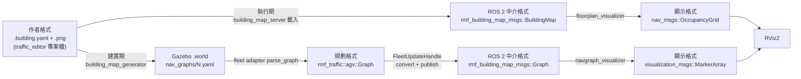
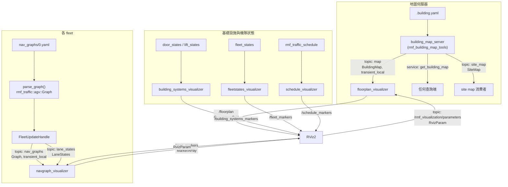

# rmf_demos 室內空間視覺化所使用的資料模型

## 摘要

`open-rmf/rmf_demos`[^demos] 本身**不含任何視覺化程式碼**。它只負責啟動（launch）與提供地圖資產，室內空間視覺化全部由另一套儲存庫 `open-rmf/rmf_visualization`[^viz] 的節點搭配 RViz 完成。因此「rmf_demos 的視覺化使用什麼資料模型」的正確答案是：

> **資料模型是 `rmf_building_map_msgs`[^bmapmsgs] 定義的一組 ROS 2 訊息（`BuildingMap` / `Level` / `Graph` / `GraphNode` / `GraphEdge` / `AffineImage` / `Door` / `Lift` / `GraphZone` / `Param`），在 ROS 2 主題上以「樓層（level）＋點、線、矩形」的扁平結構傳遞；節點再把它轉譯成 RViz 能吃的 `nav_msgs/OccupancyGrid` 與 `visualization_msgs/MarkerArray`。**

換句話說，視覺化的資料模型**不是** IndoorGML / CityGML / IFC 這類室內空間代數結構，也**不是** RMF 內部的 `rmf_traffic::agv::Graph`（那是規劃用的執行期圖），而是介於兩者之間的一個 **ROS 2 專用中介訊息層**，其欄位本質上是「一張帶仿射變換的點陣圖 + 一組點/線圖 + 一組門/電梯線段 + 一組矩形區域」。

---

## 1. 範圍界定：rmf_demos 與視覺化的責任分工

要回答這個問題必須先釐清三層職責：

| 層級 | 儲存庫 / 套件 | 負責什麼 |
|---|---|---|
| 地圖資產 | `rmf_demos_maps`（在 `rmf_demos` 內） | 存放 `.building.yaml` 與樓層 `.png`；建置期產生 `.world` 與 `nav_graphs/*.yaml` |
| 啟動與設定 | `rmf_demos`（launch、config、各世界的 `.rviz`） | 啟動 `building_map_server`、各 fleet adapter、`rmf_visualization`，並指定 RViz 設定檔 |
| 視覺化 | `rmf_visualization`（外部儲存庫） | 訂閱 ROS 2 主題、發布 RViz 用的 Marker / OccupancyGrid |

`rmf_demos` 的 `CMakeLists.txt` 只安裝 `launch/`、`config`、`sros2` 三個目錄[^demos-cmake]，本身不建置任何節點；`rmf_demos_gz` 的 `simulation.launch.xml` 只負責 Gazebo 與 `/clock` 橋接[^sim-launch]。視覺化節點完全來自 `rmf_visualization`。

`rmf_demos` 的 `common.launch.xml` 是關鍵接線處，它同時啟動：

- `rmf_building_map_tools` 的 `building_map_server`，並以 `config_file` 參數指向某個 `.building.yaml`[^common-launch]；
- `rmf_visualization/visualization.launch.xml`，並把 `initial_map`（預設 `L1`）與 `viz_config_file` 傳進去[^common-launch]。

> 註：`common.launch.xml` 也含一個以 `use_site_map` 切換的分支，可改用 `rmf_site_map_server`[^common-launch]；該路徑改用 GeoJSON / GeoPackage 形式的 `SiteMap` 訊息，屬於較新的替代路線，並非 rmf_demos 各世界預設走的路徑。本文以預設路徑（`building_map_server`）為主。

**星數背景**：`rmf_demos` 約 633 顆星、`rmf_visualization` 約 32 顆星、`rmf_building_map_msgs` 僅約 2 顆星、`rmf_traffic_editor` 約 173 顆星、`rmf_ros2` 約 122 顆星[^stars]。`rmf_building_map_msgs` 星數極低，但它是 Open-RMF 唯一官方定義的建築物視覺化訊息介面，屬於「題目指定的冷門但唯一」情形，故仍完整報告。

---

## 2. 資料模型三態：作者格式 → ROS 2 中介格式 → 顯示格式

視覺化牽涉三種不同形態的資料模型，必須分開討論：



- **作者格式**：`.building.yaml`，是 `rmf_traffic_editor` GUI 的專案檔格式[^te-book]。
- **ROS 2 中介格式**：`rmf_building_map_msgs` 的訊息，是視覺化節點實際訂閱的資料模型，也是本題的核心。
- **顯示格式**：RViz 原生吃的 `nav_msgs/OccupancyGrid` 與 `visualization_msgs/MarkerArray`。

---

## 3. 中介資料模型：`rmf_building_map_msgs` 逐欄位

`rmf_building_map_msgs` 是純介面套件（`rosidl_interface_packages`），只定義型別、不含節點邏輯[^bmapmsgs]。其訊息定義如下。

### 3.1 頂層 `BuildingMap`

```
string name
Level[] levels
Lift[] lifts
```

`BuildingMap` 由建築物名稱、一組樓層、一組電梯組成[^msg-buildingmap]。**注意：沒有 `rooms`、`cells`、`states`、`transitions` 這類室內空間代數欄位。**

### 3.2 `Level`

```
string name
float32 elevation
AffineImage[] images
Place[] places
Door[] doors
Graph[] nav_graphs
Graph wall_graph
```

`Level` 是視覺化的主體單位[^msg-level]。其設計等同於「一張圖 + 疊在上面的線與面」：

- `name` 即視覺化與各節點參數中的 **map_name**（例如 `L1`、`L2`），也是切換樓層的識別鍵；
- `elevation` 為樓層高度；
- `images` 為樓層點陣圖（見 3.3）；
- `places` 為具名位置（見 3.4）；
- `doors` 為門（見 3.5）；
- `nav_graphs` 為**多條**導航圖（每個 fleet 一條，見 3.6）；
- `wall_graph` 為牆線圖，也是 `Graph` 型別，但頂點的參數被忽略、邊一律為雙向（見 3.6 末段）。

### 3.3 `AffineImage`：帶仿射變換的點陣圖

```
string name
float32 x_offset
float32 y_offset
float32 yaw
float32 scale
string encoding
uint8[] data
```

`AffineImage` 把樓層平面圖的**原始位元組**（PNG）直接塞進訊息，並附上把它對齊到地圖座標系的仿射參數：`x_offset` / `y_offset` 為原點位移、`yaw` 為旋轉、`scale` 為每像素公尺數[^msg-affineimage]。這是整個視覺化模型最接近「幾何模型」的部分，但它在語意上是**點陣影像 + 2D 相似變換**，不是向量化的室內空間幾何。

`building_map_server` 產生此欄位的方式是以樓層的 `drawing.filename` 讀取 PNG，將檔名去掉副檔名作為 `name`、副檔名作為 `encoding`，並把樓層的 `transform` 填入 `scale`、`translation[0..1]`、`rotation`[^bms-py]。

### 3.4 `Place`

```
string name
float32 x
float32 y
float32 yaw
float32 position_tolerance
float32 yaw_tolerance
```

`Place` 是「具名且帶容差的目標位置」，用於任務層級的「前往某地」，而非視覺化幾何[^msg-place]。

### 3.5 `Door` 與 `Lift`

```
# Door.msg
string name
float32 v1_x, v1_y, v2_x, v2_y
uint8 door_type
uint8 DOOR_TYPE_UNDEFINED=0
uint8 DOOR_TYPE_SINGLE_SLIDING=1
uint8 DOOR_TYPE_DOUBLE_SLIDING=2
uint8 DOOR_TYPE_SINGLE_TELESCOPE=3
uint8 DOOR_TYPE_DOUBLE_TELESCOPE=4
uint8 DOOR_TYPE_SINGLE_SWING=5
uint8 DOOR_TYPE_DOUBLE_SWING=6
float32 motion_range
int32 motion_direction
```

```
# Lift.msg
string name
string[] levels
Door[] doors
Graph wall_graph
float32 ref_x, ref_y, ref_yaw
float32 width, depth
```

門以一對端點座標（`v1`、`v2`）加上類型列舉表示，是**線段**；電梯則有參考位姿、寬深、以及一組同為線段的門[^msg-door][^msg-lift]。`rmf_visualization_building_systems` 便是據此繪製門與電梯的狀態標記（見第 6 節）。

### 3.6 `Graph` / `GraphNode` / `GraphEdge` / `GraphZone` / `Param`

```
# Graph.msg
string name
GraphNode[] vertices
GraphEdge[] edges
GraphZone[] zones
Param[] params
```

```
# GraphNode.msg
float32 x
float32 y
string name
Param[] params
```

```
# GraphEdge.msg
uint32 v1_idx
uint32 v2_idx
Param[] params
uint8 edge_type
uint8 EDGE_TYPE_BIDIRECTIONAL=0
uint8 EDGE_TYPE_UNIDIRECTIONAL=1
```

```
# GraphZone.msg
string name
string level
string type
float32 center_x
float32 center_y
float32 yaw
float32 length
float32 width
ZoneVertex[] vertices
```

```
# Param.msg
string name
uint32 type
uint32 TYPE_UNDEFINED=0
uint32 TYPE_STRING=1
uint32 TYPE_INT=2
uint32 TYPE_DOUBLE=3
uint32 TYPE_BOOL=4
int32 value_int
float32 value_float
string value_string
bool value_bool
```

`Graph` 是一個**扁平的點線圖**：`vertices` 是 2D 點、`edges` 是以頂點索引相連的有向/雙向線段、`zones` 是矩形區域，`Param` 則是無 schema 的鍵值袋，用來掛載語意標籤（例如 `is_charger`、`is_holding_point`、`speed_limit`、`mutex`、`dock_name`、`pickup_dispenser`、`dropoff_ingestor`）[^msg-graph][^msg-graphnode][^msg-graphedge][^msg-graphzone][^msg-param]。

`building_map_server` 轉換時的行為值得注意[^bms-py]：

- **每個樓層會產生多條 nav graph**（原始碼中以 `for i in range(0, 9)` 迭代，代表最多九個 fleet 的圖），`Graph.name` 就是 fleet 編號字串（例如 `"0"`）；
- 邊的方向性由 YAML 的 `is_bidirectional` 決定，映射到 `EDGE_TYPE_BIDIRECTIONAL` 或 `EDGE_TYPE_UNIDIRECTIONAL`；
- 頂點上只有白名單參數會被複製到 `GraphNode.params`：字串類為 `dock_name`、`pickup_dispenser`、`dropoff_ingestor`、`mutex`；布林類為 `is_charger`、`is_cleaning_zone`、`is_holding_point`、`is_parking_spot`；
- 邊上會帶 `speed_limit`（double）與 `mutex`（string）；
- `wall_graph` 的名稱固定為 `"WallGraph"`，其邊一律 `EDGE_TYPE_BIDIRECTIONAL`，並把所有牆參數（`texture_name`、`alpha`、`texture_height`、`texture_width`、`texture_scale`）原封不動塞進 `Param`。

---

## 4. 作者格式：`.building.yaml` 中的視覺化相關欄位

`.building.yaml` 是 `rmf_traffic_editor` 的專案檔[^te-book]。官方書籍明言：

> "The `traffic_editor` GUI projects are stored as yaml files with `.building.yaml` file extensions. Although the typical workflow uses the GUI and does not require hand-editing the yaml files directly, we have used a yaml file format to make it easy to parse using custom scripting if needed."[^te-book]

與視覺化直接相關的欄位為：

- 樓層層級的 `drawing.filename`（對應 `AffineImage` 的來源 PNG）與 `layers`（疊圖，例如 LiDAR 掃描圖）；
- `vertices`：格式為 `[x, y, elevation, name, {params}]`，其中 `params` 可含 `is_holding_point`、`is_parking_spot`、`is_passthrough_point`、`is_charger`、`is_cleaning_zone`、`dock_name`、`spawn_robot_type`、`spawn_robot_name`、`pickup_dispenser`、`dropoff_ingestor`、`human_goal_set_name`[^te-book]；
- `lanes`：格式為 `[起點索引, 終點索引, {params}]`，`params` 含 `bidirectional`、`graph_idx`、`orientation`、`speed_limit`、`mutex`、`demo_mock_floor_name`、`demo_mock_lift_name`[^te-book]；
- `walls`：`[起點索引, 終點索引, {alpha, texture_name, texture_height, texture_width, texture_scale}]`；
- `doors`：`[起點索引, 終點索引, {name, type, motion_axis, motion_degrees, motion_direction, right_left_ratio, plugin}]`，`type` 為 `hinged` / `double_hinged` / `sliding` / `double_sliding`[^te-book]；
- `floors`、`measurements`、`models`、`fiducials`、`elevation`；
- 頂層另有 `name`、`levels`、`lifts`、`coordinate_system`、`reference_level_name`、`crowd_sim`、`graphs`、`parameters`、`map_version`[^te-book][^building-py]。

以 `rmf_demos` 內 `office/office.building.yaml` 為例，可見頂層為 `coordinate_system: reference_image`、`crowd_sim`、`graphs: {}`、`levels: {L1: ...}`、`lifts: {}`、`name: building`，而樓層內含 `drawing.filename: office.png`、`layers.office_laserscan`（另一張 PNG 疊圖）、`vertices`、`lanes`、`walls`、`doors`、`floors`、`models`、`measurements`、`constraints`、`features`[^office-yaml]。

多樓層的例子可見 `hotel/hotel.building.yaml`：`levels` 有 `L1`（elevation 0）、`L2`（elevation 8）、`L3`（elevation 16），各樓層有各自的 `drawing.filename`（`hotel_L1.png` 等）與 `fiducials`，頂層 `lifts` 定義 `Lift1`、`Lift2`（各含 `width`、`depth`、`doors`、`level_doors`、`reference_floor_name`、`lowest_floor`、`highest_floor`）[^hotel-yaml]。

作者格式轉為 ROS 2 中介格式的邏輯位於 `building_map_server`：YAML 先被 `Building(yaml)` 解析成物件樹，再由 `create_map_msg()` 逐樓層呼叫 `level_msg()`、逐電梯呼叫 `lift_msg()` 組出 `BuildingMap`[^bms-py]。其中 `Building` 的 `parse_yaml` 會依 `coordinate_system`（`reference_image` / `web_mercator` / `cartesian_meters` / `wgs84`）決定座標轉換，並用 `measurements` 推算比例尺、用 `fiducials` 對齊樓層[^building-py]。

---

## 5. 建置期與執行期資料流

### 5.1 建置期：從 `.building.yaml` 生成世界檔與導航圖

`rmf_demos_maps/CMakeLists.txt` 會用 glob 找出所有 `maps/*.building.yaml`，對每一個執行兩件事[^maps-cmake]：

1. `ros2 run rmf_building_map_tools building_map_generator gazebo <map> <world> <modeldir>` → 產生 Gazebo `.world` 與樓層模型；
2. `ros2 run rmf_building_map_tools building_map_generator nav <map> <navgraphs_dir>` → 產生 `nav_graphs/N.yaml`；
   （另有 `building_crowdsim` 產生群眾模擬資源，與視覺化無關。）

因此 `.world` 與 `nav_graphs/*.yaml` **不存在於儲存庫中**，是建置產物；`simulation.launch.xml` 以 `$(find-pkg-share $(var map_package))/maps/$(var map_name)/$(var map_name).world` 動態取用[^sim-launch]，`office.launch.xml` 等則以 `.../maps/office/nav_graphs/0.yaml` 傳給 fleet adapter[^office-launch]。

`nav_graphs/N.yaml` 的結構（由 `Building.generate_nav_graphs()` 產生）為 `building_name` / `levels` / `lifts` / `doors` / `zones`，其中每個 level 有 `vertices`（`[x, y, {name, ...}]`）與 `lanes`（`[起點, 終點, {orientation_constraint, speed_limit, mutex, door_name, dock_name, undock_name, demo_mock_floor_name, demo_mock_lift_name}]`）[^building-py]。

### 5.2 執行期：三條各自獨立的饋送路徑



重點：**樓層平面（floorplan）與導航圖（navgraph）是兩條完全不同的資料路徑**，分別由 `building_map_server`（讀 `.building.yaml`）與各 fleet adapter（讀 `nav_graphs/N.yaml`）提供，兩者在主題上互不相干，只在 RViz 中以同一個 `map` 座標系疊合。

`building_map_server` 建立發布者時使用的 QoS 為 `KEEP_LAST`、`depth=1`、`RELIABLE`、`TRANSIENT_LOCAL`[^bms-py]；fleet adapter 的 nav graph 發布者亦使用 transient local[^fuh-hpp]。這意味著視覺化節點即使在啟動順序上晚於發布者，仍可收到最後一筆資料。

值得注意的是，fleet adapter 發布的 `Graph` 是由內部規劃圖**反轉換**而來：`FleetUpdateHandle::Implementation::publish_nav_graph()` 呼叫 `rmf_traffic_ros2::convert((*planner)->get_configuration().graph(), name)`，再發布到 `NavGraphTopicName`[^fuh-cpp]，而 `NavGraphTopicName` 定義為字串 `"nav_graphs"`[^stdnames]。`rmf_traffic_ros2` 提供雙向轉換：`convert(msg)` 與 `convert(graph, fleet_name)`，其中後者註明「若必要欄位缺失或 fleet_name 為空則回傳 nullptr」[^graph-hpp]。

---

## 6. 各視覺化節點使用的資料模型與主題

`rmf_visualization` 的 `visualization.launch.xml` 啟動下列節點[^viz-launch]：

| 節點 | 套件 | 訂閱（資料模型） | 發布（顯示模型） |
|---|---|---|---|
| `floorplan_visualizer_node` | `rmf_visualization_floorplans` | `/map`：`BuildingMap`；`rmf_visualization/parameters`：`RvizParam` | `/floorplan`：`nav_msgs/OccupancyGrid`（Transient Local） |
| `navgraph_visualizer_node` | `rmf_visualization_navgraphs` | `/nav_graphs`：`Graph`；`/lane_states`：`LaneStates`；`RvizParam` | `/map_markers`：`MarkerArray`（Transient Local） |
| `rmf_visualization_building_systems` | `rmf_visualization_building_systems` | `/door_states`：`DoorState`；`/lift_states`：`LiftState` | `/building_systems_markers`：`MarkerArray`（Transient Local） |
| `fleetstates_visualizer_node` | `rmf_visualization_fleet_states` | `/fleet_states`：`FleetState` | `/fleet_markers`：`MarkerArray` |
| `schedule_visualizer_node` | `rmf_visualization_schedule` | RMF 排程資料庫的鏡像 | `/schedule_markers`：`MarkerArray` |
| `obstacle_visualizer_node` | `rmf_visualization_obstacles` | `/rmf_obstacles`：`Obstacles` | `/fleet_markers`：`MarkerArray` |

`visualization.launch.xml` 亦定義了 `lane_width`（0.5 m）、`waypoint_scale`（1.3）、`text_scale`（0.7）、`lane_transparency`（0.6）等渲染參數，以及 rmf_demos 各機隊的足跡半徑（`tinyRobot_radius=0.3`、`deliveryRobot_radius=0.6`、`cleanerBotA_radius=1.0`、`cleanerBotE_radius=1.0`、`caddy_radius=1.5`）[^viz-launch]。

### 6.1 floorplan：`BuildingMap` → `OccupancyGrid`

`FloorplanVisualizer`（節點名 `floorplan_visualizer`）的做法是[^fp-cpp]：

1. 訂閱 `/map`（`BuildingMap`，QoS `QoS(10).transient_local()`）；
2. 對每個 `Level`，取 `level.images[0]` 的 `data` 以 OpenCV `cv::imdecode(..., IMREAD_GRAYSCALE)` 解碼為 `cv::Mat`；
3. 其餘 `images[1..]` 以 `cv::addWeighted(cv_img, 0.7, next_img, 0.3, 0.0, cv_img)` **疊合進第一張**（用於 `layers` 這類疊圖）；
4. 組出 `OccupancyGrid`：
   - `info.resolution = image.scale`
   - `info.width/height` 由解碼後影像行列數決定
   - `info.origin.position.x = image.x_offset`、`y = image.y_offset`、`z = -0.01`
   - 姿態由四元數 `AngleAxisf(M_PI, UnitX) * AngleAxisf(image.yaw, -UnitZ)` 計算（即先繞 X 軸翻轉 180°、再套用影像 yaw）
   - 像素灰階反轉為佔據值：`pix = round((0xFF - pix)/255.0 * 100)`
5. 以 `level.name` 為鍵存入 `_grids`，並發布目前樓層的網格；若目前樓層無資料則發布空的 `OccupancyGrid` 作為「清除」訊號；
6. 訂閱 `rmf_visualization/parameters`（`RvizParam`），當 `map_name` 改變時切換樓層並重新發布。

`Level.doors`、`Level.nav_graphs`、`Level.wall_graph`、`Level.places` 在此節點**完全不被讀取**——floorplan 視覺化只用了 `images`。

### 6.2 navgraph：`Graph` → `MarkerArray`

`NavGraphVisualizer`（節點名 `navgraph_visualizer`）的做法是[^nvg-cpp]：

1. 訂閱 `/nav_graphs`（`Graph`，transient local）。`Graph.name` 被當作 **fleet 名稱**（訊息中該欄位即 fleet 名），並以 `_navgraphs` 建立一個 `FleetNavGraph`；
2. 由於 `Graph` 訊息中 lane 索引與 fleet adapter 內部圖的 lane 索引未必一致，節點先把 `Graph` 透過 `rmf_traffic_ros2::convert(*msg)` 轉成 `rmf_traffic::agv::Graph`，以便取得每個 waypoint 所屬的 `map_name`，再據此把 lanes 分桶到各樓層；
3. 產生的 Marker 種類如下：

| Marker | `type` | namespace | 說明 |
|---|---|---|---|
| 車道 | `LINE_STRIP` | `{fleet}/lanes/{map}` | 連接 `edges[i].v1_idx`、`v2_idx` 對應頂點，z = −0.01 |
| 途經點 | `POINTS` | `{fleet}/waypoints/{map}` | 非 zone 頂點畫成球 |
| Zone 途經點 | `SPHERE_LIST` | `{fleet}/zone_waypoints/{map}` | 位於 zone 內的頂點 |
| 標籤 | `TEXT_VIEW_FACING` | `{fleet}/labels/{map}` | 具名頂點的名稱 |
| 區域 | `CUBE` | `{fleet}/zones/{zone}` | 由 `zones[i]` 的 `center_x/y`、`yaw`、`width`、`length` 組成，`scale.z = 0.1`、`z = −0.5`、alpha 0.5 |
| 區域名稱 | `TEXT_VIEW_FACING` | `{fleet}/zone_names/{zone}` | 黑色文字 |

4. 每個 fleet 會從九色調色盤（橘、藍、紫、青綠、薰衣草、橄欖、青、灰、栗）取得一色，超過九個 fleet 則重用[^nvg-cpp]；
5. 跨樓層的車道（入口與出口 waypoint 的 `map_name` 不同）會被**跳過不畫**；
6. 訂閱 `/lane_states`（`LaneStates`），對關閉的車道把顏色改為深灰（`0.22, 0.22, 0.22, a=0.1`），對限速車道把 `scale.x` 減半；狀態變化僅增量發布受影響樓層的 Marker；
7. 訂閱 `RvizParam`，切換樓層時先以 `DELETEALL` 刪除舊 Marker 再發布新樓層的 Marker。

`GraphNode.params` 與 `GraphEdge.params` 中的語意標籤並未被視覺化節點直接使用（它們主要供 fleet adapter 與 `get_robot_location` 之類的工具查詢），navgraph 視覺化只用到座標、名稱、`zones` 與 `edge_type` 隱含於轉換後的圖。

順帶一提，`rmf_demos_tasks/get_robot_location.py` 也訂閱 `/nav_graphs`（`Graph`，transient local）與 `/fleet_states`，並在 `GraphNode.params` 中尋找名為 `map_name` 的字串參數以過濾樓層[^getloc-py]——這佐證了「`Param` 是無 schema 鍵值袋」的設計意涵。

### 6.3 building systems：門與電梯

`rmf_visualization_building_systems` 是唯一直接對應 `Door` / `Lift` 線段語意的視覺化節點。官方 README 說明：

> "A visualizer for lifts and doors in the facility. The ROS 2 node subscribes to `DoorState` and `LiftState` ROS 2 messages published over `/door_states` and `/lift_states` topics. It then publishes RViz markers depicting the location and status of these systems over `/building_systems_markers` with `Transient Local` durability."[^viz-readme]

要注意的是，它發布的 Marker 位置並非來自 `rmf_building_map_msgs::Door`，而是來自門/電梯狀態訊息與節點自身的參數；`rmf_building_map_msgs::Door` 主要是提供「門的幾何線段」，供需要知道門位置的消費者使用。

---

## 7. RViz 設定檔中的資料模型

各世界有自己的 RViz 設定檔，位於 `rmf_demos/launch/include/<world>/`（`CMakeLists.txt` 以 `install(DIRECTORY launch/ ...)` 安裝，故安裝後路徑為 `share/rmf_demos/include/<world>/...`）[^demos-cmake]。可見的檔案包括 `office/office.rviz`、`hotel/hotel.rviz`、`airport_terminal/airport_terminal.rviz`、`clinic/clinic.rviz`、`campus/campus.rviz`、`chart_lab/chart_lab.rviz`、`battle_royale/rviz.rviz`、`triple_H/rviz.rviz`[^demos-include]。

以 `office.rviz` 為例，其 Display 清單直接體現了顯示層的資料模型[^office-rviz]：

| Display 類型 | 主題 | 顯示資料模型 |
|---|---|---|
| `rviz_default_plugins/MarkerArray` | `/fleet_markers` | 機隊位置（Volatile） |
| `rviz_default_plugins/MarkerArray` | `/schedule_markers` | 排程軌跡（Volatile） |
| `rviz_default_plugins/MarkerArray` | `/map_markers` | 導航圖（Transient Local） |
| `rviz_default_plugins/MarkerArray` | `/building_systems_markers` | 門/電梯狀態（Transient Local） |
| `rviz_default_plugins/Map` | `/floorplan`（`/floorplan_updates`） | 樓層佔據網格（Transient Local） |

其他設定重點：

- `Global Options → Fixed Frame: map`，亦即 RMF 的視覺化座標系固定為 `map`；樓層切換是**換圖不換 frame**：各節點以 `Positions` 與 `yaw` 在平面內疊合，並以 `elevation` 區分樓層（在 `routing` 上則由各 waypoint 的 `map_name` 決定所屬樓層）[^office-rviz][^fp-cpp][^nvg-cpp]；
- `Map` display 的 `Durability Policy: Transient Local`，與 floorplan 節點的 QoS 一致；
- 內含 `rmf_visualization_rviz2_plugins/SchedulePanel`（`Map: L1`、`Topic: /rmf_visualization/parameters`）與 `DoorPanel`，這兩個面板即是切換樓層與操作門的 UI，其輸出即為前述的 `RvizParam`[^office-rviz][^viz-readme]。

`rmf_visualization` 自身也附一份預設 RViz 設定 `rmf_visualization_schedule/config/rmf.rviz`，其 `Fixed Frame` 同為 `map`，並列出 `/schedule_markers`、`/map_markers`、`/fleet_markers`、`/floor_plan`、`/building_systems_markers` 等顯示項[^rmf-rviz]。

> 觀察：同一份預設設定檔中，floorplan 的主題寫作 `/floor_plan`，而 `office.rviz` 寫作 `/floorplan`；`FloorplanVisualizer` 原始碼中發布的主題字串為 `"/floorplan"`[^fp-cpp][^rmf-rviz]。這類命名不一致屬於設定檔與程式碼之間的落差，實務上應以程式碼發布的主題名為準。

---

## 8. 與室內空間資訊標準的對照

把 `rmf_building_map_msgs` 的欄位對照到 IndoorGML / CityGML / IFC 的概念，可以看出它**故意不採用**室內空間代數模型，而採用「視覺化友善的扁平結構」：

| IndoorGML / CityGML / IFC 概念 | `rmf_building_map_msgs` 的對應物 | 差異 |
|---|---|---|
| `CellSpace`（房間/空間單元） | `GraphZone`（矩形，含 `length`/`width`/`yaw`） | zone 是**矩形近似**且綁定單一 fleet 的 nav graph，不是可組合的拓樸單元 |
| `State`（可停留狀態） | `GraphNode`（x, y, name, params） | 只有 2D 點，無 3D 體積或樓層內高程 |
| `Transition`（狀態間連通） | `GraphEdge`（v1_idx, v2_idx, edge_type） | 只有單一有向/雙向旗標，無「門/通道/樓梯」的分類語意 |
| `CellSpaceBoundary`（邊界） | `Graph wall_graph`（另一張 `Graph`） | 牆只是線段；門另存於 `Door[]`，兩者無拓樸關聯 |
| 3D 幾何 / 實體幾何 | `AffineImage`（點陣 PNG + x/y/yaw/scale） | **僅 2D 點陣影像**，靠 `elevation` 分層 |
| 空間階層（Site → Building → Storey） | `BuildingMap.name` → `Level` → 無 | 只到樓層一層，沒有場域（site）與空間群組概念 |
| 語意屬性（可擴充 schema） | `Param`（無 schema 鍵值袋） | 無受控詞彙表，語意靠字串命名慣例 |

因此 `rmf_building_map_msgs` 在室內空間資訊標準的分類上，屬於一種 **robot-traffic-centric、渲染優先（rendering-first）的專用中介格式**：它保留了「哪裡有圖可以貼、哪裡有點可以走、哪裡有線代表牆與門、哪裡有矩形代表區域」四件事，而不建立「空間單元—狀態—轉移」的代數結構。

---

## 9. 關鍵細節與易錯點

1. **rmf_demos 沒有視覺化程式碼**：所有視覺化邏輯在 `rmf_visualization`；`rmf_demos` 只提供 launch、`.rviz` 與 `.building.yaml` 資產。
2. **兩條平行的地圖來源**：floorplan 來自 `building_map_server` 讀 `.building.yaml`；navgraph 來自各 fleet adapter 讀 `nav_graphs/N.yaml`。兩者不共用記憶體或主題，只在 RViz 中疊合。
3. **`nav_graphs` 主題的發布者是 fleet adapter，不是 `building_map_server`**：fleet adapter 在 `FleetUpdateHandle` 建構時建立 `nav_graphs` 發布者並立即發布一次[^fuh-hpp]，其資料來自內部 `rmf_traffic::agv::Graph` 的反向轉換[^fuh-cpp][^stdnames]。
4. **`BuildingMap.levels[].nav_graphs` 是「最多九條」**：`building_map_server` 以 `range(0, 9)` 迭代替換 fleet 編號，`Graph.name` 是數字字串[^bms-py]；而 `rmf_visualization` 使用的是來自 fleet adapter 的 `Graph`，其 `name` 是真正的 fleet 名稱[^nvg-cpp]。
5. **`AffineImage` 是唯一的「影像」模型，且帶仿射參數**：`x_offset`/`y_offset`/`yaw`/`scale` 是將 PNG 對齊到 `map` 座標系所需的完整資訊，缺少它們影像將無法正確疊合[^msg-affineimage][^fp-cpp]。
6. **樓層切換靠 `RvizParam`**：`/rmf_visualization/parameters` 上的 `map_name` 欄位是 floorplan 與 navgraph 視覺化切換樓層的共同控制通道[^viz-readme][^fp-cpp][^nvg-cpp]。
7. **`Param` 無 schema**：同一鍵名（例如 `is_holding_point`）在不同消費端可能有不同的解讀與過濾清單；`building_map_server` 有白名單、`get_robot_location` 期待 `map_name`[^bms-py][^getloc-py]。
8. **`SiteMap` 是另一條路線**：`building_map_server` 同時發布 `site_map`（GeoJSON/GeoPackage 形式），`common.launch.xml` 亦有 `use_site_map` 分支可改用 `rmf_site_map_server`[^bms-py][^common-launch]；但 rmf_demos 各世界預設仍走 `BuildingMap` 路線。

---

## 10. 結論

`rmf_demos` 的室內空間視覺化，其資料模型可濃縮為一句話：

> **以 `rmf_building_map_msgs` 的 `BuildingMap`（樓層＋`AffineImage` 點陣圖＋`Door`/`Lift` 線段＋`Graph` 點線圖＋`GraphZone` 矩形）作為中介模型，由 `building_map_server` 與各 fleet adapter 分別在 ROS 2 主題上發布，`rmf_visualization` 的節點再降級（downcast）為 RViz 原生的 `OccupancyGrid` 與 `MarkerArray` 呈現；RViz 端以 `RvizParam` 控制樓層切換，固定座標系為 `map`。**

這個模型在光譜上介於「室內空間資訊標準」與「單純的渲染資料」之間：它比 IndoorGML 少了空間代數與語意階層，比一般 2D 圖層多了 `Param` 語意標籤、多 fleet 導航圖與門/電梯線段，是為機器人通行與 RViz 疊圖量身打造的專用格式。

---

## 參考資料

[^demos]: Open Robotics Middleware Framework. (n.d.). *open-rmf/rmf_demos* [Source code]. GitHub. Retrieved 2026-11-21, from https://github.com/open-rmf/rmf_demos

[^viz]: Open Robotics Middleware Framework. (n.d.). *open-rmf/rmf_visualization* [Source code]. GitHub. Retrieved 2026-11-21, from https://github.com/open-rmf/rmf_visualization

[^bmapmsgs]: Open Robotics Middleware Framework. (n.d.). *open-rmf/rmf_building_map_msgs* [Source code]. GitHub. Retrieved 2026-11-21, from https://github.com/open-rmf/rmf_building_map_msgs

[^demos-cmake]: Open Robotics Middleware Framework. (n.d.). *rmf_demos/CMakeLists.txt*. Retrieved 2026-11-21, from https://raw.githubusercontent.com/open-rmf/rmf_demos/main/rmf_demos/CMakeLists.txt

[^maps-cmake]: Open Robotics Middleware Framework. (n.d.). *rmf_demos_maps/CMakeLists.txt*. Retrieved 2026-11-21, from https://raw.githubusercontent.com/open-rmf/rmf_demos/main/rmf_demos_maps/CMakeLists.txt

[^sim-launch]: Open Robotics Middleware Framework. (n.d.). *rmf_demos_gz/launch/simulation.launch.xml*. Retrieved 2026-11-21, from https://raw.githubusercontent.com/open-rmf/rmf_demos/main/rmf_demos_gz/launch/simulation.launch.xml

[^common-launch]: Open Robotics Middleware Framework. (n.d.). *rmf_demos/launch/common.launch.xml*. Retrieved 2026-11-21, from https://raw.githubusercontent.com/open-rmf/rmf_demos/main/rmf_demos/launch/common.launch.xml

[^office-launch]: Open Robotics Middleware Framework. (n.d.). *rmf_demos/launch/office.launch.xml*. Retrieved 2026-11-21, from https://raw.githubusercontent.com/open-rmf/rmf_demos/main/rmf_demos/launch/office.launch.xml

[^office-rviz]: Open Robotics Middleware Framework. (n.d.). *rmf_demos/launch/include/office/office.rviz*. Retrieved 2026-11-21, from https://raw.githubusercontent.com/open-rmf/rmf_demos/main/rmf_demos/launch/include/office/office.rviz

[^demos-include]: Open Robotics Middleware Framework. (n.d.). *rmf_demos/launch/include* [Directory listing]. GitHub. Retrieved 2026-11-21, from https://github.com/open-rmf/rmf_demos/tree/main/rmf_demos/launch/include

[^office-yaml]: Open Robotics Middleware Framework. (n.d.). *rmf_demos_maps/maps/office/office.building.yaml*. Retrieved 2026-11-21, from https://raw.githubusercontent.com/open-rmf/rmf_demos/main/rmf_demos_maps/maps/office/office.building.yaml

[^hotel-yaml]: Open Robotics Middleware Framework. (n.d.). *rmf_demos_maps/maps/hotel/hotel.building.yaml*. Retrieved 2026-11-21, from https://raw.githubusercontent.com/open-rmf/rmf_demos/main/rmf_demos_maps/maps/hotel/hotel.building.yaml

[^te-book]: Open Source Robotics Foundation. (n.d.). Traffic Editor. In *Programming Multiple Robots with ROS 2*. Retrieved 2026-11-21, from https://osrf.github.io/ros2multirobotbook/traffic-editor.html

[^building-py]: Open Robotics Middleware Framework. (n.d.). *rmf_building_map_tools/building_map/building.py*. Retrieved 2026-11-21, from https://raw.githubusercontent.com/open-rmf/rmf_traffic_editor/main/rmf_building_map_tools/building_map/building.py

[^level-py]: Open Robotics Middleware Framework. (n.d.). *rmf_building_map_tools/building_map/level.py*. Retrieved 2026-11-21, from https://raw.githubusercontent.com/open-rmf/rmf_traffic_editor/main/rmf_building_map_tools/building_map/level.py

[^bms-py]: Open Robotics Middleware Framework. (n.d.). *rmf_building_map_tools/building_map_server/building_map_server.py*. Retrieved 2026-11-21, from https://raw.githubusercontent.com/open-rmf/rmf_traffic_editor/main/rmf_building_map_tools/building_map_server/building_map_server.py

[^msg-buildingmap]: Open Robotics Middleware Framework. (n.d.). *rmf_building_map_msgs/msg/BuildingMap.msg*. Retrieved 2026-11-21, from https://raw.githubusercontent.com/open-rmf/rmf_building_map_msgs/main/rmf_building_map_msgs/msg/BuildingMap.msg

[^msg-level]: Open Robotics Middleware Framework. (n.d.). *rmf_building_map_msgs/msg/Level.msg*. Retrieved 2026-11-21, from https://raw.githubusercontent.com/open-rmf/rmf_building_map_msgs/main/rmf_building_map_msgs/msg/Level.msg

[^msg-affineimage]: Open Robotics Middleware Framework. (n.d.). *rmf_building_map_msgs/msg/AffineImage.msg*. Retrieved 2026-11-21, from https://raw.githubusercontent.com/open-rmf/rmf_building_map_msgs/main/rmf_building_map_msgs/msg/AffineImage.msg

[^msg-place]: Open Robotics Middleware Framework. (n.d.). *rmf_building_map_msgs/msg/Place.msg*. Retrieved 2026-11-21, from https://raw.githubusercontent.com/open-rmf/rmf_building_map_msgs/main/rmf_building_map_msgs/msg/Place.msg

[^msg-door]: Open Robotics Middleware Framework. (n.d.). *rmf_building_map_msgs/msg/Door.msg*. Retrieved 2026-11-21, from https://raw.githubusercontent.com/open-rmf/rmf_building_map_msgs/main/rmf_building_map_msgs/msg/Door.msg

[^msg-lift]: Open Robotics Middleware Framework. (n.d.). *rmf_building_map_msgs/msg/Lift.msg*. Retrieved 2026-11-21, from https://raw.githubusercontent.com/open-rmf/rmf_building_map_msgs/main/rmf_building_map_msgs/msg/Lift.msg

[^msg-graph]: Open Robotics Middleware Framework. (n.d.). *rmf_building_map_msgs/msg/Graph.msg*. Retrieved 2026-11-21, from https://raw.githubusercontent.com/open-rmf/rmf_building_map_msgs/main/rmf_building_map_msgs/msg/Graph.msg

[^msg-graphnode]: Open Robotics Middleware Framework. (n.d.). *rmf_building_map_msgs/msg/GraphNode.msg*. Retrieved 2026-11-21, from https://raw.githubusercontent.com/open-rmf/rmf_building_map_msgs/main/rmf_building_map_msgs/msg/GraphNode.msg

[^msg-graphedge]: Open Robotics Middleware Framework. (n.d.). *rmf_building_map_msgs/msg/GraphEdge.msg*. Retrieved 2026-11-21, from https://raw.githubusercontent.com/open-rmf/rmf_building_map_msgs/main/rmf_building_map_msgs/msg/GraphEdge.msg

[^msg-graphzone]: Open Robotics Middleware Framework. (n.d.). *rmf_building_map_msgs/msg/GraphZone.msg*. Retrieved 2026-11-21, from https://raw.githubusercontent.com/open-rmf/rmf_building_map_msgs/main/rmf_building_map_msgs/msg/GraphZone.msg

[^msg-param]: Open Robotics Middleware Framework. (n.d.). *rmf_building_map_msgs/msg/Param.msg*. Retrieved 2026-11-21, from https://raw.githubusercontent.com/open-rmf/rmf_building_map_msgs/main/rmf_building_map_msgs/msg/Param.msg

[^fp-cpp]: Open Robotics Middleware Framework. (n.d.). *rmf_visualization_floorplans/src/FloorplanVisualizer.cpp*. Retrieved 2026-11-21, from https://raw.githubusercontent.com/open-rmf/rmf_visualization/main/rmf_visualization_floorplans/src/FloorplanVisualizer.cpp

[^nvg-cpp]: Open Robotics Middleware Framework. (n.d.). *rmf_visualization_navgraphs/src/NavGraphVisualizer.cpp*. Retrieved 2026-11-21, from https://raw.githubusercontent.com/open-rmf/rmf_visualization/main/rmf_visualization_navgraphs/src/NavGraphVisualizer.cpp

[^viz-launch]: Open Robotics Middleware Framework. (n.d.). *rmf_visualization/visualization.launch.xml*. Retrieved 2026-11-21, from https://raw.githubusercontent.com/open-rmf/rmf_visualization/main/rmf_visualization/launch/visualization.launch.xml

[^viz-readme]: Open Robotics Middleware Framework. (n.d.). *rmf_visualization/README.md*. Retrieved 2026-11-21, from https://raw.githubusercontent.com/open-rmf/rmf_visualization/main/README.md

[^rmf-rviz]: Open Robotics Middleware Framework. (n.d.). *rmf_visualization_schedule/config/rmf.rviz*. Retrieved 2026-11-21, from https://raw.githubusercontent.com/open-rmf/rmf_visualization/main/rmf_visualization_schedule/config/rmf.rviz

[^fuh-hpp]: Open Robotics Middleware Framework. (n.d.). *rmf_fleet_adapter/src/rmf_fleet_adapter/agv/internal_FleetUpdateHandle.hpp*. Retrieved 2026-11-21, from https://raw.githubusercontent.com/open-rmf/rmf_ros2/main/rmf_fleet_adapter/src/rmf_fleet_adapter/agv/internal_FleetUpdateHandle.hpp

[^fuh-cpp]: Open Robotics Middleware Framework. (n.d.). *rmf_fleet_adapter/src/rmf_fleet_adapter/agv/FleetUpdateHandle.cpp*. Retrieved 2026-11-21, from https://raw.githubusercontent.com/open-rmf/rmf_ros2/main/rmf_fleet_adapter/src/rmf_fleet_adapter/agv/FleetUpdateHandle.cpp

[^stdnames]: Open Robotics Middleware Framework. (n.d.). *rmf_fleet_adapter/include/rmf_fleet_adapter/StandardNames.hpp*. Retrieved 2026-11-21, from https://raw.githubusercontent.com/open-rmf/rmf_ros2/main/rmf_fleet_adapter/include/rmf_fleet_adapter/StandardNames.hpp

[^graph-hpp]: Open Robotics Middleware Framework. (n.d.). *rmf_traffic_ros2/include/rmf_traffic_ros2/agv/Graph.hpp*. Retrieved 2026-11-21, from https://raw.githubusercontent.com/open-rmf/rmf_ros2/main/rmf_traffic_ros2/include/rmf_traffic_ros2/agv/Graph.hpp

[^parse-graph]: Open Robotics Middleware Framework. (n.d.). *rmf_fleet_adapter/src/rmf_fleet_adapter/agv/parse_graph.cpp*. Retrieved 2026-11-21, from https://raw.githubusercontent.com/open-rmf/rmf_ros2/main/rmf_fleet_adapter/src/rmf_fleet_adapter/agv/parse_graph.cpp

[^getloc-py]: Open Robotics Middleware Framework. (n.d.). *rmf_demos_tasks/rmf_demos_tasks/get_robot_location.py*. Retrieved 2026-11-21, from https://github.com/open-rmf/rmf_demos/blob/main/rmf_demos_tasks/rmf_demos_tasks/get_robot_location.py

[^stars]: GitHub. (n.d.). *Repository metadata for open-rmf/rmf_demos, open-rmf/rmf_visualization, open-rmf/rmf_building_map_msgs, open-rmf/rmf_traffic_editor, open-rmf/rmf_ros2, open-rmf/rmf_internal_msgs* [Repository metadata]. Retrieved 2026-11-21, from https://api.github.com/repos/open-rmf/rmf_demos
