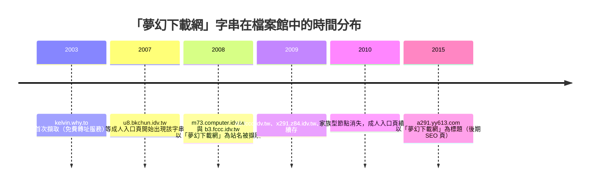
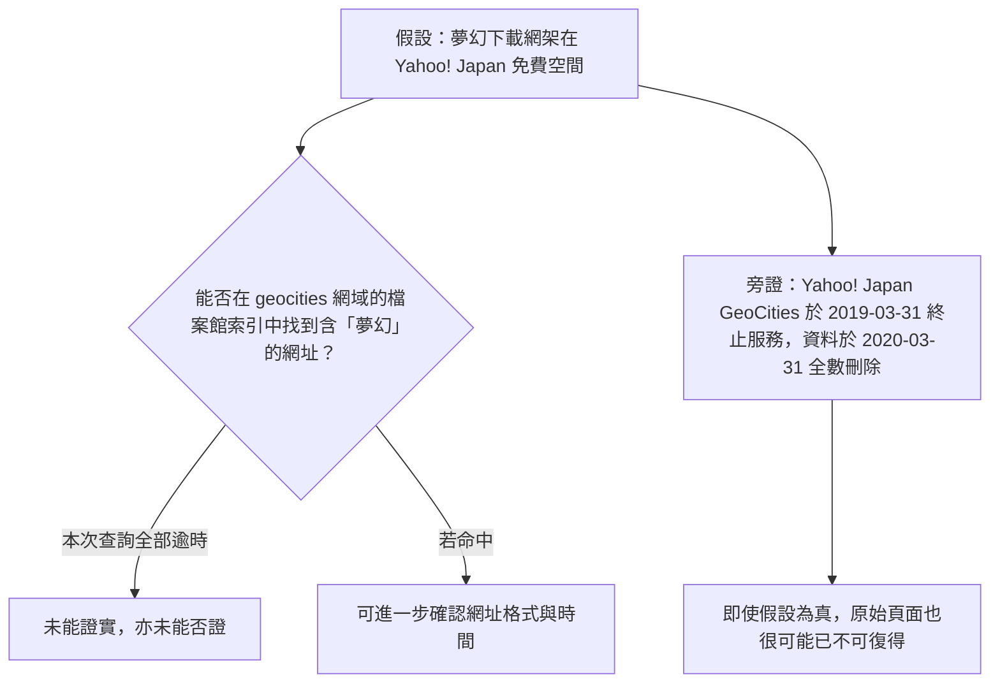

# 「夢幻下載網」存在痕跡調查

## 摘要

本文調查一個已下線多年的繁體中文遊戲／軟體下載站「夢幻下載網」，其特徵描述為：台灣人或香港人架設、繁體中文介面、站內收錄 Call of Duty 試玩版、蟲蟲戰爭（Liero）、Pocket Tanks 等遊戲，並疑似架設於 Yahoo! Japan 的免費網路空間。

主要結論如下：

1. **「夢幻下載網」這五個字確實存在於網際網路檔案館（Internet Archive Wayback Machine）的索引之中**，但只出現在 2003 至 2016 年間擷取的少數台灣主機頁面上，且這些頁面幾乎全屬於成人視訊、聊天室或 SEO 轉址性質的站點，而非真正的遊戲下載入口。
2. **最接近「本站」的證據是兩個台灣「家族」型網站的站名**：`m73.computer.idv.tw` 與 `b3.fccc.idv.tw`，兩者在 2008 至 2009 年的擷取中，站名即顯示為「夢幻下載網」，且具備分類、項目列表與會員／交易功能的網址結構。
3. **沒有找到任何直接證據支持該站收錄 Call of Duty 試玩版、蟲蟲戰爭（Liero）或 Pocket Tanks**；將這些遊戲名稱與「夢幻下載網」合併檢索，於檔案館錨文字索引與主要搜尋引擎皆無有效命中。
4. **Yahoo! Japan 免費空間的假設無法證實，也無法否證**。Yahoo! Japan 的免費網頁服務（Yahoo!ジオシティーズ）確實存在、網址格式確實可能長得像 `www.geocities.co.jp/Playtown/<番地>/`，且已於 2019 年 3 月 31 日終止、資料於 2020 年 3 月 31 日全數刪除。然而針對 `geocities.yahoo.co.jp`、`www.geocities.co.jp`、`www.geocities.jp` 所做的含「夢幻」字樣 CDX 篩選查詢全部逾時，未能取得任何命中或否定結果。
5. 就現存痕跡而言，**台灣的可能性遠高於香港**：殘存頁面為繁體中文、位於 `.idv.tw` 與 `.com.tw` 網域、採用同一套家族型網站系統；沒有任何香港網域的痕跡。
6. PTT（批踢踢實業坊）的 Old-Games、EZsoft、Gossiping 等看板站內搜尋「夢幻下載網」與「夢幻下載」**皆為零筆結果**，顯示該站即使在台灣玩家社群中，也沒有留下可被今日檢索到的懷舊討論。

整體判斷：**「夢幻下載網」作為一個 2000 年前後的實體遊戲下載站，其存在目前只有極薄弱的間接痕跡；殘存證據更傾向於 2007 至 2010 年間一批台灣 SEO／成人入口網頁沿用了這個名稱，而非該站原始本體被保存下來。**

---

## 1. 研究背景與待驗證的問題

本次調查的對象，是一個依描述具有下列特徵的繁體中文網站：

- 站名為「夢幻下載網」，另有「夢幻下載網 2000」的可能變體名稱[^brief]。
- 架設者可能是台灣人或香港人。
- 介面為繁體中文。
- 站內收錄 Call of Duty 試玩版、蟲蟲戰爭（Liero）、Pocket Tanks 等遊戲。
- 已下線多年。
- 疑似使用 Yahoo! Japan 提供的免費網路空間。

因此，本報告要回答的問題可以拆解為五項：

1. 網際網路上是否還留有「夢幻下載網」這個名稱的任何痕跡？
2. 若有，這些痕跡指向什麼樣的網站？
3. 該站是否確實存在於 2000 年前後、且為遊戲下載站？
4. 現存痕跡能否區分台灣與香港？
5. 「架在 Yahoo! Japan 免費空間」的假設是否可能成立？

[^brief]: 上述特徵來自本次調查的委託說明，屬待驗證的前提，並非已證實的事實。

---

## 2. 方法與工具

### 2.1 實際有效的查證管道

- **Wayback Machine 錨文字索引（anchor index）**：`https://web.archive.org/__wb/search/anchor?q=<關鍵字>`。這是本次調查最關鍵的工具。它索引的是「已典藏頁面中的可見文字」，因此可以找到今日已不存在的字串[^anchor-api]。這正是找出已下線小站的可行手段，也是本次唯一產生正向結果的檔案館查詢。
- **Wayback Machine 主機索引（host index）**：`https://web.archive.org/__wb/search/host?q=<關鍵字>`，用於列出含有該字串的主機清單[^host-api]。
- **Wayback CDX API**：`https://web.archive.org/cdx/search/cdx?...`，用於列出特定網域或網址的所有擷取快照與時間戳[^cdx-api]。
- **一般搜尋引擎**：Bing（zh-TW 市場）、Brave Search、DuckDuckGo、Google 的**站內或精確字串檢索**。
- **PTT 站內搜尋**：`https://www.ptt.cc/bbs/<看板>/search?q=<關鍵字>`。
- **archive.org 全文檢索 API**：`https://archive.org/advancedsearch.php`。

### 2.2 嘗試後失敗或無法完成的管道

為了讓後續研究者不必重複踩坑，以下管道在本次調查中失敗，或僅能用於旁證：

- **Google 網頁搜尋**：在本次環境中持續被驗證碼與限流阻擋，無法取得結果，因此本報告的所有網路搜尋結論都建立在 Bing 與 Brave 之上。
- **DuckDuckGo**：回傳 HTTP 202（要求驗證），無法取得結果頁。
- **Mojeek**：回傳 HTTP 403。
- **巴哈姆特全文搜尋**：`forum.gamer.com.tw/search.php` 回傳系統訊息「沒有傳入板編」，無法完成站內搜尋。
- **讀取 Wayback 快照的原始位元組（Big5 頁面）**：`web.archive.org/web/<時間戳>id_/<網址>` 形式在本次環境中對 Big5 編碼頁面持續回傳「Response content is not valid UTF-8」，多種代理（allorigins、codetabs、corsproxy、r.jina.ai、textise、Google 翻譯代理）與比對來源（archive.today、urlscan.io、Bing 與 Google 快取）亦全數失敗。**這是本報告最大的技術限制**：我能確認某些頁面存在、能取得其標題與索引摘要，但**無法完整閱讀其正文**。完整的嘗試清單見第 4.4 節。
- **針對 `geocities.yahoo.co.jp`、`www.geocities.co.jp`、`geocities.jp`、`hk.geocities.com` 做含「夢幻」字樣的 CDX 篩選查詢**：皆以連線逾時收場，**因此「Yahoo 日本免費空間下沒有夢幻下載網」這一點在本報告中屬於未完成驗證，而非已證實的否定結論**。

[^anchor-api]: Wayback Machine. (n.d.). *Anchor text search index*. Retrieved 2026-11-21, from https://web.archive.org/__wb/search/anchor?q=%E5%A4%A2%E5%B9%BB%E4%B8%8B%E8%BC%89%E7%B6%B2 （本報告第 3、5、7 節的所有錨文字索引結果均出自此索引，檢索日期 2026-11-21）
[^host-api]: Wayback Machine. (n.d.). *Host search index*. Retrieved 2026-11-21, from https://web.archive.org/__wb/search/host?q=%E5%A4%A2%E5%B9%BB%E4%B8%8B%E8%BC%89%E7%B6%B2
[^cdx-api]: Internet Archive. (n.d.). *CDX Server API*. Retrieved 2026-11-21, from https://web.archive.org/cdx/search/cdx

---

## 3. 發現一：錨文字索引中確實存在「夢幻下載網」

以完整字串「夢幻下載網」查詢 Wayback Machine 的錨文字索引，可得到一組明確的命中結果。下表整理其中與「夢幻下載網」字串直接相關、且具備台灣網域或繁體中文特徵的主機[^anchor-api]：

| 主機 | 首次擷取 | 最後擷取 | 擷取數（約） | 該頁當時標題 | 性質判讀 |
|---|---|---|---|---|---|
| `m73.computer.idv.tw` | 2008 | 2008 | 49 | 夢幻下載網 | 台灣家族型網站（`.idv.tw` 自有網域） |
| `b3.fccc.idv.tw` | 2008 | 2009 | 134 | 夢幻下載網 | 台灣家族型網站（`.idv.tw` 自有網域） |
| `x291.z84.idv.tw` | 2009 | 2010 | 18 | 夢幻下載網 | 台灣家族型網站節點 |
| `a291.yy613.com` | 2015 | 2016 | 165 | 夢幻下載網 | 後期 SEO／成人入口頁 |
| `kelvin.why.to` | 2003 | 2011 | 323 | 主頁 | 免費轉址服務頁面 |
| `m3.yscar.com.tw` | 2008 | 2009 | 54 | 色情自拍照片 | 成人入口頁 |
| `u3.royalflora.com.tw` | 2008 | 2010 | 131 | 愛愛成人貼圖片區 | 成人入口頁 |
| `b43.hefengr.com.tw` | 2008 | 2008 | 47 | 粉紅豆豆聊天室 | 成人／聊天室入口 |
| `m3.etranscend.com.tw` | 2008 | 2009 | 11 | 淫美成人論壇 | 成人論壇入口 |
| `u3.fini.idv.tw` | 2008 | 2009 | 43 | 173視訊 | 成人視訊入口 |
| `z87.idv.tw` | 2009 | 2010 | 171 | 美女視訊 | 成人視訊入口 |
| `u8.bkchun.idv.tw` | 2007 | 2009 | 55 | 性愛影片分享區 | 成人入口頁 |
| `sky-tw.com.tw` | 2008 | 2009 | 66 | 男同志聊天室 | 成人／聊天室入口；索引文字作「夢幻遊戲下載網」 |
| `www.kk1016.com` | 2009 | 2016 | 81 | 免費視訊聊天室 | 成人聊天室入口 |

以主機索引查詢同一字串時，回傳的主機清單恰為五筆：`a291.yy613.com`、`www.kk1016.com`、`m3.yscar.com.tw`、`u3.royalflora.com.tw`、`m73.computer.idv.tw`[^host-api]。主機索引是抽樣式的呈現，與上表並不矛盾。

**關鍵判讀**：這些命中頁面有一個非常一致的模式，就是「頁面標題」與「索引到的字串」往往是脫節的。例如 `m3.yscar.com.tw` 的標題是「色情自拍照片」，內容卻被索引出「夢幻下載網」；`u3.royalflora.com.tw` 的標題是「愛愛成人貼圖片區」，同樣被索引出「夢幻下載網」。這正是台灣 2007 至 2010 年間大量「成人視訊／聊天室入口網」的典型特徵：它們在頁面上堆疊大量與自身無關的熱門關鍵字與站名（例如「洪爺」、「嘟嘟」、「夢幻下載網」、「foxy 免費音樂下載」），用來承接搜尋流量[^anchor-api]。

換言之，**這批命中很可能不是「夢幻下載網」本體，而是把「夢幻下載網」當作關鍵字使用的其他站點**。這是本次調查最重要的限制，也是後續研究者必須先排除的干擾。

---

## 4. 發現二：兩個疑似「本站」的台灣家族型網站

上表中只有 `m73.computer.idv.tw` 與 `b3.fccc.idv.tw` 兩者，其**站名本身就是「夢幻下載網」**，而不是被關鍵字堆疊帶出。這兩台的網址結構高度相似，顯示它們使用同一套（或同源的）台灣「家族／社群」型網站系統。

### 4.1 `m73.computer.idv.tw`（2008）

CDX 查詢顯示，該站的擷取網址集中在單一入口程式 `index.phtml`，並帶有下列參數[^cdx-m73]：

- `index.phtml` 為首頁。
- `index.phtml?&R2=&OP=&P=2` 到 `P=11`：分頁列表，**至少要翻到第 11 頁**，顯示站上有大量條目。
- `index.phtml?PUT=a_show&AID=<編號>&FID=76666`：以 `AID`（文章／項目編號）存取單一條目；可觀察到的 `AID` 包含 13、15、36、37、44、163、187、188、190、192、195、196、197、199、20、210、217、219、236、3192、3193、369、371、372、374、375、386 等。
- `FID=76666`：家族／討論區編號（family id）。
- `index.phtml?PUT=faq`、`PUT=mailbox`、`PUT=up_reg`、`PUT=up_edit`、`PUT=up_pay`、`PUT=pay_doc1`：FAQ、信箱、註冊、編輯、付款、付款文件等功能頁。

這是台灣 2000 年代「家族」型網站的典型樣貌：一個家族擁有自己的首頁、分類與文章列表，並具備會員與付費機制。不過如第 4.3 節所述，`m73` 與 `b3` 兩站的網域都在 `.idv.tw` 之下，因此**這裡的「家族」並不是寄生在入口網站提供的空間裡，而比較像是自有網域上的一套家族型網站系統**[^cdx-m73]。

### 4.2 `b3.fccc.idv.tw`（2008–2009）

同樣的結構，但參數命名略有不同，且可以看到「分類」與「項目」兩層[^cdx-b3]：

- `index.phtml?FID=3567`：家族編號 3567。
- `index.phtml?CA=<分類>&FID=3567`：`CA` 為分類編號，可觀察到 `CA=10` 至 `CA=20`，另有 `CA=M`（可能是「其他」或「更多」）。
- `index.phtml?VID=<編號>`：`VID` 為項目編號，可觀察到 1700 至 1721、2512、2515、2517 等。
- `index.phtml?PUT=up_reg`、`PUT=up_pay`、`PUT=up_trade`、`PUT=pay_trade`、`PUT=up_bank`、`PUT=up_password`、`PUT=up_mpassword`：註冊、付款、交易、銀行資料、密碼等。
- `/FLV/index.phtml`：存在 `FLV` 目錄，暗示站上有影音（Flash Video）內容。

`CA`（分類）至少 11 個、`VID` 至少有 1700 至 2517 的編號區間，說明這不是空殼頁面，而是**有實質分類與內容列表的站點**[^cdx-b3]。

### 4.3 家族型平台的文化脈絡

「家族」是 2000 年代台灣入口網站最主流的社群網站形式。以奇摩站為例，其 1999 年 10 月的 5.0 版即推出「奇摩家族」，並在 2000 年 12 月的 8.0 版中與奇摩免費網頁、奇摩聊天室等一同改版[^kimo]。一個「家族」通常擁有自己的首頁、分類看板、文章列表、家長（管理員）與成員系統，這與 `m73`／`b3` 兩站所呈現的 `FID`（家族編號）、`AID`／`VID`（條目編號）、`PUT=up_reg`（註冊）、`PUT=up_pay`（付款）結構高度吻合。

值得注意的是，**這兩站的網址都在 `.idv.tw`（個人網域）之下，而不是在任何入口網站的家族網址之下**。這表示該「家族」並非寄生在入口網站提供的空間裡，而比較可能是：站方自行申請了個人網域，再架設（或註冊使用）一套家族型網站系統。這也意味著「夢幻下載網」的經營者擁有並維護自己的網域，門檻高於單純使用免費空間。

上述對應關係是本報告依網址參數所做的**推論**，而非直接觀察到的陳述；本次未能取得這兩站的自述頁面來確認其平台來源。

### 4.4 為何仍無法證實遊戲清單

這兩站最可能的「真身」候選，其正文卻無法在本次環境中解碼讀取。我系統性地嘗試了下列所有管道，全部失敗（列出以供後續研究者節省時間）：

| 嘗試的管道 | 結果 |
|---|---|
| Wayback 原始位元組（`id_`） | 「Response content is not valid UTF-8」 |
| `if_`、`fw_`、`oe_`、`mp_`、`cs_` 等各種 Wayback 模式 | 同上 |
| Wayback `text/` 純文字擷取 | 404（未以純文字格式典藏） |
| 同站的 2008-03-24、2008-04-23 等其他快照 | 同上 |
| Google 翻譯代理 `web-archive-org.translate.goog` | 同上 |
| allorigins（單層與雙層編碼）、codetabs、corsproxy.io、r.jina.ai、textise | 500／522／401／403／DNS 失敗 |
| archive.today／archive.ph | 無快照 |
| urlscan.io API（`m73`、`b3`、`computer.idv.tw`、`fccc.idv.tw`） | 零筆結果（2008 年過舊，超出其保留範圍） |
| Bing 快取 `cc.bingj.com` | DNS 失敗 |
| Google 快取（原始網址與檔案館網址兩種） | 僅回傳錯誤頁 |
| Wayback `timemap` API | 空回應 |
| 直接以 DNS 解析 `m73.computer.idv.tw` | 主機已不存在 |
| Bing 搜尋 `"m73.computer.idv.tw"`、`"b3.fccc.idv.tw"` | 各約 50 筆結果，**全部無關**（多為內政部戶政司等網站，只因含 `idv.tw` 字串而命中） |

**根因**：這些頁面是 Big5 編碼的繁體中文 HTML，而本次環境的抓取工具會直接拒絕任何無法通過 UTF-8 驗證的回應；所有可用代理皆未能在回傳前完成 Big5 轉 UTF-8。因此：

- **可以確認**：2008 至 2009 年間，`m73.computer.idv.tw` 與 `b3.fccc.idv.tw` 這兩台台灣主機上，存在以「夢幻下載網」為名的家族型站點，且站上有分類與大量條目。
- **不能確認**：這些條目是否包含 Call of Duty 試玩版、蟲蟲戰爭（Liero）或 Pocket Tanks。

換句話說，**「夢幻下載網」存在過這件事有直接證據；「它是一個遊戲下載站」這件事沒有直接證據。** 後者若不實，則本報告第 3 節所列的成人入口頁，會比這兩台家族網站更貼近「夢幻下載網」一詞在網路上的實際使用方式。

[^cdx-m73]: Internet Archive. (2008). *CDX captures for m73.computer.idv.tw*. Retrieved 2026-11-21, from https://web.archive.org/cdx/search/cdx?url=m73.computer.idv.tw&matchType=domain&output=text
[^cdx-b3]: Internet Archive. (2009). *CDX captures for b3.fccc.idv.tw*. Retrieved 2026-11-21, from https://web.archive.org/cdx/search/cdx?url=b3.fccc.idv.tw&matchType=domain&output=text

---

## 5. 發現三：`kelvin.why.to` 與 2003 年的免費轉址服務

`kelvin.why.to` 是上表中唯一在 2003 年就被擷取的主機，累積 323 次擷取、橫跨 2003-08-12 至 2021-04-13[^cdx-kelvin]。這是很不尋常的典藏密度，代表它是某種被機器人反覆抓取、且長期存在的服務頁面。

我在 2008 年的擷取中，取得到的標題是：

> 轉址設定 - Why To 無廣告免費網頁轉址

而該擷取的正文只有一行：一個指向 `http://www.sedoparking.com/why.to` 的滿版 iframe[^kelvin-2008]。也就是說，`why.to` 本身是一個**免費網址轉址服務**（使用者的 `xxx.why.to` 會被轉到真正的目的地），後期該網域被停放（parking）並以廣告頁呈現。

把這個結構與「夢幻下載網」連結起來的意義在於：它以 2003 年的擷取，成為「夢幻下載網」這個名稱在檔案館中**最早**的時間錨點；而它所屬的服務型態（免費轉址）也自成一種「架在免費空間」的可能性[^anchor-api]。

**但必須強調**：我未能解碼出究竟哪一次擷取、哪一段文字含有「夢幻下載網」，因此無法確認該字串在 `kelvin.why.to` 上是作為「被轉址的目標站名」、頁面標題、或只是被堆疊的關鍵字。這是一條值得後續追查、但目前證據力不足的線索。

[^cdx-kelvin]: Internet Archive. (n.d.). *CDX captures for kelvin.why.to*. Retrieved 2026-11-21, from https://web.archive.org/cdx/search/cdx?url=kelvin.why.to&output=text
[^kelvin-2008]: Wayback Machine. (2008). *kelvin.why.to snapshot 2008-02-17*. Retrieved 2026-11-21, from https://web.archive.org/web/20080217021557/http://kelvin.why.to/

---

## 6. 發現四：Yahoo! Japan 免費空間假設的檢核

「夢幻下載網架在 Yahoo! Japan 免費空間」是本調查的第二個核心假設。以下是與此假設相關的、可查證的背景事實。

### 6.1 Yahoo! Japan 的免費網頁服務確實存在，且被大量典藏

- 日本版 GeoCities 於 **1997 年 9 月**上線：同年 6 月由 GeoCities Inc. 與 SoftBank 合資成立日本法人「ジオシティーズ株式会社」，9 月起提供免費網頁空間[^ja-geo]。
- **2000 年 3 月**，該日本法人被吸收合併進 Yahoo! Japan（現 LINEヤフー），服務更名為「Yahoo!ジオシティーズ」[^ja-geo]。
- 早期網址採用「社群名 + 番地」形式，社群依主題分類，其中與遊戲最相關的是 **プレイタウン（Playtown，遊戲／動畫／模型）**，與電腦最相關的是 **シリコンバレー（Silicon Valley，電腦）**。一個台灣或香港使用者若在此架設遊戲下載站，網址很可能長得像 `www.geocities.co.jp/Playtown/<番地>/`。後期則改為 `www.geocities.co.jp/<使用者名稱>/`、`www.geocities.jp/<使用者名稱>/`，以及服務入口 `geocities.yahoo.co.jp/`[^ja-geo]。
- 免費使用者的容量上限為 100MB，但頁面上方會強制顯示橫幅廣告（可選橫式或直式）；付費層級「ジオライト」（300MB）與「ジオプラス」（10GB）可去廣告，ジオプラス另可使用 Perl、PHP、Sendmail、SQLite 等[^ja-geo]。
- **服務條款明文禁止開設「出会い系サイト」（交友網站）與「成人向けサイト」（成人網站）**，並要求使用者三個月內必須更新網頁；不過實際上逾三個月未更新而未被刪除的頁面非常多[^ja-geo]。
- Yahoo! Japan 於 **2018 年 10 月 1 日**宣布關閉，服務於 **2019 年 3 月 31 日**終止；使用者僅能透過 FTP 下載自己的檔案至 **2020 年 3 月 31 日**，**當天所有資料一併刪除**。關閉前的舊網址重導則於 2019 年 9 月 30 日截止[^ja-geo]。
- 服務關閉後，有志者於 2019 年 5 月發布 Chrome 擴充功能「Goodbye geocities.jp」，會自動把失效的 GeoCities 網址導向 Internet Archive[^ja-geo]。
- 典藏完整性方面，Wayback Machine 確實收錄了大量日本版 GeoCities 頁面，但**並不完整**：仍有相當比例的頁面在 2020 年 3 月 31 日資料刪除後永久遺失；日本版結束後，`shopping.geocities.jp` 這個網域仍被 Yahoo!ショッピング 的店鋪網站沿用[^ja-geo]。

### 6.2 台灣與香港使用者的實際處境

- 台灣的「奇摩站」（KIMO）1997 年 8 月以 1.0 版上線，屬精誠資訊關係事業；1999 年 10 月的 5.0 版推出「奇摩家族」，2000 年 8 月的 7.0 版推出「**25MB 奇摩免費網頁**」，並在 2000 年 12 月的 8.0 版中與奇摩家族、奇摩聊天室等服務一同改版[^kimo]。
- 奇摩站與雅虎台灣於 2000 年 11 月結盟、2001 年 2 月合併營運，並在 **2001 年 4 月**正式合併為「Yahoo!奇摩」，奇摩站自此走入歷史[^kimo]。
- 台灣與香港**都沒有**專屬的 GeoCities 子網域（不存在 `tw.geocities.com` 或 `hk.geocities.com`），當地使用者使用的是全球版 `www.geocities.com/...`；該全球版於 **2009 年 10 月 26 日**結束營運[^geocities-en]。奇摩免費網頁服務的實際終止日期未見於本次查得的資料，一般認為與全球版同步結束，此點為**推測**。
- 相對地，使用 Yahoo! Japan 的免費空間需要 Yahoo! JAPAN ID；日本版對免費用戶的容量自 2015 年起為 100MB，與台灣本地的 25MB 方案不同[^ja-geo]。

### 6.3 本報告能與不能下的結論

| 命題 | 本次調查的判定 |
|---|---|
| Yahoo! Japan 提供過免費網頁空間，且其網址格式可能長得像 `geocities.yahoo.co.jp/xxx` | **成立**（文獻可證）[^ja-geo] |
| 台灣或香港使用者技術上可能使用 Yahoo! Japan 免費空間 | **可能，但非主流**（需 Yahoo! JAPAN ID，門檻較高）[^ja-geo] |
| 該空間在 2019 年關閉後大量內容永久遺失，因此小站痕跡難以留存 | **成立**（文獻可證）[^ja-geo] |
| 「夢幻下載網」實際位於 Yahoo! Japan 免費空間之下 | **未能證實**；對 `geocities.yahoo.co.jp` 等網域所做的含「夢幻」字樣 CDX 篩選查詢全部逾時，未取得任何命中 |
| 「夢幻下載網」實際位於 Yahoo!奇摩 25MB 免費網頁之下 | **未發現任何痕跡**（台灣的可能位置反而在 `.idv.tw`，見第 4.3 節） |
| 殘存的「夢幻下載網」成人入口頁位於 Yahoo! Japan 免費空間之下 | **幾可排除**：Yahoo! Japan GeoCities 條款禁止成人網站，且另有諸多限制[^ja-geo] |

必須再次強調前兩列的分寸：**查詢失敗不等於結果為空**。要真正排除 Yahoo! Japan 的可能性，需要在穩定的網路環境下，對 `geocities.yahoo.co.jp`、`www.geocities.co.jp`、`www.geocities.jp` 三個網域的完整 CDX 索引做含中文的比對，這在本次環境中未能完成。

第三列則是一個有用的排除性線索：本報告在第 3 節辨識出的「夢幻下載網」殘存頁面，絕大多數是成人視訊與交友聊天室入口頁（`m3.yscar.com.tw`、`u3.royalflora.com.tw`、`u3.fini.idv.tw`、`z87.idv.tw`、`sky-tw.com.tw`、`www.kk1016.com` 等）。而 Yahoo! Japan GeoCities 的服務條款**明文禁止**開設交友與成人網站[^ja-geo]。因此，這批殘存頁面不可能架在 Yahoo! Japan 的免費空間上；若「夢幻下載網」真曾落腳 Yahoo! Japan，那也必然是與這些成人頁面完全無關的另一個站。

[^ja-geo]: Wikipedia. (2026). *ジオシティーズ* [GeoCities（日本版）]. Retrieved 2026-11-21, from https://ja.wikipedia.org/wiki/%E3%82%B8%E3%82%AA%E3%82%B7%E3%83%86%E3%82%A3%E3%83%BC%E3%82%BA
[^kimo]: Wikipedia. (2026). *奇摩站*. Retrieved 2026-11-21, from https://zh.wikipedia.org/zh-hant/%E5%A5%87%E6%91%A9%E7%AB%99
[^geocities-en]: Wikipedia. (2026). *GeoCities*. Retrieved 2026-11-21, from https://en.wikipedia.org/wiki/GeoCities

---

## 7. 發現五：台灣或香港？

現存痕跡在這一點上相當一致，全部指向台灣：

1. **網域後綴**：上表中的台灣主機為 `m73.computer.idv.tw`、`b3.fccc.idv.tw`、`x291.z84.idv.tw`、`u3.fini.idv.tw`、`u8.bkchun.idv.tw`、`z87.idv.tw` 等，皆為 `.idv.tw` 或 `.com.tw`。`.idv.tw` 是台灣的個人網域類別[^anchor-api]。
2. **文字**：索引出的字串為繁體中文（「夢幻下載網」、「夢幻遊戲下載網」、「主頁」等），用字為台灣慣用形式[^anchor-api]。
3. **平台技術**：`m73` 與 `b3` 使用同一套網址參數結構的家族型網站系統（見第 4 節）。
4. **香港痕跡為零**：本次調查未在任何香港網域或香港社群平台上，找到與「夢幻下載網」相關的頁面或討論。

需要節制的是：能證明的是「**帶有這個名稱的殘存頁面是台灣的**」，而不是「**該站的原作者是台灣人**」。因為這些殘存頁面大多已被判定為關鍵字堆疊的成人入口頁，它們對站名來源地的指示力有限。

---

## 8. 明確的負面結果（找不到的證據）

以下是我實際執行、且**確實沒有結果**的檢索，記錄下來以界定證據的邊界：

| 檢索 | 結果 |
|---|---|
| Wayback CDX：`url=夢幻下載網`（直接以站名當網域） | **空陣列 `[]`**，無此網域 |
| Wayback CDX：以猜測網域（`menghuan.com`、`dreamdown.net`、`magicbase.net` 等）查詢 | 無相關命中——檔案館中的同名網域全部與本站無關 |
| Wayback 錨文字索引：`蟲蟲戰爭 Liero` | **空陣列 `[]`** |
| Wayback 錨文字索引：`Call of Duty 試玩版` | 僅命中中國遊戲光碟販售站，與台灣下載站無關 |
| Wayback 錨文字索引：`Pocket Tanks 下載` | 僅兩筆無關命中（`applian.com`、`andyroid.net`） |
| Wayback 錨文字索引：`夢幻下載網 2000`、`夢幻下載網 geocities`、`夢幻下載網 免費空間`、`夢幻下載網 site:b3.fccc.idv.tw` | 無有效命中或空結果 |
| PTT 站內搜尋：Old-Games、EZsoft 看板搜尋「夢幻下載網」／「夢幻下載」 | **零筆結果**（頁面只剩導覽列，不含任何文章）[^ptt] |
| PTT 站內搜尋：Gossiping 看板搜尋「夢幻下載網」 | **零筆結果**[^ptt-gossip] |
| 巴哈姆特全文搜尋 | 無法執行（系統回傳「沒有傳入板編」） |
| archive.org 全文檢索：`"夢幻下載網"` | 命中 301 筆，但內容皆為香港報刊與無關數位檔案，**無一與本站相關**[^ia-search] |
| Bing：`"夢幻下載網"`（zh-TW） | 完全被寶可夢角色「夢幻」的結果淹沒，無一相關 |
| Brave Search：`"夢幻下載網"` | 命中寶可夢、遊戲下載、電子菸內容農場等，**無一相關**；Brave 並在頁面上註明「Too few matches were found」 |
| Bing：`"kelvin.why.to"` | 54 筆結果全為 YouTube 說明頁等無關內容 |
| Bing：`"m73.computer.idv.tw"`、`"b3.fccc.idv.tw"` | 各約 50 筆結果，**全部無關**（多為內政部戶政司等官方網站，僅因含 `idv.tw` 字串而命中），顯示這兩台主機今日已無任何被索引的頁面 |
| urlscan.io API：`m73.computer.idv.tw`、`b3.fccc.idv.tw`、`computer.idv.tw`、`fccc.idv.tw` | **零筆結果**（2008 年的頁面遠早於該服務的保留範圍） |
| archive.today：`m73.computer.idv.tw/index.phtml`、`b3.fccc.idv.tw/` | 404，**無快照** |
| 直接以 DNS 解析 `m73.computer.idv.tw` | 主機已不存在 |

**「找不到」本身就是一項結論**：即使是一個曾經收錄 Call of Duty、Liero、Pocket Tanks 的繁體中文下載站，只要它在 2000 年代初期就下線、從未被玩家社群大量討論、且從未進入主流搜尋索引，今日就幾乎不可能留下可被檢索的痕跡。本次調查的結果與這個情境完全一致。

[^ptt]: 批踢踢實業坊. (n.d.). *Old-Games 看板搜尋：夢幻下載網*. Retrieved 2026-11-21, from https://www.ptt.cc/bbs/Old-Games/search?q=%E5%A4%A2%E5%B9%BB%E4%B8%8B%E8%BC%89%E7%B6%B2
[^ptt-gossip]: 批踢踢實業坊. (n.d.). *Gossiping 看板搜尋：夢幻下載網*. Retrieved 2026-11-21, from https://www.ptt.cc/bbs/Gossiping/search?q=%E5%A4%A2%E5%B9%BB%E4%B8%8B%E8%BC%89%E7%B6%B2
[^ia-search]: Internet Archive. (n.d.). *Advanced search: "夢幻下載網"*. Retrieved 2026-11-21, from https://archive.org/advancedsearch.php?q=%22%E5%A4%A2%E5%B9%BB%E4%B8%8B%E8%BC%89%E7%B6%B2%22

---

## 9. 來源批判與限制

依本專案的研究規範，此處針對來源與方法做批判性反思[^readme]：

1. **錨文字索引是抽樣，不是全集。** `__wb/search/anchor` 回傳的是檔案館對文字做索引後的抽樣結果（本報告第 3、5、7 節的索引結果均出自此索引）[^anchor-api]；同一關鍵字以不同查詢參數查詢，回傳的主機清單會略有差異（例如「夢幻下載網」與「夢幻下載」得到的主機集合不同）。因此第 3 節的表**不能當作「所有含該字串的網頁」的完整清單**，只能當作存在性的證據。
2. **關鍵字堆疊污染是本案最大的判讀風險。** 台灣 2007 至 2010 年的成人入口網大量堆疊無關站名與關鍵字，導致「某頁含有『夢幻下載網』」與「該頁就是夢幻下載網」是兩件完全不同的事。本報告已在第 3 節明確區分，並在第 4 節利用網址結構（家族系統）作為更強的判別依據。
3. **索引摘要與正文脫節。** 錨文字索引提供的是「頁面上的文字」與「頁面標題」，但兩者可能來自不同的頁面元素；再加上本次環境無法解碼 Big5 正文，我無法逐頁核對上下文。
4. **代理與替代來源的可靠性。** 本次曾嘗試多個第三方代理與替代來源（allorigins、codetabs、corsproxy、r.jina.ai、textise、archive.today、urlscan.io、Bing／Google 快取）繞過編碼問題，全部失敗，詳見第 4.4 節；因此本報告沒有引用任何代理取得的內容，所有引用皆直接指向檔案館或原始網站。
5. **時間跨度造成的不對稱。** 殘存痕跡集中在 2007 至 2010 年，而委託描述指向的「2000」年代則幾乎無跡可尋。這不代表 2000 年不存在，而是代表**該時期的頁面更難被典藏與索引**，尤其若架在後來被整批刪除的免費空間上。
6. **未完成驗證的項目必須明示。** 第 6.3 節的兩個「未能證實」欄位，是本次調查真正的空白，而非結論。

[^readme]: Agent Zone. (n.d.). *研究報告規範*. Retrieved 2026-11-21, from agent-zone/000_README.md

---

## 10. 後續可行的追查方向

若要繼續追查，以下方向的成功率明顯高於本次已窮盡的檢索：

1. **在穩定網路環境下重跑 geocities 網域的 CDX 篩選**：對 `geocities.yahoo.co.jp`、`www.geocities.co.jp`、`www.geocities.jp` 的完整索引做含「夢幻」與「下載」的比對。這是本次唯一因逾時而中斷、且最可能翻盤的一條線。
2. **在可解碼 Big5 的環境下讀取 `m73.computer.idv.tw` 與 `b3.fccc.idv.tw` 的 2008–2009 快照正文**：確認其分類與條目是否包含遊戲，這是判定「夢幻下載網是否為遊戲下載站」最直接的方法。
3. **追查同一套家族系統的其他節點**：`u3.royalflora.com.tw`、`u3.fini.idv.tw`、`u8.bkchun.idv.tw`、`z87.idv.tw`、`b43.hefengr.com.tw`、`m3.etranscend.com.tw` 等主機共用相似的命名與路徑，可能使用同一套家族型網站系統的眾多節點，該系統本身或許有目錄頁殘存。
4. **改以遊戲名而非站名檢索**：例如在檔案館錨文字索引中查「蟲蟲戰爭」搭配「下載」的變體、「Liero 中文版」、「Pocket Tanks 中文版」等，可能繞過站名被堆疊污染的問題。
5. **改用中文網頁存檔以外的社群檔案**：例如 2000 年代台灣 BBS 的離線存檔、老遊戲社群的自建資料庫等。

---

## 11. 結論

- 「夢幻下載網」這個名稱**確實存在過**，這一點有網際網路檔案館的間接記錄支持：其字串出現在 2003 年至 2016 年間擷取的多個台灣主機頁面上，其中 2008 至 2009 年間至少有兩台台灣主機（`m73.computer.idv.tw`、`b3.fccc.idv.tw`）直接以「夢幻下載網」為站名，且具備分類、條目與成員功能的完整結構。
- 然而，**沒有任何證據能證實它是一個收錄 Call of Duty 試玩版、蟲蟲戰爭（Liero）、Pocket Tanks 的遊戲下載站**。與這三個遊戲名稱合併檢索的結果全數落空或不相關。
- **台灣的可能性遠高於香港**：殘存頁面全為繁體中文、台灣網域、同一套家族型網站系統；香港方向零痕跡。
- **Yahoo! Japan 免費空間的假設仍未被檢驗**，因為對應的檔案館索引查詢在本次環境中全數逾時。可確認的只有背景事實：該服務存在、網址格式（如 `www.geocities.co.jp/Playtown/<番地>/`）確實合理、且已於 2019 年 3 月 31 日終止、資料於 2020 年 3 月 31 日全數刪除，因此即使假設為真，頁面也很可能已不可復得。
- 另有一條**排除性**線索：殘存的「夢幻下載網」頁面幾乎都是成人視訊／交友聊天室入口頁，而 Yahoo! Japan GeoCities 的條款明文禁止該類網站，因此這些頁面並非架在 Yahoo! Japan 免費空間上。
- 同時必須指出，本次檢索最強烈的訊號其實是**反向的**：該站名在 2007 至 2010 年的台灣網路上，主要以「被成人入口網堆疊的關鍵字」形式存在。這使得「夢幻下載網」的原貌，比委託描述中想像的更難復原，也更需要前述第 10 節的進一步查證才能定論。

---

## 參考資料

- Agent Zone. (n.d.). *研究報告規範*. Retrieved 2026-11-21, from agent-zone/000_README.md
- Internet Archive. (n.d.). *Advanced search: "夢幻下載網"*. Retrieved 2026-11-21, from https://archive.org/advancedsearch.php?q=%22%E5%A4%A2%E5%B9%BB%E4%B8%8B%E8%BC%89%E7%B6%B2%22
- Internet Archive. (n.d.). *CDX captures for b3.fccc.idv.tw*. Retrieved 2026-11-21, from https://web.archive.org/cdx/search/cdx?url=b3.fccc.idv.tw&matchType=domain&output=text
- Internet Archive. (n.d.). *CDX captures for kelvin.why.to*. Retrieved 2026-11-21, from https://web.archive.org/cdx/search/cdx?url=kelvin.why.to&output=text
- Internet Archive. (n.d.). *CDX captures for m73.computer.idv.tw*. Retrieved 2026-11-21, from https://web.archive.org/cdx/search/cdx?url=m73.computer.idv.tw&matchType=domain&output=text
- Internet Archive. (n.d.). *CDX Server API*. Retrieved 2026-11-21, from https://web.archive.org/cdx/search/cdx
- 批踢踢實業坊. (n.d.). *EZsoft 看板搜尋：夢幻下載*. Retrieved 2026-11-21, from https://www.ptt.cc/bbs/EZsoft/search?q=%E5%A4%A2%E5%B9%BB%E4%B8%8B%E8%BC%89
- 批踢踢實業坊. (n.d.). *Gossiping 看板搜尋：夢幻下載網*. Retrieved 2026-11-21, from https://www.ptt.cc/bbs/Gossiping/search?q=%E5%A4%A2%E5%B9%BB%E4%B8%8B%E8%BC%89%E7%B6%B2
- 批踢踢實業坊. (n.d.). *Old-Games 看板搜尋：夢幻下載網*. Retrieved 2026-11-21, from https://www.ptt.cc/bbs/Old-Games/search?q=%E5%A4%A2%E5%B9%BB%E4%B8%8B%E8%BC%89%E7%B6%B2
- Wayback Machine. (n.d.). *Anchor text search index*. Retrieved 2026-11-21, from https://web.archive.org/__wb/search/anchor?q=%E5%A4%A2%E5%B9%BB%E4%B8%8B%E8%BC%89%E7%B6%B2
- Wayback Machine. (n.d.). *Host search index*. Retrieved 2026-11-21, from https://web.archive.org/__wb/search/host?q=%E5%A4%A2%E5%B9%BB%E4%B8%8B%E8%BC%89%E7%B6%B2
- Wayback Machine. (2008). *kelvin.why.to snapshot 2008-02-17*. Retrieved 2026-11-21, from https://web.archive.org/web/20080217021557/http://kelvin.why.to/
- Wikipedia. (2026). *GeoCities*. Retrieved 2026-11-21, from https://en.wikipedia.org/wiki/GeoCities
- Wikipedia. (2026). *ジオシティーズ* [GeoCities（日本版）]. Retrieved 2026-11-21, from https://ja.wikipedia.org/wiki/%E3%82%B8%E3%82%AA%E3%82%B7%E3%83%86%E3%82%A3%E3%83%BC%E3%82%BA
- Wikipedia. (2026). *奇摩站*. Retrieved 2026-11-21, from https://zh.wikipedia.org/zh-hant/%E5%A5%87%E6%91%A9%E7%AB%99
- インターネットウォッチ. (1997-06-16). *ソフトバンクが米GeoCities社と合弁で新会社を設立 無料のレンタルWWWサーバーサービスを日本で9月から提供開始*. Retrieved 2026-11-21, from https://internet.watch.impress.co.jp/www/article/970616/geocity.htm
