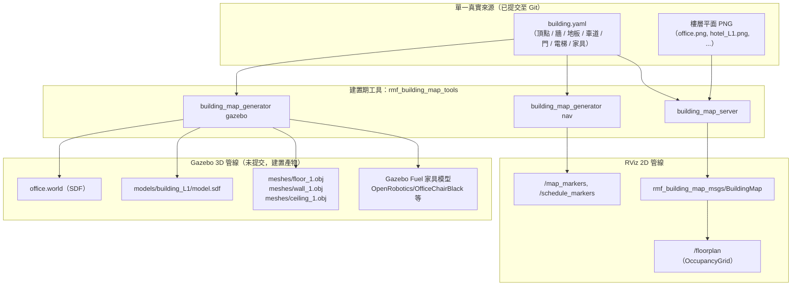

# rmf_demos 的室內空間視覺化資料模型：Gazebo 是資料模型，還是渲染器？

## 摘要

本文回答一個具體問題：`open-rmf/rmf_demos`[^demos-api] 在視覺化「完整建築、牆壁、地面」時，使用的是什麼資料模型？是 Gazebo 嗎？

結論是：**Gazebo 不是資料模型，而是終端渲染器之一**。整條視覺化管線只有一個真實來源（single source of truth），就是 `rmf_traffic_editor` 定義的 `.building.yaml` 建築地圖檔。這份檔案被 `rmf_building_map_tools` 編譯成兩個完全不同的消費端產物：

1. **RViz 2D 管線**：`.building.yaml` → `rmf_building_map_msgs/BuildingMap` 訊息 + 樓層平面 PNG → RViz 顯示平面圖與佔據柵格（OccupancyGrid）。
2. **Gazebo 3D 管線**：`.building.yaml` → `.world`（SDF）+ `model.sdf` + 程式生成的 OBJ 網格 → Gazebo 渲染出牆壁、地板、天花板、門、電梯與家具。

值得注意的是，**`rmf_demos` 的 Git 儲存庫內完全沒有 `.world`、`.sdf` 或 `.obj` 檔案**：地圖目錄下只有 `.building.yaml` 與 `.png`[^demos-tree]。3D 世界是建置期（build time）由 CMake 客製目標即時生成的產物[^maps-cmake]。這個事實本身就是答案的核心：在 rmf_demos 中，「室內空間的 3D 模型」不是被儲存的資產，而是從 `.building.yaml` 衍生的編譯輸出。

---

## 1. 問題釐清：三個容易混淆的層次

在討論之前必須先把三件事分開，因為它們常被混為一談：

| 層次 | 內容 | rmf_demos 的對應 |
|---|---|---|
| 建築幾何描述 | 牆、地板、天花板、房間邊界、家具位置 | `.building.yaml` 的 `walls`、`floors`、`holes`、`models`、`doors`、`lifts` |
| 交通語意描述 | 路徑點、有向車道、通行事件 | `.building.yaml` 的 `vertices`、`lanes`、`doors` |
| 渲染 / 視覺化 | 把上述資料畫出來 | RViz（2D）與 Gazebo（3D） |

`rmf_demos` 的關鍵設計特徵是：**前兩層被塞進同一個 YAML 檔案的同一組 `vertices` 索引空間中**。牆、地板、門、車道全部以「頂點索引對」或「頂點索引序列」表示，共用同一份 `vertices` 陣列[^office-yaml][^hotel-yaml]。這使得「建築幾何」與「交通語意」在資料層面無法乾淨分離，但也讓 2D 標註工具（traffic editor）能用同一套互動方式編輯兩者。



---

## 2. 單一真實來源：`.building.yaml`

### 2.1 格式定位

`.building.yaml` 是 `rmf_traffic_editor` 的原生專案格式。官方說明為：「The `traffic_editor` GUI projects are stored as `yaml` files with `.building.yaml` file extensions」，且「Each `.building.yaml` file includes several attributes for each level in the site as annotated by the user」[^book]。`rmf_traffic_editor` 本身的定位是「a graphical editor for robot traffic flows」，其目的在於「annotate building floorplans with the desired robot traffic lanes and generate simulation models」[^te-readme]。

### 2.2 頂層結構

以 `office.building.yaml` 為例，頂層鍵為[^office-yaml]：

```yaml
coordinate_system: reference_image
crowd_sim: { ... }        # 人群模擬（Menge/ORCA）設定
graphs: {}                # 額外圖（示範用，通常為空）
levels:
  L1:
    constraints: [...]    # 頂點配對的幾何約束
    doors: [...]          # 門（頂點索引對 + 參數）
    drawing: { filename: office.png }   # 樓層平面底圖
    elevation: 0
    features: [...]       # 標註特徵點（含圖層）
    floors: [...]         # 地板多邊形 + 材質參數
    lanes: [...]          # 車道（頂點索引對 + 參數）
    layers: { office_laserscan: { ... } }   # 疊圖圖層（含仿射轉換）
    measurements: [...]   # 比例尺量測
    models: [...]         # 3D 家具模型擺放
    vertices: [...]       # 所有頂點的座標 + 名稱 + 參數
    walls: [...]          # 牆（頂點索引對 + 材質參數）
lifts: {}                 # 電梯（頂層鍵，非各樓層）
name: building
```

`hotel.building.yaml` 則展示了多樓層與電梯的情形：三個樓層 `L1`/`L2`/`L3` 的 `elevation` 分別為 `0`/`8`/`16`，並以 `fiducials`（參考標記 `ref1`、`ref2`、`ref3`）跨樓層對齊；頂層 `lifts` 下定義 `Lift1` 與 `Lift2`，各有 `width: 2.7`、`depth: 2.7`、`reference_floor_name: L1`，以及 `level_doors` 映射哪個電梯門服務哪些樓層[^hotel-yaml]。

### 2.3 各元素的資料表示法

| 元素 | 表示法 | 說明 |
|---|---|---|
| `vertices` | `[x, y, z, name, params]` | `z` 目前恆為 0；`params` 是鍵值對，值為 `[型別碼, 值]`[^vertex-py] |
| `walls` | `[v1_idx, v2_idx, params]` | `params` 含 `texture_name`、`alpha`、`texture_height`、`texture_width`、`texture_scale`[^office-yaml] |
| `floors` | `{vertices: [idx...], parameters: {...}}` | 多邊形；`parameters` 含 `texture_name`、`ceiling_texture`、`indoor`、`texture_scale`、`texture_rotation`[^office-yaml] |
| `doors` | `[v1_idx, v2_idx, params]` | `params` 含 `name`、`type`（`hinged`/`double_hinged`/`sliding`/`double_sliding`）、`motion_degrees`、`motion_direction`、`plugin`、`right_left_ratio`[^office-yaml] |
| `lanes` | `[v1_idx, v2_idx, params]` | `params` 含 `bidirectional`、`graph_idx`、`orientation`、`speed_limit`、`mutex`、`demo_mock_floor_name`、`demo_mock_lift_name`[^office-yaml] |
| `models` | `{name, model_name, x, y, yaw, z, static, dispensable}` | 以名稱引用外部 Gazebo 模型[^office-yaml] |
| `lifts` | 具名物件 | `width`、`depth`、`x`、`y`、`yaw`、`doors`、`level_doors`、`lowest_floor`、`highest_floor`[^hotel-yaml] |

`params` 的型別碼定義在 `ParamValue` 類別中：`UNDEFINED = 0`、`STRING = 1`、`INT = 2`、`DOUBLE = 3`、`BOOL = 4`[^paramvalue]。這就是為什麼 YAML 中會出現 `texture_name: [1, blue_linoleum]` 這種看似冗餘的寫法，第一個元素是型別碼。

### 2.4 座標系統

`coordinate_system` 支援四種列舉值[^coordsys]：

- `reference_image`（值 1）：以樓層平面圖像素為單位，`y` 軸需翻轉（`y_flip_scalar()` 回傳 `-1`），比例由 `measurements` 推得。
- `web_mercator`（值 2）：全球座標，需 `generate_crs` 參數。
- `cartesian_meters`（值 3）：平面公尺座標。
- `wgs84`（值 4）：經緯度座標。

`office`、`hotel` 使用 `reference_image`[^office-yaml][^hotel-yaml]；`campus` 世界則依官方說明「designed and traffic lanes are annotated at the planet scale, using GPS WGS84 coordinates」[^demos-readme]，屬於 `wgs84` 或 `web_mercator` 路線。比例尺的計算邏輯在 `Level.calculate_scale_using_measurements()`：若沒有量測線，會印出警告「No measurements defined. Scale is indetermined.」並「Nav graph generated in pixel units, not meters!」[^level-py]。

---

## 3. 視覺化管線 A：RViz（2D 平面）

### 3.1 啟動路徑

`rmf_demos_gz/launch/office.launch.xml` 先 include `rmf_demos/office.launch.xml`[^gz-launch]，後者再 include `common.launch.xml` 並傳入 `config_file`（即 `office.building.yaml`）與 `viz_config_file`（即 `office.rviz`）[^office-launch]。

`common.launch.xml` 是關鍵：它啟動 `rmf_building_map_tools/building_map_server`，參數就是 `.building.yaml` 路徑[^common-launch]：

```xml
<node pkg="rmf_building_map_tools" exec="building_map_server" args="$(var config_file)">
  <param name="use_sim_time" value="$(var use_sim_time)"/>
</node>
```

同一檔案中另有一個 `use_site_map` 分支，若為真則改啟動 `rmf_site_map_server`[^common-launch]。這暗示 RMF 正在從 `building.yaml` 遷移到「site map」概念（見第 8 節）。

### 3.2 `building_map_server` 的角色

`building_map_server` 是 `.building.yaml` 的 ROS 2 發佈端。它讀入 YAML，建構 `Building` 物件，然後[^bms]：

1. 建立 `rmf_building_map_msgs/BuildingMap` 訊息，透過 `map` 主題發佈（QoS 為 `TRANSIENT_LOCAL`，depth 1）。
2. 建立 `rmf_site_map_msgs/SiteMap` 訊息（壓縮的 GeoJSON），透過 `site_map` 主題發佈。
3. 提供 `get_building_map` 服務。

它也支援 `.gpkg`、`.geojson`、`.geojson.gz` 三種替代輸入格式[^bms]。

### 3.3 BuildingMap 訊息的結構

`BuildingMap.msg` 的定義極簡[^building-map-msg]：

```
string name
Level[] levels
Lift[] lifts
```

而 `Level.msg` 為[^level-msg]：

```
string name
float32 elevation
AffineImage[] images
Place[] places
Door[] doors
Graph[] nav_graphs
Graph wall_graph
```

**這裡出現一個關鍵事實**：`Level` 訊息中**沒有牆、沒有地板、沒有 3D 幾何欄位**。建築的「外觀」完全由 `images`（`AffineImage[]`）承擔，其欄位為[^affine-msg]：

```
string name
float32 x_offset
float32 y_offset
float32 yaw
float32 scale
string encoding
uint8[] data
```

`building_map_server` 的 `level_msg()` 會實際開啟 `.building.yaml` 中 `drawing.filename` 指向的 PNG 檔，讀成位元組塞進 `AffineImage.data`，並把該樓層的仿射轉換參數（`scale`、`x_offset`、`y_offset`、`yaw`）一併填入[^bms]。

換言之：**在 RViz 這一側，「室內空間」的視覺呈現是一張被仿射校正過的 2D 樓層平面點陣圖，不是 3D 模型。** `rmf_visualization_floorplans` 套件的職責就是把這張圖轉成 `OccupancyGrid` 並發佈到 `/floorplan` 主題[^viz-readme]，`office.rviz` 中對應的 `rviz_default_plugins/Map` 顯示項即訂閱 `/floorplan`[^office-rviz]。

### 3.4 車道與建築設施的視覺化

`rmf_visualization` 的其餘套件負責其他圖層[^viz-readme][^viz-launch]：

- `rmf_visualization_navgraphs`：訂閱 `Graph` 訊息，發佈 `/map_markers`，以顏色區分各 fleet 的車道；關閉的車道顯示為灰色，限速車道較窄。
- `rmf_visualization_building_systems`：訂閱 `/door_states` 與 `/lift_states`，發佈 `/building_systems_markers`。
- `rmf_visualization_fleet_states`：訂閱 `/fleet_states`，發佈 `/fleet_markers`。
- `rmf_visualization_schedule`：啟動 RMF Schedule Database 的 mirror，發佈 `/schedule_markers`。
- `rmf_visualization_obstacles`：訂閱 `/rmf_obstacles`。

`office.rviz` 檔中可見對應的顯示項：`/fleet_markers`、`/schedule_markers`、`/map_markers`、`/building_systems_markers`、`/floorplan`，而 `Fixed Frame` 是 `map`，視角為 `rviz_default_plugins/TopDownOrtho`（正上方俯視的正交視角）[^office-rviz]。

因此 RViz 的世界觀是純 2D 的：一張平面圖 + 一組標記。這與「完整建築、牆壁、地面的 3D 模型」完全是兩件事。

---

## 4. 視覺化管線 B：Gazebo（3D 世界）

### 4.1 建置期生成，而非儲存

`rmf_demos_maps/CMakeLists.txt` 是 3D 管線的起點。它對每個 `.building.yaml` 執行[^maps-cmake]：

```cmake
message("BUILDING WORLDFILE WITH COMMAND: ros2 run rmf_building_map_tools
         building_map_generator gazebo ${map_path} ${output_world_path} ${output_model_dir}")
add_custom_target(
  ${world_name}
  COMMAND ros2 run rmf_building_map_tools building_map_generator gazebo
          ${map_path} ${output_world_path} ${output_model_dir}
)
```

同一份 CMakeLists 也生成 crowd simulation 設定（`building_crowdsim`）與導航圖（`building_map_generator nav`），最後 `install(DIRECTORY ${output_dir} DESTINATION share/${PROJECT_NAME}/maps)`[^maps-cmake]。下載 Gazebo Fuel 模型快取的目標 `update_model_cache` 也在這裡定義[^maps-cmake]。

`simulation.launch.xml` 則在執行期以 `$(find-pkg-share rmf_demos_maps)/maps/$(var map_name)/$(var map_name).world` 找到這個生成的世界檔，並透過 `ros_gz_sim` 的 `gz_sim.launch.py` 載入[^sim-launch]。

### 4.2 `building_map_generator gazebo` 的內部流程

`Generator.generate_sdf()` 的步驟是[^generator-py]：

1. `parse_editor_yaml()` 讀入 YAML，建立 `Building` 物件。
2. `building.generate_sdf_models(output_models_dir)`：為每個樓層產生一個獨立的 SDF 模型目錄。
3. `building.generate_sdf_world(template_file, skip_camera_pose)`：以模板 SDF 為基礎，產生頂層 `.world`。

`Building.generate_sdf_models()` 對每個樓層建立目錄 `{building_name}_{level_name}`（例如 `hotel_L1`、`hotel_L2`），並呼叫 `level.generate_sdf_model()`[^building-py]。`Level.generate_sdf_model()` 寫出 `model.config` 與 `model.sdf`，其中 `model.sdf` 的內容為[^level-py]：

```python
sdf_ele = Element('sdf', {'version': '1.7'})
model_ele = SubElement(sdf_ele, 'model', {'name': model_name})
static_ele = SubElement(model_ele, 'static')
static_ele.text = 'true'
self.generate_floors(model_ele, model_name, model_path)
self.generate_walls(model_ele, model_name, model_path)
```

也就是說：**每個樓層變成一個靜態 SDF 模型，其內容由程式生成的地板網格與牆壁網格組成。**

### 4.3 `.world` 模板

生成的 `.world` 以 `rmf_building_map_tools/building_map/templates/gz_world.sdf` 為模板[^building-py]。模板本身定義了[^gz-world]：

- 物理與系統外掛：`gz-sim-physics-system`、`gz-sim-user-commands-system`、`gz-sim-scene-broadcaster-system`。
- 建築設施外掛：`libdoor.so`（名稱 `door`）與 `liblift.so`（名稱 `lift`）。
- GUI 外掛：`MinimalScene`（3D View，引擎 `ogre2`）、`GzSceneManager`、`InteractiveViewControl`、`CameraTracking`、`EntityTree`、`ComponentInspector`、`WorldControl`、`Shapes`、`Lights` 等。
- 一個方向光 `sun`。
- `toggle_charging` 外掛。

`Building.generate_sdf_world()` 接著把樓層 `include` 進 world，並附加[^building-py]：

- 每層樓的 `<include>`，`uri` 為 `model://{building_name}_{level_name}`，`pose` 帶入 `elevation`（若為 wgs84 座標系則另加全域平移）。
- 電梯的 shaft doors 與 cabin（`lift.generate_shaft_doors(world)`、`lift.generate_cabin(world)`）。
- `register_component` 外掛與 `Chargers` 元件，內含所有帶 `is_charger` 參數的頂點座標。
- `toggle_floors` GUI 外掛，列出各樓層的 `name`、`model_name` 以及該層的靜態模型與門，讓使用者能在 Gazebo GUI 中逐層切換顯示。
- 依座標系統附加 `<offset>` 與 `<crs>` 元素。

`rmf_simulation` 的 README 也說明了這兩個建築外掛的用途：`toggle_floors` 是「a world plugin ... that adds a GUI plugin with buttons to enable / disable visibility of specific floors, to make visualization of intermediate floors easier」[^sim-readme]。

### 4.4 地板：多邊形三角化為 OBJ

`Floor.generate()` 是「地面」3D 模型的實作[^floor-py]：

1. 依 `vertices` 索引取出頂點座標，建構 `shapely.geometry.Polygon`。
2. 從多邊形中扣除 `holes`（挖洞）與電梯井（`lift_vert_lists`）。
3. 建立 SDF `<link name="floor_{n}">`，其 `<visual>` 與 `<collision>` 都指向 `model://{model_name}/meshes/floor_{n}.obj`。碰撞元素的 `collide_bitmask` 設為 `0x01`。
4. 以 `shapely.ops.triangulate()` 做 Delaunay 三角化，並遞迴地與原始多邊形求交集，處理凹多邊形的情況（程式註解寫道：「the Delaunay triangulation returned by Shapely will be convex, but often the floor plan polygons are not, so we have to intersect each triangle with the original floorplan polygon and recurse if needed」）。
5. 手寫 OBJ 檔：每個頂點寫兩份（一份在 `z = 0`，一份在 `z = -thickness`，`thickness = 0.1` 公尺），使地板從下方也能看見；三角形以正反兩個繞向各寫一次面。
6. 另寫 `.mtl` 檔，`map_Kd` 指向對應的 PBR 貼圖。

地板厚度硬編碼為 `self.thickness = 0.1`，牆高基準 `self.wall_height = 2.5`[^floor-py]。

`Floor.generate_ceiling()` 是天花板的實作：僅在 `indoor` 參數為真時呼叫（`has_ceiling()` 回傳 `self.indoor`），頂點寫在 `z = wall_height`（2.5 公尺），法線為 `0 0 -1`，且只寫單面三角形，程式註解說明理由是「Ceiling only visible from below / Invisible from above to allow bird-eye view」[^floor-py]。

在 `office.building.yaml` 中，所有地板的 `indoor` 參數都是 `[2, 0]`（整數 0，即假）[^office-yaml]，因此 office 世界實際上不會產生天花板。`triple_H.building.yaml` 的地板參數更精簡，只有 `texture_name`、`texture_rotation`、`texture_scale`[^tripleh]。

### 4.5 牆壁：線段擠出

`Level.generate_walls()` 先掃描所有牆，收集相異的參數組合（以 `texture_name` 與 `alpha` 等分組），再為每組建立一個 `Wall` 物件與一個 SDF link[^level-py]。`Wall.generate_wall_visual_mesh()` 的做法是[^wall-py]：

- 牆高 `wall_height = 2.5` 公尺、厚 `wall_thickness = 0.1` 公尺（註解：「todo: allow per-segment height?」）。
- 對每個牆段（兩個頂點），計算其中心點與 yaw，建立一個「在原點的四角足跡」，再旋轉與平移到位。
- 每段寫 8 個頂點（`z = 0` 與 `z = h` 各四個），以及 4 個側面法線 + 1 個頂面法線。
- 最後輸出 8 個三角形的面（北、東、南、西四面各兩三角形，加上頂面兩三角形）。
- 頂點會整體平移至原點，link 的 `<pose>` 再帶回原位置，理由是「so that Gazebo/Ignition "Move To" command is useful」。
- `.mtl` 檔中的 `d`（alpha）取自 `wall_params['alpha']`，SDF 中另以 `<transparency>` 元素表達 `1.0 - alpha`。

因此，**「牆壁」在 rmf_demos 中不是從 BIM 構件讀入的，而是由 2D 線段擠出（extrude）而成的三角網格。** 官方手冊也這樣描述：「By default, the walls are of thickness of 10cm and height 2.5m」以及「Meshes of the annotated walls are automatically generated during 3D world generation using `building_map_generator`」[^book]。

### 4.6 門與電梯：SDF 模型 + 模擬外掛

門不是靜態網格，而是可動的 SDF 模型。`Level.generate_door()` 依 `type` 參數分派到四個類別[^level-py]：

- `sliding` → `SlidingDoor`
- `hinged` → `SwingDoor`
- `double_sliding` → `DoubleSlidingDoor`
- `double_hinged` → `DoubleSwingDoor`

這些類別位於 `rmf_building_map_tools/building_map/doors/`[^te-tree]。官方手冊說明：「The `building_map_generator gazebo` script parses a `.building.yaml` file for any doors and automatically generates an sdf sub-element with links and joints required for the door along with a configured plugin」[^book]。

在 Gazebo 執行期，門由 `libdoor.so` 外掛驅動。`rmf_simulation` 的 README 給出的 SDF 片段顯示外掛接受 `v_max_door`、`a_max_door`、`a_nom_door`、`dx_min_door`、`f_max_door` 等運動參數，以及每個門的 `name`、`type`、`left_joint_name`、`right_joint_name`[^sim-readme]。

電梯同理：「The `building_map_generator gazebo` script parses a `.building.yaml` file for lift definitions and auto-generates the sdf elements for the cabin, cabin doors and lift shaft doors. A prismatic joint is defined at the base of the cabin which is actuated by the lift plugin to move the cabin between different levels」[^book]。`liblift.so` 的 SDF 參數包含 `lift_name`、多個 `<floor name=... elevation=...>` 與 `<door_pair cabin_door=... shaft_door=...>`，以及 `cabin_joint_name`[^sim-readme]。

### 4.7 家具與設備：Gazebo Fuel 外部模型

`models` 區段是最能說明「rmf_demos 沒有自建 3D 建築資料模型」的地方。`Model.generate()` 產生的 SDF 是一個 `<include>`，其 `uri` 決定於 `model_name` 是否為 `org/name` 形式、以及該模型是否已存在本機的 pit_crew 快取中[^model-py]：

```python
tokens = self.model_name.split('/')
if len(tokens) > 1:
    org = tokens[0]
    model = '/'.join(tokens[1:])
    if (model, org) in model_author_cache:
        uri_ele.text = f'https://fuel.gazebosim.org/1.0/{org}/models/{model}'
    else:
        uri_ele.text = f'model://{model}'
```

也就是說，家具是**以字串名稱遠端引用 Gazebo Fuel 上的 SDF 模型**。`office.building.yaml` 中的家具名稱如 `OpenRobotics/OfficeChairBlack`、`OpenRobotics/AdjTable`、`OpenRobotics/SmallCubicle`、`OpenRobotics/Fridge`、`OpenRobotics/TeleportDispenser`、`OpenRobotics/Coke`、`OpenRobotics/TrashBin`、`OpenRobotics/WhiteCabinet` 等[^office-yaml]。`hotel.building.yaml` 則有 `OpenRobotics/NormalBed`、`OpenRobotics/Shower`、`OpenRobotics/BathroomSink`、`OpenRobotics/KitchenCountertop`、`OpenRobotics/EscalatorStart` 等[^hotel-yaml]。

每個模型的擺放參數為 `x`、`y`、`z`、`yaw`、`static`、`dispensable`；`Model.generate()` 會將這些與樓層 `elevation` 及座標轉換合成最終 `<pose>`，並把 `static` 寫成 `<static>` 元素。若 `dispensable` 為真，模型名稱會加上 `_dispensable` 後綴[^model-py]。

模型下載機制由 `building_map_model_downloader` 負責：它從 `https://fuel.gazebosim.org/1.0/models` 分頁抓取模型清單，寫入 `~/.pit_crew/model_cache.json`[^model-dl]。`rmf_demos_maps/CMakeLists.txt` 中的 `update_model_cache` 目標即呼叫此工具[^maps-cmake]。`rmf_demos_assets` 套件則提供機器人模型（`TinyRobot`、`CleanerBotA`、`DeliveryRobot`、`HospitalRobot`、`Caddy` 等），透過環境掛鉤把 `models` 目錄前綴到 `GZ_SIM_RESOURCE_PATH`[^assets-cmake]。官方 FAQ 也提醒機場世界需要額外下載 `osrf/gazebo_models` 模型庫[^faq]。

**注意 `rmf_demos_assets` 與 `rmf_demos_maps` 的分工**：前者只有機器人模型，後者只有 `.building.yaml` 與 `.png`。沒有任何一方持有建築的 3D 幾何資產。

### 4.8 機器人的視覺化：spawn 與 slotcar

`Level.generate_sdf_models()` 除了產生家具，也會掃描頂點，若發現 `spawn_robot_type` 參數，就在該頂點生成一個 `<include>`，`uri` 為 `model://{robot_type}`，yaw 取自第一條相連車道的方向[^level-py]。`office.building.yaml` 的 `tinyRobot1_charger`、`tinyRobot2_charger` 頂點即帶有此參數[^office-yaml]。

機器人本身在 Gazebo 中的運動由 `libslotcar.so` 外掛模擬，它「acts as a simple robot navigation stack, controlling the robot and sending updates to its fleet adapter through ROS 2 topics」[^sim-readme]。官方 FAQ 解釋了選用 slotcar 的理由：為了避免在每個機器人上跑完整 ROS1/2 navstack 造成過大計算負載，slotcar 實作「a simple "rail-like" navigation which accelerates and decelerates the robot along a straight line from its current position to the waypoint」，並假設「the robot lanes are free of other static obstacles」[^faq]。

---

## 5. 兩個消費端的對照

把兩條管線並列，可以清楚看出「室內空間視覺化」在 rmf_demos 中並不是單一資料模型：

| 面向 | RViz 管線 | Gazebo 管線 |
|---|---|---|
| 輸入 | `.building.yaml` + `.png` | `.building.yaml` + 模板 SDF + Fuel 模型 |
| 中間格式 | `rmf_building_map_msgs/BuildingMap` | `.world` + `model.sdf` + `.obj`/`.mtl` |
| 建築外觀來源 | 2D 點陣平面圖（`AffineImage`） | 程式生成的三角網格（地板、天花板、牆） |
| 維度 | 2D（`TopDownOrtho` 俯視正交） | 3D（`ogre2` 引擎） |
| 牆是否可見 | 否（訊息中無牆欄位） | 是（擠出的 OBJ 網格） |
| 地板是否可見 | 否（僅作為圖片底圖） | 是（三角化 OBJ 網格） |
| 家具是否可見 | 否 | 是（Fuel 外部 SDF 模型） |
| 產生時機 | 執行期（`building_map_server` 讀檔） | 建置期（CMake 客製目標） |
| 產物是否入版控 | 是（`.yaml` 與 `.png` 已提交） | 否（`.world`/`.sdf`/`.obj` 皆為生成物） |
| 主要用途 | 交通排程、車道、fleet 狀態的監督 | 物理模擬、感測器、門與電梯互動 |

這解釋了為什麼在 `rmf_demos` 的官方文件中，機場世界的示意圖會並列三張圖：「from top to bottom we have how the world looks like in `traffic_editor`, the schedule visualizer in `rviz`, and the full simulation in `gazebo`」[^demos-readme]。這三者是同一份 `.building.yaml` 的三種投影。

---

## 6. 與 IndoorGML / CityGML / IFC 的關係

先前的問題設定指出 RMF 不採用既有的室內空間資訊標準，而是自建以機器人通行為中心的模型。本文的調查支持這個判斷，並可補上更精確的觀察。

官方 Open-RMF 使用手冊在整個建築地圖與 traffic editor 章節中**完全沒有出現 IndoorGML、CityGML 或 IFC** 這三個詞[^book]。手冊確實使用「standardized set of semantics」一詞，但那指的是 RMF 自己的標註慣例，而非任何外部標準[^book]。

更值得注意的是：RMF 唯一的 GIS 風格互通格式（GeoJSON / SiteMap）**也只承載交通語意**。`Building.generate_geojson()` 只輸出兩種 feature[^building-py]：

- `feature_type: 'rmf_vertex'`（`Point`），屬性含 `name`、`level_idx`、`rmf_type`。
- `feature_type: 'rmf_lane'`（`LineString`），屬性含 `level_idx`、`rmf_type`、`start_vertex_name`、`end_vertex_name`。

而程式碼中留下明確的 TODO 註解[^building-py]：

```python
# todo: add measurement edges
# todo: add wall edges
# todo: add door edges
# todo: add lifts
```

**牆、門、電梯都不在 GeoJSON 匯出範圍內。** 這意味著即使在最具「空間資料標準」色彩的匯出路徑上，RMF 仍只表達「點與線」的通行網路，而非建築構件。

`Building.generate_geopackage_file()` 同樣只建立 `vertices`（Point）與 `edges`（LineString）兩個圖層，且限定 `cartesian_meters` 座標系與已定義 `generate_crs` 的地圖才可產生[^building-py]。`GeoPackage` 類別寫入的 metadata 中，`md_scope` 為 `'rmfTrafficMap'`、`md_standard_uri` 為 `'http://open-rmf.org'`[^geopackage]——即 RMF 自己的命名空間。

因此可以更精確地說：RMF 有兩套平行的空間表示，而**兩套都是 traffic-centric 的**：

1. **內部編輯格式** `.building.yaml`：額外承載建築幾何（牆、地板、天花板、門、電梯、家具），因為這是產生模擬世界所必需的副產品。
2. **對外互通格式** GeoJSON/GeoPackage/SiteMap：只承載頂點與車道。

建築幾何只存在於第一套、且只為了餵給 Gazebo；它從未被提升為可互通的室內空間標準。

---

## 7. 一個容易忽略的細節：`.building.yaml` 內部的結構不對稱

`.building.yaml` 雖然同時裝載建築幾何與交通語意，但兩者在結構上有明顯的不對稱：

- **交通語意是「圖」**：`lanes` 帶有 `graph_idx`，可用 `Level.generate_nav_graph(graph_idx)` 產生多張獨立的導航圖（`0` 到 `8`），並輸出成 `nav_graphs/{idx}.yaml`[^level-py]。`hotel.building.yaml` 就同時定義了 `graph_idx: 0`、`1`、`2` 三組車道[^hotel-yaml]。
- **建築幾何是「多邊形與線段集合」**：`floors` 是多邊形、`walls` 是線段、`holes` 是多邊形。這些在 `generate_nav_graph()` 中完全不被使用，只在 `generate_sdf_models()` 路徑中才被讀取。

換言之，`.building.yaml` 對交通規劃而言是圖，對 Gazebo 而言是擠出示意圖。同一個檔案服務兩個語意差異極大的目的，這也解釋了為何 RMF 後來另起 `rmf_site` 專案（見下節）。

另一個結構細節：`Level` 類別中另有 `zones`、`constraints`、`fiducials`、`features`、`layers` 等成員[^level-py][^te-level-h]。`layers` 用於疊加掃描圖（例如 `office.building.yaml` 中的 `office_laserscan` 圖層，引用 `office_scan.png` 並帶有 `scale`、`translation_x`、`translation_y`、`yaw` 仿射參數）[^office-yaml]，這與 RViz 的 `AffineImage` 使用同一組轉換語意。

---

## 8. 其他分支：`rmf_site` 與 site map 路線

RMF 已有一個實驗性的替代方案。`open-rmf/rmf_site` 的描述是「Experimental visualizer for dense buildings in RMF」，以 Rust 與 Bevy 遊戲引擎撰寫，可編譯為桌面原生程式或 WebAssembly 網頁版[^site-repo][^rmf-site]。其 README 說明：「The RMF Site Editor is an experimental approach to visualizing and editing large RMF deployment sites. It is built in Rust using Bevy, an open-source Rust-based game engine.」[^rmf-site]

`common.launch.xml` 中的 `use_site_map` 參數與 `rmf_site_map_server` 節點即對應這條路線；`BuildingMapServer` 也已能讀取 `.gpkg`、`.geojson`、`.geojson.gz`[^common-launch][^bms]。`building_map_converter` 則提供 `.building.yaml` 轉出 `.gpkg`/`.geojson`/`.geojson.gz` 的 CLI[^converter]。

值得注意的歷史痕跡：`rmf_demos` 中仍留有 `docs/ignition.md`，內容是 ROS 2 Galactic + Ignition Fortress 的安裝說明，並教使用者以 `ros2 launch demos office.launch.xml use_ignition:=1` 啟動[^ignition]。但 `main` 分支已無 `rmf_demos_ign` 套件，且現行的 launch 檔中已無 `use_ignition` 參數，實際套件是 `rmf_demos_gz`[^demos-tree][^gz-launch]。`rmf_simulation` 的 README 也說明其支援策略是跟隨 `ros_gz` 的版本對應（例如「ROS Humble <-> Gazebo Fortress」），並指出 Gazebo Classic 支援「is only guaranteed until Gazebo 11 EOL ... and might be removed afterwards」[^sim-readme]。因此 `docs/ignition.md` 應視為過時文件。

---

## 9. 結論

回到原始問題：「`rmf_demos` 中使用什麼樣的資料模型來描述室內空間視覺化的部份？是 Gazebo 嗎？」

**答案分兩層：**

1. **資料模型不是 Gazebo，而是 `.building.yaml`。** 這是 `rmf_traffic_editor` 的原生格式，以「頂點陣列 + 索引對/索引序列 + 型別化參數」為基礎，同時表達建築幾何（`walls`、`floors`、`holes`、`doors`、`lifts`、`models`）與交通語意（`vertices`、`lanes`、`graph_idx`）。它沒有 IndoorGML 的 CellSpace/State/Transition 代數結構，也沒有 IFC 的構件階層；牆是線段、地板是多邊形、家具是外部模型名稱。

2. **Gazebo 是消費端與渲染器，不是資料模型。** `rmf_building_map_tools` 在建置期把 `.building.yaml` 編譯成 `.world`（SDF）、每層樓的 `model.sdf`，以及程式生成的 `floor_N.obj`、`ceiling_N.obj`、`wall_N.obj` 網格；家具則以名稱遠端引用 Gazebo Fuel。這些 3D 資產**全部不存在於 Git 儲存庫中**，是建置產物。

3. **RViz 那一側甚至不是 3D。** `BuildingMap` 訊息中沒有牆或地板欄位；室內空間在 RViz 中呈現為一張經仿射校正的 2D 樓層平面 PNG（轉成 `OccupancyGrid` 發到 `/floorplan`），加上車道、門、電梯、fleet 等標記圖層，並以 `TopDownOrtho` 俯視正交視角呈現。

4. **若要回答「完整建築、牆壁、地面的 3D 模型用了什麼資料模型」，最精確的答案是**：一組由 2D 標註擠出而成的 SDF 網格——牆是 2.5 公尺高、0.1 公尺厚的線段擠出體，地板是 0.1 公尺厚的多邊形三角化網格（天花板在 `indoor` 參數為真時才生成），門與電梯是可動的 SDF 模型加模擬外掛，家具是 Gazebo Fuel 的外部模型。這套表示法是為了模擬與渲染而存在的，並非為了空間資訊的語意交換。

---

## 10. 來源批判性反思

- **官方文件與程式碼的一致性**：Open-RMF 使用手冊（`osrf.github.io/ros2multirobotbook`）與 `rmf_traffic_editor` 原始碼在建築地圖描述上高度一致，手冊中「walls are of thickness of 10cm and height 2.5m」與 `wall.py` 中的 `wall_height = 2.5`、`wall_thickness = 0.1` 完全吻合，可信度高。但手冊章節明顯較舊（提及 Ubuntu 18.04 / ROS 2 Eloquent / Qt 5），部分敘述可能落後於程式碼[^book][^te-readme]。
- **文件落後於程式碼的實例**：`docs/ignition.md` 描述的 `use_ignition:=1` 啟動方式在現行 launch 檔中已不存在；`rmf_demos_gz` 才是現行套件。這提醒讀者：`rmf_demos` 的文件與程式碼可能不同步，必須以程式碼與 launch 檔為準[^ignition][^demos-tree]。
- **「視覺化」一詞的歧義**：本主題最大的混淆來源是「視覺化」在 RMF 脈絡下同時指 RViz 的 2D 監督介面與 Gazebo 的 3D 模擬。官方 README 的機場世界段落用「the schedule visualizer in `rviz`」與「the full simulation in `gazebo`」加以區分[^demos-readme]，但其他文件常混用。任何關於「RMF 室內空間視覺化」的討論都應先明確指出是哪一條管線。
- **星數作為關注度指標**：截至查閱時，`rmf_demos` 有 633 顆星、170 個 fork；`rmf_traffic_editor` 有 173 顆星；`rmf_site` 有 67 顆星；`rmf_visualization` 有 32 顆星；`rmf_simulation` 有 22 顆星；而承載 `BuildingMap` 訊息定義的 `rmf_building_map_msgs` 僅有 2 顆星[^demos-api][^te-api][^site-repo][^viz-api][^sim-api][^bmsgs-api]。星數分布本身反映了 RMF 生態的關注重心：示範與編輯工具遠比訊息定義受注目，這也意味著訊息層的規格穩定性較少受到社群公開審視。
- **未查證的部分**：本文未實際建置 `rmf_demos` 並執行 Gazebo，因此關於「生成的 `.obj` 網格在 Gazebo 中的實際渲染外觀」是基於程式碼推論，而非實機觀察。此外，`campus` 世界的 `coordinate_system` 實際值未從其 `.building.yaml` 直接確認，僅依官方 README 的敘述推斷其使用 WGS84[^demos-readme]。

---

[^demos-api]: open-rmf. (n.d.). *rmf_demos* [Repository metadata]. GitHub. Retrieved 2026-11-21, from https://api.github.com/repos/open-rmf/rmf_demos
[^demos-readme]: open-rmf. (n.d.). *RMF Demos* (README). GitHub. Retrieved 2026-11-21, from https://github.com/open-rmf/rmf_demos/blob/main/README.md
[^demos-tree]: open-rmf. (n.d.). *rmf_demos repository tree, main branch* [Data file]. GitHub REST API. Retrieved 2026-11-21, from https://api.github.com/repos/open-rmf/rmf_demos/git/trees/main?recursive=1
[^maps-cmake]: open-rmf. (n.d.). *rmf_demos_maps/CMakeLists.txt*. GitHub. Retrieved 2026-11-21, from https://github.com/open-rmf/rmf_demos/blob/main/rmf_demos_maps/CMakeLists.txt
[^office-yaml]: open-rmf. (n.d.). *office.building.yaml*. GitHub. Retrieved 2026-11-21, from https://github.com/open-rmf/rmf_demos/blob/main/rmf_demos_maps/maps/office/office.building.yaml
[^hotel-yaml]: open-rmf. (n.d.). *hotel.building.yaml*. GitHub. Retrieved 2026-11-21, from https://github.com/open-rmf/rmf_demos/blob/main/rmf_demos_maps/maps/hotel/hotel.building.yaml
[^tripleh]: open-rmf. (n.d.). *triple_H.building.yaml*. GitHub. Retrieved 2026-11-21, from https://github.com/open-rmf/rmf_demos/blob/main/rmf_demos_maps/maps/triple_H/triple_H.building.yaml
[^gz-launch]: open-rmf. (n.d.). *rmf_demos_gz/launch/office.launch.xml*. GitHub. Retrieved 2026-11-21, from https://github.com/open-rmf/rmf_demos/blob/main/rmf_demos_gz/launch/office.launch.xml
[^office-launch]: open-rmf. (n.d.). *rmf_demos/launch/office.launch.xml*. GitHub. Retrieved 2026-11-21, from https://github.com/open-rmf/rmf_demos/blob/main/rmf_demos/launch/office.launch.xml
[^common-launch]: open-rmf. (n.d.). *rmf_demos/launch/common.launch.xml*. GitHub. Retrieved 2026-11-21, from https://github.com/open-rmf/rmf_demos/blob/main/rmf_demos/launch/common.launch.xml
[^sim-launch]: open-rmf. (n.d.). *rmf_demos_gz/launch/simulation.launch.xml*. GitHub. Retrieved 2026-11-21, from https://github.com/open-rmf/rmf_demos/blob/main/rmf_demos_gz/launch/simulation.launch.xml
[^office-rviz]: open-rmf. (n.d.). *rmf_demos/launch/include/office/office.rviz*. GitHub. Retrieved 2026-11-21, from https://github.com/open-rmf/rmf_demos/blob/main/rmf_demos/launch/include/office/office.rviz
[^faq]: open-rmf. (n.d.). *Frequently Asked Questions* (rmf_demos docs/faq.md). GitHub. Retrieved 2026-11-21, from https://github.com/open-rmf/rmf_demos/blob/main/docs/faq.md
[^ignition]: open-rmf. (n.d.). *Ignition setup* (rmf_demos docs/ignition.md). GitHub. Retrieved 2026-11-21, from https://github.com/open-rmf/rmf_demos/blob/main/docs/ignition.md
[^gz-readme]: open-rmf. (n.d.). *rmf_demos_gz* (README). GitHub. Retrieved 2026-11-21, from https://github.com/open-rmf/rmf_demos/blob/main/rmf_demos_gz/README.md
[^assets-cmake]: open-rmf. (n.d.). *rmf_demos_assets/CMakeLists.txt* and *hooks/rmf_demos_assets.dsv.in*. GitHub. Retrieved 2026-11-21, from https://github.com/open-rmf/rmf_demos/blob/main/rmf_demos_assets/CMakeLists.txt
[^te-readme]: open-rmf. (n.d.). *Traffic Editor* (rmf_traffic_editor README). GitHub. Retrieved 2026-11-21, from https://github.com/open-rmf/rmf_traffic_editor/blob/main/rmf_traffic_editor/README.md
[^te-api]: open-rmf. (n.d.). *rmf_traffic_editor* [Repository metadata]. GitHub. Retrieved 2026-11-21, from https://api.github.com/repos/open-rmf/rmf_traffic_editor
[^te-tree]: open-rmf. (n.d.). *rmf_traffic_editor repository tree, main branch* [Data file]. GitHub REST API. Retrieved 2026-11-21, from https://api.github.com/repos/open-rmf/rmf_traffic_editor/git/trees/main?recursive=1
[^te-level-h]: open-rmf. (n.d.). *rmf_traffic_editor/gui/level.h*. GitHub. Retrieved 2026-11-21, from https://github.com/open-rmf/rmf_traffic_editor/blob/main/rmf_traffic_editor/gui/level.h
[^generator-py]: open-rmf. (n.d.). *rmf_building_map_tools/building_map/generator.py*. GitHub. Retrieved 2026-11-21, from https://github.com/open-rmf/rmf_traffic_editor/blob/main/rmf_building_map_tools/building_map/generator.py
[^building-py]: open-rmf. (n.d.). *rmf_building_map_tools/building_map/building.py*. GitHub. Retrieved 2026-11-21, from https://github.com/open-rmf/rmf_traffic_editor/blob/main/rmf_building_map_tools/building_map/building.py
[^level-py]: open-rmf. (n.d.). *rmf_building_map_tools/building_map/level.py*. GitHub. Retrieved 2026-11-21, from https://github.com/open-rmf/rmf_traffic_editor/blob/main/rmf_building_map_tools/building_map/level.py
[^wall-py]: open-rmf. (n.d.). *rmf_building_map_tools/building_map/wall.py*. GitHub. Retrieved 2026-11-21, from https://github.com/open-rmf/rmf_traffic_editor/blob/main/rmf_building_map_tools/building_map/wall.py
[^floor-py]: open-rmf. (n.d.). *rmf_building_map_tools/building_map/floor.py*. GitHub. Retrieved 2026-11-21, from https://github.com/open-rmf/rmf_traffic_editor/blob/main/rmf_building_map_tools/building_map/floor.py
[^model-py]: open-rmf. (n.d.). *rmf_building_map_tools/building_map/model.py*. GitHub. Retrieved 2026-11-21, from https://github.com/open-rmf/rmf_traffic_editor/blob/main/rmf_building_map_tools/building_map/model.py
[^vertex-py]: open-rmf. (n.d.). *rmf_building_map_tools/building_map/vertex.py*. GitHub. Retrieved 2026-11-21, from https://github.com/open-rmf/rmf_traffic_editor/blob/main/rmf_building_map_tools/building_map/vertex.py
[^paramvalue]: open-rmf. (n.d.). *rmf_building_map_tools/building_map/param_value.py*. GitHub. Retrieved 2026-11-21, from https://github.com/open-rmf/rmf_traffic_editor/blob/main/rmf_building_map_tools/building_map/param_value.py
[^coordsys]: open-rmf. (n.d.). *rmf_building_map_tools/building_map/coordinate_system.py*. GitHub. Retrieved 2026-11-21, from https://github.com/open-rmf/rmf_traffic_editor/blob/main/rmf_building_map_tools/building_map/coordinate_system.py
[^geopackage]: open-rmf. (n.d.). *rmf_building_map_tools/building_map/geopackage.py*. GitHub. Retrieved 2026-11-21, from https://github.com/open-rmf/rmf_traffic_editor/blob/main/rmf_building_map_tools/building_map/geopackage.py
[^converter]: open-rmf. (n.d.). *rmf_building_map_tools/building_map_converter/building_map_converter.py*. GitHub. Retrieved 2026-11-21, from https://github.com/open-rmf/rmf_traffic_editor/blob/main/rmf_building_map_tools/building_map_converter/building_map_converter.py
[^model-dl]: open-rmf. (n.d.). *rmf_building_map_tools/building_map_model_downloader/building_map_model_downloader.py*. GitHub. Retrieved 2026-11-21, from https://github.com/open-rmf/rmf_traffic_editor/blob/main/rmf_building_map_tools/building_map_model_downloader/building_map_model_downloader.py
[^gz-world]: open-rmf. (n.d.). *rmf_building_map_tools/building_map/templates/gz_world.sdf*. GitHub. Retrieved 2026-11-21, from https://github.com/open-rmf/rmf_traffic_editor/blob/main/rmf_building_map_tools/building_map/templates/gz_world.sdf
[^bms]: open-rmf. (n.d.). *rmf_building_map_tools/building_map_server/building_map_server.py*. GitHub. Retrieved 2026-11-21, from https://github.com/open-rmf/rmf_traffic_editor/blob/main/rmf_building_map_tools/building_map_server/building_map_server.py
[^building-map-msg]: open-rmf. (n.d.). *rmf_building_map_msgs/msg/BuildingMap.msg*. GitHub. Retrieved 2026-11-21, from https://github.com/open-rmf/rmf_building_map_msgs/blob/main/rmf_building_map_msgs/msg/BuildingMap.msg
[^level-msg]: open-rmf. (n.d.). *rmf_building_map_msgs/msg/Level.msg*. GitHub. Retrieved 2026-11-21, from https://github.com/open-rmf/rmf_building_map_msgs/blob/main/rmf_building_map_msgs/msg/Level.msg
[^affine-msg]: open-rmf. (n.d.). *rmf_building_map_msgs/msg/AffineImage.msg*. GitHub. Retrieved 2026-11-21, from https://github.com/open-rmf/rmf_building_map_msgs/blob/main/rmf_building_map_msgs/msg/AffineImage.msg
[^door-msg]: open-rmf. (n.d.). *rmf_building_map_msgs/msg/Door.msg*. GitHub. Retrieved 2026-11-21, from https://github.com/open-rmf/rmf_building_map_msgs/blob/main/rmf_building_map_msgs/msg/Door.msg
[^graphedge-msg]: open-rmf. (n.d.). *rmf_building_map_msgs/msg/GraphEdge.msg*. GitHub. Retrieved 2026-11-21, from https://github.com/open-rmf/rmf_building_map_msgs/blob/main/rmf_building_map_msgs/msg/GraphEdge.msg
[^bmsgs-api]: open-rmf. (n.d.). *rmf_building_map_msgs* [Repository metadata]. GitHub. Retrieved 2026-11-21, from https://api.github.com/repos/open-rmf/rmf_building_map_msgs
[^viz-readme]: open-rmf. (n.d.). *Open-RMF Visualization* (rmf_visualization README). GitHub. Retrieved 2026-11-21, from https://github.com/open-rmf/rmf_visualization/blob/main/README.md
[^viz-launch]: open-rmf. (n.d.). *rmf_visualization/launch/visualization.launch.xml*. GitHub. Retrieved 2026-11-21, from https://github.com/open-rmf/rmf_visualization/blob/main/rmf_visualization/launch/visualization.launch.xml
[^viz-api]: open-rmf. (n.d.). *rmf_visualization* [Repository metadata]. GitHub. Retrieved 2026-11-21, from https://api.github.com/repos/open-rmf/rmf_visualization
[^sim-readme]: open-rmf. (n.d.). *rmf_simulation* (README). GitHub. Retrieved 2026-11-21, from https://github.com/open-rmf/rmf_simulation/blob/main/README.md
[^sim-api]: open-rmf. (n.d.). *rmf_simulation* [Repository metadata]. GitHub. Retrieved 2026-11-21, from https://api.github.com/repos/open-rmf/rmf_simulation
[^site-repo]: open-rmf. (n.d.). *rmf_site* [Repository metadata]. GitHub. Retrieved 2026-11-21, from https://api.github.com/repos/open-rmf/rmf_site
[^rmf-site]: open-rmf. (n.d.). *The RMF Site Editor* (rmf_site README). GitHub. Retrieved 2026-11-21, from https://github.com/open-rmf/rmf_site/blob/main/README.md
[^book]: Open-RMF. (n.d.). *Open-RMF user manual* (ros2multirobotbook). Retrieved 2026-11-21, from https://osrf.github.io/ros2multirobotbook/
