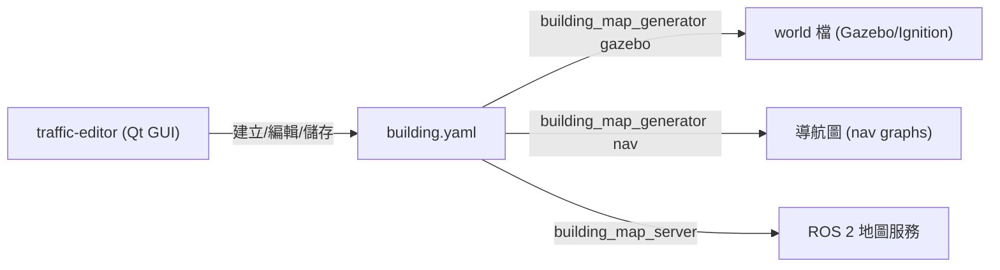

# Open-RMF 的 `building.yaml`：官方編輯器與相關工具調查

## 摘要

有。Open-RMF（Open Robotics Middleware Framework，開放機器人中介框架）的 `building.yaml` 檔案有官方編輯器，且不只一個：

1. **`traffic-editor`**（程式碼倉庫 `open-rmf/rmf_traffic_editor`）：Qt5 桌面 GUI，是 `building.yaml` 的**主要且正式**的編輯器，可以「新增、開啟、編輯、儲存」`.building.yaml` 檔案[^te-readme]。
2. **RMF Site Editor**（程式碼倉庫 `open-rmf/rmf_site`）：新世代編輯器，以 Rust 與 Bevy 遊戲引擎撰寫，可編譯為桌面版與 **WebAssembly 瀏覽器版**。它**可以讀取（匯入）`.building.yaml`**，但存檔格式改為 `.site.json`[^site-load]。

換句話說：`building.yaml` 至今仍是 Open-RMF 生態中「建築地圖」的正式交換格式，而它的第一方編輯器同時存在「舊版 Qt GUI」與「新版 Rust/網頁 GUI」兩套。

---

## 1. 什麼是 `building.yaml`

`building.yaml` 是 `traffic-editor` GUI 的專案檔格式，官方文件明確寫道：

> 「`traffic_editor` GUI 的專案以 `yaml` 檔儲存，副檔名為 `.building.yaml`。」
> [^te-book-quote]

檔案內含多層樓（levels）、頂點（vertices，即路徑點/waypoints）、車道（lanes）、牆（walls）、門（doors）、電梯（lifts）、地板多邊形（floors）、量測（measurements）、模型（models）、圖層（layers）與基準點（fiducials）等標註資訊[^te-book]。

一個空白的 `.building.yaml` 長這樣[^te-book]：

```yaml
levels:
  L1:
    doors:
      - []
    drawing:
      filename:
    fiducials:
    elevation: 0
    flattened_x_offset: 0
    flattened_y_offset: 0
    floors:
      - parameters: {}
        vertices: []
    lanes:
      - []
    layers:
      {}
    measurements:
      - []
    models:
      -{}
    vertices:
      {}
    walls:
      {}
lifts:
  {}
name: building
```

以官方示範地圖 `rmf_demos` 的 `office.building.yaml` 為例，實際檔案包含 `constraints`、`doors`、`drawing`、`features`、`floors`、`lanes`、`layers`、`measurements`、`models`、`vertices`、`walls` 等節點，並在頂層帶有 `coordinate_system: reference_image`、`crowd_sim`、`graphs`、`name` 等欄位[^office-yaml]。

---

## 2. 主要編輯器：`traffic-editor`（`open-rmf/rmf_traffic_editor`）

### 基本資料

| 項目 | 內容 |
|---|---|
| 名稱 | `traffic-editor`（同時稱 `rmf_traffic_editor`、Traffic Editor GUI） |
| 倉庫 | <https://github.com/open-rmf/rmf_traffic_editor> |
| 授權 | Apache License 2.0[^te-api] |
| 語言 | C++（Qt5）[^te-api]、[^te-readme] |
| 星數 | 173（擷取於 2026-11-21）[^te-api] |
| Fork 數 | 81[^te-api] |
| 最新版本 | 1.16.0（2026-11-13）[^te-changelog] |
| 預設分支最後推送 | 2026-11-19[^te-api] |
| 是否活躍 | 是；核心維護者（例如 mxgrey、Aaron Chong）持續提交[^te-changelog] |

### 功能

`traffic-editor` 是一個 Qt 為基礎的圖形介面，用途是「建立並標註 2D 平面圖，加上機器人交通路徑與建築基礎設施資訊」[^te-book]。它明確支援：

- 透過 `Building → New...` **建立新的 `.building.yaml`**[^te-book]
- **開啟並編輯**既有的 `.building.yaml`[^te-book]
- 匯入樓層平面圖（`.png`）作為背景畫布[^te-book]
- 加入頂點、牆、地板、門、電梯、量測、基準點與交通車道[^te-book]
- 切換「Building 模式」與「Traffic 模式」編輯不同構面[^te-book]

### 倉庫中的其他工具（非編輯器）

同一個倉庫也包含 `rmf_building_map_tools`，這是一組 Python CLI 工具，**只做後處理，不能編輯 `building.yaml`**[^te-readme]：

| 工具 | 用途 |
|---|---|
| `building_map_server` | 以 ROS 2 節點形式提供地圖服務[^te-readme] |
| `building_map_generator` | 由 `.building.yaml` 產生 Gazebo/Ignition 的 `.world` 與導航圖（`nav` 子命令）[^te-readme] |
| `building_map_model_downloader` | 下載地圖引用的 Gazebo 模型[^te-readme] |
| `building_map_converter` / `building_map_combiner` | 轉換（如 GeoPackage/GeoJSON）與合併地圖[^te-changelog] |

典型工作流：先用 `traffic-editor` 編好 `.building.yaml`，再以 `building_map_generator` 產生模擬世界與導航圖[^te-readme]。

Mermaid 流程示意：



---

## 3. 新世代編輯器：RMF Site Editor（`open-rmf/rmf_site`）

### 基本資料

| 項目 | 內容 |
|---|---|
| 名稱 | RMF Site Editor |
| 倉庫 | <https://github.com/open-rmf/rmf_site> |
| 授權 | Apache License 2.0[^site-api] |
| 語言 | Rust（Bevy 遊戲引擎）[^site-readme] |
| 星數 | 67（擷取於 2026-11-21）[^site-api] |
| Fork 數 | 41[^site-api] |
| 預設分支最後推送 | 2026-11-13[^site-api] |
| 網頁版 | <https://open-rmf.github.io/rmf_site/>[^site-readme] |
| crates.io | `rmf_site_editor`，最新 0.0.3（2025-10-25）[^crates] |

RMF Site Editor 的官方說明是「一個視覺化與編輯大型 RMF 部署場址的實驗性做法」，以 Rust 搭配 Bevy 撰寫，同一份程式碼可建置為桌面版（Windows/Linux/Mac）與網頁版（WebAssembly + WebGL/WebGPU）[^site-readme]。網頁版「不需要建置或安裝任何東西」，直接在瀏覽器使用[^site-readme]。

### 它能不能編輯 `building.yaml`？

可以**匯入**，但**不以此格式存檔**。在編輯器的檔案載入邏輯中（`crates/rmf_site_editor/src/site/load.rs`），副檔名以 `.building.yaml` 結尾時會走「legacy building map」路徑：先解析成 `BuildingMap`，再呼叫 `to_site()` 轉成新的 `Site` 結構；若副檔名是 `.json` 則直接解析為 `Site`。找不到檔名線索時，會先試 JSON、再退回 YAML[^site-load]。

對應的舊格式解析與轉換程式碼位於 `crates/rmf_site_format/src/legacy/`（`building_map.rs`、`level.rs`、`lane.rs`、`lift.rs`、`door.rs` 等），並處理「像素座標 → 笛卡爾公尺座標」的座標系轉換[^legacy-mod]、[^legacy-bm]。

存檔格式方面，Site Editor 的存檔對話框只提供 `.site.json`[^site-save-ai]，序列化方法為 `to_writer_json` / `from_bytes_json`[^site-save-ai]。

> 注意：網頁版的 README 仍標示為「高度實驗性，目前缺少如地圖檔存讀等重要功能」，但可透過下載或複製貼上 JSON 匯出[^site-readme]。此敘述可能未隨版本更新而修訂，使用前應以實際版本驗證。

### 與 ROS 2 的整合

`open-rmf/rmf_site_ros2` 提供 `rmf_site_cmake`（由 Site Editor 專案產生模擬世界與導航圖）與 `rmf_site_demos`（示範 cmake 專案設定），其 README 亦說明可用 `cargo install rmf_site_editor` 安裝編輯器[^site-ros2]。該倉庫星數僅 6（擷取於 2026-11-21），無正式 release[^site-ros2]。

---

## 4. 已封存（archived）的網頁編輯器嘗試

Open-RMF 曾經做過「網頁版 traffic-editor」，但現已封存：

| 倉庫 | 說明 | 狀態 |
|---|---|---|
| `open-rmf/traffic-editor-js` | 「Web-based port and upgrade of the Qt-based traffic-editor」，TypeScript 撰寫[^tejs-api]；README 開頭即寫「THIS REPO IS NOW ARCHIVED」，並指向 Rust 版 `open-rmf/rmf_site`[^tejs-readme] | 已封存，星數 1，最後推送 2022-10-05[^tejs-api] |
| `open-rmf/traffic_editor_iii` | 「Rust-based traffic editor for RMF」，Rust 撰寫[^teiii-api] | 已封存，星數 2，最後推送 2022-10-05[^teiii-api] |

`traffic-editor-js` 的 README 也說明其運作方式：以一個最小「building map server」提供端點，讓網頁 GUI 取得地圖資料，再從下拉選單「Open map from localhost:8000」載入[^tejs-readme]。

---

## 5. 綜合比較

| 工具 | 形式 | 可開啟 `.building.yaml` | 可建立/編輯 `.building.yaml` | 自身存檔格式 | 活躍狀態 |
|---|---|---|---|---|---|
| `traffic-editor`（`rmf_traffic_editor`） | Qt5 桌面 GUI | 是[^te-book] | 是[^te-book] | `.building.yaml`[^te-book] | 活躍，1.16.0（2026-11-13）[^te-changelog] |
| RMF Site Editor（`rmf_site`） | Rust/Bevy 桌面 + 網頁 | 是（匯入 legacy）[^site-load] | 是（但另存 `.site.json`）[^site-save-ai] | `.site.json`[^site-save-ai] | 活躍（實驗性），最後推送 2026-11-13[^site-api] |
| `rmf_building_map_tools` | Python CLI | 是（讀取）[^te-readme] | 否[^te-readme] | 產生 world / nav 檔[^te-readme] | 隨主倉庫更新 |
| `traffic-editor-js` | 網頁（TypeScript） | 是 | 是 | 未明載 | **已封存**[^tejs-readme] |
| `traffic_editor_iii` | 桌面（Rust） | 未明載 | 未明載 | 未明載 | **已封存**[^teiii-api] |

---

## 6. 對來源的批判性反思

- **官方文件 vs. 原始碼**：`traffic-editor` 的文件（OSRF 的《Programming Multiple Robots with ROS 2》線上書）明確指出 `building.yaml` 是 GUI 專案檔[^te-book]，而 GitHub API 的 metadata（星數、推送時間、授權）可由 `api.github.com` 直接查得，屬第一手資料，可信度高[^te-api]。
- **版本時效性**：官方文件在「Deriving coordinate-space transforms」段落提到「下一版 traffic-editor 會更靈活……但目前沒有硬性時程」，這與我們在 `rmf_site`（Rust 版）中看到的實際進展一致，顯示舊文件的部分敘述已過時[^te-book]。
- **實驗性標示的風險**：`rmf_site` 的 README 自稱 experimental，且網頁版 README 明言缺少存讀功能[^site-readme]；然而我們也直接讀到其原始碼已具備 `.building.yaml` 匯入與 `.site.json` 存檔邏輯[^site-load]、[^site-save-ai]，兩者存在落差，可能是 README 未即時更新。建議以實際發行版本測試為準，不宜單憑 README 斷言。
- **低星數專案**：`traffic-editor-js`（1 星）、`traffic_editor_iii`（2 星）、`rmf_site_ros2`（6 星）星數偏低[^tejs-api]、[^teiii-api]、[^site-ros2]；但本報告主題屬 Open-RMF 特定生態的利基領域，且這些倉庫已被官方封存或為新興周邊，故仍納入說明並標註其狀態。
- **未發現第三方編輯器**：以 GitHub 搜尋 `org:open-rmf` 的 editor 相關倉庫，僅得 `rmf_traffic_editor`、`rmf_site_ros2`、`traffic_editor_iii`、`traffic-editor-js`、`rmf_workcell`、`traffic_editor_assets` 六項[^gh-search]，未發現 Open-RMF 組織以外的通用 `building.yaml` 編輯器。

---

## 7. 結論

- **有編輯器**：`traffic-editor`（`open-rmf/rmf_traffic_editor`）是 `building.yaml` 的正式第一方編輯器，能建立、開啟、編輯、儲存 `.building.yaml`，且仍在活躍維護（1.16.0，2026-11-13）[^te-changelog]。
- **新世代替代方案**：RMF Site Editor（`open-rmf/rmf_site`）提供桌面與網頁兩種形式，可匯入 `.building.yaml`，但存檔改用 `.site.json`[^site-load]、[^site-save-ai]。
- **其他工具只讀不寫**：`rmf_building_map_tools` 負責由 `building.yaml` 產生模擬世界與導航圖，不具編輯能力[^te-readme]。
- **舊網頁版已封存**：`traffic-editor-js` 與 `traffic_editor_iii` 均已封存，開發能量轉向 `rmf_site`[^tejs-readme]、[^teiii-api]。

---

## 參考文獻

[^te-readme]: Open-RMF. (n.d.). *rmf_traffic_editor — README*. GitHub. Retrieved 2026-11-21, from https://github.com/open-rmf/rmf_traffic_editor/blob/main/README.md

[^te-book]: Open Source Robotics Foundation. (n.d.). Traffic Editor. In *Programming Multiple Robots with ROS 2*. Retrieved 2026-11-21, from https://osrf.github.io/ros2multirobotbook/traffic-editor.html

[^te-book-quote]: Open Source Robotics Foundation. (n.d.). Traffic Editor. In *Programming Multiple Robots with ROS 2*. 「The `traffic_editor` GUI projects are stored as `yaml` files with `.building.yaml` file extensions.」Retrieved 2026-11-21, from https://osrf.github.io/ros2multirobotbook/traffic-editor.html

[^te-api]: Open-RMF. (n.d.). *rmf_traffic_editor repository metadata*. GitHub REST API. Retrieved 2026-11-21, from https://api.github.com/repos/open-rmf/rmf_traffic_editor

[^te-changelog]: Open-RMF. (2026-11-13). *CHANGELOG for package rmf_traffic_editor*. GitHub. Retrieved 2026-11-21, from https://github.com/open-rmf/rmf_traffic_editor/blob/main/rmf_traffic_editor/CHANGELOG.rst

[^office-yaml]: Open-RMF. (n.d.). *rmf_demos_maps/office.building.yaml*. GitHub. Retrieved 2026-11-21, from https://github.com/open-rmf/rmf_demos/blob/main/rmf_demos_maps/maps/office/office.building.yaml

[^site-readme]: Open-RMF. (n.d.). *rmf_site — README (The RMF Site Editor)*. GitHub. Retrieved 2026-11-21, from https://github.com/open-rmf/rmf_site/blob/main/README.md

[^site-api]: Open-RMF. (n.d.). *rmf_site repository metadata*. GitHub REST API. Retrieved 2026-11-21, from https://api.github.com/repos/open-rmf/rmf_site

[^site-load]: Open-RMF. (n.d.). *crates/rmf_site_editor/src/site/load.rs* (LoadSite::from_data). GitHub. Retrieved 2026-11-21, from https://github.com/open-rmf/rmf_site/blob/main/crates/rmf_site_editor/src/site/load.rs

[^site-save-ai]: Open-RMF. (n.d.). *crates/rmf_site_format/src/site.rs*, *crates/rmf_site_editor/src/workspace.rs*. GitHub. Retrieved 2026-11-21, from https://github.com/open-rmf/rmf_site

[^legacy-mod]: Open-RMF. (n.d.). *crates/rmf_site_format/src/legacy/mod.rs*. GitHub. Retrieved 2026-11-21, from https://github.com/open-rmf/rmf_site/blob/main/crates/rmf_site_format/src/legacy/mod.rs

[^legacy-bm]: Open-RMF. (n.d.). *crates/rmf_site_format/src/legacy/building_map.rs* (BuildingMap::from_bytes, to_site). GitHub. Retrieved 2026-11-21, from https://github.com/open-rmf/rmf_site/blob/main/crates/rmf_site_format/src/legacy/building_map.rs

[^site-ros2]: Open-RMF. (n.d.). *rmf_site_ros2 — README*. GitHub. Retrieved 2026-11-21, from https://github.com/open-rmf/rmf_site_ros2/blob/main/README.md

[^crates]: Open-RMF. (2025-10-25). *rmf_site_editor — crates.io*. Retrieved 2026-11-21, from https://crates.io/api/v1/crates/rmf_site_editor

[^tejs-readme]: Open-RMF. (n.d.). *traffic-editor-js — README (archived)*. GitHub. Retrieved 2026-11-21, from https://github.com/open-rmf/traffic-editor-js/blob/main/README.md

[^tejs-api]: Open-RMF. (n.d.). *traffic-editor-js repository metadata*. GitHub REST API. Retrieved 2026-11-21, from https://api.github.com/repos/open-rmf/traffic-editor-js

[^teiii-api]: Open-RMF. (n.d.). *traffic_editor_iii repository metadata*. GitHub REST API. Retrieved 2026-11-21, from https://api.github.com/repos/open-rmf/traffic_editor_iii

[^gh-search]: Open-RMF. (n.d.). *GitHub REST API search: repositories in organization open-rmf matching "editor"*. Retrieved 2026-11-21, from https://api.github.com/search/repositories?q=org:open-rmf+editor&sort=stars
