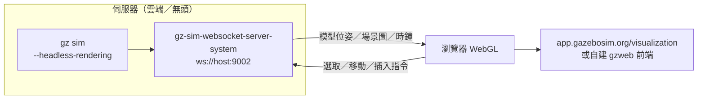
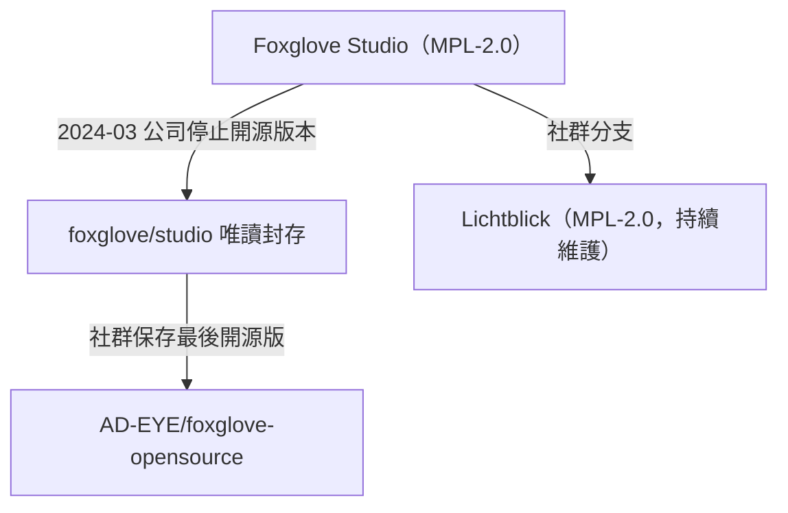
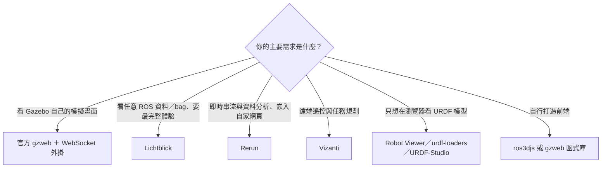

# Gazebo 的網頁版自由開源軟體（FOSS）三維視覺化替代方案

## 摘要

Gazebo 是機器人領域最廣泛使用的模擬器之一，其圖形化介面（GUI）與 Rviz 長期被視為「桌面端」工具：必須在本機安裝、搭配 X Window 與顯示卡才能使用。然而在雲端／無頭（headless）模擬、遠端協作、跨平台瀏覽器存取的趨勢下，社群近年發展出一批「以瀏覽器為前端」的自由開源三維視覺化工具，可在不安裝桌面環境的情況下檢視機器人模型、感測器資料與模擬場景。

本報告針對此需求，調查並比較可作為 Gazebo 視覺化替代方案的網頁版 FOSS 工具，涵蓋三大類：

1. **Gazebo 官方生態系的網頁前端**（gzweb）
2. **通用機器人資料／ROS 視覺化工具**（Lichtblick、Webviz、Vizanti、Rerun）
3. **純瀏覽器的模型檢視與 URDF 工具**（ros3djs、urdf-loaders、Robot Viewer、URDF-Studio）

> 本報告為獨立文件，所有背景知識與名詞皆於文中說明，讀者無須先閱讀其他文件。

---

## 一、背景與名詞定義

### 1.1 Gazebo 是什麼

Gazebo 是一套開源的機器人三維模擬器，能模擬剛體動力學、感測器（相機、光達、IMU 等）與環境，常與 ROS（Robot Operating System）搭配使用[^gazebo-sim]。Gazebo 生態系有兩個世代：

- **Gazebo Classic（gazebo11 及更早）**：舊世代，官方已於 2025 年 1 月宣布停止支援（end-of-life）[^gazebo-classic-eol]。
- **Gazebo Sim（現代版，原名 Ignition Gazebo，指令為 `gz sim`）**：目前主力世代[^gazebo-sim]。

Gazebo 的「視覺化」通常指兩件事：一是模擬器本身的三維場景視窗（模擬世界），二是檢視機器人狀態與感測器資料的除錯工具（如 Rviz）。本報告所稱「Gazebo 的替代方案」，指的是**取代上述三維視覺化／檢視體驗**的工具，而非取代整個物理模擬引擎。

### 1.2 關鍵名詞

| 名詞 | 說明 |
|---|---|
| FOSS | Free and Open Source Software，自由／開源軟體，允許檢視、修改與再散布原始碼。 |
| Web-based（網頁版） | 主要操作介面在瀏覽器內執行（以 WebGL／WebGPU 繪圖），不需安裝原生桌面程式。 |
| ROS / ROS 2 | Robot Operating System，機器人中介軟體；ROS 1 與 ROS 2 為兩個不相容的世代。 |
| rosbridge | 一套以 WebSocket 將 ROS 訊息橋接到瀏覽器的中介服務，是許多網頁工具的基礎[^rosbridge]。 |
| URDF | Unified Robot Description Format，以 XML 描述機器人連桿與關節的標準格式。 |
| 無頭模擬 | Headless simulation，伺服器端不開視窗、僅用離屏（offscreen）渲染執行模擬。 |
| MCAP | 一種由 Foxglove 發起的機器人資料容器格式，可存放多通道時序資料，被視為 ROS bag 的現代替代[^mcap]。 |

---

## 二、Gazebo 官方的網頁視覺化路線

在尋找「替代方案」之前，必須先理解 Gazebo 本身已內建網頁視覺化能力，否則容易重複造輪子。

### 2.1 現代 Gazebo 的內建 WebSocket 視覺化

現代 Gazebo Sim 內建一個名為 `gz-sim-websocket-server-system` 的系統外掛，會在模擬執行時以 WebSocket 對外發布場景資訊，讓瀏覽器以 WebGL 連線渲染[^gz-websocket]。官方文件明確說明[^gz-webviz]：

> Web visualization supports rendering and interacting with running Gazebo simulations. … No additional dependencies, other than a browser and internet connection, are required.

使用方式是在 SDF 世界中加入外掛：

```xml
<plugin filename="gz-sim-websocket-server-system"
        name="gz::sim::systems::WebsocketServer">
  <port>9002</port>
  <publication_hz>30</publication_hz>
  <max_connections>-1</max_connections>
</plugin>
```

再以瀏覽器連線至官方前端 `https://app.gazebosim.org/visualization`，或自行以 `gzweb` 函式庫嵌入[^gz-webviz]。

### 2.2 gzweb：Gazebo 官方網頁渲染函式庫

`gzweb` 是 Gazebo 官方（`gazebo-web` 組織）維護的函式庫，使用 Three.js 在瀏覽器渲染 Gazebo 的模型與世界，並可與執行中的模擬透過 WebSocket 通訊[^gzweb-modern]。它提供兩個主要類別：`AssetViewer`（渲染靜態模型／世界）與 `SceneManager`（連線到即時模擬場景）。

需注意歷史上存在**兩個同名專案**：

- `osrf/gzweb`：給 **Gazebo Classic** 的舊版網頁客戶端（77 顆星），已隨 Classic 進入生命週期終點[^gzweb-classic]。
- `gazebo-web/gzweb`：給**現代 Gazebo** 的改寫版（npm 套件 `gzweb`，約 50 顆星），持續維護中[^gzweb-modern]。

### 2.3 無頭與遠端渲染架構

Gazebo 支援以 EGL 進行離屏渲染，可透過 `--headless-rendering` 命令列選項啟用（僅支援 OGRE2 渲染引擎）[^gz-headless]。這讓「在雲端 GPU 機器上跑模擬、把三維畫面以 WebSocket 串到瀏覽器」成為官方認可的組合。



### 2.4 小結

若需求是「把 Gazebo 自己的模擬畫面搬到瀏覽器」，**官方路線（gzweb + WebSocket 外掛）已足夠**，且是 Gazebo Classic 被淘汰後唯一支援現代 Gazebo 的官方方案。以下章節的工具，則適用於「不限於 Gazebo、要檢視任意 ROS／機器人資料」或「只想在瀏覽器看模型」的情境。

---

## 三、通用型網頁視覺化工具

### 3.1 Lichtblick（Foxglove Studio 的開源分支，最推薦）

**Foxglove Studio 曾是本領域最受歡迎的網頁視覺化工具**，原以 MPL-2.0 授權開源。然而 Foxglove 公司於 2024 年 3 月宣布停止開源版本的開發，官方部落格指出無法同時支撐全職開發與大量開源釋出[^foxglove-2]。其 GitHub 儲存庫 `foxglove/studio` 隨後轉為唯讀（封存狀態）[^foxglove-studio]。

社群因此以分支方式接手，誕生 **Lichtblick**：一個與 Foxglove Studio 相容、以瀏覽器或桌面應用執行的機器人視覺化與診斷工具，採 **MPL-2.0** 授權，由社群組織 Lichtblick Suite 維護，GitHub 上約 1,200 顆星、仍持續開發[^lichtblick]。



**優勢**：功能最接近完整 RViz／Gazebo 檢視體驗（三維場景、點雲、影像、URDF、圖表、ROS bag 播放），且提供瀏覽器版。**限制**：並非模擬器，不能取代 Gazebo 的物理模擬；對 Gazebo 原生主題（gz-transport）需透過 ROS 橋接。

### 3.2 Webviz（Cruise Automation，已實質停止維護）

Webviz 由自動駕駛公司 Cruise Automation 開發，是網頁版 ROS bag 視覺化工具的先驅，採 **Apache-2.0** 授權，GitHub 上約 2,300 顆星（本報告比較群中星數最高），並提供 `regl-worldview` 等 React 三維渲染函式庫[^webviz]。

然而其最後一次提交約在 2022 年 3 月，專案 README 表明 Cruise 已不再提供商業支援，並將使用者導向 Foxglove Studio[^webviz]。**結論**：歷史地位重要，但不建議用於新專案。

### 3.3 Vizanti（ROS 網頁地面控制站）

Vizanti 是活躍維護中的網頁版 ROS 視覺化與控制工具，採 **BSD-3-Clause** 授權，約 275 顆星，同時支援 ROS 1 與 ROS 2 分支（Noetic、Humble、Jazzy 等）[^vizanti]。它提供類似 RViz 的視圖、衛星底圖、任務規劃（航點）、搖桿與鍵盤遙控，並內含 Flask 伺服器與 rosbridge。

**適用情境**：戶外機器人的遠端操作與概覽。**限制**：以二維／地圖視角為主，並非 Gazebo 模擬器的替代，也不直接介接 Gazebo[^vizanti]。

### 3.4 Rerun（資料層級的視覺化，星數最高）

Rerun 採 **MIT + Apache-2.0 雙授權**，GitHub 上約 11,800 顆星，以 Rust 為核心並提供 Python／C++／Rust SDK，定位為「實體 AI 的資料層」[^rerun]。它提供官方**網頁檢視器**（npm 套件 `@rerun-io/web-viewer`），可透過 iframe、JavaScript 或 Gradio 嵌入，並支援以 gRPC 串流或載入 `.rrd`／MCAP 檔案[^rerun-web]。

Rerun 可匯入 MCAP、ROS bag、ROS 2 db3 等資料，並內建關節狀態、座標變換（transforms）、點雲、影像等 ROS 常見資料型別的視覺化，官方文件亦以「RViz 替代」自我定位[^rerun]。**限制**：它是資料視覺化工具，並非 Gazebo 的即時模擬前端。

---

## 四、純瀏覽器的模型檢視與 URDF 工具

若需求單純是「在瀏覽器看機器人三維模型」，以下工具輕量且門檻低。

### 4.1 ros3djs（RobotWebTools）

`ros3djs` 是 ROS 網頁工作組（RobotWebTools）維護的三維視覺化層，建構於 `roslibjs` 與 Three.js 之上，採 **BSD** 授權，約 450 顆星；底層的 `roslibjs`（約 833 顆星）與 `rosbridge_suite`（約 1,300 顆星）同樣為 BSD 授權[^ros3djs]。`roslibjs` 透過 rosbridge 同時支援 ROS 1 與 ROS 2；`ros3djs` 則提供 URDF 渲染、互動式標記（interactive markers）與地圖顯示。

**限制**：`ros3djs` 綁定的 Three.js 版本相當舊、更新較慢；其整體活躍度由 `rosbridge_suite` 支撐[^ros3djs]。另有舊專案 `ros2-web-bridge` 已封存，官方建議改用 `rosbridge_suite`[^ros2web].

### 4.2 urdf-loaders（NASA JPL 開源）

由 NASA JPL 開源、`gkjohnson/urdf-loaders`，採 **Apache-2.0** 授權，約 822 顆星，是 Three.js 生態中載入 URDF 的主要函式庫，提供 JavaScript URDF 解析器與渲染器，並支援自訂 HTML 元素 `<urdf-viewer>`[^urdf-loaders]。許多其他網頁工具都以此為底層。

### 4.3 Robot Viewer（fan-ziqi）

`fan-ziqi/robot_viewer` 採 **Apache-2.0** 授權，約 589 顆星，為目前較完整的瀏覽器機器人檢視器，支援 URDF、Xacro、MJCF 與部分 USD，內建關節滑桿、以 WebAssembly 執行 MuJoCo 物理模擬、動畫編輯與量測工具；所有處理皆在使用者端完成[^robotviewer]。

### 4.4 URDF-Studio（OpenLegged）

`OpenLegged/URDF-Studio` 採 **Apache-2.0** 授權，約 503 顆星，建構於 React Three Fiber，定位為瀏覽器內的 URDF **編輯環境**（不只是檢視器）：可編輯機器人拓撲、幾何與碰撞、硬體配置，並匯出 URDF、MJCF、USD、SDF、Xacro[^urdfstudio]。

---

## 五、綜合比較

下表星數與日期為 2026-11-21 之快照，會隨時間變動。

| 工具 | 類型 | 授權 | GitHub 星數 | 網頁版 | ROS 1/2 | 對 Gazebo 的關聯 | 維護狀態 |
|---|---|---|---|---|---|---|---|
| gzweb（`gazebo-web/gzweb`） | 渲染函式庫 | Apache-2.0（推定） | 約 50 | 是 | 不直接相關 | 現代 Gazebo 官方前端 | 活躍（2026-02）[^gzweb-modern] |
| gzweb（`osrf/gzweb`） | 獨立應用 | Apache-2.0 | 約 77 | 是 | 否 | 僅 Gazebo Classic | 隨 Classic EOL[^gzweb-classic] |
| Lichtblick | 獨立應用 | MPL-2.0 | 約 1,200 | 是（亦有桌面版） | 兩者皆可 | 非模擬器，資料層級 | 活躍[^lichtblick] |
| Webviz | 應用＋函式庫 | Apache-2.0 | 約 2,300 | 是 | bag 檔案 | 無 | 2022-03 起停滯[^webviz] |
| Vizanti | 獨立應用 | BSD-3-Clause | 約 275 | 是 | 兩者皆可 | 無 | 活躍（2026-11）[^vizanti] |
| Rerun | 應用＋函式庫 | MIT＋Apache-2.0 | 約 11,800 | 是 | MCAP／bag／db3 | 無 | 活躍[^rerun] |
| ros3djs | 函式庫 | BSD | 約 450 | 是 | 兩者皆可 | 無 | 中等[^ros3djs] |
| urdf-loaders | 函式庫 | Apache-2.0 | 約 822 | 是 | 否 | 無 | 活躍[^urdf-loaders] |
| Robot Viewer | 獨立應用 | Apache-2.0 | 約 589 | 是 | 否 | 無 | 活躍[^robotviewer] |
| URDF-Studio | 獨立應用 | Apache-2.0 | 約 503 | 是 | 否 | 無 | 活躍[^urdfstudio] |

### 5.1 依使用情境的建議



---

## 六、來源批判性反思

1. **Foxglove 與 Lichtblick 的授權轉折是本主題最重要的事實**：Foxglove Studio 由開源（MPL-2.0）轉為閉源商業產品，導致「推薦清單」在 2024 年前後劇烈改變。任何引用較舊文章而推薦 Foxglove Studio 的資料都可能過時；Lichtblick 是社群為延續開源而生的分支，需留意其長期維護能量。

2. **星數（GitHub stars）只是熱度的粗略代理指標**，不等於品質或活躍度。例如 Webviz 星數最高（約 2,300）卻已停滯多年；gzweb 現代版星數僅約 50，卻是 Gazebo 官方且仍在維護的方案。本報告因此同時列出「最後提交時間」與「維護狀態」以校正判讀。

3. **GitHub 星數與提交日期為動態資料**：本報告中的數字為 2026-11-21 的檢視結果，讀者引用前應重新確認。

4. **部分授權資訊存在不確定性**：現代 `gazebo-web/gzweb` 儲存庫根目錄未見明確 LICENSE 檔，`package.json` 亦未宣告授權欄位，但同組織（`gazebo-web`）一致採用 Apache-2.0，故本報告標記為「推定 Apache-2.0」。這是推論而非直接證據，使用前應自行核實[^gzweb-modern]。

5. **「替代 Gazebo」一詞需精確界定**：本報告中除了 gzweb 之外，其餘工具**都不是模擬器**，無法取代 Gazebo 的物理引擎與感測器模擬，僅能取代其「視覺化」層。若需求是完整模擬，應考慮 Gazebo Sim 本身或同樣為網頁化的其他模擬器（例如瀏覽器端物理引擎 WebAssembly 方案），而非本報告列出的檢視工具。

---

## 參考文獻

[^gazebo-sim]: Open Robotics. (n.d.). Gazebo Sim. Retrieved 2026-11-21, from https://gazebosim.org/

[^gazebo-classic-eol]: Open Robotics. (2025). Gazebo Classic end of life. Open Robotics Discourse. Retrieved 2026-11-21, from https://discourse.openrobotics.org/t/gazebo-classic-end-of-life/48748

[^gz-websocket]: Open Robotics. (n.d.). Websocket server. Gazebo Sim API documentation. Retrieved 2026-11-21, from https://gazebosim.org/api/sim/10/websocket_server.html

[^gz-webviz]: Open Robotics. (n.d.). Web visualization. Gazebo documentation. Retrieved 2026-11-21, from https://gazebosim.org/docs/latest/web_visualization/

[^gzweb-modern]: Open Robotics. (n.d.). gazebo-web/gzweb: A library for rendering Gazebo models and worlds in the browser. GitHub. Retrieved 2026-11-21, from https://github.com/gazebo-web/gzweb

[^gzweb-classic]: Open Robotics. (n.d.). osrf/gzweb: Web client for Gazebo classic simulation. GitHub. Retrieved 2026-11-21, from https://github.com/osrf/gzweb

[^gz-headless]: Open Robotics. (n.d.). Headless rendering. Gazebo Sim API documentation. Retrieved 2026-11-21, from https://gazebosim.org/api/sim/9/headless_rendering.html

[^foxglove-2]: Foxglove. (2024, March 10). Foxglove 2.0: Unifying robotics observability. Retrieved 2026-11-21, from https://foxglove.dev/blog/foxglove-2-0-unifying-robotics-observability

[^foxglove-studio]: Foxglove. (n.d.). foxglove/studio. GitHub. Retrieved 2026-11-21, from https://github.com/foxglove/studio

[^lichtblick]: Lichtblick Suite. (n.d.). lichtblick-suite/lichtblick: An integrated visualization and diagnosis tool for robotics. GitHub. Retrieved 2026-11-21, from https://github.com/Lichtblick-Suite/lichtblick

[^webviz]: Cruise Automation. (n.d.). cruise-automation/webviz: Web-based visualization libraries for robotics. GitHub. Retrieved 2026-11-21, from https://github.com/cruise-automation/webviz

[^vizanti]: Vizanti contributors. (n.d.). MoffKalast/vizanti: A mission planner and visualizer for controlling outdoor ROS robots. GitHub. Retrieved 2026-11-21, from https://github.com/MoffKalast/vizanti

[^rerun]: Rerun. (n.d.). rerun-io/rerun: An open source SDK for logging, storing, querying, and visualizing multimodal and multi-rate data. GitHub. Retrieved 2026-11-21, from https://github.com/rerun-io/rerun

[^rerun-web]: Rerun. (n.d.). Embed the Rerun web viewer. Rerun documentation. Retrieved 2026-11-21, from https://rerun.io/docs/howto/integrations/embed-web

[^ros3djs]: RobotWebTools. (n.d.). RobotWebTools/ros3djs: 3D visualization library for use with the ROS JavaScript libraries. GitHub. Retrieved 2026-11-21, from https://github.com/RobotWebTools/ros3djs

[^ros2web]: RobotWebTools. (n.d.). RobotWebTools/ros2-web-bridge. GitHub. Retrieved 2026-11-21, from https://github.com/RobotWebTools/ros2-web-bridge

[^rosbridge]: RobotWebTools. (n.d.). RobotWebTools/rosbridge_suite. GitHub. Retrieved 2026-11-21, from https://github.com/RobotWebTools/rosbridge_suite

[^urdf-loaders]: Johnson, G. (n.d.). gkjohnson/urdf-loaders: URDF loading library for Three.js. GitHub. Retrieved 2026-11-21, from https://github.com/gkjohnson/urdf-loaders

[^robotviewer]: fan-ziqi. (n.d.). fan-ziqi/robot_viewer: A browser-based robot model viewer supporting URDF, Xacro, MJCF and USD. GitHub. Retrieved 2026-11-21, from https://github.com/fan-ziqi/robot_viewer

[^urdfstudio]: OpenLegged. (n.d.). OpenLegged/URDF-Studio: A browser-based URDF authoring environment. GitHub. Retrieved 2026-11-21, from https://github.com/OpenLegged/URDF-Studio

[^mcap]: Foxglove. (n.d.). MCAP: A modular container file format for pub/sub and robotics data. Retrieved 2026-11-21, from https://mcap.dev
