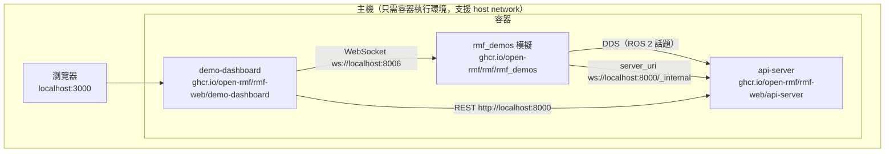

# Open-RMF Web（rmf-web）能否只靠容器、主機不安裝任何原生套件？

## 摘要

結論：**可以**。Open-RMF 官方本身就提供多組預先建置（prebuilt）的 OCI／Docker 映像，能在不安裝 ROS 2、Gazebo、Open-RMF 或 Node.js 到主機的前提下，於容器內跑起完整的 rmf-web 體驗（API server、前端儀表板，必要時再加上模擬環境）。[^rmfwebreadme][^rmfreadme]

但「純容器」有兩個層次的限制必須說清楚：

- **主機仍需要一個容器執行環境（Docker／Podman），且必須支援 Linux 的 host network 模式。** 因為 Open-RMF 依賴 ROS 2 的 DDS 探索（discovery）機制，官方文件一律建議以 `--network host` 執行。[^rmfwebreadme]
- **純容器只能提供「既有部署的網頁介面」或「容器內模擬」。** 若只要儀表板與 API server，兩個容器即可；若要看到地圖、機器人、任務流動，必須再多一個執行 `rmf_demos` 的容器提供資料來源。[^rmfdemosreadme]

本文整理官方三條不同的容器供應線、最小可行組合、可用的現成 `docker-compose`、網路與時間同步等關鍵細節，以及目前已知的限制與替代路徑。

---

## 1. 背景：rmf-web 是什麼

Open-RMF（Open Robotics Middleware Framework）是一套多機隊（multi-fleet）機器人管理框架，負責異質機器人之間的路徑衝突協調、共享資源（電梯、門、車道）管理與任務派遣。[^rmfdemosreadme]

`rmf-web` 是 Open-RMF 的網頁介面集合，官方描述為「提供使用者視覺化與控制 Open-RMF 部署各面向的一組套件（packages）」，其主要組成為：[^rmfwebreadme]

| 元件 | 角色 |
| --- | --- |
| `api-server` | 與 Open-RMF 部署（ROS 2 網路）溝通、提供 REST／WebSocket API、負責認證授權與資料庫記錄 |
| `api-client` | 包裝 `socket.io-client` 的型別化前端客戶端 |
| `rmf-dashboard-framework` | 可重用的前端元件庫（MicroApps、Workspace）與可自訂的儀表板 |

`rmf-web` 為 Apache-2.0 授權、TypeScript 為主要語言，2020-03-02 建立，於 2026-11-21 查詢時有約 141 顆星、87 個 fork。[^ghapirmfweb]

---

## 2. 官方提供哪些現成容器映像

「只靠容器」之所以可行，是因為官方在三個不同的 repository 都發布了 GHCR（GitHub Container Registry）映像。以下依「與 rmf-web 的關聯度」排序。

### 2.1 來自 `rmf-web` repository 的映像

`rmf-web` 的 README 直接提供「Quick start with docker」章節，這是官方針對「試用 `rmf_demos`」所設計的路徑。[^rmfwebreadme]

其 nightly 工作流程（`.github/workflows/nightly.yml`）會針對 ROS 2 的 `jazzy`、`lyrical`、`rolling` 三個發行版，建置並推送以下映像：[^rmfwebnightly]

| 映像 | 用途 | 標籤形式 |
| --- | --- | --- |
| `ghcr.io/open-rmf/rmf-web/minimal-rmf` | 供其他建置階段使用的基底（ROS 2 + `rmf_*_msgs` + pnpm／Node） | `<distro>-nightly` |
| `ghcr.io/open-rmf/rmf-web/demo-dashboard` | 預先建置好的示範儀表板，由 `serve` 提供靜態檔案 | `<distro>-nightly` |
| `ghcr.io/open-rmf/rmf-web/api-server` | API server | `<distro>-nightly`，`rolling` 另加 `latest` |

`demo-dashboard` 的建置流程值得注意：它先在 `minimal-rmf` 內用 pnpm 安裝依賴、以 Vite 建置 `examples/demo`，再將產物複製到一個乾淨的 `ubuntu:24.04` 映像，安裝 `serve`，並以一支 shell entrypoint 在容器啟動時把 `RMF_SERVER_URL` 與 `TRAJECTORY_SERVER_URL` 環境變數「注入」到 `index.html`。[^rmfwebdashdocker][^rmfwebentrypoint]

```bash
docker run \
  --network host -it --rm \
  -e RMF_SERVER_URL=http://localhost:8000 \
  -e TRAJECTORY_SERVER_URL=ws://localhost:8006 \
  ghcr.io/open-rmf/rmf-web/demo-dashboard:jazzy-nightly
```

上述指令是官方 README 的範例，儀表板預設在 `localhost:3000`。[^rmfwebreadme]

`api-server` 映像則以 `ros:<distro>-ros-core` 為底，安裝 `python3-pip`、`ros-$ROS_DISTRO-rmf-*-msgs`、`ros-$ROS_DISTRO-rmw-cyclonedds-cpp`，把建置好的 wheel 裝進去，並以 `sqlite_local_config.py` 作為預設設定（使用容器內非持久化的 SQLite）。[^rmfwebapiserverdocker]

```bash
docker run \
  --network host -it --rm \
  -e ROS_DOMAIN_ID=<ROS_DOMAIN_ID> \
  -e RMW_IMPLEMENTATION=<RMW_IMPLEMENTATION> \
  ghcr.io/open-rmf/rmf-web/api-server:jazzy-nightly
```

API server 預設只綁定 `127.0.0.1`，若要從其他機器存取，必須把設定中的 `host` 改為 `0.0.0.0` 並設定對應的 `public_url`。[^rmfwebreadme][^rmfwebapiserverreadme]

### 2.2 來自 `rmf` repository 的映像

`open-rmf/rmf`（Root repository，Apache-2.0，2026-11-21 查詢約 469 顆星）提供了整包「已編譯好的 Open-RMF 工作空間」映像，也就是 `rmf_demos` 本身。[^ghapirmf][^rmfreadme]

```bash
docker pull ghcr.io/open-rmf/rmf/rmf_demos:jazzy-rmf-latest
docker tag ghcr.io/open-rmf/rmf/rmf_demos:jazzy-rmf-latest rmf:jazzy-rmf-latest

docker run -it --network host rmf:jazzy-rmf-latest bash -c \
  "export ROS_DOMAIN_ID=9; ros2 launch rmf_demos_gz office.launch.xml headless:=1"
```

其 `Dockerfile` 以 `ros:<distro>-ros-base` 為底，安裝 `ros-dev-tools`、`rmw_cyclonedds_cpp`、`rmw_zenoh_cpp`，以 `vcs import` 匯入 `rmf.repos` 列出的所有套件，再用 `colcon build` 完成編譯。[^rmfdockerfile]

官方同時警告：這些映像建構自 `main` 分支的 nightly，可能如預期般出現破壞性變更，尤其是較舊的 ROS 2 發行版；正式部署應改用已驗證可用的特定 hash／版本，而非 `latest`。[^rmfreadme]

### 2.3 來自 `rmf_deployment_template` 的三件套與現成 docker-compose

`open-rmf/rmf_deployment_template` 是官方文件（`ros2multirobotbook`）明確導向的部署範本 repo，2026-11-21 查詢約 25 顆星。[^ros2bookrmfweb][^ghapideploy]

它最有價值的部分，是 `devel/docker-compose-local.yaml`——一份**只用 docker-compose、不必架 Kubernetes 叢集**的本機部署檔案，內容只有三個服務：[^deploycompose]

```yaml
services:
  simulation:
    image: "ghcr.io/open-rmf/rmf_deployment_template/rmf-deployment/rmf-sim:latest"
    entrypoint: ["/ros_entrypoint.sh", "ros2", "launch", "rmf_demos_gz", "office.launch.xml", "headless:=1", "server_uri:=ws://localhost:8000/_internal"]
    environment:
      RMW_IMPLEMENTATION: "rmw_cyclonedds_cpp"
    network_mode: "host"

  api-server:
    image: "ghcr.io/open-rmf/rmf_deployment_template/rmf-deployment/api-server:latest"
    environment:
      RMW_IMPLEMENTATION: "rmw_cyclonedds_cpp"
    network_mode: "host"

  web-dashboard:
    image: "ghcr.io/open-rmf/rmf_deployment_template/rmf-deployment/dashboard-no-auth:latest"
    environment:
      RMF_SERVER_URL: "http://localhost:8000"
      TRAJECTORY_SERVER_URL: "ws://localhost:8006"
    ports:
      - "3000:80"
```

使用方式為：

```bash
docker-compose -f devel/docker-compose-local.yaml up -d
```

之後存取 `http://localhost:3000/dashboard`，就能直接派送任務。官方特別說明此路徑會啟動 `dashboard-no-auth` 映像，因此**不需要認證**。[^deployreadme]

此 compose 檔的關鍵設計，在於把「模擬」也放進容器，並讓模擬容器自己去連 API server 的內部端點（`server_uri:=ws://localhost:8000/_internal`），使 API server 能收到任務與機器人狀態。[^deploycompose]

`rmf_deployment_template` 的 nightly 工作流程會建置並推送 `builder`、`rmf`、`rmf-site`、`api-server`、`dashboard`、`dashboard-local`、`keycloak-setup`、`rmf-sim` 等映像。[^deploynightly]其中 `dashboard-no-auth` 的 Dockerfile 說明了它為何不需要認證：它從 `rmf-web` 原始碼抓取後，以自己的 `main.tsx`、資源與 `vite.config.ts` 取代原設定，再以 Vite 建置，最後放到 nginx 並透過 `99-inject-env.sh` 在容器啟動時把 `RMF_SERVER_URL` 寫進 `index.html`。[^deploydashdocker][^deployinject][^deployvite]

---

## 3. 最小可行組合

若目標是「在主機上不安裝任何原生套件，看到 rmf-web 跑起來」，依需求不同可分三個層級。



### 層級 A：只有介面，沒有資料（2 個容器）

只需要 `api-server` 與 `demo-dashboard`。啟動後儀表板可開，但地圖、門、電梯、機器人清單會是空的，因為 API server 收不到任何 RMF 資料。[^rmfwebgettingstarted]官方 `getting-started` 文件對此有明確說明：測試本機時看到地圖與機器人全空，是因為 API server 沒有收到來自 RMF 的資料。[^rmfwebgettingstarted]

### 層級 B：完整示範，含容器內模擬（3 個容器）

再加上 `rmf_demos` 模擬容器（或使用第 2.3 節的 compose 三件套）。此時三個連線都需要滿足：

| 連線 | 端點 | 說明 |
| --- | --- | --- |
| 模擬 → API server | `ws://localhost:8000/_internal` | 由 fleet adapter 把任務與機器人狀態回報給 API server |
| 儀表板 → API server | `http://localhost:8000` | REST 與 socket.io |
| 儀表板 → 軌跡伺服器 | `ws://localhost:8006` | 讀取 RMF schedule database 中的機器人軌跡 |

`_internal` 端點是「不安全」的內部端點，官方在 Ingress 範例中特別把它從對外路徑排除。[^deployrmfweb]軌跡伺服器的 8006 埠，來自 `rmf_visualization` 的排程視覺化節點，其 launch 檔中的 `websocket_port` 預設值即為 8006。[^rmfvisreadme][^rmfvislaunch]

### 層級 C：官方 compose 一鍵路徑

直接使用 `rmf_deployment_template/devel/docker-compose-local.yaml`（第 2.3 節），能同時涵蓋模擬、API server 與免認證儀表板，是「純容器」最短的一條路。[^deployreadme]

---

## 4. 關鍵細節與限制

### 4.1 host network 幾乎是必要條件

官方所有容器範例都加上 `--network host`。[^rmfwebreadme]原因是 ROS 2 的 DDS 探索需要容器與其他節點處於同一網路視野；`rmf_deployment_template` 的 compose 中，模擬與 API server 也都明確設定 `network_mode: "host"`，只有 nginx 儀表板使用一般埠映射 `3000:80`。[^deploycompose]

這帶來一個實務上的硬限制：**host network 主要在 Linux 上可用**。在 Docker Desktop（macOS／Windows）環境中，官方回應過的類似問題顯示網路連通性會是主要障礙（社群回報在 WSL2 上曾出現儀表板看得到、地圖看不到的狀況）。[^ghissue1057][^ghissue1070]

### 4.2 `ROS_DOMAIN_ID` 與 `RMW_IMPLEMENTATION` 必須一致

API server 容器需要 `ROS_DOMAIN_ID` 與 `RMW_IMPLEMENTATION` 環境變數，且必須與其餘 Open-RMF 系統（模擬、fleet adapter）相同。[^rmfwebreadme]官方映像同時內建 `rmw_fastrtps_cpp` 與 `rmw_cyclonedds_cpp`。[^rmfwebreadme]`rmf_deployment_template` 的 compose 則統一採用 `rmw_cyclonedds_cpp`。[^deploycompose]

### 4.3 從另一台機器存取時，URL 必須是「瀏覽器可達」的位址

儀表板注入的 `RMF_SERVER_URL`／`TRAJECTORY_SERVER_URL` 是由**瀏覽器**使用的，不是由容器使用的。[^rmfwebreadme]因此若從另一台電腦開儀表板，這兩個變數必須指向該機器可達的位址（例如 `http://192.168.1.100:8000`），同時 API server 端也要把 `host` 設為 `0.0.0.0` 並設定相符的 `public_url`。[^rmfwebreadme][^rmfwebapiserverreadme]

社群歷史上確實在這個點上踩過坑：issue #1070 回報「改了 `RMF_SERVER_URL` 卻無效，瀏覽器仍打 localhost:8000」，該問題後續已被關閉處理。[^ghissue1070]更早期 issue #1028、#861 也都是同類問題。[^ghissue1028][^ghissue861]

### 4.4 預設使用記憶體內 SQLite，資料不持久

`api-server` 的預設設定 `db_url` 為 `sqlite://:memory:`，且容器預設使用 `sqlite_local_config.py`（檔案式 SQLite，但仍非持久化）。官方說明預設情境下 API server 使用「內部非持久化資料庫」。[^rmfwebdefaultconfig][^rmfwebreadme]若要持久化，得改配置並加上 PostgreSQL 容器。[^rmfwebapiserverreadme]

### 4.5 認證：示範路徑可完全略過

`demo-dashboard` 的 `examples/demo/main.tsx` 使用 `StubAuthenticator`，即不需要真正的身分提供者。[^rmfwebmaintsx]`rmf_deployment_template` 的 `dashboard-no-auth` 亦同。[^deployreadme]反之，正式部署路徑（`charts/rmf-deployment`）會引入 Keycloak、PostgreSQL、JWT 公鑰與 Ingress，複雜度大幅上升；`rmf-web` 的 API server 本身支援 OpenID Connect，並自行在應用內處理授權（roles／actions／authorization groups）。[^deployvalues][^deployrmfweb][^rmfwebapiserverreadme]

### 4.6 時間同步：模擬與排程的陷阱

在模擬情境下，任務的開始時間必須落在模擬時間（起始於 Unix millis 0）；官方 troubleshooting 建議「建立一個 1970 年以前的開始日期」。[^rmfwebreadme]API server 端可透過 `RMF_SERVER_USE_SIM_TIME=true` 環境變數，確保客戶端時間被正確轉換為 RMF 模擬時間。[^rmfwebapiserverreadme]另外 `sqlite_local_config.py` 已預帶 `ros_args: ["-p", "use_sim_time:=true"]`。[^rmfwebsqliteconfig]

### 4.7 地圖不顯示的另一個常見原因

官方 troubleshooting 指出，若地圖樓層載入失敗，需檢查 `.building.yaml` 中的 level 是否已加入 wall；儀表板以所有 wall 頂點的 bounding box 作為渲染場景邊界，沒有 wall 頂點就無法渲染樓層。[^rmfwebreadme]這在本機容器示範（例如 issue #1057）中曾被回報。[^ghissue1057]

### 4.8 nightly 映像的穩定性

`rmf-web` 與 `rmf` 的容器映像皆為 nightly（每日 2am SGT 或 1:08 UTC 觸發），建構自 `main` 分支。[^rmfwebnightly][^rmfnightly]官方明言可能出現破壞，建議部署時改用已驗證過的特定版本而非 `latest`。[^rmfreadme]此外 issue #1022 提到 nightly 流程當時只產生 nightly 映像，社群希望有對應正式 release 的映像，該 issue 已於 2026-11-06 關閉。[^ghissue1022]

### 4.9 模擬容器仍可能需要額外分享 `/dev/shm`

社群實作範例中會在 `docker run` 加上 `-v /dev/shm:/dev/shm`，以滿足 Gazebo 對共享記憶體的需求。[^ghissue1028]這不涉及主機安裝原生套件，但涉及主機的執行參數。

---

## 5. 替代路徑比較

| 路徑 | 主機需求 | 複雜度 | 適用情境 |
| --- | --- | --- | --- |
| `rmf-web` 兩容器（api-server + demo-dashboard） | Docker + host network | 低 | 只想看介面、接既有部署，或前端開發 |
| `rmf_deployment_template` devel compose（三容器） | Docker + host network + docker compose | 低 | 本機完整示範，含模擬，免認證 |
| `rmf_deployment_template` + k3s + Helm + ArgoCD | Linux 主機 + K8s 叢集 | 高 | 接近正式環境的部署、含 Keycloak 與監控 |
| 從原始碼建置（pnpm + ROS 2 工作空間） | 大量原生安裝（ROS 2、Gazebo、Node、pnpm） | 高 | 需要修改 rmf-web 本身 |

其中第三條路徑代表另一種「幾乎全容器」的極端作法：連 Kubernetes 都用容器化的 k3s（官方以 `--docker` 方式安裝並以 Helm／ArgoCD 部署），但這已超出「只靠幾個 container」的範疇，且仍需要 Linux 主機與較多記憶體。[^deployreadme]

---

## 6. 來源評論（critical reflection）

- **權威性**：本文的主要依據是官方 repository 的 README、Dockerfile 與 CI 工作流程，屬第一手來源，權威性高。`ros2multirobotbook` 為 Open-RMF 專案的官方使用手冊。[^ros2bookrmfweb]
- **時效性**：`rmf-web` 的 `main` 分支在 2026-11-12 仍有推送，2026-11-16 有更新；`rmf_demos` 於 2026-11-20 仍有推送，專案屬活躍維護狀態。[^ghapirmfweb][^ghapirmfdemos]但容器映像為 nightly，具體可用性可能每天變動。[^rmfwebnightly]
- **一致性與落差**：`rmf-web` README 的第 3 節（Quick start with docker）與 `rmf_demos` README 的「RMF-Web quick start」在細節上有落差——前者提供 `demo-dashboard` 與 `RMF_SERVER_URL`／`TRAJECTORY_SERVER_URL` 環境變數注入機制；後者則稱「透過 docker 的儀表板不可 runtime 配置，最好只用於快速整合與測試」，並導向 `rmf_demos_dashboard_resources`。[^rmfwebreadme][^rmfdemosreadme]兩者描述的可能是不同時期的映像行為，使用前應以實際映像的 README 為準。
- **文件稀疏處**：`rmf-web` 的 `getting-started` 文件在「如何產生可自訂的生產映像」一節帶有 FIXME 註解，顯示此部分尚未完全定型。[^rmfwebgettingstarted]
- **社群訊號**：低星數（25 顆星）的 `rmf_deployment_template` 是本文「最省事容器路徑」的關鍵來源。[^ghapideploy]考量其為官方文件明確指名的部署範本 repo，且被 `ros2multirobotbook` 引用，故仍納入並標註其星數偏低。[^ros2bookrmfweb]
- **未能查證處**：GitHub Packages 的匿名查詢端點回傳 401／未授權，故本文無法以 API 直接列舉 `ghcr.io` 上的映像標籤清單；映像名稱與標籤係引自官方 README 與 CI 工作流程。[^ghapirmfweb][^rmfwebnightly]

---

## 7. 結論（直接回答）

1. **可以只靠容器。** 官方提供 `ghcr.io/open-rmf/rmf-web/{api-server,demo-dashboard}`、`ghcr.io/open-rmf/rmf/rmf_demos`，以及 `ghcr.io/open-rmf/rmf_deployment_template/rmf-deployment/*` 等現成映像。[^rmfwebreadme][^rmfreadme][^deploynightly]
2. **最短路徑是 `rmf_deployment_template` 的 `devel/docker-compose-local.yaml`**，三容器一次涵蓋模擬、後端與免認證前端。[^deploycompose][^deployreadme]
3. **但不能「零容器基礎設施」**：主機必須有容器執行環境，且因 DDS 需求而以 host network 執行，實務上等於需要 Linux 主機。[^rmfwebreadme][^deploycompose]
4. **要看到地圖與機器人，必須有資料來源容器**（`rmf_demos` 模擬或真實 fleet adapter），否則介面會是空的。[^rmfwebgettingstarted]
5. **映像為 nightly、預設資料庫不持久、認證在示範路徑可完全略過**，這三點決定了它適合「試用與整合驗證」，而非直接當正式部署。[^rmfwebnightly][^rmfwebreadme][^rmfwebdefaultconfig]

---

## 參考文獻

[^rmfwebreadme]: Open-RMF. (n.d.). *RMF Web (README)*. GitHub. Retrieved 2026-11-21, from https://github.com/open-rmf/rmf-web

[^rmfwebnightly]: Open-RMF. (n.d.). *.github/workflows/nightly.yml (rmf-web)*. GitHub. Retrieved 2026-11-21, from https://github.com/open-rmf/rmf-web/blob/main/.github/workflows/nightly.yml

[^rmfwebdashdocker]: Open-RMF. (n.d.). *.github/demo-dashboard/Dockerfile (rmf-web)*. GitHub. Retrieved 2026-11-21, from https://github.com/open-rmf/rmf-web/blob/main/.github/demo-dashboard/Dockerfile

[^rmfwebentrypoint]: Open-RMF. (n.d.). *.github/demo-dashboard/docker-entrypoint.sh (rmf-web)*. GitHub. Retrieved 2026-11-21, from https://github.com/open-rmf/rmf-web/blob/main/.github/demo-dashboard/docker-entrypoint.sh

[^rmfwebapiserverdocker]: Open-RMF. (n.d.). *.github/api-server/Dockerfile (rmf-web)*. GitHub. Retrieved 2026-11-21, from https://github.com/open-rmf/rmf-web/blob/main/.github/api-server/Dockerfile

[^rmfwebminimal]: Open-RMF. (n.d.). *.github/minimal-rmf/Dockerfile (rmf-web)*. GitHub. Retrieved 2026-11-21, from https://github.com/open-rmf/rmf-web/blob/main/.github/minimal-rmf/Dockerfile

[^rmfwebapiserverreadme]: Open-RMF. (n.d.). *Open-RMF API Server (packages/api-server/README.md)*. GitHub. Retrieved 2026-11-21, from https://github.com/open-rmf/rmf-web/blob/main/packages/api-server/README.md

[^rmfwebgettingstarted]: Open-RMF. (n.d.). *Getting Started (packages/rmf-dashboard-framework/docs/getting-started.md)*. GitHub. Retrieved 2026-11-21, from https://github.com/open-rmf/rmf-web/blob/main/packages/rmf-dashboard-framework/docs/getting-started.md

[^rmfwebmaintsx]: Open-RMF. (n.d.). *examples/demo/main.tsx (rmf-web)*. GitHub. Retrieved 2026-11-21, from https://github.com/open-rmf/rmf-web/blob/main/packages/rmf-dashboard-framework/examples/demo/main.tsx

[^rmfwebdefaultconfig]: Open-RMF. (n.d.). *api_server/default_config.py (rmf-web)*. GitHub. Retrieved 2026-11-21, from https://github.com/open-rmf/rmf-web/blob/main/packages/api-server/api_server/default_config.py

[^rmfwebsqliteconfig]: Open-RMF. (n.d.). *sqlite_local_config.py (rmf-web)*. GitHub. Retrieved 2026-11-21, from https://github.com/open-rmf/rmf-web/blob/main/packages/api-server/sqlite_local_config.py

[^rmfreadme]: Open-RMF. (n.d.). *Robotics Middleware Framework (Open-RMF) (README)*. GitHub. Retrieved 2026-11-21, from https://github.com/open-rmf/rmf

[^rmfdockerfile]: Open-RMF. (n.d.). *Dockerfile (open-rmf/rmf)*. GitHub. Retrieved 2026-11-21, from https://github.com/open-rmf/rmf/blob/main/Dockerfile

[^rmfnightly]: Open-RMF. (n.d.). *.github/workflows/nightly.yaml (open-rmf/rmf)*. GitHub. Retrieved 2026-11-21, from https://github.com/open-rmf/rmf/blob/main/.github/workflows/nightly.yaml

[^rmfdemosreadme]: Open-RMF. (n.d.). *RMF Demos (README)*. GitHub. Retrieved 2026-11-21, from https://github.com/open-rmf/rmf_demos

[^rmfvisreadme]: Open-RMF. (n.d.). *Open-RMF Visualization (README)*. GitHub. Retrieved 2026-11-21, from https://github.com/open-rmf/rmf_visualization

[^rmfvislaunch]: Open-RMF. (n.d.). *visualization.launch.xml (rmf_visualization)*. GitHub. Retrieved 2026-11-21, from https://github.com/open-rmf/rmf_visualization/blob/main/rmf_visualization/launch/visualization.launch.xml

[^rmfdemoscommonlaunch]: Open-RMF. (n.d.). *common.launch.xml (rmf_demos)*. GitHub. Retrieved 2026-11-21, from https://github.com/open-rmf/rmf_demos/blob/main/rmf_demos/launch/common.launch.xml

[^deployreadme]: Open-RMF. (n.d.). *Open-RMF Deployment Template (README)*. GitHub. Retrieved 2026-11-21, from https://github.com/open-rmf/rmf_deployment_template

[^deploycompose]: Open-RMF. (n.d.). *devel/docker-compose-local.yaml (rmf_deployment_template)*. GitHub. Retrieved 2026-11-21, from https://github.com/open-rmf/rmf_deployment_template/blob/main/devel/docker-compose-local.yaml

[^deploynightly]: Open-RMF. (n.d.). *.github/workflows/nightly.yaml (rmf_deployment_template)*. GitHub. Retrieved 2026-11-21, from https://github.com/open-rmf/rmf_deployment_template/blob/main/.github/workflows/nightly.yaml

[^deploydashdocker]: Open-RMF. (n.d.). *devel/dashboard-no-auth/Dockerfile (rmf_deployment_template)*. GitHub. Retrieved 2026-11-21, from https://github.com/open-rmf/rmf_deployment_template/blob/main/devel/dashboard-no-auth/Dockerfile

[^deployinject]: Open-RMF. (n.d.). *devel/dashboard-no-auth/99-inject-env.sh (rmf_deployment_template)*. GitHub. Retrieved 2026-11-21, from https://github.com/open-rmf/rmf_deployment_template/blob/main/devel/dashboard-no-auth/99-inject-env.sh

[^deployvite]: Open-RMF. (n.d.). *devel/dashboard-no-auth/vite.config.ts (rmf_deployment_template)*. GitHub. Retrieved 2026-11-21, from https://github.com/open-rmf/rmf_deployment_template/blob/main/devel/dashboard-no-auth/vite.config.ts

[^deployvalues]: Open-RMF. (n.d.). *charts/rmf-deployment/values.yaml (rmf_deployment_template)*. GitHub. Retrieved 2026-11-21, from https://github.com/open-rmf/rmf_deployment_template/blob/main/charts/rmf-deployment/values.yaml

[^deployrmfweb]: Open-RMF. (n.d.). *charts/rmf-deployment/templates/rmf-web.yaml (rmf_deployment_template)*. GitHub. Retrieved 2026-11-21, from https://github.com/open-rmf/rmf_deployment_template/blob/main/charts/rmf-deployment/templates/rmf-web.yaml

[^deployrmfsim]: Open-RMF. (n.d.). *charts/rmf-deployment/templates/rmf-sim.yaml (rmf_deployment_template)*. GitHub. Retrieved 2026-11-21, from https://github.com/open-rmf/rmf_deployment_template/blob/main/charts/rmf-deployment/templates/rmf-sim.yaml

[^ros2bookrmfweb]: Open Source Robotics Foundation. (n.d.). *RMF Web*. In *Programming Multiple Robots with ROS 2*. Retrieved 2026-11-21, from https://osrf.github.io/ros2multirobotbook/rmf-web.html

[^ghapirmfweb]: GitHub. (n.d.). *Repository metadata for open-rmf/rmf-web*. GitHub REST API. Retrieved 2026-11-21, from https://api.github.com/repos/open-rmf/rmf-web

[^ghapirmf]: GitHub. (n.d.). *Repository metadata for open-rmf/rmf*. GitHub REST API. Retrieved 2026-11-21, from https://api.github.com/repos/open-rmf/rmf

[^ghapirmfdemos]: GitHub. (n.d.). *Repository metadata for open-rmf/rmf_demos*. GitHub REST API. Retrieved 2026-11-21, from https://api.github.com/repos/open-rmf/rmf_demos

[^ghapideploy]: GitHub. (n.d.). *Repository metadata for open-rmf/rmf_deployment_template*. GitHub REST API. Retrieved 2026-11-21, from https://api.github.com/repos/open-rmf/rmf_deployment_template

[^ghissue1022]: aaronchongth. (2024-10-29). *[Feature request]: CI github workflow for docker images triggered by release* (Issue #1022). GitHub. Retrieved 2026-11-21, from https://github.com/open-rmf/rmf-web/issues/1022

[^ghissue1028]: cardboardcode. (2024-11-16). *[Other issue]: How to properly expose RMF Dashboard to local network with RMF-Web 0.2.0?* (Issue #1028). GitHub. Retrieved 2026-11-21, from https://github.com/open-rmf/rmf-web/issues/1028

[^ghissue1057]: aruizp04. (2025-04-29). *Cant not see map in dashboard using wsl2 and ubuntu 22.04* (Issue #1057). GitHub. Retrieved 2026-11-21, from https://github.com/open-rmf/rmf-web/issues/1057

[^ghissue1070]: ccalvobaigo. (2025-10-01). *Accessing rmf-web Docker Dashboard from another PC - RMF_SERVER_URL seems to be ignored* (Issue #1070). GitHub. Retrieved 2026-11-21, from https://github.com/open-rmf/rmf-web/issues/1070

[^ghissue861]: gurgenufuk12. (2023-12-14). *Can not see the RMF Map and Robots from another computer through my IP* (Issue #861). GitHub. Retrieved 2026-11-21, from https://github.com/open-rmf/rmf-web/issues/861
