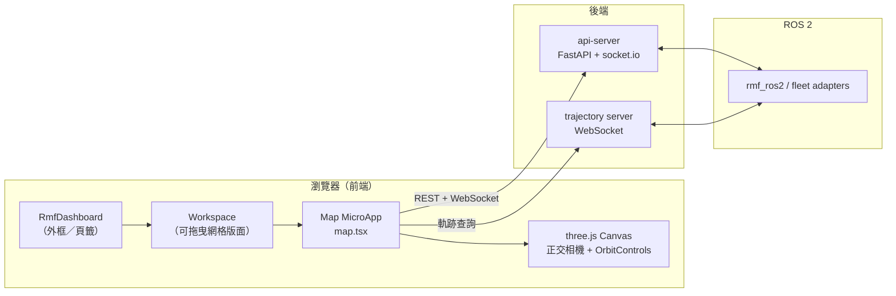
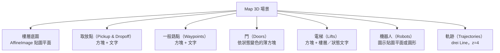

# Open-RMF Web (`rmf-web`) 是否包含 3D 檢視？

## 摘要

**是，`open-rmf/rmf-web` 內含一個以 WebGL（three.js 生態）實作的 3D 場景**，也就是儀表板中的「Map」微應用（MicroApp）。[^repo] 但它的「3D」程度有明確邊界：

- 場景本身是真正的 three.js 立體場景（`Canvas`、`orthographic` 正交相機、`OrbitControls`），可平移、滾輪縮放、切換樓層。[^map][^cam]
- 相機**刻意關閉旋轉**（`controls.enableRotate = false`），且以正交投影俯視，因此實務上是「2.5D / 類等角俯視圖」，而非可自由繞行的全 3D 場景。[^cam]
- 機器人、門、電梯多以**貼圖平面或方塊**呈現，而非載入 glTF 等 3D 模型檔。[^robotmaker][^door][^lift]
- 樓層之間以「切換層級（level）」方式呈現，並非把整棟建築的多樓層同時建成單一 3D 模型。[^map]
- 真正「自由 3D」的視覺化在 Open-RMF 生態中另有其處：ROS 2 端的 `rmf_visualization`（RViz 標記）[^viz] 與 Bevy 引擎撰寫的 `rmf_site` 場地編輯器（含 WebAssembly 網頁版）。[^site]

以下逐項說明證據與限制。

---

## 1. 研究對象基本資料

`open-rmf/rmf-web` 由 Open-RMF 組織維護，用於提供 Open-RMF 部署的網頁介面，可視覺化與控制部署中的各項元件。[^readme]

| 項目 | 值 |
| --- | --- |
| GitHub 星數 | 141[^api] |
| Fork 數 | 87[^api] |
| 授權 | Apache License 2.0[^api] |
| 主要語言 | TypeScript[^api] |
| 建立時間 | 2020-03-02[^api] |
| 最近推送 | 2026-11-12[^api] |
| 最新發行版 | 0.3.0（2025-08-05 發布）[^rel] |

星數 141 屬於小型專案，但 Open-RMF 是 Open Source Robotics Foundation（OSRF）主導的機器人車隊管理框架，`rmf-web` 是該框架官方指定的網頁前端，因此在本主題（倉儲／建築室內機器人視覺化）中屬於關鍵參考對象，仍值得報告。[^repo]

### 1.1 套件組成

`rmf-web` 是 monorepo，`packages/` 之下有五個套件：[^tree]

| 套件 | 角色 |
| --- | --- |
| `rmf-dashboard-framework` | 前端儀表板框架函式庫（3D 地圖在此）[^fwreadme] |
| `api-server` | Python 後端，對 ROS 2 與前端雙向轉譯[^readme] |
| `api-client` | 由 OpenAPI 產生的 TypeScript 用戶端[^readme] |
| `rmf-models` | ROS 訊息對應的模型[^tree] |
| `ros-translator` | ROS 訊息轉換[^tree] |

自 0.3.0 起，原本的 `packages/dashboard` 應用被重構為可重用的函式庫 `rmf-dashboard-framework`，並以 `examples/` 下的範例（`demo`、`custom-theme`、`keycloak`）作為實際應用。[^rel][^fwreadme]

---

## 2. 3D 檢視的實作位置與架構

### 2.1 它是「Map」微應用

3D 場景位於 `rmf-dashboard-framework/src/components/map/map.tsx`，並透過 `src/micro-apps/map-app.ts` 註冊成名為 `map`、標題為 `Map` 的微應用。[^mapapp]



### 2.2 相依套件證實是 three.js 生態

`rmf-dashboard-framework` 的 `package.json` 將下列套件列為 peerDependencies：[^pkg]

- `three`（^0.166.1）
- `@react-three/fiber`（^8.16.1）
- `@react-three/drei`（^9.103.0）
- `@types/three`（^0.166.0）

`@react-three/fiber` 是 three.js 的 React 渲染器，`@react-three/drei` 是其常用的輔助元件庫。[^pkg] 因此 3D 檢視是真正以 three.js 為底層，而非 CSS 假 3D 或預先算圖。

### 2.3 場景以正交相機渲染

`map.tsx` 的 `Canvas` 明確設定 `orthographic={true}`，並在建立時依場景邊界框計算相機位置。[^map] 相機控制元件使用 three.js 的 `OrbitControls`，但做了以下限制：[^cam]

| 設定 | 值 | 效果 |
| --- | --- | --- |
| `enableRotate` | `false` | 無法旋轉視角 |
| `enableDamping` | `false` | 無慣性阻尼 |
| `enableZoom` | `true` | 可縮放 |
| 滑鼠左鍵 | `MOUSE.PAN` | 左鍵拖曳為平移 |
| 滑鼠中／右鍵 | `undefined` | 停用 |

滾輪事件另外被自訂處理，以 `1.2`（放大）與 `0.8`（縮小）常數調整 `camera.zoom`。[^cam] 這些設定共同構成「固定俯視、僅平移與縮放」的操作模型，是它被歸為 2.5D 的主因。

---

## 3. 場景中實際渲染了什麼

`map.tsx` 渲染的圖層如下（可用圖層面板逐項開關）：[^map][^layers]



### 3.1 樓層底圖

樓層影像（`Level.images[0].data`）以 `TextureLoader` 載入，貼在 `planeGeometry` 上，並依 `image.scale`、`image.x_offset`、`image.y_offset` 計算位置與尺寸。[^image]

### 3.2 機器人

`RobotThree` 將機器人置於 `z = 5`，旋轉為 `robotLocation[2] - Math.PI`。[^robotthree] 實際外觀由 `RobotThreeMaker` 決定：[^robotmaker]

- 若該車隊設定了 `icon`（`iconPath`），使用**帶透明度的平面貼圖**（`planeGeometry` + `meshBasicMaterial` + `alphaTest = 0.5`），並以車隊顏色染色。
- 若無圖示，退回 `CircleShape` 圓形。
- 名稱標籤以 drei 的 `Text` 或 `TextThreeRendering` 呈現。
- 滑鼠移入時以 drei `Html` 顯示名稱提示框。

**關鍵限制：** 程式碼中沒有任何 glTF / GLB / OBJ 模型載入（未使用 `useGLTF`）。[^robotmaker][^robotthree] 因此機器人是「貼圖平面」而非立體模型。

### 3.3 門

`Door` 元件訂閱門狀態（`getDoorStateObs`）與電梯狀態，依模式變色：[^door]

| 門模式 | 顏色 |
| --- | --- |
| `MODE_CLOSED` | 紅 |
| `MODE_MOVING` | 橘 |
| `MODE_OPEN`（預設） | 綠 |

實際幾何由 `DoorThreeMaker` 產生（薄方塊，`height = 8`）。[^door][^map]

### 3.4 電梯

`LiftThreeMaker` 以 `boxGeometry` 繪製電梯平面，並疊加文字顯示目前樓層與模式（`NORMAL`、`FIRE!`、`EMERGENCY!`、`OFFLINE`），另以三角形（向上／向下）或線段表示運動狀態。[^lift]

### 3.5 軌跡

軌跡來自 trajectory server 的 WebSocket，每 2000 ms 查詢一次，查詢時間窗為 300000 ms，並以 drei 的 `Line` 在 `z = 4` 繪製，衝突軌跡可標色。[^map][^vizws]

### 3.6 牆體：只用來算邊界，不用來渲染

專案內確實存在 `WallMaker` 與 `CubeMaker`（以 `planeGeometry` 產生牆面方塊）。[^wallmaker][^cube] 但在 `map.tsx` 中**並未匯入或渲染 `WallMaker`**；牆體幾何僅被 `findSceneBoundingBoxFromThreeFiber` 用來計算場景邊界框與相機距離。[^map][^utils]

若某樓層沒有牆頂點或導航圖，邊界框無效，儀表板會發出 `Map rendering error` 警告並退回 `Box3(-10,-10,0)~(10,10,10)` 的通用尺度。[^map] 官方 README 的疑難排解也記載：樓層底圖若未載入，需確認 `.building.yaml` 的 level 中已用 `traffic-editor` 或 `rmf_site` 加入牆體。[^readme]

這表示視覺上的「牆」主要來自樓層底圖貼圖，而非 3D 幾何。

---

## 4. 「3D」的程度界定

| 面向 | 是否支援 | 依據 |
| --- | --- | --- |
| WebGL 立體渲染 | 是（three.js） | [^pkg] |
| 透視／可旋轉視角 | 否（正交、旋轉停用） | [^cam] |
| 平移與縮放 | 是 | [^cam] |
| 依樓層切換 | 是（下拉選單切換 level） | [^layers] |
| 多樓層同時呈現 | 否（一次一層） | [^map] |
| 機器人立體模型（glTF） | 否（貼圖平面／圓形） | [^robotmaker] |
| 高度方向使用 | 有限（門高 8、電梯高度、`level.elevation`） | [^map] |
| 障礙物、導航圖 3D 呈現 | 否（導航圖只用於邊界框） | [^utils] |

`map.tsx` 中可見 `height = 8`、`elevation={currentLevel.elevation}`、`positionZ = HEIGHT / 2 + ELEVATION` 等用法，說明系統有 Z 軸概念，但用途是讓門、電梯、路點在立體空間中「站起來」，而非建立完整建築量體。[^map][^shape]

`layers-controller.tsx` 提供的圖層開關為：`Pickup & Dropoff waypoints`、`Pickup & Dropoff labels`、`Waypoints`、`Waypoint labels`、`Doors & Lifts`、`Doors labels`、`Robots`、`Robots labels`、`Trajectories`。[^map][^layers] 清單中沒有「牆」或「樓層量體」圖層，可佐證第 3.6 節的判斷。

---

## 5. 部署與試用方式

### 5.1 Docker 快速試用

README 提供的示範指令（需先跑 API server）：[^readme]

```bash
docker run \
  --network host -it --rm \
  -e RMF_SERVER_URL=http://localhost:8000 \
  -e TRAJECTORY_SERVER_URL=ws://localhost:8006 \
  ghcr.io/open-rmf/rmf-web/demo-dashboard:jazzy-nightly
```

儀表板預設在 `localhost:3000`；`RMF_SERVER_URL` 與 `TRAJECTORY_SERVER_URL` 是在容器啟動時注入給**瀏覽器**使用的，因此若要從其他機器開啟，需改成該機器可達的位址。[^readme] 官方 README 另有一張 `dashboard1.0-office-world.gif` 示意圖，展示 office world 情境下的儀表板外觀。[^readme]

### 5.2 從原始碼啟動

需要 Ubuntu、ROS 2 與最新 Open-RMF 發行版，安裝 pnpm 與 Node.js LTS 後執行 `pnpm install`，再分別啟動 API server 與儀表板開發伺服器；開發模式下儀表板位於 `localhost:5173`，登入帳密為 `admin` / `admin`。[^readme] 模擬情境需搭配 `rmf_demos`，例如 `ros2 launch rmf_demos_gz office.launch.xml server_uri:="http://localhost:8000/_internal"`。[^readme]

### 5.3 自建儀表板

`rmf-dashboard-framework` 允許以 React 元件組合出自訂頁面，透過 `RmfDashboard` 的 `tabs` 屬性設定頁籤，以 `Workspace` 的 `initialWindows` 指定各微應用的位置與大小（12 欄網格）；`LocallyPersistentWorkspace` 搭配 `allowDesignMode` 可讓使用者在瀏覽器上自由編排版面。[^fwreadme][^getting] 官方示範 `examples/demo/main.tsx` 即以此方式建立 Map、Robots、Tasks、Custom 四個頁籤。[^demo]

---

## 6. 生態系中其他「更 3D」的選項

若需求是真正自由視角的 3D 建築／機器人視覺化，`rmf-web` 的 Map 微應用並非最佳選擇，Open-RMF 生態中有以下對照：

| 專案 | 技術 | 3D 程度 | 備註 |
| --- | --- | --- | --- |
| `rmf-web` Map | three.js（正交） | 2.5D 俯視 | 網頁、可控制、可下任務[^map] |
| `rmf_visualization` | ROS 2 + RViz markers | RViz 內 3D | 需 ROS 2 環境；提供 WebSocket 供自訂 UI 查詢軌跡[^viz][^vizws] |
| `rmf_site` | Rust + Bevy | 完整 3D | 桌面與 WebAssembly 網頁版；主打場地編輯[^site] |

`rmf_visualization` 以 RViz 標記呈現電梯／門、車隊狀態、樓層底圖、導航圖與障礙物等，並提供 WebSocket 伺服器讓 ROS 2 環境外的自訂 UI 查詢排程資料庫中的軌跡與衝突資訊。[^viz][^vizws] `rmf_site` 則是以 Bevy 遊戲引擎撰寫的場地編輯器，同一份程式碼可編譯為桌面版與 WebAssembly 網頁版，網頁版可直接在瀏覽器使用。[^site]

---

## 7. 結論

1. **是，`rmf-web` 包含 3D 檢視**：Map 微應用以 three.js / react-three-fiber 渲染 WebGL 場景，具備正交相機、平移、縮放、樓層切換與圖層開關。[^map][^cam][^layers][^pkg]
2. **但它不是全 3D 自由視角**：旋轉被明確停用，相機為正交俯視，實務上屬 2.5D 類等角視圖。[^cam]
3. **幾何以貼圖與方塊為主**：機器人為圖示平面或圓形，未載入 glTF 模型；牆體程式碼存在但未被渲染，只用於計算場景邊界框。[^robotmaker][^wallmaker][^utils]
4. **多樓層為切換式**，非單一整合 3D 量體。[^map]
5. **真正自由 3D 的需求**宜考慮 `rmf_visualization`（RViz）或 `rmf_site`（Bevy，含網頁版）。[^viz][^site]

---

## 參考文獻

[^api]: GitHub. (n.d.). *open-rmf/rmf-web — Repository metadata (REST API)*. Retrieved 2026-11-21, from https://api.github.com/repos/open-rmf/rmf-web
[^cube]: Open-RMF. (n.d.). *rmf-web: packages/rmf-dashboard-framework/src/components/map/cube-maker.tsx*. Retrieved 2026-11-21, from https://github.com/open-rmf/rmf-web/blob/main/packages/rmf-dashboard-framework/src/components/map/cube-maker.tsx
[^cam]: Open-RMF. (n.d.). *rmf-web: packages/rmf-dashboard-framework/src/components/map/camera-control.tsx*. Retrieved 2026-11-21, from https://github.com/open-rmf/rmf-web/blob/main/packages/rmf-dashboard-framework/src/components/map/camera-control.tsx
[^demo]: Open-RMF. (n.d.). *rmf-web: packages/rmf-dashboard-framework/examples/demo/main.tsx*. Retrieved 2026-11-21, from https://github.com/open-rmf/rmf-web/blob/main/packages/rmf-dashboard-framework/examples/demo/main.tsx
[^door]: Open-RMF. (n.d.). *rmf-web: packages/rmf-dashboard-framework/src/components/map/door-three.tsx*. Retrieved 2026-11-21, from https://github.com/open-rmf/rmf-web/blob/main/packages/rmf-dashboard-framework/src/components/map/door-three.tsx
[^fwreadme]: Open-RMF. (n.d.). *rmf-web: packages/rmf-dashboard-framework/README.md*. Retrieved 2026-11-21, from https://github.com/open-rmf/rmf-web/blob/main/packages/rmf-dashboard-framework/README.md
[^getting]: Open-RMF. (n.d.). *rmf-web: packages/rmf-dashboard-framework/docs/getting-started.md*. Retrieved 2026-11-21, from https://github.com/open-rmf/rmf-web/blob/main/packages/rmf-dashboard-framework/docs/getting-started.md
[^image]: Open-RMF. (n.d.). *rmf-web: packages/rmf-dashboard-framework/src/components/map/image-maker.tsx*. Retrieved 2026-11-21, from https://github.com/open-rmf/rmf-web/blob/main/packages/rmf-dashboard-framework/src/components/map/image-maker.tsx
[^layers]: Open-RMF. (n.d.). *rmf-web: packages/rmf-dashboard-framework/src/components/map/layers-controller.tsx*. Retrieved 2026-11-21, from https://github.com/open-rmf/rmf-web/blob/main/packages/rmf-dashboard-framework/src/components/map/layers-controller.tsx
[^lift]: Open-RMF. (n.d.). *rmf-web: packages/rmf-dashboard-framework/src/components/map/lift-three-maker.tsx*. Retrieved 2026-11-21, from https://github.com/open-rmf/rmf-web/blob/main/packages/rmf-dashboard-framework/src/components/map/lift-three-maker.tsx
[^map]: Open-RMF. (n.d.). *rmf-web: packages/rmf-dashboard-framework/src/components/map/map.tsx*. Retrieved 2026-11-21, from https://github.com/open-rmf/rmf-web/blob/main/packages/rmf-dashboard-framework/src/components/map/map.tsx
[^mapapp]: Open-RMF. (n.d.). *rmf-web: packages/rmf-dashboard-framework/src/micro-apps/map-app.ts*. Retrieved 2026-11-21, from https://github.com/open-rmf/rmf-web/blob/main/packages/rmf-dashboard-framework/src/micro-apps/map-app.ts
[^pkg]: Open-RMF. (n.d.). *rmf-web: packages/rmf-dashboard-framework/package.json*. Retrieved 2026-11-21, from https://github.com/open-rmf/rmf-web/blob/main/packages/rmf-dashboard-framework/package.json
[^rel]: Open-RMF. (2025). *Release 0.3.0 — open-rmf/rmf-web*. Retrieved 2026-11-21, from https://github.com/open-rmf/rmf-web/releases/tag/0.3.0
[^readme]: Open-RMF. (n.d.). *rmf-web: README.md*. Retrieved 2026-11-21, from https://github.com/open-rmf/rmf-web/blob/main/README.md
[^repo]: Open-RMF. (n.d.). *open-rmf/rmf-web*. Retrieved 2026-11-21, from https://github.com/open-rmf/rmf-web
[^robotthree]: Open-RMF. (n.d.). *rmf-web: packages/rmf-dashboard-framework/src/components/map/robot-three.tsx*. Retrieved 2026-11-21, from https://github.com/open-rmf/rmf-web/blob/main/packages/rmf-dashboard-framework/src/components/map/robot-three.tsx
[^robotmaker]: Open-RMF. (n.d.). *rmf-web: packages/rmf-dashboard-framework/src/components/map/robot-three-maker.tsx*. Retrieved 2026-11-21, from https://github.com/open-rmf/rmf-web/blob/main/packages/rmf-dashboard-framework/src/components/map/robot-three-maker.tsx
[^shape]: Open-RMF. (n.d.). *rmf-web: packages/rmf-dashboard-framework/src/components/map/shape-three-rendering.tsx*. Retrieved 2026-11-21, from https://github.com/open-rmf/rmf-web/blob/main/packages/rmf-dashboard-framework/src/components/map/shape-three-rendering.tsx
[^site]: Open-RMF. (n.d.). *open-rmf/rmf_site — The RMF Site Editor*. Retrieved 2026-11-21, from https://github.com/open-rmf/rmf_site
[^tree]: Open-RMF. (n.d.). *rmf-web: packages directory listing (Git Trees API)*. Retrieved 2026-11-21, from https://api.github.com/repos/open-rmf/rmf-web/git/trees/main?recursive=1
[^utils]: Open-RMF. (n.d.). *rmf-web: packages/rmf-dashboard-framework/src/components/map/utils.ts*. Retrieved 2026-11-21, from https://github.com/open-rmf/rmf-web/blob/main/packages/rmf-dashboard-framework/src/components/map/utils.ts
[^viz]: Open-RMF. (n.d.). *open-rmf/rmf_visualization*. Retrieved 2026-11-21, from https://github.com/open-rmf/rmf_visualization
[^vizws]: Open-RMF. (n.d.). *rmf_visualization: README.md — Websocket Server for Custom UIs*. Retrieved 2026-11-21, from https://github.com/open-rmf/rmf_visualization/blob/main/README.md
[^wallmaker]: Open-RMF. (n.d.). *rmf-web: packages/rmf-dashboard-framework/src/components/map/wall-maker.tsx*. Retrieved 2026-11-21, from https://github.com/open-rmf/rmf-web/blob/main/packages/rmf-dashboard-framework/src/components/map/wall-maker.tsx
