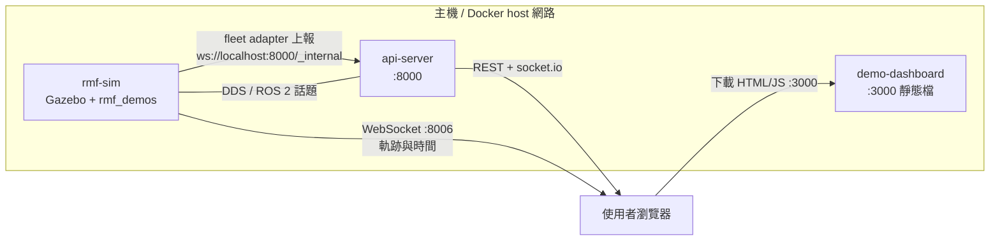

# 以 `ghcr.io/open-rmf/rmf-web/demo-dashboard:jazzy-nightly` 搭配其他 Open-RMF 元件的部署研究

## 摘要

結論先講：**可以，但必須把 `api-server` 也換成 `ghcr.io/open-rmf/rmf-web/api-server`**，不能沿用 `rmf_deployment_template` 的 `api-server`／`dashboard-no-auth`。原因是兩邊的認證模型不同：`rmf-web` 的 demo dashboard 內建 `StubAuthenticator`，用 HS256 共用密鑰與 `aud=rmf_api_server`、`iss=stub` 驗證；而部署模板的 api-server 綁定 Keycloak 的 RS256 公鑰與 `aud=dashboard`，兩者互不相容，混用會得到 401。

另外有兩個很容易踩的實務陷阱：

1. `demo-dashboard` 映像**不是 nginx 的 80 埠**，它是用 `serve` 在 3000 埠提供靜態檔，且路徑在根目錄（不是 `/dashboard`），所以原本的 `"3000:80"` 對應會失敗。
2. `jazzy-nightly` 這個 tag 是從 `jazzy` 分支原始碼建出來的，而「用環境變數注入 `RMF_SERVER_URL`／`TRAJECTORY_SERVER_URL`」的功能是在 2026-11-06 才進入 `main` 分支，**尚未回溯到 `jazzy`**。因此在 `jazzy-nightly` 上，這兩個環境變數會被忽略，dashboard 永遠連 `localhost:8000` 與 `localhost:8006`。若瀏覽器不在同一台機器，需改用 SSH 通道或自建映像。

---

## 1. 三個元件在做什麼

| 元件 | 角色 | 對外介面 |
| --- | --- | --- |
| `rmf-sim` | 跑 Gazebo 與 `rmf_demos`（traffic schedule、task dispatcher、fleet adapter、building map server、visualizer） | DDS 話題；`8006` 的 WebSocket 軌跡伺服器；以 `server_uri` 主動連 api-server |
| `api-server` | 把 RMF 狀態彙整成 REST + Socket.IO，並接收 fleet adapter 上報 | `8000`（REST、`/socket.io`、`/_internal` WebSocket） |
| `demo-dashboard` | 瀏覽器端單頁應用，瀏覽器自己去連 api-server 與軌跡伺服器 | `3000`（靜態檔） |

資料流如下（注意：**瀏覽器是主動端**，dashboard 容器本身不代理任何流量）：



這張圖說明了為什麼 `RMF_SERVER_URL` 與 `TRAJECTORY_SERVER_URL` 是「瀏覽器可達位址」而非容器內位址——官方 README 明確指出這兩個值由瀏覽器使用，若要在其他機器開啟，需填入該機器可達的位址[^rmfwebreadme]。

---

## 2. 為什麼不能沿用原本的 `dashboard-no-auth` 與部署模板 `api-server`

### 2.1 認證模型不相容（最關鍵）

`rmf-web` 的 demo dashboard 原始碼直接使用 `StubAuthenticator`，它把一組硬編碼的 JWT 塞進請求；該 JWT 的註解寫得很清楚：以密鑰 `rmfisawesome` 簽署，payload 為 `sub=stub`、`preferred_username=admin`、`aud=rmf_api_server`、`iss=stub`，有效期到 2035 年[^stubauth]。

`api-server` 的預設設定必須與之匹配：`jwt_secret="rmfisawesome"`、`aud="rmf_api_server"`、`iss="stub"`，且預設只綁 `127.0.0.1:8000`、資料庫為記憶體 SQLite[^defaultconfig]。

相對地，部署模板的 api-server 設定檔是把 `jwt_public_key` 指向 Keycloak 產生的公鑰、`jwt_secret` 設為 `None`、`aud="dashboard"`、`iss` 指向 `${baseUrl}/auth/realms/rmf-web`，並且要求掛載設定檔與公鑰[^deployconfigmap]。因此「demo dashboard + 部署模板 api-server」在握手階段就會 401。

此外部署模板的 api-server 映像本身是 `pipenv` + 掛載設定檔的 k8s 導向建置，entrypoint 直接跑 `python -m api_server`，沒有 Keycloak 就無法通過驗證[^deployapiserverdockerfile]。

### 2.2 Dashboard 的埠號與路徑不同

- `dashboard-no-auth` 走 nginx，監聽 **80**，並把應用放在 `/dashboard` 子路徑，靠 `99-inject-env.sh` 對 `index.html` 做 `sed` 替換 `__RMF_SERVER_URL__`[^deploycompose][^dashboardnoauthdockerfile]。
- `demo-dashboard` 走 `serve -sn /opt/dashboard`，`serve` 的預設監聽埠是 **3000**（可由 `PORT` 覆寫），且掛在根路徑[^demodockerfile][^servecli]。

所以原本 compose 的 `"3000:80"` 必須改成 `3000:3000`，或直接使用 host 網路。

### 2.3 映像新鮮度

部署模板的 `latest` tag 只在該儲存庫 `main` 有 push 時更新（`build-images.yaml` 同時推 `latest` 與 commit sha），而 `:nightly` 才是每日重建的 tag[^buildimages]。該儲存庫最後一次 push 是 2025-06-16[^deployrepoapi]，因此 `dashboard-no-auth:latest`、`rmf-sim:latest` 這類 tag 可能停在 2025 年年中；`rmf-web` 的 `jazzy-nightly` 則是 nightly workflow 每日重建[^nightly]。

---

## 3. `jazzy-nightly` 的環境變數陷阱

`main` 分支的 nightly workflow 會以 matrix 方式為 `jazzy`、`lyrical`、`rolling` 各推一個 `demo-dashboard:<distro>-nightly` 映像[^nightly]。但該 Dockerfile 是**用 `BRANCH_NAME=$ROS_DISTRO` 去抓原始碼**，也就是 `jazzy-nightly` 的內容其實來自 `jazzy` 分支[^demodockerfile]。

而 `jazzy` 分支的 dashboard 版本：

- `examples/demo/main.tsx` 把 `apiServerUrl` 與 `trajectoryServerUrl` **寫死**成 `http://localhost:8000` 與 `http://localhost:8006`[^demomainjazzy]
- `examples/demo/index.html` 沒有 `__RMF_SERVER_URL__` 這類佔位符[^indexhtmljazzy]
- Dockerfile 只有 `ENTRYPOINT ["serve", "-sn", "/opt/dashboard"]`，沒有注入腳本[^demodockerfilejazzy]

`main` 分支才加入 `index.html` 佔位符與 `docker-entrypoint.sh`，在容器啟動時以 `sed` 渲染 URL[^indexhtml][^entrypoint]。這個修正是 commit `ac42d1ce`（2026-11-06，標題為「Apply RMF_SERVER_URL and TRAJECTORY_SERVER_URL in demo-dashboard image (#1113)」），修掉 issue #1070；commit message 直接說明：自從改用 dashboard framework 之後，這些環境變數就被忽略了[^commit1113]。

**因此 `jazzy-nightly` 上設定 `RMF_SERVER_URL`／`TRAJECTORY_SERVER_URL` 是無效的**；只有預設的 localhost 情境會剛好可用。要在其他機器開 dashboard，可選：

1. 用 SSH 通道把三個埠轉到本機，瀏覽器看到的仍是 `localhost`（最省事，且不需要改映像）。
2. 改用 `rolling-nightly`（`main` 分支原始碼，含注入腳本），但整套元件（含 api-server 與模擬）都要跟著 rolling，風險較高。
3. 自行以 `main` 或 cherry-pick 該修正的 `jazzy` 分支建映像。

---

## 4. 建議的 compose 檔

以下為「全部走 `rmf-web` 官方映像」的最小可用版本，模擬端沿用你原本的 `rmf-sim` 映像（它與 api-server 同為 Jazzy/ROS 2 生態，透過 DDS 互通）：

```yaml
name: rmf-web-demo

services:
  simulation:
    image: ghcr.io/open-rmf/rmf_deployment_template/rmf-deployment/rmf-sim:nightly
    entrypoint:
      - /ros_entrypoint.sh
      - ros2
      - launch
      - rmf_demos_gz
      - office.launch.xml
      - headless:=1
      - server_uri:=ws://localhost:8000/_internal
    environment:
      RMW_IMPLEMENTATION: rmw_cyclonedds_cpp
      ROS_DOMAIN_ID: "0"
    network_mode: host
    ipc: host
    volumes:
      - /dev/shm:/dev/shm
    restart: unless-stopped

  api-server:
    image: ghcr.io/open-rmf/rmf-web/api-server:jazzy-nightly
    environment:
      RMW_IMPLEMENTATION: rmw_cyclonedds_cpp
      ROS_DOMAIN_ID: "0"
      RMF_SERVER_USE_SIM_TIME: "true"
    network_mode: host
    restart: unless-stopped

  web-dashboard:
    image: ghcr.io/open-rmf/rmf-web/demo-dashboard:jazzy-nightly
    environment:
      RMF_SERVER_URL: http://localhost:8000
      TRAJECTORY_SERVER_URL: ws://localhost:8006
    network_mode: host
    restart: unless-stopped
```

重點說明：

- **`ROS_DOMAIN_ID` 與 `RMW_IMPLEMENTATION` 三個 ROS 端必須完全一致**。官方文件要求 api-server 設定成與其餘 Open-RMF 系統相同的 domain 與 RMW，映像內支援 `rmw_fastrtps_cpp` 與 `rmw_cyclonedds_cpp`[^rmfwebreadme]。
- **`RMF_SERVER_USE_SIM_TIME=true` 只能給 api-server**，且必須在啟動時就存在。api-server 在建立 ROS node 時讀取這個環境變數，決定是否附加 `use_sim_time:=true`[^rosusage]；官方文件說明跑模擬時必須設定它，client 送來的時間才會正確換算成 RMF 的模擬時間[^apiserverreadme]。
- **`server_uri:=ws://localhost:8000/_internal`** 是 fleet adapter 回報狀態的入口。`rmf_demos` 的 `common.launch.xml` 宣告了 `server_uri` 參數並傳給 `rmf_task_dispatcher`，`fleet_adapter.launch.xml` 也把它設成節點參數[^commonlaunch][^fleetadapterlaunch]；api-server 端對應的 websocket route 掛在 `/_internal`[^internalroute]。`rmf_demos` README 給的正是這個指令形式[^rmfdemosreadme]。
- **`network_mode: host` 下 `ports:` 會被忽略**，Docker 會警告「Published ports are discarded when using host network mode」[^dockerhost]。既然 demo-dashboard 直接聽 3000，host 模式下瀏覽器打開 `http://localhost:3000` 即可。
- **`/dev/shm` 與 `ipc: host`** 是 Gazebo 的實務需求（共享記憶體不足會讓模擬崩潰），沿用你原本的 `/dev/shm:/dev/shm` 寫法沒問題。
- 若不想用 host 網路，改成 bridge 時：dashboard 用 `3000:3000`，api-server 與 sim 則因 DDS 探索與 8006 埠的關係而不建議拆開，仍以 host 網路最省事。

### 4.1 若要從別台機器開 dashboard

`jazzy-nightly` 無法透過環境變數改 URL（見第 3 節），最穩定的做法是 SSH 通道：

```bash
ssh -L 3000:localhost:3000 \
    -L 8000:localhost:8000 \
    -L 8006:localhost:8006 \
    <your-host>
```

若真的要用瀏覽器直連主機 IP，則需同時處理兩件事：

1. dashboard 端必須能填入可達 URL（需自建含注入腳本的映像，或改用 `rolling-nightly`）。
2. api-server 必須改成 `host="0.0.0.0"` 且 `public_url` 設成同一個對外位址，做法是掛載自訂設定檔並設 `RMF_API_SERVER_CONFIG`；預設只聽 `127.0.0.1`[^defaultconfig][^rmfwebreadme][^apiserverreadme]。

---

## 5. 啟動後如何驗證

1. **api-server 活著**：開 `http://localhost:8000/docs`。`/docs` 不需要認證，會回 Swagger UI；這是最快確認 uvicorn 有起來的方法[^apppy]。
2. **DDS 有連上**：`docker exec -it <sim容器> bash -lc 'source /opt/rmf_sim/setup.bash; ros2 topic list | grep rmf'`，應看到 `rmf_task`、`rmf_traffic`、`/fleet_states` 等。
3. **fleet adapter 有回報**：api-server log 會顯示收到 `fleet_state_update` 類訊息；internal route 的處理邏輯就是依 `type` 分派 `task_state_update`、`fleet_state_update`、`fleet_log_update` 等[^internalroute]。
4. **軌跡伺服器有開**：`rmf_visualization` 的 `visualization.launch.xml` 預設 `websocket_port=8006`，且 `headless` 參數只影響是否開 rviz2[^vislaunch]；此伺服器只有在環境變數 `JWT_PUBLIC_KEY` 存在時才驗證 token，否則不驗證[^trajserver]，所以與 demo dashboard 的 stub token 併用不會被擋。
5. **Dashboard 有畫面**：`http://localhost:3000` 應看到 Map 分頁與 office 地圖。若樓層不顯示，通常是 `.building.yaml` 沒有任何 wall 頂點，dashboard 無法算出場景邊界[^rmfwebreadme]。
6. **送任務**：Tasks 分頁建立 Patrol。注意在模擬時間下，任務開始時間需對應模擬時鐘（從 unix millis 0 起算），官方疑難排解建議把開始時間設在 1970 年之前[^rmfwebreadme]。

---

## 6. 常見錯誤對照表

| 現象 | 可能原因 | 處理 |
| --- | --- | --- |
| Dashboard 白畫面、Console 401 | 混用部署模板 api-server（Keycloak/RS256） | 換成 `rmf-web/api-server`，並保持預設 `jwt_secret`／`aud`／`iss` |
| `http://localhost:3000` 連不上 | 只映射 `3000:80`，但 `serve` 聽 3000 | 改 `3000:3000` 或用 host 網路 |
| Dashboard 連 `localhost:8000` 失敗（遠端開啟） | `jazzy-nightly` 忽略 `RMF_SERVER_URL` | 用 SSH 通道，或自建含注入腳本的映像 |
| 機器人不動、任務卡住 | `RMF_SERVER_USE_SIM_TIME` 與模擬時間不一致 | 模擬時務必設 `true`，且 api-server 啟動前就要設定 |
| api-server 看不到任何 fleet | `ROS_DOMAIN_ID`／RMW 不一致，或 `server_uri` 沒帶進 launch | 兩邊對齊環境變數；確認 `server_uri:=ws://localhost:8000/_internal` |
| 換成 `rolling-nightly` 後訊息型別錯誤 | 映像的 RMF 訊息版本與模擬端不同 | 整套元件使用同一 distro 的映像 |
| 任務時間顯示錯亂 | api-server 的 `timezone` 與瀏覽器時區不同 | 官方 `sqlite_local_config.py` 預設 `Asia/Singapore`，需與系統及 UI 時區一致[^sqliteconfig] |

---

## 7. 兩個補充觀察

**映像版本策略。** `rmf-web` 儲存庫累積 141 顆星、87 個 fork，授權 Apache-2.0，主要語言 TypeScript，預設分支 `main`[^rmfwebapi]；`rmf_demos` 有 633 顆星[^rmfdemosapi]；`rmf_deployment_template` 僅 25 顆星[^deployrepoapi]。star 數低不代表不能用，但部署模板本質上是「參考範本」，其 compose 檔是為了搭配 Keycloak 與 `/dashboard` 子路徑而設計，並非為 `rmf-web` 官方 demo dashboard 設計；這也是本文建議「模擬用模板、前端用 rmf-web」而非整套照抄的原因。

**`latest` 與 `nightly` 的語意不同。** 若你沿用部署模板的映像，請優先使用 `:nightly`；`:latest` 綁在最後一次 push 的 commit，可能落後數月[^buildimages][^deployrepoapi]。相對地 `rmf-web` 的 `:jazzy-nightly` 是每日重建，但如前所述內容跟著 `jazzy` 分支走[^nightly][^demodockerfile]。

---

## 參考資料

[^rmfwebapi]: Open-RMF. (2026). *rmf-web* [原始碼儲存庫]. Retrieved 2026-11-21, from https://github.com/open-rmf/rmf-web

[^rmfwebreadme]: Open-RMF. (2026). *RMF Web — README*. Retrieved 2026-11-21, from https://github.com/open-rmf/rmf-web/blob/main/README.md

[^defaultconfig]: Open-RMF. (2026). *api_server/default_config.py*. Retrieved 2026-11-21, from https://github.com/open-rmf/rmf-web/blob/main/packages/api-server/api_server/default_config.py

[^stubauth]: Open-RMF. (2024). *src/services/stub-authenticator.ts*. Retrieved 2026-11-21, from https://github.com/open-rmf/rmf-web/blob/jazzy/packages/rmf-dashboard-framework/src/services/stub-authenticator.ts

[^rosusage]: Open-RMF. (2026). *api_server/ros.py*. Retrieved 2026-11-21, from https://github.com/open-rmf/rmf-web/blob/main/packages/api-server/api_server/ros.py

[^apiserverreadme]: Open-RMF. (2026). *Open-RMF API Server — README*. Retrieved 2026-11-21, from https://github.com/open-rmf/rmf-web/blob/main/packages/api-server/README.md

[^internalroute]: Open-RMF. (2026). *api_server/routes/internal.py*. Retrieved 2026-11-21, from https://github.com/open-rmf/rmf-web/blob/main/packages/api-server/api_server/routes/internal.py

[^apppy]: Open-RMF. (2026). *api_server/app.py*. Retrieved 2026-11-21, from https://github.com/open-rmf/rmf-web/blob/main/packages/api-server/api_server/app.py

[^sqliteconfig]: Open-RMF. (2026). *sqlite_local_config.py*. Retrieved 2026-11-21, from https://github.com/open-rmf/rmf-web/blob/main/packages/api-server/sqlite_local_config.py

[^demodockerfile]: Open-RMF. (2026). *.github/demo-dashboard/Dockerfile*. Retrieved 2026-11-21, from https://github.com/open-rmf/rmf-web/blob/main/.github/demo-dashboard/Dockerfile

[^demodockerfilejazzy]: Open-RMF. (2026). *.github/demo-dashboard/Dockerfile*（jazzy 分支）. Retrieved 2026-11-21, from https://github.com/open-rmf/rmf-web/blob/jazzy/.github/demo-dashboard/Dockerfile

[^entrypoint]: Open-RMF. (2026). *.github/demo-dashboard/docker-entrypoint.sh*. Retrieved 2026-11-21, from https://github.com/open-rmf/rmf-web/blob/main/.github/demo-dashboard/docker-entrypoint.sh

[^indexhtml]: Open-RMF. (2026). *examples/demo/index.html*. Retrieved 2026-11-21, from https://github.com/open-rmf/rmf-web/blob/main/packages/rmf-dashboard-framework/examples/demo/index.html

[^indexhtmljazzy]: Open-RMF. (2026). *examples/demo/index.html*（jazzy 分支）. Retrieved 2026-11-21, from https://github.com/open-rmf/rmf-web/blob/jazzy/packages/rmf-dashboard-framework/examples/demo/index.html

[^demomainjazzy]: Open-RMF. (2026). *examples/demo/main.tsx*（jazzy 分支）. Retrieved 2026-11-21, from https://github.com/open-rmf/rmf-web/blob/jazzy/packages/rmf-dashboard-framework/examples/demo/main.tsx

[^commit1113]: Jin, A. (2026, November 6). *Apply RMF_SERVER_URL and TRAJECTORY_SERVER_URL in demo-dashboard image (#1113)* [Commit ac42d1ce]. Retrieved 2026-11-21, from https://github.com/open-rmf/rmf-web/commit/ac42d1cec155abe05be3b715d211b54d81560730

[^nightly]: Open-RMF. (2026). *.github/workflows/nightly.yml*. Retrieved 2026-11-21, from https://github.com/open-rmf/rmf-web/blob/main/.github/workflows/nightly.yml

[^servecli]: Vercel. (2026). *serve — source/main.ts*. Retrieved 2026-11-21, from https://github.com/vercel/serve/blob/main/source/main.ts

[^dockerhost]: Docker Inc. (n.d.). *Host network driver*. Retrieved 2026-11-21, from https://docs.docker.com/engine/network/drivers/host/

[^deploycompose]: Open-RMF. (2025). *devel/docker-compose-local.yaml*. Retrieved 2026-11-21, from https://github.com/open-rmf/rmf_deployment_template/blob/main/devel/docker-compose-local.yaml

[^dashboardnoauthdockerfile]: Open-RMF. (2025). *devel/dashboard-no-auth/Dockerfile* 與 *99-inject-env.sh*. Retrieved 2026-11-21, from https://github.com/open-rmf/rmf_deployment_template/tree/main/devel/dashboard-no-auth

[^deployconfigmap]: Open-RMF. (2025). *charts/rmf-deployment/templates/config/rmf-web-rmf-server-configmap.yaml*. Retrieved 2026-11-21, from https://github.com/open-rmf/rmf_deployment_template/blob/main/charts/rmf-deployment/templates/config/rmf-web-rmf-server-configmap.yaml

[^deployapiserverdockerfile]: Open-RMF. (2025). *dockerfiles/rmf-web/api-server/Dockerfile*. Retrieved 2026-11-21, from https://github.com/open-rmf/rmf_deployment_template/blob/main/dockerfiles/rmf-web/api-server/Dockerfile

[^buildimages]: Open-RMF. (2025). *.github/workflows/build-images.yaml*. Retrieved 2026-11-21, from https://github.com/open-rmf/rmf_deployment_template/blob/main/.github/workflows/build-images.yaml

[^deployrepoapi]: Open-RMF. (2025). *rmf_deployment_template* [原始碼儲存庫，含最後 push 時間與 star 數]. Retrieved 2026-11-21, from https://api.github.com/repos/open-rmf/rmf_deployment_template

[^rmfdemosreadme]: Open-RMF. (2026). *RMF Demos — README*. Retrieved 2026-11-21, from https://github.com/open-rmf/rmf_demos/blob/main/README.md

[^rmfdemosapi]: Open-RMF. (2026). *rmf_demos* [原始碼儲存庫，含 star 數]. Retrieved 2026-11-21, from https://api.github.com/repos/open-rmf/rmf_demos

[^commonlaunch]: Open-RMF. (2026). *rmf_demos/launch/common.launch.xml*. Retrieved 2026-11-21, from https://github.com/open-rmf/rmf_demos/blob/main/rmf_demos/launch/common.launch.xml

[^fleetadapterlaunch]: Open-RMF. (2026). *rmf_demos_fleet_adapter/launch/fleet_adapter.launch.xml*. Retrieved 2026-11-21, from https://github.com/open-rmf/rmf_demos/blob/main/rmf_demos_fleet_adapter/launch/fleet_adapter.launch.xml

[^vislaunch]: Open-RMF. (2026). *rmf_visualization/launch/visualization.launch.xml*. Retrieved 2026-11-21, from https://github.com/open-rmf/rmf_visualization/blob/main/rmf_visualization/launch/visualization.launch.xml

[^trajserver]: Open-RMF. (2026). *rmf_visualization_schedule/src/rmf_visualization_schedule/TrajectoryServer.cpp*. Retrieved 2026-11-21, from https://github.com/open-rmf/rmf_visualization/blob/main/rmf_visualization_schedule/src/rmf_visualization_schedule/TrajectoryServer.cpp