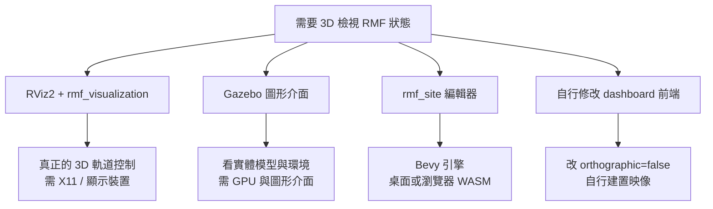

# `rmf-web` 的 Web Dashboard 為何只有 2D 平面視角：成因與取得 3D 檢視的替代方案

## 摘要

「只有 2D 平面畫面」不是錯覺，也不是部署設定漏了什麼，而是 `rmf-web` 前端刻意的設計決定：

`rmf-dashboard-framework` 的地圖其實是**用 3D 引擎畫的**（`@react-three/fiber` + `three`），但相機被硬性設為 **orthographic（正交投影）**，並且**關閉旋轉**，滑鼠左鍵被綁成平移。因此場景雖然有高度（門、電梯是 3D 立方體，機器人懸在 z=5，軌跡懸在 z=4），畫面永遠是俯視的平面圖。

目前沒有任何 UI 開關或環境變數可以切換視角。要真正的 3D 檢視，得改用 RViz2（`rmf_visualization`）、Gazebo 圖形介面，或 `rmf_site`；若堅持在 Web Dashboard 內看 3D，只能自行修改前端並重建映像。

---

## 1. 證據：3D 引擎 + 正交相機 + 停用旋轉

### 1.1 地圖元件用的是 three.js

`packages/rmf-dashboard-framework/src/components/map/map.tsx` 匯入 `@react-three/fiber` 的 `Canvas`、`@react-three/drei` 的 `Line`，以及 `three` 的 `Box3`、`TextureLoader`、`Vector3`，並以 `<Canvas>` 掛載整張地圖場景[^map]。`package.json` 的 peerDependencies 也明確列出 `three`、`@react-three/fiber`、`@react-three/drei`[^pkg]。

場景中確實有三維幾何體：

| 物件 | z 座標 / 尺寸 | 來源 |
| --- | --- | --- |
| 門（Door / DoorThreeMaker） | 立方體，高度 8 | `height / 2 + ELEVATION`[^doormaker] |
| 電梯（Lifts） | 立方體，高度 8 | 同上，透過 `Lifts` 元件[^map] |
| 機器人（RobotThree） | `STANDAR_Z_POSITION = 5` | `new Vector3(x, y, 5)`[^robotthree] |
| 軌跡（Line） | `z = 4` | `new Vector3(seg.x[0], seg.x[1], 4)`[^map] |
| 樓層底圖（ReactThreeFiberImageMaker） | `z = 0` 的平面貼圖 | `<mesh position={[x_offset, y_offset, 0]}>`[^imagemaker] |

### 1.2 相機被鎖成正交俯視

同一份 `map.tsx` 裡：

```tsx
<Canvas onCreated={...} orthographic={true}>
  <CameraControl zoom={zoom} />
```

`CameraControl` 則把 `OrbitControls` 設定成只剩平移與縮放[^camera]:

```tsx
controls.target = new Vector3(0, 0, -Number.MAX_SAFE_INTEGER);
controls.enableRotate = false;
controls.enableDamping = false;
controls.enableZoom = true;
controls.mouseButtons = { LEFT: MOUSE.PAN, MIDDLE: undefined, RIGHT: undefined };
```

`enableRotate = false` 直接砍掉軌道旋轉，`mouseButtons` 只留左鍵平移，而縮放走的是正交相機的 `camera.zoom`（不是透視相機的 dolly）。另外相機初始位置永遠是 `center.z + distance`，即正上方俯視[^map]。`controls.target` 設在負無限大附近，是為了讓極遠的注視點在平移時不產生視角傾斜。

這個設計有明確出處：PR #737「Fix panning rotation issue」的說明寫著「Use orthographic camera by default」、「Target of orthographic camera set to 1km below origin, this fixes the re-orientation when we pan」、「Changing left click to panning」、「Disabling all other mouse interactions (rotation and dolly)」[^pr737]。

### 1.3 沒有可切換 3D 的介面

- `MapProps` 只有四個欄位：`defaultMapLevel`、`defaultZoom`、`defaultRobotZoom`、`attributionPrefix`[^map]，**沒有** `orthographic` 或 `perspective` 之類的開關。
- `LayersController`（地圖左上角控制面板）提供的操作只有：樓層下拉選單、全覽（Fullscreen 圖示）、放大、縮小、圖層核取方塊[^layers]。沒有任何「3D 視角」按鈕。
- demo 的 `main.tsx` 只傳 `attributionPrefix`、`defaultMapLevel`、`defaultRobotZoom`、`defaultZoom` 四個值[^demomain]。
- 在 `open-rmf/rmf-web` 的 issue 搜尋中，以「3d」為關鍵字僅命中三筆，全部與 3D 視角需求無關（分別是相機目標調整 PR、Leaflet→R3F 遷移 issue、以及 2020 年的辦公室地圖美化 issue）[^issuesearch]。也就是說，「Web Dashboard 應提供 3D 視角」目前既沒有實作，也沒有對應的功能請求在等。

---

## 2. 為什麼會這樣設計（合理的工程取捨）

RMF 的操作情境是「派任務、看機器人位置、看路障與樓層」。這種用途下俯視正交圖的好處是：

- 沒有透視變形，距離可直接目測，車道寬度與機器人間距不會因視角變形而誤判。
- 正交投影在極大場域（機場、校園）仍能完整入鏡，不會出現透視相機近大遠小的比例失真。
- 關閉旋轉後，2D 平移心智模型與 Leaflet 時代的操作習慣相容，使用者不用學軌道控制；也避免使用者在三維空間迷向。

換言之，程式底層是 3D，但**產品定位是 2D 平面圖**，高度只用來疊放圖層（門/電梯柱體、機器人浮在地板上方以利點擊、軌跡浮更高避免與底圖重疊）。

---

## 3. 若真的需要 3D，可用的四條路



### 3.1 RViz2 + `rmf_visualization`（最貼近「看 RMF 狀態」）

`rmf_visualization` 就是為 RViz 而寫的：`schedule`、`fleet_states`、`floorplans`、`navgraphs`、`obstacles`、`building_systems` 各節點把資料發布成 RViz marker[^visreadme]。RViz2 本身具備完整 3D 軌道控制，可以傾斜、旋轉、拉近。

啟動方式（`headless` 參數控制是否開 rviz2）[^vislaunch]:

```bash
ros2 launch rmf_visualization visualization.launch.xml \
  use_sim_time:=true headless:=false map_name:=L1
```

限制：需要 `DISPLAY`（X11 / XWayland），容器內要掛 `-e DISPLAY=$DISPLAY -v /tmp/.X11-unix:/tmp/.X11-unix`，或直接用 `rocker` 之類的工具。純 headless 伺服器上沒有意義。

### 3.2 Gazebo 圖形介面

如果你跑的是 `rmf_demos_gz`，把 `headless:=1` 拿掉（或設 `0`），Gazebo 就會開 GUI，看到的是真正的 3D 世界：辦公室牆面、機器人模型（Hatchback）、門與電梯的實體[^officelaunch]。`simulation.launch.xml` 會依 `headless` 決定是否加 `-s`（server only）[^simlaunch]。

限制：吃 GPU 與視窗環境，通常只在開發機上用，不適合遠端維運。

### 3.3 `rmf_site`（Bevy 引擎）

`rmf_site` 是 Open-RMF 官方的 3D 場域編輯器，用 Rust + Bevy 寫成，同時提供桌面版與瀏覽器 WASM 版，定位是「visualizing and editing large RMF deployment sites」[^site]。專案也提供線上版本可直接在瀏覽器開啟。

限制：它的主要用途是**編輯** `.building.yaml` 與產生模擬/導航圖，不是即時監看機器人狀態；對「看任務執行」幫助有限。

### 3.4 自行改前端（唯一能在 Web Dashboard 內看到 3D 的方法）

把 `map.tsx` 的 `orthographic={true}` 改成 `false`，並在 `CameraControl` 打開 `enableRotate`：

```tsx
<Canvas orthographic={false} ...>

controls.enableRotate = true;
controls.mouseButtons = { LEFT: MOUSE.ROTATE, MIDDLE: MOUSE.DOLLY, RIGHT: MOUSE.PAN };
```

再依 `rmf-web` 的建置流程自行產出映像（`pnpm build:example examples/demo`，或參照 `.github/demo-dashboard/Dockerfile` 的兩階段建置）[^demodockerfile]。

注意事項：

- 這些值是**寫死在元件內**的，無法透過 `MapProps` 或環境變數覆寫（見第 1.3 節），所以一定要改原始碼重建。
- 透視相機下 `camera.zoom` 沒有意義，要改成調整 `camera.position` 或 dolly 距離；`onCreated` 內用 `camera.zoom = zoom` 的邏輯需要一起改[^map]。
- 現有的 `Distance` 計算公式（`Math.max(size.x, size.y, size.z) * 0.7`）是為正交相機調的，換成透視後視野可能過近或過遠，需要重新調參。
- 標籤（`TextThreeRendering`）以 sprite/billboard 方式繪製，斜視時仍會面向相機，但深度排序在大量重疊時可能出現遮擋問題。

---

## 4. 結論對照表

| 需求 | 建議做法 |
| --- | --- |
| 只想確認「為何沒有 3D」 | 這是設計決定，不是設定問題；見第 1、2 節 |
| 想在 Web 上快速看整體狀況 | 維持現狀，2D 俯視其實更適合派任務 |
| 需要 3D 檢查車道、樓層、障礙物 | RViz2 + `rmf_visualization`（`headless:=false`） |
| 需要看機器人實際外觀與環境互動 | Gazebo GUI（移除 `headless:=1`） |
| 需要編輯場域並以 3D 檢視 | `rmf_site` 桌面版或瀏覽器版 |
| 一定要求在 Web Dashboard 內 3D | 改 `orthographic`／`enableRotate` 並自建映像 |

---

## 參考資料

[^map]: Open-RMF. (2026). *packages/rmf-dashboard-framework/src/components/map/map.tsx*. Retrieved 2026-11-21, from https://github.com/open-rmf/rmf-web/blob/main/packages/rmf-dashboard-framework/src/components/map/map.tsx

[^camera]: Open-RMF. (2026). *packages/rmf-dashboard-framework/src/components/map/camera-control.tsx*. Retrieved 2026-11-21, from https://github.com/open-rmf/rmf-web/blob/main/packages/rmf-dashboard-framework/src/components/map/camera-control.tsx

[^pkg]: Open-RMF. (2026). *packages/rmf-dashboard-framework/package.json*. Retrieved 2026-11-21, from https://github.com/open-rmf/rmf-web/blob/main/packages/rmf-dashboard-framework/package.json

[^doormaker]: Open-RMF. (2026). *packages/rmf-dashboard-framework/src/components/map/door-three-maker.tsx*. Retrieved 2026-11-21, from https://github.com/open-rmf/rmf-web/blob/main/packages/rmf-dashboard-framework/src/components/map/door-three-maker.tsx

[^robotthree]: Open-RMF. (2026). *packages/rmf-dashboard-framework/src/components/map/robot-three.tsx*. Retrieved 2026-11-21, from https://github.com/open-rmf/rmf-web/blob/main/packages/rmf-dashboard-framework/src/components/map/robot-three.tsx

[^imagemaker]: Open-RMF. (2026). *packages/rmf-dashboard-framework/src/components/map/image-maker.tsx*. Retrieved 2026-11-21, from https://github.com/open-rmf/rmf-web/blob/main/packages/rmf-dashboard-framework/src/components/map/image-maker.tsx

[^layers]: Open-RMF. (2026). *packages/rmf-dashboard-framework/src/components/map/layers-controller.tsx*. Retrieved 2026-11-21, from https://github.com/open-rmf/rmf-web/blob/main/packages/rmf-dashboard-framework/src/components/map/layers-controller.tsx

[^demomain]: Open-RMF. (2026). *packages/rmf-dashboard-framework/examples/demo/main.tsx*. Retrieved 2026-11-21, from https://github.com/open-rmf/rmf-web/blob/main/packages/rmf-dashboard-framework/examples/demo/main.tsx

[^pr737]: Chong, A. (2023, August 17). *Fix panning rotation issue* (Pull Request #737). Retrieved 2026-11-21, from https://github.com/open-rmf/rmf-web/pull/737

[^issuesearch]: Open-RMF. (2026). *Issues and pull requests matching "3d" in rmf-web*. Retrieved 2026-11-21, from https://github.com/open-rmf/rmf-web/issues?q=3d

[^visreadme]: Open-RMF. (2026). *Open-RMF Visualization — README*. Retrieved 2026-11-21, from https://github.com/open-rmf/rmf_visualization/blob/main/README.md

[^vislaunch]: Open-RMF. (2026). *rmf_visualization/launch/visualization.launch.xml*. Retrieved 2026-11-21, from https://github.com/open-rmf/rmf_visualization/blob/main/rmf_visualization/launch/visualization.launch.xml

[^officelaunch]: Open-RMF. (2026). *rmf_demos_gz/launch/office.launch.xml*. Retrieved 2026-11-21, from https://github.com/open-rmf/rmf_demos/blob/main/rmf_demos_gz/launch/office.launch.xml

[^simlaunch]: Open-RMF. (2026). *rmf_demos_gz/launch/simulation.launch.xml*. Retrieved 2026-11-21, from https://github.com/open-rmf/rmf_demos/blob/main/rmf_demos_gz/launch/simulation.launch.xml

[^site]: Open-RMF. (2026). *The RMF Site Editor — README*. Retrieved 2026-11-21, from https://github.com/open-rmf/rmf_site/blob/main/README.md

[^demodockerfile]: Open-RMF. (2026). *.github/demo-dashboard/Dockerfile*. Retrieved 2026-11-21, from https://github.com/open-rmf/rmf-web/blob/main/.github/demo-dashboard/Dockerfile