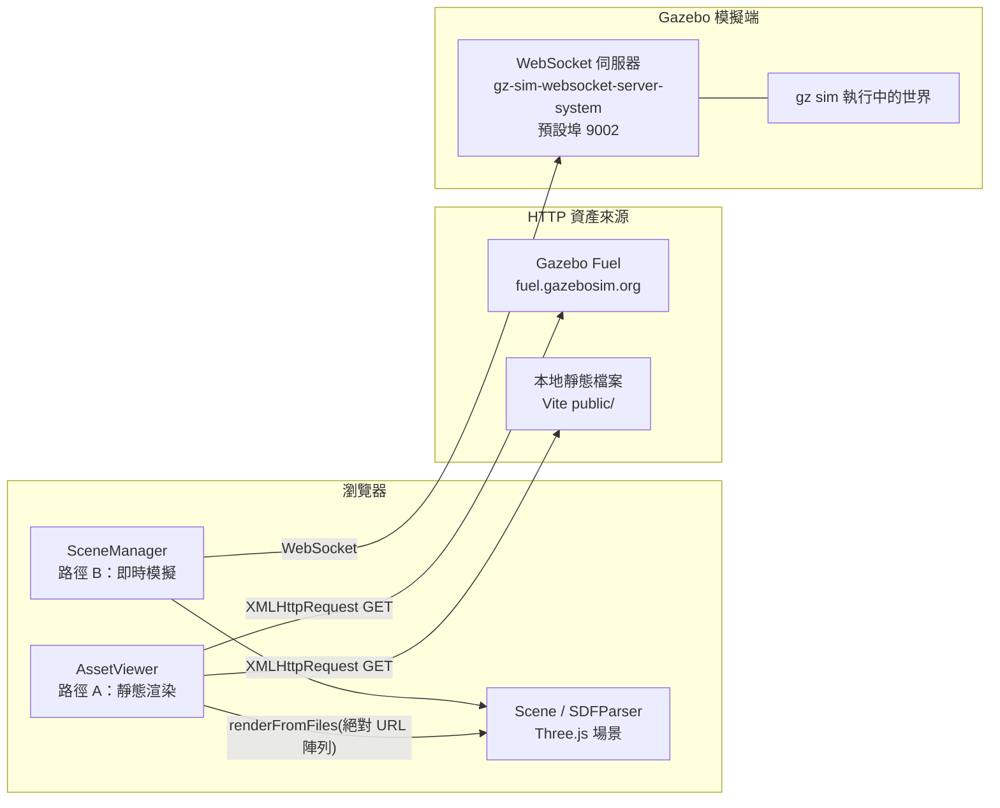

# gzweb 最小可用範例（Hello World）建置指南

## 摘要

`gzweb` 是 Gazebo 官方組織 `gazebo-web` 維護的 JavaScript/TypeScript 函式庫，讓網頁前端可以渲染 Gazebo 的模型與世界（world），或透過 WebSocket 連上正在執行的 Gazebo 模擬並同步顯示[^repo]。本報告提供兩份可直接照抄操作的最小可用範例（hello world），並把「前置作業」逐步寫清楚：從安裝 Gazebo、準備 WebSocket 伺服器、安裝 Node，到建立前端專案、貼上程式碼、驗證結果。

> 本報告為獨立文件，所有需要的背景、指令、程式碼與資產 URL 皆收錄於本文內，不假設讀者具備任何前後文。

---

## 1. 先理解 gzweb 是什麼

`gzweb` **不是一個可以雙擊打開的網站**，而是一個被其他網頁應用引用的程式庫（library）[^readme]。它提供兩條主要使用路徑：

| 路徑 | 類別 | 是否需要 Gazebo 執行中 | 主要 API |
| --- | --- | --- | --- |
| A：靜態渲染 | 渲染單一模型或世界 | 否 | `AssetViewer` |
| B：即時模擬 | 連上 Gazebo 的 WebSocket 伺服器 | 是 | `SceneManager` |

官方 README 明確指出：若只想渲染靜態模型或世界，使用 `AssetViewer`；若要渲染正在執行的 Gazebo 模擬，使用 `SceneManager`[^readme]。

底層以 `three`（Three.js）渲染，透過 WebSocket 與 Gazebo Transport 通訊，訊息格式為 protobuf[^pkg][^rollup]。

### 專案基本資料

- 倉庫：`https://github.com/gazebo-web/gzweb`，隸屬 `gazebo-web` 組織[^repo]。
- 星數：50，fork 13，主要語言 JavaScript（原始碼 TypeScript），建立於 2022-05-11，最後推送 2026-02-26[^repo]。
- 倉庫**未標示授權條款**（license 為 `null`），商用或再散布前應向維護者確認[^repo]。
- npm 最新版本 `3.0.2`，套件為 ESM 模組（`"type": "module"`），要求 Node 24、npm 11[^npm]。

> 星數僅 50，屬小眾專案。之所以仍值得記錄，是因為它是 Gazebo 官方在網頁端 3D 視覺化的現行方案，且被官方前端 `gazebosim-app` 實際採用[^app-pkg]。

---

## 2. 兩條路徑的架構



---

## 3. 前置作業（環境準備）

### 3.1 需要什麼

| 項目 | 需求 | 是否兩條路徑都需要 |
| --- | --- | --- |
| Node.js | 24（gzweb 的開發需求） | 是 |
| npm | 11 | 是 |
| Gazebo（`gz sim`） | Gazebo Jetty 或更新 | 只有路徑 B |
| WebSocket 伺服器外掛 | `gz-sim-websocket-server-system` | 只有路徑 B |

### 3.2 安裝 Node 24 與 npm 11

使用 `nvm` 切換版本（gzweb README 建議作法）[^readme]：

```bash
# 安裝 nvm（若尚未安裝）
curl -o- https://raw.githubusercontent.com/nvm-sh/nvm/v0.40.1/install.sh | bash
# 重新載入 shell 設定
source ~/.bashrc

nvm install 24
nvm use 24
node -v   # 應顯示 v24.x.x
npm -v    # 應顯示 11.x.x
```

若版本不符，gzweb 的 `package.json` 以 `engines` 欄位宣告 Node 24 / npm 11[^pkg]，部分工具鏈可能因此拒絕執行。

### 3.3 建立前端專案骨架（兩條路徑共用的起手式）

本報告以 Vite + TypeScript 為例，因為設定最少；gzweb 本身是 ESM 函式庫，任何支援 ESM 的打包器皆可[^npm][^rollup]。

```bash
npm create vite@latest gzweb-hello -- --template vanilla-ts
cd gzweb-hello
npm install
npm install gzweb
```

`npm create vite@latest` 後面接 `-- --template <名稱>` 是 Vite 官方支援的免互動建立方式（`vanilla-ts` 是官方範本名稱之一）[^vite-guide]。專案建立後預設會有 `dev` / `build` / `preview` 三個 npm script[^vite-guide]。

安裝完成後，`node_modules/gzweb/dist/` 應該存在 `gzweb.module.js`（ESM）與 `gzweb.js`（UMD）[^npm]。

> **Node 版本衝突提醒**：Vite 自身要求 Node 20.19+ 或 22.12+[^vite-guide]，而 gzweb 的 `engines` 宣告 Node 24 / npm 11[^pkg]。兩者在此版本下相容（因為 24 ≥ 20.19），但若你為了相容舊專案而降到 Node 18，gzweb 的 `engines` 檢查可能導致安裝或執行失敗。本報告採用的 Node 24 同時滿足兩者。

### 3.4 （路徑 B 專用）安裝 Gazebo 並驗證

Gazebo Jetty 的官方二進位安裝步驟如下（Ubuntu Noble 24.04 或 Resolute 26.04）[^install-ubuntu]：

```bash
sudo apt-get update
sudo apt-get install curl lsb-release gnupg

sudo curl https://packages.osrfoundation.org/gazebo.gpg \
  --output /usr/share/keyrings/pkgs-osrf-archive-keyring.gpg

echo "deb [arch=$(dpkg --print-architecture) signed-by=/usr/share/keyrings/pkgs-osrf-archive-keyring.gpg] https://packages.osrfoundation.org/gazebo/ubuntu-stable $(lsb_release -cs) main" \
  | sudo tee /etc/apt/sources.list.d/gazebo-stable.list > /dev/null

sudo apt-get update
sudo apt-get install gz-jetty
```

驗證 Gazebo 可執行[^getstarted]：

```bash
gz sim shapes.sdf        # 會開啟 GUI 與伺服器，顯示六個基本形狀
gz sim -s shapes.sdf -v 4  # 只跑伺服器（headless）
```

> 若為 macOS 或 Windows，安裝方式不同，請見官方安裝頁[^install-ubuntu][^getstarted]。

> **headless 精簡安裝（選用）**：若不需要 GUI（例如在無顯示器的伺服器或容器中），可改用 `sudo apt-get install gz-sim10-server`。官方文件指出這只安裝模擬伺服器、不含 GUI 與 Qt 相依，體積顯著較小；但要注意**伺服器執行檔位於 `/usr/libexec/gz/sim10/gz-sim-server`，預設不在 `PATH` 中**，且 `gz sim -s` 這個子命令在此精簡安裝下**不可用**（它需要完整的 `gz-sim10-cli` 套件）[^install-ubuntu]。若要使用本報告 §5 的 `gz sim -v 4 -s world.sdf` 指令，請安裝完整的 `gz-jetty`，或改用該執行檔的完整路徑。

#### 關於「路徑 B 的前置作業」補充說明

WebSocket 伺服器在 Gazebo Jetty 之前是 `gz-launch` 外掛，以 `gz launch websocket.gzlaunch` 啟動；`gz-launch` 在 Gazebo Jetty 已**棄用**，官方改為把同一組參數搬進 SDF 世界檔，改用 `gz-sim` 的**系統外掛（system plugin）**[^gzsimportutorial][^gzlaunch][^gzsimapi]。

| 項目 | 舊寫法（已棄用） | 新寫法（Gazebo Jetty 起） |
| --- | --- | --- |
| 檔名 `filename` | `gz-launch-websocket-server` | `gz-sim-websocket-server-system` |
| 名稱 `name` | `gz::launch::WebsocketServer` | `gz::sim::systems::WebsocketServer` |
| 啟動方式 | `gz launch websocket.gzlaunch` | 世界檔加入外掛後 `gz sim world.sdf` |

#### 驗證外掛檔案是否確實存在

WebSocket 伺服器是 gz-sim 的**系統外掛**，因此它不是獨立服務，而是一個 `.so` 檔案，由 gz-sim 在載入世界時讀取。以下三項可從 gz-sim 原始碼確認：

1. **外掛的編譯單位**。`src/systems/websocket_server/CMakeLists.txt` 定義如下[^gzsim-ws-cmake]：

   ```cmake
   gz_add_system(websocket-server
     SOURCES
       WebsocketServer.cc
     PUBLIC_LINK_LIBS
       websockets_shared
       ...
   ```

   而 `src/systems/CMakeLists.txt` 中的 `gz_add_system()` 會把名稱加上 `-system` 後綴，並安裝到外掛目錄[^gzsim-systems-cmake]：

   ```cmake
   set(system_name ${system_name}-system)
   ...
   install(TARGETS ${system_target} DESTINATION ${GZ_SIM_PLUGIN_RELATIVE_INSTALL_DIR})
   ```

   因此對應的檔名為 `libgz-sim-websocket-server-system.so`，與 SDF 中 `filename="gz-sim-websocket-server-system"` 一致。

2. **安裝路徑**。根目錄 `CMakeLists.txt` 定義[^gzsim-cmake]：

   ```cmake
   set(GZ_SIM_PLUGIN_RELATIVE_INSTALL_DIR
     ${GZ_LIB_INSTALL_DIR}/gz-${GZ_DESIGNATION}/plugins
   )
   ```

   以 Ubuntu amd64 而言，`GZ_LIB_INSTALL_DIR` 為 `lib/x86_64-linux-gnu`；`GZ_DESIGNATION` 是版本代號（Jetty 為 `sim-10`，Rotary 為 `sim-11`）。實務上請直接查詢，不要硬編：

   ```bash
   # 找出 gz-sim 的外掛目錄與該外掛
   find /usr/lib -name "libgz-sim-websocket-server-system.so" 2>/dev/null

   # 反查該檔案屬於哪個 apt 套件
   dpkg -S $(find /usr/lib -name "libgz-sim-websocket-server-system.so" 2>/dev/null | head -1)
   ```

3. **最實用的驗證**：直接啟動世界後確認埠是否被監聽（見 §5.2 的 `ss -ltnp | grep 9002`）。若有監聽，代表外掛確實存在且已載入。

> **從原始碼自行編譯時的陷阱（官方已明示）**：gz-sim 以 `libwebsockets` 是否被找到來決定是否編譯此子目錄[^gzsim-systems-cmake]：
>
> ```cmake
> if (libwebsockets_FOUND)
>   add_subdirectory(websocket_server)
> endif()
> ```
>
> 根目錄也會在找不到時發出官方警告[^gzsim-cmake]：
>
> ```cmake
> if (NOT WIN32)
>   gz_find_package(libwebsockets)
>   if (NOT libwebsockets_FOUND)
>     gz_build_warning("Unable to find libwebsockets. The websocket_server system will not be built.")
>   endif()
> endif()
> ```
>
> 也就是說：**缺少 `libwebsockets` 開發檔時，此系統會被無聲略過（僅有一行警告），而且沒有對應的 CMake 開關可強制啟用**。自行編譯前請先確保安裝了 `libwebsockets` 的開發套件。另外，該外掛在 Windows 上不編譯[^gzsim-cmake]。使用 OSRF 官方二進位套件者通常已在套件相依中帶入。

---

## 4. 路徑 A：靜態渲染 Hello World（AssetViewer）

`AssetViewer` 只透過 HTTP 取得資產檔案（SDF、網格、材質貼圖），**不需要 Gazebo、不需要 WebSocket**[^assetviewer]。

### 4.1 三個必懂的行為（決定你怎麼寫程式）

讀 `AssetViewer` 與 `SDFParser` 原始碼後，有三個會直接影響 hello world 成敗的行為：

1. **容器元素必須先存在。** `AssetViewer` 的建構子就會呼叫 `window.document.getElementById(this.elementId)` 並把 canvas 附加進去；找不到元素時只印 `console.error`，畫面會是空白[^assetviewer]。
2. **資產 URL 必須以 `http` 開頭。** `SDFParser.addUrl()` 的檢查是 `trimmedUrl.indexOf("http") !== 0` 就丟棄並印 `Trying to add invalid URL`[^sdfparser]。因此**相對路徑（例如 `/models/a/model.sdf`）會被忽略**，必須寫成絕對 URL，例如 `` `${window.location.origin}/models/a/model.sdf` ``。
3. **`renderFromFiles()` 只在陣列中找結尾為 `.sdf` 的檔案當作主檔。** 其餘 URL 只是加入解析器的候選資產池[^assetviewer]：

```ts
// AssetViewer.renderFromFiles（官方原始碼）
const sdfFile = files.find((file) => file.endsWith(".sdf"));
files.forEach((file) => this.sdfParser!.addUrl(file));
```

### 4.2 範例 A-1：完全離線的最小 Hello World

這個版本**不需要網路、不需要 Gazebo**，只渲染一個內嵌的方塊，最容易確認「工具鏈是否正常」。

**步驟 1：建立模型檔**

新增 `public/models/hello/model.sdf`：

```xml
<?xml version="1.0" ?>
<sdf version="1.6">
  <model name="hello_box">
    <link name="link">
      <visual name="visual">
        <geometry>
          <box>
            <size>1 1 1</size>
          </box>
        </geometry>
        <material>
          <ambient>0.8 0.2 0.2 1</ambient>
          <diffuse>0.8 0.2 0.2 1</diffuse>
        </material>
      </visual>
    </link>
  </model>
</sdf>
```

（Vite 會把 `public/` 底下的檔案原樣服務在網站根目錄，因此實際網址是 `/models/hello/model.sdf`。Vite 官方文件說明：`public` 目錄預設為 `<root>/public`，開發時掛在根路徑 `/`，且「應該一律以根絕對路徑引用 `public` 資產，例如 `public/icon.png` 在原始碼中寫成 `/icon.png`」[^vite-assets]。本報告的範例因此用 `` `${window.location.origin}/models/hello/model.sdf` `` 這種絕對 URL；若你改用其他打包器，請確認 `public` 或靜態目錄的掛載路徑是否相同。）

**步驟 2：寫 `index.html`**

```html
<!doctype html>
<html lang="zh-Hant">
  <head>
    <meta charset="UTF-8" />
    <title>gzweb Hello World（離線方塊）</title>
    <style>
      html, body { margin: 0; height: 100%; }
      /* 容器必須有非零寬高，否則 canvas 尺寸為 0，看起來像沒渲染。 */
      #container { width: 100vw; height: 100vh; }
    </style>
  </head>
  <body>
    <div id="container"></div>
    <script type="module" src="/src/main.ts"></script>
  </body>
</html>
```

**步驟 3：寫 `src/main.ts`**

```ts
import { AssetViewer, AssetViewerConfig } from "gzweb";

const config: AssetViewerConfig = {
  elementId: "container",   // 必須對應 index.html 中已存在的元素
  addModelLighting: true,   // 加入場景光源，否則模型可能是全黑
  scaleModel: true,         // 依最大尺寸自動縮放並重置相機
  enablePBR: false,         // 本範例無 PBR 貼圖，關掉可少一堆缺檔警告
};

const viewer = new AssetViewer(config);

// 注意：必須是絕對 URL，addUrl() 會拒絕不以 http 開頭的字串。
const fileUrls: string[] = [
  `${window.location.origin}/models/hello/model.sdf`,
];

viewer.renderFromFiles(fileUrls);

// 只代表 Object3D 已建立，不代表網格與貼圖都載完
viewer.resourceLoaded$.subscribe((loaded) => {
  console.log("resource loaded:", loaded);
});

// 視窗尺寸變化時同步更新畫面大小
window.addEventListener("resize", () => viewer.resize());

// 頁面卸載時清理動畫迴圈與場景
window.addEventListener("beforeunload", () => viewer.destroy());
```

**步驟 4：啟動與預期結果**

```bash
npm run dev
```

打開終端機印出的網址（預設 `http://localhost:5173`），應該看到一個紅色方塊置中，可用滑鼠拖曳旋轉、滾輪縮放。Console 會出現 `resource loaded: true`。

### 4.3 範例 A-2：用真實 Fuel 資產（含網格檔）

確認工具鏈沒問題後，換成一個「有外部網格檔」的模型，驗證資產解析路徑。以下 URL 為 Gazebo Fuel 上 `OpenRobotics` 的 `Construction Barrel`（版本 4），是本報告實際查得的清單[^fuelbarrel-files]：

```
https://fuel.gazebosim.org/1.0/OpenRobotics/models/Construction%20Barrel/4/files/model.sdf
https://fuel.gazebosim.org/1.0/OpenRobotics/models/Construction%20Barrel/4/files/meshes/construction_barrel.dae
https://fuel.gazebosim.org/1.0/OpenRobotics/models/Construction%20Barrel/4/files/materials/textures/Construction_Barrel_Diffuse.png
https://fuel.gazebosim.org/1.0/OpenRobotics/models/Construction%20Barrel/4/files/materials/textures/Construction_Barrel_Spec.png
```

該模型的 `model.sdf` 內容（節錄）以 `model://` 參照網格[^fuelbarrel-sdf]：

```xml
<model name="Construction Barrel">
  <link name="link">
    <visual name="visual">
      <geometry>
        <mesh>
          <uri>model://construction_barrel/meshes/construction_barrel.dae</uri>
        </mesh>
      </geometry>
    </visual>
  </link>
</model>
```

解析器如何把它對到實際檔案：`createGeom()` 取 `meshUri`（此例去掉 `model://` 後為 `construction_barrel/meshes/construction_barrel.dae`），再取「最後一段路徑」`meshFileName`；當 `usingFilesUrls` 為真時，它會逐一比對 `customUrls` 中是否**包含**該檔名，命中者即為實際下載網址[^sdfparser]：

```ts
// SDFParser.createGeom（官方原始碼，節錄）
let meshFileName: string = meshUri.substring(meshUri.lastIndexOf("/"));
...
if (this.customUrls.length !== 0) {
  for (var k = 0; k < this.customUrls.length; k++) {
    if (this.customUrls[k].indexOf(meshFileName) > -1) {
      modelUri = this.customUrls[k];
      break;
    }
  }
}
```

因此 `.../files/meshes/construction_barrel.dae` 會被配對成功。

把 `src/main.ts` 的 `fileUrls` 換成上面四個 URL 即可（`elementId`、`scaleModel`、`addModelLighting` 維持不變，`enablePBR` 仍建議關閉，因為該模型沒有 PBR 貼圖）：

```ts
const fileUrls: string[] = [
  "https://fuel.gazebosim.org/1.0/OpenRobotics/models/Construction%20Barrel/4/files/model.sdf",
  "https://fuel.gazebosim.org/1.0/OpenRobotics/models/Construction%20Barrel/4/files/meshes/construction_barrel.dae",
  "https://fuel.gazebosim.org/1.0/OpenRobotics/models/Construction%20Barrel/4/files/materials/textures/Construction_Barrel_Diffuse.png",
  "https://fuel.gazebosim.org/1.0/OpenRobotics/models/Construction%20Barrel/4/files/materials/textures/Construction_Barrel_Spec.png",
];
```

> **CORS 說明**：瀏覽器端是以 `XMLHttpRequest` 直接向 `fuel.gazebosim.org` 取檔[^sdfparser]，因此跨來源行為取決於 Fuel 伺服器的回應標頭。查閱 Fuel 後端所用的 `gz-go` 函式庫原始碼可確認：CORS 中介層 `addCORSheadersMiddleware` 會被掛進**每一條路由**中介層鏈[^gzgo-router]，而它呼叫的 `addCORSheaders` 明確設定[^gzgo-middleware]：
>
> ```go
> w.Header().Set("Access-Control-Allow-Origin", "*")
> ```
>
> 也就是 Fuel 對所有路由（含檔案下載）都回 `Access-Control-Allow-Origin: *`，且另有全域 OPTIONS 處理器負責回覆預檢請求[^gzgo-router]。故 §4.3 的 Fuel 資產在瀏覽器中應可直接取得。
>
> 兩個實務注意事項：(1) 同一函式也設定了 `Access-Control-Allow-Credentials: true`；依 CORS 規範，當請求帶有憑證時萬用字元 `*` 不成立，因此若你的請求會帶 cookie 或自訂 `Authorization` 標頭，可能觸發預檢並失敗；gzweb 讀取公開資產時為不帶憑證的簡單請求，不受影響。(2) 若仍遇到阻擋（例如企業網路代理改寫標頭），可把資產下載到 `public/` 底下自行提供以確保同源。官方文件本身對 CORS 沒有任何敘述[^gzfuel-docs]。

### 4.4 範例 A-3：渲染整個世界（world）

`AssetViewer` 也能渲染 world。做法與 A-2 相同，只是主檔必須是含 `<world>` 根元素、結尾為 `.sdf` 的檔案；`renderFromFiles()` 同樣只靠「結尾是否為 `.sdf`」挑主檔[^assetviewer]。若要渲染 world，建議把該世界相關的所有模型與網格 URL 一併放入陣列，讓 `customUrls` 足以配對到所有 `meshFileName`。

---

## 5. 路徑 B：即時模擬 Hello World（SceneManager）

`SceneManager` 會先建立 WebSocket 連線，狀態依序為 `disconnected` → `connected` → `ready`，在 `ready` 之後才訂閱場景與位姿主題並開始渲染[^scenemanager]。

### 5.1 步驟 1：建立含 WebSocket 伺服器外掛的世界檔

新增 `worlds/ws_hello.sdf`（可直接照抄；這是依官方示範世界 `websocket_server.sdf` 精簡而得[^wssdf]）：

```xml
<?xml version="1.0" ?>
<sdf version="1.11">
  <world name="ws_hello">

    <!-- 基本系統 -->
    <plugin filename="gz-sim-physics-system"
            name="gz::sim::systems::Physics"></plugin>
    <plugin filename="gz-sim-user-commands-system"
            name="gz::sim::systems::UserCommands"></plugin>
    <plugin filename="gz-sim-scene-broadcaster-system"
            name="gz::sim::systems::SceneBroadcaster"></plugin>

    <!-- 本範例主角：WebSocket 伺服器 -->
    <plugin filename="gz-sim-websocket-server-system"
            name="gz::sim::systems::WebsocketServer">
      <publication_hz>30</publication_hz>
      <port>9002</port>
      <max_connections>-1</max_connections>
    </plugin>

    <scene>
      <ambient>1.0 1.0 1.0</ambient>
      <background>0.8 0.8 0.8</background>
    </scene>

    <light type="directional" name="sun">
      <cast_shadows>true</cast_shadows>
      <pose>0 0 10 0 0 0</pose>
      <diffuse>0.8 0.8 0.8 1</diffuse>
      <specular>0.2 0.2 0.2 1</specular>
      <direction>-0.5 0.1 -0.9</direction>
    </light>

    <model name="ground_plane">
      <static>true</static>
      <link name="link">
        <collision name="collision">
          <geometry>
            <plane><normal>0 0 1</normal><size>100 100</size></plane>
          </geometry>
        </collision>
        <visual name="visual">
          <geometry>
            <plane><normal>0 0 1</normal><size>100 100</size></plane>
          </geometry>
          <material>
            <ambient>0.8 0.8 0.8 1</ambient>
            <diffuse>0.8 0.8 0.8 1</diffuse>
          </material>
        </visual>
      </link>
    </model>

    <model name="box">
      <pose>0 0 0.5 0 0 0</pose>
      <link name="box_link">
        <inertial>
          <inertia>
            <ixx>0.16666</ixx><ixy>0</ixy><ixz>0</ixz>
            <iyy>0.16666</iyy><iyz>0</iyz><izz>0.16666</izz>
          </inertia>
          <mass>1.0</mass>
        </inertial>
        <collision name="box_collision">
          <geometry><box><size>1 1 1</size></box></geometry>
        </collision>
        <visual name="box_visual">
          <geometry><box><size>1 1 1</size></box></geometry>
          <material>
            <ambient>1 0 0 1</ambient>
            <diffuse>1 0 0 1</diffuse>
          </material>
        </visual>
      </link>
    </model>

    <model name="sphere">
      <pose>0 1.5 0.5 0 0 0</pose>
      <link name="sphere_link">
        <inertial>
          <inertia>
            <ixx>0.1</ixx><ixy>0</ixy><ixz>0</ixz>
            <iyy>0.1</iyy><iyz>0</iyz><izz>0.1</izz>
          </inertia>
          <mass>1.0</mass>
        </inertial>
        <collision name="sphere_collision">
          <geometry><sphere><radius>0.5</radius></sphere></geometry>
        </collision>
        <visual name="sphere_visual">
          <geometry><sphere><radius>0.5</radius></sphere></geometry>
          <material>
            <ambient>0 0 1 1</ambient>
            <diffuse>0 0 1 1</diffuse>
          </material>
        </visual>
      </link>
    </model>

  </world>
</sdf>
```

外掛參數說明（官方教學與示範世界列出的項目）[^gzsimportutorial][^wssdf]：

| 參數 | 說明 | 本範例值 |
| --- | --- | --- |
| `<port>` | WebSocket 服務埠 | `9002` |
| `<publication_hz>` | 發送資料給 gzweb 的節流頻率 | `30` |
| `<max_connections>` | 最大連線數，負值或省略表示不限制 | `-1` |
| `<authorization_key>` | 一般使用者授權金鑰（選用） | 未設定 |
| `<admin_authorization_key>` | 管理者授權金鑰（選用） | 未設定 |
| `<ssl><cert_file>` / `<ssl><private_key_file>` | SSL 憑證與私鑰（選用） | 未設定 |

> 官方示範世界 `websocket_server.sdf` 另外包含 `cylinder`、`capsule`、`ellipsoid`、`cone` 等模型，以及被註解掉的授權與 SSL 範例[^wssdf]。

### 5.2 步驟 2：啟動 Gazebo 並確認 WebSocket 真的在聽

開啟**終端機 1**：

```bash
gz sim -v 4 -s worlds/ws_hello.sdf
```

`-s` 表示只跑伺服器（headless），`-v 4` 會輸出 debug 等級訊息[^getstarted]。

開啟**終端機 2**，確認 9002 埠處於監聽狀態：

```bash
ss -ltnp | grep 9002
```

若看到 `LISTEN` 且指向 `gz sim` 的 process，代表 WebSocket 伺服器已啟動。這是驗證「外掛真的有被載入」最直接的方式。

> 官方也提供「事後動態掛載外掛」的做法：先 `gz sim -v 4 shapes.sdf -s`，再另一個終端機用 `gz service` 對 `/world/<world_name>/entity/system/add` 發送請求，把 `gz::sim::systems::WebsocketServer` 加入既有世界[^gzsimportutorial][^gzsimapi]。指令為：
>
> ```bash
> gz service -s /world/shapes/entity/system/add \
>   --reqtype gz.msgs.EntityPlugin_V \
>   --reptype gz.msgs.Boolean \
>   --timeout 2000 \
>   --req 'plugins: {name: "gz::sim::systems::WebsocketServer", filename: "gz-sim-websocket-server-system", innerxml: "<port>9002</port><publication_hz>30</publication_hz><max_connections>-1</max_connections>"}'
> ```
>
> 這種做法適合世界檔不想被修改的情境，但步驟較多，hello world 建議直接用 §5.1 的世界檔。

### 5.3 步驟 3：建立前端專案

若尚未建立，回到 §3.3 的指令建立 `gzweb-hello` 並安裝 `gzweb`。

`index.html`（使用 `SceneManager` 的預設容器 id `gz-scene`）[^scenemanager]：

```html
<!doctype html>
<html lang="zh-Hant">
  <head>
    <meta charset="UTF-8" />
    <title>gzweb 即時模擬</title>
    <style>
      html, body { margin: 0; height: 100%; }
      #gz-scene { width: 100vw; height: 100vh; }
    </style>
  </head>
  <body>
    <div id="gz-scene"></div>
    <script type="module" src="/src/main.ts"></script>
  </body>
</html>
```

### 5.4 步驟 4：寫 `src/main.ts`

```ts
import { SceneManager } from "gzweb";

// 提供 websocketUrl 時，建構子會立刻發起連線。
const sceneMgr = new SceneManager({
  websocketUrl: "ws://localhost:9002",
  // websocketKey: "auth_key",  // 僅當世界檔設定了 authorization_key 才需要
});

// 連線狀態為非同步；ready === true 代表場景資訊已就緒。
sceneMgr.getConnectionStatusAsObservable().subscribe((ready) => {
  console.log("ready:", ready);
  if (ready) {
    console.log("models:", sceneMgr.getModels());
  }
});

// 視窗大小改變時同步更新畫面。
window.addEventListener("resize", () => sceneMgr.resize());

// 卸載時關閉連線並移除 canvas。
window.addEventListener("beforeunload", () => sceneMgr.disconnect());
```

### 5.5 步驟 5：啟動與預期結果

保持終端機 1 的 `gz sim` 執行中，另開終端機：

```bash
npm run dev
```

打開 `http://localhost:5173`，預期看到地面、紅色方塊與藍色球體；若在 Gazebo 端讓模擬開始跑，方塊會落下並停在地面（因為 `box` 有慣性與質量、`ground_plane` 為靜態）。Console 應出現 `ready: true`，且 `getModels()` 會列出場景中的模型。

### 5.6 更快的替代方案：完全不安裝 gzweb

若只想先確認「Gazebo 端的 WebSocket 設定是否正確」，官方示範文件提供了不安裝任何前端的做法[^gzsimdemo][^webvis]：

1. 啟動帶有 WebSocket 伺服器的 Gazebo 世界（例如 §5.1）。
2. 瀏覽器開啟 `https://app.gazebosim.org/visualization`。
3. 連線位址輸入 `ws://localhost:9002`。

另外，官方 `gz-sim` 倉庫的示範資料夾內附一個 `index.html`，是「整合了某個快照版本 gzweb」的簡易示範，硬編碼連到 `websocket_server` 世界，可直接用瀏覽器開啟[^gzsimdemo]：

```bash
# 於 gz-sim 原始碼的 examples/scripts/websocket_server/ 目錄下
firefox index.html
```

該目錄包含 `index.html`、`gz.js`、`gz3d.js`、`eventemitter2.min.js`，以及測試用自簽憑證 `localhost.cert` / `localhost.key`[^gzsimdir]。官方文件特別註明：這個 `index.html` 僅用於示範連線流程與事件，材質支援有限；要更完整的視覺效果請改用 `app.gazebosim.org` 的路線[^gzsimdemo]。

---

## 6. 相依套件與打包器注意事項

### 6.1 執行期相依

gzweb 的 `package.json` 把以下套件列為一般 `dependencies`（`npm install gzweb` 會一併安裝）[^pkg]：

| 套件 | 版本範圍 | 用途 |
| --- | --- | --- |
| `three` | `^0.141.0` | 3D 渲染引擎 |
| `rxjs` | `^7.5.5` | 連線狀態與載入狀態的 Observable |
| `protobufjs` | `^6.11.3` | WebSocket 訊息的 protobuf 解析 |
| `eventemitter2` | `^6.4.5` | 事件發送 |
| `jszip` | `^3.10.0` | 解壓縮資產 |
| `fast-xml-parser` | `^4.1.3` | 解析 SDF（XML） |
| `three-nebula` | `^10.0.3` | 粒子系統 |

### 6.2 打包器（bundler）關鍵設定

gzweb 的 Rollup 設定把上述套件全部標記為 `external`，也就是**不會被打包進 gzweb 自身的輸出**，而由使用端在建置時解析[^rollup]。因此：

- `npm install gzweb` 即可，因為它們是 `dependencies`[^pkg]。
- gzweb 以 ESM 形式輸出（`exports.import` 指向 `dist/gzweb.module.js`）[^npm]，應使用 `import { AssetViewer } from "gzweb"` 這種 ESM 匯入語法。
- `three` 被綁定在 `^0.141.0`[^pkg]。若你的專案另外使用不同版本的 Three.js，可能出現同一份 `three` 被載入兩次，建議先對齊版本或於打包器設定去重（dedupe）。
- gzweb 在建構子階段就使用 `window.document`、`requestAnimationFrame` 等瀏覽器 API[^assetviewer][^scenemanager]，因此**不支援伺服器端渲染（SSR）**；在 SSR 框架中必須延後到客戶端才匯入與實例化。
- `jszip` 於 gzweb 的 `dependencies` 為 `^3.10.0`[^pkg]；`fast-xml-parser` 負責 SDF 解析[^sdfparser]。

### 6.3 官方唯一的實務參考：gazebosim-app

官方並未提供獨立的 React/Vite hello world 範例。目前已知唯一的實務使用案例是官方前端 `gazebo-web/gazebosim-app`（Angular，使用 `@angular-builders/custom-webpack` + webpack 5）[^app-pkg]。它包含兩個可參考的元件：

- `sdfviewer.component.ts`：使用 `AssetViewer`，設定 `elementId: "container"`；模型時開啟 `scaleModel` 與 `enablePBR`；兩者都開啟 `addModelLighting`；最後呼叫 `renderFromFiles(fileUrls)`[^sdfviewer]。
- `visualization.component.ts`：使用 `SceneManager`，以 `new SceneManager({ websocketUrl, websocketKey })` 連線，並在 `ngOnDestroy` 呼叫 `disconnect()`[^visualization]。

該應用的 `package.json` 將 `gzweb` 鎖定為 `^2.0.14`，與 GitHub 主分支的 `3.0.1`、npm 上的 `3.0.2` 不同，屬較舊的引用[^app-pkg]。

---

## 7. 常見問題排查

| 症狀 | 可能原因 | 對策 |
| --- | --- | --- |
| 畫面空白，Console 出現 `Trying to add invalid URL` | 資產 URL 不是以 `http` 開頭（用了相對路徑） | 改用絕對 URL，例如 `` `${location.origin}/models/hello/model.sdf` ``[^sdfparser] |
| 畫面空白，Console 出現 `Unable to find HTML element with an id of ...` | 建構子執行時容器不存在，或 `elementId` 打錯 | 確認 `index.html` 已有對應 id；`AssetViewer` 預設 `gz-scene`[^assetviewer] |
| 元素存在但看不到任何東西 | 容器寬高為 0 | 給容器明確尺寸（例如 `width: 100vw; height: 100vh`） |
| 模型全黑 | 未開啟光源 | `addModelLighting: true`[^assetviewer] |
| Console 充斥 `Missing ... Map file` | 開啟 `enablePBR` 但資產沒有對應的 PBR 貼圖 | 設 `enablePBR: false`[^sdfparser] |
| Console 出現 `Failed to get URL [...]` | 資產 URL 不存在或跨來源被拒 | 先以瀏覽器直接開該 URL 驗證，再處理 CORS[^sdfparser] |
| 連線一直停在 `disconnected` | Gazebo 端未載入外掛、埠號不符、或需要金鑰 | 用 `ss -ltnp \| grep 9002` 確認埠；檢查 `<port>` 與是否需要 `websocketKey`[^gzsimportutorial] |
| 物件存在但靜止不動 | 只有 `SceneBroadcaster` 與 WebSocket，沒有 Physics | 世界檔需含 `gz-sim-physics-system`[^wssdf] |
| SSR 建置失敗 | gzweb 依賴 `window` / `document` | 僅在客戶端動態匯入並實例化[^assetviewer][^scenemanager] |
| 出現兩份 Three.js 警告 | 專案 Three.js 版本與 gzweb 的 `^0.141.0` 不一致 | 對齊版本或設定打包器去重[^pkg] |

---

## 8. 來源評析（Critical Source Reflection）

- **權威性**：主要事實來自 Gazebo 官方組織（`gazebo-web`、`gazebosim`）的倉庫與官方文件網站，屬第一手來源[^repo][^readme][^gzsimportutorial][^gzsimapi][^install-ubuntu][^getstarted]。
- **時效性**：gzweb 主分支 2026-02 仍有推送，npm 最新版 `3.0.2` 為近期發行[^repo][^npm]。惟官方前端 `gazebosim-app` 仍引用舊版 `^2.0.14`，存在版本落差[^app-pkg]。
- **可驗證性**：§4 與 §5 的程式碼是依官方 API 原始碼（`AssetViewer.ts`、`SceneManager.ts`、`SDFParser.ts`）實際行為組合而成，關鍵行為（`elementId` 查找、`addUrl` 的 `http` 前置檢查、`.sdf` 主檔挑選、`meshFileName` 配對、連線狀態機）皆逐段引用原始碼，而非憑印象推測[^assetviewer][^scenemanager][^sdfparser]。資產 URL 清單亦經實際查詢 Fuel API 取得[^fuelbarrel-files][^fuelbarrel-sdf]。
- **侷限性**：(1) 官方未發佈可直接執行的 hello world 專案，因此 §4、§5 的範例尚未逐行於真實環境驗證；(2) 官方 WebSocket 教學頁未說明外掛由哪個 apt 套件提供，本報告改以「埠是否監聽」與 CMake 原始碼作為驗證手段；(3) 關於 Fuel 的 CORS，官方文件完全未提及[^gzfuel-docs]，本報告的結論改由 Fuel 後端函式庫 `gz-go` 的原始碼推得[^gzgo-middleware][^gzgo-router]，而非官方保證。
- **未確認事項**：gzweb 倉庫未標示授權條款，商用或再散布前應向維護者確認[^repo]；星數僅 50，社群支援有限[^repo]。

---

## 9. 參考文獻

[^repo]: Gazebo Web. (n.d.). *gzweb*. GitHub. Retrieved 2026-11-21, from https://github.com/gazebo-web/gzweb

[^readme]: Gazebo Web. (n.d.). *README.md*. gzweb GitHub repository. Retrieved 2026-11-21, from https://github.com/gazebo-web/gzweb/blob/main/README.md

[^pkg]: Gazebo Web. (n.d.). *package.json*. gzweb GitHub repository. Retrieved 2026-11-21, from https://github.com/gazebo-web/gzweb/blob/main/package.json

[^npm]: npm, Inc. (n.d.). *gzweb*. npm registry. Retrieved 2026-11-21, from https://registry.npmjs.org/gzweb/latest

[^rollup]: Gazebo Web. (n.d.). *rollup.config.js*. gzweb GitHub repository. Retrieved 2026-11-21, from https://github.com/gazebo-web/gzweb/blob/main/rollup.config.js

[^assetviewer]: Gazebo Web. (n.d.). *src/AssetViewer.ts*. gzweb GitHub repository. Retrieved 2026-11-21, from https://github.com/gazebo-web/gzweb/blob/main/src/AssetViewer.ts

[^scenemanager]: Gazebo Web. (n.d.). *src/SceneManager.ts*. gzweb GitHub repository. Retrieved 2026-11-21, from https://github.com/gazebo-web/gzweb/blob/main/src/SceneManager.ts

[^sdfparser]: Gazebo Web. (n.d.). *src/SDFParser.ts*. gzweb GitHub repository. Retrieved 2026-11-21, from https://github.com/gazebo-web/gzweb/blob/main/src/SDFParser.ts

[^app-pkg]: Gazebo Web. (n.d.). *package.json*. gazebosim-app GitHub repository. Retrieved 2026-11-21, from https://github.com/gazebo-web/gazebosim-app/blob/main/package.json

[^sdfviewer]: Gazebo Web. (n.d.). *src/app/model/sdfviewer/sdfviewer.component.ts*. gazebosim-app GitHub repository. Retrieved 2026-11-21, from https://github.com/gazebo-web/gazebosim-app/blob/main/src/app/model/sdfviewer/sdfviewer.component.ts

[^visualization]: Gazebo Web. (n.d.). *src/app/visualization/visualization.component.ts*. gazebosim-app GitHub repository. Retrieved 2026-11-21, from https://github.com/gazebo-web/gazebosim-app/blob/main/src/app/visualization/visualization.component.ts

[^gzsimportutorial]: Gazebo Sim. (n.d.). *Websocket server for gzweb*. gz-sim tutorials. Retrieved 2026-11-21, from https://github.com/gazebosim/gz-sim/blob/main/tutorials/websocket_server.md

[^gzsimapi]: Gazebo Sim. (n.d.). *Websocket server for gzweb*. Gazebo Sim API Reference 10.7.0. Retrieved 2026-11-21, from https://gazebosim.org/api/sim/10/websocket_server.html

[^gzsim-cmake]: Gazebo Sim. (n.d.). *CMakeLists.txt*. gz-sim GitHub repository. Retrieved 2026-11-21, from https://github.com/gazebosim/gz-sim/blob/main/CMakeLists.txt

[^gzsim-systems-cmake]: Gazebo Sim. (n.d.). *src/systems/CMakeLists.txt*. gz-sim GitHub repository. Retrieved 2026-11-21, from https://github.com/gazebosim/gz-sim/blob/main/src/systems/CMakeLists.txt

[^gzsim-ws-cmake]: Gazebo Sim. (n.d.). *src/systems/websocket_server/CMakeLists.txt*. gz-sim GitHub repository. Retrieved 2026-11-21, from https://github.com/gazebosim/gz-sim/blob/main/src/systems/websocket_server/CMakeLists.txt

[^gzgo-router]: Gazebo Web. (n.d.). *router.go*. gz-go GitHub repository. Retrieved 2026-11-21, from https://github.com/gazebo-web/gz-go/blob/main/router.go

[^gzgo-middleware]: Gazebo Web. (n.d.). *router_middleware.go*. gz-go GitHub repository. Retrieved 2026-11-21, from https://github.com/gazebo-web/gz-go/blob/main/router_middleware.go

[^gzfuel-docs]: Gazebo. (n.d.). *Fuel*. Gazebo documentation. Retrieved 2026-11-21, from https://gazebosim.org/docs/latest/fuel/

[^vite-assets]: Vite. (n.d.). *Static Asset Handling*. Vite documentation. Retrieved 2026-11-21, from https://vite.dev/guide/assets

[^vite-guide]: Vite. (n.d.). *Getting Started*. Vite documentation. Retrieved 2026-11-21, from https://vite.dev/guide/

[^gzsimdemo]: Gazebo Sim. (n.d.). *Get Started*. gz-sim websocket_server demo README. Retrieved 2026-11-21, from https://github.com/gazebosim/gz-sim/blob/main/examples/scripts/websocket_server/README.md

[^gzsimdir]: Gazebo Sim. (n.d.). *examples/scripts/websocket_server*. gz-sim GitHub repository. Retrieved 2026-11-21, from https://github.com/gazebosim/gz-sim/tree/main/examples/scripts/websocket_server

[^wssdf]: Gazebo Sim. (n.d.). *websocket_server.sdf*. gz-sim examples. Retrieved 2026-11-21, from https://github.com/gazebosim/gz-sim/blob/main/examples/scripts/websocket_server/websocket_server.sdf

[^gzlaunch]: Gazebo Launch. (n.d.). *examples/websocket.gzlaunch*. gz-launch GitHub repository. Retrieved 2026-11-21, from https://github.com/gazebosim/gz-launch/blob/main/examples/websocket.gzlaunch

[^fuelbarrel-files]: Gazebo Fuel. (n.d.). *Construction Barrel file list (version 4)*. Retrieved 2026-11-21, from https://fuel.gazebosim.org/1.0/OpenRobotics/models/Construction%20Barrel/tip/files

[^fuelbarrel-sdf]: Gazebo Fuel. (n.d.). *Construction Barrel model.sdf (version 4)*. Retrieved 2026-11-21, from https://fuel.gazebosim.org/1.0/OpenRobotics/models/Construction%20Barrel/4/files/model.sdf

[^install-ubuntu]: Gazebo. (n.d.). *Binary Installation on Ubuntu*. Gazebo Jetty documentation. Retrieved 2026-11-21, from https://gazebosim.org/docs/jetty/install_ubuntu/

[^getstarted]: Gazebo. (n.d.). *Getting Started with Gazebo*. Gazebo Jetty documentation. Retrieved 2026-11-21, from https://gazebosim.org/docs/latest/getstarted/

[^webvis]: Gazebo. (n.d.). *Web Visualization*. Gazebo Jetty documentation. Retrieved 2026-11-21, from https://gazebosim.org/docs/latest/web_visualization/
