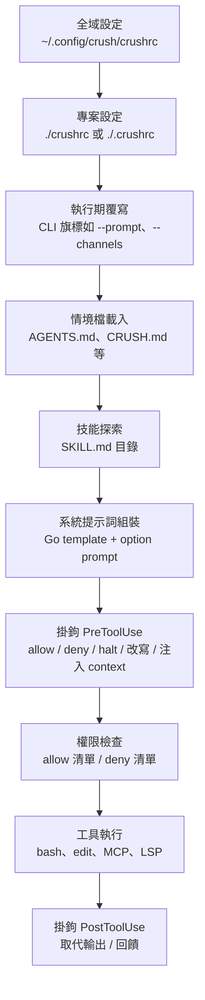
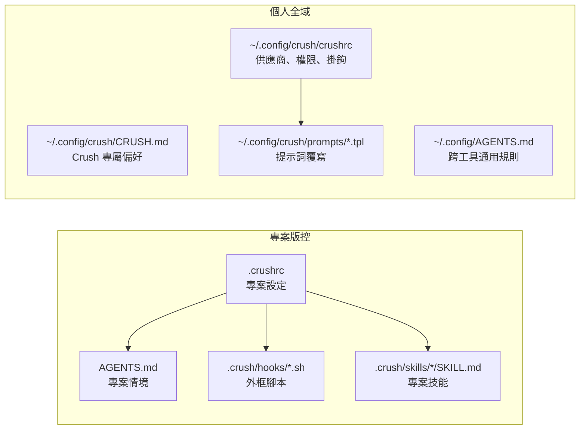

# Crush 的額外情境、外框（Harness）與引導（Steering）機制

## 摘要

Crush 是 Charm 團隊以 Go 語言開發的終端機 AI 程式助理，截至 2026-11-22 在 GitHub 上擁有 29,158 顆星、2,390 個 fork，授權為 FSL-1.1-MIT[^repo]。最新正式版本為 v0.102.0，於 2026-11-19 發布[^rel]。

本報告回答一個具體問題：**能否為 Crush 設定額外的情境（context）、外框（harness）與引導（steering）？** 答案是肯定的，而且 Crush 提供了多層、可疊加的官方機制，涵蓋情境檔、系統提示詞覆寫、技能（Skills）、掛鉤（Hooks）、MCP 伺服器、權限規則與子代理提示詞。本報告逐層說明每個機制、設定方式、優先順序與限制，並給出一套可落地的組合建議。

> 名詞說明：本報告中「情境」指餵給模型的事實與背景；「外框」指包住模型執行流程的程式化機制（掛鉤、權限、MCP）；「引導」指直接改寫或前置系統提示詞與使用者提示詞的手段。三者並非 Crush 的官方術語，而是本報告為了分類而使用的描述性詞彙。

## 一、背景：Crush 是什麼

Crush 是「在終端機中執行的代理式（agentic）程式助理」，透過多種 LLM 供應商（Anthropic、OpenAI、Gemini、Bedrock、Copilot、Hyper、MiniMax、Vercel 等）驅動模型，並提供讀取、寫入、執行等工具，另整合 LSP 取得程式碼智慧，並支援以 MCP 伺服器與 Agent Skills 擴充能力[^repo]。其設定檔的主要格式為 `crushrc`，本質是一段 Bash 腳本，透過 Crush 內建指令（builtins）建立設定[^config]。

Crush 也隨附兩個內建的自我設定技能：`crush-config` 與 `crush-hooks`，官方建議多數情況下直接以自然語言要求 Crush 自行完成設定即可[^repo]。

## 二、機制總覽

下圖呈現 Crush 可設定「情境／外框／引導」的各層與它們的關係。載入順序由下（最底層、最早）往上（最上層、最靠近模型）：



每一層都可獨立設定，且優先順序較高者覆蓋較低者。

## 三、情境層（Context）

### 3.1 預設情境檔清單

Crush 會自動從工作目錄讀取一批慣用的情境檔，不需額外設定。內建的預設清單為[^configgo]：

- `.github/copilot-instructions.md`
- `.cursorrules`
- `.cursor/rules/`
- `CLAUDE.md`、`CLAUDE.local.md`
- `GEMINI.md`、`gemini.md`
- `crush.md`、`crush.local.md`、`Crush.md`、`Crush.local.md`、`CRUSH.md`、`CRUSH.local.md`
- `AGENTS.md`、`agents.md`、`Agents.md`

也就是說，只要在專案根目錄放一份 `AGENTS.md` 或 `CRUSH.md`，內容就會被納入系統提示詞的專案情境區塊[^coder]。

### 3.2 追加自訂情境路徑

可用 `option` 指令追加路徑。專案層級使用 `context-path`，全域層級使用 `global-context-path`，兩者皆為「串列鍵」，可重複呼叫累加[^config][^configgo]：

```bash
# 載入單一 Markdown 檔
option context-path "docs/architecture.md"

# 遞迴載入整個資料夾內所有 Markdown
option global-context-path "/full/path/to/folder/of/files/"
```

`option reset <key>` 可清空先前的串列值（例如在 `source` 引入共用設定後想砍掉某些路徑）[^config]。

### 3.3 全域情境檔

Crush 自動載入兩個跨專案的個人化情境檔[^repo]：

- `~/.config/crush/CRUSH.md`：放 Crush 專屬規則；若只用 Crush，只需編輯這一個。
- `~/.config/AGENTS.md`：放通用指令，供其他代理式工具共用；官方建議避免在此提及 Crush 專屬功能。

這兩者可透過 `option global-context-path` 自訂或追加[^repo]。

### 3.4 專案初始化

執行 `crush init` 時，Crush 會分析程式碼庫並產生一份情境檔，預設檔名為 `AGENTS.md`，可用 `option initialize-as` 改名或改路徑（例如 `CRUSH.md` 或 `docs/LLMs.md`）[^repo]。初始化使用的提示詞本身也是可覆寫的（見 4.2 節）。

### 3.5 忽略檔案

Crush 預設尊重 `.gitignore`，另可建立 `.crushignore` 排除「想納入版控但不希望 Crush 讀取」的檔案；語法與 `.gitignore` 相同，可放在專案根目錄或子目錄[^repo]。

## 四、引導層（Steering）

### 4.1 供應商層級的系統提示詞前綴

每個供應商可設定 `--system-prompt-prefix`，在送往該供應商的系統提示詞最前面加上一段文字[^config][^configgo]。這是最輕量的引導手段，適合放「無論哪個專案都要遵守」的規則。

### 4.2 覆寫內建系統提示詞

Crush 的系統提示詞是 Go template，內建六個可被使用者檔案完全取代的提示詞[^config]：

| 名稱 | 用途 |
| --- | --- |
| `coder` | 主要代理（agent）的系統提示詞 |
| `task` | 子代理的系統提示詞 |
| `plan` | 規劃代理的系統提示詞 |
| `summary` | 長對話壓縮（compaction）的指示 |
| `title` | 為工作階段命名的指示 |
| `initialize` | `crush init` 使用的指示 |

設定方式有三種，優先順序由低到高[^config]：

```bash
# 1. 寫進 crushrc（可專案層級或全域層級）
option prompt coder ~/.config/crush/prompts/coder.md.tpl
option prompt summary ~/.config/crush/prompts/summary.md

# 2. 單次執行以 CLI 旗標覆寫，可重複指定
crush --prompt coder=./terse-coder.md.tpl
crush run --prompt summary=./summary.md "整理 changelog"
```

在 `crush.json` 中，同一組設定位於 `options.prompts`[^config]：

```json
{
  "options": {
    "prompts": {
      "coder": "~/.config/crush/prompts/coder.md.tpl",
      "summary": ".crush/summary.md"
    }
  }
}
```

**關鍵注意事項**：`coder`、`task`、`plan`、`initialize` 四個提示詞是 Go template，使用者的檔案會**完全取代**內建版本，因此內建版本注入的內容（技能清單、情境檔、LSP 狀態）都會消失，除非自己在檔案中重新取用[^config]。可用的樣板變數包括[^config]：

```text
{{.AvailSkillXML}}        可用技能清單
{{.WorkingDir}}           Crush 執行所在目錄
{{.Platform}}             主機作業系統
{{.GitStatus}}            分支、狀態與近期提交
{{.Date}}                 當日日期
{{.IsGitRepo}}            是否為 git 儲存庫
{{.ToolNames}}            可用工具名稱（plan 提示詞使用）
{{.CanWrite}}             子代理是否可寫入（task 提示詞使用）
```

情境檔與 LSP 是「串列」而非文字，直接貼上 `{{.ContextFiles}}` 或 `{{.Config.LSP}}` 會印出原始 Go 資料結構；應改用內建 `coder` 提示詞所用的區塊寫法[^config]：

```text
{{range .ContextFiles}}
<file path="{{.Path}}">
{{.Content}}
</file>
{{end}}
```

若提示詞名稱不在清單內、檔案無法讀取、或樣板無法解析，Crush 會在啟動時就失敗，而不是在對話中途才出錯[^config]。官方建議從被取代的原始提示詞出發改寫，原始檔位於 `internal/agent/templates/`[^config]。

實測：本報告撰寫環境所使用的 Crush 系統提示詞，即為內建 `coder.md.tpl` 的渲染結果，其中包含 `<critical_rules>`、`<workflow>`、`<env>` 等區塊，並在 `env` 區塊填入 `WorkingDir`、`IsGitRepo`、`Platform`、`Date` 與 `GitStatus`[^coder]。

### 4.3 子代理的引導

Crush 有三種具名代理：`coder`（主要）、`task`（子代理，負責搜尋與查證）、`plan`（規劃模式，不可修改檔案）[^configgo]。三者共用 `large` 模型，但工具集不同：`task` 為唯讀工具加上 `bash`，`plan` 為唯讀工具加上子代理與 LSP 查詢工具[^configgo]。

子代理的提示詞（`task.md.tpl`）明確規定「最終訊息即為全部交付內容」、「父代理看不到你的工作」、「回傳的檔案路徑必須是絕對路徑」等規則[^task]。若要調整子代理行為，覆寫 `task` 提示詞是最直接的手段。

## 五、外框層（Harness）

### 5.1 掛鉤（Hooks）

掛鉤是使用者自訂的 shell 指令，在代理生命週期的特定事件觸發，可對工具行為施加決定性的控制[^hooks]。Crush 支援 13 個事件[^hooks]：

| 事件 | 觸發時機 | 可控項 | 是否支援 matcher |
| --- | --- | --- | --- |
| `PreToolUse` | 工具執行前 | allow/deny、halt、改寫輸入、注入 context | 是 |
| `PostToolUse` | 工具成功後 | halt、取代輸出、context、回饋 | 是 |
| `PostToolUseFailure` | 工具失敗後 | halt、context | 是 |
| `PermissionRequest` | 顯示權限提示時 | 僅觀察 | 是 |
| `PermissionResult` | 提示被允許、拒絕或取消 | 僅觀察 | 是 |
| `SessionStart` | 建立或續用工作階段 | 僅觀察 | 否 |
| `SessionEnd` | 程式結束（2 秒預算） | 僅觀察 | 否 |
| `TurnStart` | 代理開始處理提示 | 僅觀察 | 否 |
| `TurnEnd` | 代理完成一輪 | 僅觀察 | 否 |
| `StopFailure` | 因供應商錯誤結束 | 僅觀察 | 否 |
| `Interrupt` | 使用者取消（Ctrl-C、Esc） | 僅觀察 | 否 |
| `PreCompact` | 情境壓縮前 | 阻擋 | 否 |
| `PostCompact` | 情境壓縮後 | 僅觀察 | 否 |

事件名稱不分大小寫，也接受 snake_case（`PreToolUse`、`pretooluse`、`pre_tool_use` 皆可），未知事件名稱會造成設定錯誤[^hooks]。

掛鉤設定的最小形式為 `{matcher, command}`，`matcher` 是對工具名稱的正則表示式，省略則匹配所有工具[^hooks]。專案層級掛鉤優先於全域層級；符合的掛鉤會以 `command` 去重、**平行執行**，但結果**依設定順序**合成[^hooks]。

**輸入**：掛鉤透過環境變數與 stdin 的 JSON 取得資料[^hooks]。環境變數包含 `CRUSH`、`AGENT`、`AI_AGENT`、`CRUSH_EVENT`、`CRUSH_TOOL_NAME`、`CRUSH_SESSION_ID`、`CRUSH_CWD`、`CRUSH_PROJECT_DIR`、`CLAUDE_PROJECT_DIR`、`CRUSH_TOOL_INPUT_COMMAND`、`CRUSH_TOOL_INPUT_FILE_PATH`。stdin JSON 範例[^hooks]：

```json
{
  "event": "PreToolUse",
  "hook_event_name": "PreToolUse",
  "session_id": "313909e",
  "cwd": "/home/user/project",
  "tool_name": "bash",
  "tool_input": { "command": "rm -rf /" },
  "tool_use_id": "call_01"
}
```

**輸出**：以退出碼加上 stdout/stderr 溝通[^hooks]。

| 退出碼 | 意義 |
| --- | --- |
| 0 | 成功，stdout 會被解析為 JSON 信封 |
| 2 | 阻擋此工具呼叫，stderr 作為拒絕理由 |
| 49 | 中止整輪對話，stderr 作為中止理由 |
| 其他 | 非阻擋性錯誤，會被記錄並忽略；但若 stdout 是 JSON 物件仍會被套用 |

JSON 信封欄位包含 `decision`（`allow`/`deny`/省略）、`halt`、`reason`、`context`（字串或字串陣列）、`updated_input`（PreToolUse 的淺層合併修補）、`updated_output`（PostToolUse 取代輸出）[^hooks]。

**三個實用範例**（節錄自官方文件）[^hooks]：

```bash
# 自動核准唯讀工具（行內指令，不需腳本檔）
hook add PreToolUse \
  --matcher '^(view|ls|grep|glob)$' \
  --command "echo '{\"decision\":\"allow\"}'"

# 阻擋破壞性指令
hook add PreToolUse \
  --matcher '^bash$' \
  --command "./hooks/no-rm-rf.sh"

# 每次工具呼叫都寫一行記錄
hook add PreToolUse \
  --command "echo \"$(date -Iseconds) $CRUSH_TOOL_NAME\" >> ./tools.log"
```

**執行模型**：掛鉤透過 Crush 內嵌的 POSIX shell（`mvdan.cc/sh`）執行，與 `bash` 工具使用同一個解譯器；含 shebang 的腳本會交由指定的解譯器處理[^hooks]。這代表在 Windows 上，行內 shell、無 shebang 的 `.sh` 腳本、行內 PowerShell 都能直接運作，不需 WSL、Git Bash 或 Cygwin[^hooks]。掛鉤可用任何語言撰寫，只要以可執行檔形式呼叫（例如 `node ./hooks/h.js`、`python3 ./hooks/h.py`）[^hooks]。

**超時**：預設 30 秒，逾時會取消其 context 並視為「無意見」，讓工具呼叫繼續進行[^hooks]。

**作用範圍限制**：工具與輪次事件**只對頂層代理**觸發；子代理（task 工具、`agentic_fetch` 等）不會觸發任何掛鉤，只有「呼叫子代理的那次工具呼叫本身」會被掛鉤[^hooks]。官方在 `docs/hooks/FUTURE.md` 中記錄了「子代理選擇加入（`include_sub_agents`）」的規劃，但明確標示為**尚未實作**，並註明「除非有人真的要求，否則不要推出（YAGNI）」[^hooksfuture]。

**Claude Code 相容性**：Crush 接受 Claude Code 的掛鉤輸出格式（`hookSpecificOutput`、頂層 `decision: "block"` 加 `reason`、`continue: false`），事件名稱亦有對應（`TurnStart` 對應 `UserPromptSubmit`、`TurnEnd` 對應 `Stop`）[^hooks]。差異在於：設定結構較扁平（每個事件是一組 `{matcher, command}`，而非巢狀群組）、`updated_input` 是淺層合併而非完全取代、`tool_response` 是單一字串而非逐工具物件[^hooks]。

### 5.2 權限（Permissions）

Crush 預設在執行工具前詢問權限，可用 `permissions allow` 略過提示、用 `permissions deny` 將工具從代理的工具清單中完全隱藏[^config][^configgo]：

```bash
permissions allow view ls grep edit
permissions deny bash sourcegraph
```

`deny` 會寫入 `options.disabled_tools`，因為工具不存在於代理的工具清單中，模型無法嘗試使用，是實務上的硬性阻擋[^configfuture]。`bash` 工具另有一組唯讀指令（`ls`、`pwd`、`git status`、`git log` 等）會自動免提示，但只在整個指令可證明無副作用時生效；重導向、變數賦值、指令替換、管線，或會改變狀態的參數（如 `git branch -D`）都會退回正常權限提示[^repo]。

更細緻的設定還包含[^configgo]：

- `permissions.blocked_commands`：在內建危險指令清單之外追加需提示的指令。
- `permissions.allowed_commands`：從有效危險清單中移除項目（包含內建預設）。
- `permissions.safe_commands`：**逐字完全相符**的指令行可完全略過提示（例如 `go build`），刻意採窄範圍設計，帶任何額外參數或旗標就不匹配。

另可執行 `crush --yolo` 完全略過所有權限提示，官方強調「非常、非常小心使用」[^repo]。

### 5.3 MCP 伺服器

Crush 支援三種 MCP 傳輸：`stdio`、`http`、`sse`[^repo]。MCP 伺服器可提供工具、資源與提示詞，是擴充「外框」能力的主要手段[^repo]。設定範例[^repo]：

```bash
mcp add github --type http \
  --url "https://api.githubcopilot.com/mcp/" \
  --header Authorization "Bearer $GH_PAT" \
  --disabled-tools create_issue --disabled-tools create_pull_request

mcp add filesystem --command node --args /path/to/mcp-server.js \
  --timeout 10 --env NODE_ENV production
```

MCP 伺服器另可作為「頻道（Channel）」，主動將外部事件（webhook、CI 失敗、聊天訊息）推送進工作階段；這是實驗性功能，需以 `--channels server:<名稱>` 或設定 `channel_enabled: true` 明確選擇加入[^repo]。頻道亦可雙向互動，透過伺服器自身的工具回覆訊息[^repo]。

### 5.4 LSP

Crush 可掛載語言伺服器，將診斷（lint／typecheck）結果納入工具輸出[^repo]：

```bash
lsp add go --command "gopls" --env "GOTOOLCHAIN go1.24.5"
lsp add typescript --command "typescript-language-server" --args --stdio
```

系統提示詞會依 `.Config.LSP` 是否非空，決定是否告知模型「診斷包含在工具輸出中」[^coder][^config]。

### 5.5 啟動環境變數

設定檔頂層的 `env` 欄位會在啟動時、供應商設定之前設定環境變數，適合用於影響供應商認證的變數（例如 AWS SDK 憑證鏈），避免為此包一層 shell 腳本[^repo]：

```json
{
  "env": { "AWS_PROFILE": "my-sso-profile" }
}
```

## 六、技能層（Skills）

Crush 支援 Agent Skills 開放標準：技能是含 `SKILL.md` 的資料夾，Crush 可探索並按需啟動[^repo]。

**全域探索路徑**[^repo]：

- `$CRUSH_SKILLS_DIR`
- `$XDG_CONFIG_HOME/agents/skills` 或 `~/.config/agents/skills/`
- `$XDG_CONFIG_HOME/crush/skills` 或 `~/.config/crush/skills/`
- `~/.agents/skills/`
- `~/.claude/skills/`
- Windows 另加 `%LOCALAPPDATA%\agents\skills\` 與 `%LOCALAPPDATA%\crush\skills\`
- 由 `options.skills_paths` 設定的額外路徑

**專案探索路徑**（不需任何設定）[^config]：`.agents/skills`、`.crush/skills`、`.claude/skills`、`.cursor/skills`。

**追加路徑與停用技能**[^config]：

```bash
option skill-path "$HOME/squid-skills" "./other-skills"
option disable-skill crush-config
```

停用的技能（包含內建技能與磁碟探索到的技能）會從代理的可見清單中隱藏[^repo]。

**使用者可呼叫技能**：在技能 frontmatter 加上 `user-invocable: true`，該技能就會出現在命令面板（Ctrl-P），全域技能顯示為 `user:<名稱>`，專案技能顯示為 `project:<名稱>`[^config]。加上 `disable-model-invocation: true` 可讓技能僅供使用者手動呼叫、不出現在模型的可見技能清單中[^config]。

## 七、設定檔的載入與優先順序

Crush 同時支援 `crushrc`（Bash，**建議使用**）與 `crush.json`（靜態 JSON，**已棄用**），兩者會被一起探索並深度合併[^config]。優先順序由高到低[^config]：

1. `.crushrc` / `crushrc` / `.crush.json` / `crush.json`（專案本地，越靠近當前工作目錄者優先）
2. `$XDG_CONFIG_HOME/crush/crushrc` 或 `~/.config/crush/crushrc`

同一目錄若同時存在 `crushrc` 與 `crush.json`，兩者會合併（`crushrc` 衝突時勝出），且 Crush 會記錄一則警告[^config]。

`crushrc` 是真正的 Bash 腳本，因此可直接使用 `source`、條件判斷、變數與指令替換[^config]。官方說明的兩個設計理由是：Crush 內建第一級 Bash 解譯器，可直接獲得邏輯能力；且 Crush 需要能自我設定，以指令為基礎的設定讓使用者與代理使用同一套工具[^config]。

**安全性警告**：`crushrc` 與 `crush.json` 都是受信任的程式碼；`crushrc` 會完整執行，`crush.json` 中的任何 `$(...)` 也會在載入時執行，皆以呼叫者的 shell 權限、在 UI 出現之前執行。官方明確建議不要在未審閱設定的目錄中啟動 Crush[^config]。

## 八、限制與注意事項

1. **掛鉤不涵蓋子代理**：工具與輪次事件只對頂層代理觸發；子代理的內部迴圈完全不受掛鉤攔截。子代理選擇加入目前是規劃中、尚未實作的功能[^hooks][^hooksfuture]。
2. **提示詞覆寫是全有全無**：覆寫 `coder`、`task`、`plan`、`initialize` 會完全取代內建版本，內建注入的技能清單、情境檔與 LSP 狀態都會消失[^config]。
3. **沒有「可見但一律拒絕」的權限狀態**：Crush 目前只有自動核准、需提示、以及隱藏三種狀態；要真正禁止某工具只能將其隱藏，官方認為「可見但不可用」只會浪費模型注意力與工具呼叫次數，故延後實作[^configfuture]。
4. **即時重新設定尚未實作**：目前 `crushrc` 只在啟動時執行一次；透過 `bash` 工具執行 `model large …`、`option …`、`mcp add …` 等指令來即時改動執行中工作階段，屬於規劃中的功能，且官方明確表示「持久化是非目標（non-goal）」[^configfuture]。
5. **`FUTURE.md` 不是契約**：`docs/config/FUTURE.md` 與 `docs/hooks/FUTURE.md` 是規劃草稿，開頭即聲明「此處沒有任何內容屬於現行契約」，且文件本身標註「大部分由 LLM 產生」[^configfuture][^hooksfuture]。引用時必須與正式文件區分。
6. **指標與隱私**：Crush 會記錄與裝置雜湊綁定的匿名使用指標（不含提示與回應內容），可用 `CRUSH_DISABLE_METRICS=1` 或 `DO_NOT_TRACK=1` 退出[^repo]。
7. **模型供應商前綴的適用範圍**：`--system-prompt-prefix` 是供應商層級設定，會影響該供應商的所有模型[^configgo]。

## 九、建議的落地組合

若要在自己的專案中為 Crush 建立一套「情境＋外框＋引導」配置，可採用下列分層：



具體分工建議：

- **情境**：專案事實寫入版控中的 `AGENTS.md`；個人跨專案偏好寫入 `~/.config/crush/CRUSH.md` 或 `~/.config/AGENTS.md`；需要遞迴載入的參考文件用 `option context-path` 追加。
- **引導**：先試 `--system-prompt-prefix`（最輕量）；若需結構化改寫才覆寫 `option prompt coder`，且務必從內建樣板出發，保留 `{{.AvailSkillXML}}`、`{{.ContextFiles}}`、`{{.GitStatus}}` 等區塊。
- **外框**：以 `PreToolUse` 掛鉤實作自動核准唯讀工具與阻擋危險指令；以 `PostToolUse` 掛鉤實作輸出脫敏；以 `permissions deny` 隱藏完全不需要的工具；以 MCP 伺服器擴充工具與資源。
- **可重複使用知識**：封裝成專案技能（`.crush/skills/`），需要時由模型按需載入，避免一次塞滿情境視窗。
- **版控**：`.crushrc`、`.crush/hooks/`、`.crush/skills/`、`AGENTS.md` 皆適合納入版控；含密鑰的設定應放在全域層級或以環境變數注入，避免寫入專案設定。

## 十、來源評析

本報告的資訊主要來自 Crush 官方 GitHub 儲存庫，屬於第一手來源，可信度高；專案擁有近三萬顆星、近期仍在活躍發布（v0.102.0 於 2026-11-19 發布），社群與維護活躍度佳[^repo][^rel]。

需要留意的偏誤與限制：

- 官方文件由專案維護者撰寫，對自身功能的描述可能偏樂觀，但本報告所引用的設定語法與行為多可在原始碼（`internal/config/config.go`、`internal/agent/templates/`）中交叉驗證，降低了單一來源的風險[^configgo][^coder][^task]。
- `docs/config/FUTURE.md` 與 `docs/hooks/FUTURE.md` 是規劃草稿而非現行契約，且自承「大部分由 LLM 產生」；本報告僅在「限制與注意事項」一節引用它們，並明確標示為未實作[^configfuture][^hooksfuture]。
- Crush 的功能迭代快速（v0.102.0 的發布日期與本報告撰寫日期僅相隔三天），設定選項與行為可能隨時變動；引用具體旗標前應以當時的官方文件為準[^rel][^config]。
- 本報告未獨立驗證每一項設定的執行結果，除系統提示詞結構一項是在撰寫環境中直接觀察到的[^coder]，其餘皆為官方文件所述。

## 參考文獻

[^repo]: Charmbracelet. (n.d.). *crush* [Computer software]. GitHub. Retrieved 2026-11-22, from https://github.com/charmbracelet/crush

[^rel]: Charmbracelet. (2026, November 19). *v0.102.0* [Release]. GitHub. Retrieved 2026-11-22, from https://github.com/charmbracelet/crush/releases/tag/v0.102.0

[^config]: Charmbracelet. (n.d.). *Config* [Documentation]. In crush (docs/config/README.md). Retrieved 2026-11-22, from https://github.com/charmbracelet/crush/blob/main/docs/config/README.md

[^configgo]: Charmbracelet. (n.d.). *internal/config/config.go* [Source code]. In crush. Retrieved 2026-11-22, from https://github.com/charmbracelet/crush/blob/main/internal/config/config.go

[^configfuture]: Charmbracelet. (n.d.). *Config: Future Work* [Design notes]. In crush (docs/config/FUTURE.md). Retrieved 2026-11-22, from https://github.com/charmbracelet/crush/blob/main/docs/config/FUTURE.md

[^hooks]: Charmbracelet. (n.d.). *Hooks* [Documentation]. In crush (docs/hooks/README.md). Retrieved 2026-11-22, from https://github.com/charmbracelet/crush/blob/main/docs/hooks/README.md

[^hooksfuture]: Charmbracelet. (n.d.). *Hooks: Future Work* [Design notes]. In crush (docs/hooks/FUTURE.md). Retrieved 2026-11-22, from https://github.com/charmbracelet/crush/blob/main/docs/hooks/FUTURE.md

[^coder]: Charmbracelet. (n.d.). *internal/agent/templates/coder.md.tpl* [Source code]. In crush. Retrieved 2026-11-22, from https://github.com/charmbracelet/crush/blob/main/internal/agent/templates/coder.md.tpl

[^task]: Charmbracelet. (n.d.). *internal/agent/templates/task.md.tpl* [Source code]. In crush. Retrieved 2026-11-22, from https://github.com/charmbracelet/crush/blob/main/internal/agent/templates/task.md.tpl

[^agents]: Charmbracelet. (n.d.). *AGENTS.md* [Development guide]. In crush. Retrieved 2026-11-22, from https://github.com/charmbracelet/crush/blob/main/AGENTS.md
