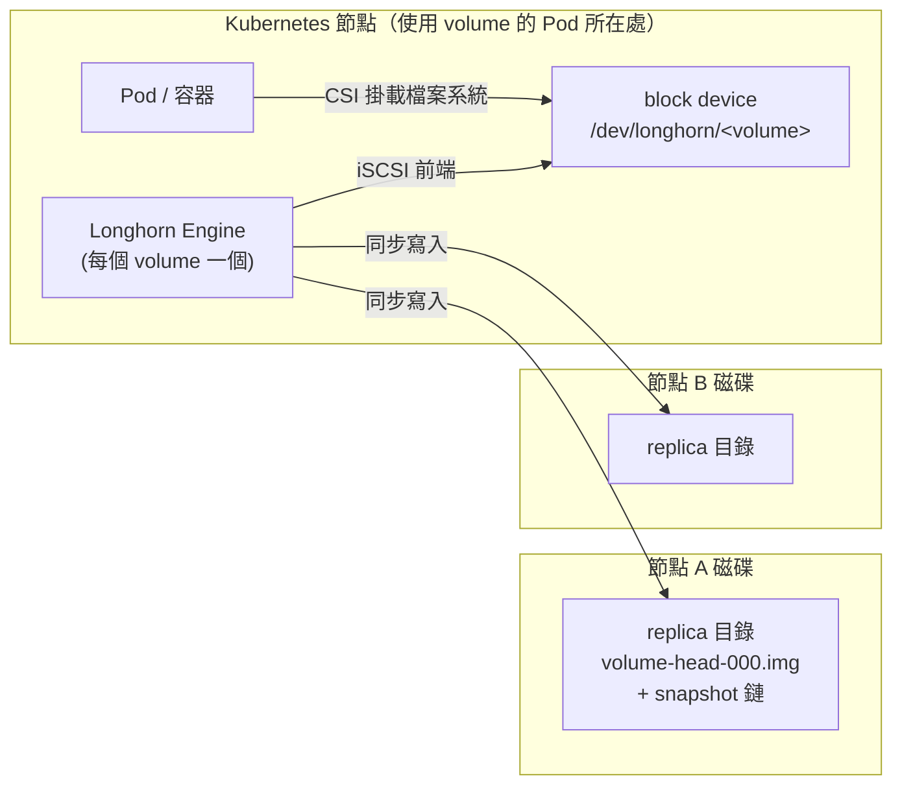
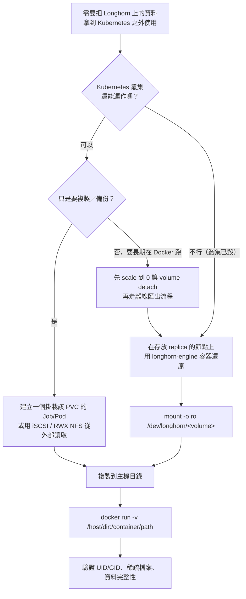

# Longhorn 磁碟資料能否在 Kubernetes 之外（Docker）掛載使用

## 問題陳述

在 Kubernetes 叢集中使用 Longhorn 作為 PVC 的後端儲存後，有兩個實務上常見的疑問：

1. 能否把 Longhorn 的「volume 檔案」直接掛載（mount）到 Docker，以便複製或備份資料？
2. 換句話說，原本由 Kubernetes 服務的同一份資料，能否用 `docker run` 啟動同一個容器映像繼續使用？

本文的結論建立在 Longhorn 官方文件、Longhorn 原始碼，以及 GitHub 專案狀態之上，並區分「資料層可行性」與「官方支援程度」兩件事。

---

## 結論摘要

| 問題 | 答案 | 關鍵限制 |
| --- | --- | --- |
| 直接把 `volume-head-000.img` 當檔案丟給 `docker run -v` 使用 | **不可以**（只會變成容器內的一個普通檔案） | 該 `.img` 是 raw block image，不是目錄，核心未將其視為 block device |
| 用 `losetup` 直接 loop-mount `volume-head-000.img` | **僅在「沒有任何 snapshot」時可能可行**，且非官方支援 | replica 是差異磁碟鏈（differencing chain），head 只是最新一層；有 snapshot 時單獨掛載會讀到不完整資料 |
| 用 Longhorn 官方工具把 replica 還原成 block device 後再掛載 | **可以**（官方支援路徑） | 需要 `--privileged` 容器、需要該 volume 已 detach、建議唯讀掛載 |
| 資料取出後用 `docker run` 跑同一個容器 | **可以** | 必須確保 Kubernetes 端已停止寫入（獨佔存取），並注意 UID/GID、路徑、稀疏檔案複製方式 |
| Longhorn 是否有 Docker volume plugin 可直接 `-v` 掛載 | **沒有可用的現行方案** | 早期 `rancher/docker-longhorn-driver` 已封存（archived、唯讀），現代 Longhorn 只提供 CSI |

一句話總結：**Longhorn 的資料可以拿到 Kubernetes 之外使用，但必須經過「把 replica 還原成 block device → 掛載 → 複製」這道手續，而不是直接把某個檔案掛給 Docker。**

---

## 一、Longhorn 的資料實際長什麼樣子

Longhorn 是為 Kubernetes 設計的分散式區塊儲存（block storage），每個 volume 由一個專屬的儲存控制器（Longhorn Engine）加上多個 replica 組成，Engine 與 replica 本身都由 Kubernetes 編排[^what-is-longhorn][^concepts]。Engine 執行在使用該 volume 的 Pod 所在節點，並把 volume 以 block device 形式暴露給該節點；V1 data engine 使用 iSCSI 作為前端（frontend）[^concepts]。Longhorn 官方文件也明確說明，常見前端包含對應到 `/dev/longhorn` 的 Linux kernel device，以及 iSCSI target[^what-is-longhorn]。



### replica 目錄結構

Longhorn 預設把資料放在 `Default Data Path`（通常為 `/var/lib/longhorn`），replica 目錄命名為 `<volume_name>-<8 bytes UUID>`，而目錄名中的 volume name 對應 Kubernetes 的 PV 名稱[^export-replica]。目錄內有一個 `volume.meta` 描述 volume 大小與目前的 head 檔名，例如：

```json
{"Size":1073741824,"Head":"volume-head-000.img","Dirty":true,"Rebuilding":false,"Parent":"","SectorSize":512,"BackingFileName":""}
```

其中 `Size` 是 volume 大小（位元組），`Head` 是目前寫入層的檔名[^export-replica][^kb-orphan]。

### 關鍵：`volume-head-*.img` 只是「最新一層」

Longhorn 的 replica 是由一連串 snapshot 組成的差異磁碟鏈：最舊的 snapshot 是基底層，較新的 snapshot 疊在上面，新資料只寫進 live data（也就是 head）[^concepts]。讀取時，若資料不在 live data，就往最新的 snapshot 找，再往更舊的找，直到最舊的一層[^concepts]。官方文件對此的描述非常直接：

> 每個 replica 都包含一條 Longhorn volume 的 snapshot 鏈。snapshot 就像映像檔的一層，最舊的 snapshot 是基底層，較新的疊在其上。只有當新資料覆寫了較舊的資料時，新 snapshot 才會包含資料。[^concepts]

因此：

- 若該 volume **從未建立過 snapshot**，鏈上只有 `volume-head-000.img` 一層，該檔案在邏輯上等於整個 block device 的內容。
- 若該 volume **存在任何 snapshot**（包含 Longhorn 自動建立的系統 snapshot），`volume-head-000.img` 只包含「相對於父層被改寫過的區塊」，單獨掛載會看到大量空洞與不完整資料。

官方「Volume Size」文件用一句話把這個關係講得最清楚：

> volume head 只持有該 volume 的最新資料，而每個 snapshot 可能同時儲存歷史資料與現行資料，最多各佔用 size 的空間。因此 volume 的 `actual size`（volume head 與所有 snapshot 的總和）可能大於使用者指定的 size。[^volume-size]

同一份文件還提醒，即使使用者完全不建立 snapshot，replica 重建（rebuilding）、volume 擴充（expansion）或備份（backup）都可能產生系統（隱藏）snapshot[^volume-size]。換句話說，**「我的 volume 沒有 snapshot」這件事本身需要被驗證，而不是假設**。

Longhorn 原始碼也印證了這個結構。replica 把每一層磁碟檔案按「最舊 → 最新」排成 `files` 陣列（index 0 是 nil、index 1 是 backing file 或基底層、最後一個是 active write layer），並維護一個「每個 sector 該去哪一層讀」的 `location` 索引[^engine-diff-disk]。讀取時若索引未知，會從最新一層往回用 Fiemap 逐層探測哪一層實際持有該 sector 的資料，若都沒有就直接落到 index 1[^engine-diff-disk]。這代表**單獨取用 head 檔案在原理上就不可能還原完整內容**，除非 `files` 陣列長度為 2（nil + head）。

至於檔案格式本身，replica 開啟個別磁碟檔案時使用 `sparse.NewDirectFileIoProcessor`，以 `O_DIRECT` 對檔案做 offset 讀寫，讀寫位置沒有保留任何 Longhorn 專屬的 metadata header 位移[^engine-replica][^sparse-tools]。換言之，`.img` 本體就是一個「從 offset 0 開始的 raw block image」，不含 Longhorn 自己的檔案標頭；它的內容是否完整，取決於整條鏈是否只有它一層。

Longhorn 採 thin provisioning，replica 以稀疏檔案（sparse file）儲存，檔案大小代表「可成長到的上限」，實際佔用磁碟的只有已寫入的區塊[^volume-size][^concepts]。

---

## 二、直接把 `.img` 交給 Docker 會發生什麼事

### 為什麼 `docker run -v` 不行

先釐清一個常見誤解：Docker 的 bind mount **可以**指向單一檔案（`-v /host/file:/container/file`），那一行指令會成功[^docker-bind]。問題不在於指令能不能跑，而在於它「給了你什麼」：

```bash
docker run --rm -v /var/lib/longhorn/replicas/<replica>/volume-head-000.img:/data.img alpine ls -l /data.img
```

容器裡只會看到一個名為 `/data.img`、大小等於 volume 名目容量的普通檔案。裡面裝的是 ext4 / xfs 之類的檔案系統位元組，**但核心並沒有把它當成 block device**，所以容器內看不到任何目錄與檔案。要用這份資料，必須先經過 loop device 或 iSCSI 裝置對映，讓核心把映像檔掛成 block device 再掛載檔案系統；這一步不是 Docker 的 volume 機制能完成的。

換句話說，`-v` 能把「檔案」搬進容器，但搬不進「檔案系統」。

### 為什麼 loop-mount 只在特定條件下可用

`losetup` + `mount` 之所以有時能成功，是因為 `.img` 確實是從 offset 0 開始的 raw 映像；但**成功讀到資料不代表資料完整**：

| 情境 | 直接 loop-mount `volume-head-*.img` | 說明 |
| --- | --- | --- |
| 完全沒有 snapshot（鏈長 1） | 通常可讀 | 檔案是完整 raw 映像 |
| 有任何 snapshot（含系統 snapshot） | **不完整、可能看似毀損** | head 只是差異層，缺少父層區塊[^concepts] |
| 有 backing image | **不完整** | 基底層在另一個 backing image 檔案中[^export-replica] |
| 已加密的 volume | **不可用** | 資料由 `dm_crypt` + LUKS2 在區塊層加密[^volume-encryption] |
| V2 data engine / sharded 佈局 | **不適用** | V2 的 replica 是 SPDK logical volume bdev，不是稀疏 `.img`[^concepts] |

Longhorn 針對「從單一 replica 匯出資料」提供的官方程序，一律要求透過 Longhorn Engine 把 replica 重新曝露成 block device，而不是要使用者直接 loop-mount `.img`[^export-replica][^kb-orphan]。這也是判斷「哪種做法被支援」最直接的依據。

### 動手前先確認鏈長

Replica 目錄內的檔案命名有固定規則：live 層是 `volume-head-<NNN>.img`，snapshot 層是 `volume-snap-<name>.img`，每層各有一個同名 `.meta` 的 JSON 描述 `Name` 與 `Parent`[^engine-disk-const][^engine-replica]。因此「鏈長是否為 1」可以直接從檔名與 `Parent` 欄位判斷：

```bash
cd /var/lib/longhorn/replicas/<replica-dir>

# 1. 有沒有 snapshot 層？有的話就不是單層
ls -1 volume-snap-*.img 2>/dev/null

# 2. head 自己的 meta 是否宣告 Parent？
cat volume-head-000.img.meta

# 3. volume 層級的 meta 記錄大小與目前 head
cat volume.meta
```

只有在「沒有任何 `volume-snap-*.img`」且「`volume-head-000.img.meta` 的 `Parent` 為空字串」時，head 才是完整資料[^engine-replica]。任一條件不成立，就必須回到官方匯出流程。

### 在容器內做 loop mount

若真的要走 loop mount，`losetup` 必須在主機或特權容器內執行，容器需 `--privileged` 並能存取 `/dev/loop-control` 與 loop 裝置[^docker-bind]：

```bash
docker run --rm --privileged -v /dev:/dev \
  -v /var/lib/longhorn/replicas/<replica-dir>:/replica \
  ubuntu:24.04 bash -c '
    losetup -f --show /replica/volume-head-000.img
    # 假設輸出 /dev/loop0
    mount -o ro /dev/loop0 /mnt
    ls /mnt
  '
```

這種寫法能繞過 Docker 的 volume 抽象，但同時也繞過 Longhorn 的所有保護機制：沒有 snapshot 鏈合併、沒有 revision counter、沒有多副本一致性檢查。**它適合「最後手段的資料搶救」，不適合日常備份。**

---

## 三、官方支援的做法：從單一 replica 匯出

官方文件 "Exporting a Volume from a Single Replica" 的場景是「整個 Kubernetes 叢集或 Longhorn 系統離線，仍想取回 volume 資料」[^export-replica]。每個 replica 都含有該 volume 的完整資料，因此任取一個健康的 replica 目錄即可還原。

### 步驟

**1. 找出 replica 目錄**

```bash
# find / -name longhorn-disk.cfg
/var/lib/longhorn/longhorn-disk.cfg

# ls /var/lib/longhorn/replicas/
pvc-06b4a8a8-b51d-42c6-a8cc-d8c8d6bc65bc-d890efb2
pvc-71a266e0-5db5-44e5-a2a3-e5471b007cc9-fe160a2c
```

**2. 確認沒有任何程序正在使用該目錄**（官方文件用 `lsof` 檢查）[^export-replica]：

```bash
lsof /var/lib/longhorn/replicas/pvc-06b4a8a8-b51d-42c6-a8cc-d8c8d6bc65bc-d890efb2
```

若 `lsof` 有輸出（例如 `longhorn` 程序仍開啟該目錄），**不可繼續**，必須先讓 volume detach[^export-replica]。Longhorn 官方知識庫同樣強調，為避免資料毀損，必須確認 replica 未被 Longhorn 或其他程序使用[^kb-orphan]。

**3. 讀出 volume 大小**

```bash
cat /var/lib/longhorn/replicas/pvc-06b4a8a8-b51d-42c6-a8cc-d8c8d6bc65bc-d890efb2/volume.meta
```

**4. 用 Longhorn Engine 容器把 replica 曝露成 block device**

```bash
docker run -v /dev:/host/dev -v /proc:/host/proc \
  -v /var/lib/longhorn/replicas/<replica-dir>:/volume \
  --privileged longhornio/longhorn-engine:v1.13.0 \
  launch-simple-longhorn <volume_name> <volume_size_bytes>
```

執行後會出現 `/dev/longhorn/<volume_name>` 這個 block device[^export-replica][^kb-orphan]。

**5. 唯讀掛載並取資料**

```bash
mkdir -p /mnt/recovered-data
mount -o ro /dev/longhorn/<volume_name> /mnt/recovered-data
```

官方文件明確建議用 `mount -o ro`，以避免意外變更 volume 內容[^export-replica]。完成後 `docker stop` 該容器，`/dev/longhorn/` 下的裝置會自動消失[^kb-orphan]。

### 叢集還活著時的替代路徑

若 Kubernetes 叢集仍正常運作，不必走「單一 replica 還原」，還有三條路：

1. **iSCSI 前端**：建立 volume 時把 frontend 設為 `iSCSI`，attach 後 `endpoint` 欄位會長成 `iscsi://10.42.0.21:3260/iqn.2014-09.com.rancher:testvolume/1`，任何在同網段的 iSCSI client（含 `open-iscsi`、KVM）都能連上，LUN 固定為 1；此模式不被 Longhorn CSI driver 支援[^iscsi]。
2. **RWX（NFS）**：Longhorn 的 ReadWriteMany volume 是由 `share-manager-<volume-name>` Pod 內的 NFSv4.1 伺服器提供，每個 RWX volume 都搭配一個 Service 曝露 NFS 端點，每個 NFS client 節點需安裝 NFSv4 client[^rwx]。這條路徑等於「用 NFS 從外部讀同一份資料」。
3. **`longhornctl export replica`**：Longhorn CLI 提供 `longhornctl export replica --name=<replica-dir> --target-dir=<host-dir>`，會啟動 replica exporter 把資料匯出到主機目錄；它透過在叢集節點上執行 DaemonSet Pod 來完成，因此需要可用的 kubeconfig 與叢集[^longhornctl-export]。

---

## 四、把資料交給 Docker 容器使用

取得可掛載的檔案系統（無論是 `/dev/longhorn/...`、iSCSI LUN，或匯出後的目錄）之後，讓 Docker 使用同一份資料就只是普通的 bind mount：

```bash
# 情況 A：已在主機上掛載成目錄
docker run --rm -v /mnt/recovered-data:/var/lib/app/data my-image:tag

# 情況 B：想直接給容器 block device（需特權）
docker run --rm --privileged \
  --device /dev/longhorn/<volume_name>:/dev/sdb \
  my-image:tag
```

### 必須注意的六件事

| 項目 | 說明 |
| --- | --- |
| **獨佔存取** | Longhorn volume 是 ReadWriteOnce 語意的區塊儲存，同一時間只能有一個 writer。Kubernetes 端仍在執行時就掛載同一份資料，會造成檔案系統毀損；務必先 scale 到 0 或刪除 Pod 讓 volume detach[^detach]。 |
| **UID / GID 與權限** | Longhorn 有專門說明 PVC 的 ownership 與 permission 行為[^pvc-ownership]；容器內的使用者 UID 若與資料原擁有者不同，會出現權限錯誤。必要時用 `--user` 或調整目錄擁有者。 |
| **稀疏檔案複製** | 用 `cp` 或 `rsync` 複製稀疏檔案時，未加 `--sparse=always`（`cp`）可能把空洞展開成實際資料，導致備份體積暴增。 |
| **容器映像本身不是重點** | 容器只看到「一個目錄或一個裝置」，映像、entrypoint 與 k8s 無關；只要路徑、環境變數、UID 對上即可。 |
| **Kubernetes 專屬中介資料** | PV 名稱、PVC 註解、StorageClass 參數等只存在於 API server，不在資料裡；換到 Docker 後這些設定要自己以環境變數或設定檔重建。 |
| **加密與 backing image** | 加密 volume 需要對應金鑰才能解鎖；有 backing image 的 volume 其基底層不在 replica 目錄內，單取 replica 會缺資料[^export-replica]。 |

---

## 五、Docker volume plugin 的歷史與現況

早期 Rancher 生態確實存在 Docker volume plugin：

- `rancher/docker-longhorn-driver`：repo 說明為「Docker volume plugin for Rancher Longhorn block storage」，並註明「This is designed to be deployed within a Rancher environment」——也就是說，連這個 plugin 的設計前提都是 Rancher 環境，而不是任意 Docker 主機。該 repo 建立於 2016-04-22，程式碼最後一次 push 是 2016-09-18，現已標記為 archived（唯讀），僅有 1 star、3 fork[^docker-longhorn-driver]。
- `rancher/convoy`：通用型 Docker volume plugin，描述為「A Docker volume plugin, managing persistent container volumes」，最後一次 push 為 2021-12-31，同樣已 archived，約 1,300 stars[^convoy]。

這兩個專案的時間軸說明了一件重要的事：**Docker volume plugin 的路線在 Longhorn 轉向 Kubernetes CSI 之後就停止維護了**。現代 Longhorn（本文引用的文件版本為 v1.13.0）只以 Kubernetes CSI driver 的形式提供儲存，安裝途徑為 kubectl / Helm / Rancher / Fleet / Flux / ArgoCD，文件索引中沒有 Docker volume driver 條目[^docs][^what-is-longhorn]。專案本身仍活躍：GitHub 上 `longhorn/longhorn` 為 Apache-2.0、8,076 stars、752 forks，建立於 2017-04-14，最後 push 於 2026-11-20（皆為 2026-11-22 讀取）[^github-repo]。

因此「用 `docker run -v <longhorn-volume>` 直接掛載」在現代 Longhorn 沒有支援路徑；可行的等價做法就是上一節的「先還原成 block device 或匯出成目錄，再 bind mount」。

---

## 六、決策建議



### 實務守則

1. **絕不並行寫入**：Docker 端與 Kubernetes 端同時掛載同一份資料，是最容易造成不可逆毀損的操作。
2. **優先用官方匯出流程**：`launch-simple-longhorn` 會正確處理 snapshot 鏈，直接 loop-mount `.img` 只在「鏈長為 1」且能確認沒有 backing image、沒有加密時才勉強可行。
3. **一律唯讀起步**：先 `mount -o ro` 驗證內容，再考慮複製到新位置寫入。
4. **備份優先於搬遷**：若目的只是備份，透過 Longhorn 自身的 backup target（NFS / S3 相容物件儲存）會比手工取出 replica 更安全，因為 backup 是 snapshot 鏈攤平後的結果[^concepts]。
5. **長期在 Docker 使用就別依賴 Longhorn**：Longhorn 的價值在於 Kubernetes 內的同步複寫與排程；脫離叢集後它只是「一次性取出資料的工具」。若真要長期雙棲，讓 Kubernetes 內的 Pod 提供 NFS/S3 介面，比在 Docker 端拼裝 block device 穩健得多。

---

## 七、資料來源評估

本文的證據分為三層，權威性遞減：

| 層級 | 來源類型 | 本文使用情況 | 評估 |
| --- | --- | --- | --- |
| 一手 | Longhorn 官方文件（longhorn.io/docs/1.13.0）、官方知識庫 | 主要依據 | 由 Longhorn 專案維護、隨版本更新，可信度最高；但文件只描述「支援行為」，不描述「不支援的硬幹法」，因此需要原始碼補足 |
| 一手 | Longhorn 原始碼（longhorn-engine、sparse-tools） | 用於驗證 `.img` 無標頭、鏈式讀取邏輯、檔案命名規則 | 這是唯一能回答「能不能直接 loop-mount」的證據來源，且不會因文件疏漏而失真 |
| 二手 | GitHub repo metadata（stars、archived 狀態、最後 push 時間） | 用於判斷 Docker volume plugin 是否仍維護 | 客觀可驗證，但只能證明「有沒有在動」，不能證明「能不能用」；`rancher/docker-longhorn-driver` 僅 1 star 也提示它從未廣泛採用 |

需要特別說明的兩點：

1. **官方文件沒有為 loop-mount 背書**。它提供的是 `launch-simple-longhorn` 流程，這是刻意的設計選擇：把 snapshot 鏈合併、revision counter、副本一致性都交給 engine 處理。因此本文把 loop-mount 標為「非官方支援」，並非推測，而是相對於官方唯一明文路徑的定位。
2. **「資料層可行」與「維運上可行」是兩件事**。技術上 loop-mount 單層 `.img` 確實會成功，但不代表它安全；同樣地，`docker run` 掛載同一份資料技術上可行，卻與 Longhorn 的 ReadWriteOnce 假設衝突。本文刻意把這兩層分開陳述，避免讀者把「指令跑得動」誤認為「這樣做沒問題」。

另外，本文未找到任何由 Longhorn 維護者撰寫、明確反對 loop-mount `.img` 的聲明；「不行」的判斷是從官方匯出流程設計與原始碼結構反推而得，屬於合理推論而非直接引用。

---

## 註腳

[^what-is-longhorn]: Longhorn. (n.d.). *What is Longhorn?*. Retrieved 2026-11-22, from https://longhorn.io/docs/1.13.0/what-is-longhorn/

[^concepts]: Longhorn. (n.d.). *Architecture and Concepts*. Retrieved 2026-11-22, from https://longhorn.io/docs/1.13.0/concepts/

[^export-replica]: Longhorn. (n.d.). *Exporting a Volume from a Single Replica*. Retrieved 2026-11-22, from https://longhorn.io/docs/1.13.0/advanced-resources/data-recovery/export-from-replica/

[^kb-orphan]: Longhorn. (2025, November 28). *Restoring Data from an Orphaned Replica Directory*. Retrieved 2026-11-22, from https://longhorn.io/kb/restoring-data-from-an-orphaned-replica-directory/

[^volume-size]: Longhorn. (n.d.). *Volume Size*. Retrieved 2026-11-22, from https://longhorn.io/docs/1.13.0/nodes-and-volumes/volumes/volume-size/

[^iscsi]: Longhorn. (n.d.). *Use Longhorn Volume as an iSCSI Target*. Retrieved 2026-11-22, from https://longhorn.io/docs/1.13.0/nodes-and-volumes/volumes/iscsi/

[^rwx]: Longhorn. (n.d.). *ReadWriteMany (RWX) Volume*. Retrieved 2026-11-22, from https://longhorn.io/docs/1.13.0/nodes-and-volumes/volumes/rwx-volumes/

[^longhornctl-export]: Longhorn. (n.d.). *longhornctl export replica*. Retrieved 2026-11-22, from https://github.com/longhorn/cli/blob/v1.13.0/docs/longhornctl_export_replica.md

[^detach]: Longhorn. (n.d.). *Detach Longhorn Volumes*. Retrieved 2026-11-22, from https://longhorn.io/docs/1.13.0/nodes-and-volumes/volumes/detaching-volumes/

[^pvc-ownership]: Longhorn. (n.d.). *Longhorn PVC Ownership and Permission*. Retrieved 2026-11-22, from https://longhorn.io/docs/1.13.0/nodes-and-volumes/volumes/pvc-ownership-and-permission/

[^engine-replica]: Longhorn. (n.d.). *longhorn-engine: pkg/replica/replica.go*. Retrieved 2026-11-22, from https://github.com/longhorn/longhorn-engine/blob/master/pkg/replica/replica.go

[^engine-diff-disk]: Longhorn. (n.d.). *longhorn-engine: pkg/replica/diff_disk.go*. Retrieved 2026-11-22, from https://github.com/longhorn/longhorn-engine/blob/master/pkg/replica/diff_disk.go

[^engine-disk-const]: Longhorn. (n.d.). *longhorn-engine: pkg/util/disk/constant.go*. Retrieved 2026-11-22, from https://github.com/longhorn/longhorn-engine/blob/master/pkg/util/disk/constant.go

[^sparse-tools]: Longhorn. (n.d.). *sparse-tools: sparse/file.go*. Retrieved 2026-11-22, from https://github.com/longhorn/sparse-tools/blob/master/sparse/file.go

[^docs]: Longhorn. (n.d.). *Longhorn Documentation v1.13.0*. Retrieved 2026-11-22, from https://longhorn.io/docs/1.13.0/

[^github-repo]: GitHub. (n.d.). *longhorn/longhorn*. Retrieved 2026-11-22, from https://github.com/longhorn/longhorn

[^docker-longhorn-driver]: GitHub. (n.d.). *rancher/docker-longhorn-driver*. Retrieved 2026-11-22, from https://github.com/rancher/docker-longhorn-driver

[^convoy]: GitHub. (n.d.). *rancher/convoy*. Retrieved 2026-11-22, from https://github.com/rancher/convoy

[^docker-bind]: Docker. (n.d.). *Bind mounts*. Retrieved 2026-11-22, from https://docs.docker.com/engine/storage/bind-mounts/

[^volume-encryption]: Longhorn. (n.d.). *Volume Encryption*. Retrieved 2026-11-22, from https://longhorn.io/docs/1.13.0/advanced-resources/security/volume-encryption/
