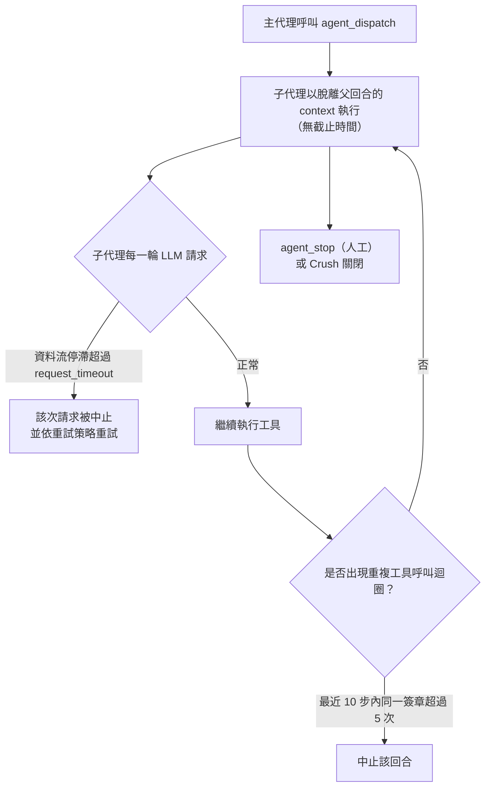

# Crush 是否可設定 subagent（子代理）逾時？

本報告調查 Charmbracelet 的終端機 AI 編碼代理 Crush（`github.com/charmbracelet/crush`）是否提供「為 subagent 設定逾時」的設定選項，並釐清目前實際存在哪些逾時機制、缺少什麼，以及尚未實作但已被社群提出的需求。

## 研究背景與範圍

Crush 是一款以 Go 撰寫的開源命令列 AI 編碼代理，於 2025-05-21 建立儲存庫，截至 2026-11-22 累積 29,158 顆星、2,390 個 fork，授權為 `FSL-1.1-MIT`（GitHub 標示為 `NOASSERTION`）[^repo]。它提供 `agent_dispatch`、`agent_send`、`agent_status`、`agent_stop` 四個工具，讓主代理把工作分派給「子代理（subagent）」在背景執行後回報[^dispatchsrc]。

「subagent 逾時」這個問題必須拆成兩層來問，因為兩者的答案不同：

1. **子代理內部每一次 LLM 請求的逾時**：有，且可設定（`request_timeout`）。
2. **子代理整體執行時間的硬性上限（per-task timeout）**：沒有，現行版本不存在此設定。

以下分別說明，並附上原始碼與 issue 的佐證。

## 結論摘要

| 問題 | 答案 | 依據 |
| --- | --- | --- |
| `crush.json` / `crushrc` 是否有 subagent 專屬逾時欄位？ | 沒有 | 官方 JSON Schema 的 `Options` 中無任何 subagent/agent 逾時欄位[^schema] |
| `agent_dispatch` 工具參數是否接受 `timeout`？ | 沒有，只有 `prompt`、`label`、`access`、`model`、`provider`、`reasoning` | 原始碼 `AgentDispatchParams`[^dispatchsrc] |
| 是否能限制子代理「單次 LLM 請求」的停滯時間？ | 可以，`option request-timeout`（預設 60 秒，0 表示停用） | 設定文件[^confdoc]、`Options.RequestTimeout`[^cfg] |
| 子代理整個任務是否有強制終止的上限？ | 沒有。子代理以獨立的 `context.WithCancel(context.Background())` 執行，脫離父回合的生命週期 | `dispatchedAgent.claim()`[^dispatchsrc] |
| 有沒有其他防止失控的機制？ | 有「重複工具呼叫」迴圈偵測，以及手動的 `agent_stop` | `loop_detection.go`[^loop]、`agent_stop` 描述[^stonetpl] |
| 社群是否已要求此功能？ | 是，issue #2066 仍為 open，留言明確要求「可在 config 設定的 per-task timeout」 | issue #2066[^issue2066] |

## 一、現況：Crush 沒有 subagent 逾時設定

### 1.1 官方設定結構中不存在該欄位

Crush 目前有兩種設定格式：新的 Bash 風格 `crushrc`（官方推薦）與舊的 JSON `crush.json`（已棄用但仍支援）[^confdoc]。官方 JSON Schema 的 `Options` 定義包含 `context_paths`、`tui`、`debug`、`disabled_tools`、`attribution`、`auto_lsp`、`notifications`、`request_timeout`、`max_background_jobs`、`pinentry_integrated`、`pinentry_cache_timeout`、`prompts` 等欄位，但完全沒有任何與 subagent 逾時、代理逾時或任務逾時相關的名稱[^schema]。`crushrc` 的 `option` 指令清單同樣如此，布林／字串／整數／清單各類鍵值中沒有 subagent 逾時項[^confdoc]。

`additionalProperties: false` 是 `Options` 的定義方式[^schema]，意思是硬塞一個自創欄位會被 schema 拒絕，因此也無法用未文件化的欄位繞過。

### 1.2 分派工具的參數本身沒有逾時

`agent_dispatch` 的參數結構如下[^dispatchsrc]：

```go
type AgentDispatchParams struct {
	Prompt string `json:"prompt" description:"The task for the subagent to perform"`
	Label  string `json:"label" description:"A short label for this subagent's scope; ..."`
	Access string `json:"access,omitempty" description:"\"read\" (default) ... or \"write\" ..."`

	Model     string `json:"model,omitempty"`
	Provider  string `json:"provider,omitempty"`
	Reasoning string `json:"reasoning,omitempty"`
}
```

`agent_send`（`label`、`message`、`model`、`provider`、`reasoning`）與 `agent_stop`（`label`、`reason`）同樣沒有逾時參數[^dispatchsrc]。對照模型本身提供的 `fetch` 工具有 `timeout` 參數（上限 120 秒）、`download` 工具也有 `timeout`（上限 600 秒）[^fetchtools]，可見「在工具參數上開 timeout」是 Crush 已採用的模式，但唯獨分派工具沒有採用。

### 1.3 子代理脫離父回合的生命週期，沒有截止時間

這是最關鍵的實作細節。子代理啟動時取得的 context 是這樣建立的[^dispatchsrc]：

```go
// claim starts a new run if the subagent is idle. The returned context is
// detached from whatever turn asked for the run: a subagent outlives the
// turn that started it and is stopped only through stop.
func (d *dispatchedAgent) claim() (context.Context, uint64, bool) {
	...
	ctx, cancel := context.WithCancel(context.Background())
	...
}
```

註解寫得很明白：「子代理的生命超越啟動它的那個回合，只能透過 stop 來停止。」這個 context 上沒有 `WithTimeout` 或 `WithDeadline`。因此除了下列三種情況之外，子代理不會自行結束：

1. 模型自己決定結束該回合；
2. 有人呼叫 `agent_stop`；
3. Crush 行程本身關閉（`stopAllDispatched`）[^dispatchsrc]。

程式碼中的逾時常數都用於「附屬的等待」而非「任務總時長」，例如 `awaitSettled(10 * time.Second)`（等待停止生效）與 `awaitDeliverable` 的 `giveUp = 10 * time.Second`（等待子代理工作階段可接收訊息）[^dispatchsrc]。這些數字不會限制子代理做多久。

## 二、仍然存在的三層逾時與保護

雖然沒有「子代理總逾時」，Crush 對子代理仍有三層間接保護，理解它們有助於判斷實務上的風險。



### 2.1 LLM 請求層的閒置逾時：`request_timeout`

Crush 為每個語言模型包了一層 `requestGuardModel`，它會監看串流的「資料間隔」：若超過 `request_timeout` 沒有新片段就中止該請求，可用 `option request-timeout SECONDS` 調整，設為 `0` 則完全停用；等待「第一個片段」的預算另有最低 5 分鐘的地板值，避免把大型前置處理誤判為卡住[^guard][^cfg]。

重要的是：子代理與主代理共用同一套 `sessionAgent` 機制，因此**這層逾時確實會作用在子代理身上**。但它限制的是「單次請求的停滯時間」，不是「子代理總共可以跑多久」——一個持續有輸出、持續呼叫工具的子代理可以無限期存活下去。這正是 issue #2066 的抱怨核心。

### 2.2 迴圈偵測

`internal/agent/loop_detection.go` 定義了 `loopDetectionWindowSize = 10` 與 `loopDetectionMaxRepeats = 5`，函式 `hasRepeatedToolCalls` 會檢查最近 10 步內是否有任何工具呼叫簽章重複超過 5 次，若有則中止[^loop]。這是針對「原地打轉」的保護，可視為部分替代方案，但它不處理「穩定前進卻永遠做不完」的情況（例如不斷搜尋新路徑）。

### 2.3 手動停止

`agent_stop` 會取消該子代理的 context 並在最多 10 秒內等待其收束；文件明確說明「已停止的子代理不會送出報告，但其工作階段被保留，之後可用 `agent_send` 帶著既有工作內容恢復」[^stonetpl][^dispatchsrc]。這是目前唯一能保證子代理不會無限執行的正常手段。

## 三、社群已提出需求，但尚未實作

### 3.1 Issue #2066：子代理會永遠跑下去且無法停止

標題為「Subagents go on forever and cannot be stopped」的 issue 由 `taoeffect` 於 2026-01-30 開立，狀態仍為 **open**，標籤為 `bug`，最後更新於 2026-07-31。原報告描述：一個簡單任務導致子代理出現 50 次以上工具呼叫，即使在使用者明確要求「請追蹤工具呼叫次數並在第 20 次前結束」後，模型仍無視指示繼續執行（測試對象為 Gemini 3 Flash 與 GLM-4.7）[^issue2066]。

2026-07-31 的留言把問題擴大並具體提出四項設計建議，其中第一項正是本報告的主題[^issue2066comment]：

1. **可在 config（`crush.json`）設定、並可 per-task 覆寫的硬性 per-task timeout**：到期時終止子代理工作階段，把部分輸出與結束原因交回父代理，讓父代理決定重試或改用替代方案，而不是無限期等待。
2. 進度心跳（對父代理暴露最後一次工具呼叫、步數、已花費 token）。
3. 把「工具呼叫／步數預算」做成硬上限（例如 `maxSteps: 50`）而非提示詞層級的軟性指示，因為該 issue 的證據顯示模型會忽略軟性指示。
4. 取消串聯與資源回收，讓使用者取消或父代理中止能沿整個代理樹傳遞。

值得注意的是，同一則留言也指出其他導致「掛住數小時」的成因：模型／供應商設定錯誤時子代理會靜默重試（日誌中累積數百筆 `ProviderModelNotFoundError` 與連線逾時）、無人能回應的權限提示，以及停止訊號不會向下傳遞。這些與逾時需求是正交的，但同屬「子代理可能無限期停滯」這一個問題類別。

### 3.2 已合併的相關修正

- **PR #3677「fix: make timeout configurable」**：由維護者 `andrinoff` 於 2026-09-04 合併，讓模型停滯逾時可透過 `request-timeout`（Bash）與 `request_timeout`（JSON）設定[^pr3677]。這是本主題中唯一已落地的「逾時可設定」變更，但層級是單次 LLM 請求，不是子代理任務。
- **PR #3365「fix(run): stop subagents from hanging on permission prompts」**：於 2026-11-12 合併。修正 `crush run` 非互動模式下子代理因權限提示無人回應而永久掛住，做法是讓子代理工作階段繼承父工作階段的核准狀態[^pr3365]。這處理的是「卡住」而非「逾時」。

因此可以說：專案對「子代理停滯」的不同成因分別做了修正，但「可設定的子代理逾時」本身仍未被實作，也未出現在官方設定文件中。

## 四、實務上的替代做法與限制

在官方支援到來之前，若要在實務上限制子代理的執行時間，可考慮以下幾種方式，但都各有明顯限制：

1. **在分派提示中要求自我限制**：在 `prompt` 裡明確寫出「最多執行 N 次工具呼叫後必須回報」。issue #2066 的證據顯示這**不可靠**，模型會忽略此類軟性指示[^issue2066]，因此不應作為唯一防線。
2. **調低 `request_timeout`**：可讓「供應商完全沒有串流輸出」的情況更快失敗，但對於穩定輸出、持續推進的子代理毫無作用，因為它衡量的是資料間隔而非總時長[^guard]。
3. **以 `agent_status` 定期檢視、以 `agent_stop` 手動終止**：這是目前唯一有保證的機制[^stonetpl]。實務上等於由人類或上層代理扮演逾時計時器。
4. **避免把範圍過大的任務交給單一子代理**：把「大範圍探索」拆成有明確終止條件的多個子任務，並透過 `agent_send` 逐步收斂，可降低單一子代理失控的機率。這是設計面的緩解，而非機制上的保證。

由於 `Options` 在 schema 上是 `additionalProperties: false`[^schema]，也不要期待能以未文件化的欄位自行加入逾時設定。

## 五、觀察與批判性反思

- **證據來源的性質**：本報告的結論同時來自「現行程式碼與官方 schema」與「社群 issue」。前者是權威且可驗證的（本報告直接引用 `main` 分支原始檔），後者是使用者主觀經驗但與程式碼證據一致——`claim()` 使用 `context.Background()` 且無截止時間，從程式面即解釋了 issue 所述的「永遠跑下去」。兩者相互印證，可信度較高。
- **時效性風險**：Crush 開發節奏很快（儲存庫於 2026-11-22 當天仍有推送[^repo]），設定檔正處於從 JSON 遷移到 Bash `crushrc` 的過程，且 `docs/config/FUTURE.md` 明確把「日後的設定變更只會加在 Bash 設定」列為政策[^confdoc]。因此本報告的「沒有此設定」結論在寫作當下（2026-11-22）成立，但隨時可能因新版本改變；任何人依此結論做決策前應重新確認當前 `main` 分支的 schema。
- **未解的設計問題**：issue #2066 留言中提出的「per-task timeout」若被實作，還需回答幾個問題，例如：逾時後的部分輸出如何呈現？逾時應算失敗還是部分成功？逾時能否被子代理以「我正在做有用的事」續期（heartbeat）？這些在官方文件中尚無任何說明。
- **與其他代理工具的對比**：本報告未對其他代理工具（如 Claude Code、Codex CLI、opencode）是否提供子代理逾時做事證性比較，因為本次調查聚焦於 Crush 本身；若需要跨工具對照，應另做一次以官方文件為基礎的獨立研究。

## 參考文獻

[^repo]: Charmbracelet. (n.d.). *GitHub API repository metadata for charmbracelet/crush*. Retrieved 2026-11-22, from https://api.github.com/repos/charmbracelet/crush

[^dispatchsrc]: Charmbracelet. (n.d.). *internal/agent/agent_dispatch.go* [Source code]. Retrieved 2026-11-22, from https://raw.githubusercontent.com/charmbracelet/crush/main/internal/agent/agent_dispatch.go

[^stonetpl]: Charmbracelet. (n.d.). *internal/agent/templates/agent_stop_tool.md* [Source code]. Retrieved 2026-11-22, from https://raw.githubusercontent.com/charmbracelet/crush/main/internal/agent/templates/agent_stop_tool.md

[^fetchtools]: Charmbracelet. (n.d.). *internal/agent/tools/fetch_types.go* [Source code]. Retrieved 2026-11-22, from https://github.com/charmbracelet/crush/blob/main/internal/agent/tools/fetch_types.go

[^schema]: Charmbracelet. (n.d.). *Crush configuration JSON Schema (schema.json)*. Retrieved 2026-11-22, from https://raw.githubusercontent.com/charmbracelet/crush/main/schema.json

[^confdoc]: Charmbracelet. (n.d.). *Config*. In *Crush documentation*. Retrieved 2026-11-22, from https://raw.githubusercontent.com/charmbracelet/crush/main/docs/config/README.md

[^cfg]: Charmbracelet. (n.d.). *internal/config/config.go* [Source code]. Retrieved 2026-11-22, from https://github.com/charmbracelet/crush/blob/main/internal/config/config.go

[^guard]: Charmbracelet. (n.d.). *internal/agent/request_guard.go* [Source code]. Retrieved 2026-11-22, from https://github.com/charmbracelet/crush/blob/main/internal/agent/request_guard.go

[^loop]: Charmbracelet. (n.d.). *internal/agent/loop_detection.go* [Source code]. Retrieved 2026-11-22, from https://github.com/charmbracelet/crush/blob/main/internal/agent/loop_detection.go

[^issue2066]: taoeffect. (2026, January 30). *Subagents go on forever and cannot be stopped* [Issue #2066]. GitHub. Retrieved 2026-11-22, from https://github.com/charmbracelet/crush/issues/2066

[^issue2066comment]: ze169393-commits. (2026, July 31). *Same class of problem here, and it's broader than tool-call budgets* [Comment on Issue #2066]. GitHub. Retrieved 2026-11-22, from https://github.com/charmbracelet/crush/issues/2066#issuecomment-5139449108

[^pr3677]: andrinoff. (2026, September 4). *fix: make timeout configurable* [Pull request #3677]. GitHub. Retrieved 2026-11-22, from https://github.com/charmbracelet/crush/pull/3677

[^pr3365]: Amolith. (2026, November 12). *fix(run): stop subagents from hanging on permission prompts* [Pull request #3365]. GitHub. Retrieved 2026-11-22, from https://github.com/charmbracelet/crush/pull/3365
