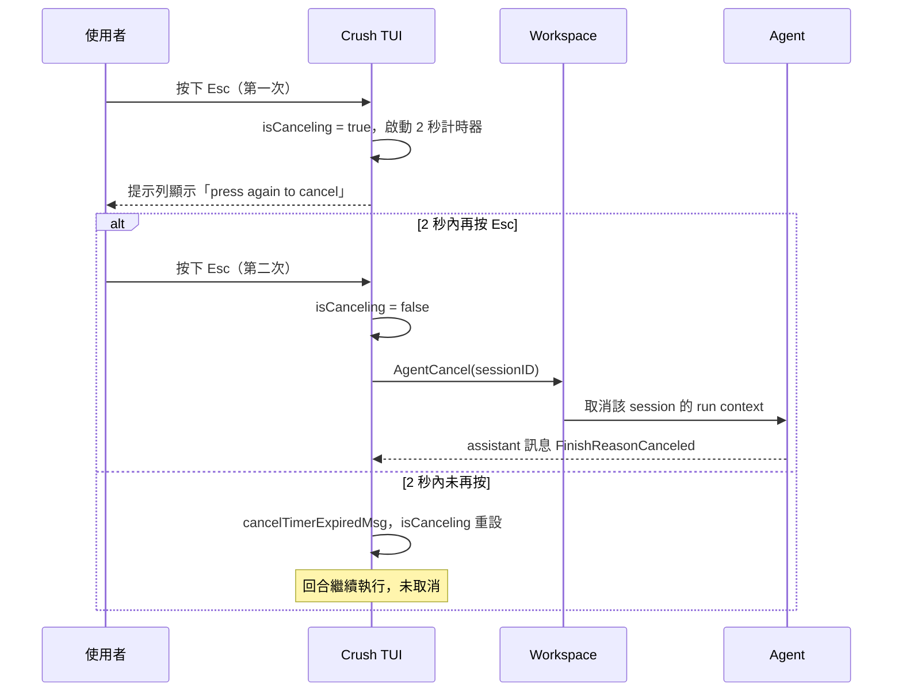
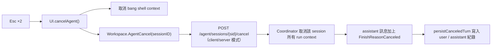

# Charmbracelet Crush 是否支援「打斷 Agent」的功能？

## 摘要

**支援。** Crush 提供「連按兩次 `Esc`」以中斷正在執行中的 Agent 回合（turn）：第一次按下僅在畫面下方提示列顯示「press again to cancel」，第二次按下（在計時器到期前）才會真正送出取消請求[^src-keys][^src-ui-cancel][^issue1166]。此機制同時會終止 Agent 的模型串流、工具呼叫，以及 `!` 前綴的 shell 指令[^src-ui-bang]。需要注意的是，`Ctrl+C` 在 Crush 中是「結束整個程式」而非「中斷 Agent」，這點與多數命令列工具的直覺不同，也是社群討論的焦點之一[^disc1318]。

## Crush 專案概況

Crush 是 Charmbracelet 以 Go 語言開發的終端機（TUI）agentic coding 工具，將本機程式碼、LSP、shell 執行與 MCP 伺服器接到使用者指定的 LLM[^readme][^repo-api]。截至 2026-11-22，該儲存庫約有 29,158 顆星、2,390 個 fork，授權為 FSL-1.1-MIT，最新正式版本為 `v0.102.0`（2026-11-19 發布），另有 `nightly` 預覽通道（`crush-0.103.0-nightly`，2026-11-22 建置）[^repo-api][^release-latest][^release-nightly]。以星數與發版頻率來看，這是一個活躍且已被大量採用的專案，屬於值得納入評估的工具。

## 中斷 Agent 的操作方式

### 按鍵與互動流程

| 操作 | 行為 | 依據 |
| --- | --- | --- |
| `Esc`（第一次） | 不取消，只在底部提示列顯示 `esc · press again to cancel` | [^src-ui-help][^issue1166] |
| `Esc`（第二次，2 秒內） | 真正取消當前 Agent 回合 | [^src-ui-cancel][^issue1166] |
| 提示列另有排隊訊息時按 `Esc` | 優先清空伺服器端排隊的 prompt，而非取消當前回合 | [^src-ui-cancel] |
| `Ctrl+C` | 結束整個 Crush 程式（`quit`），不是中斷 Agent | [^src-keys] |
| `Ctrl+Z` | 將 Crush 丟到背景（suspend） | [^src-keys] |

關鍵在於「兩段式確認」的設計：`cancelAgent()` 以 `isCanceling` 旗標搭配 `cancelTimerDuration = 2 * time.Second` 的計時器實作；若使用者在 2 秒內沒有再按一次 `Esc`，計時器到期訊息會把 `isCanceling` 重設回 `false`，取消動作即作廢[^src-ui-cancel]。這種設計可以避免誤觸 `Esc` 就中斷長時間的推論。

### 提示文字與按鍵綁定

按鍵綁定定義於 `internal/ui/model/keys.go`：`Chat.Cancel` 綁定 `esc` 與 `alt+esc`，說明文字為 `cancel`[^src-keys]。提示列的動態文案在 `internal/ui/model/ui.go` 中，當 `isAgentBusy()` 為真時把說明改成 `press again to cancel`，若只是有排隊 prompt 則改成 `clear queue`[^src-ui-help]。

## 程式實作層面

### 取消的呼叫鏈

TUI 按下第二次 `Esc` 後，依序執行：先取消 `!` shell 指令的 context（`bangCancel`），再呼叫 `m.com.Workspace.AgentCancel(m.session.ID)`，最後清掉 UI 的忙碌快取與 todo 轉圈動畫[^src-ui-cancel]。`AgentCancel(sessionID)` 是 `Workspace` 介面上的方法[^src-workspace-interface]；在 client/server 模式下由 `ClientWorkspace` 轉為 HTTP 呼叫 `POST /v1/workspaces/{id}/agent/sessions/{sid}/cancel`[^src-client-cancel]。

伺服器端收到取消後，會終止該 session 所有在飛的 run（含已接受但尚未進入執行的後續 prompt），並在下一次事件串流中送出帶 `FinishReasonCanceled` 的 assistant 訊息；取消本身**不會**以錯誤事件形式回報給任何用戶端[^src-e2e]。Agent 端在偵測到 `context.Canceled` 時，會呼叫 `persistCanceledTurn` 補寫 user 與 assistant 紀錄，並以 `AddFinish(message.FinishReasonCanceled, "User canceled request", "")` 標記，因此取消是「有紀錄的正常結束」而非「靜默中斷」[^src-agent]。

### 非互動模式（`crush run`）

除了 TUI，Crush 也有非互動的 `crush run` 子命令。其程式碼在偵測到中斷（`ctx.Err() != nil`）時，會主動呼叫 `CancelAgentSession`，避免請求返回後伺服器端的 run 繼續空轉[^src-cmd-run]。這表示「中斷 Agent」的能力不只在 TUI 層，而是貫穿到 API 與 CLI 層。

## 相關行為與邊界條件

- **排隊 prompt 優先處理**：若當下有待執行的排隊 prompt，第一次 `Esc` 會直接清空佇列而不是進入「再按一次取消」的狀態；只有在佇列為空時才會進入取消確認流程[^src-ui-cancel]。
- **`!` shell 指令同樣可中斷**：`bangCancel` 讓 `!` 前綴的 shell 指令與 Agent 回合共用同一套 `Esc` 取消邏輯，取消時 exit code 會被標記為 130（慣用的 SIGINT 結束碼）[^src-ui-bang]。
- **取消會被記錄成訊息**：被取消的回合仍會產生 user 訊息與 assistant 訊息，並附上取消原因，因此事後回顧對話時看得到「被使用者取消」這件事[^src-agent]。
- **歷史設計爭議**：社群討論中曾主張把「中斷思考」與「離開程式」的按鍵重新分配（`Ctrl+C` 中斷、其他鍵離開），反映出目前 `Ctrl+C` 直接結束程式、`Esc` 兩段式取消的配置對部分使用者不夠直覺[^disc1318]。

## 已知問題與限制

取消機制雖然存在且持續演進，但歷史上確實出現過若干缺陷，評估時值得留意：

1. **孤兒 tool_call 導致後續請求失敗**：早期在工具呼叫途中取消，會留下沒有對應 `tool_result` 的 `tool_use`，導致部分供應商回傳 400；此問題回報於 #529 並已關閉[^issue529]，另有 #1206 描述中斷後 session 無法續用的類似情境[^issue1206]。
2. **本機模型未必真正停止推論**：#831 指出對 Ollama 使用 `esc+esc` 時，Crush 端雖已取消，但伺服器端的推論仍持續消耗資源[^issue831]。
3. **取消後的待辦清單殘留**：#1624 回報取消任務後，`todos` 清單仍留在 session 中干擾後續任務[^issue1624]。
4. **長時間程序缺乏明確取消路徑（未關閉的功能請求）**：#2769 仍在開啟狀態，要求能直接取消長時間執行的程序而不必重啟 Crush，並獲得 8 個 👍 回應[^issue2769]。
5. **取消後的訊息合併問題**：有一筆尚未合併的 PR #3614 指出，取消後留下的空 assistant 佔位訊息被過濾後，會產生連續兩則 user 訊息，被嚴格遵循 OpenAI 相容規範的供應商以 400 拒絕[^pr3614]。

換言之，**功能本身已存在且是官方認定的完成功能**（#1166 以 `state_reason: completed` 關閉[^issue1166]），但周邊的邊界情況仍在陸續修補。

## 結論

1. Crush **確實支援打斷 Agent**，方式是連按兩次 `Esc`，並有 2 秒的確認視窗與提示列引導[^src-keys][^src-ui-cancel][^issue1166]。
2. 取消涵蓋模型串流、工具呼叫與 `!` shell 指令，且會在對話紀錄中留下 `FinishReasonCanceled` 標記，屬於「乾淨且有紀錄」的中斷[^src-agent][^src-ui-bang]。
3. `Ctrl+C` 是結束程式而非中斷 Agent，使用前需特別留意[^src-keys][^disc1318]。
4. 若採用本機模型（如 Ollama），取消可能只停掉用戶端，伺服器端推論仍在跑；此外取消後的工具訊息整併、待辦清單殘留等問題歷史上曾被回報，建議使用較新版本[^issue831][^issue1624][^issue529]。

## 參考資料

[^readme]: Charmbracelet. (n.d.). *charmbracelet/crush: Glamourous agentic coding for all*. GitHub. Retrieved 2026-11-22, from https://github.com/charmbracelet/crush

[^repo-api]: GitHub REST API. (2026). *Repository metadata for charmbracelet/crush*. Retrieved 2026-11-22, from https://api.github.com/repos/charmbracelet/crush

[^release-latest]: Charmbracelet. (2026, November 19). *v0.102.0 release*. GitHub. Retrieved 2026-11-22, from https://github.com/charmbracelet/crush/releases/tag/v0.102.0

[^release-nightly]: Charmbracelet. (2026, November 22). *nightly release (crush-0.103.0-nightly)*. GitHub. Retrieved 2026-11-22, from https://github.com/charmbracelet/crush/releases/tag/nightly

[^src-keys]: Charmbracelet. (2026). *internal/ui/model/keys.go* (source code, branch main). GitHub. Retrieved 2026-11-22, from https://github.com/charmbracelet/crush/blob/main/internal/ui/model/keys.go

[^src-ui-cancel]: Charmbracelet. (2026). *internal/ui/model/ui.go* — `cancelAgent`, `cancelTimerDuration`, `cancelTimerExpiredMsg`（source code, branch main）. GitHub. Retrieved 2026-11-22, from https://github.com/charmbracelet/crush/blob/main/internal/ui/model/ui.go

[^src-ui-help]: Charmbracelet. (2026). *internal/ui/model/ui.go* — `press again to cancel` 與 `clear queue` 提示文字（source code, branch main）. GitHub. Retrieved 2026-11-22, from https://github.com/charmbracelet/crush/blob/main/internal/ui/model/ui.go

[^src-ui-bang]: Charmbracelet. (2026). *internal/ui/model/ui.go* — `bangCancel` 與 `shellResultMsg` 取消路徑（source code, branch main）. GitHub. Retrieved 2026-11-22, from https://github.com/charmbracelet/crush/blob/main/internal/ui/model/ui.go

[^src-workspace-interface]: Charmbracelet. (2026). *internal/workspace/workspace.go* — `AgentCancel(sessionID string)` 介面定義（source code, branch main）. GitHub. Retrieved 2026-11-22, from https://github.com/charmbracelet/crush/blob/main/internal/workspace/workspace.go

[^src-client-cancel]: Charmbracelet. (2026). *internal/client/proto.go* — `CancelAgentSession` 與取消端點（source code, branch main）. GitHub. Retrieved 2026-11-22, from https://github.com/charmbracelet/crush/blob/main/internal/client/proto.go

[^src-agent]: Charmbracelet. (2026). *internal/agent/agent.go* — `persistCanceledTurn` 與 `FinishReasonCanceled`（source code, branch main）. GitHub. Retrieved 2026-11-22, from https://github.com/charmbracelet/crush/blob/main/internal/agent/agent.go

[^src-cmd-run]: Charmbracelet. (2026). *internal/cmd/run.go* — 中斷時呼叫 `CancelAgentSession`（source code, branch main）. GitHub. Retrieved 2026-11-22, from https://github.com/charmbracelet/crush/blob/main/internal/cmd/run.go

[^src-e2e]: Charmbracelet. (2026). *internal/server/e2e_agent_test.go* — 取消行為的端對端測試（source code, branch main）. GitHub. Retrieved 2026-11-22, from https://github.com/charmbracelet/crush/blob/main/internal/server/e2e_agent_test.go

[^issue1166]: skipper20181111. (2025, September 30). *Allow Interrupting chat* (Issue #1166). GitHub. Retrieved 2026-11-22, from https://github.com/charmbracelet/crush/issues/1166

[^disc1318]: Charmbracelet. (n.d.). *Change Keybindings for Interrupting AI Thinking and Quitting Crush* (Discussion #1318). GitHub. Retrieved 2026-11-22, from https://github.com/charmbracelet/crush/discussions/1318

[^issue529]: bigeagle. (2025, August 4). *Wrong context when tool_call is cancelled* (Issue #529). GitHub. Retrieved 2026-11-22, from https://github.com/charmbracelet/crush/issues/529

[^issue831]: NCMBianchi. (2025, August 19). *Crush doesn't send interruption signal to Ollama API when query is cancelled* (Issue #831). GitHub. Retrieved 2026-11-22, from https://github.com/charmbracelet/crush/issues/831

[^issue1206]: belden. (2025, October 8). *Cannot resume cancelled Crush session* (Issue #1206). GitHub. Retrieved 2026-11-22, from https://github.com/charmbracelet/crush/issues/1206

[^issue1624]: Gustave-241021. (2025, December 13). *bug: todo list from canceled task persists and interferes with new tasks* (Issue #1624). GitHub. Retrieved 2026-11-22, from https://github.com/charmbracelet/crush/issues/1624

[^issue2769]: deardaveed. (2026, April 30). *Feature: Cancel/interrupt long-running processes without restarting* (Issue #2769). GitHub. Retrieved 2026-11-22, from https://github.com/charmbracelet/crush/issues/2769

[^pr3614]: marwan562. (2026, August 21). *fix(agent): merge consecutive user messages after cancel (#3609)* (Pull request #3614). GitHub. Retrieved 2026-11-22, from https://github.com/charmbracelet/crush/pull/3614
