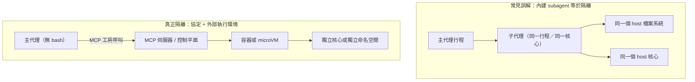
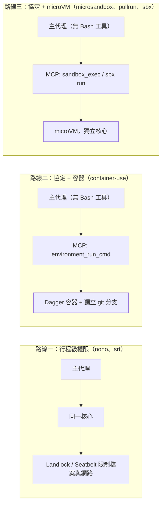

# 主代理無 Shell、子代理跑在容器或 microVM 的 Agent Sandbox 方案調查

## 摘要

本報告回答一個具體的架構問題：**有沒有一種現成工具，能讓「主代理（orchestrator）本身沒有 bash／終端機權限，但可以派工給子代理，而子代理執行在容器或 microVM 裡」**，並且安裝設定要比 `nolabs-ai/nono` 那種需要撰寫策略檔、依賴核心特性的方案簡單。

結論先講：**有，而且不只一個**。最貼近這個描述的現成工具是 `dagger/container-use`（MCP 伺服器 + 容器，主代理只被允許呼叫 MCP 工具）；其次是 `microsandbox` 搭配官方 MCP 伺服器（單一執行檔 + 一行 MCP 設定就能生出 microVM）；若想要「完全不用自己組」，則 `Docker Sandboxes`（`sbx`）與 `agent-vm` 都是「裝好一個 CLI、執行一行指令」就得到 microVM 的封裝。

本報告同時說明一個常見誤解：**多數 coding agent 的「子代理（subagent）」功能其實不是隔離邊界**，它們跑在同一個行程、同一個核心、同一個檔案系統裡，只是換了一份 context window。真正把工具執行搬到容器或 microVM 的做法，是靠「協定（MCP）＋外部執行環境」而不是靠 agent 內建的 subagent 旗標。

---

## 1. 先把問題講清楚

### 1.1 使用者真正要的東西

拆成三個需求，缺一不可：

| 編號 | 需求 | 說明 |
|---|---|---|
| R1 | 主代理沒有 shell | 主代理的可用工具清單裡沒有 `bash`／`execute`，跑錯指令的風險歸零 |
| R2 | 主代理可派工 | 主代理能建立／呼叫子代理，並取得結果摘要 |
| R3 | 子代理在容器或 microVM | 子代理的程式碼執行發生在另一個核心邊界（VM）或至少是獨立的容器命名空間 |

`nono` 之所以被認為設定複雜，是因為它解的是另一個問題：**在同一台主機的同一個核心上，用 Landlock（Linux）與 Seatbelt（macOS）對每個行程做能力限制**，並用可組合的 JSON profile 描述檔案、網路、憑證、工具鏈的權限[^nono]。它的好處是零延遲、單一執行檔、不需要 root；代價是要理解並維護 profile，而 profile 語意（檔案路徑、L7 網路規則、phantom token、Sigstore 供應鏈驗證）本身就是一門學問[^nono]。

同類路線還有 Anthropic 自家開源的 `sandbox-runtime`（`srt`）：在 Linux 用 bubblewrap ＋ seccomp、macOS 用 Seatbelt，加上 HTTP／SOCKS5 代理做網域白名單，把任意行程包進沙箱而不需要容器[^srt]。兩者概念相同：**以政策限制同核心的行程**。

換句話說：**nono 是「同一台機器上的細粒度權限控制」，不是「把子代理丟進另一個 VM」**。使用者要的是後者，而後者在 2026 年已經有多個不需要寫策略檔的實作。

### 1.2 一個關鍵區分：subagent 不是隔離邊界

以 Claude Code 為例，官方文件明確寫出子代理的模型：每個子代理有自己的 context window、自己的系統提示、自己的工具白名單與權限設定，但**它仍然在與主對話相同的機器上執行**；唯一接近隔離的欄位是 `isolation: worktree`，而那只是「開一個暫時的 git worktree」，不是容器也不是 VM[^ccsub]。



因此，搜尋方向不該是「哪個 agent 有 sandboxed subagent 旗標」，而是「**哪個工具提供 MCP（或等價協定）介面，把 shell 能力整個搬出 host**」。

---

## 2. 最貼近需求的方案（依貼合度排序）

### 2.1 `dagger/container-use`：把主代理的 shell 整個拔掉

- GitHub：`dagger/container-use`，4,101 顆星，Go 撰寫，Apache-2.0，2025-05 建立[^cuapi]
- 定位：「給 coding agent 用的開發環境」，本質是**一個 MCP 伺服器 + 一個 CLI**，底層由 Dagger 提供容器[^cureadme]

它之所以最貼合，是因為官方規則檔直接要求代理「**任何檔案、程式碼、shell 操作都只能用 Environment 工具，沒有例外**」，並且提供了把主代理限制成「只能用 container-use 的 MCP 工具」的啟動方式[^cuquick]：

```bash
# 1. 安裝（macOS / 全平台）
brew install dagger/tap/container-use
# 或
curl -fsSL https://raw.githubusercontent.com/dagger/container-use/main/install.sh | bash

# 2. 註冊成 MCP 伺服器
cd /path/to/repository
claude mcp add container-use -- container-use stdio

# 3. 關鍵一步：只允許 MCP 工具，等於沒收 Bash / Read / Write / Edit
claude --allowedTools \
  mcp__container-use__environment_create,\
mcp__container-use__environment_run_cmd,\
mcp__container-use__environment_file_read,\
mcp__container-use__environment_file_write
```

搭配的 `rules/agent.md` 會被追加到 `CLAUDE.md`，內容是「**永遠只用 Environment，其他一律不准**」的硬性指示[^curules]。

| 面向 | 表現 |
|---|---|
| 主代理有 shell 嗎 | 沒有；`--allowedTools` 白名單裡沒有 `Bash`，工具層面直接不存在 |
| 子代理在哪裡跑 | 每個 agent 一個獨立容器，各自掛在自己的 git 分支上[^cureadme] |
| 設定成本 | 一個 brew／一行 curl、一行 MCP 註冊、一行 `--allowedTools` |
| 可觀測性 | 有完整指令歷史與日誌，可 `git checkout <branch>` 檢視工作，也可用 `container-use log` 與 `container-use checkout` 取回[^cureadme][^curules] |
| 成熟度 | 專案自標 experimental[^cureadme] |

限制：它給你的是**容器**而非 microVM，隔離邊界仍是共享核心；若你的威脅模型包含核心漏洞（container escape），需要往 2.2 之後看。

### 2.2 `microsandbox` + `microsandbox-mcp`：單一執行檔的 microVM，一行 MCP 設定

- 主專案：`superradcompany/microsandbox`，9,167 顆星，Rust，Apache-2.0[^msbapi]
- MCP 伺服器：`superradcompany/microsandbox-mcp`，20 顆星，Apache-2.0[^msbmcpapi]

microsandbox 的定位是「可嵌入、可程式化、本機優先的 microVM 執行環境」，用 libkrun 與 smoltcp，開機 < 100 ms、相容 OCI 映像、可快照／分支／暫停，並主打「金鑰永遠不進 VM」[^msbreadme]。

關鍵在於它的 MCP 伺服器把「建立 VM、執行命令、讀寫檔案、快照」全部包成工具[^msbmcp]，於是主代理的 shell 被實體移除：

```bash
# 一行註冊，不用先裝 runtime（MCP 內建 runtime_check / runtime_install）
claude mcp add --transport stdio microsandbox -- npx -y microsandbox-mcp
```

| 面向 | 表現 |
|---|---|
| 主代理有 shell 嗎 | 沒有；只有 `sandbox_exec`、`sandbox_shell`、`sandbox_fs_*` 等工具 |
| 子代理在哪裡跑 | 每個 sandbox 是一個獨立 microVM（獨立核心） |
| 設定成本 | 一個 `npx` 指令；runtime 可由 MCP 自己安裝 |
| 平台 | macOS（Apple Silicon）、Linux（需 KVM）[^msbreadme] |
| 風險點 | 專案自標 beta，會有破壞性變更[^msbreadme] |

若不想用 MCP，microsandbox 也有 TypeScript / Rust / Python / Go SDK，可直接在程式裡 `Sandbox.builder("...").create()` 生出 microVM 執行 `exec`[^msbreadme]，適合自己寫 orchestration loop 的人。

### 2.3 `pullrun`：同一個 runtime，容器 / Firecracker / Apple VZ 三種後端

- GitHub：`pullrun/pullrun`，135 顆星，Apache-2.0，Rust（runtime）+ Go（CLI）[^pullrunapi]

它把「任何 OCI 映像」同時當成容器與 microVM 的根檔案系統，宣稱 Firecracker 冷啟動約 500 ms、暖池約 200 ms、Apple Silicon VM 約 160 ms，並且**內建 MCP 伺服器，提供 15 個工具**（`run`、`exec`、`logs`、`build`、`push`…）[^pullrunreadme]。

```bash
pullrun mcp            # stdio 模式，給 opencode / Claude Code / Cursor 用
pullrun mcp --sse :8080
```

| 面向 | 表現 |
|---|---|
| 主代理有 shell 嗎 | 沒有（只透過 MCP 操作 sandbox） |
| 子代理在哪裡跑 | `--backend vm` 為 Firecracker microVM；`--backend container` 為 runc 容器 |
| 設定成本 | 一個 install script；需要 `/dev/kvm`（VM 後端） |
| 額外賣點 | 同一個映像不須另外建 VM image；`commit` 可把沙箱檔案系統存成新映像，下一輪從該狀態開機[^pullrunreadme] |

專案把商業模式寫得很明白（企業授權、嵌入式沙箱），且 star 數不高，屬於「功能完整但社群驗證尚少」的一端[^pullrunreadme]。

### 2.4 `OpenSandbox`：自架控制平面，本機 Docker 起步、可上 Kubernetes

- GitHub：`opensandbox-group/OpenSandbox`，17,775 顆星，Go，Apache-2.0，屬 Agentic AI Foundation（AAIF）專案[^osbapi]

它的模型是「**沙箱伺服器 + 多語言 SDK + CLI + MCP**」，本機用 Docker 起、叢集用 Kubernetes 起，同一套生命週期 API[^osbreadme]。

```bash
uvx opensandbox-server init-config ~/.sandbox.toml --example docker
uvx opensandbox-server

# MCP：讓 agent 沒有 shell，只透過 MCP 建立沙箱與執行命令
pip install opensandbox-mcp
opensandbox-mcp --domain localhost:8080 --protocol http
```

| 面向 | 表現 |
|---|---|
| 主代理有 shell 嗎 | 沒有（MCP 只暴露建立沙箱、執行命令、文字檔操作） |
| 子代理在哪裡跑 | 本機為 Docker 容器；K8s 上可切 Firecracker（宣稱 64 ms P50 建立）[^osbreadme] |
| 設定成本 | 中等：要先跑一個伺服器行程，再讓 agent 連上去 |
| 適合誰 | 想要「本地開發、叢集部署同一套 API」或需要網路入口與憑證保管庫（Credential Vault）的團隊[^osbreadme] |

### 2.5 `kubernetes-sigs/agent-sandbox`：K8s 原生的 Sandbox CRD

- GitHub：`kubernetes-sigs/agent-sandbox`，4,676 顆星，Go，Apache-2.0[^k8sapi]

它定義 `Sandbox` 自訂資源（有穩定身分、持久儲存、可休眠／恢復），並明確把自己定位成「**sandbox orchestrator**」，把低階隔離交給 gVisor 或 Kata Containers 這類 Sandbox Runtime，透過 `RuntimeClass` 指定[^k8sreadme]。

| 面向 | 表現 |
|---|---|
| 主代理有 shell 嗎 | 取決於呼叫端；控制平面本身只提供 API／SDK，不給 shell |
| 子代理在哪裡跑 | Pod，可指定 gVisor／Kata 的 RuntimeClass 得到獨立核心 |
| 設定成本 | 高：需要 Kubernetes 1.25+（建議 1.29+）與 CRD[^k8sreadme] |
| 適合誰 | 已經有叢集、要跑大量並行 agent 或 RL 訓練的場景[^k8sreadme] |

### 2.6 其他值得知道的實作

| 專案 | 星數（2026-11-22） | 隔離方式 | 與本題的關係 |
|---|---|---|---|
| `Docker Sandboxes`（`sbx`） | 非開源（CLI 免費） | 每沙箱一個 microVM，自帶 Docker daemon | `sbx run claude` 一行就有 microVM；網路走 host 代理並以 sentinel 憑證替換真實金鑰[^sbxarch][^sbxstart] |
| `sylvinus/agent-vm` | 167 | 每專案一個 Lima／libkrun VM，單一執行檔 | `agent-vm setup` 後 `agent-vm claude`；VM 只掛載專案目錄[^agentvm] |
| `inoio/agents-sandbox` | 92 | microsandbox VM，每專案每 agent 一個 | 內建 12 種 agent profile，憑證以 placeholder 形式進 VM[^agsb] |
| `superhq-ai/shuru` | 898 | Apple Virtualization / KVM | `shuru run` 起拋棄式 VM，有 TypeScript SDK 與 Agent Skill[^shuru] |
| `smol-machines/smolvm` | 7,159 | Hypervisor.framework / KVM / WHP | 可嵌入、可分支的 VM；< 200 ms 開機[^smolvm] |
| `earendil-works/gondolin` | 2,469 | 本機 Linux microVM（libkrun／QEMU） | 可程式化的網路與檔案策略，官方有「Pi + Gondolin」範例把 agent 工具全部搬進 VM[^gondolin] |
| `textcortex/spritz` | 112 | Kubernetes Pod | 控制平面（gateway bot）沒有 shell，只負責開 ACP agent pod[^spritzapi] |
| `e2b-dev/E2B` | 14,961 | 雲端 Firecracker microVM | 以 SDK 建立雲端沙箱，主代理端無 shell[^e2bapi] |
| `vercel/sandbox` | 227 | 雲端 Firecracker microVM | 短生命週期沙箱 SDK[^vercelapi] |

---

## 3. 一張圖看懂三種路線的差別



三條路線的取捨：

- **路線一**：啟動最快、資源最省，但隔離邊界是「同一個核心 ＋ 政策」。核心一旦有漏洞或政策寫錯，邊界就破了。
- **路線二**：隔離邊界是命名空間，成本低、生態成熟（Docker），但仍有共享核心的風險。
- **路線三**：隔離邊界是 hypervisor，最強，代價是每個沙箱要一份 VM 記憶體與開機時間（即使已做到 100 至 500 ms）。

對「主代理不該有 shell」這個需求而言，路線二與路線三都能達成，差別只在你對核心漏洞的容忍度。

---

## 4. 為什麼「agent 內建子代理」通常不能滿足需求

把幾個主流 agent 的官方說明並排看，結論很清楚：

| Agent | 子代理在哪跑 | 是否為隔離邊界 | 依據 |
|---|---|---|---|
| Claude Code | 同一台機器、同一行程；`isolation: worktree` 只給 git worktree | 否 | 官方文件說明子代理有獨立 context 與工具白名單，但工作目錄仍是主機上的目錄[^ccsub] |
| Gemini CLI | `--sandbox` 把**整個 CLI** 包進 Docker／Podman／Seatbelt／runsc | 是，但隔離的是「CLI 本身」，不是子代理 | 官方 sandbox 文件列出 docker、podman、sandbox-exec、runsc、lxc 五種模式[^gemini] |
| OpenAI Codex CLI | 以 OS 沙箱（Seatbelt／Landlock）限制 CLI 行程 | 是，同樣是包住整個 CLI | 官方把 sandbox 與 approvals 放在同一份安全文件說明[^codex] |

也就是說：Gemini CLI 與 Codex CLI 的做法是「**把整個 agent 塞進沙箱**」，主代理與子代理都在裡面，主代理依然握有 shell。這和「主代理無 shell、只有子代理有」是相反的拓撲。

要達到後者，正規做法只有一個：**主代理的工具集被裁到只剩一個「派工」工具**，而那個工具背後是 MCP 伺服器或控制平面，實際執行落在別的地方。`container-use` 的 `--allowedTools` 白名單、microsandbox 的 MCP 伺服器、OpenSandbox 的 MCP、pullrun 的 MCP，都是這個拓撲的實作。

---

## 5. 實務建議

### 5.1 依需求選

| 你的情境 | 建議 | 一行起步 |
|---|---|---|
| 只想要「主代理不能碰 host shell」，容器就夠 | `dagger/container-use` | `brew install dagger/tap/container-use` 後 `claude mcp add container-use -- container-use stdio` |
| 要真正的 VM 邊界，且想最少設定 | `microsandbox-mcp` | `claude mcp add --transport stdio microsandbox -- npx -y microsandbox-mcp` |
| 不想碰 MCP 設定，只想「裝好一個 CLI 就得到 microVM」 | `Docker Sandboxes`（`sbx`）或 `agent-vm` | `sbx run claude` / `agent-vm setup && agent-vm claude` |
| 要自架控制平面、未來上 K8s | `OpenSandbox` | `uvx opensandbox-server` |
| 已經有 K8s，要跑大量並行 agent | `kubernetes-sigs/agent-sandbox` | `kubectl apply -f .../sandbox-with-extensions.yaml` |
| 需要多後端（容器與 VM 同一映像）與狀態快照 | `pullrun` | `curl -fsSL .../install.sh \| bash` 後 `pullrun mcp` |

### 5.2 三個容易踩的坑

1. **只加 MCP 伺服器、沒收原生工具，等於白做**。若 agent 仍保留 `Bash`，模型在 MCP 工具失敗時會退回直接執行指令。務必用工具白名單（如 `--allowedTools`）或權限拒絕清單把 `Bash` 移除[^cuquick]。
2. **掛載目錄就是邊界漏洞**。多數方案預設把專案目錄以讀寫掛進沙箱（`sbx` 的 workspace、`agent-vm` 的專案目錄、`container-use` 的分支）。這代表子代理可以改你的工作樹；要並行多個代理時，應改用 clone 模式或 worktree 模式[^sbxstart][^agentvm]。
3. **憑證不要進沙箱**。`sbx`、microsandbox、`agents-sandbox`、`shuru` 都採「VM 內只看到 sentinel／placeholder，真實金鑰在 host 端代理替換」的設計[^sbxarch][^msbreadme][^agsb][^shuru]。若你直接 `export ANTHROPIC_API_KEY` 再啟動，這層保護就失效了。

### 5.3 對既有工具的補充（Crush 這類自帶 subagent 的 CLI）

若你用的 CLI 本身有「派工給子代理」的工具（例如某些 CLI 的 dispatch 功能），那個子代理預設仍跑在同一台機器上。可用的折衷是：**保留 dispatch 工具、移除 bash 工具、把 MCP 伺服器（container-use 或 microsandbox-mcp）當成子代理唯一的執行通道**。這樣拓撲就變成「主代理只會派工 → 子代理只會呼叫 MCP → 實際執行在容器／VM」。

---

## 6. 資料來源的批判性檢視

- **星數不是品質保證**：本文星數全部取自 GitHub REST API 於 2026-11-22 的回應，是快照而非趨勢。`OpenSandbox` 的 17,775 顆星與它 2025-12 才建立的時間相比成長極快，可能反映中國社群的集中推廣，而非長期採用；`microsandbox` 與 `smolvm` 的星數也明顯高於其實際生態系成熟度（兩者都自標 beta）。
- **README 的效能數字未經獨立驗證**：`pullrun` 的 400 ms、`microsandbox` 的 < 100 ms、`OpenSandbox` 的 64 ms P50，都是專案自述。這類數字高度依賴硬體（KVM、Apple Silicon、reflink 檔案系統），不可直接橫向比較。
- **「零設定」是行銷語言**：`nono` 的標語同樣是 zero setup[^nono]，但實際使用者仍要理解 profile。評估任何工具時，應以「第一個可用的沙箱需要幾步、需要懂幾個概念」為準，而非標語。
- **來源類型偏單一**：本報告主要依賴各專案的官方 README 與官方文件站，少數第三方彙整（`awesome-agent-sandbox`[^awesome]）僅作交叉參考。官方 README 天生有選擇性揭露（例如不明確說明容器逃逸風險），因此第 3 節的取捨分析是基於隔離機制的一般原理，而非引用特定評測。
- **無法驗證之處**：`spritz`、`agents-sandbox` 的部分行為（例如 ACP 協定的實際邊界）僅見於其自述與彙整清單，未找到獨立技術審查，讀者應自行以 `--dry-run` 或最小權限方式驗證。

---

## 參考文獻

[^nono]: nolabs-ai. (n.d.). *nono: agent runtime security - zero trust, zero setup, zero latency agent sandboxing*. GitHub. Retrieved 2026-11-22, from https://github.com/nolabs-ai/nono

[^cuapi]: GitHub REST API. (2026). *Repository metadata for dagger/container-use* [Data file]. Retrieved 2026-11-22, from https://api.github.com/repos/dagger/container-use

[^cureadme]: Dagger. (n.d.). *container-use: Containerized environments for coding agents* [README]. GitHub. Retrieved 2026-11-22, from https://github.com/dagger/container-use

[^cuquick]: Container Use. (n.d.). *Quickstart*. Retrieved 2026-11-22, from https://container-use.com/quickstart

[^curules]: Dagger. (n.d.). *rules/agent.md* [Source file]. GitHub. Retrieved 2026-11-22, from https://github.com/dagger/container-use/blob/main/rules/agent.md

[^msbapi]: GitHub REST API. (2026). *Repository metadata for superradcompany/microsandbox* [Data file]. Retrieved 2026-11-22, from https://api.github.com/repos/superradcompany/microsandbox

[^msbreadme]: Superrad Company. (n.d.). *microsandbox: easy, fast, programmable and local-first microVM runtime and library* [README]. GitHub. Retrieved 2026-11-22, from https://github.com/superradcompany/microsandbox

[^msbmcpapi]: GitHub REST API. (2026). *Repository metadata for superradcompany/microsandbox-mcp* [Data file]. Retrieved 2026-11-22, from https://api.github.com/repos/superradcompany/microsandbox-mcp

[^msbmcp]: Superrad Company. (n.d.). *microsandbox-mcp: MCP server for microsandbox* [README]. GitHub. Retrieved 2026-11-22, from https://github.com/superradcompany/microsandbox-mcp

[^pullrunapi]: GitHub REST API. (2026). *Repository metadata for pullrun/pullrun* [Data file]. Retrieved 2026-11-22, from https://api.github.com/repos/pullrun/pullrun

[^pullrunreadme]: Boukaba, M. (n.d.). *Pullrun: The AI agent sandbox runtime* [README]. GitHub. Retrieved 2026-11-22, from https://github.com/pullrun/pullrun

[^osbapi]: GitHub REST API. (2026). *Repository metadata for opensandbox-group/OpenSandbox* [Data file]. Retrieved 2026-11-22, from https://api.github.com/repos/opensandbox-group/OpenSandbox

[^osbreadme]: OpenSandbox Group. (n.d.). *OpenSandbox: Secure, Fast, and Extensible Sandbox runtime for AI agents* [README]. GitHub. Retrieved 2026-11-22, from https://github.com/opensandbox-group/OpenSandbox

[^k8sapi]: GitHub REST API. (2026). *Repository metadata for kubernetes-sigs/agent-sandbox* [Data file]. Retrieved 2026-11-22, from https://api.github.com/repos/kubernetes-sigs/agent-sandbox

[^k8sreadme]: Kubernetes SIG Apps. (n.d.). *Agent Sandbox* [README]. GitHub. Retrieved 2026-11-22, from https://github.com/kubernetes-sigs/agent-sandbox

[^sbxarch]: Docker Inc. (n.d.). *Docker Sandboxes: Architecture*. Retrieved 2026-11-22, from https://docs.docker.com/ai/sandboxes/architecture/

[^sbxstart]: Docker Inc. (n.d.). *Get started with local Docker Sandboxes*. Retrieved 2026-11-22, from https://docs.docker.com/ai/sandboxes/get-started/

[^agentvm]: Sylvinus. (n.d.). *agent-vm: Run AI agents in safe VMs scoped to a local folder* [README]. GitHub. Retrieved 2026-11-22, from https://github.com/sylvinus/agent-vm

[^agsb]: inoio. (n.d.). *agents-sandbox: Sandbox for AI coding agents* [README]. GitHub. Retrieved 2026-11-22, from https://github.com/inoio/agents-sandbox

[^shuru]: SuperHQ. (n.d.). *shuru: A local-first microVM sandbox for running AI agents safely* [README]. GitHub. Retrieved 2026-11-22, from https://github.com/superhq-ai/shuru

[^smolvm]: smol-machines. (n.d.). *smolvm: An embeddable, portable, branchable virtual machine to safely run Agents locally* [README]. GitHub. Retrieved 2026-11-22, from https://github.com/smol-machines/smolvm

[^gondolin]: earendil-works. (n.d.). *Gondolin Agent Sandbox* [README]. GitHub. Retrieved 2026-11-22, from https://github.com/earendil-works/gondolin

[^spritzapi]: GitHub REST API. (2026). *Repository metadata for textcortex/spritz* [Data file]. Retrieved 2026-11-22, from https://api.github.com/repos/textcortex/spritz

[^e2bapi]: GitHub REST API. (2026). *Repository metadata for e2b-dev/E2B* [Data file]. Retrieved 2026-11-22, from https://api.github.com/repos/e2b-dev/E2B

[^vercelapi]: GitHub REST API. (2026). *Repository metadata for vercel/sandbox* [Data file]. Retrieved 2026-11-22, from https://api.github.com/repos/vercel/sandbox

[^ccsub]: Anthropic. (n.d.). *Create custom subagents*. Claude Code Docs. Retrieved 2026-11-22, from https://docs.claude.com/en/docs/claude-code/sub-agents

[^gemini]: Google. (n.d.). *Sandboxing in Gemini CLI*. GitHub. Retrieved 2026-11-22, from https://github.com/google-gemini/gemini-cli/blob/main/docs/cli/sandbox.md

[^codex]: OpenAI. (n.d.). *Sandbox and approvals*. OpenAI Developers. Retrieved 2026-11-22, from https://developers.openai.com/codex/security

[^srt]: Anthropic. (n.d.). *Anthropic Sandbox Runtime (srt)* [README]. GitHub. Retrieved 2026-11-22, from https://github.com/anthropics/sandbox-runtime

[^awesome]: fishman. (n.d.). *Awesome Agent Sandbox* [README]. GitHub. Retrieved 2026-11-22, from https://github.com/fishman/awesome-agent-sandbox
