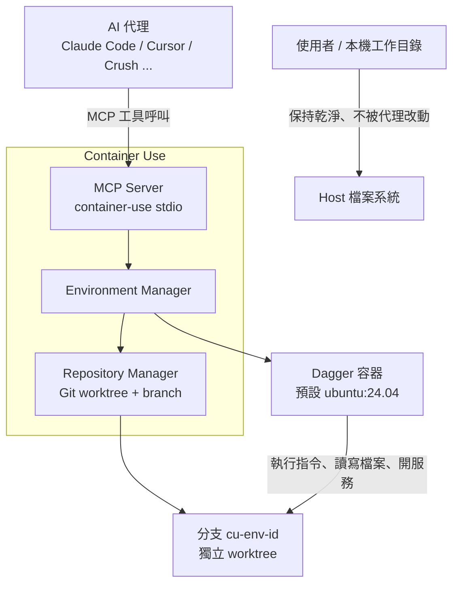
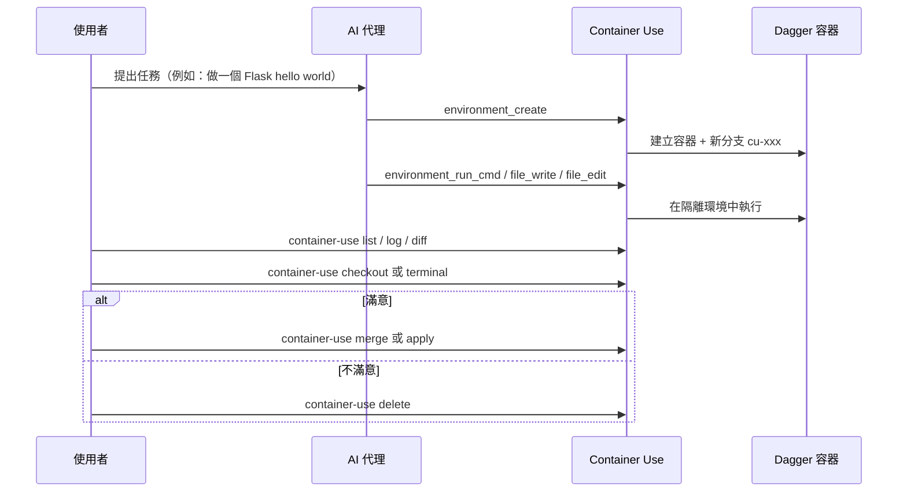

# Dagger Container Use 專案介紹

本報告介紹 GitHub 上的開源專案 `dagger/container-use`（以下簡稱 Container Use）。這是一套為 AI 程式開發代理（coding agent）提供沙箱化開發環境的工具，核心目的是讓多個代理能安全、平行地工作，而不干擾使用者本機的檔案與程序[^ghrepo]。

---

## 1. 一句話定位

Container Use 是一個以 Go 撰寫的 CLI 工具，同時也是一個 MCP（Model Context Protocol）伺服器。它讓 AI 代理在「拋棄式容器 + 獨立 Git 分支」中執行所有檔案與指令操作，使用者再以標準 Git 流程審查、合併或丟棄代理的成果[^ghreadme][^intro]。

它由 CI/CD 引擎公司 Dagger 開發並以 Apache-2.0 授權釋出[^ghrepo][^ghreadme]。

---

## 2. 專案基本資料

| 項目 | 內容 |
| --- | --- |
| 儲存庫 | `dagger/container-use`[^ghrepo] |
| 官方網站 | https://container-use.com[^ghrepo] |
| 授權 | Apache License 2.0[^ghrepo] |
| 主要語言 | Go（約 357 KB），另有少量 Shell（約 10 KB）[^ghlang] |
| 建立時間 | 2025-05-23[^ghrepo] |
| 最後推送 | 2026-11-14[^ghrepo] |
| 星號數 | 4,101[^ghrepo] |
| 分支（Fork）數 | 214[^ghrepo] |
| 未關閉 Issue | 64[^ghrepo] |
| 最新發行版 | v0.4.2（2025-08-19 發布）[^ghrelease042] |
| 穩定度標示 | experimental（實驗性）[^ghreadme] |

專案的 GitHub 描述為「Development environments for coding agents. Enable multiple agents to work safely and independently with your preferred stack.」[^ghrepo]。

---

## 3. 解決什麼問題

README 開宗明義指出：Container Use 讓代理「在自己的環境裡做事，不會擋到你」，把使用者從「一次只能盯一個代理」推進到「多個代理安全且獨立地並行工作」[^ghreadme]。

README 列出五項核心價值[^ghreadme]：

- **隔離環境（Isolated Environments）**：每個代理取得一個全新容器與專屬 Git 分支，可平行執行、可安全實驗、失敗可立即丟棄。
- **即時可視性（Real-time Visibility）**：可看到完整的指令歷史與日誌，而不只是代理聲稱它做了什麼。
- **直接介入（Direct Intervention）**：可隨時進入任何代理的終端機查看狀態，卡住時直接接手。
- **環境控制（Environment Control）**：以標準 Git 工作流審查，例如 `git checkout <branch_name>`。
- **通用相容（Universal Compatibility）**：與任何支援 MCP 的代理、模型或基礎設施搭配，無廠商綁定。

---

## 4. 運作原理

### 4.1 雙層隔離模型

官方文件說明 Container Use 是「以 Dagger 提供容器化工作流，以 Git worktree 提供分支」[^intro]：



- **容器隔離**：由 Dagger 負責，每個環境是一個獨立容器，預設基底映像為 `ubuntu:24.04`，內含 git、curl、bash、apt 等基本工具[^envconfig][^intro]。
- **Git worktree 隔離**：每個環境對應一個獨立 worktree 與分支，命名慣例為 `cu-<env-id>`，因此代理寫入的檔案不會落到使用者的主要工作目錄[^intro][^cliref]。

官方將「環境（Environment）」定義為三件事的組合：專屬 Git 分支、隔離的容器執行環境，以及完整歷史紀錄（每個指令、檔案變更與容器狀態都會被自動追蹤）[^envworkflow]。

### 4.2 典型流程



官方文件把核心流程整理為四步：代理建立新環境 → 代理在隔離中工作 → 使用者觀察成果 → 使用者做決定（merge、apply、繼續迭代或刪除）[^envworkflow]。

---

## 5. 安裝與設定

### 5.1 前置需求

官方 Quickstart 明確要求：開始前必須安裝 **Docker** 與 **Git**[^quickstart]。也就是說容器隔離層依賴可用的 Docker daemon，且被操作的專案必須是 Git 儲存庫。

### 5.2 安裝方式

官方提供三種方式[^quickstart]：

```sh
# macOS（官方推薦）
brew install dagger/tap/container-use

# 所有平台
curl -fsSL https://raw.githubusercontent.com/dagger/container-use/main/install.sh | bash

# 從原始碼建置
git clone https://github.com/dagger/container-use.git
cd container-use
go build -o container-use ./cmd/container-use
sudo mv container-use /usr/local/bin/
```

發行版同時提供多平台預編譯檔：darwin（amd64／arm64）、linux（amd64／arm64）、windows（amd64／arm64）[^ghrelease042]。

### 5.3 與代理整合

所有支援 MCP 的代理都使用同一個指令：把 `container-use stdio` 註冊為 MCP 伺服器[^agentint][^ghreadme]。官方文件列出 18 種代理的設定方式，包含 Claude Code、Amazon Q Developer、Cursor、Windsurf、VSCode／GitHub Copilot、Zed、OpenCode、Goose、Sourcegraph Amp、**Charm Crush**、Cline、Qodo Gen、Kilo Code、Kiro、OpenAI Codex、Warp、Gemini CLI、JetBrains Junie[^agentint]。

以 Claude Code 為例[^agentint][^quickstart]：

```sh
cd /path/to/repository
claude mcp add container-use -- container-use stdio
```

以本專案使用的 Charm Crush 為例，官方建議寫入 `./.crush.json`[^agentint]：

```json
{
  "$schema": "https://charm.land/crush.json",
  "mcp": {
    "container-use": {
      "type": "stdio",
      "command": "container-use",
      "args": ["stdio"],
      "env": {}
    }
  },
  "permissions": {
    "allowed_tools": [
      "mcp_container-use_environment_add_service",
      "mcp_container-use_environment_checkpoint",
      "mcp_container-use_environment_config",
      "mcp_container-use_environment_create",
      "mcp_container-use_environment_file_delete",
      "mcp_container-use_environment_file_edit",
      "mcp_container-use_environment_file_list",
      "mcp_container-use_environment_file_read",
      "mcp_container-use_environment_file_write",
      "mcp_container-use_environment_open",
      "mcp_container-use_environment_run_cmd",
      "mcp_container-use_environment_update_metadata"
    ]
  }
}
```

官方亦建議附加代理規則檔（`rules/agent.md`），內容要求代理「任何檔案、程式碼或 shell 操作都只用 Environment，沒有例外」，並提醒代理必須告知使用者可用 `container-use log <env_id>` 與 `container-use checkout <env_id>` 檢視成果[^agentrules]。

### 5.4 最小權限建議

官方為多個代理示範「只信任 Container Use 工具」的設定，例如 Claude Code 使用 `--allowedTools` 白名單，Zed 則可建立只啟用 Container Use 工具、關閉 `read_file`／`terminal`／`edit_file` 等本機工具的 agent profile，以防代理直接修改本機檔案[^agentint]。

---

## 6. MCP 工具清單

Container Use 本身即是 MCP 伺服器，透過 stdio 傳輸與代理溝通[^intro][^agentint]。官方文件與代理設定範例中出現的工具如下[^agentint]：

| 工具 | 用途（依名稱與文件推斷） |
| --- | --- |
| `environment_create` | 建立新的隔離環境 |
| `environment_run_cmd` | 在環境內執行 shell 指令 |
| `environment_file_write` | 寫入檔案 |
| `environment_file_read` | 讀取檔案 |
| `environment_file_list` | 列出檔案 |
| `environment_file_delete` | 刪除檔案 |
| `environment_file_edit` | 尋找取代式編輯，避免重寫整份檔案造成上下文耗損[^ghrelease040] |
| `environment_add_service` | 從容器暴露服務連接埠 |
| `environment_open` | 在瀏覽器開啟環境中的 URL |
| `environment_checkpoint` | 儲存環境狀態檢查點 |
| `environment_update_metadata` | 更新環境中介資料 |
| `environment_config` | 檢視或修改環境設定 |

此外，2026-08-11 的提交新增了 `environment_log` 與 `environment_diff` 兩個工具，讓代理能自行檢視環境歷史與累積變更，而不必要求使用者手動跑 `cu log`／`cu diff`[^ghcommit363]。

---

## 7. CLI 指令參考

指令形式為 `container-use {command} [options] [arguments]`，`cu` 是可互換的簡短別名[^cliref]。

| 指令 | 說明 |
| --- | --- |
| `list` | 列出所有環境與狀態（`--no-trunc`、`-q`）[^cliref] |
| `log <id>` | 檢視環境的提交歷史與執行過的指令（`--patch`）[^cliref] |
| `diff <id>` | 顯示相對基底分支的程式碼變更[^cliref] |
| `checkout <id>` | 在本機取出該環境的分支（`--branch`）[^cliref] |
| `terminal <id>` | 進入容器的互動式終端機[^cliref] |
| `merge <id>` | 將環境成果合併進當前分支，保留提交歷史（`--delete`）[^cliref] |
| `apply <id>` | 將變更套用為已暫存狀態但不提交（`--delete`）[^cliref] |
| `delete <id>` | 刪除環境並清理資源（`--all`）[^cliref] |
| `watch` | 即時監看環境活動[^cliref] |
| `config` | 管理預設環境設定[^cliref] |
| `version` | 顯示版本資訊[^cliref] |
| `stdio` | 以 MCP 伺服器模式啟動（給代理設定用，通常不由使用者直接執行）[^cliref] |
| `completion <shell>` | 產生 shell 補全腳本（bash／zsh／fish／powershell）[^cliref] |

**環境 ID** 是隨機產生的雙詞組合，例如 `fancy-mallard`、`clever-dolphin`；可用完整 ID、唯一的部分 ID，或分支名 `cu-fancy-mallard` 來指涉[^cliref]。

**結束碼**：`0` 成功、`1` 一般錯誤、`2` 指令語法錯誤、`3` 找不到環境、`4` 操作取消[^cliref]。

---

## 8. 環境設定與密鑰管理

### 8.1 設定分兩層

官方文件說明設定分為「專案預設設定」與「代理臨時調整」兩層；代理在環境中所做的設定變更預設是暫時的，直到使用者以 `container-use config import` 匯入成為新預設[^envconfig]。

常見子指令[^cliref][^envconfig]：

```sh
container-use config base-image set python:3.11
container-use config setup-command add "apt-get update && apt-get install -y build-essential"
container-use config install-command add "pip install -r requirements.txt"
container-use config env set PYTHONPATH /workdir
container-use config show
container-use config import fancy-mallard
```

官方建議：若使用 `latest` 標籤的自訂基底映像且頻繁更新，宜改用版本化標籤（如 `myimage:v1.2.3`）以獲得更可預測的快取行為[^envconfig]。

### 8.2 密鑰管理

Container Use 支援四種密鑰參考格式[^secrets]：

| 前綴 | 來源 |
| --- | --- |
| `env://` | 本機環境變數 |
| `op://` | 1Password（格式 `op://vault/item/field`） |
| `vault://` | HashiCorp Vault |
| `file://` | 本機檔案（如 SSH 金鑰、憑證） |

設定方式是 `container-use config secret set <KEY> <reference>`[^secrets]。

官方強調的設計目標是：**AI 模型本身永遠看不到真正的密鑰值**。設定中只儲存參考（例如 `op://vault/item/field`），執行指令時才動態解析並以環境變數注入容器，同時會從日誌與指令輸出中過濾掉密鑰，使 `echo $API_KEY` 之類的操作不會出現在日誌裡[^secrets]。官方文件另指出，密鑰是「按專案」設定，僅套用於新建立的環境，既有環境維持原本設定[^secrets]。

---

## 9. 版本歷程

以下依 GitHub Releases API 資料整理[^ghreleases]：

| 版本 | 發布日期 | 重點 |
| --- | --- | --- |
| v0.0.5 | 2025-06-16 | 早期預覽[^ghreleases] |
| v0.1.0 | 2025-06-26 | 首個正式發行：環境重用、`cu checkout`、shell 補全、終端機續用[^ghrelease010] |
| v0.1.1 | 2025-06-30 | 新增 Zed 支援、`cu diff`、`cu checkout --branch`、Gemini CLI 文件、升級 Dagger 至 v0.18.11[^ghreleases] |
| v0.2.0 | 2025-07-08 | 二進位檔由 `cu` 更名為 `container-use`（因 macOS 上 `cu` 與 Taylor UUCP 名稱衝突）；新增 `cu inspect`、`cu merge --delete`[^ghrelease020] |
| v0.3.0 | 2025-07-14 | 推出 `container-use config`、密鑰管理（環境變數／檔案／Vault／1Password）、`container-use apply`、代理設定精靈[^ghrelease030] |
| v0.3.1 | 2025-07-15 | 環境 install commands、統一工具參數[^ghreleases] |
| v0.4.0 | 2025-07-31 | `environment_file_edit` 工具、原生 Windows 支援、位置參數可省略、服務支援環境密鑰、文件精簡 42%[^ghrelease040] |
| v0.4.1 | 2025-08-01 | 修正並行伺服器程序的資源競爭問題[^ghrelease041] |
| v0.4.2 | 2025-08-19 | 改善 export 鎖粒度、新增實驗性 `stdio --single-tenant` 模式、`version --system`、環境可由 git ref 建立[^ghrelease042] |

v0.4.2 的說明指出，`--single-tenant` 模式會把每個 MCP 伺服器程序鎖定在單一環境，以降低每次工具呼叫所需的 token 量，並改善子任務的效能與準確度，主要針對 Claude Code 這類 CLI 型代理[^ghrelease042]。

---

## 10. 授權

專案採用 **Apache License 2.0**，SPDX 識別碼為 `Apache-2.0`[^ghrepo]。GitHub 同時顯示該儲存庫要求 commit sign-off（`web_commit_signoff_required: true`）[^ghrepo]。

---

## 11. 批判性反思

以下為本報告對資料來源與專案狀態的批判性評估，而非專案官方說法。

### 11.1 資料來源的偏向

- 本報告的事實基礎主要來自**專案自身的 README、官方文件站與 GitHub API**。這些來源對於工具的能力描述具有明顯的行銷語氣（例如「universal compatibility」、「no vendor lock-in」），且缺乏第三方獨立評測或效能基準可供交叉驗證[^ghreadme][^intro]。
- 官方文件站以 Mintlify 建置，屬產品文件性質，並非同儕審查或獨立研究。因此本報告只能確認「官方如此宣稱」，無法確認「實務上普遍如此」[^intro]。
- 未找到獨立的學術或媒體評測來源；若有，應優先納入以平衡觀點。

### 11.2 專案活躍度的落差

- GitHub API 顯示最後一次程式碼推送為 2026-11-14，但**最新標記發行版仍停留在 2025-08-19 的 v0.4.2**[^ghrepo][^ghrelease042]。也就是說，專案已超過一年未發布新的版本標籤，主分支的變動與正式發行版之間存在落差。使用者若透過 Homebrew 或安裝腳本取得的是 v0.4.2，將無法使用主分支上後續新增的能力（例如 `environment_log`、`environment_diff`）[^ghcommit363]。
- 專案仍標示為 experimental，官方亦自陳處於「early development and actively evolving」階段[^ghreadme]。這表示 API 與行為可能出現破壞性變更，v0.2.0 將二進位檔從 `cu` 更名為 `container-use` 即為實例[^ghrelease020]。

### 11.3 貢獻型態的觀察

- 觀察 2026-08 的近期提交，多筆提交的作者署名為「Drew the AI Guy」，且 commit message 中帶有 `Co-authored-by: Sisyphus <clio-agent@sisyphuslabs.ai>` 這類 AI 代理共同署名的痕跡，內容多為重構與小型修正[^ghcommits]。這本身不是問題（甚至與專案主題呼應），但意味著近期變更的審查深度與維護者結構值得使用者自行評估。
- 星號數 4,101 對照分支數 214 與觀察者（watchers）11，呈現典型「高關注、低深度參與」的開源專案樣態[^ghrepo]。星號數可反映關注度，但不宜直接等同於生產環境成熟度。

### 11.4 安全性考量

- 專案確實有安全相關的修正紀錄。例如 2026-08-12 的提交修正了 `exportEnvironmentFile` 的路徑穿越（path traversal）問題，讓解析後的檔案路徑無法逃出 worktree 根目錄，此修正源自 issue #337[^ghcommit365]。這顯示維護者會處理安全回報，但也同時說明攻擊面確實存在。
- **容器隔離不等於虛擬機等級的隔離**。Container Use 的容器隔離層依賴 Docker／Dagger[^quickstart]，其邊界強度取決於底層容器的設定與核心共享情形。對於不受信任的代理行為，仍建議搭配網路限制與工具白名單。
- 密鑰設計（只存參考、動態注入、日誌過濾）在方向上是正確的，且官方明確指出「AI 模型永遠不會看到真正的值」[^secrets]。但需注意：代理仍能在容器內執行任意指令，因此**理論上仍可能透過網路把已注入環境的密鑰外洩**；日誌過濾只能防止密鑰出現在輸出與模型上下文中，無法阻止代理主動外送[^secrets]。官方提供的緩解方式是限制代理只能使用 Container Use 工具[^agentint]。
- 代理規則檔要求代理「所有操作都只用 Environment」，並警告代理不要自行操作 `.git`，否則會破壞環境完整性[^agentrules]。這屬於提示層級（prompt-level）的約束，並非技術強制；真正具強制力的是各代理平台自身的工具白名單機制[^agentint]。

### 11.5 適用性判斷

綜合以上，Container Use 適合：需要同時跑多個 AI 代理、希望在合併前以標準 Git 流程審查代理成果、且本機已具備 Docker 與 Git 的使用者。

需要謹慎的情況包括：無法安裝 Docker 的環境（例如部分 CI runner 或極簡容器）、要求長期穩定 API 的生產流程（專案仍為 experimental 且發行版停滯）、以及需要硬性隔離保證的高安全場景（應改用更強的隔離機制）。

---

## 參考文獻

[^ghrepo]: GitHub. (n.d.). *dagger/container-use*. Retrieved 2026-11-22, from https://github.com/dagger/container-use

[^ghreadme]: Dagger. (n.d.). *container-use README*. Retrieved 2026-11-22, from https://raw.githubusercontent.com/dagger/container-use/main/README.md

[^ghlang]: GitHub. (n.d.). *Repository languages: dagger/container-use*. Retrieved 2026-11-22, from https://api.github.com/repos/dagger/container-use/languages

[^intro]: Container Use. (n.d.). *Introduction*. Retrieved 2026-11-22, from https://container-use.com/introduction

[^quickstart]: Container Use. (n.d.). *Quickstart*. Retrieved 2026-11-22, from https://container-use.com/quickstart

[^envworkflow]: Container Use. (n.d.). *Environment Workflow*. Retrieved 2026-11-22, from https://container-use.com/environment-workflow

[^envconfig]: Container Use. (n.d.). *Environment Configuration*. Retrieved 2026-11-22, from https://container-use.com/environment-configuration

[^secrets]: Container Use. (n.d.). *Secrets Management*. Retrieved 2026-11-22, from https://container-use.com/secrets

[^cliref]: Container Use. (n.d.). *CLI Reference*. Retrieved 2026-11-22, from https://container-use.com/cli-reference

[^agentint]: Container Use. (n.d.). *Agent Integration*. Retrieved 2026-11-22, from https://container-use.com/agent-integrations

[^agentrules]: Dagger. (n.d.). *rules/agent.md*. Retrieved 2026-11-22, from https://raw.githubusercontent.com/dagger/container-use/main/rules/agent.md

[^ghreleases]: GitHub. (n.d.). *Releases: dagger/container-use*. Retrieved 2026-11-22, from https://api.github.com/repos/dagger/container-use/releases

[^ghrelease042]: Dagger. (2025-08-19). *container-use v0.4.2*. Retrieved 2026-11-22, from https://github.com/dagger/container-use/releases/tag/v0.4.2

[^ghrelease041]: Dagger. (2025-08-01). *container-use v0.4.1*. Retrieved 2026-11-22, from https://github.com/dagger/container-use/releases/tag/v0.4.1

[^ghrelease040]: Dagger. (2025-07-31). *container-use v0.4.0*. Retrieved 2026-11-22, from https://github.com/dagger/container-use/releases/tag/v0.4.0

[^ghrelease030]: Dagger. (2025-07-14). *container-use v0.3.0*. Retrieved 2026-11-22, from https://github.com/dagger/container-use/releases/tag/v0.3.0

[^ghrelease020]: Dagger. (2025-07-08). *container-use v0.2.0*. Retrieved 2026-11-22, from https://github.com/dagger/container-use/releases/tag/v0.2.0

[^ghrelease010]: Dagger. (2025-06-26). *container-use v0.1.0*. Retrieved 2026-11-22, from https://github.com/dagger/container-use/releases/tag/v0.1.0

[^ghcommits]: GitHub. (n.d.). *Commits: dagger/container-use*. Retrieved 2026-11-22, from https://api.github.com/repos/dagger/container-use/commits

[^ghcommit363]: Dagger. (2026-08-11). *mcpserver: add environment_log and environment_diff tools (#363)*. Retrieved 2026-11-22, from https://github.com/dagger/container-use/commit/0d87ad6304bf9d4bab697d9eac82565868c3579c

[^ghcommit365]: Dagger. (2026-08-12). *fix(repository): prevent path traversal in exportEnvironmentFile (#365)*. Retrieved 2026-11-22, from https://github.com/dagger/container-use/commit/2e43e625e95216b719ec9338f4034fd3a0be2734
