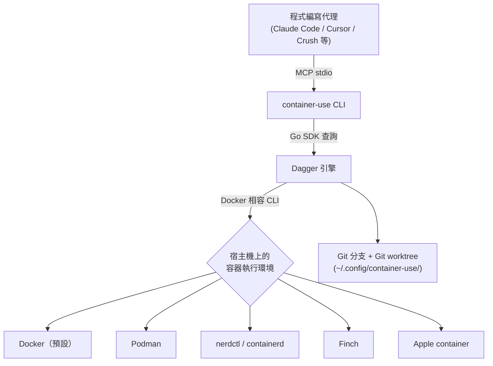

# container-use 使用哪一種容器執行環境 (Container Runtime)？

## 摘要

`dagger/container-use` 本身**不直接**與 Linux 核心的容器執行環境（runc、containerd、CRI-O 等）溝通，而是把容器工作全部委派給 **Dagger** 引擎[^readme][^intro]。Dagger 引擎在啟動時，會透過一個 **Docker CLI 相容的執行環境**在宿主機上被建立與執行[^dagger01815]。因此「container-use 用什麼容器執行環境」有兩層答案：

1. **預設與官方要求**：Docker（Docker Engine / Docker Desktop）。安裝腳本會硬性檢查 `docker` 指令，文件亦明言需要 Docker[^installsh][^quickstart]。
2. **實際可替換的執行環境**：由於 Dagger v0.18.15 起支援多種 Docker CLI 相容的執行環境，container-use 在實務上可搭配 **Podman**、**nerdctl（containerd）**、**Finch** 與 **Apple container** 使用[^dagger01815][^versiongo]。

換言之，**container-use 的容器執行環境是「Docker 相容 CLI 所指向的 OCI 執行環境」，預設為 Docker，但可換成 Podman／nerdctl／Finch／Apple container。**

## 專案背景

`dagger/container-use` 是一個以 Go 撰寫、Apache-2.0 授權的開源專案，作為 MCP（Model Context Protocol）伺服器與 CLI 工具，讓多個程式編寫代理（coding agents）各自在獨立的容器與 Git 分支中平行工作[^gh-repo][^readme]。

| 項目 | 內容 |
| --- | --- |
| 倉庫 | `dagger/container-use` |
| 主要語言 | Go |
| 授權 | Apache License 2.0 |
| 星數 | 4,101 |
| Fork 數 | 214 |
| 建立時間 | 2025-05-23 |
| 官網 | https://container-use.com |
| 狀態 | 實驗性（experimental） |

上表數據來自 GitHub 倉庫 API[^gh-repo]，擷取日期為 2026-11-22。

## 架構：三層關係

container-use 的容器能力來自 Dagger。程式碼中直接依賴 `dagger.io/dagger` 這個 Go SDK（v0.21.8），並在 `dagger.json` 宣告引擎版本為 `v0.21.8`[^gomod][^daggerjson]。專案文件也明確說明「Container Use leverages Dagger for containerized workflows and Git worktrees for branching」[^intro]，環境說明文件則寫道每個環境會「Spins up a Dagger container」[^envreadme]。



`environment/environment.go` 顯示實際操作全部走 Dagger 的型別化 API：以 `env.dag.Container().From(基準映像)` 建立容器、以 `LoadContainerFromID` 取回既有容器狀態、以 `container.Publish` 產出映像、以 `container.Terminal` 開互動終端[^envego]。`environment/service.go` 亦以 `env.dag.Container().From(cfg.Image)` 啟動附屬服務，並透過 `Host().Tunnel` 將埠口曝露到宿主機[^service]。程式碼中沒有出現 `containerd`、`runc`、`CRI-O` 或 `kubelet` 等直接呼叫，也沒有自行操作 cgroup／namespace 的邏輯。

## 執行環境支援清單

container-use 的 `version --system` 指令會偵測並印出容器執行環境；其偵測順序**刻意與 Dagger 保持一致**，依序為 Docker、Podman、nerdctl、finch[^versiongo]：

```go
runtimes := []struct {
    command string
    name    string
}{
    {"docker", "Docker"},
    {"podman", "Podman"},
    {"nerdctl", "nerdctl"},
    {"finch", "finch"},
}
```

對應的單元測試也預期輸出符合 `Docker|Podman|nerdctl|finch` 其中之一[^versiontest]。

| 執行環境 | 是否為預設 | container-use 支援狀況 | 依據 |
| --- | --- | --- | --- |
| Docker | 是 | 官方要求；安裝腳本強制檢查 | [^installsh][^quickstart] |
| Podman | 否 | 可運作；需將 `podman` 以符號連結命名為 `docker`，或依 Dagger 驅動設定 | [^issue102][^podman] |
| nerdctl（containerd） | 否 | 可運作；同樣以符號連結 `docker` → `nerdctl` | [^issue296][^nerdctl] |
| Finch | 否 | Dagger 支援；container-use 偵測邏輯涵蓋 | [^dagger01815][^versiongo] |
| Apple container | 否 | Dagger v0.18.15 起支援；container-use 早期硬編碼 Docker，相關需求單已於 2026-07-29 結案 | [^issue310][^apple] |
| Kubernetes / containerd 直連 | 否 | 無原生支援；需靠執行環境層的相容 CLI | [^issue296] |

## 為何是「Docker 相容 CLI」而非直接綁定 Docker

Dagger 引擎需要被「放置」在某個地方執行。Dagger 的預設映像驅動程式（driver，舊稱 `docker-image`，後改名為 `image`）會呼叫宿主機上的 `docker` 執行檔，把引擎本身當成一個容器跑起來[^nerdctl]。因此只要有一個 CLI 與 Docker 指令相容，就能替換底層執行環境。

Dagger v0.18.15 的變更紀錄明確寫道：新增「Allow starting dagger engines in alternative container runtimes, including: Apple's `container`、`podman`、`nerdctl`、`finch`」，該功能由 PR #10714「Support for more driver types」實作並於 2025-07-30 合併[^dagger01815][^pr10714]。該 PR 引入了 `image+podman`、`image+nerdctl`、`image+finch`、`image+apple` 等驅動程式，以及會自動選擇可用執行環境的通用 `image`／`container` 驅動程式[^pr10714]。

container-use 隨後在 PR #284「upgrade dagger to v0.18.16」中升級 Dagger 版本，作者在 PR 說明中直言「this should enable other container runtimes amongst other improvements」[^pr284]。這一步是 container-use 從「只能用 Docker」走向「可換執行環境」的關鍵。

## 實務替換方式

### Podman

GitHub issue #102「Is it possible to use podman instead of docker?」中，Dagger 作者 shykes 回覆 container-use 底層由 Dagger 驅動，可依 Dagger 的 Podman 文件操作；提問者 dmmalam 實測後回報只需一行符號連結即可[^issue102]：

```shell
ln -s $(which podman) <local_bin_dir>/docker
```

Dagger 官方文件亦記載 Podman 的作法是建立名為 `docker` 的符號連結，並要求 Podman 以 rootful 模式執行容器[^podman]。

### nerdctl / containerd

issue #296「[Feature]: Add containerd support」中，container-use 維護者 cwlbraa 指出自 Dagger v0.18.15 起，透過 nerdctl（Docker CLI 相容的 containerd 前端）「theoretically possible」；另一位使用者 frantjc 實測回報「Creating a symlink from `docker` to `nerdctl` ... worked for me!」[^issue296]。Dagger 的 nerdctl 文件同樣建議建立 `docker` 符號連結，並要求 nerdctl 以 rootless 模式運作[^nerdctl]。

值得一提的是，該 issue 的提問者 Borg93 最後指出，安裝時唯一阻礙其實是 container-use 安裝腳本中硬性的 Docker 檢查；移除該檢查後「everything work out of the box with containerd」[^issue296]。

### Apple container

issue #310「[Feature]: Apple `container` support」由 trieloff 提出，指出 Dagger 已支援 Apple 的 `container` 執行環境，但 container-use 當時「hardcodes the `docker` CLI」，且兩者 CLI 並不相容，因此無法單靠符號連結解決；維護者 grouville 回應認為這會是「a very hard contribution」之外、相對容易的貢獻。該 issue 已於 2026-07-29 以 completed 結案[^issue310]。Dagger 的 Apple container 文件標示此支援仍屬早期實驗性，並提示部分功能可透過符號連結搭配自訂 runner 達成[^apple]。

## 預設與自訂環境設定

container-use 的環境設定檔 `.container-use/environment.json` 決定容器**內容**（基準映像、setup／install 指令、環境變數、密鑰、服務），而非決定**執行環境**本身[^configgo][^cuenv]。預設基準映像為 `ubuntu:24.04`，工作目錄為 `/workdir`[^configgo]。使用者可用 `container-use config base-image set` 等指令調整[^cliref]。因此「換執行環境」與「換基準映像」是兩件不同層次的事：前者由 Dagger／宿主機決定，後者由 container-use 設定檔決定。

此外，container-use 的整合測試本身會在特權容器內安裝並啟動 `dockerd`，以取得 Docker daemon 來跑真實容器測試，這也側面印證其測試路徑預設依賴 Docker[^dagmain]。

## 注意事項與限制

- **安裝腳本仍硬性要求 Docker**：`install.sh` 的 `check_dependencies` 會在找不到 `docker` 時直接報錯並結束[^installsh]。這與程式碼中已支援 Podman／nerdctl／finch 偵測的情況不一致，也是社群多次反映的痛點[^issue102][^issue296]。
- **官方文件仍以 Docker 為前提**：快速開始指引寫明「Make sure you have Docker and Git installed before starting」[^quickstart]。
- **錯誤訊息以 Docker 為中心**：`docker_errors.go` 專門辨識 Docker daemon 連線失敗的訊息（Linux 的 `/var/run/docker.sock`、Windows 的 `dockerDesktopLinuxEngine` named pipe、macOS 的 `docker.sock`），並提示使用者啟動 Docker[^dockererr]。
- **Dagger 引擎驅動程式仍在演進**：Dagger 於 1.0-beta 版本強調「sandbox, scheduler, container runtime, build cache and tracing」垂直整合[^daggerbeta]，未來 container-use 與執行環境的耦合方式可能隨 Dagger 版本而變。專案本身亦標示為實驗性[^readme]。

## 結論

- container-use **不自行實作容器執行環境**，而是把容器工作交給 Dagger 引擎，再由 Dagger 呼叫宿主機上的 Docker 相容 CLI[^readme][^intro][^envego]。
- **預設與官方唯一明示要求的是 Docker**：安裝腳本硬性檢查 `docker`，文件與錯誤處理也以 Docker 為中心[^installsh][^quickstart][^dockererr]。
- 自 Dagger v0.18.15（2025-08-18）起，Dagger 可改用 **Podman、nerdctl（containerd）、Finch、Apple container** 作為引擎執行環境[^dagger01815][^pr10714]，container-use 亦隨之在 `version --system` 中列出這四種偵測目標[^versiongo]。
- 實務上最常見的替代做法，是把 `podman` 或 `nerdctl` 以符號連結命名為 `docker`[^issue102][^issue296][^podman][^nerdctl]。
- **containerd／Kubernetes 沒有原生直連路徑**：若要在 k3s 之類的環境中直接使用 containerd，目前只能透過 nerdctl 之類的 Docker 相容前端間接達成[^issue296]。

## 參考文獻

[^gh-repo]: Dagger. (2026). dagger/container-use [Source code]. GitHub. Retrieved 2026-11-22, from https://github.com/dagger/container-use

[^readme]: Dagger. (n.d.). container-use README. Retrieved 2026-11-22, from https://raw.githubusercontent.com/dagger/container-use/main/README.md

[^gomod]: Dagger. (n.d.). go.mod. Retrieved 2026-11-22, from https://raw.githubusercontent.com/dagger/container-use/main/go.mod

[^daggerjson]: Dagger. (n.d.). dagger.json. Retrieved 2026-11-22, from https://raw.githubusercontent.com/dagger/container-use/main/dagger.json

[^intro]: Dagger. (n.d.). Introduction. Retrieved 2026-11-22, from https://raw.githubusercontent.com/dagger/container-use/main/docs/introduction.mdx

[^envreadme]: Dagger. (n.d.). Environments. Retrieved 2026-11-22, from https://raw.githubusercontent.com/dagger/container-use/main/environment/README.md

[^envego]: Dagger. (n.d.). environment/environment.go. Retrieved 2026-11-22, from https://raw.githubusercontent.com/dagger/container-use/main/environment/environment.go

[^service]: Dagger. (n.d.). environment/service.go. Retrieved 2026-11-22, from https://raw.githubusercontent.com/dagger/container-use/main/environment/service.go

[^configgo]: Dagger. (n.d.). environment/config.go. Retrieved 2026-11-22, from https://raw.githubusercontent.com/dagger/container-use/main/environment/config.go

[^installsh]: Dagger. (n.d.). install.sh. Retrieved 2026-11-22, from https://raw.githubusercontent.com/dagger/container-use/main/install.sh

[^quickstart]: Dagger. (n.d.). Quickstart. Retrieved 2026-11-22, from https://raw.githubusercontent.com/dagger/container-use/main/docs/quickstart.mdx

[^dockererr]: Dagger. (n.d.). cmd/container-use/docker_errors.go. Retrieved 2026-11-22, from https://raw.githubusercontent.com/dagger/container-use/main/cmd/container-use/docker_errors.go

[^versiongo]: Dagger. (n.d.). cmd/container-use/version.go. Retrieved 2026-11-22, from https://raw.githubusercontent.com/dagger/container-use/main/cmd/container-use/version.go

[^versiontest]: Dagger. (n.d.). cmd/container-use/version_test.go. Retrieved 2026-11-22, from https://raw.githubusercontent.com/dagger/container-use/main/cmd/container-use/version_test.go

[^cliref]: Dagger. (n.d.). CLI Reference. Retrieved 2026-11-22, from https://raw.githubusercontent.com/dagger/container-use/main/docs/cli-reference.mdx

[^cuenv]: Dagger. (n.d.). .container-use/environment.json. Retrieved 2026-11-22, from https://raw.githubusercontent.com/dagger/container-use/main/.container-use/environment.json

[^dagmain]: Dagger. (n.d.). .dagger/main.go. Retrieved 2026-11-22, from https://raw.githubusercontent.com/dagger/container-use/main/.dagger/main.go

[^issue102]: dmmalam. (2025, June 18). Is it possible to use podman instead of docker? [Issue #102]. GitHub. Retrieved 2026-11-22, from https://github.com/dagger/container-use/issues/102

[^issue296]: Borg93. (2025, September 2). [Feature]: Add containerd support [Issue #296]. GitHub. Retrieved 2026-11-22, from https://github.com/dagger/container-use/issues/296

[^issue310]: trieloff. (2025, September 24). [Feature]: Apple container support [Issue #310]. GitHub. Retrieved 2026-11-22, from https://github.com/dagger/container-use/issues/310

[^pr284]: cwlbraa. (2025, August 26). upgrade dagger to v0.18.16 [Pull request #284]. GitHub. Retrieved 2026-11-22, from https://github.com/dagger/container-use/pull/284

[^dagger01815]: Dagger. (2025, August 18). v0.18.15. Retrieved 2026-11-22, from https://raw.githubusercontent.com/dagger/dagger/main/.changes/v0.18.15.md

[^pr10714]: jedevc. (2025, July 30). Support for more driver types [Pull request #10714]. GitHub. Retrieved 2026-11-22, from https://github.com/dagger/dagger/pull/10714

[^nerdctl]: Dagger. (n.d.). Nerdctl. Retrieved 2026-11-22, from https://raw.githubusercontent.com/dagger/dagger/main/docs/versioned_docs/version-0.18/reference/container-runtimes/nerdctl.mdx

[^podman]: Dagger. (n.d.). Podman. Retrieved 2026-11-22, from https://raw.githubusercontent.com/dagger/dagger/main/docs/versioned_docs/version-0.18/reference/container-runtimes/podman.mdx

[^apple]: Dagger. (n.d.). Apple Container. Retrieved 2026-11-22, from https://raw.githubusercontent.com/dagger/dagger/main/docs/versioned_docs/version-0.18/reference/container-runtimes/apple-container.mdx

[^daggerbeta]: Dagger. (n.d.). Introduction. Retrieved 2026-11-22, from https://docs.dagger.io/getting-started/introduction
