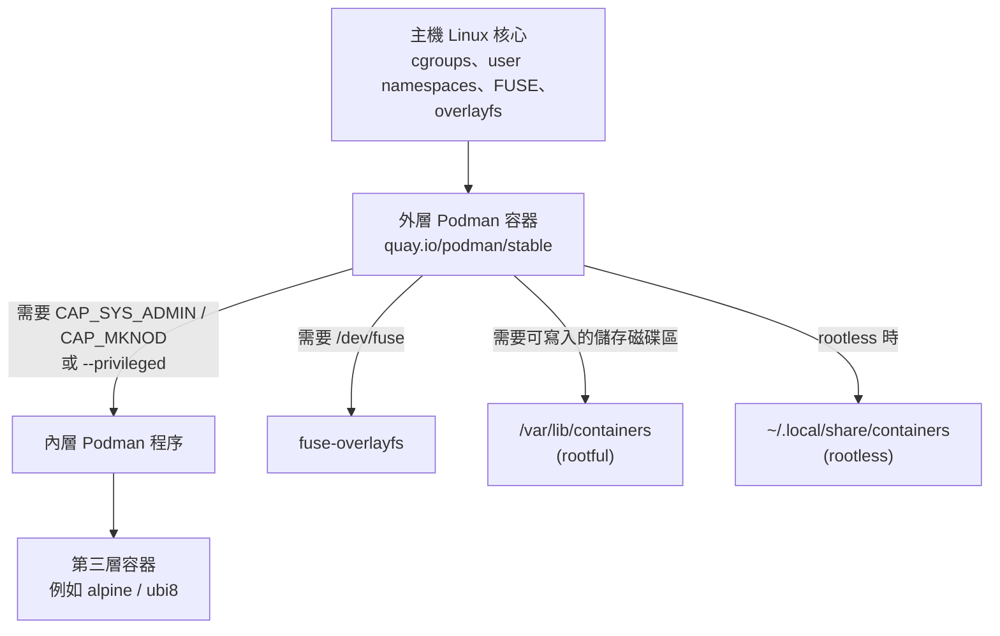

# 如何在 Podman 裡執行 Podman(podman in podman)

## 摘要

「podman in podman」(常縮寫為 PINP)指的是在一個 Podman 容器內部,再執行一套 Podman 來建立、建置或管理另一層容器。它與「docker in docker」(DIND)是同一類問題,但因為 Podman 天生是無常駐守護程序(daemonless)、且預設以 rootless 與 user namespace 運作,所以所需的權限組合與 Docker 不同[^rhpodman]。

核心結論是:只要給予容器足夠的權限與裝置,並為內層 Podman 準備好可寫入的儲存目錄與使用者 ID 對應,PINP 就能運作。實務上最簡單的做法是 `--privileged`,但 Red Hat 的作者對此並不推薦:「Given that, I am **not a fan** of using the `--privileged` flag. I believe we can do better from a security perspective.」因此若在意安全,應改用「最小權限」的旗標組合[^rhpodman][^podsample]。

---

## 為什麼需要特殊設定

容器引擎本身需要一些在一般容器中被剝奪的能力與裝置,才能在容器內再開一層容器。主要障礙如下。

### 1. 掛載檔案系統需要能力

內層 Podman 若以 root 身分執行,要掛載執行容器所需的檔案系統,需要 `CAP_SYS_ADMIN`;要在容器的 `/dev` 中建立裝置節點,則需要 `CAP_MKNOD`。在 Docker 環境中 `CAP_MKNOD` 是預設允許的,但 Podman 與部分容器引擎預設不給[^rhpodman]。

### 2. overlay on overlay 會被核心拒絕

容器儲存預設使用 overlay 檔案系統。當外層容器本身就跑在 overlay 之上,內層再嘗試使用 overlay 時,核心常常會拒絕這種「overlay 疊 overlay」的組合。因此官方映像檔刻意把儲存目錄宣告為 `VOLUME`,讓內層 Podman 使用非 overlay 的磁碟區,並預設搭配 `fuse-overlayfs` 作為掛載程式[^rhpodman][^podcontainerfile]。

### 3. 需要 `/dev/fuse` 裝置

`fuse-overlayfs` 需要核心的 FUSE 支援。主機上若沒有把 `/dev/fuse` 傳入容器,內層 Podman 會出現 `fuse: device not found, try 'modprobe fuse' first` 的錯誤。修法是主機先 `modprobe fuse`(或在 `/etc/modules-load.d` 設定開機自動載入),再用 `--device /dev/fuse` 傳入容器[^podtrouble][^podsample]。

### 4. SELinux 與 seccomp 的阻擋

SELinux 不允許被隔離的容器程序掛載內層所需的全部檔案系統,因此需要 `--security-opt label=disable` 關閉標籤隔離。若外層引擎是 Docker,其 seccomp 政策比 Podman 嚴格,通常還需要 `--security-opt seccomp=unconfined`(或改用 `--seccomp=/usr/share/containers/seccomp.json` 套用 Podman 的政策)[^rhpodman]。

### 5. 儲存目錄與 UID 對應

內層 Podman 需要可寫入的儲存目錄。若外層容器執行的是 rootless Podman,使用者必須在 `/etc/subuid` 與 `/etc/subgid` 中擁有 subordinate UID/GID 範圍,否則會出現 `newuidmap` 找不到、或 `not enough IDs` 之類的錯誤[^podtrouble][^rootless]。

下圖說明各層之間的關係。



---

## 官方映像檔

上游在 `quay.io` 提供專門用來跑 PINP 的 Podman 映像檔,由 `podman-container-tools/image_build` 這個 monorepo 自動建置[^imgbuild]。

| 映像檔 | 用途 |
|---|---|
| `quay.io/podman/stable` | 最新穩定版 Podman,每日重建[^imgbuild] |
| `quay.io/containers/podman` | 同上的另一個命名空間[^imgbuild] |
| `quay.io/podman/testing` | 使用 Fedora `updates-testing` 的測試版[^imgbuild] |
| `quay.io/podman/upstream` | 直接編譯上游 `main` 分支,可能不穩定[^imgbuild] |
| `quay.io/containers/aio` | 「All In One」,同時含 Podman、Buildah、Skopeo,體積較小,適合當 CI/開發用基底映像檔[^imgbuild][^aioreadme] |

標籤策略方面,`vX`、`vX.Y`、`vX.Y.Z` 與 `latest` 會每日更新以納入安全性修補;帶 `-immutable` 的標籤一旦推送就不再覆寫,適合需要固定內容的使用者。以 2026-11-22 檢視,`quay.io/podman/stable:latest` 與 `v6.2.0` 指向同一 digest,最後更新時間為 2026-11-20[^quaystable]。

映像檔內部有幾個為 PINP 設計的細節[^podcontainerfile]:

- 安裝 `podman`、`fuse-overlayfs`、`openssh-clients`、`cpp`、`git-core`,並刻意排除 `container-selinux`。
- 以 `io.containers.capabilities` 標籤宣告映像檔所需的最小能力集合(`CHOWN,DAC_OVERRIDE,FOWNER,FSETID,KILL,NET_BIND_SERVICE,SETFCAP,SETGID,SETPCAP,SETUID,SYS_CHROOT`)。
- 建立 UID/GID 1000 的使用者 `podman`,並寫入 `/etc/subuid`、`/etc/subgid` 對應範圍。
- 設定 rootful 與 rootless 各自的 `storage.conf` 片段,使用 `mount_program = "/usr/bin/fuse-overlayfs"`。
- 宣告 `VOLUME /var/lib/containers` 與 `VOLUME /home/podman/.local/share/containers`,避免 overlay on overlay。
- 設定 `BUILDAH_ISOLATION=chroot`,讓映像檔內的 `RUN` 指令預設以 chroot 隔離執行(而非呼叫 crun/runc),藉此降低所需權限。
- 透過 `/etc/containers/containers.conf` 把內層預設命名空間設為 `host`,並關閉內層 cgroup 建立:`netns="host"`、`userns="host"`、`ipcns="host"`、`utsns="host"`、`cgroupns="host"`、`cgroups="disabled"`,同時指定 `cgroup_manager = "cgroupfs"` 與 `runtime="crun"`[^podconf]。這正是「內層 Podman 直接沿用外層容器的命名空間與 cgroup 視野」的官方做法,也說明在容器內跑 Podman 時 cgroup 通常不需由內層自行建立。

---

## 方法一:rootful Podman in rootful Podman

### 最快的方式:`--privileged`

官方 README 與 Red Hat 的說明文件都指出,最簡單的方式就是加上 `--privileged`[^podsample][^rhpodman]:

```bash
# 先確認主機已載入 fuse 模組
modprobe fuse

# 直接以特權模式執行內層 podman
podman run --privileged quay.io/podman/stable podman run ubi8 echo hello
```

若要避免每次都重新拉取映像檔,可把主機目錄掛進內層的儲存路徑:

```bash
mkdir -p /var/lib/mycontainer
podman run --privileged \
  -v /var/lib/mycontainer:/var/lib/containers:Z \
  quay.io/podman/stable podman run ubi8 echo hello
```

### 不用 `--privileged` 的最小權限組合

若不想給出特權,可只補上內層真正需要的能力、裝置與安全性選項[^rhpodman]:

```bash
podman run \
  --cap-add=sys_admin,mknod \
  --device=/dev/fuse \
  --security-opt label=disable \
  quay.io/podman/stable podman run ubi8-minimal echo hello
```

各旗標的意義如下[^rhpodman]:

- `--cap-add=sys_admin`:讓容器內的 root Podman 能掛載所需檔案系統。
- `--cap-add=mknod`:讓容器內的 root Podman 能在 `/dev` 建立裝置節點。
- `--device=/dev/fuse`:把主機的 FUSE 裝置傳入,供 `fuse-overlayfs` 使用。
- `--security-opt label=disable`:關閉 SELinux 隔離,否則掛載會被拒絕。

若外層引擎是 Docker,則還需要放寬 seccomp:

```bash
docker run \
  --cap-add=sys_admin --cap-add mknod \
  --device=/dev/fuse \
  --security-opt seccomp=/usr/share/containers/seccomp.json \
  --security-opt label=disable \
  quay.io/podman/stable podman run ubi8-minimal echo hello
```

### 以常駐容器方式操作

若想像 VM 一樣登入內層環境反覆操作,可讓容器保持執行後再 `exec` 進去[^podsample]:

```bash
mkdir -p /var/lib/mycontainer

podman run --detach --name=podmanctr --net=host \
  --security-opt label=disable --security-opt seccomp=unconfined \
  --device /dev/fuse:rw \
  -v /var/lib/mycontainer:/var/lib/containers:Z \
  --privileged quay.io/podman/stable \
  sh -c 'while true ; do sleep 100000 ; done'

podman exec -it podmanctr /bin/sh
# 進入容器後:
# podman pull alpine
# podman images
```

---

## 方法二:rootless Podman in rootful Podman

在外層 rootful Podman 內,以映像檔中的非 root 使用者 `podman` 身分執行,就得到 rootless 內層 Podman。特權版本最單純[^rhpodman]:

```bash
podman run --user podman --privileged \
  quay.io/podman/stable podman run ubi8 echo hello
```

不用 `--privileged` 時,除了 `/dev/fuse` 與關閉標籤隔離,還需要 `unmask=ALL`,因為預設被遮蔽或唯讀的 `/proc`、`/sys` 路徑會擋住 rootless Podman[^rhpodman][^sysd]:

```bash
podman run --user podman \
  --security-opt label=disable \
  --security-opt unmask=ALL \
  --device /dev/fuse -ti \
  quay.io/podman/stable \
  podman run -ti docker.io/busybox echo hello
```

`unmask=ALL` 的作用是取消 Podman 預設對一連串路徑的遮蔽與唯讀限制,例如 `/proc/acpi`、`/proc/kcore`、`/proc/keys`、`/sys/firmware`、`/sys/fs/selinux` 等被遮蔽,`/proc/sys`、`/sys/fs/cgroup` 等被掛成唯讀[^sysd]。

`aio` 映像檔的官方範例則示範了完整的 rootless 用法,包含 `--userns=keep-id` 與掛載 `~/.local/share/containers`[^aioreadme]:

```bash
mkdir $HOME/mycontainers

podman run -it --net=host \
  --security-opt label=disable --privileged \
  --security-opt seccomp=unconfined --device /dev/fuse:rw \
  --user user --userns=keep-id:uid=1000,gid=1000 \
  -v $HOME/mycontainers:/home/user/.local/share/containers:Z \
  quay.io/containers/aio:latest
```

`--userns=keep-id` 會把目前使用者的 UID:GID 對應成容器內相同的數值,適合映像檔本身以非 root 使用者執行時使用;若掛載磁碟區卻沒用 `keep-id`,容器內的非 root 使用者會因為無法取得對應權限而存取失敗[^rootless][^userns]。

---

## 方法三:rootless Podman in rootless Podman

外層也是 rootless 時,內層同樣以 `podman` 使用者執行即可。Red Hat 文件給出的最小組合是[^rhpodman]:

```bash
podman run --security-opt label=disable --user podman \
  --device /dev/fuse \
  quay.io/podman/stable podman run alpine echo hello
```

此情境下 `--privileged` 的效果有限,因為 rootless 的外層容器本來就無法取得真正的主機特權;能否成功主要取決於 `fuse-overlayfs`、subuid/subgid 設定與核心版本[^rootless][^podtrouble]。

---

## 儲存、效能與 cgroup v2 注意事項

### 一定要掛載儲存目錄

Podman 官方疑難排解明確指出,在容器內執行 Podman 時,至少要掛載 `/var/lib/containers/storage/` 這類儲存目錄;若只掛載部分目錄,會出現容器狀態不一致、所有容器都顯示為 `created` 或 `configured` 的情形。若刻意共用主機的 `/var/lib/containers/storage`,則必須同時掛入主機的 `/run/libpod` 與 `/run/containers/storage`,否則內層 Podman 會誤判系統已重新啟動而重置容器狀態[^podtrouble]。

若只是要從容器內操作主機上的容器,官方建議改用 Podman remote client,只需掛入一個 socket,負擔最小[^podtrouble]。

### 檔案 I/O 很慢或卡住

使用 overlay 儲存驅動在容器內執行嵌套 `podman build` 時,大量 `COPY`、`ADD` 或 I/O 密集的 `RUN` 可能非常慢甚至卡死。原因是內層退回使用 `fuse-overlayfs` 寫入 `/var/lib/containers/storage`,而 `fuse-overlayfs` 的寫入效能較差。解法是改用主機上的本機目錄作為磁碟區,讓內層能使用原生 overlay[^podtrouble]:

```bash
podman run --privileged --rm -it \
  -v ./nested_storage:/var/lib/containers/storage \
  parent:latest
```

若無法控制外層啟動參數(例如在 CI 環境),替代方案是在映像檔的 `storage.conf` 中把驅動改成 `vfs`:

```ini
[storage]
driver = "vfs"
```

改完可能需要執行 `podman system reset` 才會生效,可用 `podman info | grep graphDriverName` 確認已變成 `vfs`。此法效能仍低於原生 overlay,但明顯優於 `fuse-overlayfs`[^podtrouble]。

### 核心版本與 rootless overlay

Rootless 使用者要使用原生 overlayfs,需要 Podman 3.1 以上搭配 Linux 核心 5.12 以上;否則會退回較慢的 `fuse-overlayfs`。Rootless 支援的儲存驅動只有 overlay(可搭配 `fuse-overlayfs`)與 VFS[^rootless]。

### cgroup v2 與 systemd

`--cgroupns` 的預設值取決於主機:cgroup v1 時預設為 `host`,cgroup v2 時預設為 `private`[^cgroupns]。因此在 cgroup v2 主機上,若要讓容器內的程序看到與主機相同的 cgroup 階層,需明確指定 `--cgroupns=host`。

若要在容器內以 systemd 管理內層服務,`--systemd` 選項預設為 `true`,只在容器內執行的指令是 `systemd`、`/usr/sbin/init`、`/sbin/init` 或 `/usr/local/sbin/init` 時才啟用;`--systemd=always` 可強制啟用。啟用後 Podman 會在 `/run`、`/run/lock`、`/tmp`、`/var/lib/journal` 掛上 tmpfs,把停止訊號改為 `SIGRTMIN+3`,並在 cgroup v2 系統上把 `/sys/fs/cgroup` 掛成可寫[^sysd]。在 SELinux 系統上,systemd 需要寫入 cgroup,必須開啟 `container_manage_cgroup` 布林值[^sysd][^podtrouble]:

```bash
setsebool -P container_manage_cgroup true
```

---

## 安全考量

`--privileged` 是官方認可「最簡單」的方式,但代價極高。Red Hat 的說明指出,使用 `--privileged` 後容器幾乎可以做到主機 root 能做的任何事,因此該文建議在可能的情況下改用本文件前面章節所列的能力、裝置與安全性選項組合,只給予內層 Podman 真正需要的最小權限[^rhpodman]。

即使是 `--cap-add=sys_admin`,也需謹慎。Podman 手冊明確警告,`CAP_SYS_ADMIN`、`CAP_SYS_PTRACE`、`CAP_MKNOD`、`CAP_SYS_MODULE` 等能力若未搭配 user namespace 使用,特別危險,可能讓程序逃脫隔離[^podrun]。因此在共用或不受信任的環境中,應優先考慮 rootless 內層 Podman,並以 `--security-opt label=disable`、`--device /dev/fuse`、`--cap-add` 逐項補足需求。

此外,把主機的 `/var/lib/containers` 直接掛入容器會讓內層 Podman 有能力修改主機的容器儲存,若該容器不受信任,等於放棄隔離;官方建議這種共用情境要改走 remote client 或獨立儲存目錄[^podtrouble]。

---

## 疑難排解

| 症狀 | 原因 | 處理方式 |
|---|---|---|
| `fuse: device not found, try 'modprobe fuse' first` | 主機未載入 FUSE 模組 | 主機執行 `modprobe fuse`,並以 `--device /dev/fuse` 傳入;可寫入 `/etc/modules-load.d` 使其開機自動載入[^podtrouble][^podsample] |
| 容器狀態顯示為 `configured` / `created`,即使原本在執行中 | 只掛入部分儲存目錄 | 至少掛入 `/var/lib/containers/storage/`;若共用主機儲存,需同時掛入 `/run/libpod` 與 `/run/containers/storage`[^podtrouble] |
| 嵌套 `podman build` 極慢或卡死 | 退回 `fuse-overlayfs` 寫入 | 掛入主機本機目錄作為 `/var/lib/containers/storage`,或在 `storage.conf` 改 `driver = "vfs"`[^podtrouble] |
| `newuidmap` 找不到 | 缺少 `shadow-utils` 或新版對應套件 | 安裝含 `newuidmap` / `newgidmap` 的 shadow-utils[^podtrouble] |
| `not enough IDs available in the namespace` | subuid/subgid 未設定或不足 | 以 `usermod --add-subuids --add-subgids` 設定,並執行 `podman system migrate`[^podtrouble][^rootless] |
| systemd 在容器內出現 cgroup 權限被拒 | SELinux 阻擋寫入 cgroup | 設定 `setsebool -P container_manage_cgroup true`[^sysd][^podtrouble] |
| rootless 的 `podman build` 在 NFS 上 EPERM | NFS 不支援 user namespace | 把儲存改到本機檔案系統,或改用 rootful Podman[^podtrouble] |

---

## 結論

要在 Podman 內執行 Podman,可依需求選擇三種層級:

1. **追求快速驗證**:`podman run --privileged quay.io/podman/stable podman run ...`,別忘了主機先 `modprobe fuse`。
2. **追求最小權限**:以 `--cap-add=sys_admin,mknod --device=/dev/fuse --security-opt label=disable` 取代 `--privileged`;外層為 Docker 時再加 seccomp 放寬。
3. **追求隔離**:內層使用 rootless(`--user podman`),搭配 `--userns=keep-id`、`--security-opt unmask=ALL` 與正確的 subuid/subgid 設定。

無論哪一種,都應掛入獨立的儲存目錄,避免 overlay on overlay 造成的效能與狀態問題,並留意 cgroup v2 下 `--cgroupns` 與 `--systemd` 的行為差異。

---

## 參考文獻

[^rhpodman]: Walsh, D., & Mohnani, U. (2021-07-01). How to use Podman inside of a container. Retrieved 2026-11-22, from https://web.archive.org/web/20241013210225/https://www.redhat.com/sysadmin/podman-inside-container

[^podsample]: Podman Container Tools. (n.d.). Podman Image — Sample Usage. In image_build (podman/README.md). Retrieved 2026-11-22, from https://github.com/containers/image_build/blob/main/podman/README.md

[^aioreadme]: Podman Container Tools. (n.d.). All In One: Podman, Buildah and Skopeo Image — Sample Usage. In image_build (aio/README.md). Retrieved 2026-11-22, from https://github.com/containers/image_build/blob/main/aio/README.md

[^imgbuild]: Podman Container Tools. (n.d.). Image Build — Podman / Buildah / Skopeo overview. In image_build (README.md). Retrieved 2026-11-22, from https://github.com/containers/image_build/blob/main/README.md

[^podcontainerfile]: Podman Container Tools. (n.d.). podman/Containerfile. In image_build. Retrieved 2026-11-22, from https://github.com/containers/image_build/blob/main/podman/Containerfile

[^podconf]: Podman Container Tools. (n.d.). podman/containers.conf. In image_build. Retrieved 2026-11-22, from https://github.com/containers/image_build/blob/main/podman/containers.conf

[^podtrouble]: Podman Container Tools. (n.d.). Troubleshooting. Retrieved 2026-11-22, from https://github.com/containers/podman/blob/main/troubleshooting.md

[^podrun]: Podman Container Tools. (n.d.). podman-run(1) — Run a command in a new container. Retrieved 2026-11-22, from https://docs.podman.io/en/latest/markdown/podman-run.1.html

[^sysd]: Podman Container Tools. (n.d.). podman-run(1) — --systemd and --security-opt options. Retrieved 2026-11-22, from https://github.com/podman-container-tools/podman/blob/main/docs/source/markdown/options/systemd.md

[^cgroupns]: Podman Container Tools. (n.d.). podman-run(1) — --cgroupns option. Retrieved 2026-11-22, from https://github.com/podman-container-tools/podman/blob/main/docs/source/markdown/options/cgroupns.md

[^userns]: Podman Container Tools. (n.d.). podman-run(1) — --userns option. Retrieved 2026-11-22, from https://github.com/podman-container-tools/podman/blob/main/docs/source/markdown/options/userns.container.md

[^rootless]: Podman Container Tools. (n.d.). Shortcomings of Rootless Podman. Retrieved 2026-11-22, from https://github.com/containers/podman/blob/main/rootless.md

[^quaystable]: Quay.io. (2026-11-20). podman/stable — Repository tags. Retrieved 2026-11-22, from https://quay.io/api/v1/repository/podman/stable
